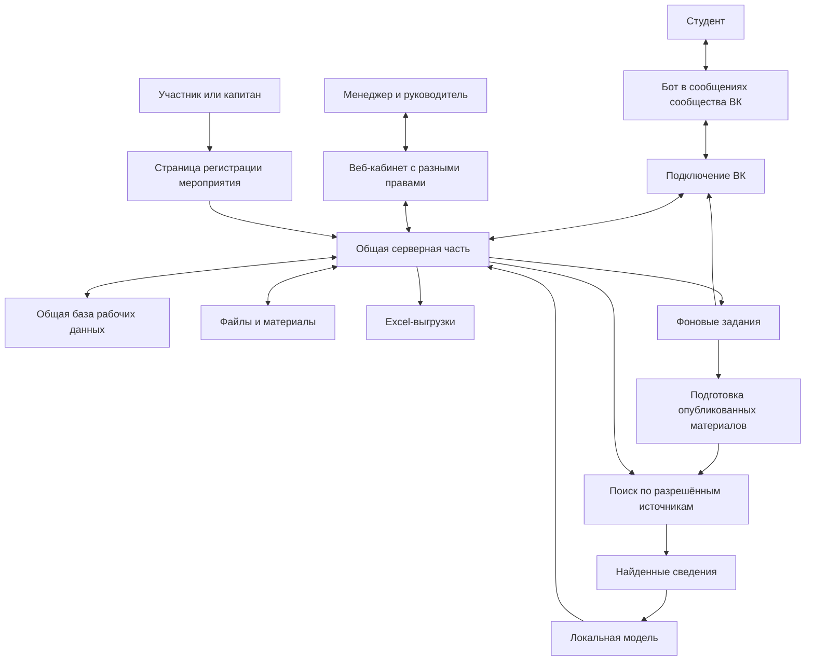
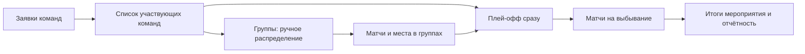

# MVP спортивного портала «Альянс»: единая концепция и план

Документация собрана в `docs/`. [Навигация по материалам](README.md), [технический черновик](design_draft.md), [передача коллегам](ПЕРЕДАЧА.md). Этот файл остаётся единым источником требований MVP; исходные материалы находятся в `research/`. Актуальное упрощение поддержки от 2 ноября — два статуса и отдельный владелец (§3.1); исторические ревью §15–19 и §23 могут содержать прежние формулировки ожидания и не отменяют это решение.

Обновлено: 1 ноября 2026 года.

Документ объединяет назначение продукта, актуальные решения, сценарии, предложения архитектуры, порядок реализации и историю проверок. Это рабочий план, а не готовая спецификация или утверждённое заказчиком техническое задание. Перед подготовкой спецификации начать с раздела 25: он связывает действующие решения, экраны, источники дизайна и проверки. Старые обзоры и предложения правок сохранены как история; их формулировки не заменяют принятые решения в основных разделах. Есть первая запускаемая демонстрация кабинета в apps/frontend; реальных серверных модулей, VK ID, сообщений ВК и модели пока нет. Исходный HTML в корне остаётся визуальным референсом.

## 1. Общая идея и выбранное направление

Создаём единый рабочий инструмент для спортивного клуба университета: бот ВК для студентов и веб-кабинет для менеджеров и руководителя. В кабинете работа разделена на понятные вкладки и карточки: обращения, мероприятия, заявки, составы, занятия, рассылки и отчётность.

Главная связь внутри MVP: полезные действия менеджера одновременно создают сведения для руководителя. Менеджер организует мероприятие, ведёт состав или отмечает посещаемость; руководитель получает актуальные данные, контроль заполнения и отчётность из тех же записей. Повторно заполнять отдельную отчётную базу не требуется.

**Разработку начинаем с бота ВК и поиска ответов по материалам клуба (RAG).** Это первый проверяемый результат — снижение повторяющихся вопросов и передача сложных обращений человеку. Кабинет и остальные рабочие сценарии также входят в полный MVP, реализуясь следующими очередями.

### Сводка функций и их статусы

Включённая функция и выбранная технология её реализации — разные решения. Таблица фиксирует актуальный объём обсуждения, не подтверждая ещё не проведённые эксперименты.

| Часть | Статус | Пользовательский результат |
| --- | --- | --- |
| Бот ВК, RAG и поддержка человеком | В MVP; первая очередь | Ответ по опубликованным материалам клуба либо сохраняемое обращение в общей очереди; менеджер отвечает в тот же диалог |
| Пополнение знаний из поддержки | В MVP; утверждено 1 ноября 2026 года | Из вопроса и выбранного ответа сотрудник создаёт черновик материала; проверка и публикация выполняются вручную |
| Вход сотрудников | В MVP; выбран VK ID с одобрением | До назначения роли рабочие данные закрыты; университетский SSO отложен |
| Мероприятия и заявки | В MVP | Организаторы создают событие, обрабатывают заявки, вручную допускают команды и ведут составы |
| Организаторы мероприятия | В MVP | Один ответственный и помощники с одинаковыми рабочими правами; помощников добавляет/убирает ответственный |
| Составы секций и сборных | В MVP | Заявка в секцию через бота и форму требует ручного одобрения менеджером; после одобрения студент вносится в состав. Менеджер поддерживает актуальность; отбор в сборную происходит вне программы |
| Занятия и посещаемость | В MVP | Разовые и повторяющиеся занятия на выбранный период, отметки ответственным с телефона, история и статистика |
| Рассылки и расписания ВК | В MVP | Выбор аудитории, просмотр и результат отправки; приглашения, расписания команд и секций, напоминания о занятиях |
| Учёт участия и результатов команд | В MVP | Организатор отмечает участие команды; учитывается её полный зарегистрированный состав; итоговый счёт и технический исход без статистики игроков |
| Кабинет руководителя | В MVP | Посещаемость, занятия, события, участники, результаты, актуальные составы и неполные сведения с переходом к деталям |
| Адресные пометки руководителя | В MVP | Сообщение об уточнении сотруднику с важностью и возможной ссылкой на запись; без мессенджера |
| Excel | В MVP | Участники события и посещаемость за период; в файлах листы «Итоги» и «Подробности» |
| Время и площадки турнира | Запрошены для MVP | Дата/время и адрес события, несколько площадок в одном месте, ручное время матча, расчёт последовательных стартов по задаваемым параметрам |
| Группы, плей-офф и автоматические переходы | Расширение обсуждается; границы уточнить до оценки | Визуальное распределение команд предложено пользователем; генерация матчей, правила мест и пересчёт зависимостей описаны как предложения, не как универсальный утверждённый движок |
| Первоначальный перенос контактов из Google Таблицы | Предложение для запуска рассылок | Ограниченный перенос согласованного образца, а не постоянная синхронизация или универсальный импорт |
| Автоматическая отправка с личного VK-аккаунта | Запрос на проверку, не подтверждённая возможность | Исследовать разрешённый способ для приложения проекта; вход VK ID этого права не даёт |

### Основные решения и ограничения

- Данные приложения хранятся в общей базе; Google Таблицы не являются обязательным рабочим слоем. Они остаются существующим источником контактов и возможным источником материалов.
- Для секций выбран путь «бот → форма по ссылке → ручное одобрение менеджером → внесение в состав → подтверждение в ВК». Собственный механизм шаблонов турнирной регистрации остаётся рабочим предложением раздела 3.2; подключать одновременно все способы ввода не требуется.
- Номер студенческого и VK-ссылка обязательны для каждого участника турнирной заявки. Сверка с университетским реестром не входит в MVP; дополнительные поля уточняются по образцу.
- В закрытой тестовой команде у одобренных менеджеров общий рабочий доступ. Административные действия выделены отдельно; после MVP ожидается разграничение.
- Бот и рассылки используют ВК. Telegram не подключается. В выбранной архитектуре бот пишет от имени сообщества.
- Публичный медиасайт, рейтинг и универсальные конструкторы отложены. Команда разработки — три второкурсника, работающие с Codex. Жёсткий календарный срок не установлен; стек, удалённый доступ, доступное время и распределение технических обязанностей уточняются при подготовке первой очереди. Ранее обсуждалась RTX 3060 12 ГБ; фактически доступный компьютер с RTX 3050 8 ГБ указан в §7. Первый пилот планируется на домашнем компьютере пользователя; удалённый доступ, запуск и пригодность под нагрузкой проверяются отдельно.

Набор в сборные происходит примерно раз в год, поэтому он не является основным частым сценарием. Мероприятия, поддержка, актуализация составов и занятия дают более регулярную пользу. Публичный сайт остаётся частью долгосрочного портала.

### Как уточняем и выбираем решения

Пользователь задал общий принцип дальнейшей проработки MVP: сначала сравнивать предлагаемый сценарий с существующими продуктами, перенимать подходящие привычные способы работы и добавлять своё при выявленной необходимости. Этот подход применяется ко всем частям MVP, а не только к поддержке.

Для каждого обсуждаемого блока фиксируем: задачу пользователя; примеры сопоставимых решений со ссылками; что в них подходит нашему университету; ограничения и дополнительную работу; выбранный сценарий и оставшиеся вопросы. Большой обзор рынка на каждую мелкую настройку не нужен: сравниваем существенные решения и спорные места.

Документация подтверждает наличие и правила функции, но сама по себе не доказывает популярность или удобство. Выводы об удобстве должны опираться на доступные наблюдения пользователей и проверку сценария нашими студентами и менеджерами; неподтверждённые оценки явно обозначаем. Конкретный продукт не объявляется подходящим только из-за известности. Собственные дополнения обосновываем особенностями клуба, а не стремлением добавить функций.

## 2. Пользователи и общая структура

| Пользователь | Основные действия |
| --- | --- |
| Студент или участник | Задаёт вопросы в ВК, подаёт заявку через форму регистрации, получает ответ сотрудника и приглашения |
| Менеджер направления или мероприятия | Ведёт материалы бота и обращения, заявки, составы, мероприятия, занятия, рассылки и рабочие выгрузки в пределах своих полномочий |
| Руководитель | Видит направления, составы, итоги и полноту сведений; запрашивает уточнения; формирует сводки и выгрузки |
| Администратор | Управляет доступами и техническими подключениями; может совмещать другую роль |

**Уточнено пользователем:** посещаемость с телефона отмечает назначенный человек, связанный с секцией: тренер, ответственный секции, менеджер или другой уполномоченный сотрудник. Возможность не привязывается исключительно к должности тренера. Для узкого пилота можно использовать менеджерский доступ по выбранному процессу одобрения; отдельная ограниченная роль пока не утверждена.

**Согласовано для закрытого MVP: общее рабочее пространство.** В узкой тестовой команде все одобренные менеджеры могут просматривать и редактировать рабочие данные всех направлений: мероприятия, заявки, составы, занятия и материалы. Вид спорта используется как метка и фильтр, а не ограничение доступа. Это временное правило пилота, а не модель для неограниченного расширения числа сотрудников. После MVP пользователь ожидает разграничение доступа; точные роли, области и сроки перехода ещё определяются.

Административные полномочия остаются отдельными: обычный менеджер не получает автоматически право одобрять сотрудников, назначать роли, отключать аккаунты и менять технические подключения. По ранее согласованному правилу помощников мероприятия добавляет и убирает его ответственный. При общем рабочем доступе список организаторов показывает ответственность и участие в работе, а не служит единственным способом открыть карточку события.

**Задел для последующего разграничения:** рабочие записи связаны с направлением и/или мероприятием там, где это применимо; профиль сотрудника и его метки отделены от назначенных прав. Сервер проверяет разрешения для операций, включая списки, поиск и выгрузки. Для MVP действует общая область доступа клуба, позднее можно вводить назначения по направлениям и мероприятиям через тот же механизм. Пользователи без одобрения и заблокированные сотрудники не входят в общую область. Будущий переход потребует настройки и проверки правил, но не должен начинаться с поиска проверок по всем экранам.

Предлагаются личное авторство изменений и возможность исправить ошибку. Правила удаления отменённого события и редактирования завершённых событий приведены в разделах 3.3 и 3.7; полномочия для остальных потенциально необратимых операций ещё уточняются; общее разрешение на рабочее редактирование не утверждает автоматически бесследное удаление всех данных. Перед расширением пилотной команды нужно пересмотреть область доступа и назначить действующим сотрудникам нужные права; конкретный процесс перехода ещё не утверждён.

Пример общего базового доступа — [права членов организации GitHub](https://docs.github.com/en/organizations/managing-user-access-to-your-organizations-repositories/managing-repository-roles/setting-base-permissions-for-an-organization). Разрешения по обязанностям и серверные проверки описаны в [OWASP Authorization](https://cheatsheetseries.owasp.org/cheatsheets/Authorization_Cheat_Sheet.html). Примеры подтверждают механизмы, а не удобство для нашей команды; источники проверены 31 октября 2026 года.

**Доступ сотрудников.** Пользователь запросил регистрацию менеджеров и других сотрудников внутри веб-приложения. Создание учётной записи само по себе не даёт полномочий менеджера. Добавление помощника к событию и создание сотруднику доступа — связанные, но разные действия.

**Согласованное направление управления доступами:** руководитель или главный менеджер с ролью суперпользователя решает, кому выдать доступ. Список суперпользователей можно расширять по решению руководителя. Это административная роль внутри приложения; она не означает доступ к операционной системе сервера или ключам внешних сервисов.

Утверждено пользователем: первого руководителя назначает разработчик при настройке системы служебной командой на сервере после его входа через VK ID; публичной кнопки для получения руководящих прав нет. Дальнейшая выдача доступов не требует обращения к разработчикам. Не утверждено, что любой суперпользователь может самостоятельно повышать других до своей роли: решение о расширении списка принадлежит руководителю. Уточнено пользователем 1 ноября 2026 года: руководитель обязательно может сам назначать администраторов и может выдать конкретному администратору отдельное разрешение выполнять такие назначения по его решениям. Роль администратора сама по себе этого разрешения не даёт. Разрешение действует до явного отзыва руководителем; отдельное подтверждение каждого назначения в приложении не требуется. После отзыва новые назначения по нему запрещаются, выдача и отзыв сохраняются в истории. Утверждённые границы: только руководитель выдаёт и отзывает дополнительное право назначения; администратор с этим правом может назначать обычных администраторов, но не передавать дополнительное право дальше, менять роль руководителя или блокировать его доступ. Также утверждено: любой администратор одобряет заявки обычных менеджеров и может блокировать их рабочий доступ; снимать административные права или блокировать администраторов может только руководитель, дополнительное право назначения этого не разрешает. Блокировка сохраняет историю и созданные записи, прекращая рабочий доступ. Согласованная административная матрица приведена в §9.12 design_draft.md. Также утверждено восстановление: обычного менеджера разблокирует любой администратор, администратора — только руководитель. Разблокировка возвращает доступ с сохранёнными правами, но не восстанавливает отдельно отозванные роли и разрешения; новый профиль и повторная заявка не нужны. Кто и когда заблокировал и восстановил доступ, сохраняется в истории. Утверждены защита от потери последних действующих руководящих прав и ручное аварийное восстановление: ответственный за сервер после подтверждения личности руководителя связывает новый подтверждённый вход с прежним внутренним профилем, отключает старый вход и сеансы, сохраняет действие в истории. Порядок описан в §9.13 design_draft.md. Точные команды, проверка личности, техническая обработка конкурентных действий и оставшиеся рабочие разрешения ещё требуют проработки.

**Подтверждённое ограничение:** университетский SSO существует, но подключение возможно только после согласования с руководством университета, за пределами MVP. Исследование и получение SSO-доступа не являются условием начала разработки пилота. Для MVP требуется самостоятельное управление аккаунтами и правами сотрудников в нашем приложении; это не означает разработку собственного провайдера единого входа.

Выбранный при этом ограничении сценарий — VK ID для подтверждения входа и локальная заявка с ручным одобрением уполномоченным сотрудником. Университетский SSO рассматривается как последующий дополнительный или заменяющий способ входа. Привязку к существующему внутреннему аккаунту нужно проводить после проверки личности; совпадения имени недостаточно. При переходе не выдавать роль менеджера каждому вошедшему через университетский SSO: существующие права и организационные основания сохраняются отдельно.

**Согласовано для MVP: VK ID и одобрение заявки на доступ.** Пользователь выбрал сценарий: вход через ВК → заявка на доступ → одобрение уполномоченным сотрудником → назначение роли. Коды приглашений и локальные пароли не входят в выбранный основной путь. Подтверждение выбора не означает, что техническое подключение VK ID уже проверено. Требование — минимальная дополнительная работа и возможность последующего подключения университетского SSO.

**Оценка и примеры других сервисов.** В [GitLab Self-Managed](https://docs.gitlab.com/administration/settings/sign_up_restrictions/) есть настройка обязательного одобрения новых зарегистрировавшихся администратором. Это пример входного контроля аккаунтов, а не утверждение о поддержке нашего VK-сценария. В [GitHub Organizations](https://docs.github.com/en/organizations/managing-membership-in-your-organization/inviting-users-to-join-your-organization) используется другой вариант: приглашение уже существующего пользователя в организацию. Оба примера отделяют наличие аккаунта от разрешения пользоваться ресурсами организации. Справки проверены 31 октября 2026 года; популярность продуктов сама по себе не доказывает удобство процедуры для клуба.

По текущим требованиям рекомендуется заявка после входа через VK ID: руководитель одобряет доступ, а не заполняет чужие аккаунты и не восстанавливает их локальные пароли. Механизм подходит для небольшой команды, но при большом количестве сотрудников ручные одобрения могут задерживаться. Увеличение числа студентов в боте не означает такого же роста числа заявок сотрудников: вход в кабинет рассматривается отдельно от регистрации участников мероприятий.

Минимальный объём реализации: проверенный вход VK ID и сессии приложения; локальный профиль; одна активная заявка; список заявок с одобрением и отказом; назначение ролей и направлений; серверная проверка прав; изменение и отзыв доступа с журналом действий. Это отдельная законченная задача разработки, а не добавление одной кнопки. Не требуется строить корпоративный каталог, подключать отдельную платформу управления идентичностью или выдавать всем персональные почтовые ящики. Нагрузка здесь обычная для веб-приложения; точная конфигурация и затраты не измерены. Главный ресурсный риск — корректная реализация и сопровождение доступа, а не размер модели или GPU. Первый технический эксперимент должен проверить вход и возврат из VK ID на реальном адресе проекта; после него можно оценивать трудоёмкость под выбранный стек.

Выбранный путь: вход через VK ID → локальный профиль без прав сотрудника → явная подача заявки с кратким указанием должности и направления → состояние «Ожидает одобрения» → проверка руководителем или уполномоченным администратором → назначение роли → доступ к соответствующим функциям; в закрытом MVP менеджеры имеют общую рабочую область клуба. До одобрения доступны только собственная заявка, её состояние и выход; обращения студентов, документы, составы и рабочие данные недоступны. Простое посещение сайта после входа не создаёт бесконечно повторяющихся заявок.

Вход через ВК подтверждает владение конкретной учётной записью VK ID, но не должность и не принадлежность к клубу. Утверждающий проверяет человека по известному контакту или внутри коллектива, а не только по имени и фотографии профиля. Пользователь не выдаёт себе роль, даже если указывает желаемую должность в заявке. Права назначаются сервером после разрешённого действия администратора. Подход соответствует [OWASP Authorization](https://cheatsheetseries.owasp.org/cheatsheets/Authorization_Cheat_Sheet.html): доступ закрыт по умолчанию, разрешения проверяются на каждом запросе. Источник проверен 31 октября 2026 года.

Для заявки предлагаются состояния: ожидает, одобрена, отклонена. Статус самого сотрудника и блокировка доступа хранятся отдельно: отклонение заявки и увольнение ранее одобренного сотрудника — разные действия. Необходимы ограничение частоты подачи, одна активная заявка на профиль и журнал выдачи/изменения/отзыва ролей. При блокировке уже открытый кабинет теряет доступ к рабочим данным; повторный вход через ВК не снимает блокировку. Утверждено пользователем: после отказа можно самостоятельно повторно подать заявку, снова требующую ручного одобрения; прежний отказ сохраняется в истории, на профиль допускается одна активная заявка. Повторная подача не снимает и не обходит блокировку. Разблокировку менеджера выполняет администратор, администратора — руководитель; сохраняется тот же профиль и неотозванные права, отдельно отозванные полномочия автоматически не возвращаются.

**Задел на развитие:** у человека есть постоянный внутренний идентификатор в базе приложения. Вход через VK ID хранится как отдельная привязка подтверждённого внешнего идентификатора. Организационные роли и доступ к направлениям и мероприятиям задаются отдельно. История действий, авторство материалов, участия и назначения ссылаются на внутреннего пользователя, а не на ссылку ВК или имя. Позднее это позволит добавить другой вход или университетскую учётную запись без переноса всей предметной истории на новый профиль. Добавление провайдера всё равно потребует интеграции и проверки, а смена/объединение привязок — проверки личности; автоматическое объединение по одинаковому имени недопустимо.

Как пример разделения внутреннего пользователя и внешних способов входа, [Auth0 описывает связывание учётных записей разных провайдеров](https://auth0.com/docs/manage-users/user-accounts/user-account-linking/link-user-accounts). Это иллюстрация архитектурного принципа, а не предложение подключить Auth0 или подтверждение наличия в нём нужного VK ID подключения. Для MVP достаточно одного провайдера, нескольких понятных ролей и единого механизма проверок на сервере. Отдельный сервер идентификации и универсальный редактор разрешений сейчас не требуются.

Компромисс: коды и ручное заполнение чужих аккаунтов исчезают, но одобрение каждого нового сотрудника остаётся ручным. При росте команды очередь заявок может стать узким местом. Позднее можно делегировать одобрение уполномоченным сотрудникам или добавить приглашения на той же модели пользователя и ролей. Право назначения суперпользователей по-прежнему принадлежит руководителю; обычное одобрение сотрудника его не подразумевает. Окончательный круг одобряющих и назначаемых ими ролей ещё уточняется.

[Официальный VK ID Web SDK](https://github.com/VKCOM/vkid-web-sdk), проверено 31 октября 2026 года, предоставляет вход и требует регистрации приложения для получения APP_ID. Нужны настройка возврата после входа, серверная проверка результата, привязка идентификатора к локальному профилю и сессии приложения. Прямой портал документации VK ID при предыдущей проверке не открылся; условия конкретного аккаунта и полный вход нужно проверить экспериментом. VK ID не заменяет подключение сообщений сообщества. Обычная веб-авторизация не требует GPU; производительность, сроки разработки и внешние условия не измерены.

**Сохранённые альтернативы:** личный логин/пароль с созданием администратором; самостоятельная регистрация по одноразовому приглашению; приглашение вместе с VK ID. Они пока не реализуются параллельно и не являются обязательным резервным входом. У приглашений есть жизненный цикл и передача кода, у локальных паролей — восстановление доступа. Выбран вход VK ID с одобрением заявки; варианты выше сохранены только для объяснения выбора. Первого руководителя назначает разработчик служебной командой после входа через VK ID, без публичного самостоятельного назначения. Порядок ручного восстановления при потере VK-аккаунта и защита последних руководящих прав согласованы в §9.13 design_draft.md; точные команды и проверки ещё предстоит описать.

Логические части продукта: бот ВК, веб-кабинет сотрудников, общая серверная система, рабочие данные и файлы, поиск по разрешённым материалам и локальная модель. Для пилота выбран домашний ПК пользователя, серверная основа — Django + PostgreSQL, одно приложение с предметными модулями и отдельный процесс локальной модели. Кабинет формируется Django-шаблонами с Tailwind CSS и модульным обычным JavaScript. Для фоновых задач выбран вариант А: задания сохраняются в PostgreSQL и выполняются отдельными процессами приложения. Обработчики работы отделяются от механизма очереди для возможного последующего перехода на Celery + Redis; переход потребует поддерживаемой среды, настройки и проверки ожидающих/выполняемых заданий, повторов и неизвестных исходов отправки (§9.19 design_draft.md). Реализовывать оба механизма в MVP не требуется. Точные процессы, версии и эксплуатационные настройки ещё предстоит закрепить в спецификации.

## 3. Функции MVP

### 3.1. Бот ВК и RAG-поддержка — первая очередь

**Утверждено пользователем 1 ноября 2026 года:** для пилота входящие события сообщества получаем через Bots Long Poll отдельным процессом того же приложения. Получатель отделён от общей обработки, чтобы позднее при необходимости перейти на Callback без переписывания правил поддержки, поиска и очереди менеджеров. Новый Callback-получатель, публичный адрес и контролируемое переключение потребуют отдельной реализации и проверки; делать оба транспорта в MVP не требуется (§9.18 design_draft.md).

**Утверждённая основа поиска:** полнотекстовый поиск PostgreSQL и смысловой поиск через расширение pgvector в той же базе. Отдельный Qdrant рассмотрен как альтернатива, но не входит в выбранный стек MVP. Для первой проверки утверждены multilingual-e5-small на CPU и Qwen3-4B-Instruct-2507 Q4_K_M через llama.cpp на GPU; начальный контекст 4096 токенов и одна одновременно исполняемая генерация (§9.23 design_draft.md). Ревизии артефактов, правила подготовки фрагментов, объединение результатов, остальные параметры и пороги ещё предстоит закрепить и проверить на материалах клуба и доступном ПК. Поиск использует только разрешённые опубликованные сведения; сходство само по себе не доказывает наличие достаточного ответа.

**Согласовано: границы тем бота.** Бот помогает только по вопросам клуба и организации его работы на основе разрешённых материалов. Это не собеседник на любые спортивные темы. Он не составляет личные программы тренировок, не консультирует по лечению травм и не отвечает по существу на посторонние вопросы, например о приготовлении еды. В этих случаях бот кратко объясняет, чем может помочь, без автоматической передачи постороннего вопроса сотрудникам. Предлагаемый текст: «Я помогаю с вопросами нашего спортивного клуба: секциями, мероприятиями, расписанием и правилами участия. По этому вопросу я не могу проконсультировать».

Нужно различать постороннюю тему и вопрос о клубе, на который нет сведений. Во втором случае остаётся передача менеджерам; явно посторонний вопрос предлагается не отправлять в их очередь автоматически. Неясный вопрос требует уточнения контекста, а не отказа только из-за необычных слов. Точный текст, пограничные примеры и способ проверки этого поведения ещё обсуждаются. Нельзя обещать безошибочное соблюдение границ только на основании инструкции модели.

- Ответы по опубликованным материалам о разных задачах клуба, а не только секциях.
- Поиск нужных сведений перед генерацией ответа; уточнение неоднозначных вопросов и указание использованного источника.
- Передача обращения человеку при нехватке или противоречии сведений либо по просьбе пользователя.
- Уведомление ответственного, сохраняемая очередь и история разговора в кабинете.
- Менеджер отвечает из кабинета, студент получает ответ в том же диалоге ВК.
- Во время работы человека самостоятельные ответы AI приостановлены. Завершение обращения и возврат к автоматической обработке должны быть явными.

**Согласованное распределение обращений.** Обращения, переданные ботом человеку, доступны в общей очереди всем менеджерам с доступом к поддержке. Любой из них может взять вопрос, если понимает, что способен ответить, в том числе вопрос по чужому спортивному направлению. За спортом может быть закреплён профильный менеджер, но обращение не блокируется на нём и не требует ожидания его отказа для подхвата другим сотрудником.

Общие вопросы клуба могут подхватывать активные менеджеры, хорошо знающие организацию; отдельная изолированная очередь для них не обязательна. Предлагается использовать тему или вид спорта как метку и фильтр общей очереди. Неизвестная тема не должна препятствовать передаче человеку; уточнение направления нужно только там, где оно помогает ответить.

Менеджер сам нажимает «Взять в работу» и становится ответственным за конкретный диалог. До этого обращение ожидает ответа. Принятие должно исключать одновременное назначение двух сотрудников; остальные видят, что вопрос уже занят. Доступ к поддержке не означает автоматического доступа ко всем остальным модулям и персональным данным приложения.

Пользователь пояснил, что менеджеры видов спорта, вероятно, являются студентами и не всегда могут ответить. **Согласовано:** если взявший обращение менеджер больше не может помочь, в том числе после частичного ответа, он возвращает его в общую очередь с отметкой повышенного приоритета, чтобы его подхватили раньше. История разговора сохраняется; студент продолжает тот же диалог.

Предлагаемые детали возврата: снимается текущий ответственный, добавляется внутренняя причина передачи и отметка «Нужна помощь другого менеджера». Время создания и возраст открытого обращения сохраняются, повторный возврат не создаёт новое обращение и не повышает приоритет бесконечно. Автоматическая передача руководителю не утверждена.

**Уточнение приоритета от 2 ноября 2026 года:** давние открытые обращения автоматически выделяются отметкой «Долго открыто». Считается возраст всей человеческой карточки, а не ожидание ответа менеджера. Команда не знает постоянного графика студенческих менеджеров, поэтому нарушенный срок ответа не вычисляется. Порог подсветки настраивается для пилота; ранее названные 30 минут были предварительным ориентиром другого правила и не считаются утверждённым порогом новой метрики. Подсветка не обещает студенту ответ за заданный срок.

**Согласовано по GF-05: координатор поддержки.** Контроль оставшихся без ответа обращений поручается одному из действующих ответственных менеджеров. Конкретного человека назначает коллектив; отсутствие фамилии сейчас не мешает описать роль. Координатор следит за общей очередью, включая обращения, которые уже взяты, но остались без следующего ответа. Это дополнительная организационная обязанность менеджера, а не новая обязательная должность и не роль суперпользователя.

**Уточнение пользователя от 2 ноября 2026 года: передача и перехват.** Координатор может вернуть зависшее обращение в очередь или передать другому сотруднику без подтверждения прежнего владельца. Дополнительно любой активный менеджер с правами работы в поддержке и доступом к конкретному обращению может явно «Забрать себе» обращение другого менеджера без его согласия. Использование только в критических ситуациях — договорённость команды вне приложения; программа не требует доказательства недоступности, обязательного объяснения, ожидания срока или одобрения координатора. Владельцем остаётся один человек; прежний теряет право отправлять новые ответы, история и личные черновики сохраняются, возраст карточки и важность не сбрасываются, AI остаётся выключенным. В истории фиксируются инициатор, прежний/новый владелец и время. Это право взять себе, а не право обычного менеджера назначать третьего сотрудника или менять настройки координатора. Старое правило об исключительном праве координатора на такую смену владельца заменено этим решением; его обязанности контроля очереди сохраняются. Конкретных людей и интервалы контроля задают перед пилотом. Ответ за 30 минут или автоматическая эскалация не обещаны. Контракты — §14.1–14.2 design_draft.md.

**Рабочее правило контроля очереди — редакция 2 ноября 2026 года.** У человеческого обращения два статуса: «Открыто» и «Закрыто»; ответственный учитывается отдельно. Общая очередь — открытые без владельца, «Мои» — открытые у текущего менеджера; доступные открытые карточки других сотрудников можно просматривать и явно забирать себе. Сообщения менеджера и студента не меняют статус и не требуют промежуточных отметок. Признаков «Ждём менеджера»/«Ждём студента» нет. Длительность считается от создания человеческого обращения и не обнуляется перепиской или сменой назначения. Подсветка называется «Долго открыто», без вывода о просрочке менеджера. Черновик, ошибка и неизвестный исход отправки не выдаются за подтверждённый ответ. Детали — §11.4 и §11.6 design_draft.md. Эта редакция заменяет прежний контроль по стороне ожидания.

**Состояния поддержки — решение пользователя от 2 ноября 2026 года:** только «Открыто» и «Закрыто», владелец отдельно. «В очереди»/«В работе» больше не отдельные статусы. Взятие, возврат и перехват меняют назначение открытой карточки, а закрытие выполняется явно студентом либо менеджером. Для диалога сохраняются автоматический/человеческий режим и версия периода обработки; AI-задачи связаны с разрешившей их версией и конкретным запросом. Старый ответ до передачи человеку не отправляется после закрытия только потому, что автоматическая помощь снова доступна; само закрытие не запускает генерацию (§11.6 design_draft.md).

**Отправка ответа — ручной повтор, решение 2 ноября 2026 года.** При установленной ошибке приложение сохраняет текст, показывает причину и допустимое действие «Повторить»; даже временный сбой не запускает новую отправку автоматически. Повтор выполняет менеджер с действующими правами и актуальным назначением. Он относится к той же логической отправке и её зафиксированному тексту; повторный клик не создаёт дубль. Изменённый текст — отдельное новое сообщение. Если ВК мог принять сообщение, но результат неизвестен, сначала выполняется проверка, а не слепой повтор; неизвестность не выдаётся за недоставку. Автоматическая проверка результата разрешена и не равна автоматической повторной отправке. Правило относится к ответам менеджера, не задавая повторы для всех сообщений бота/рассылок. Статус обращения и возраст от отправки не меняются. Подробности — §14.3 design_draft.md.

Приоритетная отметка содержит причину. При одинаковой важности выше стоят раньше созданные открытые человеческие обращения. Возврат, ответ и перехват не обнуляют возраст и не наращивают приоритет бесконечно. Порог «Долго открыто» уточняется для пилота; график внешних сводок задаётся только при будущем подключении такого канала. Сторона ожидания и отдельные интервалы первого/следующего ответа не управляют текущим списком.

Координатор и назначенный ему на замену менеджер видят общую очередь, могут взять, вернуть или передать вопрос с журналом автора/времени и обновлением единственного ответственного. Автоматическое вытеснение отвечающего сотрудника не требуется. Руководитель назначает исполнителей этой обязанности перед пилотом. На входе в кабинет выделяется необслуженная очередь. Для первого пилота используются внутренние уведомления по §21; если позднее потребуется внешний канал, его сообщения объединяются в сводки без уведомления на каждый вопрос. Если команда недоступна, служебный ответ один раз сообщает: «Вопрос передан менеджерам. Ответ может занять время; повторно отправлять заявку не нужно». Это не возобновляет AI и не обещает точный срок.

Причины важности — «Передано другим менеджером» и «Долго открыто» — отображаются отдельно. Порядок и возраст карточки заданы рабочим правилом выше; повышение важности не гарантирует немедленный ответ.

**ИИ после передачи человеку:** пользователь отдельно подтвердил обязательность прекращения ответов модели. Это правило действует с момента передачи в очередь сотрудников, во время диалога менеджера и при возврате обращения в очередь. Автоматически возобновлять генерацию только потому, что ответственный снят, нельзя. После завершения действует согласованное правило нового обращения; связанное продолжение нерешённого вопроса сразу поступает людям. Пограничные случаи благодарностей и повторных нажатий уточняются отдельно. Служебное подтверждение передачи, если используется, не является ответом модели по существу вопроса.

**Согласовано: завершение обращения.** Студент подтверждает, что вопрос решён, в том же диалоге ВК. Для этого предлагается явное действие «Вопрос решён»; конкретный способ его отображения нужно проверить при подключении ВК. Менеджер также может завершить обращение, если студент забыл это сделать. Обязательный срок ожидания подтверждения и автоматическое закрытие не утверждены. Уточнение 2 ноября: если ответ не отправлен, ещё отправляется или результат неизвестен, менеджер может закрыть карточку после явного предупреждения и подтверждения. Предупреждение честно показывает состояние, подтверждение сохраняется в истории и не считается успешной отправкой или решением, подтверждённым студентом. Неначатые старые задания отменяются, уже начатый вызов не обещается отозвать; поздний результат не открывает карточку заново. Черновики и история не удаляются, обязательного комментария нет (§14.4 design_draft.md).

При завершении сохраняются история и отметка, кто закрыл обращение — студент или менеджер. Закрытие сотрудником не учитывается как подтверждение удовлетворённости студентом. Предлагается сделать закрытие доступным студенту только для своего активного обращения, а действие менеджера выполнять с проверкой полномочий и сохранением автора. Способ отображения действия завершения и обработка пограничных сообщений уточняются; основной порядок нового обращения после закрытия уже выбран ниже.

**Согласовано: сообщение после закрытия начинает новое обращение.** Единого отраслевого правила нет. [Intercom](https://www.intercom.com/help/en/articles/8363763-close-a-conversation) описывает автоматическое повторное открытие при ответе клиента. [Usedesk, управление чатом](https://docs.usedesk.ru/article/850) описывает создание нового запроса при сообщении после закрытия чата; это пример онлайн-чата, не подтверждение идентичного поведения канала ВК. [Zendesk, follow-up tickets](https://support.zendesk.com/hc/en-us/articles/8421655952026-Understanding-follow-up-tickets) описывает новый запрос со ссылкой на закрытый. Отдельная [статья Zendesk о messaging](https://support.zendesk.com/hc/en-us/articles/5417918886426-What-happens-when-a-user-replies-in-messaging-and-the-ticket-is-closed) также описывает новый связанный запрос с возвратом к AI, но относится к legacy-функциональности; её нельзя выдавать за универсальное правило всех актуальных конфигураций Zendesk. Источники проверены 31 октября 2026 года.

Пользователь согласовал для MVP по умолчанию начинать новый цикл после закрытия, сохраняя старое обращение в истории. Это заменяет прежнее предложение обязательно спрашивать при каждом новом сообщении, продолжает ли студент прежний вопрос. Новая запись не требует смены диалога ВК, повторного представления и создания менеджером карточки вручную.

Новая тема может проходить обычный путь через бота. Если студент явно сообщает, что прежний вопрос не решён, или просит сотрудника, создаётся связанное продолжение в общей очереди людей с доступной прежней перепиской, без обязательного повторного прохождения AI. Утверждены явные действия «Вопрос решён», «Позвать менеджера» и «Вопрос не решён» после закрытия; каждое относится к конкретному вопросу/обращению, старое нажатие не меняет новый вопрос. Точные события и отображение в ВК ещё предстоит описать (§10.7 design_draft.md). Пока обращение у людей активно, новые сообщения относятся к нему и AI остаётся выключенным.

**Утверждено пользователем 1 ноября 2026 года:** в автоматическом режиме несколько сообщений до ответа объединяются, если по контексту являются частями или уточнениями одного вопроса. Соседство по времени само по себе не является основанием. Все исходные сообщения сохраняются; самостоятельная новая тема не подменяет и не отменяет прежний неотвеченный вопрос. Явное исправление обновляет конкретный запрос, устаревший результат проверяется перед отправкой. Механизм определения связи и временные границы ещё предстоит закрепить (§10.3 design_draft.md). Для нескольких самостоятельных вопросов пользователь выбрал критерий скорости: один общий либо отдельные ответы выбираются по измеренному полному времени при сохранении качества и ответов на все вопросы. Количество вызовов модели и количество сообщений ВК сравниваются отдельно; победитель пока не измерен (§10.4 design_draft.md). Это не меняет правило одного активного человеческого обращения в диалоге.

**Утверждён частичный ответ:** если достаточные сведения есть только для части вопроса/набора вопросов, бот сообщает достоверную часть и передаёт оставшееся менеджеру. Менеджер видит полную историю, уже отправленный ответ с фактическим состоянием отправки и нерешённые вопросы. Частичный ответ не означает полного решения. После передачи AI прекращает самостоятельные ответы, включая ожидание назначения; запоздалый проект не отправляется вопреки этому режиму. Технический порядок отправки и передачи, ошибки и временные пределы ещё предстоит описать (§10.5 design_draft.md).

**Черновики ответов — утверждено пользователем:** текст ответа менеджера автоматически сохраняется на сервере с привязкой к автору и конкретному обращению, без признака промежуточного сообщения (отменён 2 ноября, §11.4 design_draft.md). Автор может продолжить после перезагрузки или с другого устройства; черновик не отправляется автоматически и не становится общим текстом всех сотрудников. Интерфейс показывает подтверждённую сохранность текущей версии, ошибки и конфликты двух устройств не должны молча терять ввод. Переназначение не даёт прежнему владельцу право отправить сохранённый текст; позднее подтверждение отправки не удаляет новые правки. Точные поля, интервалы и хранение описываются в §11.5 design_draft.md. Пример с другой тренировочной группой не соответствует устройству клуба и не вводит такой сценарий в MVP.

**Вложения поддержки — утверждено пользователем:** в MVP автоматическая обработка ограничена текстом. На голосовое, фото или документ без достаточного текста бот просит описать вопрос текстом и предлагает позвать менеджера, не заявляя, что распознал вложение. При передаче человеку вложения доступны в переписке кабинета; во время активной человеческой поддержки новые вложения добавляются в то же обращение без включения AI. Автоматическое распознавание речи/изображений отложено. Вложения не публикуются в базе знаний автоматически. Реальные поддерживаемые типы, получение, защищённое хранение/ссылки и ограничения ещё предстоит описать и проверить (§10.6 design_draft.md).

Уведомление о закрытии и подтверждения нажатий не должны безусловно порождать рабочую задачу менеджеру. Утверждено: отдельные «Спасибо»/«Понятно» после закрытия сохраняются в истории без нового обращения или генерации. Сообщение с явным нерешённым продолжением передаётся людям со связью с прежним обращением; новая тема начинает новый цикл. Оценивается смысл всего сообщения, не отдельное слово. Повторы действий не создают дубли, старые кнопки не применяются к новому вопросу (§10.7 design_draft.md). Повторное обращение по нерешённому вопросу важно отличать от новой темы в отчётности. Утверждено логическое разделение: постоянный диалог и сообщения, запросы автоматической обработки, отдельные обращения менеджеру при передаче; рабочая очередь содержит только требующее человека (§11 design_draft.md). Актуальные состояния утверждены 2 ноября в §11.6 design_draft.md: «Открыто» и «Закрыто», владелец отдельно; сторона ожидания отменена. Точные поля и обработку событий ещё нужно определить. Просмотр ответов бота обязателен для пилота: в кабинете нужен отдельный журнал автоматических ответов с вопросом, отправленным текстом, временем/состоянием и использованными источниками, доступный без создания человеческой задачи (§10.8 design_draft.md). Также утверждена отметка «Есть проблема» с необязательным комментарием: она связана с конкретным ответом, сохраняет автора и время для разбора ошибок. Уже отправленный текст не переписывается, человеческое обращение или обучение модели автоматически не запускаются (§10.8 design_draft.md).

**Подключение менеджера — утверждено пользователем:** из журнала/переписки менеджер может явно подключиться к активному автоматическому диалогу. Создаётся человеческое обращение, сразу назначенное ему, сохраняются вопросы и история; самостоятельные ответы AI прекращаются. Если обращение уже ведёт другой сотрудник, обычное подключение не обходит владельца: для смены назначения менеджер явно выбирает «Забрать себе» по правилу от 2 ноября 2026 года. Конкурирующие действия дают одно активное обращение и одного владельца. Причина ручного подключения фиксируется отдельно от просьбы студента. Отметка проблемы сама по себе диалог не переключает; исправление отправляется новым сообщением менеджера (§10.9 design_draft.md).

**Отложенное дополнение — уведомления при закрытом кабинете:** внешние сводки не являются условием начала пилота (§21). пользователь требует объединять уведомления и не отвлекать менеджеров сообщением на каждый вопрос, в том числе во время занятий. Электронная почта предложена пользователем как возможный канал, окончательно не выбрана. Рабочее предложение — периодическая сводка о требующих внимания обращениях: сколько не взято, сколько долго остаются открытыми, сколько возвращено, ссылка на очередь. Категории могут пересекаться; их числа не следует складывать в общий итог без устранения повторов.

Если внешний канал будет введён, предлагается отправлять сводку только при наличии обращений, требующих действий, без переписки и персональных сведений участников в тексте. Учитывать состояние очереди на момент отправки, заданные часы уведомлений и ограничение повторных напоминаний об одной и той же ситуации. График, получатели, часовой пояс, интервал и правила повторов ещё согласуются. В кабинете предлагается постоянная индикация числа ожидающих и важных обращений. Канал уведомлений не меняет правил общей очереди и сам по себе не назначает ответственного.

**Дизайн кабинета:** пользователь попросил отдельно обсудить внешний вид и удобство работы. Ранее предложенные вкладки и расположение элементов остаются гипотезой; макет и эргономика ещё не утверждены.

**Утверждено 1 ноября 2026 года: пополнение базы знаний из обращений.** В кабинете можно отобрать вопросы, переданные человеку из-за нехватки сведений. Сотрудник с правами управления материалами может из обращения создать черновик на основе вопроса и выбранного ответа менеджера. Он проверяет факты, убирает личные данные и частные обстоятельства, при необходимости обновляет существующий материал вместо создания дубля. Только отдельная ручная публикация делает материал доступным боту. Связь с исходным обращением видна сотрудникам с соответствующими правами; опубликованный материал не раскрывает саму переписку. Создание черновика не изменяет отправленные сообщения, не переключает режим поддержки и не является условием закрытия обращения. Автоматическое обучение или публикация переписки не предусмотрены. Подробности и проверки — §12.4 design_draft.md.

Менеджер самостоятельно загружает, проверяет, публикует и заменяет материалы. У материала есть ответственное лицо и версия; ошибка обработки видна. Загруженный файл не считается автоматически опубликованным. При обновлении старые сведения должны переставать участвовать в действующем поиске.

**Согласовано: права публикации и актуальность.** Все сотрудники с доступом к кабинету поддержки, включая менеджеров и руководящие роли, могут загружать и публиковать материалы для бота. Например, организатор может добавить регламент своего локального турнира. Отдельное обязательное согласование публикации руководителем не требуется. Проверка извлечения текста и явное разрешение использовать материал остаются частью предложенного процесса подготовки источника.

Ответственность за своевременное обновление материалов распределяется внутри коллектива вне программы. В MVP не добавляются обязательные сроки пересмотра, автоматическое согласование, санкции или специальный процесс контроля актуальности. Упоминание ответственного лица означает организационную принадлежность материала, а не автоматическое назначение задачи на пересмотр. Предлагается сохранять автора загрузки и публикации, время изменения и версию, чтобы сотрудники могли разобраться в происхождении сведений. Техническая ошибка обработки остаётся видимой; это отдельно от проверки актуальности содержания.

Открытый случай: два опубликованных материала могут противоречить друг другу. Право публикации всеми сотрудниками не определяет, какой источник важнее. Правила замены прежней версии, принадлежности регламента конкретному мероприятию и ответа при конфликте ещё уточняются; более поздняя загрузка сама по себе не доказывает, что материал отменяет все предыдущие правила.

**Предварительная организация материалов:** пользователь поддержал идею привязывать источник к определённому виду спорта, но не подтвердил достаточность схемы «клуб / вид спорта / мероприятие». В базе ожидаются разнообразные организационные сведения, а не только регламенты. До получения материалов это возможные области применения источника, а не окончательная иерархия разделов. Тема документа и область его действия могут отличаться. Отдельные типы материалов, обязательность привязки, связь с несколькими направлениями и правила приоритета источников ещё не выбраны. Нельзя выводить из общей привязки к спорту, что любой связанный документ автоматически важнее общеклубного. Предлагается вернуться к этим решениям после просмотра первых образцов, не требуя от пользователя заранее перечислять неизвестное содержание.

**Состояние исходных материалов:** пользователь пока не получил их от руководителя, хотя уже запросил. Предположительно это преимущественно текстовые документы, в том числе PDF и Google Таблицы; изображения не ожидаются в существенном количестве. Ни точный состав, ни качество, ни актуальность файлов не подтверждены. До получения образцов не обещаем обработку любых форматов и не считаем материалы готовой базой знаний.

Предлагаемый путь: загрузить материал → получить извлечённый текст и статус обработки → проверить содержание → разрешить использование ботом. При ошибке или пустом результате материал не публикуется автоматически. Для первой проверки предлагаются текстовые PDF, DOCX и ввод обычного текста. Уточнение пользователя от 1 ноября 2026 года: нужна также загрузка Excel и Google Таблиц как источников знаний для бота. Конкретные расширения Excel, ограничения обработки и пригодность извлечения определяются по реальным примерам; начальный кандидат — XLSX. Пользователь выбрал прямое подключение Google Таблиц по ссылке при разумном объёме реализации MVP (§9.14–9.15 design_draft.md). Утверждены чтение через служебный аккаунт приложения и ручное обновление кнопкой «Обновить из Google». Владелец предоставляет служебному аккаунту доступ «Читатель», менеджер добавляет ссылку; новая или обновлённая версия проходит проверку и отдельную публикацию. До публикации новой версии бот использует прежнюю. При потере доступа к Google Таблице материал снимается только вручную: ошибка очередного обновления видна сотруднику, а опубликованная локальная копия остаётся доступной боту до ручного снятия или публикации подготовленной замены. История сохраняется, восстановление Google-доступа само по себе не публикует и не обновляет материал (§9.15 design_draft.md). Персональный Google-вход каждого менеджера и автоматическая синхронизация не входят в выбранный путь; доступ по реальной таблице ещё не проверен. Для Excel и Google Таблиц утверждён выбор листов и столбцов с предварительным просмотром перед публикацией (§9.16 design_draft.md). При обновлении сохраняется выбор, новые столбцы автоматически не включаются, неоднозначное изменение структуры требует проверки менеджера. Точный интерфейс и технические ограничения ещё предстоит описать. Распознавание сканов и изображений пока не добавляется в обязательный MVP. Загрузка таблиц в базу знаний не возвращает обязательную интеграцию Google в рабочие процессы и не означает автоматический импорт заявок/составов; внутренние списки и произвольные данные не публикуются автоматически.

Пример для сравнения: [Intercom: загрузка и управление документами](https://www.intercom.com/help/en/articles/8124534-upload-and-manage-documents), проверено 31 октября 2026 года. Система описывает загрузку PDF/DOCX, обработку, замену и отдельное включение источника для AI; текстовый PDF отличается от скана. Для нашего проекта предлагается дополнить этот подход просмотром извлечённого текста перед публикацией. Это проектное предложение, а не утверждение о точно таком же интерфейсе Intercom. Наличие этой функции у продукта не является проверкой наших документов.

Внутренние списки людей, служебные заметки и переписка не попадают в студенческую базу автоматически. Обращения с неизвестной темой поступают в общую очередь менеджеров по согласованному правилу. Канал уведомлений при закрытом кабинете, режим работы сотрудников и поддерживаемые форматы файлов ещё уточняются.

**Стартовая модель ответа, утверждённая для испытания:** Qwen3-4B-Instruct-2507, GGUF Q4_K_M, локальный сервер llama.cpp с GPU-ускорением. Фактический ПК пилота — i3-12100F, около 16 ГБ RAM и RTX 3050 8 ГБ; прежняя RTX 3060 12 ГБ была ориентиром до уточнения оборудования. Пользователь утвердил llama.cpp/llama-server как программу запуска модели ответа (§9.21 design_draft.md). Модель и формат утверждены для первой проверки в связке с multilingual-e5-small на CPU (§9.23 design_draft.md). Это ещё не измеренная производственная конфигурация; конкретная сборка, ревизии весов и параметры должны быть закреплены и проверены на фактическом ПК. Цель — полный короткий содержательный ответ во ВК за 4–5 секунд при согласованных условиях нагрузки. Гарантии такой задержки пока нет.

Для первичного измерения предлагаются постоянно загруженная модель, краткий найденный контекст и ответы около 100–150 токенов. Проверять нужно правильность русскоязычных ответов, передачу человеку и весь путь до сообщения ВК при одиночных и параллельных запросах. Сокращение ответа не должно удалять существенные условия.

Источники рекомендации: [оригинальная модель](https://huggingface.co/Qwen/Qwen3-4B-Instruct-2507), [квантованные сборки Unsloth](https://huggingface.co/unsloth/Qwen3-4B-Instruct-2507-GGUF/tree/main), [llama.cpp](https://github.com/ggml-org/llama.cpp). Качество и скорость выбранного формата проверяются на материалах клуба.

### 3.2. Регистрация: единый механизм и формы мероприятий

**Предлагаемый процесс регистрации; окончательный выбор ещё открыт.** Пользователь разрешил проектировать новый процесс вместо копирования существующего. Яндекс Формы применяются по привычке; обязательного требования сохранить их нет. По описанию пользователя, сегодня человек заполняет форму, после чего сведения попадают менеджерам в Google Таблицу; детали переноса и полей пока неизвестны.

Предлагается собственная страница регистрации для каждого мероприятия, создаваемая из его настроек одним общим механизмом. Одна система не означает одну анкету с вопросами обо всех видах спорта. Каждая ссылка заранее определяет мероприятие; студенту не приходится выбирать его из общего списка и повторять название или дату. Одна общая ссылка с выбором события возможна позднее, но каталог не нужен для первого выпуска.

#### Путь менеджера

1. Создать мероприятие: название, вид спорта, дата, место и ответственный.
2. Выбрать шаблон участия и срок регистрации. Настроить применимые параметры: допустимый размер команды или категории участия. Не добавлять произвольные вопросы и сложные условия в первом выпуске.
3. Проверить предварительный вид формы и опубликовать регистрацию. Получить ссылку для ВК и других каналов.
4. Работать с поступающими заявками в карточке события: уточнять сведения, обрабатывать отмены и при необходимости подтверждать участие.
5. После события отметить фактическое участие и результаты. Руководитель получает эти записи в сводках, обе роли могут выгрузить доступный им список в Excel.

#### Путь участника

Открыть ссылку → увидеть событие и условия → заполнить подходящую форму → проверить введённое → отправить → получить подтверждение сохранения и способ вернуться к заявке. Отправка заявки на турнир не равна допуску: допуск вручную подтверждает организатор. Возврат и привязка к заявителю определены единым правилом GF-04 в разделе 4; отдельный большой кабинет студента не требуется.

#### Предлагаемые шаблоны

| Шаблон | Что вводится | Пример |
| --- | --- | --- |
| Индивидуальный | Сведения участника, контакт для связи, категория из заданного списка при необходимости | Личное соревнование по настольному теннису |
| Командный | Название команды, ответственный и состав из отдельных участников | Турнир по волейболу |

Пользователь подтвердил обязательные сведения для каждого участника заявки: номер студенческого билета и ссылка на профиль ВК, включая всех игроков командной заявки. ФИО и учебная группа остаются предлагаемыми общими полями; окончательный набор уточняется.

Номер студенческого вводится текстом с сохранением начальных нулей; фото документа не запрашивается по умолчанию.

Пользователь не уверен, что номера сейчас проверяются; предположительно их только собирают. Подтверждённого процесса сверки с университетской базой нет. Для MVP предлагается собирать номер с проверкой обязательного заполнения, без автоматической проверки статуса студента. Формат номера уточняется по образцам, чтобы не отклонять допустимые значения. Система не отмечает студента как проверенного только на основании введённого номера. Проверка заполнения и формата не доказывает подлинность номера или принадлежность профиля.

Номер может помогать искать совпадения, но не является паролем и сам по себе не разрешает доступ к чужой записи.

Ссылка на ВК не означает, что бот может отправлять этому человеку сообщения. Эти сведения доступны сотрудникам в пределах полномочий; включение их в Excel определяется отдельно по назначению выгрузки.

Спорт и формат регистрации — разные настройки: один вид спорта может иметь личные и командные соревнования. Командную заявку ведёт капитан по выбранному сценарию; организационный порядок передачи сведений игроков и точные поля формы ещё нужно проверить на пилоте. Индивидуальный поиск команды и сбор команды через приглашения не включаются автоматически.

Повторно использовать персональные сведения можно после надёжного сопоставления человека. Совпадения ФИО недостаточно. Автозаполнение после подтверждения связи может использоваться; обязательный способ входа через отдельный VK ID для каждого игрока не вводится: участнический путь идёт через бота по GF-04. Посетитель формы не получает доступ к чужим заявкам.

#### Границы и проверка

Сервер проверяет событие, открытый срок регистрации, обязательные поля и правила выбранного шаблона. Повторная отправка не создаёт дубликат заявки. Изменение шаблона после первых заявок не должно молча менять смысл уже собранных сведений; для пилота предлагается блокировать смену формата участия после появления заявок. Отмена сохраняется в истории. Для исправлений и повторного вступления нужны явные правила.

Форма сохраняет заявку непосредственно через сервер в общую базу. ВК служит каналом приглашения и поддержки и может направлять на ссылку; генеративная модель не заполняет обязательные поля от имени человека. Это небольшая публичная страница регистрации, а не отложенный медиасайт. Оба шаблона предложены для обсуждения; первый законченный путь можно реализовать на индивидуальном шаблоне, затем проверить командный.

Главный довод против собственной формы — дополнительная разработка, проверка ввода, защита от повторов и сопровождение внешнего доступа. Для неё не требуется GPU, но доступность сервера и совместная нагрузка с моделью ещё не проверены. Создание произвольного конструктора анкет для любых соревнований существенно расширило бы MVP; вместо этого предлагается ограничить поддерживаемые форматы и явно показывать неподдерживаемые случаи.

Альтернатива — сохранить Яндекс Формы как средство ввода. [Документация Яндекс Форм](https://yandex.ru/support/forms/ru/send-request), проверенная 31 октября 2026 года, описывает передачу ответов HTTP-запросом без Google Таблиц и требование IPv6 для этого способа. Подключение на аккаунте клуба не проверено. Собственная форма, интеграция Яндекса и пошаговая анкета в переписке не являются тремя обязательными реализациями MVP: после согласования выбирается основной вход. Текущее предложение — собственная форма; Яндекс остаётся альтернативой, а не обязательной интеграцией.

#### Командная заявка через капитана: предложение

Пользователь подтвердил: сейчас регистрацию команд ведут капитаны, но процесс разрешено менять. Предлагается оставить капитана ответственным за одну командную заявку. Менять распределение ответственности без выявленной проблемы не требуется; удобство достигается сохранением черновика, понятным списком игроков и исправлениями в той же заявке.

1. Капитан открывает страницу конкретного события, указывает название команды и свои контактные сведения.
2. Добавляет игроков отдельными строками с необходимыми полями, включая номер студенческого и ссылку на ВК каждого игрока, а не одним свободным текстом. Если сам играет, явно включает себя в состав: контактное лицо не считается участником автоматически.
3. Сохраняет черновик и возвращается к нему через защищённый доступ. Используется единый путь из бота по GF-04; публичная ссылка на событие не даёт права редактировать заявку.
4. Перед отправкой видит недостающие поля и нарушения заданного размера команды. После отправки получает подтверждение получения, которое отличается от допуска к соревнованию.
5. Менеджер видит одну заявку команды с отдельными записями игроков и контактом капитана. При необходимости возвращает её на уточнение с конкретным замечанием; капитан исправляет эту же заявку.
6. После допуска и до начала турнира капитан сообщает менеджеру нужные изменения, менеджер меняет состав в той же заявке/команде. Новая заявка не создаётся. Капитан самостоятельно редактирует черновик и заявку, возвращённую на уточнение; после отправки изменения вносит менеджер либо возвращает эту же заявку на исправление. С начала турнира состав фиксируется по правилу §3.3 и больше не меняется.

Предлагаемые состояния: черновик, отправлена, требует уточнения, принята, отклонена, отменена. Черновик не входит в число поданных заявок. Пользователь согласовал ручной допуск организатором для турнира; автоматическая проверка заполнения не заменяет это решение и не доказывает соответствия всем правилам соревнования.

Для первого пилота предлагается не требовать отдельной регистрации и нажатия подтверждения каждым игроком: это создаёт зависимость подачи команды от действий всех её участников. Недостаток — возможные ошибки и устаревшие сведения, введённые капитаном. Помогают просмотр состава, исправления и проверка менеджером, но они не заменяют личное подтверждение там, где оно действительно требуется. Правила допустимости подачи сведений за участников нужно согласовать с организаторами. Приглашения игрокам для самостоятельного заполнения и подтверждения можно рассмотреть позже по выявленной потребности.

Менеджер получает готовый структурированный список без переписывания. Руководитель видит раздельно число команд, заявленных игроков и фактических участников; один капитан не создаёт дополнительного участника. Состав заявки на турнир не меняет автоматически постоянный состав секции. При последующем повторном использовании команды нужен отдельный снимок состава на новое событие, чтобы не менять историю старого.

Ручное одобрение заявки организатором согласовано; основания отказа и порядок уточнений ещё детализируются. Заявка в секцию остаётся отдельным назначением регистрации, её правила не следует автоматически приравнивать к правилам турнира. Описанный путь является предложением, а не уже согласованным набором функций.

### 3.3. Мероприятия: создание, участники и итоги

**Количество мест — уточнение пользователя.** Число команд/заявок не ограничивается квотой мест: регистрацию не закрывают из-за достижения заданного количества. Приём определяется сроком регистрации и ручным решением о допуске, а не конкурсом за ограниченные места. Размер состава одной команды, если он задан регламентом, остаётся отдельной проверкой. Числа команд в прототипе — примеры, не продуктовый лимит. Сетка формируется по фактически допущенным командам в поддерживаемом формате; отсутствие квоты не означает обещание неограниченной технической производительности или универсального автоматического движка.

**Закрытие регистрации — уточнение пользователя.** Менеджер задаёт дату и время окончания приёма заявок для конкретного мероприятия. В интерфейсе явно указан часовой пояс мероприятия. С наступлением дедлайна новые заявки не принимаются; закрытие применяется сервером и к форме, открытой заранее. Несданный черновик не считается поданной вовремя заявкой. Пользователь видит сообщение о завершении регистрации, а менеджер — статус «Регистрация закрыта».

Рабочее разделение этапов: дедлайн закрывает новые подачи, а не удаляет полученные заявки и не означает начало турнира. Проверка, решение о допуске и исправление ранее полученных заявок продолжаются по действующим правилам до начала турнира; после подтверждённого начала составы фиксируются. Точная механика открытия регистрации и изменения дедлайна уточняется в спецификации. Автоматический допуск по дедлайну не вводится.

**Команда мероприятия — уточнение на примере баскетбола.** Пользователь описал одного основного ответственного, назначаемого внутри организации: обычно это менеджер секции, который собирает заявки, формирует расписание и ведёт подготовку. У него могут быть помощники; их число не ограничивается правилом «один или два». Назначение внутри коллектива не требует отдельной системы голосования или согласования в продукте.

В карточке хранятся один ответственный и список помощников с собственными доступами к этому мероприятию. **Уточнение пользователя:** статус ответственного преимущественно нужен администрации университета; выраженная субординация организаторов не требуется. Для MVP принимается одинаковый набор рабочих прав ответственного и помощников в рамках назначенного мероприятия: работа с настройками события, заявками, участниками и результатами. Отдельного обязательного утверждения действий помощника ответственным не вводим. Статус ответственного не означает, что он единственный может редактировать карточку. **Согласовано:** создавать мероприятия могут менеджеры секций и все вышестоящие должности. Конкретное соответствие должностей ролям приложения ещё определяется; право создания не означает автоматически право редактировать все чужие мероприятия. **Согласовано:** добавлять и убирать помощников может ответственный за мероприятие. Это отдельное полномочие по управлению командой; одинаковые рабочие права помощников не включают изменение списка организаторов. Назначение и смена ответственного и потенциально необратимые действия ещё уточняются. В закрытом MVP действует согласованный общий рабочий доступ менеджеров; ограничение только назначенными мероприятиями отложено до будущего разграничения. Предлагается сохранять автора изменений независимо от формального статуса, чтобы разбирать ошибки совместной работы.

Пример для сравнения: [Eventbrite: управление ролями и доступом команды](https://www.eventbrite.co.uk/help/en-gb/articles/509534/how-to-manage-roles-and-permissions/), проверено 31 октября 2026 года. В справке описаны отдельные учётные записи сотрудников и роли с разрешениями. Для нашего MVP используем принцип личных доступов; различающиеся права организаторов не переносим, поскольку пользователь предпочёл равноправную совместную работу. Сложный редактор ролей не требуется. Роль владельца организации Eventbrite не приравнивается к нашему ответственному за событие; удобство решения для клуба не проверено.

Упоминание пользователем расписания турнира фиксирует реальную задачу организатора, но ещё не включает автоматическое построение матчей в MVP. Нужно отдельно определить минимальную работу с расписанием игр. Оно отличается от уже включённого расписания занятий секций. Ранее сетки были отложены; пользователь теперь предложил добавить конструктор групп и плей-офф. Объём расширения обсуждается в разделе 14 и пока не утверждён окончательно.

Менеджер создаёт событие с помощью ограниченного конструктора: название, вид спорта из справочника, дата и время начала, место проведения с адресом, ответственное направление и регистрация. Время мероприятия и адрес явно запрошены пользователем. Время каждого матча задаётся отдельно и отображается в конструкторе; ограниченный расчёт последовательных стартов описан в разделе 14. Необходимые для сводки сведения об организаторе, уровне и характере участия клуба уточняются по реальному отчёту.

В карточке автоматически собираются заявки. Менеджер ищет участников, исправляет ошибки, обрабатывает изменения и отмены, использует готовый список в организации события. **Согласовано для турниров:** организатор просматривает список заявок и вручную допускает команды. Только допущенные команды доступны для включения в сетку. Допуск вправе выполнять ответственный и помощники мероприятия в рамках уже согласованных одинаковых рабочих полномочий.

Предлагаемый интерфейс — просмотр состава и действие «Допустить»; для удобства можно отметить несколько заявок и применить действие к выбранным. Массовое одобрение — предложение, а не замена проверки организатором. В списке различаются ожидающие, допущенные и отклонённые заявки; уточнения и отмены сохраняются отдельными состояниями по согласованному процессу. Записываются автор и время допуска. Капитану нужно показывать, что заявка получена, но до одобрения участие ещё не подтверждено. Способ уведомления о решении пока не выбран.

**Формальная проверка заявки — дополнение пользователя.** Система проверяет соответствие заданной форме и заполнение обязательных полей, помечая заявку как потенциально допустимую. Предлагаемая подпись «Формальная проверка пройдена» точнее, чем «Допущена»: система не подтверждает действительность номера студенческого или фактическое право человека играть. Дополнительно предлагается проверять число игроков по настройкам турнира, корректность формата контакта и повторы в одном составе; точные ограничения ещё утверждаются. Показывать конкретные недостающие/ошибочные поля. Эти же проверки применяются после правок менеджером. Автоматическая проверка и ручной статус допуска хранятся отдельно.

**Согласовано: замена после допуска возможна только до начала турнира.** Капитан сообщает менеджеру, какие изменения нужны; менеджер редактирует существующую команду в системе. Новая заявка не подаётся. Интерфейс: список команд события → карточка команды → список игроков → добавить или убрать участника. С начала турнира эти действия для состава недоступны и на сервере. Под «конструктором состава» понимаются простые действия над списком, без обязательного свободного холста.

**Отказ команды от участия — уточнение пользователя.** Капитан должен иметь возможность сообщить об отказе через бота; в кабинете организаторов видно, что команда отказалась. Хотя пользователь назвал действие удалением заявки, требуется сохранить видимое состояние отказа, а не бесследно уничтожать запись.

Предлагаемый основной путь: капитан открывает свою заявку через бота → выбирает «Отказаться от участия» → видит подтверждение с названием турнира и команды → подтверждает. Заявка получает статус «Отказалась от участия» с автором и временем действия; организаторам показывается уведомление/изменение в списке. Создание дополнительного обращения поддержки для типового отказа не требуется. Свободное сообщение в поддержку остаётся способом получить помощь, но AI не снимает команду по догадке из переписки без явного подтверждённого действия.

Отказываться от команды может связанный с заявкой капитан, не любой игрок или обладатель публичной ссылки события. Связь подтверждается единым участническим доступом GF-04 из раздела 4. Менеджер также должен иметь возможность зафиксировать отказ, полученный от капитана вне этого действия. Конкретные способы уведомления организаторов ещё согласуются; факт отказа сохраняется независимо от доставки сообщения.

Отказавшаяся команда не попадает в новую расстановку как активная и не считается участвовавшей без отдельного подтверждения фактов организатором. **Дополнение пользователя:** если отказавшаяся команда уже включена в сетку, ей засчитываются технические поражения вместо перестройки сетки. Сыгранные матчи сохраняют прежние результаты. Технические поражения относятся к оставшимся назначенным играм, которые команда должна была проводить; не создавать вымышленные матчи в дальнейших раундах после выбывания. В плей-офф соответствующий соперник проходит дальше по правилам турнира; в группе обработка очков использует настроенный технический результат. Числовой технический счёт не фиксируется единым для всех видов спорта. После подтверждённого отказа организатору показываются оставшиеся назначенные игры и предлагаемые технические исходы. Он подтверждает их применение; до подтверждения эти игры отмечены как требующие решения, а не как уже сыгранные. Повторное подтверждение не создаёт второй результат. Неявка обоих соперников и последствия для порядка мест остаются отдельными случаями. Это отличается от удаления целого отменённого мероприятия. Отказ исключает команду и её игроков из новых приглашений и напоминаний по этой заявке, кроме подтверждения отказа и адресных организационных сообщений. Капитан не восстанавливает заявку самостоятельно: до начала игр организатор может вернуть ту же заявку на рассмотрение и снова решить вопрос допуска. После начала игр восстановление не отменяет уже подтверждённые результаты автоматически и требует сверки по правилу исправлений ниже. После завершения события вместо отказа доступно обращение к организатору для исправления фактов. Общий профиль игрока и членство в секциях отказом от турнира не удаляются.

**Согласовано пользователем 1 ноября: состав команды фиксируется с началом турнира.** Перед первой игрой организатор подтверждает действие «Начать турнир». Сервер сохраняет неизменяемый снимок допущенных команд и их игроков и закрывает добавление, удаление и замену участников для капитана и менеджеров. Одного наступления плановой даты недостаточно: фиксация происходит при подтверждённом фактическом начале; начать матч или внести его результат до фиксации нельзя. После начала состав не меняется между матчами и не переснимается при завершении турнира. Изменения общего профиля или членства в секции не меняют этот снимок. Правило относится к составу турнира, а не к запрету исправлять счёт, отметку участия команды или другие итоги по правилам ниже.

Рабочее правило правок до начала турнира: капитан меняет только черновик или возвращённую на уточнение заявку; отправленную и допущенную команду меняет менеджер. После фиксации начала турнира составы закрыты для изменений, включая правки в архиве. После допуска корректная правка менеджером сохраняет уже выданный допуск и записывается в историю, не создавая нового автоматического решения о допуске. Система заново проверяет обязательные поля, размер состава и повторы; изменение, нарушающее эти проверки, нельзя применить к действующему составу. Введённые данные сохраняются на экране для исправления ошибки. Если требуется снять допуск по организационной причине, менеджер делает это отдельным явным действием с основанием; команда с назначенными матчами обрабатывается по правилам отказа и технических исходов. Ручной допуск не доказывает участие команды: его отмечают отдельно при проведении события.

**Согласовано: участие в командном турнире учитывается на уровне команды.** Организатор отмечает, участвовала команда или не участвовала. Поимённая явка и фактическое число вышедших игроков для MVP не нужны. Если в составе пять человек, а играли трое, по принятому правилу учитывается весь зарегистрированный состав из пяти. Это уточнение заменяет прежнее предложение отдельно отмечать присутствие каждого игрока командного турнира.

Для хранения используются состояния «Не отмечено», «Участвовала», «Не участвовала», чтобы отсутствие отметки не превращалось в подтверждённую неявку. Отчёт и Excel включают состав на начало турнира для каждой команды, отмеченной участвовавшей. Число людей — число игроков в этих зафиксированных составах, а не поимённая явка и не состав на дату выгрузки. Если в начале было пять игроков, а играли трое, отчёт учитывает пятерых. Изменение отметки участия команды пересчитывает её включение в отчёт, сохраняя исходный состав. Отдельный общий показатель уникальных людей требует устранения повторов по надёжно сопоставленным людям.

Отметку участия задаёт организатор; автоматически выводить её только из допуска или технической победы нельзя: соперник мог не явиться. Исторический состав берётся из снимка начала турнира и не меняется при подтверждении или исправлении итогов, в том числе в архиве. Исправление результатов завершённых игр выполняется по правилу GF-08 ниже; оно не разрешает замены игроков. Число фактически вышедших игроков и личная посещаемость турниров могут появиться позже, но не включаются автоматически в MVP. Учёт присутствия на занятиях секций остаётся отдельной функцией.

После события менеджер выбирает призёров и вносит результат или подтверждающий протокол. У команд результат связан с командой и её составом; у личного соревнования — с человеком и при необходимости категорией. Конкретные правила фактического участия для личных соревнований отдельно ещё не утверждены.

Итоги доступны руководителю вместе с исходными записями и состоянием заполнения. Замечания исправляются в той же карточке, без отдельного повторного ввода отчёта. Завершённые мероприятия хранятся в архиве и могут исправляться уполномоченным менеджером; это согласованное поведение, а не запрет изменений после завершения. Архив является разделом тех же данных приложения, а не отдельной вручную заполняемой таблицей.

**Удаление ненужного или отменённого мероприятия:** пользователь предпочёл простое удаление, в том числе если на отменённое событие уже поступили заявки. Карточку и её регистрационный список не требуется сохранять видимыми в специальном архиве. Предлагается подтверждение удаления с указанием числа связанных заявок. После удаления ссылка регистрации не принимает новые заявки и показывает, что регистрация недоступна. Отменённое событие и его заявки не считаются проведённым мероприятием и фактическими участиями в отчётности. Удаление регистраций этого события не должно удалять общий профиль человека, его членство в секции или участие в других событиях. Техническое хранение удалённых данных и срок хранения ещё не выбраны; пользовательский запрос на удаление карточки не определяет политику резервных копий. Удаление уже проведённого мероприятия с подтверждёнными итогами — отдельный, пока не согласованный случай. Перед удалением применяется правило отмены после уведомления, приведённое ниже; сама кнопка удаления не запускает незаметную рассылку.

#### Удаление события после отправки расписания — рабочее правило GF-15

Перед подтверждением удаления организатор видит число заявок и то, отправлялись ли участникам сообщения о событии. Если отправлялись, доступны два явных действия: «Удалить и сообщить об отмене» или «Удалить — участники уведомлены другим способом». Второе сохраняет отметку организатора; приложение не утверждает, что внешнее уведомление действительно доставлено. Если сообщений не было, достаточно обычного подтверждения удаления.

В первом варианте фиксируется отмена и закрывается регистрация, затем создаётся одно задание сообщения подключённым затронутым участникам с названием, датой и фактом отмены. Повторное подтверждение не дублирует сообщение. Ошибки и недоступные адресаты видимы организатору. Удаление карточки из рабочих списков не теряет исходящее задание: ему сохраняется минимальный снимок содержания/адресатов, необходимый для обработки и проверки. Это история отправки, не возвращение обязательного пользовательского архива отменённых турниров. Отложенные напоминания отменённого события прекращаются.

#### Правка результата при зависимых матчах — рабочее правило GF-08

Система показывает, какие матчи, позиции и отчётные итоги затронет изменение. До начала зависимых игр организатор просматривает пересчёт и подтверждает его. Подтверждение сохраняет исправление, новые ещё не сыгранные пары и пересчитанные места одним согласованным действием; без подтверждения исходные данные не меняются.

Если зависимый матч уже начат или завершён, его фактические соперники и результат автоматически не переписываются. Организатор может сохранить исправленный исходный результат с кратким основанием; связанный турнир получает отметку «Итоги требуют сверки». Далее он явно проверяет сохранённые сыгранные факты, вручную исправляет ещё не начатые пары и при необходимости итоговые места, затем подтверждает согласованный итог. Исправления, автор, прежние/новые значения и основание сохраняются. Система не выдумывает переигровки и не выдаёт несверенный расчёт за подтверждённый.

Завершённое мероприятие при этом остаётся проведённым и доступным в сводке; состояние сверки видно отдельно. Новая выгрузка указывает, что результаты требуют проверки, до подтверждения итогов. Это позволяет исправлять архив, как выбрал пользователь, без скрытого уничтожения сыгранной истории. Рассылку нового расписания организатор подтверждает отдельно; правка результата не отправляет автоматически промежуточные сообщения.

### 3.4. Актуальные составы

**Несколько секций — уточнение пользователя.** Клуб не ограничивает количество секций, в которых одновременно состоит студент. Один надёжно сопоставленный профиль человека имеет отдельные членства в разных секциях. Вступление, выход, расписание, посещаемость и уведомления относятся к конкретной секции; выход из одной не меняет остальные. Повторная заявка в ту же секцию при активном членстве не создаёт ещё одну запись.

В предложенном разделе бота «Мои секции» отображаются все действующие секции студента; перед просмотром расписания или выходом он выбирает нужную. Названия и полный состав меню бота остаются предложением интерфейса, а отсутствие лимита секций — подтверждённое правило. В отчёте число членств по секциям отличается от числа уникальных людей клуба: один человек в трёх секциях — три членства и один уникальный человек при надёжном сопоставлении.

**Регистрация и первое посещение секции — последнее решение пользователя при разборе ревью.** Предварительная регистрация обязательна. Заявка на вступление в секцию требует ручного одобрения менеджером. После одобрения и внесения в действующий состав студент может прийти на первое занятие. До решения человек остаётся заявителем. Это заменяет ранее обсуждавшееся автоматическое вступление. Сценарий гостевой отметки без регистрации не добавляется.

Путь: бот → выбранная секция → форма по защищённой ссылке → проверка обязательных полей и связи заявителя → заявка ожидает решения → менеджер одобряет или отклоняет → при одобрении система добавляет человека в состав → результат доступен в своей заявке и сообщается в ВК с учётом настроек уведомлений. Неполная форма требует исправления; прохождение формальной проверки не означает одобрения. Повторная отправка не создаёт вторую активную заявку или второе членство. Повторная обработка одобрения не дублирует запись. До успешного сохранения членства нельзя показывать, что студент уже записан. Решение, автор и время сохраняются в истории.

Правила различаются: в секцию — ручное одобрение менеджером; на турнир — ручной допуск организатором; отбор в сборную проходит вне программы, действующий состав ведёт менеджер. Членство в секции не предоставляет права сотрудника. Форма связана с конкретной секцией и не является копией командной турнирной анкеты. Регистрация и одобрение сами по себе не доказывают фактическое посещение.

**Сведения и уведомление по заявке — уточнение пользователя.** Для профиля участника нужны сведения, собираемые формой приёма; отдельный дополнительный набор анкетных данных не требуется. Посещаемость учитывается отдельно. Дата вступления/выбытия, состояние членства, источник и время добавления — возможные служебные сведения процесса, а не новые вопросы студенту. Конкретные поля формы ещё не получены; номер студенческого и VK-ссылка ранее явно подтверждены для заявок участников турниров, их обязательность для формы секции нужно отдельно согласовать по реальному шаблону.

**Уведомление студенту:** получение формы и одобрение — разные состояния. После решения менеджера студент видит одобрение или отказ в своей заявке; инициативное сообщение в ВК отправляется согласно его настройкам §3.6. При одобрении после сохранения членства сообщается возможность прийти на занятие, а при наличии сведений — расписание и место. Успех доставки не является условием сохранения решения или членства. Подробное оформление отказа уточняется в спецификации.

Форма по ссылке должна надёжно связываться с заявителем: открытая ссылка на секцию сама по себе не подтверждает аккаунт, произвольно введённая VK-ссылка не должна определять чужого получателя. Участническая привязка следует GF-04; фактическое разрешение сообщений проверяется отдельно при интеграции. Заполнение всех полей непосредственно в чат-боте не входит в выбранный основной путь и остаётся возможной будущей альтернативой; большой личный кабинет студента не добавляется автоматически. Вход/связь участника с ВК не выдаёт доступ сотрудника и не требует одобрения аккаунта руководителем.

Членство сохраняется независимо от успешной доставки подтверждения. Предусматриваются состояния отправки, видимая ошибка и контролируемый повтор, если сообщения стали недоступны. При повторном открытии своей регистрации студент видит сохранённый результат. Подключение уведомлений секции не приравнивается автоматически к подписке на все анонсы клуба.

Менеджеры по-прежнему формируют и поддерживают действующие составы секций и сборных. Предлагается сохранить ручное добавление как вспомогательное действие для уже существующих спортсменов и исправления данных; обязательная повторная регистрация всех текущих участников не добавляется.

Новый участник секции включается после одобрения менеджером; менеджер исправляет сведения, вручную добавляет существующих спортсменов при переносе, отмечает выбытие и подтверждает актуальность списка. Предлагаемый интерфейс — карточка направления, список участников и действие «Добавить участника»: найти существующего человека или создать запись с обязательными полями. Состав конкретных полей нужно согласовать отдельно: обязательные поля турнирной заявки не переносятся автоматически на все типы членства. Совпадения имени недостаточно для объединения записей. В закрытом MVP действует ранее согласованный общий рабочий доступ менеджеров, без технической изоляции по виду спорта; организационно список ведут соответствующие менеджеры.

Первоначальное заполнение существующих составов должно быть согласовано без обязательного повторного обращения всех спортсменов. Универсальный импорт Excel не включён в MVP; обсуждаемый ограниченный перенос контактов отборов из Google Таблицы сам по себе не создаёт действующее членство.

Заявка на мероприятие и вступление в сборную или секцию — разные основания. Посещение открытого события или пропуск одного занятия не меняют членство автоматически.

**Выход из секции — выбранные пользователем каналы:** через бота ВК либо через поддержку. Предлагаемый самостоятельный путь: открыть свои секции → выбрать нужную → «Выйти из секции» → явно подтвердить. Альтернативный путь — студент пишет в поддержку, менеджер по обращению отмечает выбытие. Свободный текст не должен приводить к изменению членства только по предположению модели. Последнее решение пользователя: одобрение менеджером не требуется. Бот показывает название секции и отдельное подтверждение выхода, чтобы случайное нажатие не меняло членство. После подтверждения выход сохраняется, менеджер видит его в истории; прошлые посещения не удаляются. Будущие напоминания по этой секции прекращаются после выхода.

**Дополнение пользователя: актуализация менеджером.** Добровольный выход на практике редок. Если человек отчислен или закончил обучение, менеджер должен самостоятельно убрать его из действующего состава, без ожидания обращения через бота. Предлагаемое действие «Убрать из состава» фиксирует окончание членства и дату; причина может быть краткой отметкой, но обязательный перечень причин пока не согласован. Сведения об отчислении или выпуске менеджер узнаёт вне продукта: автоматическая проверка статуса обучения или интеграция с университетским реестром в MVP не добавляется. Это основной описанный пользователем практический случай поддержания актуальности, а не основание удалить ранее согласованные каналы самостоятельного выхода.

Предлагается хранить дату окончания членства и автора действия, а не удалять общий профиль. Человек исчезает из текущего состава и не включается автоматически в будущие занятия после этой даты; прежняя посещаемость остаётся в истории. Нужно согласовать обновление уже созданных списков будущих занятий без изменения прошедших записей. Самостоятельное действие доступно только для собственных подтверждённых связей с секцией. Выход из одной секции не удаляет остальные членства, не снимает команду с отдельного турнира и не превращается автоматически в выход из сборной. Повторное вступление в секцию проходит через тот же путь регистрации с ручным одобрением менеджера. Самостоятельный выход по подтверждению студента по-прежнему не требует одобрения. Надёжно сопоставленный человек использует прежний профиль; новое членство не стирает период прежнего участия и не восстанавливает задним числом посещаемость за перерыв. Повторная отправка при уже активном членстве не создаёт дубликат. Эти правила не определяют выход из сборной и возвращение в неё: отбор и поддержание состава сборной остаются отдельным процессом.

Руководитель видит составы, необходимые категории, ответственных и дату подтверждения. Изменение отдельной записи отличается от проверки полноты всего списка. Правила членства и периодичность подтверждения ещё уточняются.

### 3.5. Расписание секций и посещаемость

**Перенос и отмена занятия — согласованное уведомление.** Организатор отдельно проверяет и подтверждает отправку сообщения студентам. Сохранение изменения расписания и отправка уведомления — разные действия: изменение уже действует в кабинете, но уведомление не отправляется автоматически по каждой правке.

Рабочий путь: сохранить перенос/отмену конкретного занятия → открыть предварительный просмотр актуального текста и получателей → подтвердить отправку → видеть результат. До подтверждения заметно состояние «Изменение сохранено, уведомление не отправлено». Повторные правки до подтверждения обновляют содержание, не порождая цепочку автоматических рассылок. Перед самой отправкой перепроверяются действующее занятие, версия изменения, актуальные участники и доступность сообщений ВК. Устаревший предварительный просмотр требует обновления, а не отправляет старые дату/место. Недоступные адресаты и ошибки видны отдельно; подтверждение не означает успешную доставку всем.

Отменённое занятие не получает обычное напоминание; при переносе задания напоминаний приводятся к актуальному времени и повторно проверяют его перед отправкой. Подтверждение уведомления не задерживает само изменение расписания. История прошедших занятий и посещаемости переносом будущего занятия не переписывается. Подробности управления заданиями и частичных ошибок описываются в технической спецификации; никаких отдельных Telegram-каналов не добавляется.

**Время заполнения — уточнение пользователя.** Ответственный отмечает посещаемость в любой удобный момент в течение занятия. Фиксированное время переклички, обязательная отметка в начале или конце и таймер заполнения не вводятся. Отсутствие отметки не означает отсутствие студента; контроль полноты для статистики не превращается в санкции за время внесения.

Рабочее предложение для мобильного интерфейса: каждое изменение сохраняется автоматически с состояниями «Сохраняется», «Сохранено», «Не удалось сохранить». При ошибке выбранное значение остаётся на экране как несохранённое, доступен повтор; повтор одного изменения не создаёт лишнего посещения. При закрытии страницы с несохранёнными изменениями требуется предупреждение. Полная работа без сети и гарантированное сохранение после закрытия браузера этим предложением не обещаются. «Не отмечен», «Присутствовал» и «Отсутствовал» различаются явно; автоматического заполнения отсутствующих по окончании занятия нет. Это предложение поведения сохранения, не отдельное подтверждение пользователя или выполненная реализация.

**Исполнитель и устройство:** назначенный ответственный секции отмечает поимённую посещаемость с телефона в веб-приложении; им может быть тренер, менеджер или другой уполномоченный сотрудник. Отдельное нативное мобильное приложение не требуется. Нужен удобный мобильный путь «занятие → список → отметки → сохранение», с видимым результатом сохранения. Офлайн-режим и автоматическая синхронизация при отсутствии сети не согласованы.

Для закрытого MVP предложено выдавать ответственному за отметки менеджерский доступ через уже выбранный процесс VK ID → заявка → одобрение. Это не автоматическое назначение роли любому человеку, назвавшемуся ответственным секции. Отдельный упрощённый входной экран для занятий может облегчить работу и при общей менеджерской роли; он не заменяет серверные ограничения будущего ограниченного доступа к посещаемости. При переходе за рамки пилота нужно уточнить, какие права нужны такому сотруднику помимо отметок. Сейчас нельзя считать ограниченную роль согласованной вопреки пользовательскому предложению.

Сопоставимый сценарий: [Spond — отметки и история посещаемости](https://help.spond.com/club/en/articles/131887-register-attendance-and-download-attendance-history-in-the-spond-app). В справке описана регистрация фактической посещаемости администратором события в приложении. Это подтверждает подход «конкретное занятие + список + реальные отметки», а не необходимость повторять ограничения Spond по дате отметки или создавать нативное приложение. Источник проверен 31 октября 2026 года.

**Согласовано:** расписание занятий создаёт и ведёт менеджер, ответственный за секцию. Посещаемость отмечает назначенный ответственный; эти обязанности может совмещать один человек. Пользователь не задавал обязательного разделения на двух сотрудников. В закрытом MVP общий рабочий доступ сохраняется, организационная ответственность за расписание при этом остаётся у секционного менеджера. Занятие содержит дату, время, площадку и связанный список участников. Для начала предлагается брать список из состава направления с явной корректировкой по согласованным правилам. Пользователь уточнил: расписание обычно стабильно полгода или год. **Согласовано включить** разовое дополнительное занятие и создание повторяющихся занятий с регулярностью и периодом, задаваемыми менеджером. Фиксировать единый срок для всех секций не требуется.

Назначенный ответственный открывает занятие с телефона и отмечает присутствие. Предлагаемый минимум состояний: «присутствовал», «отсутствовал», «не отмечено». Отмена занятия отражается отдельно и не считается пропуском.

**Назначение посещаемости — уточнение пользователя.** В секциях занятия добровольные, отметки нужны прежде всего для статистики и работы менеджера. Пропущенная ответственным отметка не должна запускать дисциплинарный процесс или блокировать обычную работу. В сборных учёт может быть строже, но разбор пропусков и ошибок происходит между людьми вне приложения; конкретные дополнительные правила программы не утверждены.

Предложение обязательно завершать учёт с заполнением каждого человека не согласовано. С учётом уточнения рекомендуется простое сохранение отметок, без обязательной процедуры закрытия занятия, автоматических санкций и выяснения причин отсутствия. Незаполненные отметки сохраняются как неизвестные и не превращаются автоматически в пропуски. Кнопки массовой отметки и необязательное подтверждение проверки списка остаются предложенными удобствами, не отдельными утверждёнными требованиями.

Сводки строятся по введённым данным: при необходимости показывают число отмеченных посещений и объём незаполненных отметок, чтобы не выдавать неполный учёт за точную посещаемость. Процент и его знаменатель ещё не утверждены; жёсткий контроль заполнения каждого занятия секции не добавляется автоматически из общего требования руководителя видеть полноту сведений. Менеджер может исправлять ошибочные отметки, порядок и сроки исправлений ещё определяются. Личная статистика занятий остаётся отдельной от командного учёта турниров.

Изменение будущего расписания или текущего состава не должно незаметно менять проведённые занятия. Прошедшие записи сохраняются в объёме, необходимом для достоверных срезов и выгрузок; полноценная система версий всех документов отдельной функцией не утверждена.

Руководитель выбирает период и направление, видит посещаемость и незаполненные занятия и **экспортирует результаты посещаемости за период в Excel (.xlsx)**. Предлагаемый шаблон — строки участников, отметки по занятиям и итоговые количества присутствий, отсутствий и незаполненных отметок. Конкретные столбцы и правила расчёта согласуются отдельно. При расчёте долей нужно учитывать проведённые занятия и период членства.

**Повторение занятий — выбранное дополнение MVP.** Менеджер создаёт занятие с временем, местом и секцией, затем оставляет его разовым либо задаёт повторение на выбранный период. Предлагаемая первая настройка регулярности — выбранные дни недели, время и даты начала/окончания; при необходимости несколько разных временных шаблонов одной секции. Точный набор периодичностей ещё уточняется: пользователь не требовал всех возможных календарных правил.

Система создаёт конкретные датированные занятия, каждое со своим списком и отметками. Предлагается до сохранения показывать даты и количество будущих занятий. Дополнительное разовое занятие не меняет основной шаблон. Повторная отправка одного действия не должна дублировать серию; намеренное второе занятие той же секции требует отличать от случайного повтора.

Предлагаемый порядок исправлений: изменить/отменить одно занятие либо изменить будущую часть серии с выбранной даты. Уже проведённые занятия и посещаемость не переписываются автоматически. Правила для отдельных ранее перенесённых занятий и массового изменения ещё согласуются; список затронутых дат должен быть виден перед применением. Праздничные дни автоматически не исключаются без заданного правила, менеджер может отменить отдельную тренировку.

Бронирование залов, сложные произвольные календарные условия, запись с лимитами мест и автоматический календарь каникул не добавляются в MVP этим решением. Это отдельный механизм расписания занятий секций, не правила длительности матчей турнира.

### 3.6. Массовые рассылки ВК

**Настройки уведомлений студента — согласовано.** Студент вправе отключить любые инициативные уведомления: анонсы, напоминания, переносы/отмены и сообщения об изменении состояния заявок, в том числе всё сразу. Важность сообщения и подтверждение организатором не обходят выбор адресата. Настройки не меняют членство в секции, заявку на мероприятие или доступ к сведениям по собственному запросу.

Рабочее представление в боте: общая настройка «Отключить все уведомления», управление категориями и уведомлениями выбранной секции/мероприятия. Общий запрет имеет приоритет. Названия и подробная группировка уточняются в спецификации; право полного отключения не зависит от будущей группировки. Вступление, повторное вступление или новая заявка не включают отключённые уведомления незаметно. Ответы на явные вопросы и команды студента остаются взаимодействием по его запросу, а не исключением для незапрошенных рассылок.

Проверка получателей перед предварительным просмотром и непосредственно перед отправкой учитывает эти настройки вместе с действующим участием и разрешениями ВК. Отписка после постановки в очередь исключает ещё не отправленные сообщения; менеджер не может вручную снять это исключение при рассылке. В результатах видна причина «Исключён: уведомления отключены» отдельно от ошибки доставки. Уже отправленное сообщение не отзывается. Студент может сам изменить настройки и вернуть уведомления.

Отмена занятия, изменение расписания и состояние заявки сохраняются независимо от уведомления. Если оно отключено, сведения доступны по запросу в боте/своей форме согласно правам пользователя; отключённые сообщения не подменяются обязательной отправкой в другой канал. Настройки уведомлений сотрудников в кабинете — отдельный сценарий и этим решением не меняются.

**Дополнение пользователя к MVP: расписание и напоминания участникам секций через бота ВК.** Сейчас менеджер вручную сообщает о занятиях на конкретную дату. Требуется использовать расписание из кабинета, чтобы сообщать о занятиях людям, состоящим в соответствующей секции, и напоминать о них. Это отдельная аудитория от контактов отборов и участников турнира.

Предложение для первой реализации: менеджер может отправить расписание секции за выбранный период с предварительным просмотром и включить одно автоматическое напоминание о каждом занятии за настраиваемое время до начала. Конкретный интервал не фиксируется в требованиях. Сообщение содержит секцию, дату, время и место. Перед отправкой проверяются актуальное занятие, отсутствие отмены, действующее членство, подключение адресата к сообщениям ВК и доступность доставки. Повтор задания не должен отправлять тот же экземпляр напоминания повторно.

Перенос/отмена занятия должны обновлять или отменять ещё не отправленное напоминание. Правила отдельного уведомления об изменении после уже отправленного сообщения ещё согласуются; не рассылать автоматически каждую промежуточную правку. Менеджер видит ошибки отправки. Предлагается отдельное управление уведомлениями секции у участника; подписка на занятия не подразумевает получение всех анонсов клуба. Напоминание не создаёт отметку посещаемости и не требует от студента подтверждать присутствие; получение сообщения не доказывает явку. При активном обращении к человеку организационное сообщение не возобновляет ответы AI и не закрывает обращение.

Пример для сравнения: [Spond, функции событий](https://help.spond.com/app/en/articles/129730-features-in-events) описывает автоматические и ручные напоминания, преимущественно не ответившим на приглашение. Для клуба заимствуется идея напоминаний от записи расписания, но не чужие интервалы и не обязательная предварительная запись на каждое занятие. Источник проверен 31 октября 2026 года.

**Первичный анонс и выбор отправителя — новое пожелание пользователя.** До регистрации на турнир человеку нужно узнать о нём. Пользователь предложил выбор отправки из продукта от имени сообщества/бота либо личного VK-аккаунта менеджера. Это отдельное расширение, пока не проверенное технически. Ранее согласованная доставка расписания зарегистрированным игрокам его не решает.

**Подтверждённая текущая работа с первой аудиторией:** в начале учебного года на отборы в сборные приходит много студентов, особенно первокурсников. У них собирают данные и ссылки на соцсети, формируя локальную контактную базу. Затем организаторы вручную пишут каждому из этой базы со своих личных аккаунтов и приглашают на соревнования/мероприятия. **Пользователь уточнил: база хранится в Google Таблице**, из которой менеджеры берут контакты для личных приглашений. Столбцы, признаки интереса к спорту и наличие разрешений на сообщения сообщества пока не проверены. Ранее использованное выражение «локальная база» не означает существование отдельной СУБД.

Сокращение этой ручной работы — самостоятельная цель рассылок MVP. Рассылка расписания уже зарегистрированным игрокам не является её заменой. Следует различать контакт после отбора, членство в секции/сборной, регистрацию на событие и подключённого получателя сообщений: один статус не создаёт остальные автоматически. Контакты не прошедших отбор также могут быть аудиторией мероприятий, если это предусмотрено правилами клуба; это не считается подтверждённым членством.

Предлагаемый устойчивый путь для будущих отборов: при сборе данных дать возможность подключить сообщения клуба о мероприятиях через ВК и указать интересующие направления. Подключение анонсов не требует выдачи доступа сотрудника и не обязывает поступать в сборную. Это предложение по улучшению точки входа, а не автоматическое включение большого модуля ежегодного отбора в MVP. Для имеющейся базы без подключения потребуется отдельный первоначальный процесс привлечения к сообщениям сообщества, либо подтверждённая допустимая интеграция личного отправителя. Нельзя объявлять автоматизацию существующего ручного сценария завершённой, пока не проверена достижимость реальных контактов.

Пользователь оценил включение подключения к сообщениям клуба в будущие отборы как осуществимое с большой вероятностью. Это предварительная организационная возможность, а не уже согласованный с клубом обязательный процесс. Конкретное место действия в анкете/на отборе и связь аккаунта с собранными сведениями ещё нужно проверить. Запуск MVP не должен зависеть от ожидания следующего ежегодного отбора: работу на текущей базе следует проверить отдельным пилотом на небольшой группе реальных контактов.

**Предложение по начальному переносу текущей Google Таблицы:** согласовать один образец и нужные поля, получить его выгрузку и выполнить контролируемую загрузку в контактный список приложения с проверкой ошибок и повторов. Это разовая миграция пилотной базы, а не постоянная синхронизация, не источник рабочих данных для кабинета после переноса и не универсальный импорт любых Excel-файлов. Необходимость повторять перенос при обновлениях старой таблицы ещё обсуждается. Конкретный формат выгрузки и исполнитель выбираются после просмотра образца. Существование профиля в таблице не означает членства в сборной или разрешения боту писать этому человеку.

**Подтверждённый отбор адресатов:** Google Таблица содержит разделы по видам спорта с контактами людей, приходивших на соответствующий отбор. Для баскетбольного турнира менеджер открывает баскетбольный раздел и вручную приглашает всех из него. Требуемое упрощение — сохранить эту связь и дать отбор аудитории по виду спорта прямо в приложении, с видимым списком получателей. Это признак интереса/участия в отборе, а не доказательство текущего членства в секции или сборной.

Предлагаемый путь в кабинете: выбрать мероприятие → подготовить приглашение → предложить контакты отбора по виду спорта мероприятия → проверить аудиторию и доступность доставки → запустить отправку → увидеть результат. Рекомендованный список не означает автоматическую отправку при создании события. Контакт может относиться к нескольким спортивным направлениям; при объединении выборок предлагается исключать повторы одного адресата в одной рассылке. Конкретный способ сопоставления людей из разных разделов ещё определяется. **Согласовано:** приглашение на конкретный турнир не отправляется человеку, если в системе уже есть его регистрация на этот турнир. Это фильтр приглашений, а не отключение расписания и организационных уведомлений. Предлагается проверять регистрацию при подготовке аудитории и непосредственно перед отправкой, чтобы учесть заявки, поступившие после предварительного просмотра. Для командной заявки учитывать каждого указанного игрока, а не только капитана, если аккаунт надёжно сопоставлен. Достаточно участия в текущем турнире; регистрация на прошлое событие сама по себе не исключает человека из новой аудитории. Учёт года отбора, отменённых/отклонённых заявок и правила повторных приглашений пока не согласованы. Ограничения личного/сообщественного отправителя остаются отдельным непроверенным условием; автоматизация отбора аудитории не означает решённую доставку.

Предлагается отбирать адресатов из контактного списка по имеющимся признакам, показывать предпросмотр и результат отправки, не скрывать недоступных получателей. Первоначальное попадание текущей базы в продукт нужно определить отдельно по фактическому образцу. Универсальный импорт любых Excel/Google Таблиц не возвращается в MVP этим уточнением; при необходимости следует согласовать ограниченный первоначальный перенос конкретного набора полей. Не обещать автоматическую переписку с каждым участником старой базы до проверки условий ВК.

В выбранной архитектуре бот — программа, работающая в сообщениях сообщества, а не обязательный отдельный личный профиль. И автоматический ответ, и ответ менеджера из кабинета, и рассылка через этот канал отображаются от имени сообщества. Разные типы сообщений не требуют разных личных аккаунтов.

Для первого приглашения различаются: человек, уже разрешивший сообщения сообщества и согласившийся на анонсы, и человек, чей профиль просто есть в старой таблице/контактах. Подписка на сообщество, получение расписания прежнего турнира и согласие на все будущие анонсы не приравниваются автоматически. [Официальная схема VK API](https://github.com/VKCOM/vk-api-schema/blob/master/messages/methods.json) предусматривает разрешение/запрет сообщений сообщества и проверку доступности отправки. Первичный анонс в сообществах университета и действующих спортивных беседах со ссылкой на регистрацию — предложенный путь привлечения, а не новая обязательная интеграция публикации постов.

Отправку от личного аккаунта нельзя считать простой сменой подписи. Понадобятся разрешённый VK способ доступа к личным сообщениям для приложения проекта, отдельное разрешение владельца, проверка доступности адресатов, условия и ограничения рассылок, обработка ответа и отзыва доступа. Вход через VK ID в кабинет таких полномочий автоматически не предоставляет. Возможность и условия автоматической отправки от личного аккаунта для данного приложения не подтверждены; отсутствие подтверждения не означает, что любая такая интеграция запрещена. Массовая отправка от лица менеджера не гарантирует достижимость любого старого контакта. Обход ограничений, сбор паролей личных страниц и подмена клиента не предлагаются.

Текущая рекомендация: оставить автоматические сообщения сообщества основным реализуемым каналом и отдельно проверить личного отправителя до включения его в обязательства MVP. Если этот режим недоступен, возможна подготовка текста и ссылки для ручного распространения менеджером; такую передачу не считать автоматической отправкой или доставкой. Пользователь не утвердил отказ от личного режима, он сохранён как запрос на проверку, а не молча исключён. Окончательные источники первой аудитории и процесс первичного приглашения ещё обсуждаются.

**Информирование участников турнира — только ВК.** Пользователь уточнил: Telegram был оговоркой, подключать его не нужно. Поддержка и организационные рассылки выполняются через бота ВК. Пользователь предложил отправлять расписание участникам конкретного турнира с учётом команды игрока. Публичный сайт остаётся предполагаемым местом для сетки, расписания и результатов в будущем; решение вернуть его в MVP не принято.

Рабочая рекомендация для MVP — использовать ВК и отбор «мероприятие → команда → доступные адресаты». Система подготавливает для участников команды её известные матчи с датой, временем, названием площадки и общим адресом события; организатор просматривает и явно отправляет актуальную версию расписания. Предварительное расписание будущих этапов обозначает зависимость от выхода команды, не обещая уже назначенного участия. Незапланированный матч не получает выдуманное время.

**Выбрано пользователем:** отправлять расписание каждому участнику, а не только капитану. Связь игрока с командой берётся из заявки мероприятия. Подтверждение аккаунта и доступность отправки — разные проверки: ссылка, введённая капитаном, сама по себе не гарантирует доставку.

**Согласован пользователем общий путь подключения:** после подачи команды капитан получает ссылку на бота и передаёт её игрокам. Каждый игрок открывает бота и подтверждает получение сообщений по турниру. Система сопоставляет фактический аккаунт отправителя с профилем из заявки и связывает уведомления с конкретным участием. Общее правило связи задано GF-04; точный SDK и фактическая работа ссылки/разрешения сообщений проверяются при интеграции ВК. Несовпадение не должно разрешаться только по совпадению имени или самостоятельному выбору чужой строки состава. Аккаунт получателя расписания не получает роль сотрудника и не проходит одобрение доступа в кабинет менеджеров.

В [официальной схеме VK API](https://github.com/VKCOM/vk-api-schema/blob/master/messages/methods.json), проверенной 31 октября 2026 года, есть разрешение/запрет сообщений сообщества и проверка `messages.isMessagesFromGroupAllowed`. Это подтверждает необходимость учитывать доступность отправки; подключение и фактическая отправка на аккаунтах клуба не проверены. Вход через VK ID сам по себе не равен разрешению сообщений сообщества.

Предлагается показывать организатору, кому отправка доступна и кому не удалась; недоступного игрока не считать уведомлённым. Автоматическая подмена личной отправки передачей капитану не согласована. Сроки подключения, обработка отказа и запасной способ информирования недоступных игроков ещё обсуждаются. Получение организационных сообщений по конкретному турниру не означает автоматическую подписку на любые приглашения клуба.

При согласовании подключения игроков пользователь поддержал сценарий личного получения расписания через бота; конкретный технический способ сопоставления аккаунта и заявки ещё требует проверки.

Автоматическая отправка при каждом изменении матча пока не выбрана: она может создавать спам и рассылать промежуточное расписание. Предлагается сначала явное действие «Отправить расписание», видимая версия и результат доставки. Для последующих правок предложено действие «Отправить изменения» после серии сохранений, с просмотром текста и затронутых получателей; этот механизм ещё не утверждён отдельно.

**Уточнение пользователя:** дата проведения также относится к изменениям, о которых нужно информировать участников. Вместе с ранее обсуждёнными временем и площадкой она составляет базовый набор полей для уведомления об изменениях. При переносе даты всего события затронуты все команды; при переносе отдельного матча — участники этого матча. Предлагается перед отправкой показывать прежние и новые значения. Изменение даты события не должно незаметно сдвигать даты всех матчей: перенос расписания требует явного действия организатора с проверкой результата. Уведомления об отмене, автоматические напоминания и публикация результатов ещё обсуждаются отдельно. Менеджерская очередь поддержки и доставка организационных сообщений не должны переключать друг друга без явных правил.

Из кабинета менеджер выбирает получателей, готовит приглашение с необходимой ссылкой, просматривает текст и аудиторию, затем явно запускает отправку. После отправки видит результат и ошибки.

Фильтры аудитории определяются по реальным рабочим данным. Дополнительно предлагаются защита от повторной отправки и отдельный отказ от приглашений, не отключающий поддержку.

Права ВК, доступность получателей из имеющейся базы и условия массовой отправки необходимо проверить. Техническое разрешение ВК не заменяет настройки уведомлений студента: отправка допустима только при соблюдении обоих условий. Наличие контакта в форме или таблице само по себе не доказывает возможность написать через бота. Успешная отправка не означает прочтение или регистрацию на мероприятие.

### 3.7. Руководитель: отчётность, контроль и выгрузки

Руководитель получает сведения из рабочих действий менеджеров: актуальные составы, мероприятия, участие команд и результаты, посещаемость занятий. Для командных турниров используется согласованный учёт по полным зарегистрированным составам участвовавших команд, без поимённой проверки явки.

**Явно названные пользователем приоритеты сводки:** посещаемость, проведённые мероприятия, количество людей на них и результаты мероприятий. Для выбора периода предлагаются даты начала/окончания и отбор по направлению с переходом к исходным занятиям/событиям. Для первой версии событие относится к периоду по дате начала, а занятия — по своей фактической календарной дате; правило указывается в выгрузке. Расширенный учёт многодневных событий по отдельным дням не добавляется автоматически.

| Показатель | Предлагаемое содержание |
| --- | --- |
| Посещаемость | Сохранённые посещения по занятиям и секциям за период; незаполненные отметки отдельно, без обязательного контроля каждого пропуска |
| Проведённые мероприятия | Количество и список событий, подтверждённых как проведённые; прошедшая календарная дата не является достаточным основанием |
| Люди на мероприятиях | Для команд — игроки составов, зафиксированных на начало турнира, только у команд с отметкой «Участвовала»; число команд показывается отдельно. Сумма участий по событиям не называется числом уникальных людей |
| Результаты | Итоговые места, победители/призёры и сохранённые итоги конкретного мероприятия; подробная статистика игроков не требуется |

**Поддержано пользователем для первой версии сводки:** актуальное число участников по составам секций/сборных с датой последнего подтверждения; число проведённых занятий для понимания объёма работы секции; список мероприятий без подтверждённых итогов и занятий с неполными отметками. Детальные формулы и признаки подтверждения ещё уточняются. Индикация неполноты не означает обязательную процедуру закрытия каждого занятия и не вводит санкции. Изменение составов за период и сравнение периодов — возможные дальнейшие показатели, не обязательные функции MVP по этому предложению. Рейтинг секций не возвращается.

Пример: [главная сводка Spond Club](https://help.spond.com/club/en/articles/185494-home) объединяет показатели участников и требующие действий состояния с переходом к деталям. Для нашего MVP предлагается фиксированная небольшая сводка, а не универсальный конструктор метрик Spond. Источник проверен 31 октября 2026 года; полезность выбранных показателей для руководителя ещё требует проверки.

**Согласовано: завершение мероприятия подтверждает менеджер-организатор.** Он вручную отмечает, что событие проведено и завершено. Действие «Завершить мероприятие» не выполняется автоматически по календарной дате или наличию результата матча и не требует отдельного утверждения руководителем. Для команд организаторов сохраняются ранее согласованные одинаковые рабочие права ответственного и помощников. В историю записываются сотрудник и время подтверждения. После подтверждения событие входит в сводку проведённых за соответствующий период. Полнота итоговых сведений проверяется отдельно: проведённое событие с недостающим результатом не должно незаметно исчезать из отчёта. Завершение сохраняет подтверждённый организатором факт проведения даже при неполных итогах; перед сохранением показываются пробелы, а в сводке остаётся отметка неполноты. Завершение не выдумывает недостающие результаты. Сохранённые результаты матчей могут подставляться в итог автоматически по согласованным правилам; повторного ручного отчёта руководителю не требуется. **Согласовано:** завершённые события доступны в архиве, менеджер с соответствующими полномочиями может открыть карточку и исправить сведения по необходимости. Отдельное переодобрение руководителем или обязательное повторное открытие события не требуется по выбранному пути. Для закрытого MVP действует общий рабочий доступ одобренных менеджеров; позднее применяется согласуемое разграничение. Исправление не превращает событие автоматически в непроведённое. Предлагается сохранять автора, время и изменённые значения, пересчитывать связанные сводки и формировать новые выгрузки по актуальным данным. Уже скачанный Excel автоматически не обновляется. Если изменение затрагивает зависимые матчи и места, применяется полный порядок GF-08 из раздела 3.3: просмотр, подтверждение и сохранение сыгранных фактов. Простой архив завершённых событий не означает обязательного хранения отменённых карточек: для них ранее согласовано удаление.

В кабинете должны быть видны ответственные, полнота обязательных сведений и незавершённые итоги. Руководитель запрашивает уточнение, менеджер исправляет исходную запись. Пустое поле отличается от проверенного нулевого результата. Полнота данных за период требует ожидаемого перечня событий или подтверждения менеджером: система не узнает о событии, которое никто не зарегистрировал.

**Уточнённый запрос: адресные пометки об уточнениях.** Пользователь прямо отказался от идеи внутреннего мессенджера. Руководителю нужно оставить сотруднику короткую пометку о том, что уточнить, обновить или исправить, и обозначить важность. Ранее предложенные личные диалоги и история переписки исключаются из текущего предложения; отдельный модуль чата не требуется.

Минимальный вариант рабочей редакции: адресат, текст, обычная/важная отметка, автор и дата; при необходимости ссылка на мероприятие, состав или другие сведения. Сотрудник видит пометки в своём списке «Требует внимания» и открывает связанную карточку. Например: «Уточни результат баскетбольного турнира — важно». Пометка может быть адресной без привязки к карточке, если уточнение общее.

Рабочее правило GF-17: адресат отмечает пометку «Выполнено», автор может вернуть её в «Открыта», уточнив исходный текст. Обязательной повторной приёмки нет. Видны автор, адресат и время изменения состояния; открытые и выполненные пометки разделены. Сообщения-ответы, чатовые ветки, вложения, звонки, групповые диалоги, обязательные сроки и сложный трекер задач не входят в этот запрос. Внешние уведомления ещё не определены; не отправлять письмо на каждую пометку автоматически.

Адресная пометка и автоматически найденная неполнота данных — разные основания внимания. Пометку видят её автор и адресат. Общий рабочий доступ менеджеров не открывает чужие адресные пометки; роль технического администратора не выдаёт отдельный пользовательский просмотр их содержимого. Это не переписка студентов с ботом и не массовая рассылка ВК. Процесс руководителя — обозначить нужное уточнение, сотрудник исправляет исходные сведения без повторного ручного отчёта.

Предусматриваются просмотр сводки за период и направления, детализация до источника каждого числа и согласованный табличный отчёт. Формулы вычисляются по записям приложения; генеративная модель не определяет итоговые числа.

**Подтверждённые Excel-выгрузки:**

1. Список участников мероприятия — менеджеру и руководителю в пределах доступа.
2. Результаты посещаемости за выбранный период — руководителю.

Состав столбцов, отбор по фильтрам и поля результатов в списке участников ещё уточняются. Импорт произвольных Excel-файлов, их редактирование и универсальный анализ таблиц не входят в MVP. Точная форма общей отчётной выгрузки согласуется по образцу руководителя, без конструктора произвольных формул.

**Назначение Excel — уточнение пользователя:** предположительно руководитель использует скачанные таблицы как исходные сведения для своего отчёта вышестоящему руководству университета. Точный процесс и форма официального отчёта пользователю пока неизвестны. Поэтому полностью автоматическая подготовка конечного университетского отчёта не считается согласованной функцией.

**Согласовано пользователем:** в уже включённых Excel-выгрузках предусмотреть лист «Итоги» с краткими показателями и лист «Подробности» с исходными записями, без отдельной ручной отчётной базы. Для мероприятия краткие сведения: название, дата, вид спорта, место, организатор, участвовавшие команды, число людей по принятому методу учёта и результаты; подробности — список игроков из составов на начало турнира с отметками участия команд. Сводка и подробности используют один и тот же снимок. Для посещаемости — выбранный период/направление, посещения и незаполненные отметки, затем детализация по занятиям и людям. Структура из двух листов согласована; конкретный набор столбцов и формулы ещё уточняются по потребностям руководителя.

Сводка должна указывать способ расчёта и момент формирования. При отчёте за несколько событий сумма участий не называется числом уникальных людей; актуальные составы не смешиваются с историческими участиями. Окончательное соответствие таблиц потребностям руководителя проверяется по реальному образцу его отчёта перед реализацией экспорта. Отсутствие образца сейчас не требует придумывать официальный бланк, дополнительные персональные поля или универсальный конструктор отчётов.

## 4. Предлагаемая архитектура и хранение

Схема отражает текущую гипотезу с собственной страницей регистрации. Эта страница не требует создания отложенного публичного медиасайта. Если будет выбран Яндекс, заменится вход заявок, а кабинет и общая база сохранят назначение.

Стрелки показывают логические связи, а не количество серверов. Предлагается один кабинет и одно серверное приложение с внутренними модулями. Фоновые работы могут выполняться отдельным процессом того же проекта; микросервисы для каждого модуля пока не требуются по известным условиям. Кабинет руководителя — представление того же приложения с другими правами и функциями.

### Общая база и Excel

Заявки, составы, мероприятия, занятия, посещаемость и результаты хранятся в общей базе. Кабинет получает сведения от сервера и отображает их карточками, списками и фильтрами. Изменения менеджера сохраняются там же. Промежуточные Excel-файлы для отображения не требуются.

«Локальная база» означает базу на управляемом проектом сервере, а не отдельные копии на компьютерах менеджеров. Размещение в университете или на другом сервере ещё выбирается. Внешние каналы ВК и Яндекс требуют подключения к интернету.

Excel формируется сервером по запросу из доступных сотруднику записей. Это снимок данных на момент выгрузки; изменения скачанного файла не загружаются обратно. Подтверждённые выгрузки перечислены в разделе 3.7.

Отказ от Google Таблиц уменьшает число интеграций, копий и конфликтующих правок. Он сам по себе не гарантирует ускорение всех операций: скорость зависит от запросов, объёма данных и размещения. Команда берёт на себя доступность базы, резервное копирование и восстановление. Копии базы и необходимых файлов хранятся отдельно от рабочего экземпляра, восстановление проверяется. Excel-отчёт резервную копию не заменяет; периодичность и допустимая потеря последних изменений ещё согласуются.

### Границы модулей

| Модуль | За что отвечает | Граница ответственности |
| --- | --- | --- |
| Доступ и справочники | Вход сотрудников, полномочия, направления, виды спорта, площадки и ответственные | Проверяет доступ на сервере; скрытия кнопки в кабинете недостаточно |
| Материалы и RAG | Версии и публикация источников, подготовка поиска, получение сведений и генерация ответа | Передаёт модели только разрешённые материалы; не меняет составы и не считает отчётные итоги |
| Обращения | История, состояние диалога, назначение менеджера, передача человеку и завершение | Определяет, кто отвечает в данный момент; генеративная модель не управляет доступами и статусами произвольно |
| Подключение ВК | Получение сообщений и отправка ответов и приглашений, результат попытки отправки | Общий канал для поддержки и рассылок; не дублировать подключение в каждом модуле |
| Заявки и подключение форм | Связь формы с назначением, сопоставление полей, получение и проверка ответа, повторы и ошибки | Хранит происхождение данных; секционная заявка требует ручного одобрения менеджером, турнирная — ручного допуска организатором; ни одна заявка сама по себе не доказывает членство или фактическое участие |
| Мероприятия | Карточка события, регистрационный список, фактические участники и результаты | Использует полученные заявки; связывает итог с участником или командой по правилам выбранного формата |
| Составы | Участники направлений, вступление, выбытие, подтверждение актуальности | Членство отдельно от заявки на событие и посещения занятия |
| Занятия и посещаемость | Расписание, конкретные занятия, их списки, отмены и отметки | Сохраняет факты прошедших занятий при изменении текущего состава |
| Рассылки | Аудитория, текст, предварительный просмотр, запуск и состояние отправки | Использует подключение ВК; успешная отправка не равна прочтению |
| Отчётность и контроль | Проверяемые сводки, пробелы, запросы уточнений и Excel-выгрузки | Читает исходные записи других модулей; не создаёт вторую ручную базу с теми же фактами |

Это разделение исходного кода по обязанностям, а не список десяти отдельных приложений. Формирование Excel относится к отчётности и использует уже проверенные права доступа.

### Основные записи и их связи

Для проектирования нужны как минимум: сотрудник и его полномочия; направление; человек; членство человека в направлении; форма и полученный ответ; мероприятие; регистрация и фактическое участие; результат; занятие и отметка посещаемости; материал базы знаний и версия; разговор и сообщения; рассылка и попытки отправки; запрос уточнения.

Один человек может иметь несколько разных связей с клубом. Необходимо отличать человека от его заявки, членства и участия. Ссылка на профиль ВК является способом связи, но не заменяет автоматически проверку личности и сопоставление с заявкой.

Рабочие записи составов и событий и поисковый индекс имеют разное назначение. Предлагается хранить факты в основной базе приложения, исходные документы — в файловом хранилище, а индекс строить из опубликованных источников. Конкретная СУБД, механизм поиска и формат хранения файлов ещё не утверждены.

### Фоновые работы и сбои

Подготовка документов, получение заявок, рассылки и большие выгрузки не должны удерживать обычные действия кабинета до своего завершения. Предлагаются сохраняемые задания со статусами, видимыми ошибками и контролируемыми повторными попытками. Механизм и необходимость отдельной очереди выбираются после оценки нагрузки.

Файл с ключами доступа не хранится в опубликованной базе знаний или репозитории. Модель получает материал для ответа, а не прямой доступ к управлению всеми данными. При её недоступности сохраняются очередь обращений и работа сотрудника. Перезапуск не должен терять задания или незаметно повторять массовую отправку.

### Требования к диагностике, отправкам и исправлениям

Этот подраздел уточняет ранее выбранные видимые ошибки, историю и защиту от повторов по GF-09, GF-11–GF-13 и GF-16. Это требования к будущей реализации; их запись не подтверждает выполненную проверку.

- **Связь этапов операции.** Для обращения связываются входящее VK-сообщение, обращение, поиск, вызов модели и исходящие попытки. Для заявки и рассылки — исходная запись, действие и результат. У технического ответственного должны быть видны последнее успешное действие, состояние, время, причина ошибки и число попыток. Не требуется отдельная платформа распределённой трассировки; обычных связанных записей и журналов приложения достаточно для первого варианта.
- **Версия ответа и источника.** Для разбора ответа сохраняются идентификаторы использованных источников/версий и результат поиска. Загрузка, разрешение публикации, готовность действующего поиска и ошибка подготовки различаются. Новая версия не считается готовой для ответов до успешной подготовки; снятая с публикации версия не участвует в новом поиске. Замена и снятие проверяются испытанием; это не автоматический процесс контроля смысловой актуальности. Не копировать полные персональные сведения во все журналы.
- **Проверяемый результат отправки.** Различаются выбранный адресат, исключение с причиной, ожидание, подтверждённое принятие внешним каналом, подтверждённая ошибка и неопределённый исход. Отсутствие ответа API не приравнивается автоматически к недоставке. Повтор связан с исходным действием и проверяет его результат; неоднозначные случаи не запускают бесконтрольные повторные сообщения. Подтверждение отправки не называется прочтением.
- **Общий канал ВК.** При ограниченной пропускной способности ответы поддержки и ответы сотрудника имеют приоритет перед обычными массовыми приглашениями. Темп массовой отправки и повторов управляемый, ожидающие сообщения видимы. Конкретные пределы определяются реальным подключением и измерением «рассылка + вопрос + ответ сотрудника», а не выдуманными лимитами.
- **Совместное редактирование.** Сохранение не должно молча затирать более свежую правку другого сотрудника. Показывать изменившуюся запись и сохранять введённые, но ещё не применённые данные для разрешения конфликта. Автор/дата и сведения об изменённых значениях позволяют проверить ошибку. Уполномоченный менеджер открывает историю конкретной записи, видит автора, время и прежние/новые значения, затем вносит исправление обычной правкой с теми же проверками. Исправление создаёт новую запись истории, а не стирает прежнее действие. Для матчей действуют дополнительные правила сверки из §3.3; полный универсальный редактор версий не требуется. Проверяются две одновременные правки состава и исправление ошибочной отметки.
- **Откат и внешние действия.** После восстановления старой базы автоматические рассылки не возобновляются до сверки уже отправленных сообщений и очереди. Решения и заявки, подтверждённые после восстановленной копии, требуют разбора по доступным подтверждениям. До эксплуатации нужна проверка восстановления базы вместе с файлами и одним сценарием «заявка + внешнее сообщение». Наличие резервной копии само по себе её не заменяет.

### Общая запись человека и доступ к своей заявке — рабочее правило GF-04

Единый путь применяется к капитанам, личным заявкам в секцию, подключению расписаний и повторному открытию своих заявок. Он строится на выбранной точке входа через бота и не требует роли сотрудника или одобрения аккаунта руководителем.

1. **Начало через бота.** Сервер получает идентификатор отправителя из проверенного сообщения/события ВК. Публичная ссылка турнира или секции может привести в нужный сценарий, но сама не открывает доступ к чужой записи.
2. **Форма по ссылке.** Ссылка из бота открывает нужную форму, но сама по себе не разрешает читать или менять сведения заявителя. Для участнического сеанса используется вход через ВК с проверенной связью с отправителем в боте; сотрудническая роль для этого не нужна. Сервер проверяет владельца при каждом чтении и изменении заявки, а краткоживущую ссылку — при открытии. Если связь аккаунтов ещё не установлена, бот предлагает её подтвердить, и данные заявки до подтверждения не раскрываются. Идентификатор в изменяемом поле или адресной строке не считается подтверждением. Пересланная ссылка не открывает чужую заявку и не меняет владельца. Механизм сеанса и проверка входа берутся из стандартных средств выбранного стека, без собственной криптографии; соответствие идентификаторов ВК входит в обязательную проверку GF-04.
3. **Возврат.** Действие «Мои заявки» в боте заново открывает собственные записи. Истёкшая ссылка не уничтожает черновик; пользователь получает новую через тот же подтверждённый канал. Из чужого аккаунта заявка недоступна.
4. **Капитан и игрок.** Заявка принадлежит капитану, состав содержит сведения о других игроках. Когда игрок приходит в бота, канонический профиль из заявки сопоставляется с фактическим аккаунтом. Ввод имени, номера студенческого или самостоятельный выбор чужой строки не выдаёт права. Разные пространства идентификаторов VK ID и сообщений не считаются одинаковыми без проверки интеграцией.
5. **Несовпадение.** Сомнительные записи остаются раздельными. Менеджер видит проблему и передаёт разбор уполномоченному администратору данных (для пилота — существующему суперпользователю). Тот проверяет через известный контакт игрока/капитана/организатора, выбирает правильную связь и сохраняет основание. Подтверждённые человеком данные не перезаписываются капитаном или старой таблицей автоматически.
6. **Объединение и восстановление.** Перед подтверждением объединения видны затронутые заявки и членства; операция не создаёт дубли участий и сохраняет происхождение записей. При утрате старого VK-аккаунта администратор проверяет человека по известному организационному контакту, отзывает старую привязку и сеансы, затем связывает новый аккаунт с тем же внутренним пользователем. Совпадения имён и одного лишь номера студенческого недостаточно. Если личность не подтверждена, доступ не передаётся.

Проверки до приёмки: обычный возврат, истёкшая ссылка, попытка открыть чужую заявку, несовпадение VK-ссылки, дубликат из таблицы, восстановление привязки. До одобрения доступа сотрудника любой из этих путей остаётся только участническим. Конкретный SDK и техническое представление защищённой ссылки выбираются при реализации; фактическая совместимость ВК проверяется экспериментом, а не объявляется выполненной этим правилом.

### Начальные сведения и пределы истории

Уточнение GF-19: перенос текущего состава подтверждает его состояние на дату начала работы в приложении. Дата переноса не выдаётся за дату вступления. Реальные более ранние даты используются только при наличии источника; неизвестные остаются неизвестными. Отчёты не распространяют текущий список на весь прошлый учебный год и обозначают период, за который есть достоверные данные. Прошлую историю всего клуба восстанавливать ради запуска не требуется.

**Переход с таблицы — рабочее правило GF-18.** Для выбранной пилотной аудитории менеджер подтверждает снимок конкретных разделов Google Таблицы и дату переноса. До сохранения видны сопоставление полей, ошибки и возможные повторы; импорт имеет идентификатор, поэтому повтор той же загрузки не создаёт второй список. После приёмки новых контактов и их исправления для этой пилотной аудитории ведут в приложении. Старая таблица остаётся историческим источником снимка, её незаметное повторное наложение на рабочие записи запрещено. Вне пилота организация может продолжать старый процесс.

Новые пилотные события и заявки ведутся в приложении целиком. Ранее начатое старым способом событие заканчивают прежним способом, если организатор отдельно не подтвердил перенос с проверкой заявок; параллельное редактирование одного списка в двух местах не является штатным процессом. Дополнительная загрузка — явный разбор новых/изменившихся записей, а не автоматическое затирание. Постоянная синхронизация и универсальный импорт не требуются. При остановке пилота менеджер выгружает актуальные рабочие сведения и фиксирует дальнейшее место ведения списка; скрытое возвращение к старому снимку не допускается.

## 5. Сквозные пользовательские сценарии

### Поддержка — первый результат

Уполномоченный сотрудник входит через VK ID и получает одобренный доступ → публикует материал → студент пишет в ВК → бот отвечает по разрешённой базе либо передаёт обращение общей очереди → менеджер берёт вопрос и отвечает в тот же диалог → студент или менеджер завершает обращение. Во время ожидания и работы человека AI не отвечает. Новая тема после завершения начинает новое обращение, продолжение нерешённого вопроса связывается с прежним и идёт людям.

### Турнир

Организатор создаёт мероприятие с датой/временем, адресом и командой организаторов → готовит приглашение → отправляет доступной аудитории → капитан подаёт заявку → система показывает формальную проверку → организатор допускает команду. Игроки подключают получение сообщений через бота; состав, доступность доставки и допуск — разные состояния.

Далее организатор распределяет допущенные команды и задаёт матчи/расписание в рамках утверждённого объёма турнирного модуля → проверяет и отправляет расписание → вносит результаты и участие команд → подтверждает проведение и завершение → руководитель видит сводку и Excel. Архивное событие можно исправлять. Генерация всех матчей и правила пересчёта группы/плей-офф пока не считаются автоматически утверждёнными — см. раздел 14.

### Секция и занятия

Студент открывает бота → заполняет форму секции по ссылке → заявка ожидает решения менеджера → одобрение и внесение в состав → подтверждение с учётом настроек уведомлений → можно прийти на первое занятие. Менеджер создаёт разовое занятие или серию на период → ответственный отмечает посещаемость с телефона → сохранённые сведения используются в сводке и выгрузке. Расписание и напоминания отправляются подключённым участникам по выбранным настройкам. Выход/выбытие не переписывает прошлые отметки.

### Руководитель

Руководитель выбирает период и направление → видит показатели и неполноту → открывает исходные записи → при необходимости оставляет адресную важную пометку сотруднику → сотрудник исправляет сведения → новая сводка и Excel используют актуальные данные. Адресат отмечает пометку выполненной, автор при необходимости возвращает её в работу согласно §3.7; отдельный чат не создаётся.

### Подтверждённая команда и способ разработки

Пользователь сообщил: разработчиков трое — он и ещё два студента второго курса. Вручную пишут мало или практически не пишут; намерены разрабатывать преимущественно с помощью Codex. Не следует оценивать проект как работу трёх опытных штатных разработчиков или считать генерацию кода доказательством готовности. Доступное время, срок пилота, распределение опыта и персональное назначение технического владельца пока не подтверждены; фактическое оборудование и домашнее размещение первого пилота указаны в §7.

Рабочая рекомендация: небольшие законченные изменения с проверкой конкретного пути, стандартные механизмы выбранного стека, единый запуск и понятные ошибки. Первый результат остаётся прежним: сотрудник публикует материал, студент получает справку либо ответ человека в ВК. Поздние модули могут опираться на проверенные общие данные/права, а не создаваться одновременно независимыми генерациями с разными правилами.

При распределении работы между тремя людьми предлагается разделять ответственность за сценарий/приёмку, реализацию и проверку интеграции, с возможной сменой этих обязанностей. Это предложение процесса, а не назначение участников без согласования. Команда должна уметь запустить результат, проверить реальные действия, понять ошибку и восстановить рабочую версию; объём генерируемого кода не является показателем прогресса. Отдельный пользовательский функционал этим не добавляется и не исключается.

Оценку последующих очередей предлагается уточнить после первого проверенного сквозного пути, сравнив затраты на реализацию, исправления и сопровождение. Готовые библиотеки и компоненты рассматриваются при выборе стека, не заменяя проверку своего сценария. Полный турнирный движок и сроки полного MVP не оценены. Для GF-02 в плане определены состав команды, последовательность и обязанности; пригодность выбранного оборудования под фактической нагрузкой и затраты сопровождения остаются предметом проверки, а не обещанием заранее.

## 6. Последовательность реализации

Бот и RAG остаются первым приоритетом. Общие технические основания создаются вместе с первой очередью, а не отдельным большим предварительным продуктом. Следующая таблица уточняет прежние очереди, учитывая дополнения; это план зависимостей, не календарное обещание. Включённые функции не вынесены за рамки MVP.

| Очередь | Состав и необходимые основания | Проверяемый результат |
| --- | --- | --- |
| **1. Бот, RAG и работа сотрудника** | Минимальный вход VK ID с одобрением/ролями; единая база и идентификаторы сотрудников; подключение сообщений сообщества; материалы и поиск; очередь, история, принятие/возврат, ответ и завершение; понятные ошибки и состояние обработки | Материал опубликован → реальный вопрос → корректный ответ либо сотрудник в том же диалоге; заменённый источник влияет на следующие ответы. Вход/отправка и нагрузка проверены на реальном подключении |
| **2. Заявки и мероприятие** | Общие записи людей и заявок; выбранный способ возврата к своей заявке; шаблон регистрации и карточка события; организаторы, ручной допуск, составы команд, отказ, участие/итоги/архив; дата/адрес и связь с матчами; Excel участников с двумя листами | Организатор проводит событие без переписывания заявки и получает сверяемый список/итог. Правила автоматизации турнира оцениваются отдельно, см. ниже |
| **3. Составы и руководитель** | Заявка в секцию через бота и форму, ручное одобрение/внесение в состав и подтверждение в ВК; начальные составы, ручное добавление/выбытие, история; показатели, детализация, адресные пометки | Менеджеры ведут реальные составы, руководитель видит те же записи и их ограничения. Адресат завершает пометку, автор возвращает её в работу по §3.7 |
| **4. Приглашения и сообщения по турнирам** | Аудитория по виду спорта, исходная контактная таблица и граница переноса; проверка подключения адресата; исключение зарегистрированных; просмотр, управляемая отправка, результаты; расписание команды и подтверждённые изменения | Проверяется достижимость реальных контактов и исключение повторов; ручной просмотр профилей и автоматическая доставка не смешиваются. Личный отправитель остаётся отдельной проверкой |
| **5. Занятия, статистика и напоминания** | Разовые/повторяющиеся занятия, история списков; отметки уполномоченным с телефона; отмены и исправления; сводка/Excel посещаемости «Итоги» и «Подробности»; отправка расписания секции и настраиваемых напоминаний | Реальный период учитывается без обязательного закрытия каждого занятия; неизвестная отметка не становится пропуском; отменённое занятие не порождает напоминание |

**Турнирное расширение внутри обсуждаемого MVP:** согласованные дата/адрес, ручное время матча, несколько площадок в одном месте, расчёт последовательных стартов, заданные менеджером длительность/перерыв/отдых и минимальный результат должны быть отражены в оценке очереди 2 и рассылках очереди 4. Построение групп/плей-офф, расчёт мест, переход победителей и граница каскадных исправлений требуют отдельного определения объёма до реализации. Это не молчаливый отказ от конструктора и не автоматическое принятие всех возможностей универсального движка.

**Что не блокирует первую очередь:** турнирные правила, анкеты будущих событий, перенос старой контактной таблицы, массовые приглашения, графики занятий и форма университетского отчёта. Их можно исследовать параллельно небольшими экспериментами, но готовность этих частей не требуется для начала пути поддержки.

Сроков и оценок пока нет: команда известна — три второкурсника с разработкой преимущественно через Codex; нужно уточнить доступное время, оборудование и ответственных за сопровождение. После этого оценивается каждая очередь и отдельно турнирное расширение. Если ресурсов недостаточно, изменение объёма/сроков принимает пользователь; документ не сокращает их автоматически.

## 7. Условия проверки MVP

**Оборудование для локальной разработки — уточнено.** Пользователь планирует запуск у себя. При проверке текущего рабочего компьютера получены: Intel Core i3-12100F (4 ядра / 8 потоков), около 16 ГБ оперативной памяти, NVIDIA GeForce RTX 3050 с 8 ГБ видеопамяти. Это фактически проверенная конфигурация, в отличие от ранее обсуждавшегося ориентира RTX 3060 12 ГБ. Подбор модели, контекста и числа одновременных запросов нужно проверять на доступной RTX 3050; прежняя цель полного ответа за 4–5 секунд не становится гарантией. Пользователь подтвердил, что может оставлять компьютер включённым для пилота. Первый пилот планируется на его домашнем компьютере; это не обещание гарантированной круглосуточной доступности. Доступ удалённых пользователей и подключение ВК нужно настроить и проверить отдельно. В техническом плане предусмотреть запуск необходимых процессов после перезагрузки, проверку их состояния и резервное копирование по правилам восстановления этого раздела. Подтверждение места размещения само по себе не разрешает произвольно открывать порты, публиковать данные или менять настройки сети; конкретный способ доступа выбирается при реализации.

### Темп работы и готовность без фиксированных сроков

**Уточнено пользователем:** конкретные сроки не устанавливаются; команда работает в доступном темпе. Ранее заданный вопрос о неделе не является дедлайном, недельный эксперимент также не выбран как обязательный план. Календарные оценки можно обсуждать позднее по потребности, но не использовать сейчас как условие начала работы.

Прогресс определяется законченными и проверенными сценариями. Первый результат остаётся прежним: реальное сообщение ВК → ответ по небольшому набору проверенных материалов либо обращение → ответ сотрудника в тот же диалог. Минимальный кабинет и доступ сотрудника входят в этот путь. Затем команда переходит к следующим очередям, не объявляя первый прототип готовностью всего MVP.

По мере работы фиксируются проверенный результат, обнаруженные ошибки, блокирующие внешние условия и следующий небольшой шаг. Подключения, материалы и оборудование проверяются по мере необходимости; отсутствие готового срока не означает готовность непроверенной функции. Обязательных недельных спринтов, отчётов по часам и календарных дат этим планом не вводим. Согласованный функциональный объём не сокращается.

### Подготовка первой очереди

Для первого пути поддержки нужны только следующие результаты:

1. Зафиксировать границы поддержки и общий кабинет: бот, опубликованные источники, общая очередь и ответ человека.
2. Выбрать средства первой реализации и среду запуска по реальным навыкам и оборудованию команды; не требуется детализировать базы поздних модулей.
3. Проверить вход VK ID, одобрение доступа и получение/отправку сообщений сообщества. Определить восстановление доступа первого администратора перед рабочим запуском.
4. Получить небольшой набор материалов и реальных вопросов; проверить извлечение текста, поиск, замену публикации и полный ответ ВК. Неполученные документы не заменять выдуманной базой знаний.
5. Описать состояния обращения, режим «бот/человек», поведение при отказе модели и зависшем диалоге. Не обещать срок ответа людей при неизвестном графике.
6. Разбить первый сквозной путь на задачи с наблюдаемым результатом, назначить разработчиков и технического ответственного пилота.

После выбора минимальных оснований можно реализовывать путь «публикация → вопрос → ответ или сотрудник → завершение». Короткие технические проверки допустимы раньше. Формы, рассылки и турниры готовятся к своим очередям, а не входят в обязательный общий предварительный шлюз.

Блок-схема остаётся рабочей архитектурой, а не подтверждённой эксплуатационной конфигурацией. Независимое концептуальное ревью проведено в разделе 16; оно не заменяет проверку интеграций и нагрузку.

### Ресурсы и постоянная работа

Рабочее распределение GF-02/GF-14: организационные данные и ответы ведёт команда клуба, техническое сопровождение пилота — команда разработки из трёх человек. Внутри команды разработки перед реальным запуском обозначаются основной технический контакт и его замена; в клубе — координатор поддержки и уполномоченный по доступам. Это роли запуска, а не новые штатные должности и не выдуманные фамилии. Жёсткие сроки и нормы часов не вводятся.

| Работа после запуска | Уже описанная или требуемая роль | Что ещё неизвестно |
| --- | --- | --- |
| Публиковать и заменять материалы | Сотрудники поддержки; актуальность распределяет коллектив | Первые владельцы источников и трудозатраты |
| Отвечать и разбирать зависшие обращения | Менеджерская команда; назначенный координатор и замена с полномочиями по §3.1 | Перед запуском назначить конкретных людей, режим контроля и параметры уведомлений |
| Вести события, составы и занятия | Организаторы и менеджеры; отметки — ответственный секции | Пользователи первого рабочего примера и объём ручных исправлений |
| Одобрять доступ и отключать сотрудников | Уполномоченные суперпользователи | Кто исполняет роль и кто заменяет при недоступности |
| Разбирать ошибки каналов, базы и модели | Команда разработки; основной технический контакт и замена обозначаются перед запуском | Реальные доступы и согласованные возможности реакции перед эксплуатацией |
| Копии и восстановление | Технический контакт команды разработки и замена | Настройки на фактическом сервере и протокол проверенного восстановления |

**Перегрузка — рабочее правило GF-10.** До измерения задаются ограничиваемые число одновременных генераций, длина контекста/ответа и срок допустимого ожидания; конкретные величины выбираются экспериментом на фактическом сервере. Если запрос уже поставлен в допустимую очередь, пользователю можно один раз показать служебное ожидание, не считать его ответом. При превышении ёмкости или отказе модели бот не сочиняет ответ и не создаёт автоматически вал обращений людям: сообщает «Автоматический ответ сейчас недоступен. Можно повторить позже или передать вопрос менеджеру» и даёт явное действие передачи. Прямая просьба о человеке обрабатывается обычным путём независимо от доступности модели.

Принятое сообщение сохраняется, не исчезает при таймауте; повтор доставки того же события ВК не запускает новую генерацию. После передачи человеку запоздавший ответ модели не отправляется студенту. Поведение проверяется нагрузкой вместе с исходящими сообщениями. Неудачный нагрузочный тест остаётся результатом теста, а не отменяется фактом существования этих настроек.

### Обнаружение сбоев и восстановление — порядок GF-14/GF-20

Перед рабочим запуском технический контакт имеет доступ к состоянию получения сообщений, базе, обработке материалов, очереди исходящих действий и последней успешной резервной копии. Отсутствие прогресса, устойчивая ошибка подключения и неуспешная копия выделяются отдельно от обычного ожидания менеджера. Координатор клуба сообщает техническому контакту о проблеме через согласованный рабочий канал; приложение не должно само обещать круглосуточную поддержку.

Сценарий восстановления: остановить фоновые отправки → восстановить согласованную копию базы вместе с нужными файлами → проверить соответствие версий источников и состояние поиска → сверить подтверждённые после копии заявки/решения и уже выполненные внешние отправки → вручную разобрать неопределённые операции → проверить одну входящую заявку и один ответ → явно возобновить очередь. Сверка опирается на журнал внешних действий, доступную историю ВК и имеющиеся подтверждения; если исход неизвестен, запись остаётся требующей разбора, а не помечается успешной.

Перед приёмкой сервера команда фиксирует фактические периодичность/место копий, срок хранения, результат теста восстановления и допустимую потерю последних изменений. Копия хранится отдельно от рабочего экземпляра; настройки выбираются под реальную инфраструктуру. Если восстановление не проверено или технический контакт не определён, допускается локальная демонстрация, но не объявляется готовность к эксплуатации с реальными данными.

### Повторное использование и выбор реализации — GF-07

Проверять готовое решение следует на том же сквозном сценарии, а не по числу функций на странице продукта. Базовый сценарий поддержки: ВК → материал/локальная модель → передача человеку → ответ в тот же диалог → замена материала. Базовый турнирный сценарий: команды из наших заявок → группы/плей-офф → результаты → наши отчёт и исправления.

| Кандидат | Подтверждённое основание | Не считать подтверждённым без эксперимента |
| --- | --- | --- |
| Небольшой модуль в нашем серверном приложении на стандартных средствах выбранного стека | Одна база, один кабинет и доступы соответствуют выбранной концепции | Оценка трудозатрат и качества ещё не измерена; нельзя писать транспорт, авторизацию и криптографию с нуля при наличии подходящих библиотек |
| Chatwoot как готовая основа поддержки | [API-канал и webhook](https://app.chatwoot.com/hc/user-guide/articles/1677839703-how-to-create-an-api-channel-inbox), [самостоятельное размещение](https://www.chatwoot.com/deploy) описаны официально | Прямая работа с нужным ВК, нашей локальной моделью, едиными ролями и кабинетом; цена и фактические ресурсы размещения не проверены |
| Challonge/Toornament как внешний турнирный компонент | [Challonge API](https://challonge.apidog.io/getting-started-1726706m0) и [структура Toornament](https://developer.toornament.com/v2/doc/structure_overview) описаны официально | Доступы конкретного приложения/тарифа, перенос составов и возврат результатов без ручного дублирования, исправления и доступность сервиса |

Источники проверены 31 октября 2026 года. Это сравнение интеграционных возможностей, не нагрузочное испытание и не заявление, что готовая система хуже. Стартовый план — единое приложение; перед собственной крупной реализацией разработчик проверяет наиболее подходящий готовый кандидат коротким сценарием. Кандидат принимается, если работает обязательный путь, данные не приходится вводить дважды, условия размещения/доступа приемлемы и сопровождение проще. Иначе фиксируется конкретная неудавшаяся проверка и реализуется ограниченный модуль с повторным использованием стандартных компонентов. Дополнительные сервисы не включаются в архитектуру без результата этой проверки. Это условие технического выбора, а не требование пользователю самостоятельно сравнить рынок.

### Проверка пользы первой очереди

Процедура описана в редакции по GF-03; реальные результаты и пороги пока отсутствуют.

- Собрать обезличенные реальные вопросы менеджеров и небольшую согласованную базу. В набор включить обычный ответ, неоднозначность, отсутствие сведений, противоречие, постороннюю тему и просьбу позвать человека. Часть вопросов оставить для проверки после настройки.
- Для каждого записать допустимые источники, существенные условия и ожидаемый исход: ответ, уточнение, передача или объяснение границ. Сотрудник клуба оценивает содержание, а не только модель или разработчик.
- На сопоставимых задачах измерить нынешний ручной процесс, простой поиск/готовую справку и RAG. Учитывать время подготовки/обновления материалов и исправления ошибок, не только время набора ответа.
- Различать корректный результат, существенную ошибку, выдуманные сведения, корректную передачу, потерянное обращение и повторное обращение из-за нерешённого вопроса. Низкая доля передач сама по себе не является успехом.
- Проверить полный путь сообщения в одиночном и согласованном параллельном режиме, а также во время отправки обычных приглашений. Измерять время до содержательного ответа, не до заглушки. Цель 4–5 секунд остаётся целью для измеренной конфигурации, не безусловной гарантией.
- Повторить вопрос после замены/снятия источника; проверить передачу, паузу AI, ответ сотрудника, возврат в очередь и новое обращение после закрытия.
- Сохранить итог испытания: набор и версия материалов, конфигурация, нагрузка, ошибки, время людей и вывод о готовности первого сценария. До пилота команда определяет объём выборки и допустимые пороги; отсутствие данных нельзя объявлять успешной проверкой.

### Проверка пользовательских результатов

**Предварительная аудитория пилота по уточнению пользователя:** вероятный первый сквозной сценарий — баскетбольная аудитория; сводки проверяет руководство. Также могут участвовать менеджеры баскетбола, волейбола и сотрудники, взаимодействующие с первокурсниками. Поддержка полезна всей менеджерской команде из-за повторяющихся вопросов, поэтому нельзя считать пилот окончательно ограниченным одной секцией. Конкретный состав пользователей, доступы и нагрузка пока не подтверждены; требовать точный список от пользователя сейчас не нужно. Можно проверять поддержку более широкой командой, а секционные и турнирные процессы — на ограниченном реальном примере; это предложение по организации, не утверждённая численность.

- Проверка на ограниченном числе реальных направлений, одном типе мероприятия и согласованном наборе материалов; пилот не ограничивается искусственными демонстрационными данными.
- Справка проверяется по разным темам, включая отсутствие ответа, конфликт документов и просьбу позвать человека. Задержка измеряется до полного сообщения ВК; уведомление «сейчас отвечу» не считается выполнением цели 4–5 секунд.
- Повторная доставка заявки не создаёт нового человека или участия; отмена, ошибки импорта и исправления менеджера не теряются.
- Участник вводит реквизиты один раз на выбранном пути, менеджер использует их повторно без обязательной ручной работы в нескольких таблицах.
- Из отчётного числа можно перейти к исходным записям. Число заявок, участников, команд, участий и уникальных людей не смешивается; одно общее событие не удваивается из-за нескольких направлений.
- Посещаемость не считает незаполненное занятие подтверждённым пропуском. Выгрузка за период соответствует сохранённым занятиям и правилам членства.
- Сбои модели не должны уничтожать обращения или блокировать обычные рабочие функции кабинета; ошибки отправки и обработки материалов видны ответственному.
- Результат оценивается по правильности ответов, времени менеджеров, полноте сведений и удобству выполнения реальных задач. Сам факт отсутствия передачи человеку не доказывает успех поддержки.

## 8. За пределами MVP

Публичный сайт и медиа; специализированные списки для прохода; библиотека рабочих документов и шаблонов сотрудников; рейтинг направлений; приём спортивных новостей; импорт произвольных Excel-файлов; универсальные конструкторы форм и отчётов; оплаты, бронирование площадок и интеграция с турникетами.

Турнирные сетки первоначально были отложены, но теперь пересматриваются по предложению пользователя: см. раздел 14. Ограниченный конструктор турнира ещё не утверждён как окончательный объём; произвольный редактор любых спортивных форматов также не добавлен.

Управление документами для RAG входит в MVP, хотя отдельная библиотека рабочих шаблонов сотрудников отложена. Расписание и посещаемость входят в MVP, рейтинг — нет.

## 9. Обсуждённые альтернативы и причины выбора

| Вариант | Текущее отношение и причина |
| --- | --- |
| Google Таблицы как основное рабочее место или обязательная копия | В текущей схеме исключены: базу ведёт приложение, нужные сведения выгружаются в Excel. Возвращаться к интеграции стоит при выявленном обязательном внешнем процессе |
| Яндекс Формы как обязательная точка входа | Обязательности нет: это привычка сотрудников. Можно сохранить как готовый инструмент ввода, если собственная форма окажется слишком объёмной |
| Собственная форма на основе настроек события | Последнее предложение: событие и заявка связаны сразу, менеджер не собирает анкету заново. Требует разработки, сопровождения и проверки удобства |
| Одна неизменная анкета для всех видов спорта | Вместо неё предложен единый механизм с ограниченными шаблонами личного и командного участия; конкретный спорт не определяет формат заявки автоматически |
| Произвольный конструктор любых анкет | Отложен из-за объёма условий, полей и проверок. Ограниченный конструктор мероприятия остаётся в MVP |
| Пошаговая анкета в диалоге ВК | Пока не выбрана: длинные командные списки трудно исправлять в переписке. Бот может вести на форму по ссылке |
| Обязательное подтверждение от каждого игрока | Для первого пилота предложено не требовать: подача команды иначе зависит от действий всех игроков. Личное подтверждение добавляется при обоснованной потребности |
| Раздельные базы менеджеров и повторная отчётная таблица | Общая база позволяет руководителю использовать те же рабочие записи и сохранять историю |
| Много отдельных серверных сервисов | Пока предлагается одно приложение с модулями и отдельно запускаемая модель; разделение усложнило бы запуск без подтверждённой необходимости |
| Большая модель только ради числа параметров | Ранее сравнивались Qwen2.5-7B-Instruct и Qwen3.5-4B/9B. Для пилота предложена Qwen3-4B-Instruct-2507; выбор нужно подтвердить качеством и полной задержкой на нашем оборудовании |

Описание текущей работы с Яндекс/Google основано на рассказе пользователя; фактический перенос данных ещё не исследован. Отказ от точного воспроизведения этой цепочки разрешён пользователем. Выбор одного входа регистрации не обязывает реализовать все альтернативы в MVP.

## 10. Проверки перед реализацией и запуском

Функциональные решения из ревью закреплены в действующих разделах; конкретные параметры выбираются в настройках или технической проверкой, без нового опроса пользователя о каждом значении. Данные, которых нет, не выдумываются. Эта таблица — список действий команды, не единый блокирующий шлюз перед первым прототипом.

| Когда | Что выполнить | Результат, достаточный для перехода |
| --- | --- | --- |
| Начало первой очереди | Выбрать стек под доступные навыки, проверить фактический сервер и VK ID/сообщения сообщества | Описанный единый запуск и журнал проверенного входа/получения/ответа; личный отправитель не требуется для RAG |
| Поддержка на реальных вопросах | Получить проверенные материалы, собрать контрольный набор и выполнить процедуру §7 | Оценённые исходы, ошибки, нагрузка, полная задержка и трудозатраты, а не только демонстрация |
| Пилот команды | Руководитель назначает координатора и замену, задаёт интервалы ожидания и контроль внутри кабинета; разработчики назначают основной технический контакт и замену | Внутренние уведомления и сценарии отсутствия/передачи проверены. Внешние сводки отложены и не являются условием старта; ни дедлайн проекта, ни ответ за полчаса не обещаются |
| Регистрации | Реализовать GF-04 и проверить срок ссылки, возврат, чужую заявку, несовпадение и восстановление; сверить поля формы по образцу | Подтверждённый доступ к своим действиям и понятный разбор ошибок; не по имени и не по одному номеру студенческого |
| Начальные данные | Менеджер подтверждает снимок таблицы и текущие составы, команда проводит пробную загрузку по GF-18/19 | Ошибки/повторы разобраны; определены источник дальнейших правок и дата начала достоверной истории |
| Турнирный модуль | Зафиксировать поддерживаемые шаблоны пилота и правила начисления/равенства/технического исхода в настройках; проверить GF-08 | Исправление до и после зависимого матча не теряет сыгранные факты; глобальный движок всех видов спорта не обещан |
| Рассылки | Проверить реальных доступных адресатов, исключения, частичную отправку, неопределённый исход и совместную работу с поддержкой | Виден фактический результат и управляемый повтор; доставленность старой базе не подразумевается |
| Личный VK-отправитель | Отдельно проверить официальный способ доступа и разрешённую фактическую отправку от приложения проекта | Подтверждённая возможность либо зафиксированное ограничение. Не включать неподтверждённую автоматизацию в обещание готового модуля |
| Посещаемость | Проверить серию/разовое занятие, перенос, отмену, выбытие участника и правки с телефона | Прошлые отметки сохраняются, неизвестное не считается пропуском, отмена не порождает напоминание |
| Отчётность | Сверить два листа с реальной задачей руководителя, проверить расшифровку чисел и повторные участия | Excel воспроизводит данные и метод расчёта; официальный университетский бланк не придумывается |
| Эксплуатация | Проверить права, конфликт правок, ограничение нагрузки и полное восстановление по §4/7; настроить хранение и копии на реальном сервере | Есть журнал проверки и технические исполнители. При невыполнении возможна демонстрация, но не объявление рабочего запуска |
| Расширение после закрытого пилота | Настроить ограниченные права вместо общего доступа и, после разрешения, подключение университетского SSO | Сохраняются внутренние пользователи и история; новые сотрудники не получают автоматически полные права |

Конкретные частоты копий, параметры модели и типы полей выбираются по реальному окружению и образцам перед соответствующей реализацией. Команда разработки отвечает за проведение проверок; пользователю не нужно заранее придумывать отсутствующие показатели или правила всех видов спорта. Сроки проекта не устанавливаются, работа движется по готовности законченных сценариев.

## 11. Исходный контекст

- [Первоначальный контекст](research/контекст.md) — историческая постановка до последующих решений об MVP.
- [Тезисы голосовой встречи](research/тезисы_менеджера.md) — подробные основания и приблизительные таймкоды; авторство реплик установлено по смыслу, без надёжного разделения голосов.
- [Выжимка встречи](research/выжимка_встречи.md).
- [Разбор Kronbars](research/референс_kronbars.md) — ориентир для будущего публичного портала.

При расхождениях с ранними предложениями в этих материалах состав первого выпуска определяется настоящим планом и последующими явными решениями пользователя.

## 12. Примеры существующих систем поддержки

Изучены официальные справки 31 октября 2026 года. Это документальный разбор возможностей и приёмов интерфейса; реальные аккаунты, удобство для студентов, тарифы и интеграция с нашим проектом не тестировались. Примеры относятся к модулю поддержки, а не заменяют весь спортивный портал.

| Продукт и источник | Что подтверждено документацией | Что предлагается перенять |
| --- | --- | --- |
| [Usedesk: карточка запроса](https://docs.usedesk.ru/article/15050) и [канал ВК](https://docs.usedesk.ru/article/259) | Подключение сообщений сообщества ВК; карточка с состоянием, приоритетом и внутренними комментариями | Понятную рабочую карточку менеджера: диалог, ответственный, приоритет, заметки отдельно от ответа студенту |
| [Intercom: назначение разговоров](https://www.intercom.com/help/en/articles/6561699-assign-conversations-to-teammates-and-teams) и [передача от Fin человеку](https://www.intercom.com/help/en/articles/14468561-human-in-the-loop-approvals-for-fin-procedures) | Назначение сотрудника или команды; передача разговора от AI человеку, при которой Fin прекращает отвечать | Явную смену режима «бот / человек». Одного назначения сотрудника недостаточно: оно само по себе в Intercom не останавливает активный Fin, поэтому остановку AI нужно описать отдельным правилом |
| [Chatwoot: устройство рабочего места](https://www.chatwoot.com/hc/user-guide/en/categories/chatwoot-101) и [приоритет](https://app.chatwoot.com/hc/user-guide/articles/1682679737-how-to-assign-a-priority) | Представления своих, неназначенных и всех обращений; внутренние заметки, назначение и приоритет | Для нашей команды предложены вкладки «Ожидают», «Мои», «Все» и заметки при передаче; это пока предложение, не согласованные экраны |
| [Zendesk: очереди и маршрутизация](https://support.zendesk.com/hc/en-us/articles/4409149119514-About-omnichannel-routing) | Доступность сотрудников, очереди, порядок по времени и на соответствующих тарифах по приоритету и сроку ответа | Учитывать не только отметку важности, но и длительность ожидания. Автоматическое распределение по нагрузке пока не требуется нашей согласованной очереди с ручным принятием |

Рабочий вывод для «Альянса»: общая очередь, один ответственный после принятия, история, внутренние заметки, состояние и приоритет. Рабочий порядок ожидания/перераспределения описан в разделе 3.1, вид карточки уточняется при проектировании интерфейса.

Главное ограничение: наличие таких функций у известного продукта не доказывает удобство именно для нашей студенческой команды. Проверять сценарий нужно на нескольких менеджерах: найти ожидающий вопрос, взять, ответить, вернуть с заметкой, подхватить другим сотрудником и завершить без потери контекста.

Готовая система поддержки также является альтернативой самостоятельной разработке этого модуля. Перед выбором нужно проверить стоимость, подключение локальной модели, ВК, доступы и связь с единым кабинетом. Возможность локальной модели в перечисленных продуктах и пригодность готового продукта для всех функций портала не установлены. Выбор поставщика сейчас не сделан.

## 13. Сравнение подходов к аккаунтам сотрудников — справочные основания

Дата: 31 октября 2026 года. Историческое сравнение до окончательного выбора: сейчас выбран VK ID с одобрением, университетский SSO существует, но недоступен до этапа после MVP. Изложенный ниже общий порядок оценки альтернатив не является новым требованием сначала получить SSO. Пользователь попросил оценить альтернативы без предпочтения ранее предложенной схеме. Это сравнительный анализ по официальным источникам и инженерным критериям, а не Goldfish-обзор, исследование рыночных долей или тест пользователей. Этот обзор выполнен до окончательного выбора. После него пользователь подтвердил для MVP VK ID с одобрением заявки; актуальное решение приведено в разделе 2.

### Три независимых вопроса

1. Чем подтверждается личность: локальный пароль, ссылка/код на почту, личный внешний аккаунт или корпоративная учётная запись.
2. Как выдаются права: приглашение, заявка с одобрением, проверенный домен или назначение через организационные группы.
3. Как права отзываются и меняются: вручную в приложении либо через подключённую систему управления сотрудниками.

Вход через ВК с ручным одобрением объединяет первый вариант личного внешнего входа со вторым вариантом допуска. Это реализуемая схема, но не полный аналог корпоративной идентичности, которой управляет организация. Никакой способ входа сам по себе не определяет рабочую роль.

### Способы входа

| Подход | Как работает | Сильная сторона | Ограничение и затраты |
| --- | --- | --- | --- |
| Локальный логин/пароль | Учётные данные принадлежат конкретному приложению; допуск задаётся отдельно | Готовые средства во многих серверных стеках, независимость от социальной платформы | Восстановление доступа, защита паролей, поддержка сессий и при необходимости второго фактора остаются на продукте |
| Ссылка или код на почту | Пользователь подтверждает владение почтой при входе | Не нужен локальный пароль; может обслуживаться готовым модулем | Нужна надёжная доставка, обработка сроков и повторов, зависимость от доступа к почте; не подтверждает должность |
| Личный внешний аккаунт, например VK ID | Провайдер подтверждает аккаунт, приложение отдельно допускает сотрудника | Не требуется локальный пароль и его восстановление | Организация не управляет личным аккаунтом, есть зависимость от провайдера; выдача и отзыв роли остаются своей задачей |
| Организационный единый вход, SSO | Сотрудник использует учётную запись университета или работодателя | Организация управляет учётными записями и политиками входа; удобно для нескольких внутренних сервисов | Нужны существующий провайдер и согласование подключения. SSO сам по себе не синхронизирует все роли и не гарантирует немедленный отзыв уже действующих сессий |

Примеры подтверждённых механизмов: [Django — пользователи, пароли и права](https://docs.djangoproject.com/en/5.2/topics/auth/default/); [Supabase — ссылки и одноразовые коды на почту](https://supabase.com/docs/guides/auth/auth-email-passwordless); [официальный VK ID Web SDK](https://github.com/VKCOM/vkid-web-sdk); [Microsoft Entra — единый вход](https://learn.microsoft.com/en-us/entra/identity/enterprise-apps/what-is-single-sign-on). Примеры показывают наличие подходов, а не ранжируют популярность и не означают выбор этих поставщиков.

### Получение доступа к организации

| Механизм | Пример | Когда удобнее | Обратная сторона |
| --- | --- | --- | --- |
| Приглашение конкретного человека | [GitHub Organizations](https://docs.github.com/en/organizations/managing-membership-in-your-organization/inviting-users-to-join-your-organization) | Список нужных сотрудников известен; администратор запускает подключение | Передача приглашений, сроки, повторная отправка и отзыв |
| Заявка с одобрением | [GitLab Self-Managed](https://docs.gitlab.com/administration/settings/sign_up_restrictions/) | Человек сам обращается за доступом; администратор только принимает решение | Ожидание, посторонние заявки, ручная проверка личности; администратор остаётся узким местом |
| Допуск по подтверждённому домену | [Slack](https://slack.com/help/articles/115004856503-Manage-how-people-join-your-workspace) | Принадлежность к одному домену действительно достаточна для базового членства | Адрес университета не доказывает роль менеджера; для привилегий всё равно нужны отдельные основания |
| Организационные группы и автоматическая синхронизация | [Microsoft Entra — provisioning через SCIM](https://learn.microsoft.com/en-us/entra/identity/app-provisioning/how-provisioning-works) | Есть актуальный централизованный список сотрудников и несколько сервисов | Требуется интеграция, сопоставление групп и ролей, обработка ошибок и сроков обновления; строить инфраструктуру с нуля ради малого кабинета дорого |

### Оценка идеи VK ID с одобрением

Преимущества: нет локальных паролей и жизненного цикла приглашений; человек самостоятельно заполняет заявку; руководителю остаётся проверить и выдать права. С точки зрения вычислительных ресурсов это обычная веб-функция, не задача для GPU.

Недостатки: это не максимальная автоматизация, а перенос работы с создания аккаунта на одобрение. Проверка личности по имени и фотографии ненадёжна. Права не отзываются автоматически при уходе из организации. При большом количестве заявок или отсутствии одобряющего люди ждут. Зависимость от личной социальной учётной записи может не подходить части сотрудников и политике организации. Вход через ВК сам по себе не связывает приложение с кадровыми или университетскими статусами.

Вывод: решение пригодно для небольшой закрытой команды без доступного корпоративного провайдера и при приемлемости VK ID для всех сотрудников. Оно не лучше приглашений по всем критериям и уступает готовому корпоративному входу с автоматизированным управлением доступом по жизненному циклу. При этом подключение к уже существующему SSO иногда дешевле собственного механизма регистрации и восстановления; считать его автоматически слишком дорогим нельзя. Создание своего SSO-провайдера с нуля — существенно другая задача.

### Как принимать решение без привязки к текущей идее

Сначала выяснить, существует ли у организации поддерживаемый единый вход и кто выдаёт рабочие роли. Если подключение доступно, сравнить его трудоёмкость и ограничения с локальным/социальным входом. Если инфраструктуры нет, выбрать готовый механизм аутентификации и отдельно простой допуск по приглашению или заявке. Сложность зависит от стека, ресурсов сопровождения и внешних согласований; без них сроки и стоимость не подтверждены.

При любом выборе внутренний пользователь, внешний способ входа и рабочие разрешения должны быть отдельными понятиями. Это позволяет менять способ входа без переноса истории, но не устраняет будущую работу по интеграции. Минимум проверок: закрытый доступ до допуска, серверное применение разрешений, журнал выдачи/отзыва, отключение ушедшего сотрудника, порядок восстановления доступа уполномоченных лиц. Оценивать нужно и разработку, и постоянные действия администратора, и удобство сотрудников.

## 14. Конструктор турнира и полная работа организатора: предложение к обсуждению

### Запрос и статус

Пользователь предложил после сбора команд строить турнир: либо начинать с групп, затем переходить к плей-офф, либо сразу проводить плей-офф. Представляет вкладку «Конструктор» с блоками команд, групп A/B/C и сетки; хочет менять расположение и распределение команд перетаскиванием. Окончательный интерфейс и объём автоматизации не определены. Требует сравнить готовые продукты и рассмотреть весь процесс менеджера мероприятия. Это пересмотр прежнего решения отложить сетки; первый приоритет бота/RAG не меняется.

### Что найдено у существующих продуктов

Официальные источники проверены 31 октября 2026 года. Это сравнение документации, а не тест интерфейсов и не подтверждение популярности у менеджеров нашего университета.

| Пример | Подтверждённый механизм | Что можно перенять |
| --- | --- | --- |
| [Tournify: Format](https://help.tournifyapp.com/en/articles/8909549-format) | Комбинации групп, сеток и отдельных матчей; места следующей фазы связаны с результатами предыдущей; переход между фазами | Самая близкая основа: осмысленные спортивные блоки, а не произвольные прямоугольники |
| [Tournify: возможности](https://tournifyapp.com/en/features) | Расписание матчей поддерживает перетаскивание; есть совместная работа организаторов | Отделить формат соревнования от времени и площадок |
| [Challonge: управление участниками](https://kb.challonge.com/en/article/participant-management-1m6ooqe/) | Ручное и автоматическое распределение по группам, перемещение участников до старта | Команды из заявок использовать повторно, дать ручное распределение и перестановки |
| [Challonge: форматы](https://kb.challonge.com/en/article/learn-about-challonge-competition-formats-1f8j1cf/) | Одноэтапные и двухэтапные соревнования, включая группы и финальный этап | Выбор готового поддерживаемого формата вместо сборки любых правил с нуля |
| [Toornament: структура](https://developer.toornament.com/v2/doc/structure_overview) | Этапы, группы, раунды, матчи и позиции в рейтинге представлены разными связанными сущностями | Хранить логику турнира независимо от координат блоков на экране |

### Предлагаемая минимальная концепция

1. У мероприятия есть отдельные связанные части: заявки, допущенные команды, формат турнира, матчи/расписание и результаты. Это возможная структура рабочего процесса, названия вкладок не утверждены.
2. Команды поступают из зарегистрированных заявок. Организатор определяет, кто участвует; не набирает названия повторно вручную. Команда и её заявленный состав связаны с конкретным событием.
3. На первом шаге конструктор предлагает поддерживаемую структуру: «Сразу плей-офф» или «Группы → плей-офф». Для групп в базовом предложении — круговая игра каждого с каждым, для плей-офф — выбывание после поражения. Матч за третье место предлагается как простая отдельная настройка, но ещё не включён решением пользователя.
4. Организатор задаёт число групп, распределяет команды и указывает, сколько выходит дальше. Может перетащить команду в группу или позицию первого раунда; необходим также выбор через список без перетаскивания, в том числе для клавиатуры и небольшого экрана.
5. Плей-офф показывает источники участников, например «1-е место группы A — 2-е место группы B». Менеджер понимает связи ещё до завершения групп. Схему переходов подтверждает до старта соответствующего этапа.
6. В матче сохраняются соперники, состояние, дата/время и площадка при назначении, счёт или иной поддерживаемый результат и победитель. Где и как рассчитываются таблица группы и переход дальше — следующий открытый вопрос. Видимый результат и подтверждённый организатором итог не следует смешивать без правил.
7. Результаты питают итоговую карточку мероприятия и отчётность руководителя; число матчей не превращается автоматически в число уникальных участников.

### Свобода конструктора и её границы

Перетаскивание — способ распределять команды и менять допустимые настройки. Свободное расположение всей схемы как на доске может быть отдельным улучшением, но само не определяет пары, правила перехода и расчёт результата. Предлагается автоматически раскладывать выбранную структуру и не делать бесконечный холст с произвольными связями обязательным условием MVP. Это рекомендация, а не отказ от пользовательской идеи визуального конструктора.

Принцип можно повторно использовать для нескольких игровых видов спорта, но утверждение «подходит абсолютно любому спорту» преждевременно. Забеги, плавание с дорожками, многоборье и турниры с сетами/сериями требуют иных правил. Первый пилот предлагается ограничить одним реальным форматом баскетбольного турнира. Это не ограничивает список видов спорта во всём продукте и не требует турнирной сетки у каждого мероприятия.

Основная стоимость — правила и изменения после начала игр, а не отрисовка карточек. Необходимые обсуждения: нечётное число команд и пропуск раунда; равенство мест в группе; очки за победу/поражение; неявка и технический результат; снятие команды; изменение результата уже завершённого матча; незавершённые зависимые матчи. Нельзя молча перестроить сетку и стереть введённые результаты. Форма результата должна быть согласована со спортом; для первого пилота можно вводить итоговый счёт без посекундной статистики.

Расписание — отдельный слой над матчами. В ограниченный вариант входят ручное назначение времени матча и расчёт последовательных стартов по заданной длительности и перерыву; подробнее ниже. Площадка и явные пересечения проверяются отдельно. Необходимый отдых определяет менеджер; настройка и предупреждения описаны ниже. Способ реакции на нарушение ещё выбирается. Глобальная оптимизация, бронирование залов и автоматическая перестановка матчей для обеспечения отдыха в этот вариант не входят. Система не должна заявлять отсутствие конфликтов там, где соперник ещё неизвестен.

### Дата, адрес и расчёт времени матчей — запрошенное дополнение к MVP

Пользователь явно попросил включить дату/время и адрес мероприятия, ручное время матча в конструкторе и хотя бы частичный автоматический расчёт стартов последующих матчей. Это уточняет ранее предложенный ручной календарь. Сложная оптимизация расписания при этом не становится обязательной. Турнирный модуль в целом всё ещё требует согласования правил и размера реализации.

**Поля:** у мероприятия — дата, время начала, место и адрес. Предлагается отдельно хранить часовой пояс места проведения и показывать дату при переходе через полночь. У матча — плановые дата/время начала и выделенная длительность; его время видно прямо в блоке сетки. Пользователь уточнил, что обычно используется несколько площадок на вид спорта. Для MVP требуется несколько площадок мероприятия и назначение площадки каждому запланированному матчу; вариант только с одной площадкой не принимается за достаточный пилот. Начало мероприятия не обязано совпадать с первым матчем: перед играми могут быть регистрация или открытие.

**Предлагаемый минимальный расчёт:** организатор задаёт порядок матчей на одной площадке, время первого матча, плановую длительность и обычный перерыв между играми. Нажатие «Рассчитать время» заполняет старты остальных матчей: следующий старт = предыдущий старт + длительность предыдущего слота + перерыв после него. Перерыв после последнего матча не добавляется к времени окончания турнира. Пример: первый старт 12:00, слот 10 минут и перерыв 3 минуты → старты 12:00, 12:13, 12:26; третий матч заканчивается по плану в 12:36.

Длительность слота — реальное время, отведённое в расписании, а не обязательно игровое время по спортивным правилам. Четверти, остановки, тайм-ауты или овертайм могут увеличить реальную продолжительность. Система строит план по введённым значениям, не обещает точно предсказать окончание игры и не отсчитывает спортивный таймер.

**Ручные изменения:** организатор может изменить начало конкретного матча и применить пересчёт следующих, ещё не начавшихся матчей. Предлагается показывать предварительно старые и новые времена и требовать подтверждения сохранения. Уже начавшиеся/завершённые матчи не сдвигаются автоматически. Закреплённое вручную время следующего матча не перезаписывается незаметно: если пересчёт с ним конфликтует, система показывает конфликт и оставляет решение организатору. Правила закрепления и массового изменения ещё согласуются.

**Шаблоны по спорту:** вместо языка произвольных правил предлагаются простые настройки по умолчанию — название шаблона, длительность слота и перерыв; при необходимости организатор меняет их для конкретного турнира. Не считать одинаковую длительность верной для всех турниров одного спорта. Настройки сохраняются в мероприятии отдельным снимком: поздняя правка шаблона не перестраивает старые соревнования. Сохраняемые шаблоны — предложенное удобство; в первом варианте достаточно ввода этих двух величин в карточке события.

Отдельный длинный перерыв и отличающаяся длительность конкретного матча могут задаваться исключением. Перерыв между играми на площадке не равен гарантированному отдыху команды: игры одной команды подряд нужно проверять отдельно. Порядок игр задаёт организатор, а не оптимизатор. Явное пересечение известных команд или занятости площадки подсвечивается; для будущих участников плей-офф отсутствие конфликта не гарантируется без проверки зависимостей и окончания предыдущих игр.

**Уточнение: несколько площадок.** Пользователь подтвердил, что несколько площадок — обычная ситуация. В ограниченный расчёт расписания включаем параллельные площадки. Предлагаемый интерфейс — отдельная колонка или дорожка каждой площадки, матчи распределяются организатором. Список и сетка используют те же записи матчей: изменение времени или площадки отражается в обоих представлениях.

Каждая площадка имеет свою последовательность, время первого старта и применимые длительности/перерывы. Расчёт выполняется независимо по каждой последовательности, поэтому первые игры на двух площадках могут начинаться одновременно. Это не автоматический подбор оптимального распределения игр по площадкам. Общее значение длительности и перерыва события предлагается применять как начальное, с возможностью отдельных исключений.

Проверки должны охватывать все площадки: известная команда не играет два матча одновременно, площадка не принимает пересекающиеся матчи, зависимый матч плей-офф не начинается раньше планового завершения матчей, из которых поступают соперники. Если участники будущих матчей ещё неизвестны, проверяются возможные зависимости или показывается неполнота проверки; нельзя объявлять расписание гарантированно свободным от конфликтов. **Согласовано:** необходимый отдых команды определяет менеджер, фиксированное значение в требованиях не задаётся. Предлагается настройка минимального отдыха в мероприятии, которую сервер использует для предупреждений при планировании матчей команды на любых площадках. Она отличается от перерыва между матчами на одной площадке. Если значение ещё не задано, нельзя молча считать его нулевым или утверждать, что отдых проверен. Способ обработки нарушения — предупреждение или запрет сохранения — ещё согласуется. Автоматическая перестановка матчей для обеспечения отдыха этим решением не добавляется.

**Согласовано: площадки мероприятия всегда находятся в одном месте.** У события один объект проведения и общий адрес; внутри задаётся несколько именованных площадок, например «Площадка 1» и «Площадка 2». Матч ссылается на площадку этого события и отображает её название вместе со временем. Разные адреса внутри одного мероприятия и расчёт переездов в MVP не требуются. Конфликты команд между параллельными площадками по-прежнему проверяются. Общие судьи и другие ограниченные ресурсы не планируются автоматически без отдельных правил. Справочник объектов может быть общим, но используемые площадки задаются для конкретного события; межсобытийное бронирование не входит в MVP.

Границы: несколько параллельных площадок, ручное распределение матчей, расчёт времени по последовательности и проверки конфликтов. Многодневность, расписание судей, автоматическая оптимизация с отдыхом, бронирование залов и автоматические рассылки при каждом переносе остаются отдельными, не утверждёнными расширениями.

Сравнение: [справка Tournify по расписанию](https://help.tournifyapp.com/en/collections/8389198-schedule) выделяет настройку длительности, перерывы и ручное/автоматическое планирование. Это подтверждает полезное разделение функций, но не утверждает совпадение нашего алгоритма с реализацией Tournify. Источник проверен 31 октября 2026 года.

### Карта работы менеджера мероприятия

| Этап | Работа менеджера | Что нужно решить для продукта |
| --- | --- | --- |
| Подготовка | Создать карточку, назначить организаторов, задать условия и сроки, приложить регламент | Обязательные поля; где студент видит условия; связь регламента с базой знаний |
| Приглашение и регистрация | Распространить ссылку, собрать заявки капитанов | Свой шаблон формы остаётся предложением; участнический доступ — по GF-04 |
| Проверка заявок | Уточнить ошибки, обработать изменения/отказы, определить участвующие команды | Ручной допуск согласован; до начала турнира правки проверяются по §3.3, с начала составы зафиксированы. Основания организационного отказа задаёт организатор |
| Структура | Выбрать формат, распределить команды, задать переходы | Автоматизация матчей, мест и перехода; ограничения изменений |
| Планирование | Назначить время, площадку, перерывы и сообщить изменения | Минимальное ручное расписание; где оно доступно участникам |
| Проведение | Отметить фактическое участие, внести счёт, неявку или перенос | Кто подтверждает результаты и как исправляются ошибки |
| Завершение | Подтвердить итоговые места, приложить протокол при необходимости | Сверка с матчами и защита от случайного изменения завершённых итогов |
| Отчётность | Проверить полноту, сформировать список/выгрузку | Источники чисел; уникальные люди, команды и участия отдельно |

Это карта задач, а не автоматическое включение каждой возможной функции в MVP. Уже согласованные регистрации, рабочие списки, фактическое участие, результаты и Excel сохраняются. Предлагаемая турнирная часть требует отдельного определения минимального объёма и оценки после выбора команды и стека.

### Согласованный минимум результатов матча

Пользователь уточнил: направлений в клубе много, возможно включая парусный спорт, но турниры предположительно проводятся преимущественно по наиболее распространённым игровым видам. Нельзя требовать от пользователя сейчас правила каждого спорта или считать перечень фактически проводимых турниров подтверждённым. Поддерживаемые форматы конструктора следует определить на реальных пилотных мероприятиях; общий справочник видов спорта может быть шире этого набора.

**Минимум для MVP:** итоговый счёт матча, победитель при необходимости и технический исход, в частности техническая победа/поражение при неявке. Подробная статистика игроков сейчас не собирается и в MVP не требуется. Участие команды в турнире отмечается организатором отдельно от счёта. По последнему уточнению пользователя в MVP учитывается весь зарегистрированный состав участвовавшей команды, без проверки явки каждого игрока.

Предлагается вводить результат организатором вручную. Технический исход хранится отдельным признаком с указанием сторон и причины; счёт, если требуется регламентом, задаётся по правилам конкретного турнира. Не вшивать единый технический счёт для всех видов спорта и не выставлять неявку автоматически по истечении планового времени начала. Отсутствие результата не означает поражение. Нужность ничьей, порядок определения победителя при равном счёте и технические исходы при отсутствии обеих команд ещё уточняются по поддерживаемому формату.

Матчевая запись содержит плановое время, площадку, состояние и результат; историю автора и исправлений предлагается сохранять. Изменение подтверждённого результата обрабатывается по правилу §3.3: до начала зависимых игр — предварительный просмотр и подтверждение пересчёта; после начала — сохранение сыгранных фактов и явная сверка итогов. Сложный спортивный протокол, личная статистика и поминутное ведение игры не добавляются.

### Предлагаемая автоматизация после распределения команд

Ответ на вопрос пользователя, что можно автоматизировать. Это рекомендация по приоритетам, а не уже согласованный объём реализации.

| Действие | Автоматизировать | Что задаёт или подтверждает организатор |
| --- | --- | --- |
| Получение команд | Заявки и списки игроков появляются в мероприятии без переписывания | Допуск, если требуется; спорные данные и замены |
| Распределение | Можно предложить случайную жеребьёвку или равномерную заготовку групп; дать ручную перестановку | Число групп, участие команд и итоговую расстановку; баланс по силе без данных о силе не обещается |
| Матчи групп | Построить пары «каждый с каждым» по утверждённому формату | Один или несколько кругов; особые ограничения |
| Сетка плей-офф | Построить раунды и связи между матчами, отобразить свободный проход при неполном числе участников | Стартовые позиции, правила прохода и число мест |
| Таблица группы | Пересчитывать игры, победы/поражения, очки и иные согласованные показатели по результатам | Правила начисления, порядок критериев при равенстве; неразрешённое равенство подтверждается человеком |
| Следующий этап | Подставить прошедших из групп и победителей в следующие матчи | Подтверждение группового этапа и перехода; результат вводит уполномоченный организатор |
| Расписание | Предлагать время по длительностям и доступным площадкам; предупреждать о явных пересечениях | Время старта, площадки, длительности и перерывы; окончательное расписание. Полный автопланировщик не нужен для первого варианта |
| Итоги и отчёт | Заполнять итоговые места, сводки и Excel из подтверждённых данных | Фактическое участие, спорные итоги, неявки и финальную проверку |

**Рекомендуемое ядро ограниченного конструктора:** автоматическое построение матчей и сетки → внесение результатов человеком → пересчёт таблицы и продвижение победителей по заданным правилам → итоговые места и повторное использование в отчёте. Распределение команд можно сначала оставить ручным; случайная жеребьёвка — дополнительное удобство, а не условие работы. Расписание — с ручной расстановкой матчей и ограниченным расчётом последовательных стартов по последнему запросу пользователя; оптимизирующее планирование — позднее по потребности.

Готовые продукты подтверждают применимость части механизмов: [Tournify Format](https://help.tournifyapp.com/en/articles/8909549-format) описывает обновление таблиц и связи следующих фаз с результатами предыдущих; [Challonge Participant Management](https://kb.challonge.com/en/article/participant-management-1m6ooqe/) — автоматическое и ручное распределение. Наш список — проектная рекомендация, не заявление о полном совпадении возможностей сервисов.

Все перечисленные расчёты выполняются обычными правилами серверной программы, без языковой модели. Матч не считается сыгранным из-за наступления его времени, подача заявки не доказывает присутствие, а капитан не считается игроком автоматически. Матчевая статистика и учёт участников мероприятия остаются разными величинами; для команд действует последнее согласованное правило полного зарегистрированного состава.

Для пилота предлагается простой итоговый счёт матча и группы по согласованным правилам баскетбольного турнира. Спорные равенства и технические исходы не угадываются. Исправление подтверждённого счёта следует §3.3: до начала зависимых игр — просмотр и подтверждение пересчёта; после начала — сохранение сыгранных фактов, отметка необходимости сверки и явное подтверждение исправленных итогов. Это не разрешает изменение составов после начала турнира и не означает универсальный автоматический турнирный движок.

### Альтернативы и следующий вопрос

- Готовые структуры с ручным распределением — текущая рекомендация: меньше возможностей случайно собрать некорректный турнир.
- Произвольный визуальный редактор любых этапов и правил — ближе к максимальной свободе, но существенно дороже в проверке, сохранении и исправлении зависимостей.
- Внешний турнирный сервис со ссылкой из карточки — альтернатива собственной реализации. Не проверены тарифы, API, допустимость данных и передача результатов в наш отчёт; перенос руками может вернуть двойной ввод.

Следующее уточнение: какую часть после распределения команд система должна выполнять автоматически — создавать матчи, считать места в группе, определять прошедших и продвигать победителей. Оно определит и ценность конструктора, и основную сложность. Детальный дизайн интерфейса откладывается до согласования этих правил, как ранее просил пользователь.
Примечание к разделу 14: пользователь подчеркнул, что длительности матчей, перерывы и отдых в обсуждении приводятся как примеры. Задача — согласовать настраиваемые правила; конкретные значения организатор задаёт для мероприятия, они не становятся общими константами продукта.

## 15. Гипотеза, переданная на ревью — историческая контрольная точка

Основные пользовательские сценарии достаточно описаны для независимой проверки концепции; не требуется добиваться сейчас числовых настроек, неизвестных форматов материалов и полного списка участников пилота. Это готовность к ревью рабочего плана, а не к реализации всего объёма без дальнейшего проектирования.

Рабочая гипотеза: бот ВК отвечает по опубликованным материалам клуба и передаёт вопросы общей очереди менеджеров; единый кабинет помогает вести заявки, составы, занятия, посещаемость и мероприятия. Рабочие данные сохраняются в общей базе, используются для рассылок, сводок руководителя и двухлистных Excel-выгрузок; вход сотрудников — VK ID с одобрением доступа. Последнее обсуждение расширило концепцию ограниченным конструктором турниров, расчётом расписания нескольких площадок и напоминаниями секций; часть правил и границ этой реализации остаётся предложениями и должна быть проверена ревью, а не молча признана согласованной.

Приоритеты ревью:

1. Противоречия между ранними и поздними решениями, устаревшие открытые вопросы и смешение предложений с согласованными требованиями. Документ обновлялся по ходу беседы, поэтому его сводные разделы необходимо сверить с деталями.
2. Полнота сквозных сценариев и границы автоматизации: технические результаты, исправления, состояние состава команды, запись/выход из секций, связь студента с заявкой и сообщения ВК.
3. Объём MVP относительно ресурсов: команда, сроки и фактическое оборудование не подтверждены; особенно оценить турнирный модуль, не уменьшая согласованные функции без решения пользователя.
4. Реализуемость внешних подключений: VK ID, сообщения сообщества, доставка существующим контактам, отдельное пожелание личного отправителя. Последнее не обещано как готовая возможность.
5. Смысл отчётных чисел, исторические записи, права доступа и сохранность данных.
6. Что требуется проверить экспериментом и что можно уточнить позднее по материалам клуба; не подменять отсутствие образцов выдуманными требованиями.

На момент подготовки этой контрольной точки Goldfish-проверка ещё не запускалась. Затем пользователь подтвердил запуск; завершённый обзор находится в разделе 16, редакция — в разделе 17. Результат должен остаться в этом едином файле по пожеланию пользователя, без создания новых конкурирующих планов. После замечаний — согласование исправлений, очистка документа и выбор следующего этапа разработки.
## 16. Независимое Goldfish-ревью концепции — 31 октября 2026

Примечание после редакции: этот отчёт сохранён как результат проверки версии ДО правок. Ссылки на строки 1–846 относятся к исходной версии с SHA256 `A91664F9C57AE879EAC7105DC0F49230DADCC5C29616567127D3D8CE8F7DCA94`, а не к текущей нумерации. Актуальный ход устранения замечаний — раздел 17. Отчёт не является повторной проверкой новой редакции.

### Статус и границы обзора

Это результат шести независимых обзоров в режиме **BRAINSTORM**: проверялись жизнеспособность гипотезы, стоимость, сквозные сценарии и дальнейшая проработка. Это не проверка готовой реализации и не требование сейчас написать полное техническое задание. Исходный объект — настоящий документ, **строки 1–846 до добавления этого раздела**. Все ссылки на строки ниже относятся именно к этой версии.

**Краткий вывод:** концепция понятна и допускает поэтапный запуск. Единое приложение с общей базой соответствует задаче клуба; различение заявки, допуска, членства, участия и доступности сообщений следует сохранить. Блокеров самой концепции не обнаружено. Готовность к независимому обсуждению не означает готовности всего MVP к реализации или эксплуатации: нужны решения перед соответствующими очередями и проверки на материалах и аккаунтах клуба.

**Все замечания и способы исправления ниже — предложения ревью, а не согласованные изменения MVP.** Требования пользователя не сокращены, турнирная автоматизация не объявлена утверждённой, новые функции не включены автоматически. Исходные разделы 1–15 при добавлении отчёта не редактировались. Упоминания «проверка ещё не запускалась» в них описывают состояние до настоящего дополнения.

### Рецензенты и проверка чтения

Каждый рецензент работал в новом контексте, без истории разговора, читал только назначенные материалы и не изменял файлы. Проведены три волны по два рецензента. **Все шесть завершили обзор и подтвердили чтение MVP.md целиком, строк 1–846, без оставшихся усечённых диапазонов.** Последний прочитанный раздел у всех — §15 «Контрольная точка перед независимым ревью», строки 831–846. Основание статуса чтения — индивидуальные квитанции рецензентов; запуск агента сам по себе завершением не считался.

Общие полностью прочитанные файлы:

- Цель: `C:/Users/vfoyg/OneDrive/Рабочий стол/альянс проект/MVP.md`.
- Стандарт простоты: `C:/Users/vfoyg/.codex/plugins/cache/egm/egm/0.1.0/resources/document_standards/zoom-out-standard.md`.
- Стандарт качества гипотезы: `C:/Users/vfoyg/.codex/plugins/cache/egm/egm/0.1.0/resources/document_standards/heilmeier-standard.md`.

| Линза и роль | Канонический ID агента | Статус / чтение | Полностью прочитанная персона |
| --- | --- | --- | --- |
| Стоимость и архитектура — Skeptical Architect Brainstormer | `/root/egm_synthesizer/egm_design` | Завершён; 1–846, оба стандарта | `C:/Users/vfoyg/.codex/plugins/cache/egm/egm/0.1.0/agents/design_critic.md` |
| Наблюдаемость — Observability Brainstormer | `/root/egm_synthesizer/egm_codebase_details` | Завершён; 1–846, оба стандарта | `C:/Users/vfoyg/.codex/plugins/cache/egm/egm/0.1.0/agents/codebase_details.md` |
| Простота и повторное использование — Minimalism & Reuse Brainstormer | `/root/egm_synthesizer/egm_zoom_out` | Завершён; 1–846, оба стандарта и каркас | `C:/Users/vfoyg/.codex/plugins/cache/egm/egm/0.1.0/agents/zoom_out.md` |
| Пользовательские пути — UX & Ergonomics Brainstormer | `/root/egm_synthesizer/egm_comprehension` | Завершён; 1–846, оба стандарта | `C:/Users/vfoyg/.codex/plugins/cache/egm/egm/0.1.0/agents/comprehension.md` |
| Переход с текущих процессов — Migration & Backward Compatibility Brainstormer | `/root/egm_synthesizer/egm_implementation_readiness` | Завершён; 1–846, оба стандарта | `C:/Users/vfoyg/.codex/plugins/cache/egm/egm/0.1.0/agents/implementation_readiness.md` |
| Сопровождение — Maintenance & Operations Brainstormer | `/root/egm_synthesizer/egm_structural` | Завершён; 1–846, оба стандарта | `C:/Users/vfoyg/.codex/plugins/cache/egm/egm/0.1.0/agents/structural.md` |

Для линзы простоты дополнительно полностью прочитаны `C:/Users/vfoyg/OneDrive/Рабочий стол/альянс проект/README.md`, `C:/Users/vfoyg/OneDrive/Рабочий стол/альянс проект/apps/backend/README.md`, `C:/Users/vfoyg/OneDrive/Рабочий стол/альянс проект/apps/frontend/README.md`, `C:/Users/vfoyg/OneDrive/Рабочий стол/альянс проект/infra/README.md`; проверен инвентарь, включая скрытые файлы. Обнаружен только каркас: исходного кода, зависимостей и работающих модулей для повторного использования нет. Направление «одно приложение, общий кабинет, отдельный запуск модели» согласуется с README; оснований требовать микросервисы или отдельную платформу идентификации не найдено.

Синтезатор также полностью прочитал цель и оба стандарта, персону `C:/Users/vfoyg/.codex/plugins/cache/egm/egm/0.1.0/agents/synthesizer.md` и интеграцию `C:/Users/vfoyg/.codex/plugins/cache/egm/egm/0.1.0/docs/codex.md`. Исторические документы, расшифровки и внешние ссылки не использовались для восполнения контекста. Условия ВК, возможности продуктов и производительность модели **в рамках этого ревью независимо не подтверждены**; ссылки в предыдущих разделах остаются основаниями прежнего сравнения, а не результатами новых экспериментов.

### Как считать замечания

| Счёт | Blocker | Major | Nit | Всего |
| --- | --- | --- | --- | --- |
| Сырые замечания шести линз | 0 | 29 | 2 | 31 |
| Уникальные после объединения повторов | 0 | 20 | 1 | 21 |

По линзам получено: стоимость/архитектура — 6 Major; наблюдаемость — 6 Major; простота — 4 Major и 1 Nit; UX — 5 Major и 1 Nit; переход — 3 Major; сопровождение — 5 Major. Повторные голоса не считаются отдельными проблемами. Непроведённых и неполных обзоров нет; повторный запуск не потребовался.

**Major** здесь означает существенное решение или риск перед соответствующим пилотом, оценкой либо эксплуатацией. Это не синоним ошибки концепции или запрета начинать все работы. В реестре различаются: **несогласованность документа**, **известный открытый вопрос**, **новый риск проверки или эксплуатации**. Числа 30 минут, 4–5 секунд, длительности матчей и другие ориентиры не превращены ревью в новые обязательные нормы.

### Пять первоочередных решений

#### GF-01 — актуальная карта объёма и очередей — Major

**Тип:** несогласованность сводного плана с поздними уточнениями. **Место:** §1, строки 29–33; §6, 536–546; §8, 586; §14, 748–770, 793, 801–814; §15, 835. **Источники:** стоимость/архитектура, простота.

Таблица очередей представляет весь MVP, но не показывает выбранный VK ID и одобрение доступа, повторяющиеся занятия, секционные напоминания и турнирное расширение. В §14 при этом смешаны подтверждённые дополнения и предлагаемый движок групп/плей-офф. **Следствие:** читатели оценят разный объём, пропустят зависимости или молча примут предложения за обязательства. **Предлагаемое решение:** после согласования замечаний обновить одну карту работ: показать общие основания первой очереди, включённые дополнения и отдельно ожидающую решения автоматизацию турнира. Никакую уже выбранную функцию не исключать; настройки времени и площадок не считать согласием на все расчёты движка.

#### GF-02 — посильность разработки и постоянной работы — Major

**Тип:** известный открытый ресурсный вопрос. **Место:** §1, 33; §3.1, 151–171; §3.2–3.4, 233–237, 303–315; §3.6, 367; §6, 548; §10, 611; §14, 742, 787; §15, 841. **Источники:** стоимость/архитектура, сопровождение.

Неизвестны команда, оборудование, сроки и сопровождение. При этом собственные поддержка, формы, учёт и турниры требуют не только разработки: остаются публикация источников, исправления заявок, разбор несовпадений людей, обновление составов и недоставленные сообщения. **Следствие:** технический успех бота может скрыть непосильный полный объём и зависимость от одного человека. **Предлагаемое решение:** после выяснения доступных ресурсов оценить очереди и эксплуатацию грубо, отдельно показать прирост от турниров; составить короткую карту «постоянная работа → организационная роль → частота». При несоответствии ресурсов пользователь выбирает изменение сроков, ресурсов или объёма. Это условие обещания полного MVP, а не препятствие первому эксперименту.

#### GF-03 — воспроизводимый экзамен пользы первой очереди — Major

**Тип:** пробел проверки гипотезы. **Место:** §1, 11–13; §3.1, 169–171; §7, 573–580; §12, 649. **Источники:** стоимость/архитектура, наблюдаемость, простота.

Правильность, время менеджеров и удобство названы, но не определены исходный замер, процедура оценки и решение по результатам. Низкое число передач человеку может означать как полезность, так и незамеченную ошибку. **Следствие:** работающую демонстрацию будет трудно отличить от реальной экономии, особенно с учётом подготовки материалов. **Предлагаемое решение:** на небольшом наборе реальных вопросов сравнить текущую работу, простой справочный вариант и RAG; зафиксировать ожидаемые источники и исходы, выборочную оценку сотрудником, затраты на публикацию и сопровождение. Различать корректный ответ, уточнение, передачу, ошибку и повторный нерешённый вопрос. Порог и объём выборки определить после первых сведений; результат использовать для исправлений и оценки дальнейших затрат, без автоматической отмены согласованных функций.

#### GF-04 — единый путь связи человека с его записями — Major

**Тип:** известное открытое продуктовое решение и общая зависимость. **Место:** §3.2, 191, 206–212, 229–237; §3.3, 265–273; §3.4, 291–305, 313; §3.6, 367–371, 387–395; §4, 508–510. **Источники:** стоимость/архитектура, UX, сопровождение.

Человек появляется из таблицы, ручного состава, заявки капитана и собственного сообщения ВК. Запрет объединять по имени правилен, но не описывает единый путь возвращения к заявке, потери ссылки, неверной VK-ссылки или двух вероятных записей. **Следствие:** отказ команды, выход из секции, рассылки и повторное использование данных могут потребовать разных ручных исправлений либо затронуть чужую запись. **Предлагаемое решение:** выбрать минимальный общий путь для капитана и игрока: чем подтверждается связь, как вернуться, кто разбирает конфликт. Сомнительные записи не объединять автоматически; показывать неполноту сопоставления; сведения капитана не должны без проверки перезаписывать подтверждённые сведения человека. Проверить обычное возвращение, потерю доступа и несовпадение ВК. Большой кабинет студента и обязательная регистрация всех игроков из этого не следуют.

#### GF-05 — ответственность за зависшую поддержку — Major

**Тип:** известная открытая граница работы людей. **Место:** §3.1, 121–147; §10, 612. **Источники:** наблюдаемость, UX, сопровождение.

Сводки невзятых и возвращённых вопросов не замыкают случай, когда менеджер взял вопрос, перестал отвечать и не вернул его. Повышение важности не создаёт доступного сотрудника; AI при этом обоснованно остаётся выключенным. **Следствие:** формально занятое обращение выглядит обслуживаемым, хотя студент продолжает ждать. **Предлагаемое решение:** выбрать, кто периодически просматривает всю зависшую очередь, вправе подхватить диалог без прежнего ответственного и сообщает студенту о недоступности команды. Различать ожидание принятия, первого содержательного ответа и следующего ответа после сообщения студента. Допустим простой организационный порядок; автоматическая эскалация руководителю, дежурства и гарантия 30 минут не навязываются. Нужно перед эксплуатацией поддержки, а не для формулировки концепции.

### Остальные уникальные находки

Каждая строка — отдельная находка; ссылки относятся к исходным 846 строкам. Сокращения источников: **А** — стоимость/архитектура, **Н** — наблюдаемость, **П** — простота, **У** — UX, **М** — переход с текущих процессов, **С** — сопровождение.

| ID / серьёзность / тип | Точное место и источники | Проблема и последствие | Предложение или решение пользователя; момент |
| --- | --- | --- | --- |
| **GF-06 · Major · несогласованность подготовки** | §7, 554–565; сопоставить §6, 540, 546. **П** | «После этого начинать реализацию» ставит первый путь поддержки после проверки поздних форм и массовых приглашений, хотя поздние очереди разрешено уточнять позже. Бот может ждать не нужных ему решений. | Отделить обязательные основания первой очереди от ранних независимых экспериментов поздних модулей. Доступ сотрудника, сообщения ВК, материалы и передача человеку нужны сразу; формы и приглашения не делать общим шлюзом. До разбиения первой очереди. |
| **GF-07 · Major · риск выбора реализации** | §1, 39–43; §12, 649; §14, 703–714, 824–828. **П** | Готовые продукты пока преимущественно образцы функций; экономия от готового компонента против собственной разработки не проверена. Можно воспроизвести дорогую чужую сложность либо вернуть двойной ввод интеграцией. | Для поддержки и турниров сравнить один-два подходящих варианта на одном реальном сценарии: ВК/локальная модель, доступ, повторное использование данных, стоимость и сопровождение. Собственная реализация допустима по результату; обзор всего рынка не нужен. До окончательного выбора реализации крупных модулей. |
| **GF-08 · Major · известный открытый вопрос** | §3.3, 269–279; §3.7, 424; §14, 742, 756–766, 795–820. **С** | Предупреждение об изменении счёта само не определяет допустимое состояние зависимых матчей, мест, расписания и отчёта. Спорные исправления могут постоянно требовать разработчика. | Пользователю выбрать границу автоматического пересчёта до/после начала зависимых игр и способ явного организационного исправления со сохранением сыгранных фактов. Согласовать момент сохранения состава для итогов и его исправления. До оценки и реализации конструктора; универсальный движок не нужен. |
| **GF-09 · Major · новый риск общей ёмкости** | §3.1, 169–171; §3.6, 349–353, 385–405; §4, 496, 501, 516–518. **А** | Поддержка, ответы менеджеров и массовые сообщения используют одно подключение ВК без принципа приоритета. Приглашения и повторы могут задержать ответ даже при быстрой модели. Фактические лимиты не проверены. | Предусмотреть приоритет поддержки перед обычными приглашениями, управляемый темп массовой отправки и видимость задержек. Проверить «рассылка + входящий вопрос + ответ менеджера» на реальном подключении, затем выбрать ограничения. Перед совместным пилотом рассылок и поддержки. |
| **GF-10 · Major · новый риск перегрузки** | §3.1, 169–171; §4, 516–518; §7, 574, 579; §10, 613. **А** | Недоступность модели описана, растущая очередь работающей модели — нет. Успешный одиночный замер не определяет поведение при наплыве; массовая передача людям тоже может их перегрузить. | Экспериментом выбрать ограничение входа/контекста, приемлемое ожидание и понятный режим превышения ёмкости: задержка, ограниченный повтор либо контролируемая передача. Измерять полный путь ВК под совместной нагрузкой. До заявления о производительности пилота. |
| **GF-11 · Major · пробел диагностируемости** | §3.1, 151–163; §4, 496, 514–518; §7, 579. **Н** | Видимые ошибки не связывают входящее сообщение, обращение, поиск/модель и исходящую попытку. Жалобу «ответа нет» трудно локализовать. | Сохранять простую связь этапов важной операции: принятие, прогресс, последняя ошибка, попытки и итог; различать ВК, модель и приложение. Достаточно связанных записей/журнала одного приложения, без отдельной платформы трассировки. Перед рабочим пилотом поддержки. |
| **GF-12 · Major · пробел проверки обновлений** | §3.1, 151–163; §4, 494, 512; §6, 540. **Н** | Авторство и версии источников есть, но не задана проверяемая связь ответа с использованной версией и её готовностью для поиска. Старый ответ после замены трудно расследовать. | Сохранять для разбора использованные версии и результат поиска; различать публикацию, готовность действующего поиска и ошибку подготовки. Проверить замену и снятие публикации; не дублировать персональные данные во всех журналах. До приёмки первой очереди; новый процесс контроля актуальности не вводится. |
| **GF-13 · Major · пробел результата отправки** | §3.4, 299; §3.6, 351–353, 393–405; §4, 501, 516–518. **Н** | Если сообщение ушло во ВК, но подтверждение не получено, простые «отправлено/ошибка» не определяют безопасный повтор и охват. Причины исключения адресатов также теряются в общем числе. | Различать выбранных, исключённых с причиной, ожидающих, принятых внешним каналом, неуспешных и неопределённый исход; связывать с адресатом и версией сообщения. Выбрать контролируемый повтор, проверить перезапуск после части отправок. Перед массовым пилотом; отправка по-прежнему не означает прочтение. |
| **GF-14 · Major · известный эксплуатационный вопрос** | §4, 487, 514–518; §6, 548; §10, 611, 621. **Н** | Сопровождение и восстановление признаны открытыми, но нет рабочего пути обнаружения устойчивого сбоя и передачи ответственному. Очередь может сохраняться, но не обслуживаться. | Назначить технического ответственного и замену, режим реакции, приемлемый простой/потерю изменений и минимальные признаки вмешательства: нет прогресса, ошибки канала/базы, неуспешная копия. Проверить восстановление базы вместе с файлами. До эксплуатации; круглосуточное дежурство не требуется автоматически. |
| **GF-15 · Major · известная открытая развилка** | §3.3, 285; §3.6, 385–399. **У** | Согласованное удаление отменённого события может оставить людей со старой датой/местом без рабочего способа сообщить об отмене. Публичного актуального расписания в MVP нет. | До удаления показывать последствия для ранее уведомлённых и согласовать явное действие организатора: отправить сообщение либо подтвердить иной способ информирования. Не включать обязательную авторассылку или видимый архив отменённых событий без решения пользователя. До пилота отмен. |
| **GF-16 · Major · риск совместного редактирования** | §2, 56–62; §3.3, 247; §3.4, 303; §3.7, 424. **У** | Автор правки не объясняет, как заметить параллельное изменение и восстановить случайно испорченный список/отметки без повторного ввода. Общий доступ может вернуть взаимную ручную перепроверку. | Проверить один сценарий совместной правки и исправления: видимость последнего изменения, понятный конфликт и доступный способ восстановления. Конкретную технику выбрать позже. Перед совместным пилотом; согласованный общий доступ не отменяется. |
| **GF-17 · Major · известный открытый цикл** | §3.7, 428–434. **У** | Пометка руководителя создаётся и ведёт к записи, но завершение не выбрано; выполненные и действующие просьбы смешаются, а проверка уйдёт во внешнюю переписку. | Выбрать одно простое правило завершения и видимости результата, включая общие пометки без карточки. Например, отметка сотрудника и возможность автора вернуть её; необходимость проверки решает пользователь. До пилота пометок, без чата или сложного трекера. |
| **GF-18 · Major · известный вопрос перехода** | §3.2, 177–186, 222; §3.6, 359–373; §6, 540–546. **М, С** | Разовый перенос не определяет границу старых/новых регистраций и актуальный источник дальнейших правок контактной базы. Возникнут две расходящиеся копии; повторный перенос вернёт устаревшее. | Выбрать границу пилота, момент снимка, владельца и место новых правок. Например, новые события вести в приложении, текущие закончить прежним способом; для контактов явно выбрать первичный источник. Определить ручное продолжение при остановке пилота. До соответствующего процесса; постоянная синхронизация не требуется. |
| **GF-19 · Major · пробел исторической достоверности** | §3.4, 301–315; §3.5, 335–337; §3.7, 420, 449. **М** | Перенесённый текущий состав может ошибочно восприниматься как история: дата переноса станет датой вступления, список распространится на прошлые периоды. Отчёт будет точнее исходных сведений только по виду. | Подтвердить начальный список и дату начала достоверного учёта; реальные даты переносить при наличии источника, неизвестные не выдумывать. Обозначать ограничения более ранних отчётов. До начального заполнения составов, без восстановления всей истории клуба. |
| **GF-20 · Major · новый риск восстановления** | §4, 487, 516–518; §3.6, 351–353. **М** | Восстановление старой копии отличается от перезапуска: сообщения уже остались во ВК, а подтверждённые после копии заявки/решения могут исчезнуть из базы. Возможны дубли и потерянные регистрации. | Проверить откат с заявкой и внешним сообщением; согласовать сверку перед возобновлением автоотправок и восстановление спорных решений из доступных подтверждений. Механизм выбрать при проектировании. До эксплуатации, дополнительно к GF-14; наличие копий уже предусмотрено. |
| **GF-21 · Nit · редакционная несогласованность** | §2, 66–98; §3.1, 131–143, 167; §3.4, 295–299; §3.5, 319–333; §10, 612, 617–618; §13, 651–695. **П, У** | Сводка открытых вопросов и ранние формулировки местами снова спрашивают выбранное: правило нового сообщения после закрытия, получателя неизвестных тем, исполнителя посещаемости. Повторные обоснования затрудняют поиск актуального решения. | При согласованной очистке оставить одно место действующего решения, краткие альтернативы и остаточные вопросы. Уточнять пограничные сообщения/назначение конкретного исполнителя, а не заново выбирать основной сценарий. Не создавать второй план и не переписывать разделы без согласования. |

### Готовность и предлагаемый порядок разрешения

**Концепция:** контекста достаточно для дальнейшего обсуждения и коротких проверочных экспериментов. Ноль обнаруженных Blocker означает, что линзы поняли цель и не нашли причины отвергнуть гипотезу; это не доказательство экономии, достижимости аудитории или скорости модели.

**Реализация:** полный MVP пока нельзя считать оценённым и готовым к коду целиком. До задач первой очереди нужны её границы, доступ сотрудника и рабочий путь поддержки; до реального запуска — понятная реакция на зависшие вопросы и технические сбои. Поздние решения должны приниматься перед своими очередями, а не блокировать все работы заранее. Образцы материалов, отчёта и контактов нужно получить и проверить, а не заменить выдуманными требованиями.

Предлагаемый порядок, требующий дальнейшего согласования:

1. **Сверить статусы и карту работ:** GF-01, GF-06 и GF-21. Отделить подтверждённое от предложений, убрать ложные зависимости первой очереди; это редакционная подготовка, а не сокращение функций.
2. **Проверить пользу и посильность:** GF-02, GF-03, GF-07. Определить доступные ресурсы, контрольный сценарий и постоянную работу; оценить турнирное расширение отдельно.
3. **Замкнуть пилот поддержки:** GF-05, GF-09–GF-12, GF-14. На реальных вопросах и подключении проверить человека, обновление источника, совместную нагрузку, диагностику и реакцию на сбой. Условия ВК и цель задержки остаются экспериментальными до измерения.
4. **Подготовить сквозные рабочие данные:** GF-04, GF-13, GF-15–GF-20. Согласовать связь с человеком, переход со старых источников, достоверную историю, совместные исправления и восстановление. До обещания автоматизации старой аудитории провести уже предусмотренный пилот достижимости реальных контактов; личного отправителя не считать подтверждённым.
5. **До реализации конструктора закрыть границу исправлений:** GF-08 вместе с решением об автоматизации из GF-01 и оценкой GF-02. Не требовать сейчас правил всех видов спорта; выбрать реальный пилотный формат и явное поведение зависимых результатов.

Этот раздел фиксирует независимые предложения для следующего обсуждения. Принятие, изменение приоритета или отклонение замечания должно быть явно отражено здесь по решению пользователя; до этого исходный согласованный объём и статусы решений сохраняются.

## 17. Устранение замечаний ревью — рабочая редакция 31 октября 2026

Пользователь поручил исправлять замечания. Ниже отражены внесённые изменения, а не новый список вопросов к нему. Правила, дописанные редактором по этому поручению, являются рабочими решениями плана; они не приписываются прошлым репликам пользователя и не объявляются утверждённым университетом техническим заданием. Уже выбранные функции и отсутствие жёстких сроков сохранены.

### Реестр изменений

| ID | Что исправлено в документе | Проверка перед соответствующим рабочим запуском |
| --- | --- | --- |
| GF-01 | В §1/6 разделены включённые функции, турнирные дополнения и непроверенные интеграции; показаны зависимости | Сверить задачи с картой; перед собственным движком ограничить пилотный набор правил без исключения запроса на конструктор |
| GF-02 | Учтены три второкурсника с Codex, работа без календарного дедлайна; определены роли команды клуба и технической команды, последовательные результаты | Оборудование и фактические трудозатраты оцениваются в работе; сроки полного проекта не выдуманы |
| GF-03 | В §7 есть набор реальных вопросов, эталонные исходы, сравнение с ручной работой/простой справкой, учёт сопровождения | Получить материалы и выполнить экзамен; результат не объявлен заранее успешным |
| GF-04 | В §4 единый путь бота/своей формы, возврата, связи капитана и игрока, несовпадения и восстановления с ролью разбирающего | Проверить идентификаторы, пересланную ссылку, чужую заявку, срок ссылки, повтор и потерю аккаунта |
| GF-05 | В §3.1 назначенный менеджер и замена контролируют невзятые/зависшие обращения; есть отсчёт ожидания, приоритет и передача | Назначить исполнителей и параметры перед пилотом, проверить паузу AI и недоступность людей |
| GF-06 | В §6/7 поздние формы, таблица и массовые приглашения исключены из обязательного шлюза начала поддержки | Проверить первый сквозной путь независимо от поздних частей |
| GF-07 | В §7 выполнено предметное сравнение подходов и задана проверка кандидата до крупной собственной реализации | SDK/компоненты выбираются по реальному сквозному эксперименту, не по рекламе функций |
| GF-08 | В §3.3 исправление до зависимых игр пересчитывается по подтверждению; после начала факты заморожены, есть сверка/явное исправление итогов | Проверить цепочку матчей, архив и последующий Excel |
| GF-09 | В §4 ответы поддержки приоритетнее обычных массовых приглашений, есть управляемый темп и видимая очередь | Измерить общий канал ВК при смешанной нагрузке |
| GF-10 | В §7 ограниченная очередь модели, однократное ожидание, понятный отказ и явная передача вместо лавины автоматических эскалаций | Настроить ёмкость и ожидание по фактической нагрузке; запоздавший AI не отвечает поверх человека |
| GF-11 | В §4 входящее действие, обработка и исходящие попытки связаны; видны прогресс и причина ошибки | Воспроизвести и локализовать «ответ не пришёл» |
| GF-12 | В §4 разделены публикация, готовность поиска и версии использованных источников | Замена и снятие источника проверяются вопросами и журналом ответа |
| GF-13 | В §4 различаются исключение, ожидание, принятая отправка, ошибка и неизвестный исход; повтор контролируемый | Проверить частичную отправку, таймаут после принятия и повтор задания |
| GF-14 | В §7 роли технической команды и замены, признаки сбоев, канал реакции и проверка копий/восстановления | Перед эксплуатацией указать реальные контакты и параметры сервера |
| GF-15 | В §3.3 удаление явно учитывает ранее уведомлённых; организатор выбирает отправку отмены либо иной способ | Проверить отмену с работающим исходящим заданием после удаления карточки |
| GF-16 | В §4 конфликт параллельной записи не теряет введённые изменения; история позволяет увидеть прежние значения | Две правки состава и исправление отметки проверяются совместно |
| GF-17 | В §3.7 адресат завершает пометку, автор возвращает; видимость только участникам; чата нет | Проверить открытие/выполнение/возврат и отсутствие доступа у третьего менеджера |
| GF-18 | В §4 задан снимок, приёмка импорта и приложение как место новых правок пилотной аудитории; старые события не ведутся параллельно | Проверить загрузку/повтор и продолжение работы при остановке пилота |
| GF-19 | В §4 текущий список не выдается за всю историю; дата переноса отделена от вступления | Подтвердить начальный состав и обозначить ограничения раннего периода |
| GF-20 | В §4/7 восстановление останавливает отправки, включает сверку внешних действий и явное возобновление | Выполнить восстановление с заявкой и уже отправленным сообщением |
| GF-21 | Обновлены сводка, очереди, §10 и устаревшие формулировки; исторический обзор сохранён отдельно | Проверить отсутствие расхождений редакции; старый отчёт не называется новой проверкой |

### Статус результата

Все 21 замечание получили изменение или конкретную процедуру в рабочем плане. Это устранение пробелов спецификации и противоречий, а не утверждение, что код написан, тесты пройдены или исходные материалы получены. Зависимости от ВК, оборудования, реальных данных и экспериментального выбора компонентов перечислены в §10 как проверяемые действия команды.

Новые редакторские правила, видимые для пользователя: управление зависшей очередью; самостоятельный возврат к своей заявке через бота; разбор несовпадений суперпользователем; режим перегрузки; отмена после уведомления; сверка каскадной правки; завершение адресной пометки; граница переноса таблицы. Они описаны явно в основных разделах, а не скрыты в статусе замечания.

Ничего не вычеркнуто из согласованных функций, внутренний мессенджер не возвращён, обязательная синхронизация Google Таблиц и Telegram не добавлены, сроки не установлены. Универсальный турнирный движок и автоматическая рассылка с личной страницы не объявлены доказанной возможностью. Независимый обзор первой версии сохранён в §16; повторный независимый обзор новой редакции ещё не проводился.

## 18. Повторное независимое Goldfish-ревью — 1 ноября 2026 года

### Вывод и границы проверки

Повторно проверена рабочая редакция после устранения замечаний: **строки 1–1144**, исходный размер **370704 байта**, SHA256 `839b537b741517839475d34842d8b80a7e49ea190d232f5b1b2ba7f8d8b64768`. Ссылки на строки в этом разделе относятся к этой редакции, а не к версии первого обзора §16. Проверялись действующие правила основных разделов; записи «исправлено» в §17 сами по себе доказательством закрытия не считались. Разделы 16–17 прочитаны как история замечаний и редакции. Утверждение строки 1144 об отсутствии повторного обзора описывает состояние до настоящего дополнения.

**Итог после объединения повторов: 0 Blocker, 1 Major, 1 Nit.** Девятнадцать прежних замечаний получили достаточное для стадии концепции проектное решение или конкретную процедуру. У GF-08 осталась неоднозначность отчётного состава команды, у GF-21 — редакционные расхождения. Непроведённые технические испытания не названы выполненными и не смешаны с нерешённым дизайном.

**Первую очередь поддержки можно переводить к выбору минимального стека, коротким интеграционным экспериментам и небольшим задачам реализации.** Обнаруженная Major относится к мероприятиям и отчётности, не препятствуя этому пути. Готовность к рабочему запуску поддержки пока не подтверждена: нужны реальные материалы и подключение ВК, экзамен качества/задержки, назначенные исполнители и проверенное восстановление по §7/10.

**Весь MVP ещё не является единой оценённой спецификацией для реализации целиком.** Границы турнирной автоматизации и поддерживаемые правила пилота остаются явно открытыми; реальные формы, данные, оборудование и фактические затраты проверяются перед соответствующими очередями. Отсутствие кода, календарного дедлайна или правил всех видов спорта не объявлено дефектом концепции. Согласованные функции не сокращены; этот обзор не меняет основной план.

### Шесть завершённых независимых обзоров

Режим — **BRAINSTORM**. Запущены шесть свежих контекстов с `fork_turns: none`, без передачи истории родителя, тремя волнами по два рецензента. Каждый фактически завершил отчёт и подтвердил полное чтение **MVP.md, строк 1–1144**, своей персоны и обоих стандартов; первоначально усечённые выдачи дочитаны отдельными диапазонами. Неудачных запусков и повторных попыток не было. Прежние частичные обзоры не использовались как независимые свидетельства.

| Линза / персона из каталога `agents` | Канонический ID нового агента | Статус | Сырые находки |
| --- | --- | --- | --- |
| Стоимость и архитектура — `design_critic.md` | `/root/rereview_resume/design_critic` | Завершён; полное чтение | 1 Major, 1 Nit |
| Наблюдаемость — `codebase_details.md` | `/root/rereview_resume/codebase_details` | Завершён; полное чтение | 1 Major, 2 Nit |
| Простота и повторное использование — `zoom_out.md` | `/root/rereview_resume/zoom_out` | Завершён; полное чтение | 1 Major, 2 Nit |
| Пользовательские пути — `comprehension.md` | `/root/rereview_resume/comprehension` | Завершён; полное чтение | 1 Major, 1 Nit |
| Переход и обратная совместимость — `implementation_readiness.md` | `/root/rereview_resume/implementation_readiness` | Завершён; полное чтение | 0 Major, 1 Nit |
| Сопровождение — `structural.md` | `/root/rereview_resume/structural` | Завершён; полное чтение | 0 Major, 1 Nit |

Персоны найдены в установленном пакете `C:/Users/vfoyg/.codex/plugins/cache/egm/egm/0.1.0/agents/`. Все прочитали стандарты `C:/Users/vfoyg/.codex/plugins/cache/egm/egm/0.1.0/resources/document_standards/zoom-out-standard.md` и `C:/Users/vfoyg/.codex/plugins/cache/egm/egm/0.1.0/resources/document_standards/heilmeier-standard.md`. Синтезатор прочитал канонические `agents/synthesizer.md` и `docs/codex.md`. Статусы основаны на завершённых индивидуальных отчётах и квитанциях чтения, а не на факте запуска агентов; отдельные трассы дочерних инструментов к документу не приложены.

Линза простоты дополнительно проверила корневой README, README каталогов `apps/backend`, `apps/frontend`, `infra`, `docs`, `.gitignore`, `.env.example`, обычный и скрытый инвентари и поиск по каркасу. Готового кода или зависимостей для повторного использования не обнаружено; выбранная архитектура согласуется с README. Другие линзы не восполняли контекст соседними историческими документами, памятью или перепиской.

Сырые 4 Major и 8 Nit объединены в две уникальные находки ниже. Совпавшие голоса не умножают серьёзность; редакционные проявления одной незавершённой очистки GF-21 собраны вместе.

### RR-01 — отчётный состав команды при заменах — Major

**Линзы:** стоимость/архитектура, наблюдаемость, простота, UX. **Место:** строки 292, 296–300, 452, 482. **Связь с прежним обзором:** существенный остаток GF-08.

Строка 292 сохраняет исторический состав при проведении и применяет последующие замены к следующим матчам. Строка 300 предлагает снимок на момент подтверждения итогов. Строки 296–298 и 452 считают полный сохранённый зарегистрированный состав участвовавшей команды, не выбирая единый отчётный набор при изменении состава внутри турнира. Если А был в составе первого матча, затем его заменили на Б перед вторым, последний состав и объединение исторических составов дадут разные списки и числа людей. История правок позволяет увидеть замену, но не определяет правильное число для руководителя и Excel.

**Предлагаемое исправление до реализации мероприятий/отчётности:** выбрать один момент фиксации отчётного состава либо явно описанное объединение исторических составов с устранением повторов; отдельно определить обычную замену и исправление исторической ошибки. Показать ожидаемый список на примере А → Б, подпись метода в сводке/Excel и результат последующей исторической корректировки. Поимённая явка, подсчёт реально вышедших игроков и универсальная система версий из этого замечания не следуют. Правило каскадной правки результатов в строках 314–320 само по себе уже задано и не требует повторного выбора.

### RR-02 — незавершённая очистка актуальных формулировок — Nit

**Линзы:** все шесть. **Связь с прежним обзором:** GF-21 закрыт частично. Поздние рабочие решения в целом понятны, но ранние строки снова представляют выбранное неизвестным:

- **44**: команда «ещё не определена», хотя 609, 615, 633 описывают трёх второкурсников и способ разработки. Неизвестны доступное время, конкретное распределение обязанностей и ресурсы эксплуатации.
- **625**: закрытие пометок ещё «уточняется», хотя 467–469 задают выполнение адресатом, возврат автором и видимость.
- **667**: полномочия и замещение смешаны с неизвестными назначениями и параметрами, хотя 140–150 уже задают организационный порядок. Неизвестными следует оставить людей, режим контроля и настройки уведомлений.
- **923**: повторная проверка изменённого состава ещё «уточняется», хотя 294 определяет проверки и сохранение допуска.
- **963**: порядок каскадного исправления ещё «согласуется отдельно», хотя 314–320 и 940 задают рабочее поведение до и после начала зависимых игр.
- **887 против 909**: расчёт отдыха назван несогласованным, хотя далее согласован выбор отдыха менеджером и предложена настройка для проверки; открыты способ реакции на нарушение и детали реализации, а оптимизатор расписания не включён. Эти статусы нужно различить.

**Предлагаемое исправление:** заменить повторные открытые вопросы короткими ссылками на действующие правила; оставить открытыми реальные назначения, параметры, проверку интерфейса и неутверждённый объём автоматизации. Исторические формулировки внутри явно исторических §15–16 не выдавать за новые вопросы. До очистки ориентироваться на конкретные рабочие правила основных разделов. Это замечание не требует заново выбирать продуктовые процессы.

### Проверка каждого прежнего замечания GF-01–GF-21

В таблице «дизайн исправлен» означает достаточное рабочее правило для концептуального этапа, а не написанный код или успешный тест. Практические действия справа остаются обязательствами соответствующего запуска, а не скрытыми условиями начала всей разработки.

| ID | Что подтверждено в основных разделах: дизайн | Практическая проверка / нерешённый дизайн |
| --- | --- | --- |
| GF-01 | Карта объёма и очередей исправлена: 19–35, 621–633; включённое отделено от предлагаемого движка | Перед оценкой турнира определить его поддерживаемый объём; редакционные хвосты — RR-02 |
| GF-02 | Команда/способ разработки 607–615, последовательность 633–643 и эксплуатационные роли 660–671 определены | Оборудование, доступное время, фактические затраты и посильность полного MVP ещё не доказаны; противоречие строки 44 — RR-02 |
| GF-03 | Процедура экзамена пользы задана в 697–707: эталоны, сравнение ручного пути/справки/RAG, стоимость сопровождения | Получить материалы, определить выборку/пороги и выполнить экзамен; результатов пока нет |
| GF-04 | Единый путь своей заявки, возврата, несовпадения и восстановления задан в 566–577 | Проверить идентификаторы/сеанс ВК, истечение и пересылку ссылки, чужую запись, дубликат и утрату аккаунта |
| GF-05 | Контроль зависших вопросов, координатор/замена, текущий отсчёт и передача определены в 140–150 | Назначить людей и настройки перед пилотом; проверить недоступность команды и паузу AI |
| GF-06 | Поздние модули исключены из общего шлюза первой очереди: 631, 645–656, 749–766 | Проверить первый путь независимо от форм, таблицы и турниров |
| GF-07 | Есть кандидаты, одинаковый сквозной сценарий и критерий выбора в 685–695 | Проверить подходящий готовый компонент перед крупной собственной реализацией; пригодность/экономия ещё не подтверждены |
| GF-08 | Каскадное исправление до/после зависимых игр и состояние сверки определены в 314–320, 459, 940 | **Нерешённый дизайн:** отчётный состав после внутритурнирных замен — RR-01; затем проверить цепочку матчей и Excel |
| GF-09 | Приоритет поддержки и управляемый темп общего канала определены в 562 | Измерить смешанную нагрузку «рассылка + вопрос + ответ сотрудника» |
| GF-10 | Ограниченная ёмкость, ожидание, отказ, явная передача и подавление запоздавшего AI заданы в 673–675 | Подобрать параметры и проверить одиночную/параллельную нагрузку на фактическом сервере |
| GF-11 | Связь входящего действия, этапов, ошибок и исходящих попыток задана в 559, 679 | Воспроизвести и локализовать случай «ответ не пришёл» |
| GF-12 | Публикация, готовность поиска и использованные версии различены в 560 | Проверить замену/снятие источника и связь следующего ответа с версией, как предусмотрено в 706 |
| GF-13 | Исключение, ожидание, принятие каналом, ошибка и неопределённый исход различены в 561 | Проверить частичную отправку, таймаут после принятия, перезапуск и контролируемый повтор |
| GF-14 | Роли, признаки вмешательства и порядок реакции/восстановления определены в 662–683 | Назначить реальные контакты, параметры копий/потерь и выполнить восстановление |
| GF-15 | Явная отмена после уведомления и жизнь задания после удаления карточки определены в 308–312 | Проверить удаление с отправкой отмены, недоступных адресатов и остановку напоминаний |
| GF-16 | Конфликт сохранения, сохранность введённого, история и исправление обычной правкой заданы в 563 | Проверить две одновременные правки состава и исправление ошибочной отметки |
| GF-17 | Выполнение/возврат и приватность пометки определены в 467–469 | Проверить цикл и отсутствие доступа третьего менеджера; строка 625 — RR-02 |
| GF-18 | Снимок, приёмка, источник новых правок, старые события и остановка пилота заданы в 583–585 | Получить образец, проверить загрузку/повтор и ручное продолжение после остановки |
| GF-19 | Дата переноса отделена от вступления, неизвестная история не выдумывается: 581 | Подтвердить начальные составы и границу достоверного периода; исходный дефект переноса исправлен, турнирный срез отдельно в RR-01 |
| GF-20 | Остановка отправок, сверка внешних действий и явное возобновление заданы в 564, 679–683 | Выполнить восстановление с заявкой и уже отправленным сообщением; инструкция не заменяет испытание |
| GF-21 | Основные сводки и старые вопросы существенно очищены | **Нерешённая редакционная часть:** RR-02; заявление о полной непротиворечивости пока преждевременно |

### Ограничения и дальнейший шаг

Обзор проверяет концепцию и внутреннюю согласованность документа. Возможности/условия ВК, тарифы и пригодность готовых продуктов, скорость модели, реальные материалы, безопасность реализации и восстановление **заново не испытывались и не подтверждены**. Линзы не подменяли отсутствующие данные выдуманными результатами. Ноль Blocker не доказывает экономию времени, достижимость старой аудитории или посильность полного объёма.

Следующий шаг по первой очереди — минимальный стек и реальный путь «публикация → вопрос ВК → ответ либо сотрудник → завершение» по уже заданной процедуре §7. Перед турнирной отчётностью нужно разрешить RR-01; RR-02 допускает короткую редакционную очистку без нового продуктового обсуждения. **В рамках этого задания исправления в основные разделы не вносились:** добавлен только настоящий §18, исходные 370704 байта сохранены без изменений. Нового отдельного плана или постоянного файла отчёта не создано.

## 19. Исправление замечаний повторного ревью — 1 ноября 2026 года

Раздел 18 сохраняет результат независимого обзора прежней редакции. Ниже зафиксированы последующие изменения; новое независимое ревью этой правки не проводилось.

| Замечание | Исправление | Статус |
| --- | --- | --- |
| RR-01 / остаток GF-08 | Пользователь исключил замены во время турнира. В §3.2–3.3 фиксируется состав на подтверждённое начало; после начала замены запрещены. §3.7 использует этот же снимок в сводке и обоих листах Excel. Отметка участия команды остаётся отдельной. | Пробел в правиле устранён на уровне плана |
| RR-02 / остаток GF-21 | Исправлены сведения о команде разработки, закрытие пометок в очередях, назначение координатора, статус отдыха, проверка правок состава и каскадное исправление результатов. Действующие правила больше не названы невыбранными в перечисленных ревью местах. | Перечисленные редакционные расхождения устранены |

Проверки при реализации: до начала допустимая замена сохраняется; после начала добавление/удаление/замена отклоняются и интерфейсом, и сервером; параллельная правка при начале не обходит фиксацию; повторное «Начать» не пересоздаёт снимок. Если в начале у участвовавшей команды пять игроков, а вышли трое, сводка и Excel учитывают пятерых; поздние изменения профилей/секции и исправление счёта состав не меняют. Команда без отметки участия не считается участвовавшей автоматически.

Практические проверки ВК, качества и задержки модели, восстановления и других условий запуска остаются впереди. Настоящая правка снимает два оставшихся замечания к плану, но не объявляет приложение реализованным или испытанным.

## 20. Карта экранов первой очереди — предложение к согласованию

Статус: рабочее предложение после обсуждения дизайна, не новая утверждённая спецификация. Основание — действующие правила MVP и доступный прототип_интерфейса.html. Упоминавшийся ранее дизайн_интерфейса.md сейчас в папке отсутствует и не является обязательным внешним основанием для передачи проекта. После появления файла прототип_интерфейса.html в папке проекта прототип открыт в браузере. Просмотрены обращения с развернутым/свёрнутым меню, таблица команд, боковая карточка заявки, доска турнира и симулятор телефона с посещаемостью. На ширине просмотренного окна 1119 px поддержка обрезает правую панель и сильно сжимает заголовок/кнопки. Симулятор телефона не подтверждает адаптивность всего приложения. Макет показывает общий визуальный подход, но не реализует весь согласованный рабочий сценарий. Карта ниже остаётся предложением; просмотр не означает её утверждение.

### Граница первой очереди

Реализуется путь: сотрудник получает доступ → публикует материалы → студент пишет сообществу ВК → бот отвечает по доступным материалам либо передаёт обращение людям → менеджер отвечает из кабинета → студент получает ответ в ВК → обращение закрывается. Публикация и обслуживание базы знаний входят в эту же очередь.

Это часть согласованного MVP, а не сокращение всего проекта. Мероприятия, формы участников, составы, рассылки, расписание, посещаемость и отчётность сохраняются в следующих очередях. В первой рабочей навигации не показываются неработающие разделы.

### Предлагаемые экраны и представления

| Экран | Кто пользуется | Основная работа | Обязательные состояния |
| --- | --- | --- | --- |
| 1. Вход и получение доступа | Будущий сотрудник | Вход через VK ID, отправка заявки на доступ, просмотр решения | Не вошёл; заявка ещё не подана; ожидает решения; отказ; одобрен; доступ заблокирован; ошибка входа. Вход сам по себе не открывает кабинет |
| Главная — согласованное дополнение | Одобренные сотрудники | Личные задачи и общая ситуация клуба, переход прямо к нужному действию | Доступные блоки зависят от реализованных модулей; пустые данные и ошибки показаны явно. Подробнее §21 |
| 2. Обращения | Одобренные сотрудники поддержки; координатор | Общая очередь, мои обращения, закрытые; открыть переписку, взять обращение, ответить, вернуть в очередь, закрыть | Никто не назначен; взято мной/другим; приоритет с причиной; возраст открытой карточки; отправка, ошибка и неизвестный исход; закрыто |
| 3. База знаний | Сотрудники с доступом к публикации | Список материалов, поиск, загрузка нового материала, просмотр публикации и готовности поиска | Пустой список; загрузка; обработка; готов; ошибка обработки; опубликован; снят с публикации. Публикация и готовность поиска различаются |
| 4. Материал | Те же сотрудники | Заголовок, содержание/извлечённый текст, источник и версия; публикация, замена, снятие с публикации | Предварительный просмотр; ошибка извлечения; неподготовленная версия; доступная опубликованная версия; подтверждение снятия. Обязательная модерация руководителем не добавляется |
| 5. Доступ сотрудников | Только уполномоченные на соответствующие действия | Рассмотреть заявки, назначить разрешённую роль, отозвать доступ; просмотреть действующих сотрудников и историю решений | Новая заявка; одобрена/отклонена; сотрудник активен/заблокирован; недостаточно полномочий; конфликт параллельного решения |

Экран материала может открываться боковой панелью внутри базы знаний: отдельная страница не является обязательством. Список заявок и список действующих сотрудников — вкладки одного раздела доступа. Экран входа с ожиданием не является рабочим кабинетом.

### Как устроен экран обращений

На широком экране сохраняется предложенная дизайнером компоновка: очередь → диалог → сведения по обращению. На узком экране очередь и диалог открываются последовательно, сведения — отдельной раскрываемой панелью. Работа поддержки доступна с телефона; мобильный интерфейс не ограничивается будущей посещаемостью. Для промежуточной ширины 768–1023 px также задаётся компоновка, без необслуживаемого диапазона.

В списках открытых обращений видны автор, тема/метка направления, последнее сообщение, назначенный менеджер либо отсутствие владельца, возраст карточки и причина приоритета. Время и подсветка следуют настраиваемым правилам §3.1, а не жёсткому порогу 30 минут. Перевод к человеку отключает ответы AI, даже пока обращение никто не взял.

Открыть диалог и взять его в работу — разные действия. Поле ответа доступно назначенному менеджеру; остальные видят владельца. Одновременное взятие не создаёт двух владельцев. Координатор и его замена могут переназначать по §3.1. С 2 ноября 2026 года обычному менеджеру также доступно явное «Забрать себе» чужое активное обращение с сохранением одного владельца. Возврат в очередь сохраняет открытый статус, историю, возраст карточки и причину повышения приоритета.

Сообщения студента, бота, менеджера и служебные события различаются. Исходящее сообщение показывает реальное состояние отправки; ошибка и неизвестный исход не выглядят успешно отправленным ответом и не вызывают бесконтрольного повтора. Закрыть обращение может студент через бота либо менеджер в предусмотренном случае. Новые сообщения после закрытия обрабатываются по §3.1, история не теряется.

В сведениях показываются только реально известные данные. Если студент ещё не зарегистрирован в секции или турнире, пустые поля не заменяются вымышленным профилем и не мешают поддержке. Утверждённая привязка человека отделяется от неподтверждённого совпадения. Уточнение после согласования помощи менеджеру: в первую очередь включены история диалога, фактическая причина передачи человеку и поиск по опубликованной базе знаний. Поисковые подсказки и вставка фрагмента в редактируемый ответ описаны в §22. Автоматическое сочинение ответа за менеджера этим решением не добавляется.

### Общая навигация и ограничения

Уточнение после согласования главной: в рабочем меню первой очереди «Главная», «Обращения», «База знаний», «Сотрудники» — последнее только при соответствующих полномочиях. Профиль и выход доступны отдельно. Главная сразу даёт переходы к работе поддержки; блоки мероприятий, занятий и отчётности добавляются при реализации соответствующих очередей. Руководитель пользуется этими экранами согласно выданным правам. Согласованное наполнение главной приведено в §21.

Доступ проверяет сервер, а не только видимость пункта меню. Одобрение обычного сотрудника не означает право назначать суперпользователей. Настройки координатора, интервалов и технических подключений не выдаются всем менеджерам; способ их начальной настройки фиксируется в технической спецификации, самостоятельный большой экран настроек заранее не обещается.

Для всех экранов нужны загрузка, пустое состояние с понятным следующим действием, ошибка с сохранением введённого текста, отсутствие доступа, истёкший сеанс и конфликт более свежей правки. Навигация клавиатурой и видимый фокус предусматриваются в первой реализации. Полная работа без сети, глобальный поиск по всему продукту и непрерывный живой счёт не становятся требованиями только из-за упоминания в дизайне.

### Следующий шаг после согласования карты

Для каждого представления описать: вход/выход, доступные действия и ограничения, отображаемые поля и их источник, смену состояний, серверные операции и проверяемые примеры. Начать с одного сквозного примера обращения, затем добавить публикацию/замену материала и одобрение сотрудника. Только после этого закреплять технические контракты, выбранные компоненты и задачи разработки. Имеющийся HTML-прототип уже просмотрен. Следующая визуальная сверка проверяет соответствие согласованным сценариям и адаптивность обновлённых экранов.

## 21. Главная страница кабинета — согласованное дополнение

Пользователь выбрал отдельную удобную главную страницу и совместное отображение личной работы и общей ситуации клуба; предложенное ниже наполнение принято за основу в обсуждении. Оно дополняет карту §20, не отменяя очередность разработки.

- «Требует внимания»: мои обращения, заявки на проверку, адресные пометки; отдельно видна общая очередь обращений, которые никто не взял. Общая очередь не скрывается из-за вида спорта менеджера.
- «Ближайшее»: занятия и мероприятия, где сотрудник ответственный или помощник. Переход ведёт к конкретному действию — посещаемости, проверке заявок, расписанию.
- «Мои мероприятия»: текущие события и их состояние.
- «По клубу»: краткая общая сводка с переходом к доступным общим спискам. Личная работа визуально приоритетнее.

Задачи автоматически следуют из рабочих записей: ответить студенту, проверить заявку, заполнить результаты, обработать пометку. Новый отдельный ручной планировщик задач этим решением не вводится. Видимость и доступ к действиям соответствуют полномочиям сотрудника.

На телефоне сначала «Требует внимания», затем ближайшее занятие/мероприятие; на компьютере блоки могут стоять рядом. В первой очереди отображаются действительные данные поддержки и пометки только после их реализации; остальные блоки появляются вместе со своими модулями, без вымышленных показателей и неработающих кнопок. Конкретная сетка, размеры блоков и тексты состояний уточняются при сборке интерфейса.

Уточнение пилота: пользователь считает регулярный самостоятельный просмотр кабинета реалистичным. Рабочий порядок — уведомления внутри кабинета; внешние сводки сотрудникам не являются условием начала пилота. При обнаружении пропущенных обращений команда проверит необходимость внешнего канала и его режим. Это не отменяет рассылки и напоминания студентам через бота ВК, включённые в MVP.

Для начала пользователь выбрал единую понятную компоновку главной для сотрудников. Блоки стоят в одинаковом порядке, но содержат относящиеся к сотруднику сведения и доступную общую ситуацию. Перетаскивание, самостоятельное скрытие блоков и пользовательский конструктор главной в первую реализацию не входят.

Предложенная механика уведомлений: колокольчик с новыми событиями и историей; назначенные обращения и адресные пометки дают личное уведомление; общая очередь свободных обращений видна всем сотрудникам поддержки. Открытие уведомления снимает признак нового, но не завершает само обращение или другую работу. Требующие действий записи остаются на главной до выполнения или изменения исходного состояния. Подробное поведение списка и счётчика фиксируется при спецификации; отдельный универсальный планировщик задач не добавляется.

## 22. Помощь менеджеру при разборе обращения — согласовано

Пользователь принял помощь в трёх действиях: разобраться в обращении, найти сведения и перейти к решению. Она дополняет экран обращений из §20 и появляется по мере реализации источников данных.

### В первой очереди поддержки

- История переписки показывает вопрос студента, ответы бота и служебные события, без необходимости повторно расспрашивать студента об уже написанном.
- Причина передачи человеку берётся из фактического события системы: нет подходящих сведений, обнаружен конфликт материалов, студент попросил сотрудника или иной зарегистрированный исход. Если причина не определена, интерфейс не выдумывает объяснение задним числом.
- Поиск по опубликованным материалам предлагает подходящие фрагменты по теме вопроса; менеджер может уточнить запрос. У фрагмента видны название документа, источник и переход к материалу. Нет подходящего источника — показывается отсутствие результата, а не придуманный ответ.
- Фрагмент можно вставить в свой ответ и отредактировать; отправляет его сам менеджер. Новый поиск не отправляет сообщения студенту и не включает заново ответы бота в диалоге, переданном человеку. Автоматическое сочинение ответа за менеджера не является условием этой очереди.

### После подключения рабочих модулей

Если студент надёжно связан с записями системы, рядом с перепиской доступны относящиеся к вопросу сведения: состояние заявки, замечания организатора, мероприятие, расписание и ответственный. Переход открывает конкретную запись, а не только общий раздел. Нет подтверждённой связи — сведения не приписываются человеку по совпадению имени. Доступ остаётся в пределах полномочий сотрудника.

Пример: на вопрос «Не пришло подтверждение участия» менеджер видит полученную заявку, её реальный статус и организатора, затем открывает заявку. При отсутствии реализованного модуля или записи этот пример не подменяется вымышленными данными. Решения о допуске и другие рабочие изменения выполняются менеджером обычными действиями и проверками; помощник не принимает их автоматически.

Проверяемые случаи для реализации: передача без подходящего источника; явная просьба о человеке; конфликт источников; поиск без результата; вставка и редактирование цитаты без автоматической отправки; отсутствие подтверждённой связи со студентом; переход к существующей заявке после подключения модуля. Это критерии будущей проверки, не утверждение о написанном коде.

## 23. EGM review-loop: готовность к спецификации — раунд 1, 1 ноября 2026

**Status: resolved.** Пользователь обсудил четыре пункта по одному; все четыре обработаны, первый — с изменением выбранного правила. Основной план обновлён по этим решениям. Ниже сохранён исходный отчёт раунда; его Proposed Edit описывают предложения до согласования, а фактически применённые решения приведены в конце раздела. Отчёт помещён в единый MVP.md по выбранному пользователем порядку, отдельный goldfish_review_report.md не создаётся.

### Область и независимость

Цель: определить готовность актуального концептуального плана к созданию спецификации, а не готовность к разработке без спецификации или к рабочему запуску. SemanticTarget: full file. На начало раунда TargetFile — MVP.md, строки 1–1360, 436825 байт, SHA256 `5f096d5795a97ba12469335b6d6c8e1cd0a8e4ae88e25eaffec903c433f6d084`. Номера ниже относятся к этой версии. §15–19 прочитаны как история предыдущих обзоров и правок.

GoldfishContext: README.md и прототип_интерфейса.html. HTML — демонстрация внешнего вида, не источник новых обязательных требований. Линза простоты также проверила каркас приложений на возможность повторного использования. История беседы, память и расшифровки голосовых проверяющим не передавались.

### Проверяющие и стандарты

| Проверяющий | Свежий агент | Стандарты установленного EGM | Фактически прочитано | Статус и сырые находки |
| --- | --- | --- | --- | --- |
| design_critic | /root/loop1_design | heilmeier-standard, zoom-out-standard | Персона; оба стандарта; MVP 1–1360; README; HTML 1–951 | completed: 0 Blocker, 0 Major, 3 Nit |
| comprehension | /root/loop1_comprehension | heilmeier-standard, zoom-out-standard | Персона; оба стандарта; MVP 1–1360; README; HTML 1–951 | completed: 0 Blocker, 0 Major, 3 Nit |
| zoom_out | /root/loop1_zoom | zoom-out-standard, heilmeier-standard | Персона; оба стандарта; MVP 1–1360; README и каркас; HTML 1–951; поиск модулей | completed: 0 Blocker, 0 Major, 2 Nit |

Все три агента подтвердили полное чтение и восстановление усечённых выдач отдельными диапазонами. Все завершились успешно, повторные запуски не потребовались. Готового серверного, авторизационного или RAG-кода в каркасе не найдено; функции HTML переключают демонстрационные представления.

### Вывод о готовности

Первая очередь поддержки готова к написанию спецификации: цель, пользователи, границы ответа бота, передача человеку, управление материалами, помощь менеджеру, диагностика и процедура приёмки описаны достаточно. Принцип общей серверной части с общей базой и отдельным процессом модели соответствует цели. Отсутствие ещё не созданных API/схемы базы не является дефектом данной стадии.

Полный MVP пригоден как основа последовательной спецификации модулей. Объём турнирной автоматизации остаётся открытым явно и должен быть определён перед её оценкой. ВК, фактическая производительность, материалы, удалённый доступ и восстановление ещё проверяются по плану; обзор не подтверждает результаты этих испытаний. Подтверждённые сведения о домашнем компьютере не являются гарантией круглосуточной доступности.

**Итог: 8 сырых находок объединены в 4 уникальные; 0 Blocker, 0 Major, 4 Nit.** Категория разрешения всех четырёх — PROPOSE FIX: устранить устаревшие утверждения, не менять согласованные функции. CONTEST/ESCALATE/DECLINE в этом раунде нет. Существенные прежние замечания о снимке состава не возобновлены: правило начала турнира действительно задано в основных разделах.

### Аннотированный список и точные предложения правок

#### design_critic-1-1 — Nit: автоматическое вступление в секцию не отражено в сводке

**Объединяет:** design_critic-1-1, comprehension-1-1, секционную часть zoom_out-1-2. **Область:** строки 25 и 562 против 334–338.

Сводка говорит о ручном принятии, а граница модуля запрещает считать заявку членством без исключения для секции. Подробный согласованный путь требует автоматического принятия корректной секционной заявки. Читатель может ошибочно включить ручную очередь в спецификацию, если воспользуется только сводкой.

**AI Suggestion: PROPOSE FIX.** Источник решения доступен самим проверяющим в §3.4.

**Proposed Edit:**

- Строку 25 заменить на: «| Составы секций и сборных | В MVP | Корректная заявка в секцию через бота и форму автоматически добавляет студента в состав; менеджер поддерживает актуальность; отбор в сборную происходит вне программы |».
- Строку 562 заменить на: «| Заявки и подключение форм | Связь формы с назначением, сопоставление полей, получение и проверка ответа, повторы и ошибки | Хранит происхождение данных; корректная секционная заявка автоматически создаёт членство по §3.4, турнирная требует ручного допуска; ни одна заявка сама по себе не доказывает фактическое участие |».

#### design_critic-1-2 — Nit: внешние сводки снова выглядят условием старта пилота

**Объединяет:** design_critic-1-2, comprehension-1-2, zoom_out-1-1. **Область:** строки 148, 166–168 и 787 против 1337. Строка 699 с необходимостью назначить людей и режим контроля остаётся применимой.

В §21 пилот разрешён с уведомлениями внутри кабинета, но таблица запуска продолжает требовать часы внешних сводок. Это может добавить необязательную интеграцию к первой очереди. Студенческие рассылки этим решением не отменены.

**AI Suggestion: PROPOSE FIX.** Уточнить статус существующего предложения, не удалять принцип сводок без спама.

**Proposed Edit:**

- В строке 148 фразу «На входе в кабинет выделяется необслуженная очередь; сводка вне кабинета использует выбранный ранее принцип объединения, без сообщения на каждый вопрос.» заменить на: «На входе в кабинет выделяется необслуженная очередь. Для первого пилота используются внутренние уведомления по §21; если позднее потребуется внешний канал, его сообщения объединяются в сводки без уведомления на каждый вопрос.».
- Начало строки 166 «**Уведомления при закрытом кабинете:**» заменить на: «**Возможное дополнение после наблюдения пилота — уведомления при закрытом кабинете:** внешние сводки не являются условием начала пилота (§21).»; последующий текст о почте и объединении сохранить.
- В начале строки 168 вместо «Предлагается отправлять сводку только при наличии обращений» написать «Если внешний канал будет введён, предлагается отправлять сводку только при наличии обращений».
- Строку 787 заменить на: «| Пилот команды | Руководитель назначает координатора и замену, задаёт интервалы ожидания и контроль внутри кабинета; разработчики назначают основной технический контакт и замену | Внутренние уведомления и сценарии отсутствия/передачи проверены. Внешние сводки не являются условием старта; ни дедлайн проекта, ни ответ за полчаса не обещаются |».

#### design_critic-1-3 — Nit: выбранное оборудование и размещение остаются в списке неизвестного

**Объединяет:** design_critic-1-3 и ресурсную часть zoom_out-1-2. **Область:** строки 44, 639 и 645 против 667.

Фактическая конфигурация и возможность оставлять компьютер включённым уже записаны в §7. Ранние формулировки снова предлагают выбирать размещение и подтверждать наличие оборудования. Неизвестны его пригодность под нагрузкой, внешний доступ и затраты сопровождения, а не сама исходная конфигурация.

**AI Suggestion: PROPOSE FIX.** Согласовать ранние резюме с уже записанными фактами.

**Proposed Edit:**

- В строке 44 заменить «стек, размещение, доступное время и распределение технических обязанностей проверяются при подготовке первой очереди» на «стек, удалённый доступ, доступное время и распределение технических обязанностей уточняются при подготовке первой очереди»; заменить «Режим пилотного размещения ещё выбирается.» на «Первый пилот планируется на домашнем компьютере пользователя; удалённый доступ, запуск и пригодность под нагрузкой проверяются отдельно.».
- Последнее предложение строки 639 заменить на: «Доступное время, срок пилота, распределение опыта и персональное назначение технического владельца пока не подтверждены; фактическое оборудование и домашнее размещение первого пилота указаны в §7.».
- В строке 645 заменить «доступность оборудования и фактические затраты остаются предметом проверки» на «пригодность выбранного оборудования под фактической нагрузкой и затраты сопровождения остаются предметом проверки».

#### comprehension-1-3 — Nit: следующая сверка прототипа описана как ожидание отсутствующего файла

**Область:** строки 1279 и 1322.

В начале §20 указано, что HTML уже просмотрен; в конце предлагается ждать доступности файла или снимков. Это создаёт ложную внешнюю зависимость следующего шага.

**AI Suggestion: PROPOSE FIX.** Явно отличить состоявшийся просмотр от последующей проверки соответствия спецификации.

**Proposed Edit:** в строке 1322 заменить последнее предложение «Визуальный макет сверяется отдельно, когда доступен файл или его снимки.» на: «Имеющийся HTML-прототип уже просмотрен. Следующая визуальная сверка проверяет соответствие согласованным сценариям и адаптивность обновлённых экранов.».

### Состояние цикла и решение пользователя

Чистота определяется по полученным отчётам до внесения правок. Раунд 1 — чистый: все три проверки completed, незакрытых Blocker/Major нет. **Последовательных чистых раундов: 1 из необходимых 2.** Цикл ещё не сошёлся; предыдущие обзоры вне этого запуска не подменяют второй раунд.

Ничего из предложенных правок пока не применено. Пользователь может принять все четыре, выбрать отдельные, обсудить их или оставить без изменений. Принятие правок само по себе не разрешает следующий раунд: после обработки решения нужен явный переход пользователя к новой независимой проверке. Settled-список пока пуст; принятое исправление не считается навсегда закрытым, если следующая проверка обнаружит тот же дефект.

### Решения пользователя и применённые изменения

- **design_critic-1-1:** обработан по уточнённому решению пользователя. В секцию теперь требуется ручное одобрение; исправлены подробный путь, первое посещение, повторное вступление, сводка, модульная граница и очередь реализации. Самостоятельный выход остаётся без одобрения. Изначально предложенная автоматическая регистрация не применена и больше не является действующим правилом.
- **design_critic-1-2:** принят. Внешние сводки отложены; обязательны внутренний контроль очереди и уведомления в кабинете. Уточнены правила координатора и условия запуска.
- **design_critic-1-3:** принят. В ранних резюме подтверждены оборудование и домашнее размещение пилота; проверка реальной нагрузки и удалённого доступа сохранена.
- **comprehension-1-3:** принят. Прототип уже просмотрен, следующая сверка проверяет соответствие обновлённых экранов спецификации и адаптивность.

Итог разрешения: 4 решения приняты и применены (первое в изменённой пользователем редакции), 0 CONTEST, 0 ESCALATE, 0 DECLINE, 0 нерассмотренных пунктов этого раунда. Проверены структура Markdown и перечисленные противоречащие формулировки; это проверка документа, не тест приложения. Отчёт раунда сохраняет старые номера строк как ссылки на проверенную версию. До следующего обзора диапазон нужно определить заново.

Раунд 1 был чистым по исходным результатам проверки: 0 Blocker / 0 Major / 4 Nit. Четыре согласованные правки внесены. Пользователь остановил дальнейшие раунды, сочтя их затраты несоразмерными небольшим редакционным изменениям. Итог цикла: halted (остановлен пользователем) после одного раунда; формальная сходимость двух последовательных чистых раундов не заявляется. Открытых нерассмотренных находок этого раунда нет; повторный независимый обзор правок не проводился. Подготовку спецификации первой очереди можно продолжить на основании завершённого обзора, сохраняя ранее указанные условия будущих практических проверок.

## 24. Проверка перед спецификацией: сценарии, реальные основания и открытые проверки

Статус: точечная проверка автором плана и предложенная программа подтверждения. Это не новый независимый EGM-раунд, не спецификация и не заявление о выполненных испытаниях. Предыдущий цикл ревью остаётся остановленным по решению пользователя. Основания — актуальные §3–7/10/20–22 и HTML-прототип.

### Что подтверждено и что ещё предстоит доказать

| Предмет | Что есть сейчас | Чем подтвердить дальше |
| --- | --- | --- |
| Цели, роли, границы и очереди | Описаны в плане; завершённый обзор первой очереди не выявил Blocker/Major | Сценарный проход с пользователем и затем представителем клуба |
| Поддержка | Вход, публикация материалов, ответ/передача, очередь, ответ человека и закрытие определены | Пройти конкретные примеры: обычный ответ, нет сведений, просьба о человеке, возврат и закрытие |
| Доступ сотрудников | VK ID, заявка, одобрение, роли и отзыв определены | Проверить на примерах неодобренного и заблокированного сотрудника; проверить реальное подключение VK ID |
| Секционная регистрация | Последнее решение — ручное одобрение, внесение в состав и первое посещение; повторный вход не создаёт дубль | Один заполненный пример формы и проход решения с менеджером; не смешивать с турниром/сборной |
| Мероприятие и отчёт | Дедлайн, допуск, фиксированный начальный состав, участие команды и выгрузка описаны | Пройти одно реальное мероприятие до чисел двухлистного Excel; сначала выбрать поддерживаемый формат турнира |
| Посещаемость | Ответственный с телефона, свободное время отметки, неизвестное отдельно от отсутствия | Пример занятия с присутствующим, отсутствующим и неотмеченным; проверить итог периода |
| Рассылки | Просмотр/подтверждение, исключения, полный отказ от уведомлений и неопределённая отправка описаны | Пример отключения после постановки в очередь, частичной ошибки и повторной попытки |
| Сбои и восстановление | Есть ответственные роли, диагностика и процедура остановки/сверки/возобновления | Короткий эксперимент после появления рабочего пути; инструкция не равна успешному восстановлению |
| Макеты первой очереди | В HTML есть обращения, мероприятие, конструктор и симулятор посещаемости | Вход, база знаний, материал, управление доступом и согласованная главная ещё не представлены полным прототипным проходом |
| Реальные документы, вопросы и формы | Получение и проверка предусмотрены §7/10, выполненный набор не зафиксирован | Получить образцы у клуба; подписать ожидаемые ответы и исходы с человеком, который знает правила |
| Техническая осуществимость | Проверено наличие домашнего ПК и его конфигурация; режим пилота выбран | Измерить локальный поиск/ответ на этом ПК; проверить вход и сообщения ВК; удалённый доступ выбрать и проверить отдельно |
| Польза и доверие заказчика | Есть постановка со слов пользователя и программа сравнения; итоговая проверка заказчиком не зафиксирована | Показать несколько конкретных сценариев менеджеру и руководителю; записать поправки и ожидаемый результат |

### Как проверять сценарий без написания полной спецификации

Для каждого контрольного примера нужны исходные данные, участники и их права, действия, ожидаемая запись/сообщение/итоговое число, один повтор или сбой. Если приходится изобретать продуктовое правило, его обсуждают и добавляют в MVP; если выбор технический, его отмечают для спецификации или короткого эксперимента. Неполученные реальные данные не заменяются якобы подтверждёнными примерами.

Начать со сценария поддержки: сотрудник получает доступ, публикует разрешённый материал, студент задаёт вопрос, бот отвечает либо передаёт человеку, менеджер берёт обращение, отвечает и закрывает его. Проверить отсутствие сведений, просьбу позвать человека, двух одновременно берущих менеджеров и ошибку отправки. Отдельно убедиться, что AI после передачи не отвечает сам, сообщение не теряется и повтор не создаёт второй экземпляр.

Далее пройти по одному примеру секции, турнира, посещаемости и отчётности. Для первой спецификации поддержки поздние модули не становятся обязательной предварительной реализацией. Подтверждение их текущих правил может идти по понятным записям и расчётам, без обещания уже работающего продукта.

Переход к спецификации обоснован, когда сценарий понятен без устных дополнений, продуктовые спорные моменты разобраны, а оставшиеся неизвестные явно отнесены к данным, техническому выбору или проверке. Доказать надёжность будущего кода только проверкой текста невозможно: интеграционные и эксплуатационные испытания остаются отдельным этапом. Названные контрольные примеры — программа действий, не выполненные тесты.

## 25. Подготовка качественной спецификации: опорный раздел

Статус: улучшение структуры подготовительных материалов и программа их доработки. Это не сама спецификация, не начало реализации и не утверждение, что оформление всех экранов уже готово. Новые способы представления ниже являются предложением; подтверждённые продуктовые правила остаются в действующих разделах.

### Как читать и передавать этот файл

- §1–10: действующие функции, сценарии, очереди, ограничения и условия будущих испытаний. Если внутри раздела указан статус предложения, он сохраняется.
- §11–14: основания, сравнения и предложение турнирного конструктора. Его открытые правила нельзя превращать в обязательный универсальный движок без выбора объёма.
- §15–19: исторические обзоры и последующие исправления. Номера строк в них относятся к проверенным старым версиям.
- §20: предлагаемая карта первой очереди с согласованными дополнениями; §21: главная; §22: помощь менеджеру.
- §23: результат завершённого раунда и решения пользователя по правкам. Старые Proposed Edit внутри отчёта не являются действующими требованиями: первый пункт был изменён пользователем на ручной приём в секцию. Цикл остановлен пользователем; новый полный обзор не требуется для работы с этим разделом.
- §24: программа предметной проверки до спецификации; перечисление испытания не означает его выполнения.

Перед передачей в другую сессию Codex фиксируется конкретная версия подготовительных файлов. Для каждого перенесённого в спецификацию правила сохраняется ссылка на соответствующий раздел. Разногласия между действующими разделами устраняются явно; правило «бери последнее встретившееся предложение» не используется. История чата не должна быть необходима для понимания задания.

### 1. Перечень подтверждённых правил, важных для передачи

| Область | Актуальное решение | Где раскрыто |
| --- | --- | --- |
| Поддержка | Клубная база знаний; общая очередь; один назначенный менеджер; после передачи человеку AI не отвечает студенту | §3.1, §22 |
| Сотрудники | VK ID, заявка, ручное одобрение и роль; вход сам по себе не даёт рабочего доступа | §2, §20 |
| Секции | Вступление и повторное вступление одобряет менеджер; первый визит после внесения в состав; выход студент подтверждает сам; число секций не ограничено | §3.4 |
| Турнир | Регистрационный дедлайн задаёт менеджер; квоты мест нет; допуск ручной; с начала турнира состав фиксирован и используется в отчёте | §3.2–3.3 |
| Посещаемость | Ответственный с телефона в удобное время занятия; «не отмечен» отличается от отсутствия. Автосохранение — рабочее предложение интерфейса | §3.5 |
| Сообщения студентам | Предварительный просмотр рассылки; перенос/отмена подтверждаются организатором; студент может отключить любые уведомления | §3.5–3.6 |
| Главная и сотрудники | Единая компоновка с личными и общими данными; для пилота внутренние уведомления; внешние сводки отложены | §21 |
| Размещение | Домашний компьютер пользователя: i3-12100F, около 16 ГБ RAM, RTX 3050 8 ГБ; скорость, удалённый доступ и восстановление ещё проверяются | §7 |

Реестр помогает сверке, но не заменяет подробные правила. Добавление новых продуктовых возможностей под видом оформления спецификации не допускается; обычные варианты расположения элементов можно предлагать на основе общей системы.

### 2. Полный перечень представлений и граница первой очереди

Ниже инвентарь для проектирования, а не обещание отдельных страниц для каждого пункта. Детали можно открывать боковой панелью или вкладкой. Для первой очереди готовится целостное описание всех шести веб-представлений; остальные следуют своим очередям.

| Очередь/область | Что нужно описать | Что показано в текущем HTML |
| --- | --- | --- |
| Первая: доступ | Вход, подача заявки, ожидание/отказ/блокировка | Нет |
| Первая: главная | Личные задачи, общая очередь, единая компоновка; только реализованные блоки | Нет |
| Первая: обращения | Общая очередь/мои/закрытые, диалог, владелец, помощь и отправка | Есть один демонстрационный пример, не все состояния |
| Первая: база знаний | Список материалов, загрузка, подготовка и статус публикации | Есть пункт меню без рабочего представления |
| Первая: материал | Предварительный просмотр, публикация, замена и снятие, ошибки подготовки | Нет |
| Первая: сотрудники | Заявки на доступ, разрешённые роли, действующие сотрудники, блокировка | Нет |
| Первая: бот ВК | Свободный вопрос, ответ/уточнение/передача, ожидание, закрытие; работа человека из кабинета | Веб-пример переписки не является работающим диалогом ВК |
| Мероприятия | Список/карточка, создание и настройки, заявки/команды, проверка, начальный состав, завершение/архив | Есть пример таблицы и проверки одной команды |
| Турнир | Этапы, пары, матчи/результаты, время и площадки, список расписания и сверка изменений | Есть демонстрационная доска; автоматизация не реализована |
| Секции/составы | Направления и действующие участники, заявки/решения, ручное поддержание и история | Нет |
| Занятия | Регулярное расписание и отдельное занятие, перенос/отмена, посещаемость | Есть симулятор телефона с четырьмя людьми, не проверенная мобильная версия всего продукта |
| Рассылки | Аудитория, текст, просмотр, подтверждение, результаты/ошибки и исключения | Есть пункт меню без рабочего представления |
| Руководитель | Сводка периода, исходные записи, неполнота, адресные пометки и Excel | Нет |
| Участник | Защищённые формы секции/турнира и возврат к своим заявкам; действия бота и настройки уведомлений | Нет; большой личный веб-кабинет студента не добавляется |

Меню и профиль являются общими элементами. История уведомлений проектируется как часть кабинета, не как новый мессенджер. Полный публичный медиасайт остаётся вне MVP. Поддерживаемый состав турнирных форматов выбирается до спецификации соответствующего модуля.

### 3. Общий визуальный язык и описание каждого экрана

Доступный визуальный источник — прототип_интерфейса.html. Ниже зафиксированы наблюдаемые свойства, а не вновь утверждённая дизайн-система:

| Что | Что уже видно в прототипе | Что нужно закрепить при подготовке |
| --- | --- | --- |
| Гамма | Тёмно-синее меню #081B4B, светлый фон #F8FAFC, основной текст #0F172A, белые панели и синие основные действия | Общие значения для всех экранов; читаемые состояния ошибки, предупреждения и отключённого действия |
| Шрифты | Manrope для интерфейса; Geist Mono для числовых данных | Согласованная шкала размеров, высоты строк и переносов; читаемость на телефоне |
| Компоновка | Сворачиваемое меню, очередь/диалог/контекст, таблица и боковая карточка | Правила сжатия; устранение обрезанной правой панели; последовательный доступ к диалогу и контексту на телефоне |
| Элементы | Кнопки, поля, строки, статусы, карточки и боковая панель | Единые состояния фокуса/нажатия/загрузки/ошибки и доступные подписи |

Прототип не утверждает автоматически используемый фреймворк, готовые права, возможность отправки, настоящие статусы данных или производительность. Значения демонстрационных таймеров и количество команд не становятся продуктовыми ограничениями.

Для каждого представления нужен одинаковый короткий паспорт:

1. Назначение, пользователь и требуемые полномочия.
2. Откуда человек пришёл и куда может перейти дальше.
3. Схема расположения блоков: шапка, рабочая область, панели, основные и второстепенные действия.
4. Поля и данные: что вводится, что получается из системы, что может отсутствовать; источник каждого значения.
5. Действия, подтверждения и изменения состояния; отдельно — сохранение и внешняя отправка.
6. Обычное, пустое, загружаемое и ошибочное состояния, отсутствие доступа, потеря сеанса, параллельная правка.
7. Компоновка компьютера и телефона, длинный текст/список, клавиатура и фокус.
8. Сценарий приёмки с конкретным входом и ожидаемым результатом.

Паспорт может дополняться простой схемой блоков и примером данных. Полный художественный макет каждой страницы не обязателен, но оставлять расположение всех новых экранов на случайную интерпретацию исполнителя не следует. Работающим экраном считается не только его обычный вид, но и предусмотренные действия и состояния.

### 4. Связь правила, сценария, экрана и проверки

В подготовке используется единая таблица соответствия. Ниже примеры уже согласованных связей; полное покрытие ещё предстоит оформить, его наличие не заявляется заранее.

| Правило и источник | Сценарий | Интерфейс | Ожидаемый результат проверки |
| --- | --- | --- | --- |
| Ручное одобрение сотрудника, §2 | Новый человек входит через VK ID | Вход/ожидание, доступ сотрудников | До разрешённого решения рабочие записи недоступны; после — доступны согласно роли |
| AI молчит после передачи, §3.1 | Бот передал вопрос, менеджер взял и ответил | Диалог ВК и экран обращений | Студент получает ответ менеджера; запоздалый ответ модели не отправляется |
| Поиск помогает человеку, §22 | Менеджер ищет источник и вставляет фрагмент | Диалог и панель материала | Ссылка на опубликованный источник, редактируемый ответ; вставка не равна отправке |
| Ручной приём в секцию, §3.4 | Студент подал форму, менеджер одобрил | Форма/состояние заявки, список заявок и состав | До одобрения — заявитель, после сохранения — членство; повтор не создаёт дубликат |
| Начальный состав турнира, §3.3 | Турнир начат, затем формируется отчёт | Карточка события и выгрузка | Состав закрыт для замен; отчёт использует снимок начала и отметку участия команды |
| Полный отказ от уведомлений, §3.6 | Студент отключил сообщения после постановки рассылки в очередь | Настройки бота, просмотр/результат рассылки | Неотправленные сообщения исключены по настройке, а не отмечены как ошибка |

Так обнаруживаются два типа пропуска: функция без экрана/бот-действия и экран без основания в согласованном сценарии. Для серверных действий будущая спецификация добавляет контракты и данные к этой же связи, а не создаёт независимые требования.

### 5. Подтверждение и передача в разработку

Для первой очереди нужно подготовить: понятный проход поддержки; паспорта шести веб-представлений и диалога ВК; единые визуальные правила; таблицу соответствия; перечень данных и технических экспериментов из §7/10. Для реальных вопросов и материалов указываются источник и ожидаемый исход, согласованный с сотрудником клуба. Демонстрационные примеры помечаются явно.

Открытые пункты разделяются:

- **Продуктовый выбор:** меняет права, действия или результат для человека; обсуждается и фиксируется до детализации зависимой части.
- **Оформление интерфейса:** недостающий паспорт/состояние/расположение; подготавливается на основе общего языка прототипа.
- **Технический выбор:** стек, модель, хранение и подключение; определяется в спецификации на основе доступных ресурсов и экспериментов.
- **Внешнее основание:** реальные документы/формы/вопросы/образец отчёта или доступ ВК; отмечается как ещё не полученное, без вымышленных подтверждений.

Передаче коллеге подлежат актуальный MVP.md, доступный HTML-прототип, репозиторий и затем согласованная спецификация с последовательностью задач и проверок. Отсутствующий дизайн_интерфейса.md нельзя делать обязательной зависимостью: нужные визуальные решения следует закрепить в доступных материалах. Реальные реквизиты, токены и личные данные в передаваемые примеры не включаются.

Критерий завершения подготовки первой очереди: у каждого включённого действия понятны участник, экран/диалог, данные, результат и способ проверки; недостающий дизайн описан; спорные продуктовые правила разрешены или соответствующая часть явно отложена; технические неизвестные имеют назначенный эксперимент/этап выбора. Это не требует заранее реализовать поздние модули и не доказывает надёжность ещё не написанного приложения.

## 26. Описания экранов первой очереди и диалога бота

Статус: заполненный рабочий проект интерфейса для предметного прохода перед спецификацией. Согласованные продуктовые правила берутся из §2–3/20–22/25. Новые решения расположения, подписей и поведения компонентов ниже предложены автором; их можно уточнять при проходе. Раздел не является утверждённым заказчиком макетом, спецификацией API или работающей реализацией. Номера экранов здесь постоянны внутри раздела и не повторяют старую нумерацию §20.

### Общий каркас и визуальные правила — рабочее предложение

**Визуальная основа:** тёмно-синее меню #081B4B, фон #F8FAFC, белые рабочие поверхности, текст #0F172A. Основные действия синие (#2563EB), ожидание/внимание — янтарные, успех — зелёный, ошибка — красная; статус всегда имеет текст, цвет не является единственным признаком. Вторичный текст #64748B, граница #E2E8F0. Фон за рабочими панелями спокойный: точечная сетка прототипа не проходит под перепиской и таблицами. Единая светлая тема; переключатель тем не добавляется.

**Текст и элементы:** Manrope, Geist Mono только для времени/числовых сведений. Заголовок экрана 24/32 px, заголовок блока 20/28 px, основной текст 14/20 px; переписка и формы на телефоне 16/24 px. Подписи статусов 12/16 px. Насыщенности 400/500/600. Отступы 4/8/12/16/24/32 px; рабочая область с отступом 24 px на компьютере и 16 px на телефоне. Кнопки: основной текст 16/24 px, компактные действия 14/20 px; короткие подписи сохраняются читаемыми. Рабочие панели скруглены на 12 px, поля и кнопки на 8 px; вложенные элементы учитывают отступ и не получают конфликтующие скругления. Мобильные зоны нажатия не менее 48×48 px, даже если сама иконка меньше.

**Навигация:** «Главная», «Обращения», «База знаний», «Сотрудники»; последний пункт только при полномочиях. Слева разворачиваемое меню 240/64 px. Сверху название раздела, уведомления, профиль и выход; глобального поиска по будущим модулям нет. Активный раздел выделен. У иконок свёрнутого меню остаются доступные подписи и подсказки.

**Адаптация:** от 1440 px допускаются очередь, диалог и контекст одновременно. На 1024–1439 px — очередь и диалог; контекст по кнопке, а не обрезанная третья колонка. На 768–1023 px компактное меню и одна основная панель с переходом очередь/диалог; меньше 768 px верхняя кнопка меню и полноширинное содержание. На телефоне боковые подробности становятся полноэкранным представлением с возвратом. Ни в одном диапазоне основной текст и кнопки не выходят за край. При масштабировании приоритет у доступности действий, а не сохранения числа колонок.

**Общие состояния:** загрузка показывает каркас содержимого; ошибка не подменяется нулевым показателем; пустой список объясняет следующий шаг. Введённый текст при временной ошибке остаётся в текущем открытом представлении. Истёкший сеанс закрывает доступ и предлагает повторный вход; для чувствительного несохранённого текста нет обещания постоянного хранения в браузере. Конфликт записи показывает, что изменилось, не затирая незаметно чужую правку. Скрытая кнопка не заменяет серверную проверку прав. Есть навигация клавиатурой, видимый фокус, подписи полей и возврат назад. Движение ограничено короткими переходами прозрачности/смещения с cubic-bezier(0.22,1,0.36,1); учитывается уменьшение движения. Для новых иконок предлагается Phosphor; библиотека компонентов выбирается в технической спецификации.

Общие диалоги подтверждения называют объект и последствия. Неверный адрес показывает понятное «Страница не найдена» и разрешённый переход; отказ доступа не раскрывает чужие данные. Состояние связи/бота показывается только по фактическому ответу сервера: «Работает», «Есть проблема», «Нет данных»; зелёный индикатор не рисуется постоянным.

### Экран 1. Вход и получение доступа

**Назначение и права.** Подтвердить VK-аккаунт и запросить роль сотрудника. До одобрения доступны только вход и собственная заявка. Студенческая связь с ВК не выдаёт сотруднический доступ.

**Расположение.** По центру светлой страницы компактная панель: название клуба, «Кабинет сотрудников», пояснение и основная кнопка «Войти через ВК». После входа здесь же карточка своего профиля и состояние заявки. На телефоне панель занимает рабочую ширину с общими отступами; формы не растягиваются на весь широкий монитор.

**Поля и источник.** Имя и аватар приходят из подтверждённого входа. Предлагается необязательное поле «Чем занимаешься в клубе», помогающее распознать человека; роль не выбирается самим заявителем. У заявки видны дата и сохранённый результат. Окончательная необходимость поля подтверждается при проходе, дополнительные персональные реквизиты не вводятся автоматически.

**Действия и переходы.** «Подать заявку» → «Заявка отправлена, ожидайте решения». Повтор не создаёт вторую активную заявку. При одобрении — «Открыть кабинет» с переходом на главную; после повторного входа одобренный сотрудник также попадает туда. Ожидающий решения может обновить статус или выйти, но не открыть рабочие разделы прямым адресом. Отказ объясняет, что доступ не предоставлен, и позволяет самостоятельно повторно подать заявку с учётом ограничения частоты и отсутствия другой активной заявки. Новая заявка снова рассматривается вручную, прежний отказ остаётся в истории. Повторная подача не обходит блокировку. Снять блокировку менеджера может администратор, администратора — руководитель; новый профиль и повторная заявка не требуются. Разблокировка не восстанавливает отдельно отозванные полномочия. Блокировка действующего сотрудника также прекращает его текущий доступ.

**Проблемные состояния.** Отмена входа возвращает к кнопке. Ошибка входа или сохранения предлагает повтор, не сообщает об успешной заявке. Заблокированному доступен статус блокировки и выход. Общего публичного действия «стать первым администратором» нет. Первого руководителя назначает разработчик служебной командой после его входа через VK ID. При потере доступа ответственный за сервер после подтверждения личности восстанавливает привязку входа к прежнему профилю, отключая старый вход и сеансы; порядок согласован в §9.13 design_draft.md, точные команды ещё предстоит описать.

**Приёмка.** Новый пользователь подал заявку и до решения не видит очередь даже по прямой ссылке. Одобрение уполномоченным сотрудником открывает положенные разделы. Блокировка прекращает доступ уже открытого кабинета; повторный вход её не снимает.

### Экран 2. Главная

**Назначение и права.** Быстро увидеть собственную работу и общую очередь. Все одобренные сотрудники получают одинаковую компоновку с данными по своим полномочиям. В первой очереди нет фиктивных карточек будущих мероприятий, занятий и отчётности.

**Расположение.** Шапка «Главная», краткое приветствие. Сначала «Требует внимания»: мои обращения, ожидающие ответа сотрудника, и общая очередь без владельца, с понятными переходами. На широком экране ниже две колонки: подробный список моей работы и компактная сводка поддержки клуба. На телефоне сначала требующие действий записи, затем сводка. Будущие согласованные блоки «Ближайшее» и «Мои мероприятия» появятся со своими модулями в том же общем порядке.

**Данные.** Номер/тема обращения, автор, последнее сообщение, открытый/закрытый статус, отдельное назначение, возраст открытой карточки и причина важности берутся из сохранённых обращений, не из вывода языковой модели. Сторона ожидания не определяется и отдельно не показывается. Пересекающиеся категории не складываются в вымышленное общее число. Сводка клуба в первой очереди относится к поддержке; показатели мероприятий не имитируются.

**Действия.** Запись открывает нужный диалог; счётчик — соответствующий фильтр очереди. Колокольчик открывает новые уведомления и историю: кто/что/когда и переход к записи. Открытие снимает признак нового, но не закрывает работу. Общая свободная очередь доступна всем сотрудникам поддержки; личное назначение не засоряет список чужими личными задачами. Пометки руководителя добавляются после реализации своего модуля.

**Проблемные состояния.** «Обращений, ожидающих вашего ответа, нет» отличается от «Не удалось загрузить очередь». При частичной ошибке успешные блоки остаются, проблемный предлагает повтор. Если связанная запись уже закрыта, показывается её актуальное состояние; если право отозвано — сообщение об отсутствии доступа. Автоперестановки блоков и пользовательского конструктора нет.

**Приёмка.** Один сотрудник видит своё назначенное обращение и общую свободную очередь, другой — свою работу и ту же общую очередь. Уведомление прочитано, но нерешённое обращение остаётся «Открыто». Ошибка загрузки не показывает ложный ноль.

### Экран 3. Обращения

**Назначение и права.** Сотрудники поддержки просматривают общую очередь; отвечает единственный назначенный менеджер. Координатор и назначенная замена могут перераспределять по §3.1; любой активный менеджер с нужным доступом может явно забрать чужое обращение себе без согласия владельца. Просмотр переписки не означает принятие ответственности. Для контроля пилота в этом разделе доступен отдельный журнал ответов бота: вопрос/уточнения, фактически отправленный ответ, время и состояние, использованные источники. Просмотр автоматического ответа не создаёт человеческое обращение (§10.8 design_draft.md).

**Расположение.** Слева фильтры «Все открытые», «Общая очередь», «Мои», «Закрытые» и поиск по доступным обращениям; ниже карточки: студент, последнее сообщение, метка, владелец, возраст открытой карточки, причина приоритета. Центр — шапка диалога, состояние и лента, снизу поле ответа и одна основная кнопка отправки. Выбора промежуточного сообщения и стороны ожидания нет; переписка не закрывает обращение (§11.4 design_draft.md). Черновик текста автоматически сохраняется на сервере для автора/обращения с видимым состоянием сохранения и обработкой конфликта; перезагрузка и переход с другого устройства восстанавливают подтверждённую версию (§11.5 design_draft.md). Контекст справа либо по кнопке «Сведения и материалы»: известные данные, причина передачи и поиск по базе знаний. Приоритетная сортировка использует правила §3.1, не жёсткие 30 минут.

**Смена режимов.** Свободное обращение предлагает «Взять в работу». У своего доступны ответ, «Вернуть в очередь» и «Закрыть обращение»; возврат может сопровождаться пояснением и сохраняет повышенный приоритет. У чужого виден владелец и отдельное действие «Забрать себе»; до успешного перехвата редактор ответа недоступен. После смены владельца прежний менеджер видит новое назначение и не может отправить ответ из старой вкладки. Назначение третьему лицу остаётся отдельным действием координатора. Два одновременно нажимающих «Взять» получают одного владельца; второй видит уже назначенного. После любого ответа карточка остаётся открытой до явного закрытия. Возраст обозначает «Долго открыто», а не просрочку конкретного менеджера.

**Переписка и данные.** Сообщения студента, бота, сотрудника и служебные события различимы по подписи. Время, причина передачи, назначения и закрытие происходят из реальных событий. Нет привязанного профиля — показывается «Дополнительных сведений нет», без запроса студенческого для обычной поддержки. Ссылка на ВК соответствует известному аккаунту; нельзя приписывать чужую заявку по имени. В первой очереди не показываются выдуманные данные команд и регистрации.

**Подсказки.** По теме вопроса предлагаются опубликованные фрагменты; менеджер уточняет запрос, открывает источник или вставляет фрагмент в редактор. Вставка не отправляет сообщение. У фрагмента видны название и версия/дата источника. При отсутствии результата — «Подходящих материалов не найдено». Это помощь человеку, без отдельного автоматического сочинения ответа за него.

**Отправка.** Черновик редактируется до подтверждения. После нажатия отображаются «Отправляется», «Принято ВК», «Не отправлено» либо «Исход отправки неизвестен». Принятие платформой не означает прочтение. Во время попытки повторный клик не создаёт дубль. При установленной ошибке текст доступен для разрешённого ручного повтора кнопкой «Повторить»; автоматического повтора нет. При неизвестном исходе предлагается проверка состояния, а не слепой повтор (§14.3 design_draft.md). Закрыть обращение с такой проблемой можно после предупреждения и явного подтверждения; факт ошибки/неизвестности сохраняется (§14.4 design_draft.md). Уход с несохранённым/неотправленным текстом предупреждает; постоянная сохранность после закрытия браузера не обещается без отдельной реализации.

**Закрытие и возврат.** Студент подтверждает решение в боте; менеджер может закрыть по ранее выбранному правилу, если студент не сделал этого. Закрытие записывает автора/время, не стирает историю. Закрытое обращение доступно для чтения, обычный редактор ответа выключен; продолжение следует правилу нового или связанного цикла, без незаметной отправки в закрытую запись. Новая тема после закрытия идёт новым циклом; явное продолжение нерешённого вопроса связывается с прежним и попадает людям. AI не возобновляется при ожидании, возврате в очередь или ответе менеджера.

**Телефон.** Сначала список, затем отдельный диалог с возвратом к прежнему фильтру и позиции. Сведения открываются отдельно, черновик не теряется от простого просмотра материалов. Клавиатура не закрывает поле и отправку; длинные имена/ссылки переносятся.

**Приёмка.** Два менеджера одновременно берут вопрос — владелец один. Чужой не отправляет ответ. Студент после передачи получает только ответ человека. Ошибка отправки не выглядит успехом. Вставленная цитата остаётся черновиком. Закрытие видно в истории, повторное сообщение сохраняет связь согласно выбранному правилу.

### Экран 4. База знаний

Утверждённое дополнение: материалы можно создавать также из обращения поддержки (§3.1, §12.4 design_draft.md). Переход открывает черновик в редакторе с проверкой перед отдельной публикацией; список вопросов без достаточных сведений помогает найти пробелы.

**Назначение и права.** Все сотрудники с выбранным доступом к публикации управляют источниками без обязательной модерации руководителем. Важность роли не отменяет необходимость явно публиковать материал.

**Расположение.** Заголовок, основная кнопка «Добавить материал», строка поиска и фильтры состояния. Таблица: название, применимые метки, опубликованная версия, состояние подготовки, автор изменения и время. На телефоне карточки с теми же существенными данными и переходом к материалу; первичное действие не скрыто горизонтальной прокруткой.

**Данные и состояния.** Пусто, загрузка файла, подготовка, готов, ошибка, опубликован, снят с публикации. Опубликованность и готовность поиска показаны отдельно. У заменяемого документа видны действующая версия и готовящаяся, чтобы ошибка нового файла не казалась исчезновением старого. Метки спорта/события необязательны до проверки реальных материалов; отдельный сложный классификатор не добавляется.

**Действия.** Добавление открывает экран 5. Нажатие строки открывает существующий материал. Поиск списка ищет сам материал и отличается от поиска фрагмента в поддержке. Повторить обработку можно у ошибки по разрешённому действию; замена/публикация/снятие выполняются из карточки, где видны последствия.

**Проблемные состояния.** Пока документ готовится, нет ложной отметки «Бот уже использует». Ошибка списка предлагает повтор; если действует старая версия, она явно обозначена. Формат, размер и поддержка текстового извлечения задаются по проверенному набору в спецификации: неподдерживаемый файл отклоняется с причиной, текст из сканирования не выдумывается. Сбой модели не превращает сохранённый документ в потерянный.

**Приёмка.** Загрузка нового файла создаёт материал, но не делает непроверенную подготовку успешной. Пользователь видит ошибку или готовность. Список совпадает с карточкой по версии и публикации. При недоступности повторного запроса предыдущий список не выдаётся за актуальный без пометки.

### Экран 5. Материал

**Назначение и вход.** Из списка, добавления или источника в обращении. Сотрудник просматривает документ; действия доступны по действующим правам. На компьютере боковая панель с возможностью удобного чтения длинного текста, на телефоне полноэкранное представление с возвратом в исходный контекст.

**Расположение.** Шапка: название, версия и состояния, закрытие/назад. Далее сведения о файле и авторе, текст/предварительный просмотр, ошибки подготовки. Внизу отдельная зона действий: сохранение черновика, публикация готовой версии либо снятие с публикации и замена файла. При чтении источника из обращения случайный клик не редактирует текст.

**Поля.** Название с начальным значением из имени файла или источника, источник материала (файл, текст или Google Таблица по ссылке), необязательные описание и метки. Для Excel и Google Таблиц — выбор листов и столбцов, предварительный просмотр выбранного содержимого; для Google — действие «Обновить из Google» с подготовкой новой версии и отдельной публикацией (§9.14–9.16 design_draft.md). Служебные версия, автор, время и ошибки получаются от системы. Исходный файл не становится публично скачиваемым только из-за публикации извлечённого текста. Поддерживаемые форматы уточняются на реальных образцах; собственный сложный редактор документов не входит в это представление.

**Рабочее предложение публикации.** Новый материал загружается как черновик; после успешной подготовки сотрудник видит извлечённый текст и может нажать «Опубликовать». Объяснение у действия: «Опубликованный текст может использоваться в ответах студентам». Ошибка обработки блокирует публикацию неподготовленной версии; никакого обязательного согласования руководителем нет. Замена создаёт новую готовящуюся версию; старая опубликованная продолжает действовать до успешной подготовки и явной публикации новой. Переключение не показывает новую версию доступной раньше готовности.

**Снятие и ошибки.** «Снять с публикации» называет материал и предупреждает о прекращении использования в новых ответах. История и сам файл не удаляются этим действием. При недоступности подключённой Google Таблицы во время обновления показывается ошибка и информация об используемой опубликованной версии; автоматического снятия нет, сотрудник снимает материал вручную. Даты последней успешной загрузки/публикации не подменяются временем ошибочной попытки. Удаление источника не подменяется снятием. Непустой документ без извлечённого текста показывает проблему, не предлагая верить пустому результату. Конфликт правок возвращает актуальную версию и позволяет сравнить собственные изменения. Несохранённая смена названия/меток предупреждает при уходе.

**Приёмка.** Новая версия не меняет ответы до публикации; неудачная замена оставляет старую действующую. После снятия новый поиск не использует снятый источник. На вопрос об отсутствующем правиле бот не продолжает ссылаться на старый документ в новой проверке. Выводы фиксируются в будущих испытаниях, сейчас они не заявляются выполненными.

### Экран 6. Доступ сотрудников

**Назначение и права.** Рассмотрение заявок и управление рабочим доступом только уполномоченными сотрудниками. Обычный менеджер не получает доступ ни через меню, ни прямым адресом. Право одобрять обычного сотрудника не означает право назначать суперпользователя.

**Расположение.** Шапка «Сотрудники», вкладки «Заявки» и «Действующие сотрудники». Список: имя/профиль ВК, дата, состояние или текущая роль. Поиск по списку. Нажатие открывает боковые подробности: известный аккаунт, необязательное пояснение заявителя, история решений; ниже доступные именно этому проверяющему действия. На телефоне подробности занимают весь экран, действия остаются доступны без широкой таблицы.

**Одобрение.** Проверяющий узнаёт человека по известному организационному контакту; совпадение имени или фото не доказывает должность. «Одобрить» открывает выбор разрешённой роли и подтверждение полномочий. После успешного решения видны актуальная роль, автор и время. Если заявку уже обработал другой, повторного решения незаметно не происходит. Точный набор названий ролей и делегирования фиксируется матрицей прав в спецификации, не произвольным текстовым полем.

**Отказ и отзыв.** Отказ не создаёт сотрудника с рабочими правами; блокировка действующего прекращает текущий доступ. Подтверждение блокировки показывает имя и последствия. Журнал сохраняется. Отклонённая заявка и заблокированный ранее сотрудник показаны разными состояниями. Защита от потери всех администраторов и восстановление описываются в процессе запуска; экран не выдаёт публичный обход одобрения.

**Проблемные состояния.** Пустой список заявок не означает сбой. Ошибка решения предлагает обновить состояние прежде повторного действия. При отзыве прав проверяющего действие отклоняется сервером, скрытие пункта следует новому состоянию. Учётная запись ВК не подменяется ссылкой, введённой в пояснении.

**Приёмка.** Обычный сотрудник не одобряет себя или другого. Уполномоченный может назначить только разрешённую роль. Из двух конкурирующих решений сохраняется одно согласованное состояние. Заблокированный пользователь теряет доступ, решение остаётся в истории.

### Представление 7. Диалог студента с ботом ВК

**Назначение.** Доступная без рабочего кабинета поддержка по клубу. Подтверждённый отправитель определяется событием ВК; отсутствие членства в секции не запрещает задать вопрос. Внешний вид самого приложения ВК не проектируется, описываются сообщения и кнопки сообщества.

**Начало и вопрос.** Короткое приветствие объясняет область помощи. Студент может сразу написать текстом, без обязательного нажатия «Задать вопрос». В первой очереди нужна кнопка «Позвать менеджера»; пункты секций/мероприятий добавляются с соответствующими модулями, без неработающих команд. Полная кнопочная навигация будущих модулей остаётся предложением §25, а не условием запуска поддержки.

**Ответ по материалам.** При достаточных сведениях бот отвечает кратко и предметно, сохраняя для диагностики используемые источники. Студенту можно показать название материала и разрешённую публичную ссылку, если она действительно доступна ему; защищённый исходный файл не раскрывается автоматически. Неясность вызывает уточнение. Нет сведений либо обнаружено противоречие — бот честно сообщает о невозможности уверенного ответа и передаёт по §3.1. Посторонняя тема получает объяснение границ, а не автоматически засоряет очередь людей.

**Передача и работа человека.** Явная просьба о сотруднике передаёт без требования сначала пройти ответы модели. Сообщение подтверждает передачу и возможное ожидание, не обещает ответ за 30 минут. Далее AI выключен до завершения человеческого цикла. Повтор студента присоединяется к обращению; возврат в очередь не включает модель. Запоздавший результат AI не отправляется поверх ответа человека.

**Завершение.** После ответа сотрудника доступно «Вопрос решён»; действие закрывает и даёт понятное подтверждение, но не стирает переписку. Кнопка после обычного ответа AI без человеческого обращения не должна создавать фиктивную менеджерскую заявку. Новый вопрос после закрытия идёт новым циклом, а явное сообщение о прежней нерешённой проблеме связывается с предыдущим и направляется людям. Не задавать всем обязательно вопрос «Это старое или новое обращение?».

**Сбой и ожидание.** При временном отказе или перегрузке модели — понятное сообщение о недоступности и возможность повторить позже либо явно позвать человека; нет лавины автоматических обращений только из-за занятой модели. Длительное ожидание допускает однократную служебную индикацию. Повторные события ВК не создают одинаковые обращения/ответы. Инициативные уведомления учитывают настройки студента; ответ на его явный вопрос остаётся запрошенным взаимодействием.

**Приёмка.** Обычный вопрос получает ответ по разрешённому источнику; отсутствие правила не вызывает выдумки; просьба позвать человека передаёт в очередь; после этого AI молчит. Повтор события не дублирует обращение. Ответ сотрудника приходит в тот же диалог, студент подтверждает решение. Блокировка сообщений платформой видна как проблема отправки, а не успешный ответ.

### Связанные контрольные проходы

Все данные ниже демонстрационные. Это программа ручной проверки описаний, не результаты тестов и не реальные сведения студентов.

| Проход | Вход и действия | Ожидаемый наблюдаемый итог |
| --- | --- | --- |
| Доступ | Новый сотрудник входит, подаёт заявку; уполномоченный одобряет | До решения только собственный статус, после — главная и разрешённые разделы |
| Источник | Сотрудник загружает документ, проверяет извлечение, публикует | Поиск видит подготовленную опубликованную версию, а список и карточка согласованы |
| Справка | Студент задаёт вопрос с известным ответом | Бот отвечает по материалу, не требует членства в секции |
| Человек | Студент просит менеджера, два сотрудника берут вопрос | Одна человеческая очередь и один владелец, AI не отвечает |
| Ответ | Менеджер находит фрагмент, вставляет, редактирует и отправляет | До отправки это черновик; после виден фактический исход, студент получает ответ |
| Ошибка канала | Отправка не завершилась определённым результатом | Видно неизвестное состояние; нет автоматического дублирования |
| Завершение | Студент отмечает решение и затем задаёт новую тему | История закрыта и сохранена, новая тема обрабатывается новым циклом |
| Обновление | Сотрудник загружает ошибочную замену и затем исправленную | Старая версия действует до публикации готовой новой, ошибка не скрывается |
| Снятие | Источник снят, студент повторяет вопрос | Новый поиск не ссылается на снятую версию; при отсутствии сведений честный исход |
| Отзыв доступа | Открытый кабинет сотрудника блокируется | Новые действия не проходят, данные перестают быть доступны, журнал сохраняется |
| Мобильный проход | Очередь, диалог, источник, черновик, отправка на узком экране | Нет обрезанных панелей и кнопок; простое открытие источника не теряет черновик |
| Главная | Частичная ошибка загрузки и прочитанное уведомление | Ошибка не считается нулём; прочтение не закрывает работу |

### Что готово и что ещё уточняется

Заполнены описания всех шести веб-представлений и бота: входы, компоновка, действия, источники данных, основные ошибки, мобильное поведение и контрольные примеры. Это обеспечивает следующий предметный проход без требования сначала нарисовать все художественные макеты.

Новыми рабочими предложениями являются точные визуальные значения, границы компоновок, подписи действий, необязательное пояснение сотрудника, подробности публикации версий и уточнённые состояния компонентов. Они не приписываются предыдущим репликам пользователя. Повторная подача после отказа, административные права и разблокировка сотрудника уточнены в §9.12 design_draft.md. Первоначальное назначение руководителя, защита последних руководящих прав и порядок аварийного восстановления согласованы в §9.13 design_draft.md. До реализации остаются их технические механизмы, остальные рабочие разрешения и поддерживаемые документы на реальных образцах. Эти вопросы не заменяются бесконечным обсуждением косметических деталей.

Стек, серверные контракты, физическая схема базы, настройка ВК и измеренная модель пока не определяются этим разделом. Их место — следующий технический этап после предметного прохода описаний. Полный независимый раунд не запускался; действующий HTML в этом задании не изменялся. Реальные материалы и ожидаемые ответы сотрудника клуба остаются внешними основаниями по §24.

## 27. Начало реализации и передача коллегам — 1 ноября 2026

**Утверждено пользователем 1 ноября 2026 года:** производственный кабинет — HTML-страницы, формируемые Django-шаблонами, Tailwind CSS и отдельные ES-модули обычного JavaScript. React и HTMX не входят в выбранный фронтенд; отдельный HTML/JS-клиент через API оставлен рассмотренной альтернативой. Бизнес-операции и права проверяет Django, интерактивные области вызывают конкретные серверные операции. Модульность JavaScript, сборка CSS и связь с сервером описываются в §9.17 design_draft.md; точные маршруты, контракты, версии и инструменты ещё предстоит закрепить. Это решение спецификации, демонстрация пока не переделана.

Без субагентов подготовлена демонстрационная сборка кабинета первой очереди: apps/frontend/index.html, styles.css, app.js, store.js. Профили синтетические, переключаются явно. Данные локальные, поиск по словам, без сервера, VK ID, сообщений ВК и модели. Назначение — проверить поведение интерфейса перед производственной спецификацией. Текущий производственный стек этим не выбран.

Доступны главная, очередь/диалог и локальный демоответ, поиск опубликованных текстов, карточка материала с черновиком/публикацией/снятием, демонстрационные решения доступа и экран ожидания. PDF/DOCX, реальные сессии, история действий, конкурентные пользователи, отправки, фоновые задачи и все поздние модули ещё не реализованы. Это не выполнение всех критериев §26.

Проверка синтаксиса JS прошла. Три теста store.test.js прошли: назначенный активный сотрудник/открытое обращение; исключение неопубликованной замены и снятой публикации; пустой поиск и материал только в черновике. В браузере проверены переход из главной, открытие/назначение обращения, поиск источника, вставка и сохранение демоответа; просмотрены управление сотрудниками и отказ доступа обычному менеджеру. Полные мобильные, интеграционные и эксплуатационные испытания не проводились.

Запуск и ограничения: apps/frontend/README.md. Передача следующему Codex: docs/ПЕРЕДАЧА.md. Следующий шаг — техническая спецификация первого серверного пути на основании действующих требований и наблюдений интерфейса. Не переносить демонстрационные роли/localStorage в рабочую авторизацию и базу.
