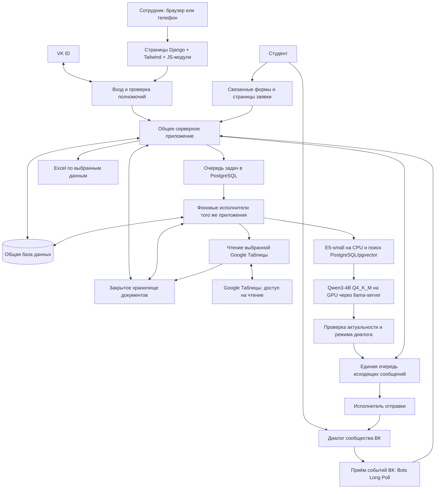
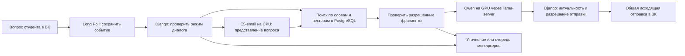

# Техническая спецификация MVP спортивного портала «Альянс»

- **Автор:** команда проекта «Альянс», подготовка с Codex.
- **Дата:** 1 ноября 2026 года.
- **Стадия:** часть 1 (§1–6) утверждена пользователем 1 ноября 2026 года; техническая архитектура (§9) обсуждается.
- **Исходная версия репозитория:** 7c9d899.
- **Источник требований:** [MVP.md](MVP.md), действующие предметные разделы и §20–27; [инструкция передачи](ПЕРЕДАЧА.md).

Это начало спецификации всего согласованного MVP. Назначение, проблема, цели и границы утверждены. Ниже развивается техническая архитектура; серверная основа выбрана — Python + Django + PostgreSQL (§9.7), а организация кода утверждена — модули с прикладными операциями на Django (§9.9–9.11). Остальные зависимости, данные, API, подробный план файлов и команды эксплуатационных проверок ещё предстоит описать. Документ пока не является полным заданием на реализацию.

## 1. Назначение и общий обзор

Университетскому спортивному клубу нужен единый инструмент для поддержки студентов, организации мероприятий, поддержания составов и учёта занятий. Менеджеры выполняют работу в веб-кабинете; студент задаёт вопросы и получает сообщения через сообщество ВК, а необходимые поля регистрации заполняет через связанную форму. Руководитель получает сводные сведения и Excel из тех же рабочих данных.

Главный принцип: полезное действие менеджера одновременно создаёт сведения для руководителя. Заявку, состав или посещаемость не требуется повторно переписывать в отдельную отчётную таблицу. Визуальный язык кабинета опирается на доступный HTML-прототип, а состав экранов и их поведение — на действующие требования.

Реализация идёт законченными очередями. Первая объединяет настоящий вход сотрудников через VK ID, одобрение доступа, управление материалами, получение сообщений ВК, поиск ответа с локальной моделью, общую очередь поддержки, ответ человека и закрытие обращения. RAG означает, что перед подготовкой ответа модель получает найденные фрагменты опубликованных материалов клуба. Готовность первой очереди не означает готовность всего MVP.

Следующие очереди добавляют мероприятия, заявки, составы, занятия, посещаемость, рассылки и инструменты руководителя. Их включённые функции сохраняются в объёме этой спецификации; конкретный порядок технических зависимостей предстоит описать.

## 2. Проблема и существующий процесс

По собранным сведениям, заявки и контакты сейчас находятся в формах и таблицах, различающихся между направлениями. Менеджеры переносят данные, вручную связываются со студентами и отвечают на повторяющиеся организационные вопросы. Руководителю приходится получать и объединять сведения для собственной отчётности.

Это создаёт повторную работу, риск устаревших списков и затрудняет проверку, откуда взялось итоговое число. При этом точные образцы документов, форм и итогового отчёта ещё нужно получить у клуба; их содержимое не считается известным по одному описанию процесса.

Нужен продукт, в котором сотрудники видят актуальные рабочие записи, студент получает понятный ответ или помощь человека, а руководитель может перейти от показателя к его исходным данным. Работающие сейчас привычки используются как контекст; точное повторение цепочки Яндекс Формы → Google Таблица не является обязательной целью.

## 3. Пользователи и организационные условия

| Пользователь | Результат, который ему нужен |
| --- | --- |
| Студент | Получить клубную информацию, обратиться к человеку, подать свою заявку, узнать состояние и расписание, управлять членством и уведомлениями |
| Капитан команды | Подать командную заявку с отдельными игроками, видеть её состояние, передавать изменения организатору и подтвердить отказ от участия |
| Менеджер/организатор | Разобрать поддержку, обновить материалы, обработать заявки, вести мероприятие, составы, расписание и рассылки |
| Ответственный за посещаемость | С телефона отмечать людей в удобный момент занятия и видеть сохранённый результат |
| Руководитель | Видеть деятельность клуба, составы и неполные сведения; получать Excel и оставлять адресные пометки |
| Уполномоченный на доступ | Проверить нового сотрудника, назначить разрешённую роль и отозвать рабочий доступ |

Роль и подтверждённая учётная запись — разные понятия. Вход VK ID не даёт рабочие полномочия автоматически. В закрытом пилоте менеджеры имеют согласованный общий рабочий доступ; административные действия выделены отдельно. Точная матрица полномочий будет определена в технической части.

Команда разработки состоит из трёх студентов второго курса и работает преимущественно с Codex. Жёсткий календарный срок не задан. Первый пилот планируется на домашнем компьютере пользователя: i3-12100F, около 16 ГБ оперативной памяти, RTX 3050 с 8 ГБ видеопамяти. Компьютер можно оставлять включённым; доступность, удалённый доступ и скорость предстоит проверить.

## 4. Цели и признаки достижения

| Цель | Как распознать результат |
| --- | --- |
| Помочь студентам и разгрузить менеджеров | На согласованном наборе вопросов бот отвечает по опубликованным материалам, уточняет или передаёт человеку; число передач само по себе не является показателем качества |
| Сделать передачу человеку полноценной | Обращение сохранено, у него один владелец, видна переписка, ответ приходит в тот же диалог ВК; после передачи модель не отвечает вместо сотрудника |
| Убрать повторный перенос данных | Принятая заявка используется в рабочих списках и отчётах без обязательного повторного заполнения нескольких таблиц |
| Дать руководителю проверяемую картину | Сводка за период связана с исходными записями; команды, участия и уникальные люди не смешиваются; выгрузка воспроизводит выбранный метод расчёта |
| Сделать интерфейс пригодным для реальной работы | Для всех включённых действий описаны экраны, права, состояния ошибок и мобильное поведение; поддержка и посещаемость доступны с телефона |
| Сохранять данные и управлять сбоями | Повторы не создают дубли, ошибка не выдаётся за успех, неизвестный исход отправки виден; есть проверенная процедура копирования и восстановления |
| Обеспечить закрытый рабочий доступ | Неодобренный и заблокированный сотрудник не получает рабочие данные через интерфейс или прямое обращение к серверу |

Цель полного короткого ответа бота — ориентировочно 4–5 секунд. Она измеряется до содержательного сообщения ВК на выбранной конфигурации и при зафиксированной нагрузке; заглушка ожидания не считается ответом. До испытаний скорость, качество и одновременное обслуживание нескольких студентов не гарантируются. Объём контрольных вопросов и допустимые пороги нужно определить до пилота.

## 5. Объём всего MVP и первая очередь

| Часть | Включённый результат | Очередь/граница |
| --- | --- | --- |
| Вход и доступ | Настоящий VK ID, заявка сотрудника, одобрение, разрешённая роль, отзыв доступа | Первая очередь |
| Поддержка ВК | Реальный приём и отправка, общая очередь, владелец, возврат, важность и завершение | Первая очередь |
| Материалы и RAG | Загрузка документов и Excel; Google Таблицы по ссылке через служебный аккаунт с ручным обновлением; подготовка, публикация/замена/снятие, поиск, локальная модель, источники и честное отсутствие ответа | Первая очередь |
| Кабинет первой очереди | Вход/статус, главная, обращения, база знаний, материал, доступ сотрудников; внутренняя индикация работы | Первая очередь, описания §26 MVP |
| Мероприятия | Создание, ответственный и помощники, дата/адрес, заявки и команды, ручной допуск, участие, результаты, завершение/архив и отмена | Последующие очереди; правила §3.2–3.3 MVP |
| Турнирное проведение | Время и площадки матчей, ручное назначение и частичный расчёт; визуальная организация этапов в выбранном ограниченном объёме | Конкретный набор форматов и автоматизации нужно согласовать перед соответствующей частью |
| Составы | Секции и сборные, ручное одобрение вступления/возврата в секцию, несколько секций, самостоятельный подтверждённый выход, актуализация и история | Последующие очереди; отбор в сборную вне программы |
| Занятия и посещаемость | Разовые занятия/серии, перенос/отмена, мобильные отметки, сохранённая история | Последующие очереди |
| Сообщения студентам | Приглашения, расписания и напоминания через ВК, выбор аудитории, просмотр/подтверждение, результат и ошибки, настройки отказа | Последующие очереди; канал отправки общий с поддержкой |
| Руководитель и Excel | Сводки периода, составы, полнота, исходные записи, адресные пометки, выгрузки с листами «Итоги» и «Подробности» | Последующие очереди; опираются на рабочие модули |
| Эксплуатация | Запуск, диагностика, копии/восстановление, проверенный способ доступа и измерение нагрузки | Поэтапно, до соответствующего рабочего пилота |

Допуск команды и наличие заявки не доказывают посещение. В турнире учитывается весь начальный состав команды, отмеченной участвовавшей; поимённая явка турнира не вводится. Для занятий «не отмечен» отличается от «отсутствовал». Эти различия должны сохраниться в данных, интерфейсе и отчётах.

Ограниченный перенос исходных контактов из Google Таблицы остаётся предложением и требует образца. Автоматическая отправка от личного VK-аккаунта менеджера — неподтверждённая возможность, которую необходимо исследовать отдельно; наличие входа VK ID её не подтверждает. Эти два пункта нельзя молча превратить в гарантированный результат реализации.

## 6. Вне согласованного MVP

- Публичный медиасайт, публикация новостей, рейтинг направлений и специализированные списки прохода.
- Университетский SSO до получения разрешения; отдельная библиотека рабочих документов и шаблонов сотрудников. Документы для RAG при этом включены.
- Универсальные конструкторы форм, отчётов и всех спортивных форматов; произвольный импорт Excel и обязательная постоянная синхронизация Google Таблиц.
- Оплаты, бронирование залов, турникеты, подробная статистика игроков и обязательная поимённая явка командного турнира.
- Telegram и внешний мессенджер сотрудников внутри портала. Внешние сводки сотрудникам отложены; уведомления внутри кабинета включены.
- Автоматическая университетская проверка действительности студенческого и статуса обучения.

Собственные формы регистрации и необходимые страницы участника не являются отложенным публичным медиасайтом. Реализация RAG не превращает бота в собеседника по любым спортивным темам: он помогает только в рамках клуба и разрешённой информации.

## 7. Что ещё предстоит определить

Это реестр для следующих разделов, а не одновременно заданные пользователю вопросы.

1. Серверная основа выбрана: Python + Django + PostgreSQL (§9.7). Организация кода выбрана: вариант 1 (§9.9–9.11). Основа веб-кабинета выбрана: Django-шаблоны + Tailwind CSS + модульный обычный JavaScript (§9.17). Для приёма событий ВК выбран Bots Long Poll с возможностью последующей замены на Callback (§9.18). Открыты версии и остальные зависимости, точные процессы запуска и способы подтверждения/связи идентификаторов.
2. Испытание утверждённой стартовой связки: Qwen3-4B-Instruct-2507 Q4_K_M через llama.cpp на GPU и multilingual-e5-small на CPU, поиск PostgreSQL/pgvector (§9.20–9.23). Открыты ревизии артефактов, библиотеки и точные параметры, измерение качества/памяти/времени; стартовый контекст 4096 и одна генерация одновременно относятся к первой проверке, а не к гарантии производительности.
3. Оставшиеся рабочие разрешения и техническая реализация управления доступом. Административные права, повторная подача после отказа и разблокировка согласованы в §9.12; первоначальное назначение руководителя, защита последних руководящих прав и аварийное восстановление — в §9.13.
4. Поддерживаемые расширения и обработка документов/таблиц по реальным образцам, точные поля форм; набор эталонных вопросов и образец выгрузки руководителя. Google Таблицы подключаются по ссылке через служебный аккаунт с ручным обновлением и публикацией (§9.14–9.15).
5. Поддерживаемый формат первого турнира, правила равенства/очков/технических исходов и объём автоматизации конструктора.
6. Реальный способ удалённого доступа, настройки копий, нагрузка и условия допуска к пилоту.

## 8. Порядок дальнейшего наполнения документа

После согласования первой части последовательно описываются:

1. Критические сквозные сценарии и техническая архитектура с выбранными решениями.
2. Данные, идентификаторы, состояния, права и контракты первой очереди.
3. Интерфейсы, реальные VK ID/сообщения, материалы, поиск/модель, отправки и обработка сбоев.
4. Технические решения остальных включённых модулей, их контракты и проверки без потери общего объёма MVP.
5. Рассмотренные альтернативы с основаниями выбора.
6. Единый подробный план реализации: все создаваемые/изменяемые файлы, причины, зависимости, миграции, проверки и запуск.
7. Сверка с исходными требованиями перед финализацией и передачей коллеге.

Техническое проектирование начато в §9; остальные пункты перечня ещё предстоит написать и согласовать. Производственный код в рамках подготовки спецификации не изменяется. Текущие localStorage, переключатель профилей и поиск по словам остаются средствами демонстрации; их нельзя использовать как рабочую авторизацию, общую базу и RAG.

## 9. Техническая архитектура — рабочее предложение

### 9.1. Основание и граница решений

Из требований уже следует одна общая серверная система: бот, кабинет и формы используют общие рабочие данные. Локальная модель работает отдельным процессом. Google Таблицы не являются обязательным промежуточным хранилищем, а Excel формируется из данных приложения по запросу.

Выбрано одно серверное приложение на Django, разделённое на предметные модули с отдельными прикладными операциями. Веб-запросы и фоновые задания могут выполняться отдельными процессами того же приложения и использовать те же правила. Разделение процессов не означает отдельные независимо разрабатываемые микросервисы.

Серверная основа утверждена в §9.7. Организация кода также утверждена (§9.9–9.11). Остальные технические предложения пока согласуются: долговечные фоновые задания, единый механизм исходящих сообщений и границы файлового хранения. Диаграмма показывает обязанности компонентов, а не уже реализованные подключения. Физические таблицы и API будут описаны в следующих частях на выбранном основании.

### 9.2. Общая схема

Для пилота выбран Bots Long Poll; будущая замена получателя на Callback предусмотрена границей подключения (§9.18). HTTPS-доступ к кабинету и формам нужен независимо от этого выбора. Схема не обещает доступность домашнего ПК извне без настройки сети.

### 9.3. Модули общего приложения

| Модуль | За что отвечает | Когда нужен |
| --- | --- | --- |
| Пользователи и доступ | Внутренние идентификаторы, внешние учётные записи, заявки сотрудников, роли, отзыв и серверные проверки | Первая очередь |
| Поддержка | Переписка, состояния обращения, общая очередь, единственный владелец, передача, возврат, завершение и история | Первая очередь |
| База знаний | Оригиналы, извлечённый текст, версии, подготовка и публикация; поиск доступных фрагментов | Первая очередь |
| Подготовка ответа | Выбор опубликованных материалов, обращение к модели, ссылки на источники, уточнение или передача человеку | Первая очередь |
| Подключение ВК и отправки | Входящие события, сопоставление канала, разрешения, исходящие попытки, ошибки, приоритеты и настройки сообщений | Первая очередь; расширяется для рассылок |
| Мероприятия и турниры | Карточка, ответственный и помощники, заявки, допуск, команды, снимок начала, матчи, участие, результаты и архив | Следующие очереди MVP |
| Секции и сборные | Составы, заявки и решения по секциям, несколько членств, выход и история | Следующие очереди MVP |
| Расписание и посещаемость | Серии и отдельные занятия, переносы, отмены, отметки с телефона | Следующие очереди MVP |
| Сводки и экспорт | Расчёт показателей из рабочих записей, полнота, детализация, адресные пометки, Excel «Итоги»/«Подробности» | Следующие очереди MVP |
| Внутренние уведомления и журнал | События для сотрудников, прочтение, авторство изменений и техническая диагностика | Основа в первой очереди; расширение с модулями |

Один модуль не должен обходить правила другого прямым произвольным исправлением его записей. Например, рассылка использует подтверждённую заявку и настройки получателя, а отчёт читает снимок турнира, а не подменяет его текущим составом секции. Границы вызовов и транзакций будут закреплены в контрактах.

### 9.4. Хранение и фоновые операции

Для выбранного варианта §9.7 используется PostgreSQL на серверном компьютере: одна база для пользователей, обращений, заявок, составов, результатов, посещаемости и состояния заданий. «Локальная» означает размещение на выбранном сервере; данные не хранятся отдельно в браузере каждого менеджера. База не публикуется напрямую в интернет. Назначение одного владельца обращения и фиксация состава при старте требуют транзакций и ограничений базы, а не только проверки кнопок.

Оригиналы документов предлагается хранить в закрытом каталоге приложения; в базе — сведения о файле, версии, состоянии и праве использования. Копия одной базы без файлов не является полной резервной копией. Поисковый индекс — производные данные, которые должны восстанавливаться из опубликованных версий. Выбран поиск внутри PostgreSQL: полнотекстовый поиск и pgvector (§9.20). Отдельный Qdrant рассмотрен, но не входит в выбранный стек. Для первой проверки выбрана multilingual-e5-small на CPU (§9.22–9.23); её ревизию, устройство индекса и параметры ещё предстоит закрепить и проверить.

Вызовы модели, обработка документов, отправки и напоминания выполняются вне обработки веб-запроса. Пользователь утвердил для пилота хранение заданий и исходящих намерений в PostgreSQL с отдельными исполнителями ограниченной параллельности; обработчики отделяются от механизма очереди для возможного перехода на Celery/Redis (§9.19). Это не готовая гарантия надёжности: спецификация должна задать захват задания, срок владения, восстановление после сбоя, предел попыток и состояние неизвестного результата. PostgreSQL документирует `SKIP LOCKED` как применимый механизм для конкурирующих потребителей таблицы-очереди, но не реализует этими словами весь исполнитель. [Документация PostgreSQL](https://www.postgresql.org/docs/current/sql-select.html).

Такой вариант уменьшает число обязательных служб пилота, но добавляет разработку и проверку поведения очереди. Если нагрузочные испытания покажут, что очередь мешает рабочим запросам, либо поддерживать её окажется дороже готового решения, потребуется отдельно согласовать механизм фоновых задач. Celery/Redis не входят в текущую реализацию пилота; они сохранены как возможный следующий механизм. Выбран вариант А и требование возможности перехода на вариант Б (§9.19).

### 9.5. Первый сквозной путь и защита от запоздалого ответа

1. Сотрудник входит через VK ID. Сервер связывает подтверждённую внешнюю учётную запись с внутренним пользователем; до одобрения показывает только разрешённое состояние заявки. Связь этого идентификатора с отправителем сообщений сообщества проверяется отдельно.
2. Менеджер загружает материал. Подготовка создаёт новую версию и фрагменты; загрузка сама по себе не публикует материал. До явной замены продолжает действовать прежняя опубликованная версия. Ошибка подготовки новой версии не снимает старую.
3. Событие ВК сохраняется с ключом защиты от повторов. После надёжного приёма создаётся обработка; повтор того же события не порождает новое обращение или второй ответ.
4. Сервер проверяет режим диалога. Если обращение передано людям, сообщение направляется в соответствующую очередь/переписку без нового ответа AI. Иначе поиск выбирает только опубликованные и разрешённые студенту источники; внутренние данные сотрудников автоматически в RAG не попадают.
5. При достаточном основании модель готовит короткий ответ с источниками. При отсутствии основания, конфликте, неприемлемом ожидании или явном запросе человека применяется согласованный путь уточнения/передачи. Посторонняя тема получает объяснение границ помощи.
6. Перед постановкой AI-ответа на отправку и непосредственно перед попыткой отправки сервер повторно проверяет актуальность входного сообщения, режима диалога и версий источников. Результат устаревшего вычисления отбрасывается. Переход к человеку и допуск отправки должны иметь определённый порядок для одного диалога; уже начатый внешний сетевой вызов невозможно обещать отозвать задним числом. Конкретный механизм синхронизации будет описан вместе с состояниями.
7. Менеджер атомарно берёт обращение. Сервер допускает ответ только действующего владельца с сохранёнными полномочиями. Его ответ проходит через тот же механизм исходящих сообщений; сохранение текста, принятие ВК и фактическое прочтение студентом не смешиваются.

Порядок и повторная проверка нужны и для последующих модулей: отменённое занятие не должно отправлять старое напоминание, а отказ студента от уведомлений учитывается перед фактической отправкой. При сетевом сбое после начала отправки неизвестный исход не превращается в безусловный автоматический повтор. Точные возможности устранения дублей уточняются по контракту ВК и проверяются реальными запросами.

### 9.6. Ограничения домашнего запуска

Сервер, база, файлы и модель могут размещаться на одном ПК пилота, но модель запускается отдельно и получает ограниченную очередь. Отказ или перегрузка модели не должны блокировать вход сотрудников, чтение сохранённых данных и обработку людьми. Независимость процессов не защищает от выключения всего компьютера; нужны автозапуск, резервное копирование вне единственного диска и проверка восстановления.

Предлагается не давать модели прямой доступ к базе и операциям приложения: она получает разрешённые текстовые фрагменты и возвращает проект ответа. Допуск сотрудников, изменение состава и отправку рассылки выполняет сервер по явным правилам. Загрузка документа не даёт его содержимому полномочий изменять инструкции или вызывать действия.

На RTX 3050 8 ГБ скорость и параллельность сначала измеряются. Название серверного фреймворка не доказывает достижение 4–5 секунд. Нужно измерить отдельно ожидание в очереди, поиск, генерацию и отправку ВК, а затем весь путь. Конкретные модели, параметры поиска, лимиты и пороги приёмки остаются открытыми; поиск PostgreSQL/pgvector и запуск модели ответа через llama.cpp выбраны в §9.20–9.21.

### 9.7. Серверное основание — выбран Django

Оба варианта сохраняют общую модульную систему, отдельную локальную модель и специальный интерфейс по прототипу. Оба требуют настоящей интеграции VK ID, проверки прав, миграций, фоновых исполнителей и испытаний; ни один не даёт готовый MVP установкой библиотеки. Пользователь выбрал вариант А: Python + Django + PostgreSQL. Сравнение ниже сохранено как основание решения; FastAPI не входит в выбранный серверный стек. База и интеграции ещё не реализованы.

| | Вариант А: Python + Django + PostgreSQL | Вариант Б: Python + FastAPI + PostgreSQL |
| --- | --- | --- |
| Механизм | Использовать встроенные средства Django для данных, миграций, пользователей, групп, прав и сессий; поверх них написать правила клуба и API кабинета | Собрать явный API на FastAPI; для доступа к базе и миграций добавить SQLAlchemy/Alembic, определить и реализовать единый механизм пользователей, прав и сессий |
| Что даёт | Больше общих средств учёта и доступа поставляется одной системой; техническая админка пригодна для ограниченных служебных задач | Контракты API и валидация запросов занимают центральное место; выбор остальных компонентов отделён от API-фреймворка |
| Цена | Нужно освоить соглашения Django; встроенные права не заменяют предметные ограничения, например ответ только владельцу обращения | Больше интеграционных решений и согласования между библиотеками; готовые средства безопасности не равны готовой корпоративной системе |
| Когда подход не оправдывается | Если команда начнёт обходить правила приложения через прямое редактирование технической админки либо дублировать встроенную систему отдельной несовместимой системой пользователей | Если команда не закрепит единые правила сессий, доступа и транзакций: разные обработчики могут начать выполнять их по-разному |

Django документирует встроенные пользователей, группы, права и cookie-сессии; его админка не предназначена для замены всего пользовательского интерфейса. [Система доступа](https://docs.djangoproject.com/en/5.2/topics/auth/), [границы админки](https://docs.djangoproject.com/en/5.2/ref/contrib/admin/).

FastAPI документирует валидацию, OpenAPI и средства подключения безопасности. Его `BackgroundTasks` выполняются в процессе приложения; долговечные отправки и обработка модели в этом проекте проектируются отдельно. [Возможности FastAPI](https://fastapi.tiangolo.com/features/), [фоновые задачи](https://fastapi.tiangolo.com/tutorial/background-tasks/).

Оценки трудоёмкости в таблице — проектное сравнение состава работ, а не результат замеров этих двух реализаций. Ссылки проверены 1 ноября 2026 года; конкретные поддерживаемые версии и совместимость зависимостей ещё предстоит закрепить для выбранного стека. Фронтенд позднее утверждён в §9.17: Django-шаблоны + Tailwind CSS + модульный обычный JavaScript. Приём событий ВК и удалённый доступ остаются отдельными решениями архитектуры.

**Решение пользователя от 1 ноября 2026 года:** вариант А, Django. Продолжается технический план; реализация кода не начинается. Полное утверждение архитектурного раздела будет после описания оставшихся границ и контрактов.

### 9.8. Архитектурные требования и способ их проверки

Пользователь отдельно подтвердил требование модульности и возможности развития проекта. Это относится к обоим вариантам стека. Название фреймворка и наличие каталогов по модулям не являются доказательством выполнения требования. Ниже — предлагаемые проверяемые ограничения; конкретные интерфейсы и распределение файлов уточняются в последующих частях спецификации.

| Требование | Как реализовать и проверить |
| --- | --- |
| Границы предметных модулей | У поддержки, базы знаний, мероприятий, составов и остальных модулей есть обозначенные обязанности, принадлежащие им данные и разрешённые точки взаимодействия. Проверки зависимостей запрещают циклические импорты и обход этих точек. Общие справочники имеют конкретного владельца. |
| Единое выполнение бизнес-правил | Веб-обработчик, событие ВК и фоновое задание вызывают один прикладной сценарий. Критические правила — единственный владелец обращения, допуск, фиксация состава, право отправки — проверяются на сервере при каждом соответствующем действии. Тесты проверяют запреты и конкурирующие изменения, а не только успешные ответы. |
| Отделение внешних подключений | Предметные сценарии не зависят от формата ответа VK API, SDK модели или компонентов браузера. Подключения переводят внешние данные в согласованные внутренние контракты. Замена модели или добавление университетского SSO не требует переписывать турнирные правила. Интерфейсы вводятся на реальных границах; создавать обёртку над каждым классом не требуется. |
| Явные зависимости и транзакции | В спецификации перечислены разрешённые вызовы между модулями и операции, которые должны сохраняться атомарно. Блокировки базы не удерживаются на время генерации или сетевого вызова ВК. Изменение рабочих данных и создание исходящего намерения не теряются между двумя несогласованными записями. Общая база допускает необходимые транзакции; она не даёт любому модулю право произвольно менять чужие записи. |
| Расширение без копирования процессов | Новый вид спорта, форма поддерживаемого шаблона или поставщик входа добавляется через определённую точку расширения. Изменяемые правила и настройки отделяются от одинакового процесса. Новые спортивные правила всё равно требуют проектирования и проверки; универсальность всех форматов заранее не обещается. |
| Масштабирование по измеренной нагрузке | У веб-приложения нет единственной копии рабочих данных в памяти процесса. При добавлении экземпляров общими остаются база, сессии, файлы, задания и координация обработки одного диалога. Исполнители допускают ограниченное увеличение числа процессов с проверкой захвата заданий, порядка и повторов. Модель и база могут остаться пределом производительности: дополнительные веб-процессы сами его не устраняют. |
| Управляемые изменения данных и контрактов | Схема базы изменяется миграциями; внешние и внутренние контракты описаны явно. Обновление приложения учитывает сохранённые задания старой версии. Для каждого этапа указаны порядок обновления, совместимость и восстановление, включая случаи, где обратная миграция невозможна без потери данных. |
| Проверяемая эксплуатация | Логи связывают обращение, входящее событие, задание и попытку отправки без публикации токенов и лишних персональных данных. Проверяются сбой модели, повтор события, перезапуск исполнителя, истечение сеанса, отзыв прав и восстановление копии. Зависимости фиксируются; секреты отделены от Git. |

Практический критерий для разработки коллегами: у каждого модуля должны быть контракт, правила владения данными, состояния, проверки и понятная точка подключения к общей системе. В плане файлов потребуется указать, какие проверки удерживают эти границы. Структура каталогов сама по себе этому критерию не соответствует.

Разделение на независимо развёртываемые сервисы остаётся возможным направлением при появлении конкретной потребности; оно не является обещанием переноса без затрат. Сначала следует измерять узкое место и проверять, достаточно ли настройки запросов, индексов, ограничений очереди или отдельного исполнителя. Формальный полный набор шаблонов Clean Architecture, DDD или CQRS этим документом не утверждается: конкретную структуру выбираем по обязанностям и проверкам, с учётом команды из трёх человек и домашнего пилота.

### 9.9. Организация кода: выбран вариант 1

Архитектурное основание остаётся общим: предметные модули внутри одного серверного приложения, отдельные процессы фоновых исполнителей и модели. Пользователь утвердил вариант 1 от 1 ноября 2026 года: прикладные операции с контролируемой зависимостью от Django ORM. Вариант 2 ниже сохранён как рассмотренная альтернатива. Это отдельная ось выбора от Django/FastAPI: сам по себе FastAPI не означает Clean Architecture, а Django не исключает её.

**Вариант 1. Прикладные сценарии с контролируемой зависимостью от фреймворка.** Модуль содержит входные обработчики, именованные операции изменения, запросы чтения, модели данных и внешние подключения. Операция вроде «Взять обращение» или «Одобрить заявку» может прямо использовать ORM и транзакции выбранного стека. HTTP-обработчики и обработчики ВК переводят входные данные и вызывают эти операции; правила не размножаются по обработчикам. Самостоятельные расчёты, например построение последовательности времени матчей, оформляются без сетевого и файлового ввода-вывода.

- Цена: изменения фреймворка и ORM могут затронуть прикладные операции; проверки операций с базой требуют настоящей тестовой базы.
- Условия применимости: команда принимает зависимость от выбранного стека и удерживает её внутри владельца данных. Замена VK API и модели изолирована отдельно.
- Когда граница ломается: обработчики начинают самостоятельно изменять записи, чужие модули импортируют внутренние ORM-модели для записи, один файл сценариев превращается в неограниченный набор обязанностей. Формальное наличие каталога `services` этого не исправляет.

**Вариант 2. Прикладное и предметное ядро, независимое от фреймворка.** Предметные состояния и правила не импортируют ORM, веб-фреймворк или SDK. Прикладные операции работают с явно заданными интерфейсами хранилищ, транзакций и внешних действий. Инфраструктурные реализации связывают эти интерфейсы с базой, ВК и моделью. В точке сборки приложения выбираются конкретные реализации. Предметные объекты и записи ORM могут иметь разные представления.

- Цена: дополнительные интерфейсы, преобразования и проверки соответствия; нужно явно определить, где начинаются транзакции и как сохраняются ограничения базы. Замена базы всё равно требует миграций и испытаний.
- Условия применимости: команда готова поддерживать отдельную предметную модель и проверять направление зависимостей; сложность правил или потребность в независимых реализациях оправдывают эту работу.
- Когда граница ломается: архитектура существует только на схеме, а ядро обращается к глобальной ORM-сессии; абстракции скрывают существенные блокировки и порядок операций; тесты с подставными хранилищами проходят, но реальная база допускает гонки.

Оба варианта позволяют поддерживать качество. Различие — в изоляции от фреймворка, стоимости разработки и характере тестов. Утверждён вариант 1: его прикладные операции соответствуют сценариям клуба и позволяют использовать выбранный Django без отдельной копии всей предметной модели. Изоляция внешних подключений, контроль зависимостей и проверки входят в выбранный подход. Конкретизация — в §9.11. Точные имена каталогов и файлов будут назначены в подробном плане реализации.

### 9.10. Правила разработки для обоих вариантов — предложение

#### Явный путь действия

Каждое изменение имеет один именованный прикладной вход, понятные входные/выходные данные, проверку инициатора и состояния, границу транзакции и определённые ошибки. Например, «Одобрить заявку в секцию»:

1. Получить внутренний идентификатор инициатора из проверенного сеанса, а не из произвольного поля запроса.
2. Проверить рабочий доступ и право выполнить операцию; права и состояние заявки проверить в согласованной транзакционной границе, исключающей обход при конкурентном изменении.
3. Защитить заявку от конкурирующего решения и проверить её актуальную версию.
4. Одной транзакцией сохранить решение, членство, запись истории и намерение уведомить студента. Ограничения базы защищают от второго действующего членства в том же направлении.
5. После фиксации отдельно обработать уведомление через общий механизм отправки. Недоступность ВК не отменяет сохранённое решение; повторная отправка запроса на одобрение не создаёт ещё одно членство.

Это описание архитектурной обязанности, не окончательный контракт состояния заявки или формат API. Конкретный способ блокировки/проверки версии и поведение при отзыве полномочий должны быть определены до реализации.

Для существенных бизнес-действий предлагаются прямые вызовы вместо скрытых цепочек ORM-сигналов и глобальной шины событий. Отложенный эффект записывается явно и имеет отслеживаемое состояние. Документация Django также предупреждает о трудности сопровождения сигналов и предлагает прямой вызов, где это возможно; это основание для ограничения, а не запрет всех технических сигналов. [Документация сигналов](https://docs.djangoproject.com/en/5.2/topics/signals/).

#### Владение данными и чтение

У каждого набора данных один предметный владелец, который выполняет изменения. Другие модули используют его опубликованные операции и контракты; зависимости перечисляются явно. Для сценария, затрагивающего несколько модулей, задаётся конкретный координатор и транзакционная граница, а не взаимные вызовы по кругу.

Сложные выборки руководителя и Excel могут объединять данные нескольких модулей через явно описанные запросы только для чтения. Не требуется загружать по одному объекту ради каждого столбца отчёта. Такие запросы зависят от документированных схем/проекций и меняются вместе с миграциями; доступ к ним не даёт права менять данные чужого модуля. Отдельная система CQRS или копия всей базы этим разделом не вводится.

Общие идентификаторы, форматы ошибок и технические средства получают ограниченные обязанности. Раздел `common`/`utils` не становится местом для спорных бизнес-правил. Новую абстракцию вводят для конкретной границы или повторяющегося поведения, с описанием её ответственности.

#### Минимальные проверки перед объединением изменений

| Проверка | Что должна обнаружить |
| --- | --- |
| Форматирование и статический анализ | Несогласованный стиль, неиспользуемый код, типовые ошибки; точные инструменты и конфигурация фиксируются со стеком |
| Типы на контрактах и в новом серверном коде | Несовместимые входы/выходы и необработанные варианты; непроверенные данные внешнего API валидируются на входе, аннотация типов их не подтверждает |
| Контракты импортов | Циклы, запрещённый доступ к внутренним модулям и зависимость ядра от инфраструктуры, если выбран вариант 2 |
| Предметные проверки | Переходы состояний, правила ролей, дедлайн, запрет изменения стартового состава, выключение AI после передачи |
| Интеграционные проверки с PostgreSQL | Ограничения, миграции, конкурирующее взятие обращения, повтор одобрения и транзакционное сохранение исходящего намерения; SQLite не подменяет эти проверки |
| Проверки подключений | Формат и повторы реальных событий ВК, отзыв разрешения, тайм-аут, устаревший ответ модели; локальные подстановки дополняются отдельными проверками реального подключения |
| Сквозной сценарий затронутого модуля | Наблюдаемый результат пользователя и корректные состояния ошибки, включая поведение интерфейса |

Пример подходящего инструмента архитектурного контроля для Python — Import Linter: он поддерживает запрещённые импорты, защищённые модули, слои и отсутствие циклов. Его конфигурация должна отражать выбранную архитектуру; наличие установленного пакета не доказывает соблюдение границ. Он также не обнаруживает произвольные SQL-запросы и нарушения бизнес-правил. [Контракты Import Linter](https://import-linter.readthedocs.io/en/stable/contract_types/).

Тесты пишутся под существенные риски и поведение. Процент покрытия и ограничение длины файла не заменяют проверки сценариев. Общие проверки выполняются автоматически перед объединением; расширенные испытания GPU, ВК и восстановления запускаются отдельно и имеют записанный результат. Разработка с Codex подчиняется тем же правилам: небольшое изменение в пределах конкретного модуля, просмотр diff, применимые проверки, затем объединение.

#### Решения, которые можно восстановить из документации

Для каждого существенного выбора в этой спецификации фиксируются причина, альтернативы, ограничения и условие пересмотра. В инструкциях для разработки требуется отразить выбранные границы и команды проверок. Незавершённое решение не выдаётся за выполненное; исключение из архитектурного правила сопровождается конкретной причиной и оценкой влияния. Подробный план файлов будет составлен на основе утверждённого варианта 1 (§9.9) и выбранного Django (§9.7), после описания контрактов и оставшихся подключений.

**Утверждено:** Django и организация кода по варианту 1. Дальнейшая спецификация использует это основание. Утверждение основы не заменяет последующую проработку и согласование API, данных и оставшихся технических подключений.

### 9.11. Выбранная организация кода на Django

Профиль ниже конкретизирует утверждённый пользователем вариант 1. Утверждение относится к организации кода; конкретные API, таблицы и инструменты проверок пока не выбраны. Он рассчитан на команду из трёх человек, общий рабочий кабинет с несколькими предметными направлениями и домашний пилот. Основание выбора — характер работы: большинство операций изменяет связанные записи с проверкой прав и состояний; основные внешние границы — ВК, модель, документы и выгрузки. Дополнительное полностью независимое от ORM ядро сейчас не обосновано отдельной потребностью. Если появится сложная предметная область, её независимое ядро можно спроектировать локально, оценив стоимость и совместимость.

#### Распределение обязанностей внутри модуля

Это логические роли будущих файлов, а не обязательные одинаковые каталоги для каждого простого справочника. Небольшую роль допустимо держать в одном файле; рост делится по связанным сценариям, без изменения контрактов.

| Часть | Обязанность | Ограничение |
| --- | --- | --- |
| Входные обработчики | Разобрать HTTP-запрос, событие ВК или параметры задания; проверить формат и вызвать нужную операцию | Не реализуют самостоятельно допуск, переход состояния или изменение состава |
| Прикладные операции | Выполнить именованное действие с инициатором: взять обращение, опубликовать версию, принять заявку; проверить право, состояние, конкурентный доступ и транзакцию | Могут использовать Django ORM внутри своего модуля; не зависят от объекта HTTP-запроса и SDK ВК/модели |
| Запросы чтения | Вернуть разрешённые списки, карточки и показатели с фильтрацией, пагинацией и контролем объёма выборок | Не меняют состояние при чтении; межмодульные отчёты оформляются явно по §9.10 |
| Модели и ограничения | Задать сохраняемые сущности, связи, допустимые значения и ограничения целостности | Техническое сохранение модели само по себе не запускает скрытую цепочку бизнес-действий |
| Предметные правила и расчёты | Выразить проверяемые правила и расчёты, например последовательность начала матчей или допустимость перехода | Не выполняют сетевые вызовы; самостоятельные вычисления проверяются без базы |
| Контракт модуля | Описать разрешённые операции, типы входа/выхода и ошибки для других модулей | Не раскрывает изменяемые ORM-объекты как общий способ правки данных |
| Внешние подключения | Выполнить конкретный запрос ВК, обращение к модели, чтение поддерживаемого документа или создание файла | Не получают права самостоятельно решать, кого допускать, как закрывать обращение и кому разрешено писать |

Схема одного действия: входной обработчик → прикладная операция → правила и ORM своего модуля → зафиксированные данные/исходящее намерение → отдельный исполнитель внешнего действия. Прикладной сценарий является точкой оркестрации; ни общий контроллер, ни техническая админка не подменяют его.

Внутренние запросы не должны случайно запускаться при сериализации или обращении другого модуля к ленивому ORM-объекту. На границе контракта возвращается определённый результат с нужными данными. Это не требование дублировать каждую модель отдельным классом: отдельное представление вводится на границе взаимодействия и проверяется по контракту.

#### Что закрепить до первой реализации

Для первой очереди составляются конкретные данные, переходы и права: сотрудники/учётные записи, обращения/сообщения, материалы/версии, входящие события, задания и исходящие попытки. У каждой операции должны быть определены успешный результат, отказ, повтор, конфликт и последствия перезапуска. Поля нельзя окончательно выводить только из демонстрационных данных.

Используем средства Django для транзакций и ограничений, но задаём их под сценарий. `transaction.atomic()` обеспечивает совместную фиксацию изменений, а не автоматически решает все гонки. Где требуется исключить конкурирующее изменение, выбирается конкретная блокировка, условное обновление либо ограничение базы и проверяется на PostgreSQL. Сетевые вызовы не выполняются под длительной блокировкой. [Транзакции Django](https://docs.djangoproject.com/en/5.2/topics/db/transactions/), [блокировки строк](https://docs.djangoproject.com/en/5.2/ref/models/querysets/#select-for-update).

Контракты кабинета, бота и внутренних операций описываются согласованно: одинаковые значения состояний, устойчивые идентификаторы, предсказуемые ошибки и явная проверка полномочий. По времени задаются хранение, часовой пояс отображения и правила дедлайна. Для отправок задаётся различие между сохранением намерения, принятием ВК и неизвестным исходом. Вариант веб-API и библиотеки ещё не выбран этим разделом.

#### Качество кода и пригодность продукта проверяются отдельно

| Область | Какое свидетельство потребуется |
| --- | --- |
| Сопровождаемость | Другой участник команды по документации находит владельца операции, запускает приложение и проверки; изменения не требуют обхода границ модуля |
| Надёжность данных | Конкурирующие менеджеры не получают одно обращение одновременно; повтор запроса не создаёт лишнюю заявку/членство; начало турнира сохраняет неизменяемый состав |
| Рабочий доступ | Неодобренный, заблокированный и пользователь без права не выполняют запрещённую операцию даже прямым запросом; вход VK ID не назначает роль автоматически |
| Удобство | Менеджер проходит согласованный сценарий на телефоне/компьютере и понимает, что сохранено, что требует действия и почему операция не выполнилась |
| Поддержка и RAG | На реальных материалах проверены ответы, источники, отсутствие ответа, передача и пауза AI; записано измерение полной задержки при известной нагрузке |
| Отчётность | Показатель и Excel совпадают с исходными записями и согласованным методом учёта; недостаточно заполненные данные явно видны |
| Эксплуатация | Запуск после перезагрузки, доступ сотрудников, диагностика, резервная копия и восстановление испытаны; восстановление не вызывает неконтролируемую повторную отправку |

Прохождение автоматических тестов не заменяет испытание реальными сотрудниками. Сначала проверяется законченный путь поддержки на ограниченной пилотной аудитории, затем остальные очереди всего MVP. Для пилота заранее составляются сценарии и условия приёмки; фактические наблюдения записываются, а замечания возвращаются в конкретные операции и экраны.

Конфигурация рабочего запуска должна пройти применимые проверки Django, включая `manage.py check --deploy`, и отдельную проверку внешнего доступа. Эта команда не проверяет за нас интеграцию ВК, предметные права или восстановление; её результат — одна из проверок готовности. [Подготовка Django к размещению](https://docs.djangoproject.com/en/5.2/howto/deployment/checklist/).

#### Порядок дальнейшей подготовки спецификации

На утверждённой основе далее подробно описывается первый серверный путь поддержки: данные → роли/состояния → контракты → интерфейс/подключения → ошибки и повторы → проверки → список файлов и запуск. Независимые решения следующих очередей не подменяются предположениями: турниры, расписание, составы, рассылки и отчётность получают собственные предметные контракты в пределах общего MVP.

Каждый будущий этап разработки заканчивается проверяемым пользовательским результатом и описанными ограничениями. Допустимый результат этапа — например, реальный вопрос ВК, сохранённый в кабинете, и реальный ответ назначенного менеджера в тот же диалог; визуальная имитация этого пути таким результатом не считается. Работающая первая очередь также не объявляется готовностью всего MVP.

Предложенная архитектура уменьшает риск смешения обязанностей, но качество подтверждается реализацией и проверками. Сейчас изменяется только спецификация: производственный Django-код, фоновые исполнители и подключения ещё не созданы.

**Решение пользователя от 1 ноября 2026 года:** вариант 1 из §9.9 с модульностью, отдельными прикладными операциями и выделенными подключениями ВК и модели. Вариант 2 остаётся рассмотренной альтернативой. Весь технический план пока не завершён и не получает автоматического утверждения вместе с этой основой.

### 9.12. Назначение администраторов и делегирование

**Решение пользователя от 1 ноября 2026 года:** руководитель обязательно может самостоятельно назначать администраторов. Он также может выдать конкретному администратору разрешение выполнять такие назначения по своим решениям. Это отдельное разрешение, а не неотъемлемое свойство роли администратора.

Отсюда следуют обязательные различия:

- Руководитель назначает администраторов сам и выбирает, кому делегировать выполнение этих действий.
- Обычный администратор не получает право назначать других администраторов только в силу своей роли.
- У конкретного администратора может быть явно выдано дополнительное разрешение; сервер проверяет его при соответствующем действии.
- Назначение администратора, выдача дополнительного разрешения и фактическое действие по нему — разные записи истории. В них нужно сохранять инициатора, адресата и время.
- Рабочая административная роль клуба не означает доступ к серверу, токенам или безусловный обход прикладных проверок.

**Уточнение, утверждённое пользователем 1 ноября 2026 года:** делегированное разрешение действует до явного отзыва руководителем. Пока оно активно, отдельное подтверждение каждого назначения в приложении не требуется; отдельный процесс согласования каждого назначения не вводится. После отзыва новые назначения по этому разрешению запрещаются сервером, в том числе из уже открытого кабинета. Выдача и отзыв сохраняются в истории. Точный порядок проверки при конкурентном отзыве и назначении будет определён в контракте операции.

**Границы делегирования, утверждённые пользователем 1 ноября 2026 года:**

- Только руководитель выдаёт и отзывает дополнительное право назначать администраторов.
- Администратор с этим правом может назначать новых обычных администраторов. Назначение не передаёт дополнительное право назначения автоматически.
- Администратор не может выдавать или отзывать это дополнительное право у других; для его получения требуется действие руководителя.
- Дополнительное право не позволяет менять роль руководителя или блокировать его доступ. Сервер проверяет не только право инициатора, но и допустимость действия над конкретным адресатом.

Проверки при реализации: обычный администратор не может назначить администратора; уполномоченный может назначить обычного, но не передать ему дополнительное право; скрытая кнопка не заменяет запрет прямого запроса; попытки изменить роль или заблокировать руководителя отклоняются; отзыв разрешения запрещает новые назначения. Успешные изменения отражаются в истории.

**Управление доступом, утверждённое пользователем 1 ноября 2026 года:** любой администратор может одобрить заявку обычного менеджера или заблокировать его рабочий доступ. Снять административные права или заблокировать администратора может только руководитель. Дополнительное право назначения не даёт права снимать полномочия других администраторов. Блокировка прекращает рабочий доступ, но сохраняет историю действий и созданные записи сотрудника.

Матрица согласованных административных действий:

| Действие | Обычный менеджер | Администратор | Администратор с правом назначения | Руководитель |
| --- | --- | --- | --- | --- |
| Одобрить заявку обычного менеджера | Нет | Да | Да | Да |
| Заблокировать рабочий доступ обычного менеджера | Нет | Да | Да | Да |
| Разблокировать обычного менеджера | Нет | Да | Да | Да |
| Разблокировать администратора | Нет | Нет | Нет | Да |
| Назначить обычного администратора | Нет | Нет | Да | Да |
| Снять административную роль или заблокировать администратора | Нет | Нет | Нет | Да |
| Выдать или отозвать дополнительное право назначения | Нет | Нет | Нет | Да |

Таблица касается административных действий, а не всех рабочих операций клуба. Проверка права назначения учитывает действующий административный доступ и дополнительное разрешение: блокировка или снятие административной роли не должны оставлять возможность назначать администраторов. Администратор, даже с дополнительным правом, не может обойти ограничение, сначала понизив другого администратора до менеджера и затем заблокировав его. Изменение прав и запись истории выполняются согласованно; прямые запросы проверяются так же, как действия через кабинет.

Проверки при реализации: обычный администратор может обработать доступ менеджера, но не снять роль администратора; администратор с дополнительным правом также получает отказ при снятии роли или блокировке администратора; руководитель может выполнить эти операции. После блокировки сотруднику недоступны рабочие операции из уже открытого кабинета. Созданные им записи и история сохраняются.

**Повторная заявка после отказа — решение пользователя от 1 ноября 2026 года:** пользователь может самостоятельно повторно подать заявку на рабочий доступ. Новая заявка снова требует ручного решения уполномоченного сотрудника и не выдаёт прав автоматически. Отказ по прежней заявке сохраняется в истории, повторная подача использует тот же внутренний профиль. На профиль допускается только одна ожидающая решения заявка; повтор одного запроса не создаёт вторую активную заявку. Ограничение частоты подачи задаётся в техническом контракте, конкретный интервал пока не выбран.

Блокировка уже допущенного сотрудника — отдельное состояние. Повторная подача или повторный вход через VK ID не снимают блокировку и не обходят её. Разблокировка выполняется по утверждённому ниже порядку. Интерфейс отказа должен предлагать повторную подачу, если она доступна по состоянию и ограничению частоты; интерфейс блокировки не выдаёт её за способ восстановления.

Проверки при реализации: после отказа можно создать новую ожидающую заявку, не получая рабочего доступа; прежнее решение остаётся в истории. Два одновременных повторных запроса создают не более одной активной заявки. Повторный вход заблокированного не снимает ограничение; попытка повторной заявки не обходит блокировку.

**Разблокировка сотрудника — решение пользователя от 1 ноября 2026 года:**

- Обычного менеджера может разблокировать любой действующий администратор, включая администратора с дополнительным правом назначения, либо руководитель.
- Администратора может разблокировать только руководитель. Дополнительное право назначения не расширяет полномочия на разблокировку администраторов.
- Разблокировка возвращает доступ с сохранёнными правами. Роли и дополнительные разрешения, отдельно отозванные до разблокировки, не восстанавливаются автоматически.
- Используется тот же внутренний профиль: новый аккаунт и повторная заявка не требуются. История блокировок и восстановления, инициатор и время сохраняются.

При реализации разблокировка меняет состояние доступа, а не копирует полномочия из старого снимка профиля. Сервер проверяет текущую роль адресата, право инициатора и актуальное состояние; точный порядок конкурентных изменений будет задан в контракте. Возврат доступа не означает автоматическую повторную отправку пропущенных уведомлений или выполнение действий от имени сотрудника.

Проверки при реализации: администратор разблокирует менеджера, но получает отказ при разблокировке администратора; руководитель может разблокировать администратора. После разблокировки сотрудник работает только с сохранёнными и неотозванными правами; отозванное право назначения не возвращается. Повтор операции не создаёт второй профиль или новую заявку. История блокировки и восстановления сохраняется.

Первоначальное назначение руководителя, защита последних руководящих прав и аварийное восстановление согласованы в §9.13. Открыты их техническая реализация, обработка конкурентных действий, данные, API и остальные рабочие разрешения; таблица не заменяет полную матрицу продукта.

### 9.13. Первоначальный доступ руководителя и восстановление управления

**Порядок, утверждённый пользователем 1 ноября 2026 года:**

1. Первого руководителя назначает разработчик при настройке системы служебной командой на сервере, после входа руководителя через VK ID. Используется существующий внутренний профиль с подтверждённой внешней учётной записью. Публичного действия «стать руководителем» нет.
2. Приложение не позволяет оставить систему без действующего руководителя: нельзя снять последние руководящие права или выполнить другое изменение доступа, оставляющее систему без такого пользователя. Проверка должна учитывать конкурентные операции, а не только состояние на момент открытия экрана.
3. При потере доступа к ВК ответственный за сервер после подтверждения личности руководителя вручную связывает новый подтверждённый способ входа с его существующим внутренним профилем. Старый вход и сеансы отключаются; восстановление сохраняется в истории. Совпадение имени не является подтверждением личности.

Назначение первого руководителя и аварийное восстановление — служебные операции, требующие доступа к серверу. Обычное одобрение сотрудников и назначение администраторов выполняются в кабинете по §9.12. Административная роль в кабинете не даёт доступа к служебной команде. Первоначальное назначение не должно оставаться публичным или повторно доступным способом получить руководящие права после настройки.

Восстановление сохраняет внутренний идентификатор, рабочие записи и историю руководителя. Оно не создаёт новый независимый профиль с потерей связей. В истории должно быть видно, что выполнено служебное восстановление, а не обычное действие сотрудника из кабинета. Секреты и токены не включаются в журнал.

Для технической спецификации ещё нужны точные команды, параметры и ограничения первоначального назначения, способ подтверждения нового входа и личности при восстановлении, атомарный порядок замены привязки/отключения старого входа, аннулирование сеансов и проверка защиты последнего руководителя. Само утверждение этого порядка не доказывает, что восстановление уже испытано, и не вводит университетский SSO в MVP.

Проверки при реализации:

- Неодобренный пользователь не может назначить себя руководителем через HTTP, форму или событие ВК.
- Первоначальная настройка назначает выбранный подтверждённый профиль; повтор не создаёт второго профиля и не превращается в обход последующего управления правами.
- Изменение доступа не оставляет приложение без действующего руководителя, включая конкурирующие запросы.
- После служебного восстановления новый проверенный вход открывает прежний профиль; старый вход и ранее действовавшие сеансы не дают рабочего доступа.
- История и рабочие связи сохранены; операция восстановления отражена отдельно, без публикации секретов.

Это согласованные требования и проверки для дальнейшей реализации. Команды и механизмы пока не реализованы.

### 9.14. Таблицы как источники базы знаний

**Требование пользователя от 1 ноября 2026 года:** помимо текстовых источников нужна загрузка Excel и Google Таблиц в базу знаний бота. Пользователь уточнил оговорку «Build»: имеется в виду Google. Это загрузка справочной информации для ответов, а не автоматическое создание заявок, составов или посещаемости из произвольной таблицы. Рабочая база приложения остаётся общей PostgreSQL.

Стартовое предложение по другим источникам — обычный текст, DOCX и PDF с извлекаемым текстом. Для Excel необходимо закрепить конкретные поддерживаемые расширения: первым кандидатом является XLSX, поддержка старого XLS или файлов с макросами автоматически не обещается. Точные ограничения проверяются на образцах клуба.

Подготовка таблицы должна сохранять смысл данных: название листа, заголовки и связь значений одной строки. Нельзя превратить таблицу в несвязанный поток ячеек и считать такую обработку успешной. Менеджер перед публикацией видит подготовленное содержимое и явно разрешает его использование ботом. Внутренние списки и персональные сведения не попадают в ответы только потому, что оказались в том же файле; границы публикуемого содержимого должны быть видны при проверке. Пользователь утвердил выбор листов и столбцов перед публикацией; порядок описан в §9.16. Выбор отдельных диапазонов строк этим решением не утверждается.

Пользователь выбрал прямое подключение Google Таблиц по ссылке при условии разумной сложности для MVP. Оценка: для чтения выбранных таблиц это ограниченная интеграция, если владелец может предоставить приложению доступ. Настройка доступа, подготовка снимка, ошибки и проверка публикации входят в работу; техническое подключение ещё не проверено. Ниже сохранено сравнение вариантов; выбран вариант Б. Служебный аккаунт и ручное обновление утверждены в §9.15.

| Вариант | Путь менеджера и механизм | Цена и условия отказа |
| --- | --- | --- |
| А. Через выгруженный файл | Менеджер выгружает Google Таблицу в XLSX и загружает её тем же способом, что Excel; проверяет и публикует полученный снимок | Нет прямого подключения Google в приложении. Для обновления нужно выгрузить новую версию вручную; изменения исходной таблицы не появляются автоматически |
| Б. Прямое подключение по ссылке | Менеджер указывает таблицу; приложение после настройки доступа получает её содержимое, готовит снимок и предлагает публикацию. Для обновления используется кнопка «Обновить из Google», затем проверка и отдельная публикация новой версии | Нужны интеграция Google, проверка доступа и обработка отозванных разрешений/сетевых ошибок. Одна ссылка на закрытую таблицу не даёт права её читать. Утверждён доступ через служебный аккаунт (§9.15) |

Google документирует экспорт таблиц в XLSX. Для обращения к закрытым данным через API требуется соответствующая авторизация; области доступа Sheets API задаются на уровне файла, а не отдельного листа. Это не отменяет ограничения на используемую приложением и публикуемую часть содержимого. [Форматы экспорта Google](https://developers.google.com/workspace/drive/api/guides/ref-export-formats), [области доступа Sheets API](https://developers.google.com/workspace/sheets/api/scopes). Проверено 1 ноября 2026 года.

Ни один вариант сам по себе не вводит постоянную синхронизацию рабочих данных клуба с Google Таблицами. При любом выбранном механизме извлечение, проверка и явная публикация должны сохранять правила версий базы знаний. Загрузка снимка не считается готовым ответом на произвольный вычислительный вопрос по таблице. Формулы, объединённые ячейки, скрытые листы, большие файлы и структура таблиц требуют отдельного контракта обработки и проверки на реальных примерах.

**Выбранное направление:** Google Таблицы добавляются по ссылке. Загрузка Excel сохраняется отдельным способом. Ручная выгрузка Google в XLSX остаётся доступной через загрузку файла, но не заменяет выбранное прямое подключение. Способ доступа и ручное обновление утверждены в §9.15. Конкретные ограничения и технические контракты ещё предстоит определить; интеграция пока не реализована.

### 9.15. Доступ к Google Таблицам — выбран служебный аккаунт и ручное обновление

**Решение пользователя от 1 ноября 2026 года:** для MVP утверждены служебный аккаунт приложения с доступом на чтение конкретных таблиц и ручное обновление через кнопку «Обновить из Google». Каждая обновлённая версия проходит проверку и отдельную публикацию. Приложение сохраняет подготовленную версию локально для поиска; обращение студента к боту не должно каждый раз зависеть от сетевого чтения Google. Чтение по ссылке не означает редактирование источника или постоянную синхронизацию всей рабочей базы.

| Способ доступа | Как работает | Цена и условия отказа |
| --- | --- | --- |
| А. Один служебный аккаунт приложения | При настройке создаётся сервисный аккаунт Google. Владелец или сотрудник с правом выдавать доступ делится нужным файлом с адресом этого аккаунта как с читателем. Затем менеджер указывает ссылку в кабинете. На сервере используется доступ только для чтения | Нет отдельного подключения личного Google-аккаунта каждого менеджера. Нужно один раз настроить интеграцию и открыть доступ к каждому источнику. Если политика владельца/университета запрещает такое предоставление доступа, схема не сработает без разрешённого альтернативного способа |
| Б. Подключение Google-аккаунта сотрудника через OAuth | Сотрудник разрешает приложению чтение доступных ему таблиц; приложение получает данные от его имени в пределах выданного разрешения | Не требуется делиться таблицей со служебным адресом, но нужны подключение/отключение Google, безопасное хранение и обновление токенов, обработка отзыва и смены сотрудника. Ограничения организации могут распространяться и на этот вариант; он не является способом обхода запрета |

Оба способа относятся только к подключению источников. Вход сотрудников в кабинет остаётся через VK ID с локальным одобрением; Google не становится вторым обязательным способом входа в портал.

Утверждён вариант А: ограниченная команда явно предоставляет чтение выбранных файлов служебному аккаунту приложения. Персональное OAuth-подключение каждого сотрудника остаётся рассмотренной альтернативой и не входит в выбранный путь MVP. Потребуется короткая проверка на реальной таблице клуба; её доступность по одной ссылке не считается проверенной.

Проектная оценка состава работ: настройка Google-проекта/учётных данных, серверное подключение чтения, проверка ссылки и идентификатора, выбор содержимого, подготовка версии, ошибки и проверки прав. Это отдельная интеграционная задача, а не одна операция чтения URL. Календарная оценка без доступа и образцов не задаётся.

Google описывает сервисный аккаунт как способ доступа приложения к разрешённым ему ресурсам. Документация gspread показывает явное предоставление доступа таблицы адресу сервисного аккаунта. Это подтверждение механизма, а не выбор gspread обязательной библиотекой проекта. [Учётные данные Google](https://developers.google.com/workspace/guides/create-credentials), [пример предоставления доступа сервисному аккаунту](https://docs.gspread.org/en/latest/oauth2.html#for-bots-using-service-account).

Утверждённый пользовательский путь: предоставить чтение → вставить ссылку → получить сведения о таблице и определить допустимое содержимое → подготовить/проверить → опубликовать. Для дальнейших правок используется «Обновить из Google»: загружается новая версия для проверки, затем сотрудник отдельно публикует её. До публикации новой версии бот использует прежнюю опубликованную. Изменение исходной Google Таблицы само по себе не обновляет ответы. Автоматическое обновление по расписанию и публикация без проверки в выбранный порядок MVP не входят. Для содержимого утверждён выбор листов и столбцов с предварительным просмотром (§9.16); подробная компоновка экрана ещё предстоит.

Задача чтения выполняется в фоне с ограничением объёма и времени; результат не выдаётся за полный при обрезании данных. При недоступности, отсутствии прав или ограничении частоты показывается соответствующая ошибка. Неудачное обновление не заменяет действующую опубликованную версию пустой. Google задаёт квоты и рекомендует задержки повторов при их превышении. [Ограничения Sheets API](https://developers.google.com/workspace/sheets/api/limits).

**Снятие при потере Google-доступа — решение пользователя от 1 ноября 2026 года:** материал снимается с публикации только вручную уполномоченным сотрудником по уже согласованным правам базы знаний. Обнаруженная потеря доступа к исходной Google Таблице не снимает опубликованную копию автоматически. Бот продолжает использовать последнюю опубликованную локальную версию, пока сотрудник явно не снимет её или не опубликует подготовленную замену.

При следующей попытке чтения недоступность источника показывается как ошибка обновления. В карточке должно быть понятно, что обновление не выполнено и для ответов используется сохранённая опубликованная версия; отображается время её загрузки/публикации. Неудачная попытка не изменяет эти даты как будто данные обновились. При ручном обновлении мгновенное обнаружение отзыва не обещается: отдельные постоянные фоновые проверки не вводятся.

Ручное снятие исключает материал из нового поиска и контекста ответа по общим правилам публикации; сохранённая копия и история не удаляются этим действием. Восстановление Google-доступа само по себе не обновляет и не публикует содержимое: сотрудник использует «Обновить из Google», проверяет новую версию и отдельно публикует её. Автоматическое снятие при потере доступа остаётся рассмотренным, но не выбранным вариантом.

Хранение учётных данных и точные ошибки чтения ещё требуют технического контракта. Отзыв Google-доступа и снятие публикации внутри приложения — независимые действия; отзыв нельзя выдавать за автоматическое удаление ранее скопированных данных. При загрузке по ссылке сервер извлекает идентификатор поддерживаемого источника и обращается к согласованному API; произвольные URL не используются как неограниченная загрузка сервером. Публикация таблицы не должна автоматически выдавать студенту доступ к закрытому оригиналу.

Проверки при реализации: таблица, предоставленная служебному аккаунту для чтения, загружается по ссылке; недоступная таблица даёт понятную ошибку. Обновление создаёт ещё не опубликованную версию и не меняет текущие ответы. После проверки и явной публикации поиск использует новую версию. Ошибка чтения не стирает прежнюю опубликованную. Запись в Google не запрашивается и не выполняется, личный Google-вход менеджера не требуется. Сам ответ студенту использует локально сохранённые сведения без сетевого чтения Google по каждому вопросу. Потеря доступа, обнаруженная при обновлении, показывает ошибку, но оставляет опубликованную копию доступной боту с прежними датами версии. После ручного снятия эта копия не участвует в новом поиске и подготовке ответа; история сохранена. Возврат Google-доступа не публикует и не обновляет материал автоматически.

Открыты технический контракт выбора листов/столбцов, обработка формул и сложной структуры, ограничения объёма, хранение учётных данных и точная обработка ошибок чтения. Политика опубликованного снимка при отзыве Google-доступа согласована: снятие только вручную. Их необходимо определить в последующих контрактах. Источники проверены 1 ноября 2026 года, подключение на аккаунтах клуба не выполнялось.

### 9.16. Выбор листов и столбцов таблицы для бота

**Решение пользователя от 1 ноября 2026 года:** в MVP включён выбор листов и столбцов для Excel и Google Таблиц перед публикацией содержимого в базе знаний.

Утверждённый пользовательский путь:

1. После загрузки файла или получения Google Таблицы менеджер видит список листов.
2. Выбирает нужные листы и столбцы.
3. Проверяет предварительный вид выбранных данных с сохранёнными заголовками и связями значений строк.
4. Явно публикует подготовленную версию для бота.

Например, можно опубликовать день, время, место и контакт менеджера, оставив внутренние комментарии и номера студенческих вне публикуемой части. Не выбранные данные не должны попадать в поисковые фрагменты для студента, контекст модели или источники ответа. Это ограничение действует на сервере, а не только в отображаемой таблице.

При обновлении сохраняется прежний выбор листов и столбцов. Новые столбцы не включаются автоматически. Если структура изменилась и прежние выбранные столбцы нельзя уверенно определить, система просит менеджера проверить настройки; неоднозначная версия не публикуется до разрешения проблемы. Ранее опубликованная версия действует по существующим правилам замены.

Выбор сохраняется вместе с конкретной подготовленной/опубликованной версией. Правка выбора относится к новой подготовке и не должна незаметно менять уже опубликованный материал. Сервер формирует предварительный просмотр и данные для поиска из одного и того же выбранного содержимого. Способ сопоставления листов и столбцов между версиями, обработка повторяющихся/пустых заголовков, вставок и перестановок будут определены в техническом контракте. Нельзя считать сопоставление верным только потому, что совпала позиция столбца.

Выбор публикуемого содержимого внутри приложения не меняет Google-права на исходный файл: служебный аккаунт получает разрешение на чтение файла по правилам Google. Наличие доступа к файлу не означает разрешение публиковать все его данные. Эта граница уже следует из §9.14–9.15.

Проверки при реализации:

- Из файла с несколькими листами и столбцами в предварительный просмотр, поиск и контекст модели попадает только выбранное содержимое.
- Новый столбец исходной таблицы не появляется в базе знаний автоматически.
- Неоднозначная смена структуры требует проверки; неверный столбец не подставляется незаметно по старому номеру.
- При обновлении применён сохранённый выбор; до явной публикации новой версии ответы используют прежнюю опубликованную.
- Прямой запрос не позволяет подменить подготовленные данные и обойти проверенный выбор; публикация относится к конкретной версии подготовки.

Этим решением не вводятся произвольные вычисления по таблицам или универсальный редактор Excel. Конкретные поля и расположение элементов, лимиты и правила обработки сложных таблиц ещё предстоит описать и проверить на образцах.

### 9.17. Выбрано: Django-шаблоны + Tailwind CSS + обычный JavaScript

**Решение пользователя от 1 ноября 2026 года:** страницы кабинета формирует Django из HTML-шаблонов, оформление выполняется Tailwind CSS, интерактивность — отдельными ES-модулями обычного JavaScript. React и HTMX рассмотрены как альтернативы и не входят в выбранный фронтенд. Выбранная серверная основа Django + PostgreSQL и модульные прикладные операции сохраняются.

Этот набор подходит для согласованных рабочих экранов. Качество зависит от организации состояния, обработки действий и проверок. Работа без клиентского фреймворка означает, что управление DOM, сетевыми ответами, жизненным циклом обработчиков и повторным использованием элементов необходимо явно распределить по модулям. Не следует создавать собственный универсальный UI-фреймворк ради этих экранов.

#### Модульность JavaScript в выбранном подходе

- Код разделяется на ES-модули по рабочим областям: обращения, материалы, сотрудники, мероприятия, составы и другие включённые сценарии. Новые модули появляются по очередям MVP, а не как пустой универсальный каркас.
- Общие элементы — подтверждения, сообщения об ошибках, работа с формами — получают конкретные обязанности. Один глобальный файл и общий изменяемый объект для всех экранов не становятся архитектурой приложения.
- Сетевые вызовы выполняются через согласованный слой обмена с сервером: формат ошибок, истечение сеанса, CSRF, отмена/устаревание запросов. Серверные результаты не подменяются состоянием localStorage.
- Код отображения, обработка действий пользователя и временное состояние экрана разделены по обязанностям. У каждого изменяемого участка DOM есть понятный владелец; повторное открытие экрана не накапливает обработчики.
- Сервер подтверждает права, состояния и результат изменения. Клиентские проверки обязательных полей помогают вводу, но не заменяют серверные правила.
- Данные сообщений, документов и таблиц не вставляются как произвольный исполняемый HTML. Для текста используются безопасные операции DOM/экранирование; отдельный форматированный просмотр потребует явной политики обработки.
- Проверяются ошибки, конкурирующие изменения, поздние ответы запросов, сохранение ввода, фокус и мобильное поведение по паспортам экранов. Отсутствие React не отменяет эти требования.

Браузерные ES-модули позволяют использовать `import`/`export` без обязательного клиентского фреймворка. Проверка интерфейсных контрактов может использовать JSDoc и инструменты проверки JavaScript; конкретный инструмент пока не выбран, TypeScript как язык исходников не навязывается. [Модули JavaScript](https://developer.mozilla.org/en-US/docs/Web/JavaScript/Guide/Modules).

#### Подготовка Tailwind

Для рабочего запуска стили собираются в статический CSS. Минимальный кандидат — Tailwind CLI; наличие CSS-сборки не требует React или отдельного Node.js-сервера в эксплуатации. Tailwind также документирует отдельный исполняемый CLI без обязательной установки Node.js. Точный способ установки, поддерживаемые версии и команды сборки будут закреплены в плане реализации. Play CDN предназначен для разработки и не выбирается для рабочего размещения. [Tailwind CLI](https://tailwindcss.com/docs/installation/tailwind-cli), [назначение Play CDN](https://tailwindcss.com/docs/installation/play-cdn).

Сборка должна видеть классы HTML-шаблонов и JS-модулей. Классы для состояний задаются так, чтобы Tailwind мог обнаружить полные имена; сборка проверяется на реальных состояниях интерфейса. [Обнаружение классов](https://tailwindcss.com/docs/detecting-classes-in-source-files). Выбор Tailwind не меняет согласованные визуальные ориентиры, цвета или компоновку; эти решения здесь не пересматриваются.

#### Формирование страниц: выбран вариант А

Обычный HTML + Tailwind + JavaScript допускает два способа соединения с Django:

| | А. HTML-страницы формирует Django | Б. Отдельный HTML/JS-фронтенд получает данные через API |
| --- | --- | --- |
| Механизм | Django формирует HTML из шаблонов. JS-модули добавляют интерактивность и обращаются к серверным операциям для обновления нужных данных | Статические HTML-страницы и JS-модули получают JSON и отображают данные. Сервер Django предоставляет согласованный API |
| Цена | Нужно поддерживать шаблоны и явные контракты интерактивных операций; работа интерфейса частично зависит от серверного формирования страниц | Нужно самостоятельно организовать отображение, загрузку данных, переходы и состояние; цена отдельного API сохраняется даже без React |
| Условия отказа от подхода | Если клиентских взаимодействий становится много, без чётких границ шаблонов и JS возникает конкуренция за DOM и дублирование представлений | Если всё состояние, маршрутизация и запросы сосредоточены в общем файле, получается собственный трудно сопровождаемый фреймворк |

Утверждён вариант А: страницы Django плюс отдельные JS-модули для интерактивных областей. Таблица сохранена как основание выбора. Бизнес-операции остаются отдельными от шаблонов и HTTP-обработчиков; интерактивные действия обращаются к конкретным серверным операциям с описанными контрактами. Отдельное HTML/JS-приложение, которое самостоятельно формирует весь кабинет через JSON API, для MVP не выбрано. Это не запрещает необходимые JSON-операции или последующее развитие API.

В обоих вариантах сохраняются настоящий VK ID, локальное одобрение сотрудников и серверная проверка доступа. Для пилота предлагаются один HTTPS-источник, сессии Django в защищённых cookie и CSRF-защита изменяющих запросов; точный контракт подтверждения входа ещё предстоит описать. JWT в localStorage не вводятся автоматически. API-библиотека, включая DRF, не считается выбранной вместе с HTML/Tailwind/JS.

Демонстрация остаётся визуальным и сценарным ориентиром: наличие HTML и обычного JS не превращает её localStorage, переключатель профилей и локальный поиск в производственные механизмы. Перенос выполняется после согласования серверных контрактов. Ни Django-код, ни сборка Tailwind сейчас не создаются.

**Утверждено:** Django-шаблоны, Tailwind CSS и модульный обычный JavaScript. Далее требуется описать страницы и серверные операции, клиентские состояния, структуру модулей и сборку CSS. Конкретные маршруты, формат ответов, сессии/CSRF, инструменты проверки и версии ещё предстоит закрепить; они не считаются реализованными этим решением. Источники проверены 1 ноября 2026 года; совместимость версий и браузеров ещё предстоит проверить.

### 9.18. Получение событий сообщества ВК — выбран Bots Long Poll

Решение относится к входящим сообщениям и поддерживаемым событиям сообщества. Оно не выбирает способ входа VK ID, не заменяет проверку доступности исходящей отправки и не означает автоматическую отправку от личного аккаунта менеджера.

| | А. Bots Long Poll | Б. Callback API |
| --- | --- | --- |
| Механизм | Отдельный процесс приложения устанавливает запросы к серверу ВК и получает события. Ему нужен исходящий доступ к ВК | ВК отправляет события на настроенный адрес нашего приложения; приложение проверяет запрос, сохраняет событие и подтверждает приём |
| Размещение | Для входящих событий бота не нужен публичный принимающий HTTP-адрес на домашнем ПК. Доступ сотрудников к кабинету, формы и VK ID всё равно требуют отдельной настройки HTTPS | Нужен стабильный публичный адрес приёма, достижимый со стороны ВК, и настройка подтверждения сервера |
| Цена | Постоянный процесс получения, контроль единственного активного получателя для сообщества, позиция чтения, переподключение и диагностика разрывов | Подтверждение/проверка источника, быстрый надёжный приём без ожидания модели, повторы и ошибки внешнего вызова нашего адреса |
| Условия сбоя | Потеря связи, истечение параметров подключения или простой могут привести к разрыву получения; восстановление истории нельзя считать неограниченным без проверки протокола | Недоступность адреса или неуспешное подтверждение нарушают приём; повторы и порядок событий нельзя подменять гарантией доставки ровно один раз |

**Решение пользователя от 1 ноября 2026 года:** для первого пилота выбран вариант А, Bots Long Poll. Пользователь отдельно подтвердил необходимость возможности последующего перехода на Callback при появлении такой потребности. Таблица сохранена как основание выбора. В MVP реализуется выбранный приём через Long Poll; параллельная реализация второго транспорта не требуется. Настройка приёма бота не требует отдельного публичного endpoint, но кабинет, формы и вход VK ID всё равно нуждаются в отдельно настроенном HTTPS-доступе.

Официальный SDK VKCOM описывает и Long Poll с отдельным циклом получения событий, и Callback с подтверждением адреса и приёма событий. Это подтверждает наличие механизмов; PHP-библиотека не выбирается для нашего Django-приложения. [Получение событий в официальном SDK](https://github.com/VKCOM/vk-php-sdk/blob/master/README.md#6-groups-updates). Страницы руководства dev.vk.ru в этой проверке не открылись, поэтому условия восстановления/повторов и точные параметры должны быть дополнительно проверены по доступной актуальной документации и эксперименту до реализации. Источник проверен 1 ноября 2026 года.

#### Общие требования к приёму

- Получатель только проверяет поддерживаемое событие и надёжно сохраняет его с задачей дальнейшей обработки. Он не ждёт генерацию модели или ответ менеджера.
- Повтор события не создаёт второй диалог, сообщение или исходящий ответ. Состав ключа повтора определяется по реальному контракту событий выбранной версии API и проверяется на примерах.
- Сохраняются сообщество, тип события, идентификаторы сообщения/диалога и состояние обработки, необходимые для диагностики и повторного выполнения. Минимальный состав сохраняемого payload и срок хранения ещё предстоит задать; токены не попадают в журнал.
- Порядок обработки одного диалога и актуальность ответа контролируются общими правилами поддержки; смена входящего транспорта не разрешает AI отвечать после передачи человеку.
- Ошибка получения видна в техническом состоянии. «Событий нет» не используется как доказательство исправной связи.

Для выбранного Long Poll предусматривается отдельная команда запуска того же Django-приложения. Курсор чтения продвигается после надёжного сохранения принятой порции событий. Конкретный атомарный порядок, запрет двух несогласованных читателей, восстановление параметров подключения и поведение при разрыве истории должны быть описаны до реализации. Читатель может перезапускаться отдельно от веб-кабинета; состояние приёма не хранится только в памяти процесса.

При последующей реализации Callback подтверждение приёма бизнес-события должно следовать после надёжного сохранения; тип подтверждения адреса обрабатывается отдельно по протоколу ВК. У запроса проверяются предусмотренные протоколом сведения о сообществе и секрете, а не только произвольное поле отправителя. Конкретные ответы, ограничения и защита HTTP-приёма закрепляются в контракте.

#### Граница подключения и последующий переход на Callback

Получатель событий отделяется от правил поддержки, поиска, модели и отправки. Long Poll преобразует внешнее событие в согласованный внутренний контракт и передаёт его на надёжное сохранение/общую обработку. При дальнейшем добавлении Callback новый получатель выполняет ту же роль. Режим диалога, очередь менеджеров, история, поиск и правила ответа не должны зависеть от способа получения события.

Внутренний контракт должен сохранять необходимые идентификаторы ВК, тип события и сведения для защиты от повторов; точные поля задаются по проверенной версии API. Ключ повтора не должен зависеть только от имени транспорта или случайного идентификатора, созданного получателем: одно и то же сообщение при переключении не должно становиться новым только из-за смены подключения.

Переход потребует создать и настроить HTTP-приём Callback, подтвердить адрес в ВК, проверить входящие события и секрет, выполнить контролируемое переключение и проверить отсутствие дублей/необъяснённых пропусков. Два несогласованных потока приёма не запускаются одновременно как способ миграции. Исходящие сообщения по-прежнему используют общий механизм отправки. Смена входящего транспорта не требует переписывать предметные правила при соблюдении этого контракта, но требует разработки подключения и эксплуатационных проверок.

Граница общего обработчика проектируется в MVP; работающий Callback-получатель откладывается до фактической необходимости. Возможность будущего перехода не выдаётся за уже выполненную интеграцию.

Проверки будущей реализации: реальное сообщение появляется в кабинете; повтор не дублирует его; перезапуск получателя не теряет уже сохранённое событие; недоступность модели не останавливает приём; разрыв получения виден и восстанавливается в пределах проверенных возможностей ВК. Время ожидания/получения входит в измерение полного ответа 4–5 секунд, а не исключается из него.

**Утверждено:** Bots Long Poll для пилота и отдельная граница приёма, позволяющая позднее подключить Callback без изменения правил поддержки. Точная версия API, Python-библиотека, контракт событий, команды и процедура восстановления ещё предстоят. Настройки сообщества, токены и сетевые параметры в этом обсуждении не изменяются.

### 9.19. Фоновые задачи — выбрана PostgreSQL с возможностью перехода на Celery/Redis

Фоновая задача — сохранённое поручение приложению, например подготовить документ, обратиться к модели, обновить Google Таблицу или отправить сообщение. Сотрудник должен видеть состояние действия, а веб-запрос не должен ждать завершения всей работы. Наличие отдельного процесса ещё не обеспечивает сохранность поручения и правильность повтора.

**Решение пользователя от 1 ноября 2026 года:** для пилота выбран вариант А — сохранённые задания в PostgreSQL с отдельными исполнителями приложения. Требуется возможность позднее перейти на вариант Б, Celery + Redis, при необходимости. Сравнение ниже сохранено как основание выбора; оба механизма одновременно в MVP не реализуются.

| | А. Сохранённые задания в PostgreSQL и отдельные исполнители приложения | Б. Celery + Redis в поддерживаемой среде Linux |
| --- | --- | --- |
| Механизм | Задание записывается в общую базу; исполнитель атомарно берёт готовое задание и выполняет предусмотренный обработчик | В базу записываются рабочие изменения и исходящее намерение; согласованный отправитель передаёт поручение через Redis исполнителям Celery |
| Организационная цена | Меньше обязательных служб. Нужно выбрать/реализовать и проверить механизм захвата, срок владения, восстановление, повтор, приоритеты и диагностику; наличие таблицы не даёт готовый диспетчер | Готовые средства выполнения и повторов, но нужны Redis, конфигурация Celery и поддерживаемая среда запуска. Согласование базы и брокера, идемпотентность и неизвестный исход внешнего действия остаются обязанностями приложения |
| Пригодность для домашнего ПК | Не требует именно Celery или отдельного брокера; команды исполнителей проектируются под выбранную среду. Пригодность PostgreSQL, парсеров и модельного процесса всё равно проверяется | Официально Celery не поддерживает нативный Windows. На Windows-ПК нужна отдельно настроенная поддерживаемая Linux-среда, например WSL2/контейнеры с проверенной конфигурацией, либо другой сервер |
| Когда вариант становится проблемой | Недостаточно испытанная собственная очередь либо тяжёлые выборки мешают рабочей базе; незаметно строится универсальный диспетчер вместо ограниченного набора нужных операций | Дополнительные службы не настроены на восстановление, очередь расходится с состоянием базы или команда рассчитывает, что готовый инструмент автоматически исключает повторные внешние действия |

PostgreSQL описывает блокировки и `SKIP LOCKED` как механизм, применимый к таблицам-очередям; это не готовая библиотека заданий. Celery описывает работу через брокер и отдельно указывает отсутствие поддержки Windows. [PostgreSQL](https://www.postgresql.org/docs/current/sql-select.html), [архитектура Celery](https://docs.celeryq.dev/en/stable/getting-started/introduction.html), [ограничение Windows](https://docs.celeryq.dev/en/stable/faq.html#does-celery-support-windows). Источники проверены 1 ноября 2026 года.

Выбранный вариант А ограничивается необходимыми типами задач и обязательно проходит проверки устойчивости. Меньшее число служб не означает меньший объём логики. Переход на Б потребует настройки Celery/Redis и поддерживаемой среды; готовность такого перехода не считается подтверждённой заранее.

#### Обязательства приложения при любом выборе

- Изменение рабочих данных и сохранение намерения выполнить внешний эффект согласуются транзакционно. Нельзя считать отправку в отдельный брокер автоматически атомарной с записью PostgreSQL. Точный механизм фиксируется в контракте.
- У задания есть идентификатор, тип, ссылка на рабочие данные и их версию, состояние, время готовности, число попыток и диагностируемая ошибка. Точные поля и переходы ещё предстоит описать.
- Обращения к модели, обработка документов и отправка сообщений имеют отдельные ограничения ресурсов. Занятая модель не должна заставлять ответ менеджера или приём нового сообщения ждать окончания генерации. Пределы параллельности подтверждаются на доступном ПК.
- Перезапуск допускает повторное выполнение, поэтому обработчики проверяют актуальное состояние и не создают второе членство, публикацию или ответ из-за повтора. Истечение срока владения заданием само по себе не доказывает, что прежний исполнитель прекратил работу; поздние результаты необходимо отклонять по согласованному механизму.
- Для внешней отправки различаются безопасный повтор, подтверждённая ошибка и неизвестный исход. После сетевого сбоя нельзя безусловно послать то же сообщение повторно только потому, что исполнитель не успел записать успех.
- Перед действием проверяется его актуальность: AI уже мог быть выключен передачей человеку, материал снят, занятие отменено, а получатель отказался от уведомлений. Старое сохранённое поручение не обходит новые ограничения.
- Неудачные задания не повторяются бесконечно. Пределы попыток, ожидание, срок актуальности и право ручного повтора задаются для конкретных типов; точные значения не выбираются без проверки.
- Переход на другой механизм очереди сохраняет прикладные обработчики и состояние рабочих операций, но требует настройки и испытания переноса; обещание бесплатной замены не даётся.

Для приёмки требуется испытать остановку исполнителя после сохранения поручения, после захвата, после выполнения локального изменения и во время внешнего запроса. Проверяется сохранность заданий, отсутствие дублирующих локальных результатов, видимость неизвестного исхода отправки и продолжение работы кабинета при отказе модели. Сам факт прохождения обычного успешного пути не подтверждает эти свойства.

#### Граница механизма очереди и последующая замена

Прикладной обработчик выполняет работу — например, готовит версию документа или отправляет разрешённое сообщение. Получение поручения, захват задания, планирование попытки и передача исполнителю относятся к механизму очереди. Обработчики используют прикладные операции Django, но не должны напрямую зависеть от вызовов Celery, клиента Redis или цикла опроса таблицы.

В MVP задаётся единая точка постановки задач и контракт их выполнения. Задание имеет устойчивый идентификатор и версию формата; для выполнения передаются необходимые идентификаторы и данные, а не экземпляры HTTP-запроса, ORM-объекты или произвольный исполняемый код. Конкретный контракт ещё предстоит описать. Бизнес-намерения, состояния и история остаются в PostgreSQL; Redis при возможном переходе не становится единственным источником истины о выполненном действии.

При переходе на Celery/Redis новый механизм передаёт задания тем же прикладным обработчикам через согласованный контракт. Сохраняются проверки повторов, актуальности, полномочий и исходящей отправки. Точный способ использования идентификатора задачи в Celery не считается гарантией однократного выполнения: состояние и допустимость действия проверяет приложение.

До переключения требуется подготовить поддерживаемую среду, проверить режимы подтверждения/повторов Celery, определить судьбу ожидающих и выполняемых заданий и отдельно разобрать отправки с неизвестным исходом. Выбирается процедура завершения старых заданий либо контролируемого переноса. Два несогласованных механизма не должны одновременно считать себя владельцем одной задачи. Форматы сохранённых заданий и сроки актуальности проверяются на совместимость.

Архитектурная граница создаётся в MVP; работающий Celery-адаптер и перенос не включаются в текущую очередь работ автоматически. Замена потребует настройки и испытаний, но не должна требовать переписывать сами правила подготовки документов, поддержки и отправок.

**Утверждено:** вариант А с подготовленной границей для возможного перехода на Б. Конкретная библиотека/реализация диспетчера PostgreSQL, параметры исполнения, команды и версии ещё предстоят; производственный код здесь не создаётся.

### 9.20. Поиск сведений для RAG — выбраны PostgreSQL и pgvector

Сначала поиск находит разрешённые фрагменты, затем модель получает их для подготовки ответа. Смысловое сходство с вопросом не доказывает, что найден ответ: правила достаточности, противоречия, уточнения и передачи человеку остаются обязательными. Объём контекста и пороги нельзя назначить на основании одного удачного примера.

**Решение пользователя от 1 ноября 2026 года:** выбран вариант А — поиск внутри PostgreSQL с расширением pgvector, сочетающий поиск по словам и смысловой поиск. Первый помогает находить точные названия, термины и формулировки; второй ищет близкие по смыслу фрагменты, даже если студент использовал другие слова. Для второго отдельная модель преобразует запрос и фрагменты в числовые представления — эмбеддинги. Это отдельный компонент от модели, формулирующей ответ. Для первой проверки выбрана multilingual-e5-small на CPU (§9.22–9.23); её качество на русском языке должно быть проверено на материалах клуба.

Выбрано хранение и поиск в PostgreSQL с pgvector. Сравнение с отдельным Qdrant сохранено как основание решения:

| | А. PostgreSQL + расширение pgvector | Б. Отдельный Qdrant для смыслового индекса |
| --- | --- | --- |
| Механизм | Документы, фрагменты, версии и векторы находятся в PostgreSQL. Поиск по словам и векторам объединяется в приложении по определённому правилу | Документы и права остаются в PostgreSQL, а векторы и необходимые поисковые метки — в отдельном сервисе Qdrant. Результаты сопоставляются с разрешёнными фрагментами |
| Цена | Нужно установить расширение, настроить запросы/индексы и проверить нагрузку на общую базу. Для нативного Windows официальная инструкция предусматривает отдельную сборку либо альтернативный способ установки | Дополнительная служба, размещение/доступ и поддержание согласованности двух хранилищ; публикация/снятие не должны запаздывать только потому, что индекс обновляется отдельно |
| Когда вариант пересматривается | Измеренная нагрузка поиска мешает рабочим операциям либо нужны возможности отдельной поисковой системы | Стоимость отдельной службы и синхронизации не оправдывается объёмом/нагрузкой; права или версии расходятся с рабочей базой |

Утверждён вариант А: общая база упрощает связь фрагмента с публикацией и сокращает число отдельных служб. Это не гарантия скорости или качества; потребуются установка и испытания. Вариант Б остаётся рассмотренной альтернативой при конкретной потребности отдельно развивать поиск; его параллельная реализация не требуется. Выбор хранилища сам по себе не выбирает модель эмбеддингов, генератор ответа или параметры поиска.

PostgreSQL документирует полнотекстовый поиск. pgvector документирует хранение/поиск векторов, сочетание с полнотекстовым поиском и варианты установки, включая особенности Windows. Qdrant документирует отдельное локальное развёртывание и операции векторного поиска. [Поиск PostgreSQL](https://www.postgresql.org/docs/current/textsearch-intro.html), [pgvector и гибридный поиск](https://github.com/pgvector/pgvector#hybrid-search), [установка pgvector на Windows](https://github.com/pgvector/pgvector#windows), [Qdrant](https://qdrant.tech/documentation/quickstart/). Проверено 1 ноября 2026 года.

#### Общие границы поиска

- Исходные документы и выбранные части таблиц преобразуются в фрагменты с устойчивой ссылкой на материал, версию и место в источнике. У таблиц сохраняется связь заголовков со значениями выбранной строки; исключённые столбцы не попадают в контекст через соседние фрагменты или метаданные.
- Право использования и действующая публикация проверяются при поиске и перед использованием результата. Проиндексированный черновик или снятая версия не становятся разрешёнными только из-за наличия вектора. Перед отправкой учитываются общие проверки актуальности §9.5.
- Название, описание, вид спорта и контекст вопроса могут помогать поиску, но сами по себе не определяют приоритет противоречащих регламентов. Более свежая загрузка или более высокое сходство не считаются автоматическим доказательством правильности.
- Поисковое представление версионируется вместе с моделью/параметрами, которыми оно получено. Запрос сравнивается с совместимыми представлениями; смена модели эмбеддингов требует управляемой перестройки индекса и проверки качества.
- Поисковый индекс является производным: его можно восстановить из подготовленных версий и параметров. Перестройка не должна незаметно включить снятый материал или остановить обычную работу кабинета.
- Для модели ответа выбирается ограниченный набор действительно относящихся к вопросу фрагментов; вся база и произвольные внутренние таблицы в запрос не передаются. Источники ответа доступны для диагностики с учётом прав; закрытый оригинал не становится публичным автоматически.
- Алгоритм объединения результатов, число кандидатов, размеры фрагментов, фильтрация, пороги и необходимость дополнительного ранжирования определяются отдельным контрактом и испытанием. Настройка на скорость не должна удалять существенные условия ответа.

У модуля базы знаний должен быть один явный контракт поиска для автоматического ответа и помощи менеджеру, с нужными ограничениями доступа/контекста. Получатель ВК, экран и модель ответа не делают собственные независимые запросы к векторному хранилищу в обход этого контракта. При необходимости замены поискового backend меняется его подключение и перестраивается индекс; правила разрешения публикации и внутренние ссылки сохраняются. Такая замена всё равно требует настройки и проверки результатов.

Нагрузка на GPU/CPU и память оценивается вместе с локальной моделью ответа на доступном ПК. Эмбеддинги документов предлагается готовить фоном; вычисление представления вопроса входит в измерение полной задержки. Стартовое исполнение модели эмбеддингов выбрано на CPU (§9.23); допустимая параллельность и нагрузка ещё требуют измерения.

Для приёмки нужен набор реальных русскоязычных вопросов: точная формулировка, перефразирование, похожие термины разных направлений, отсутствующее правило, конфликт источников, снятая версия и исключённая часть таблицы. Проверяются найденные основания, дальнейший ответ/передача и время всего пути. Синтетические примеры помогают отладить механизм, но не подтверждают качество на неизвестных документах клуба.

**Утверждено:** PostgreSQL + pgvector с сочетанием поиска по словам и смыслу. Следующие технические задачи — измерить выбранную для старта E5-small, определить подготовку фрагментов, объединение результатов, фильтрацию и параметры индекса; описать совместимую установку и миграции. Никакой показатель качества или задержки этим выбором не считается измеренным. Расширение и модели в этом обсуждении не устанавливаются.

### 9.21. Запуск локальной модели ответа — выбран llama.cpp

Модель ответа — обученные веса, а программа запуска загружает эти веса, использует CPU/GPU и предоставляет приложению способ получить результат. Выбор программы не доказывает пригодность конкретной модели. Обработка источников и поиск выполняются нашим приложением: программа запуска получает уже подготовленный вопрос с разрешёнными фрагментами, а не автоматически управляет всей базой клуба.

| | А. llama.cpp, сервер llama-server | Б. Ollama |
| --- | --- | --- |
| Механизм | Отдельный процесс загружает совместимый GGUF и принимает запросы от приложения; конфигурация запуска явно задаёт модель, контекст, использование GPU и параллельность | Отдельная программа управляет локальными моделями и принимает запросы через API; предусмотрены загрузка модели, параметры генерации и время удержания модели в памяти |
| Цена | Нужно выбрать совместимую сборку, файл модели/шаблон диалога и сохранить проверенные параметры запуска; автозапуск и диагностика также входят в настройку | Более готовое управление моделями, но также нужно закрепить точные артефакты, параметры, GPU-исполнение, удержание в памяти и поведение при перегрузке |
| Когда вариант пересматривается | Настройка/сопровождение конкретной конфигурации оказываются неудобнее готового управления моделями либо отсутствует нужная совместимость | Управление загрузкой/распределением ресурсов не даёт требуемой предсказуемости в проверенной конфигурации либо нужный артефакт/режим не поддерживается |

llama.cpp документирует CUDA, серверные запросы, контекст и число слотов исполнения. Ollama документирует нативную работу в Windows с GPU и API с параметрами генерации/удержания в памяти. [llama.cpp](https://github.com/ggml-org/llama.cpp), [сервер llama.cpp](https://github.com/ggml-org/llama.cpp/blob/master/tools/server/README.md), [Ollama в Windows](https://docs.ollama.com/windows), [API Ollama](https://docs.ollama.com/api/chat). Проверено 1 ноября 2026 года.

**Решение пользователя от 1 ноября 2026 года:** выбран вариант А, llama.cpp с отдельным процессом llama-server. Параметры конкретного GGUF, контекста, размещения на GPU и параллельности закрепляются после испытания на RTX 3050 8 ГБ. Это выбор способа запуска, а не измеренное превосходство над Ollama и не утверждение конкретных весов. Вариант Б сохранён как рассмотренная альтернатива, его параллельная реализация не требуется. Производительность подтверждается на зафиксированном артефакте и сценарии.

#### Граница приложения и модели

- Приложение использует один контракт подготовки ответа через выделенное подключение. Экран, получатель ВК и предметные модули не делают собственные независимые запросы к программе модели.
- Модель получает допустимые фрагменты, вопрос и необходимую ограниченную историю. У неё нет прямого доступа к рабочей базе, токенам ВК и административным операциям. Результат возвращается приложению, которое проверяет состояние диалога/источников и решает, можно ли ставить ответ на отправку.
- Запуск выполняется отдельно от веб-приложения и получения событий. Отказ модели не останавливает уже согласованные ручную поддержку и работу кабинета. Приложение различает загрузку, готовность, занятость, ошибку и превышение времени ожидания по фактическим данным подключения.
- Для пилота требуется контролируемый доступ к программе модели только со стороны приложения. Публичный интернет-доступ к её API не вводится. Точные адреса и способ связи с процессом определяются с учётом выбранной среды запуска.
- Версия программы, артефакт модели и его происхождение/контрольная сумма, формат квантования, шаблон запроса, размер контекста и параметры исполнения фиксируются для воспроизводимости. Упоминание семейства модели без этих данных не считается готовой конфигурацией.
- Замена программы запуска меняет подключение и настройки, но не правила допуска источников, передачи человеку и исходящей отправки. Совместимость шаблона, параметров и поведения проверяется заново; одинаковый HTTP-формат не гарантирует одинаковое содержание ответа.

#### Что измерить до обещания скорости

На фактическом ПК i3-12100F / около 16 ГБ RAM / RTX 3050 8 ГБ проверяются загрузка и стабильное исполнение. Сначала измеряется один запрос после загрузки модели, затем согласованная параллельная нагрузка. Отдельно учитываются холодный запуск, ожидание очереди, поиск/эмбеддинг запроса, подготовка контекста, генерация и отправка ВК. Основная цель остаётся полным коротким ответом примерно за 4–5 секунд, а не появлением первого символа.

Проверяется, как меняются память, качество и время при разном контексте и длине ответа. Ответ нельзя сокращать ценой потери существенных условий. Обработка документов и модель эмбеддингов также используют ресурсы ПК: их нагрузка учитывается, а не исключается из проверки. Число одновременно исполняемых генераций, очередь, тайм-ауты и режим длительных рассуждений задаются после выбора совместимой модели и испытания, а не включаются без проверки по умолчанию.

Настройку выполняют разработчики/ответственный за запуск; обычный менеджер работает в кабинете и не должен запускать модель вручную перед каждым ответом. Автозапуск и восстановление процесса входят в эксплуатационный план, который ещё предстоит написать.

Это решение относится к программе запуска основной модели ответа. В §9.23 позднее утверждена стартовая связка для испытаний: Qwen3-4B-Instruct-2507 Q4_K_M на GPU и E5-small на CPU. Ревизии весов, совместимые библиотеки, точные настройки и результаты проверки ещё предстоят; утверждение стартовой связки не делает её испытанным победителем.

**Утверждено:** llama.cpp/llama-server как программа запуска модели ответа. Стартовые модели, формат и распределение CPU/GPU позднее утверждены в §9.23; конкретные артефакты, сборка и остальные параметры ещё предстоят. Для приёмки нужны измерения качества, памяти и полного времени ответа. В этом обсуждении модели и программы не скачиваются и не запускаются.

### 9.22. Стартовая модель смыслового поиска — выбрана E5-small для проверки

Выбор PostgreSQL/pgvector определил хранилище, но не модель, которая вычисляет поисковые представления. Она отдельно обрабатывает фрагменты и вопрос; основная модель ответа через llama.cpp затем получает найденные тексты. В составе связки §9.23 пользователь утвердил E5-small на CPU для первой проверки. Доказанное качество на ещё не полученных материалах клуба этим не объявляется.

| | А. intfloat/multilingual-e5-small | Б. Qwen/Qwen3-Embedding-0.6B |
| --- | --- | --- |
| Характеристика источника | Компактная многоязычная модель; выход 384 числа, вход до 512 токенов | Многоязычная модель на 0,6 млрд параметров; контекст до 32K, настраиваемая размерность до 1024 |
| Предлагаемая роль | Первый кандидат для коротких подготовленных фрагментов, с начальным измерением на CPU | Кандидат сравнения, если первый не находит нужные сведения или короткий вход мешает качеству |
| Цена и условия отказа | Требует корректной подготовки и разбиения длинных источников; её достаточность для вопросов клуба пока неизвестна | Более крупная модель требует отдельной оценки памяти и задержки; длинный допустимый вход не означает быстрый запрос |

Для первой проверки утверждён вариант А на CPU: это оставляет GPU основной модели ответа. Ожидаемая экономия ресурсов — проектное основание для эксперимента, не результат измерения на i3-12100F. Размер модели не доказывает ни её достаточность, ни превосходство другого кандидата. При неудовлетворительном результате сравнение проводится на одном наборе вопросов и опубликованных версий, а не на разных удобных примерах.

Карточка E5 указывает размер представления 384, обрезание длинного входа до 512 токенов, префиксы `query:` для запроса и `passage:` для фрагмента, включая неанглийские тексты, и нормализацию в примере использования. Эти требования нужно учитывать; нельзя молча обрезать конец регламента и считать весь документ проиндексированным. Карточка Qwen указывает иной размер/формат и поддержку инструкций. [E5-small](https://huggingface.co/intfloat/multilingual-e5-small), [Qwen3-Embedding-0.6B](https://huggingface.co/Qwen/Qwen3-Embedding-0.6B). Проверено 1 ноября 2026 года. Актуальная ревизия весов, библиотека и версии пока не закреплены.

#### Требования к первой проверке

- Представления документов готовятся фоном из разрешённой части материала. Модель поиска не загружается заново для каждого вопроса и не создаёт лишнюю копию в каждом веб-процессе; способ управления её исполнением ещё предстоит выбрать.
- Длинный текст делится с сохранением смысловых границ и связей с источником. У таблицы заголовки сопровождают выбранные значения; фрагмент должен укладываться в проверенный бюджет токенов вместе со служебным контекстом. Размеры/перекрытие фрагментов уточняются на образцах.
- Подготовка запроса, нормализация и подготовка документов согласованы для конкретной модели. Профиль индекса содержит модель/ревизию, размерность и правила обработки. Разные профили не сравниваются между собой как совместимые векторы.
- При замене модели прежний индекс нельзя просто переименовать: нужны повторное вычисление представлений, совместимая схема/индекс, переключение и проверка. Контракт поиска сохраняет внутренние ссылки и ограничения публикации.
- Тестируются точные запросы и перефразирования на русском, похожие вопросы разных направлений, отсутствие ответа и конфликт документов. Оценка поиска отделяется от качества генерации: модель ответа не должна маскировать отсутствующее основание.
- Измеряются время представления вопроса, поиск, память и влияние фонового индексирования на обычные запросы. Итог проверяется в полном пути до сообщения ВК и с основной моделью, а не только отдельным вызовом поиска.

До реальных материалов допускаются синтетические примеры для отладки контракта, но не заключение о готовности к пилоту. Нужны документы клуба и согласованные вопросы/ожидаемые основания. Пороги качества, число фрагментов и допустимая нагрузка ещё предстоят.

Кандидаты этого раздела рассмотрены в единой стартовой компоновке (§9.23). Утверждена E5-small на CPU для первой проверки; Qwen3-Embedding-0.6B остаётся альтернативой сравнения. Решение не заменяет испытание связки; веса не скачиваются, вычисления не запускаются.

### 9.23. Единая стартовая компоновка RAG — утверждена для испытаний

**Решение пользователя от 1 ноября 2026 года:** утверждена приведённая ниже стартовая связка для первой проверки MVP. Этот раздел собирает ранее выбранные компоненты и модели в одну проверяемую конфигурацию для фактического ПК: i3-12100F, около 16 ГБ RAM, RTX 3050 8 ГБ. Он не начинает повторный выбор основной модели с нуля. Назначение Qwen и E5 различается: первая составляет ответ, вторая помогает найти подходящие фрагменты.

| Часть | Стартовая конфигурация | Размещение и роль |
| --- | --- | --- |
| Получение событий | Уже выбранный Bots Long Poll | Отдельный процесс; сохраняет события и передаёт общей обработке |
| Кабинет и правила | Уже выбранный Django с предметными модулями, HTML-шаблоны/Tailwind/JS | CPU; рабочие права, состояния и проверка действий |
| Рабочая база и поиск | Уже выбранная PostgreSQL с полнотекстовым поиском и pgvector | CPU/RAM; публикации, фрагменты, векторы, рабочие данные и сохранённые задачи |
| Модель смыслового поиска | Выбрана для первой проверки intfloat/multilingual-e5-small | На CPU, управляемая загруженная копия; вычисляет представления вопроса и подготовленных фрагментов |
| Модель ответа | Выбрана для первой проверки Qwen3-4B-Instruct-2507, GGUF Q4_K_M | На RTX 3050 через уже выбранный llama.cpp/llama-server; получает найденные тексты и составляет ответ |
| Фоновые исполнители и отправка | Уже выбранные задания PostgreSQL и общие обработчики | Подготовка документов, обновления, генерация/отправка имеют ограничения ресурсов; приём и ответ менеджера не ждут окончания тяжёлой подготовки |

Исполнение E5 на CPU — утверждённое стартовое распределение ресурсов, которое нужно проверить на i3-12100F вместе с рабочими процессами. Оно не означает, что CPU имеет неограниченную ёмкость: массовое индексирование и вопрос студента должны иметь согласованный порядок и предел нагрузки. Обычные веб-процессы не загружают каждый собственную копию обеих моделей.

Qwen3-4B-Instruct-2507 действительно опубликована разработчиком и является моделью только с режимом non-thinking. GGUF Q4_K_M присутствует в репозитории квантованных артефактов Unsloth; это отдельный поставщик сборки, а не оригинальные веса от команды Qwen. Перед запуском фиксируются конкретный файл, ревизия, контрольная сумма и совместимая сборка llama.cpp. Наличие файла не доказывает качество или задержку на нашем ПК. [Оригинальная Qwen](https://huggingface.co/Qwen/Qwen3-4B-Instruct-2507), [GGUF Unsloth](https://huggingface.co/unsloth/Qwen3-4B-Instruct-2507-GGUF), [E5-small](https://huggingface.co/intfloat/multilingual-e5-small). Источники проверены 1 ноября 2026 года.

#### Путь одного вопроса

Ветка человека применяется по согласованным правилам: явный запрос сотрудника, отсутствие основания, противоречие или соответствующее состояние обращения. Диаграмма не означает, что каждый вопрос сначала должен пройти все вызовы модели. Пока обращение у людей, режим исключает самостоятельные ответы AI.

Источниками служат подготовленные опубликованные версии документов и выбранные части Excel/Google Таблиц. Google читается при ручном обновлении, а не на каждом вопросе студента. Новая подготовка не заменяет опубликованную версию до явной публикации. Отзыв Google-доступа не снимает локальную публикацию автоматически, как уже согласовано в §9.15.

#### Начальная конфигурация для испытания, не обещание производительности

- Qwen загружена заранее и работает отдельным процессом с GPU-ускорением. Сначала проверяется одна одновременно исполняемая генерация; затем поведение двух параллельных запросов и согласованной нагрузки, включая ожидание очереди.
- Начальная настройка контекста для испытания — 4096 токенов на запрос, включая системные правила, ограниченную историю, найденные фрагменты и место под ответ. Это утверждённый стартовый параметр эксперимента, который можно пересмотреть по качеству и памяти. Используется токенизатор модели; число символов не заменяет подсчёт бюджета.
- Ориентир короткого ответа из исходного плана — около 100–150 токенов, без потери существенных условий. Увеличение длины или необходимость большего контекста проверяются отдельно; нельзя объявить цель скорости достигнутой путём обрезания нужного содержания.
- У E5 сохраняются требования карточки к подготовке запроса/фрагмента и размеру входа. Длинный регламент не обрезается молча: он разбивается и остаётся связан с источником. Профиль индекса содержит ревизию модели, нормализацию и размерность 384, если используется именно эта конфигурация.
- Тексты документов не являются исполняемыми инструкциями; приложение контролирует источники и доступ, а генератор не получает токены ВК, произвольный доступ к базе или право выполнять административные действия.

Подбор точных библиотек для E5, версий, параметров контекста/генерации, объединения выдачи и установки остаётся частью следующей конкретизации. Их нельзя выдавать за уже установленные или испытанные настройки. Ollama и Qwen3-Embedding-0.6B остаются рассмотренными альтернативами; в утверждённую стартовую связку они одновременно не включаются.

#### Как принять или пересмотреть эту связку

Сначала проверяется загрузка и расход CPU/RAM/VRAM. Затем на одном наборе реальных материалов/вопросов отдельно проверяются нахождение нужного источника, обоснованность русского ответа и передача человеку. Измеряется весь путь от события ВК до готового сообщения, включая E5, поиск, ожидание и генерацию. Холодный запуск и медленные случаи показываются отдельно; первый символ не считается полным ответом.

Цель 4–5 секунд остаётся непроверенной до испытания. Если поиск не находит основания, пересматриваются извлечение, фрагменты, поиск и при необходимости E5. Если основания найдены, но ответ неверен, проверяются запрос, контекст и Qwen. Если нарушается время, определяется, где именно задержка, прежде чем менять модель или жертвовать качеством. При нехватке сведений и перегрузке действует согласованный путь поддержки, без бесконечной очереди скрытых попыток.

Изменение модели поиска требует совместимой перестройки индекса; изменение модели ответа — проверки шаблона, памяти, качества и времени. Общие правила доступа, публикации, передачи и отправки сохраняются. Так пересматривается конкретная слабая часть по данным проверки, а не произвольно заменяется вся система.

**Утверждено для первого испытания:** Qwen3-4B-Instruct-2507 Q4_K_M через llama.cpp на GPU + multilingual-e5-small на CPU + гибридный поиск PostgreSQL/pgvector; начальный контекст 4096 токенов и одна одновременно исполняемая генерация с последующей проверкой параллельных запросов. Качество, память и полная задержка ещё не измерены. Веса не скачиваются и программы не запускаются.

## 10. Сквозные сценарии первой очереди и обработка сообщений

Этот раздел переводит принятые решения в наблюдаемое поведение первой очереди. Он ещё не задаёт физические таблицы, имена API-полей или окончательные серверные маршруты. Основание — действующие §2–3.1 и §20–26 MVP, административные решения §9.12–9.13 и утверждённые технические компоненты §9.14–9.23. Полный MVP по-прежнему включает следующие рабочие модули.

### 10.1. Критические сквозные сценарии

В сценариях используются контролируемые тестовые материалы и профили. Их примеры не считаются реальными сведениями клуба. Проверка качества поддержки отдельно требует настоящих материалов и вопросов.

| Сценарий | Дано | Действие | Наблюдаемый результат |
| --- | --- | --- | --- |
| Вход сотрудника | Подтверждён VK ID, рабочего доступа нет | Пользователь подаёт заявку; администратор одобряет обычного менеджера | До одобрения доступен собственный статус, рабочие данные закрыты. После одобрения открываются разрешённые разделы; повтор запроса не создаёт вторую активную заявку |
| Подготовка источника | Менеджер имеет рабочий доступ | Добавляет текст/поддерживаемый документ либо таблицу; проверяет подготовку и публикует | До готовности и публикации содержимое не участвует в ответах. У таблицы используются только выбранные листы и столбцы; авторство и версия сохранены |
| Ответ по материалам | В опубликованной версии есть достаточное основание для тестового вопроса | Студент отправляет сообщение сообществу | Long Poll сохраняет событие; E5/поиск находят разрешённые фрагменты; Qwen готовит ответ; после проверки актуальности сообщение уходит в тот же диалог. Использованные версии доступны для диагностики |
| Передача сотруднику | Студент просит человека либо часть/весь вопрос не имеет достаточного непротиворечивого основания | При частичном основании бот даёт достоверный частичный ответ и передаёт оставшееся по §10.5; явный запрос человека обрабатывается по общему правилу | Причина, переписка, уже отправленные ответы и оставшиеся вопросы доступны менеджеру. AI перестаёт отвечать уже при ожидании человека, а не только после назначения владельца |
| Подключение менеджера | Идёт активная автоматическая помощь, менеджер видит необходимость вмешательства | Менеджер явно подключается из журнала/диалога | Создаётся одно обращение с назначением ему и историей; AI выключен. Конкурентное подключение или существующий другой владелец не дают двойного назначения (§10.9) |
| Взятие и ответ | Обращение находится в общей очереди | Два менеджера одновременно берут его; назначенный пишет ответ | Владельцем становится один. Другой видит актуальное назначение. Только действующий владелец с нужными правами отвечает через общий механизм отправки; сохранение текста не выдаётся за принятие сообщения ВК |
| Возврат и помощь коллег | Менеджер не может продолжать; либо коллега/координатор обнаружил зависшее обращение | Владелец возвращает в очередь; координатор возвращает/переназначает; другой менеджер может явно забрать себе без согласия владельца (§14.2, решение 2 ноября) | Один владелец, история и возраст открытого обращения сохранены; возврат повышает приоритет, перехват сохраняет текущую важность. AI выключен. Обычный менеджер берёт себе, а не назначает третьего сотрудника |
| Завершение | Идёт человеческая поддержка | Студент отмечает решение; либо менеджер закрывает забытое обращение | Сохранены история, инициатор и время. Закрытие менеджером не выдаётся за подтверждение удовлетворённости студентом |
| Сообщение после закрытия | Предыдущее обращение закрыто | Студент задаёт новый вопрос либо явно сообщает, что старый не решён | Новая тема начинает новый цикл с сохранением истории. Явное нерешённое продолжение связано с прежним обращением и попадает людям без обязательного повторного прохождения AI |
| Обновление Google-источника | Есть опубликованный снимок, служебный аккаунт имеет чтение | Менеджер нажимает «Обновить из Google», проверяет и публикует | Новая подготовка не меняет ответы до публикации. Сохранён выбор содержимого, новые столбцы не добавлены автоматически; неоднозначность структуры требует проверки |
| Google-источник недоступен | Есть опубликованный снимок | Обновление не может прочитать таблицу | Виден сбой и прежняя дата успешного снимка. Бот использует опубликованную копию до ручного снятия/замены; ошибка не удаляет её и не создаёт успешного обновления |
| Отказ модели или перезапуск | Входящее событие/задача уже сохранены | Модель недоступна либо исполнитель перезапущен | Приём и ручной кабинет продолжают работать в пределах доступности общей системы. Видны состояние и ошибка; повтор не создаёт дубль локальной операции. Неизвестный исход внешней отправки не превращается в слепой повтор |

Сценарии опираются на принятые правила. Их техническое исполнение и успешное прохождение пока не подтверждены.

### 10.2. Общий порядок обработки вопроса

1. Принять поддерживаемое событие сообщества, определить внешние идентификаторы по проверенному контракту и сохранить с защитой от повторов. Продвигать получение событий только по согласованному протоколу надёжного приёма.
2. Сохранить исходное сообщение в истории диалога. Учётная запись отправителя сообщения не считается автоматически идентификатором VK ID или сотрудником; связь идентификаторов ещё требует отдельного контракта и проверки.
3. Проверить текущий режим и активное человеческое обращение. Во время ожидания/работы человека сообщение добавляется в его переписку; новая задача самостоятельного ответа AI не создаётся.
4. В автоматическом режиме применить правила границ клуба и контекста. При явном запросе сотрудника перейти к передаче без обязательной генерации. Посторонняя тема получает объяснение возможностей; неопределённость требует подходящего уточнения.
5. Если нужен ответ по базе, получить представление вопроса, выполнить словесный/смысловой поиск только по разрешённой публикации, проверить достаточность оснований и подготовить ограниченный контекст. При отсутствии основания/конфликте не пытаться компенсировать пробел общими знаниями модели. Если основание есть только для части, применять частичный ответ и передачу по §10.5.
6. Передать контекст Qwen через выделенное подключение. Сохранить для диагностики профиль моделей/поиска, использованные версии, состояние и времена обработки с учётом прав и ограничений хранения.
7. До допуска ответа к отправке проверить актуальность сообщений конкретного запроса, режима диалога и источников с учётом контекстного объединения §10.3. Применить общий протокол, определяющий порядок с передачей человеку; уже начатый внешний сетевой вызов не обещается отозвать задним числом.
8. Выполнить исходящую попытку и сохранить её фактическое состояние. Различать локальное сохранение, принятие ВК, известную ошибку и неизвестный исход. Прочтение студентом не следует автоматически из успешного API-вызова.

Уточнение 2 ноября: используется отметка «Долго открыто» по возрасту человеческого обращения (§11.6), а не задержка ответа конкретного менеджера. Новый порог уточняется для пилота; прежние 30 минут не считаются утверждённым значением. Переписка и смена владельца возраст не обнуляют. Причина важности и время создания видны сотруднику.

### 10.3. Несколько сообщений до ответа — объединение по контексту

**Решение пользователя от 1 ноября 2026 года:** сообщения объединяются там, где это позволяет контекст. Близость по времени или простое следование одного сообщения за другим недостаточны. Все исходные сообщения сохраняются отдельно в истории, даже если обрабатываются как один логический запрос.

| Пример до ответа бота | Требуемое поведение |
| --- | --- |
| «Хочу в секцию» → «По баскетболу» → «Что нужно для записи?» | Уточнения относятся к одному вопросу и учитываются вместе |
| «По баскетболу» → «Исправлю: по волейболу» | Явное исправление обновляет контекст этого запроса; исходная история сохраняется |
| «Как записаться на баскетбол?» → «И когда турнир по волейболу?» | Самостоятельный вопрос не подменяет первый и не считается автоматически уточнением только из-за соседства; оба должны остаться учтёнными |
| Сообщение с неясной связью с предыдущим вопросом | Если без выяснения нельзя корректно ответить, применяется уточнение; система не должна уверенно приписывать неизвестный контекст |

Если связанная новая часть пришла до начала отправки подготовленного AI-ответа, актуальность конкретного запроса обновляется. Ожидающее поручение использует обновлённый контекст; уже вычисленный устаревший результат по этому запросу не отправляется. При уже идущей генерации конкретный способ отмены/повторной подготовки зависит от проверенного подключения, но не должен создавать неограниченное число генераций на одного студента. Ранее не отвеченные части вопроса не теряются только потому, что последнее сообщение короче.

Самостоятельная новая тема не отменяет другой ещё не отвеченный вопрос автоматически. Проверка актуальности различает изменение конкретного запроса и появление отдельного запроса; глобальное правило «отправлять ответ только на самое последнее сообщение диалога» непригодно. При передаче человеку общий режим диалога по-прежнему выключает самостоятельные ответы AI независимо от числа тем.

Окно ожидания/объединения и предел ожидания ещё предстоит определить с учётом цели 4–5 секунд. Это не ожидание произвольного «окончания набора»: интерфейс ВК не считается надёжным обещанием, что человек больше ничего не допишет. При уже начатой внешней отправке её нельзя безусловно отменить; последующее уточнение обрабатывается по актуальной истории без обещания отзыва отправленного.

Для человеческой поддержки новые сообщения уже согласованно относятся к активному обращению. Они не создают дополнительные карточки и не включают AI. Разделение тем в автоматическом режиме не меняет это правило. Текст ответа менеджера не отправляется и не заменяется автоматически при поступлении уточнения.

Проверки при реализации: связанные уточнения дают актуальный общий контекст; явное исправление не оставляет старое условие действующим; самостоятельная тема не стирает прежний вопрос; повтор события не создаёт дополнительную часть; передача человеку подавляет AI; история всех сообщений сохранена. Определение связи, порядок конкурентных сообщений/отправки и конкретные временные границы требуют технического контракта и испытаний, а не обещания безошибочной классификации.

Для нескольких самостоятельных вопросов пользователь выбрал критерий быстродействия: формат ответа определяется сравнением полной задержки при сохранении качества, а не предпочтением числа сообщений (§10.4). Конкретная схема пока не измерена и не объявлена победителем. Действия студента и сообщения после закрытия согласованы в §10.7; техническое определение намерения и привязка действий ещё требуют контракта. Числовые лимиты также предстоят. Порядок работы с вложениями согласован в §10.6, технический контракт их получения/хранения ещё предстоит.

### 10.4. Несколько вопросов: выбор по измеренному времени

Сравнение этого подраздела относится к вопросам, для каждого из которых найдены достаточные основания. Если часть ответа требует менеджера, действует §10.5: время ожидания человека не выдаётся за задержку генерации и не включается в обещание ответа AI за 4–5 секунд.

**Решение пользователя от 1 ноября 2026 года:** если один способ ответа работает быстрее другого, выбирать более быстрый. Предпочтение одного или двух сообщений ВК заранее не закрепляется. Полнота, правильность, источники и согласованные ограничения остаются требованиями продукта; выигрыш за счёт пропуска одного вопроса или существенных условий не считается ускорением подходящего решения.

Количество генераций и количество сообщений ВК — разные параметры. Одна генерация может подготовить ответы на несколько вопросов, а приложение затем может отправить их вместе либо отдельно. Поэтому нельзя заранее заключить, что два сообщения требуют двух генераций или что одно сообщение обязательно быстрее.

Для проверки рассматриваются:

| Схема | Генерация и отправка | Что проверить |
| --- | --- | --- |
| А. Одна генерация, одно сообщение | Оба вопроса и относящиеся к ним основания передаются в согласованном контексте; ответ отправляется с понятным разделением тем | Время до полного ответа на оба вопроса, отсутствие смешения правил/источников и пропусков |
| Б. Одна генерация, два сообщения | Результат той же подготовки разделяется на отдельные ответы; приложение отправляет их по порядку | Разницу во времени отправки, порядок и состояние каждой части; повтор второй попытки не должен повторно посылать уже отправленную первую часть |
| В. Отдельные генерации и сообщения | Каждый вопрос обрабатывается отдельно в рамках лимита одной одновременно исполняемой генерации на первом испытании | Время первого ответа, ожидание второго, суммарную задержку, качество и влияние на другие диалоги |

Схема А — предлагаемый первый контрольный вариант для измерения. Ожидание экономии на повторной подготовке контекста и отправке является гипотезой: объединённый контекст тоже имеет стоимость, а готовый отдельный ответ иногда может прийти раньше. Результата испытания пока нет. Реализация всех схем как постоянных пользовательских настроек MVP не требуется; сравнение может быть ограниченным экспериментом.

#### Условия сравнения

- Используются те же модели/артефакты, публикации, наборы вопросов и ожидаемые факты. Все варианты должны сохранить ответы на оба самостоятельных вопроса и не раскрывать исключённые части источников.
- Фиксируются параметры генерации, размер контекста, фактические входные/выходные токены и прогретость модели. Нельзя сравнивать холодный запуск одного варианта с прогретым другого или незаметно урезать содержание.
- Измеряется задержка для каждого вопроса от его получения до полного соответствующего ответа и время получения всех ответов. Первое слово или служебное «обрабатывается» не считаются ответом. Время до первого содержательного ответа также записывается отдельно, чтобы различать ранний частичный результат и завершение всей работы.
- Записываются ожидание задачи, представление вопроса/поиск, подготовка контекста, генерация и исходящие попытки. Журнал принятия ВК не выдаётся за доказательство прочтения; пользовательское получение проверяется отдельно в сквозном испытании.
- Проверка повторяется на разных парах вопросов, без посторонней нагрузки и при согласованной нагрузке других диалогов. Показываются обычные и медленные случаи, а не один лучший запуск.
- Применяются проверки актуальности §10.3, выключения AI при передаче и повторов отправки. Потеря вопроса, дубли или нарушение этих правил исключают вариант независимо от скорости.

llama-server документирует данные о времени обработки входа и генерации. Они помогают разобрать задержку модели, но не включают автоматически всё время от ВК до ВК, поэтому нужны отметки приложения и сквозная проверка. [Времена исполнения llama-server](https://github.com/ggml-org/llama.cpp/blob/master/tools/server/README.md). Проверено 1 ноября 2026 года.

По измерениям выбирается вариант с лучшим полным временем при выполнении требований качества и нагрузки. Результат, конфигурация и ограничения фиксируются в спецификации; при разнице в пределах наблюдаемого разброса нельзя объявлять доказанное преимущество. Цель 4–5 секунд остаётся ориентиром полного ответа, а не гарантией выбранной без испытаний схемы.

Сейчас утверждён критерий выбора. Схемы ещё не реализованы, модели не запускались, измерения не получены. Число повторов, реальные контрольные материалы и пороги приёмки ещё предстоит закрепить.

### 10.5. Частичный ответ и передача оставшегося менеджеру

**Решение пользователя от 1 ноября 2026 года:** если бот может достоверно ответить только на часть вопроса или набора вопросов, он даёт частичный ответ, а оставшееся передаёт менеджеру. Недостаток сведений по одной части не требует скрывать полезную информацию по другой; неизвестная часть не заполняется предположением.

Пример с переходом в другую тренировочную группу, использованный при обсуждении, пользователь отклонил как не соответствующий устройству клуба. Такая структура не выводится из примера и не становится новой сущностью/сценарием MVP.

Требуемое поведение:

1. Отделить части, для которых есть достаточное опубликованное основание, от оставшихся вопросов. Если неизвестное условие влияет на достоверность предполагаемого частичного ответа, эту зависимую часть нельзя выдавать как подтверждённую.
2. Сообщить только достоверную часть с подходящими источниками и понятно обозначить, что оставшийся вопрос передаётся сотруднику. Формат и число сообщений выбираются по применимому критерию §10.4 без потери этой информации.
3. Сохранить полную переписку и передать нерешённые вопросы в общую очередь. Менеджер должен видеть, какие части уже отвечены, содержание ответа, фактическое состояние отправки и что осталось решить. Сохранённый проект ответа не помечается как доставленный студенту.
4. После передачи в режим ожидания человека самостоятельные ответы AI прекращаются для диалога по уже принятому правилу. Новые сообщения поступают в активное обращение; отсутствие назначенного владельца не включает AI обратно.
5. Менеджер продолжает работу в том же диалоге. Достоверный частичный ответ не закрывает обращение целиком и не считается подтверждением решения студентом.

Подготовка частичного ответа, его отправка и передача требуют определённого порядка. Частичный ответ не становится исключением, разрешающим запоздалую отправку AI после переключения к людям. Если передача уже состоялась либо ответ утратил актуальность, самостоятельный AI-ответ не отправляется; доступный проект/сведения о нём показываются менеджеру с честным статусом. Сбой частичной отправки не должен бесконечно блокировать передачу оставшихся вопросов. Точный протокол, временные пределы и неизвестный исход отправки ещё предстоит описать.

Сценарий не отменяет немедленную передачу по явному запросу сотрудника и не требует обязательной генерации перед такой передачей. Для отсутствия сведений и для перегрузки модели сохраняются ранее принятые разные правила. Успешное частичное информирование не гарантирует срок последующего ответа человека.

Проверки при реализации: известная часть отвечает только по разрешённым сведениям; неизвестная передаётся с понятной причиной. История содержит исходные вопросы и фактически отправленный текст. Передача выключает AI; ещё не отправленный устаревший результат не уходит после неё. Менеджер видит неотвеченные части и отличает сохранение от подтверждённой отправки. Неудачная частичная отправка не теряет вопросы и не даёт ложного признака полного решения.

### 10.6. Текст и вложения в переписке поддержки

**Решение пользователя от 1 ноября 2026 года:** в MVP бот автоматически обрабатывает текст. Голосовые сообщения, фотографии и файлы принимаются для человеческой поддержки; автоматическое распознавание речи и изображений откладывается. Наличие вложения не означает, что выбранная текстовая модель его прочитала или прослушала.

| Состояние и вход | Поведение |
| --- | --- |
| Автоматический режим, обычный текст | Общий путь проверки контекста, поиска и ответа/передачи |
| Автоматический режим, только голосовое/фото/документ | Понятная просьба кратко описать вопрос текстом и возможность позвать менеджера. Само вложение не создаёт автоматически человеческое обращение без применимого основания/действия |
| Автоматический режим, текст вместе с вложением | Обрабатывается доступный текст. Если для ответа необходимо понять содержимое вложения, бот просит текстовое описание или предлагает сотрудника; не утверждает, что изучил файл. Самостоятельные достаточные части текста могут обрабатываться по §10.5 |
| Студент выбирает человека | В обращении доступны исходные сообщения и их вложения, а не только просьба пересказать их заново |
| Диалог уже в ожидании/работе человека | Новое вложение добавляется в то же активное обращение, AI не включается и не создаётся новая карточка |

В кабинете менеджер видит тип вложения и его состояние, может просмотреть поддерживаемое фото, прослушать голосовое либо получить файл предусмотренным безопасным способом. Неподдерживаемое, удалённое или недоступное вложение показывает понятную проблему; ошибка не подменяется пустым сообщением и не обозначается успешным просмотром. Возможность получения каждого типа должна быть проверена через реальный API сообщества.

Вложения привязаны к исходному сообщению, диалогу и имеющемуся обращению. На них распространяются права просмотра переписки; получение файла прямым запросом не обходит рабочий доступ. Повтор события не создаёт второй экземпляр сообщения/вложения. Вложения студента не попадают в базу знаний автоматически: их подготовка и публикация требуют отдельных прав и явного действия по правилам материалов.

#### Что определить в техническом контракте

- Поддерживаемые типы событий/вложений и поля выбранной версии VK API: внешний идентификатор, метаданные, способ разрешённого получения содержимого и связь с сообщением.
- Стратегию хранения или повторного получения: одних временных внешних URL недостаточно для обещания постоянной доступности. Нужно выбрать, где нужны защищённые копии, где допустимо получение актуальной ссылки и как показывать недоступность.
- Ограничения размеров/типов, время получения, срок хранения и включение копий в резервное восстановление. Произвольные исполняемые документы и HTML не отображаются как доверенная страница приложения; содержимое файла не исполняется приложением.
- Поддерживаемые просмотр/прослушивание/скачивание с телефона и компьютера, ошибки и отзыв доступа. Токены сообщества и служебные учётные данные не передаются браузеру ради скачивания.

Проверки при реализации: вложение-only получает просьбу о тексте/предложение сотрудника, а не выдуманное описание; текст с вложением не выдаётся за автоматический анализ самого файла. После передачи менеджер видит то же вложение в истории; при действующем человеческом обращении новые вложения добавляются без дублей и включения AI. Неодобренный/заблокированный сотрудник не получает защищённое содержимое прямым запросом. Недоступность файла показана явно.

Утверждён пользовательский порядок, не безусловная поддержка любых форматов или вечное хранение каждого файла. При проектировании и испытании закрепляются реальные ограничения. Дополнительные модели распознавания речи и изображений в эту очередь MVP не включаются.

### 10.7. Действия студента и сообщения после закрытия

**Решение пользователя от 1 ноября 2026 года:** в боте предусмотрены три явных действия для управления своим вопросом. Способ их представления в выбранной версии VK API, поля payload и серверные маршруты ещё предстоит закрепить; сам набор действий и поведение согласованы.

| Действие | Назначение и результат |
| --- | --- |
| «Вопрос решён» | Студент подтверждает завершение соответствующего вопроса/обращения. Сохраняются инициатор и время; действие не закрывает другой новый вопрос |
| «Позвать менеджера» | Явный запрос человека без обязательного продолжения AI. Применяется общий путь очереди и выключения самостоятельных ответов модели |
| «Вопрос не решён» после закрытия | Создаётся связанное продолжение для людей с прежней перепиской. Старое закрытое обращение сохраняется в истории; это не безусловное переоткрытие той же записи |

Новый самостоятельный вопрос после закрытия по умолчанию начинает новый цикл. Студента не заставляют каждый раз выбирать, продолжает ли он прежний. Если по смыслу он явно сообщает, что прежний вопрос остался нерешённым, применяется связанное продолжение для людей, в том числе при текстовом сообщении вместо кнопки.

Отдельные «Спасибо», «Понятно» и аналогичные завершённые благодарности после закрытия остаются в истории, но не создают новое обращение, задачу менеджеру или самостоятельную генерацию ответа. Сообщение целиком оценивается по контексту: «Спасибо, но я так и не понял, куда обращаться» содержит нерешённое продолжение, а «Спасибо, а когда турнир?» может содержать новую тему. Нельзя проверять только наличие слова «спасибо» или подстроки «понятно». Простая благодарность сама по себе также не подменяет явное подтверждение закрытия действующего обращения.

#### Привязка и повторы

- Явное действие относится к конкретному вопросу/обращению и фактическому отправителю ВК. Сервер проверяет, что студент вправе действовать над этим объектом; идентификатор в payload не является доказательством права.
- Старое нажатие не применяется автоматически к текущему новому обращению. Сервер проверяет адресат действия и актуальное состояние, возвращает понятный результат вместо незаметного изменения другого объекта.
- Повторное событие или нажатие не создаёт дубль продолжения и не закрывает другую запись. Идемпотентность определяется в контракте действия, а не только отключением кнопки в интерфейсе.
- Если человеческое обращение в этом диалоге уже активно, запрос человека/продолжение не создаёт второе параллельное активное обращение. Нужная связь и контекст сохраняются в существующем по правилу общей очереди.
- При запросе человека AI выключается уже до назначения менеджера. История сохраняется; повторная просьба в открытой карточке не меняет её время создания (§11.6).

Конкретные тексты служебных подтверждений и способ изменения доступности старых кнопок уточняются вместе с интеграцией ВК. Истёкшее или неподходящее действие не выдаётся за успех. Отсутствие возможности визуально убрать старую кнопку не отменяет серверную проверку.

Проверки при реализации: студент закрывает собственный актуальный вопрос; старое действие не закрывает новый; чужой идентификатор отклоняется. Повтор «Вопрос не решён» не создаёт два продолжения. После закрытия отдельное «Спасибо» не создаёт работу, сообщение с новым вопросом запускает новый цикл, а явно нерешённое продолжение направляется людям со связью с историей. AI остаётся выключенным при существующем человеческом обращении.

Согласован пользовательский порядок. Логическое создание запроса автоматической обработки и человеческой карточки определено в §11. Логические состояния утверждены в §11.6. Точные события/идентификаторы и проверяемый способ определения текстового намерения ещё должны быть описаны до реализации; безошибочное понимание произвольного текста не обещается.

### 10.8. Просмотр автоматических ответов и контроль качества

**Требование пользователя от 1 ноября 2026 года:** сотрудники должны видеть, что отвечает бот, особенно во время пилота, чтобы находить и исправлять проблемы. Автоматически обработанные запросы сохраняются и доступны для просмотра, даже если передачи человеку не было. Уточнение не отменяет выбранное разделение данных §11.

В разделе обращений предусматриваются два представления:

- Представления человеческой работы используют два статуса, отдельного владельца и возраст открытого обращения (§11.6); общая очередь — открытые без владельца.
- Журнал ответов бота — автоматические ответы и связанная переписка. Просмотр записи не означает назначения менеджера или открытия человеческого обращения.

Это дополнительное представление внутри согласованного кабинета. Подробная компоновка и маршруты ещё предстоят; новый самостоятельный большой модуль аналитики этим требованием не вводится.

Для проверки ответа сотруднику доступны исходный вопрос и связанные уточнения, фактически отправленный текст, время и состояние отправки, использованные материалы/версии и переход к соответствующей переписке. Для технической диагностики сохраняются профиль моделей/поиска и времена обработки по уже заданным правилам; их представление отделяется от обычного чтения ответа. Фильтры периода и результата обработки позволяют найти нужный случай без ручного просмотра всей переписки.

Подготовленный, отклонённый или неуспешно отправленный текст не показывается как фактически полученный студентом. Журнал должен различать подготовку, принятие ВК, ошибку и неизвестный исход; принятие ВК не доказывает прочтения. Несколько отправленных частей ответа остаются связаны с запросами и попыткой генерации. Версия использованного источника не подменяется сегодняшней после обновления документа.

На журнал, историю и источники распространяются рабочие права кабинета. Публичный доступ или доступ неодобренного/заблокированного сотрудника не появляется. Просмотр не раскрывает токены и не даёт права менять конфигурацию модели. Менеджер может отдельно подключиться к активному автоматическому диалогу по §10.9; просмотр и отметка проблемы сами по себе этого не выполняют.

**Решение пользователя от 1 ноября 2026 года:** к ответу добавляется простая отметка «Есть проблема» с необязательным комментарием сотрудника. Отметка связана с конкретным сохранённым ответом; сохраняются автор и время, чтобы вернуться к неудачному примеру и использованным версиям источников. Уже отправленный студенту текст не переписывается. Отметка сама по себе не создаёт человеческое обращение, не переключает режим диалога, не обучает модель и не публикует новые знания. Права и правила изменения отметки/комментария, точные фильтры и поля ещё предстоит описать.

Минимальные проверки просмотра: успешный автоматический ответ виден без создания человеческой карточки; из журнала открываются исходные сообщения и версия источника. Черновик/неуспешная попытка не выдаются за отправленный ответ. Обычный просмотр не назначает владельца, не меняет режим и не засоряет очередь людей. Неодобренный и заблокированный не получают записи прямым запросом. Сотрудник с нужными правами может отметить конкретный ответ с комментарием или без него; автор и время сохраняются. Отметка не меняет исходный ответ, режим диалога и рабочую очередь.

Сроки хранения диагностических деталей, точные фильтры, поля API и экранные состояния ещё предстоит описать. Требование особенно важно для пилота, но автоматическое отключение журнала после пилота не выбрано.

### 10.9. Подключение менеджера к активному автоматическому диалогу

**Решение пользователя от 1 ноября 2026 года:** менеджер может самостоятельно подключиться к активному автоматическому диалогу, например заметив неверный ответ в журнале. Это отдельное явное действие «Подключиться к диалогу», а не следствие просмотра или отметки «Есть проблема».

Утверждённый путь:

1. Менеджер с действующим рабочим доступом открывает активный автоматический диалог и выбирает подключение.
2. Создаётся человеческое обращение, сразу назначенное этому менеджеру, со связью с исходными вопросами, ответами и историей. Причина указывает инициативное подключение сотрудника, а не вымышленный запрос студента или автоматически приписанную неудачу поиска.
3. Диалог переводится в человеческую поддержку, самостоятельные ответы AI прекращаются. Менеджер пишет пояснение или исправление через кабинет и общий механизм отправки.
4. Завершение и дальнейшая работа выполняются по ранее согласованным правилам: студент подтверждает решение, менеджер может закрыть забытое обращение, история сохраняется.

Активность определяется серверным состоянием соответствующего вопроса/диалога, а не тем, открыт ли экран сотрудника или находится ли студент онлайн. Действие предназначено для активной автоматической помощи; разрешение самостоятельно возобновлять давно закрытую переписку или делать произвольную инициативную рассылку из журнала этим решением не вводится. Точный набор допустимых состояний задаётся в подробном контракте.

#### Назначение и конкурентные действия

Создание/получение единственного активного человеческого обращения, назначение владельца и переключение режима должны быть согласованы транзакционно. Два одновременно подключающихся сотрудника не получают двух владельцев или две активные карточки. Второй получает фактическое состояние и владельца, без ложного сообщения об успешном подключении.

Если человеческое обращение уже существует, отдельная вторая карточка не создаётся. Свободное обращение берётся обычной операцией взятия с теми же проверками; если владельцем уже является другой сотрудник, обычное подключение не обходит его назначение. С 2 ноября 2026 года для явного перехвата себе доступна отдельная операция менеджера (§14.2); назначение третьему сотруднику остаётся операцией координатора. Обычное подключение само по себе не перехватывает занятую карточку. Повтор своего успешного действия не создаёт новую работу.

После переключения ещё не отправленный устаревший результат AI не допускается к отправке. При уже начатом внешнем сетевом вызове действуют ограничения §9.5: отзыв задним числом не обещается, фактический результат сохраняется. Точный порядок синхронизации переключения/отправки ещё предстоит закрепить; UI-запрет кнопки сам по себе его не обеспечивает.

Исправление отправляется новым сообщением менеджера. Старый ответ бота остаётся в истории с исходным текстом и версиями источников. Исправление данных базы знаний выполняется отдельно через существующие загрузку/проверку/публикацию; подключение к студенту само по себе не меняет материалы и не обучает модель.

Проверки при реализации: менеджер подключается к активной автоматической помощи и становится единственным владельцем; AI выключен. Конкурирующее/повторное подключение не создаёт дубли. Чужое действующее назначение не обходится. Отзыв доступа запрещает действие прямым запросом. Отметка проблемы без подключения не меняет режим. Старый ответ сохранён, ручное исправление имеет свой статус отправки и автора. Действие над неподходящим состоянием не применяется к другому новому вопросу.

Точные поля операции, состояния, ошибки, аудит и компоновка действия ещё предстоит описать. Согласован сценарий, производственный код не создаётся.

## 11. Структура данных поддержки — выбрано разделение запросов и обращений

**Решение пользователя от 1 ноября 2026 года:** выбрано отдельное хранение запросов автоматической обработки и обращений менеджеру, связанных с постоянным диалогом и исходными сообщениями. Это влияет на продолжения после закрытия, объединение сообщений, частичные ответы и дальнейшие API. Здесь выбирается логическое разделение; точные Django-модели, первичные ключи, поля, индексы и миграции ещё не назначаются.

### 11.1. Два варианта учёта

| | А. Единая карточка для автоматической и человеческой обработки | Б. Отдельный запрос к боту и отдельное обращение менеджеру |
| --- | --- | --- |
| Механизм | Каждый содержательный запрос создаёт карточку с состояниями автоматической помощи, передачи и работы человека. Общая очередь показывает только требующие сотрудника | Сообщения образуют запросы автоматической обработки; карточка человеческого обращения появляется при передаче. С ней связаны исходные вопросы, ответы и общая история |
| Цена | Меньше разных типов карточек, но их состояния должны различать автоматический ответ, подтверждение решения и ручную работу | Больше связей и проверок согласованности, зато состояния работы модели и назначения менеджера имеют отдельные обязанности |
| Условия проблемы | Отправка AI-ответа начинает ошибочно считаться решённым обращением; автоматические записи засоряют рабочую очередь | Связи между запросами и обращением теряются, история дублируется, передача создаёт несколько параллельных карточек |

Утверждён вариант Б: постоянный диалог, сообщения, запросы автоматической обработки и отдельная человеческая работа имеют разные жизненные циклы. Он не меняет диалог студента в ВК и не требует от студента выбирать внутренние номера. Вариант А сохранён как рассмотренная альтернатива. Просмотр автоматических ответов обязателен для пилота и описан в §10.8; отделение рабочей очереди не скрывает ответы бота от сотрудников.

### 11.2. Утверждённое логическое разделение варианта Б

| Объект | Что означает и хранит |
| --- | --- |
| Диалог | Постоянная связь с конкретным диалогом сообщества ВК; режим автоматической/человеческой поддержки. Не исчезает при закрытии отдельного обращения |
| Сообщение | Отдельное входящее/исходящее сообщение, направление, время, внешние идентификаторы, текст и связанные вложения. Фактическая отправка учитывается отдельно от подготовленного текста |
| Запрос автоматической обработки | Учтённый содержательный вопрос/части вопроса и ссылки на исходные сообщения; актуальность, попытки поиска/генерации, основания и результат. Связанные уточнения могут обновлять его контекст, самостоятельная тема не подменяет его |
| Обращение менеджеру | Ручная работа по переданной нерешённой части: причина, связанные запросы, статус «Открыто»/«Закрыто», отдельное назначение единственного владельца, история передачи и связь с прежним закрытым обращением |
| Личный черновик ответа | Один актуальный текст на автора/обращение без признака промежуточного ответа, версия и время изменения; отдельный от истории отправленных сообщений объект (§11.5) |

Запрос автоматической обработки создаётся при содержательном запросе в автоматическом режиме, а не при каждом техническом событии, приветствии или отдельной благодарности. Способ определения содержательного запроса и пограничные случаи задаются контрактом §10.3/10.7 и проверяются на примерах. Обращение менеджеру создаётся при необходимости передачи, включая инициативное подключение к активному автоматическому диалогу (§10.9); если активное уже существует, новые сообщения и нужный контекст относятся к нему. Точная привязка команды человека без предшествующего текста также должна быть описана, без обязательной генерации или потери запроса.

Одна человеческая карточка может ссылаться на несколько нерешённых вопросов одного диалога. Это сохраняет правило единственного активного человеческого обращения и не требует отдельного менеджера на каждую тему. Последующая переписка людей сохраняется как сообщения; выделение каждого предложения менеджера/студента в отдельный автоматический запрос не вводится.

История сообщений не копируется независимо в каждый объект. Карточки и запросы ссылаются на неё; необходимые границы и диагностические снимки определяются отдельно, чтобы история старого обращения не изменялась незаметно при новой работе.

### 11.3. Обязательные свойства выбранного разделения

- Автоматически обработанный вопрос не появляется в очереди как задача менеджеру. Его история сохраняется; рабочая очередь предназначена для вопросов, требующих человека.
- «Ответ подготовлен», «ответ принят ВК», «студент подтвердил решение» и «закрыто менеджером» — разные факты. Считать отправку AI-ответа доказанным решением нельзя.
- Несколько исходных сообщений и несколько вопросов могут входить в один пользовательский контекст, но их связи не теряются. Снятие/обновление источника, новое уточнение и человеческий режим учитываются перед отправкой.
- После закрытия новое содержательное обращение не переписывает старую историю. Явное нерешённое продолжение сохраняет ссылку на прежнее, а уже активная человеческая карточка не дублируется.
- Нельзя назначить двух владельцев одной человеческой карточки или создать два активных человеческих обращения в одном диалоге конкурирующими запросами. Защита требуется в транзакциях и ограничениях базы, а не только в интерфейсе.
- Права на историю, сообщения и вложения проверяются сервером. Доступ к одному идентификатору не разрешает получать произвольный чужой объект прямым запросом.

Django поддерживает ограничения уникальности с условиями, что применимо к защите единственной активной записи при точно заданных состояниях. Конкретное ограничение и транзакционный порядок будут описаны со схемой данных; один декоратор или проверка наличия записи в Python не заменяют конкурентную защиту. [Ограничения Django](https://docs.djangoproject.com/en/5.2/ref/models/constraints/#uniqueconstraint). Проверено 1 ноября 2026 года.

Это разделение не требует отдельной системы отчётности поддержки. Просмотр автоматических ответов включён в MVP (§10.8) как дополнительное представление в разделе обращений; точные контракты и компоновка ещё предстоят. Числа автоматических ответов, передач и подтверждённых решений при необходимости должны выводиться из разных сохранённых фактов, а не смешиваться в один показатель.

**Утверждено:** отдельные запросы боту и обращения менеджеру со связями с общим диалогом/сообщениями. Просмотр ответов бота сохраняется обязательной функцией. Логические состояния и переходы утверждены в §11.6. Далее требуется подробная модель полей, ограничений и прикладных операций; таблицы и код сейчас не создаются.

### 11.4. Переписка без типа промежуточного ответа — решение 2 ноября

**Утверждено пользователем 2 ноября 2026 года:** у сообщения менеджера нет отметки «промежуточный ответ», у обращения нет признака стороны ожидания. Это заменяет решение от 1 ноября о типе ответа и переключении между ожиданием менеджера/студента.

Менеджер отправляет необходимое количество сообщений как обычную переписку. Подготовка, подтверждённая отправка, ошибка или неизвестный исход сохраняются как факты сообщения, но сами по себе не закрывают обращение, не снимают назначение и не меняют статус. Написанное «Уточню и вернусь», вопрос студенту и окончательный ответ обрабатываются одинаково с точки зрения статуса карточки.

Не вводятся переключатели ожидания ни у отдельных сообщений, ни у всей карточки. Новый ответ студента добавляется к открытому обращению, не создавая перехода в отдельное состояние ожидания. Закрытие — явное действие студента либо менеджера по согласованным правилам; перехват — отдельное изменение владельца (§14.2).

Статус и назначение описаны в §11.6. Длительность — возраст открытого человеческого обращения от его создания; она не доказывает, кто должен ответить и кто допустил задержку. Подсветка называется «Долго открыто», без утверждения о просрочке менеджера. Отправка любого количества сообщений не обнуляет возраст карточки.

Проверки при реализации: у поля отправки нет выбора промежуточного характера; API черновика/отправки не требует этого признака. Успешная отправка и входящий ответ сохраняют открытый статус и владельца. Ошибка не маскируется под успешную отправку. Только отдельное действие закрытия завершает карточку. Позднее подтверждение отправки не закрывает её и не изменяет новое назначение.

### 11.5. Серверный черновик ответа менеджера

**Решение пользователя от 1 ноября 2026 года:** в MVP включено автоматическое сохранение черновиков текстовых ответов на сервере. Черновик связан с внутренним пользователем-сотрудником и конкретным человеческим обращением; его автор может продолжить после перезагрузки страницы или с другого устройства. Отправка студенту остаётся отдельным ручным действием.

Сохраняются текст, автор, обращение, время изменения и версия черновика. Признака промежуточного ответа нет (§11.4, решение 2 ноября). На пару автор/обращение предусматривается один актуальный черновик; несколько вкладок или устройств не создают независимые неразличимые записи. Точные имена/типы полей и API ещё предстоят.

#### Права и привязка

- Черновик доступен автору при действующем рабочем доступе и разрешении видеть соответствующее обращение; персональный черновик не становится автоматически общим сообщением всех сотрудников. Он не виден студенту.
- Создание/изменение текста для ответа выполняется в допустимом состоянии редактора действующего владельца открытого обращения. Сохранённый ранее текст не даёт права ответить после переназначения или закрытия. Проверка отправки повторяется сервером независимо от наличия черновика.
- Смена обращения использует отдельную привязку. Старый текст не подставляется как ответ новому студенту. Передача владельца не передаёт личный черновик другому сотруднику автоматически.
- Блокировка/отзыв рабочих прав прекращает доступ к операциям с черновиком. Восстановление входа использует прежний внутренний профиль и не создаёт новую копию только из-за смены внешней привязки.

#### Сохранение и конкурирующие правки

Сохранение выполняется после короткой паузы/события редактирования; точный интервал ещё предстоит закрепить. «Сохранено» показывается только после подтверждения сервером именно текущей версии текста. Если после начала запроса пользователь продолжил ввод, подтверждение старой версии не обозначает новый текст сохранённым.

При временной ошибке введённый текст остаётся в открытом редакторе, видна несохранённость и доступен повтор. Без подтверждения сервера сохранность последних изменений после закрытия вкладки не обещается. Постоянное хранение служебного текста в localStorage этим решением не вводится.

Сохранение учитывает ожидаемую версию черновика. Одновременные изменения с двух устройств не перетираются молча: конфликт показывает наличие другой версии и сохраняет текущий локальный ввод для выбора/сравнения. Универсальный редактор совместной работы не требуется; достаточно явного разрешения конфликта. Конкретный формат результата и действия интерфейса задаются в контракте.

#### Отправка и очистка

При ручной отправке фиксируется самостоятельный снимок текста и привязки ответа для исходящего сообщения. Тип «промежуточный» не сохраняется. Последующее редактирование черновика не меняет уже подготовленную/начатую отправку. Повтор отправки и неизвестный исход выполняются по общему протоколу, а не повторным произвольным чтением текущего текста поля.

Автоматическая очистка относится только к успешно отправленной версии. Новые правки, сделанные после её фиксации, не удаляются при позднем подтверждении старой отправки. Неудачная попытка или неизвестный исход не очищают текст как будто он успешно отправлен. Точный атомарный порядок фиксации, подтверждения и условной очистки должен быть задан вместе с исходящими попытками.

Проверки при реализации: сохранённый текст восстанавливается у автора после перезагрузки/с другого устройства; выбора типа промежуточного ответа нет. Чужой черновик недоступен прямым запросом. После переназначения наличие текста не позволяет отправить ответ. Позднее подтверждение сохранения не скрывает новые несохранённые изменения; конфликт двух устройств не затирает текст. Отправляется зафиксированный снимок, ошибка сохраняет черновик, подтверждение старого сообщения не удаляет новые правки. Студент не получает ничего только из-за автосохранения.

Открыты лимит текста, интервал сохранения, срок хранения старых/неотправленных черновиков, точные состояния UI и поля/ошибки операций. Производственный код и текущая демонстрация этим разделом не изменяются; её хранение текста в памяти остаётся ограничением демо.

### 11.6. Два статуса обращения и отдельное назначение — утверждено 2 ноября

**Актуальное решение пользователя от 2 ноября 2026 года:** человеческое обращение имеет только статусы «Открыто» и «Закрыто». Ответственный хранится отдельно. Статусы «В очереди» и «В работе» как самостоятельные значения заменены сочетанием открытого статуса и назначения. Признак ожидания менеджера/студента и тип промежуточного сообщения отменены (§11.4). Проверка версии режима и запроса AI сохраняется.

| Статус | Значение |
| --- | --- |
| Открыто | Работа не завершена. Владельца может ещё не быть либо назначен один менеджер. До явного закрытия любое количество сообщений сохраняет этот статус |
| Закрыто | Студент подтвердил решение или менеджер закрыл обращение. История, автор/основание закрытия и сведения о прежних назначениях сохраняются. Отправлять новые ответы по закрытому назначению нельзя |

#### Назначение и представления кабинета

- «Все открытые» — все доступные открытые обращения; «Общая очередь» — открытые без владельца; «Мои» — открытые у текущего сотрудника. Это фильтры, а не отдельные статусы. «Все открытые» позволяет найти карточку коллеги для явного перехвата; просмотр не назначает владельца.
- Открытую карточку с другим владельцем можно просмотреть при наличии доступа и явно забрать себе (§14.2). Ответ отправляет только действующий владелец с нужными правами.
- Взятие, возврат, перехват и переназначение изменяют назначение, но сохраняют статус «Открыто», переписку и возраст карточки. Координатор сохраняет право вернуть чужую карточку в очередь либо назначить третье лицо.
- В одном диалоге допускается не более одного открытого человеческого обращения; в нём не более одного действующего владельца. Исторические назначения закрытых карточек не дают права ответа и не считаются активными.
- «Закрытые» — отдельное представление истории. Старое действие не применяется к новой карточке; явное нерешённое продолжение образует новую связанную работу по прежним правилам, а не незаметно переписывает старую.

#### Возраст и подсветка

Возраст открытого обращения считается от серверного времени создания человеческой карточки до текущего момента. Время начала диалога ВК и время последнего сообщения — другие факты. Взятие, ответ, возврат и перехват возраст не обнуляют. В одинаковой группе важности раньше созданные открытые карточки показываются выше.

При достижении настраиваемого порога открытая карточка получает отметку «Долго открыто». Возраст, причина важности и владелец видны сотруднику. Отметка действует и на назначенные карточки: система не определяет, кто сейчас должен ответить. Числовой порог уточняется с пилотной командой; прежние 30 минут не становятся автоматически порогом новой метрики. Нет расчёта нарушенного SLA менеджера, времени его текущего ожидания или автоматической паузы на ответ студента.

Закрытие убирает карточку из открытых списков и текущей подсветки, но сохраняет время создания/закрытия и историю. Повторное закрытие не меняет первое зафиксированное время. Конкретные поля времени и версия карточки фиксируются в схеме; время интерфейса не подменяет серверные факты.

#### Режим диалога и защита от устаревшей работы

Для диалога различаются автоматическая помощь и человеческая поддержка. Создание активной человеческой карточки и переключение к людям согласуются одной транзакцией. У открытого обращения без владельца AI уже выключен. При закрытии текущей карточки диалог снова допускает автоматическую помощь для нового содержательного вопроса; само закрытие не запускает новую генерацию.

В согласованной технической модели хранится версия режима/периода обработки диалога, меняющаяся при передаче людям и завершении человеческой работы. Задания и результаты AI связаны с той версией, в которой были разрешены, и с актуальностью конкретного запроса. Простого признака «сейчас автоматический режим» недостаточно: старый результат мог начаться до передачи человеку, завершиться после закрытия карточки и ошибочно пройти проверку снова включённого режима.

Перед допуском к отправке проверяются текущая версия режима, состояние/версия конкретного запроса и действующие источники. При несовпадении старый результат не отправляется. Организационное перераспределение внутри человеческой поддержки не включает AI. При закрытии отдельного автоматического вопроса проверка относится к нему и не должна отменять другой самостоятельный ещё не отвеченный запрос только из-за его соседства.

Конкретный формат версии и транзакционный протокол ещё предстоит закрепить. Это требование контроля актуальности, а не обещание остановить уже начатый сетевой вызов ВК задним числом. Сохраняется ограничение §9.5 и честное состояние исходящей попытки.

#### Основные переходы

| Событие | Результат |
| --- | --- |
| Запрос человека / недостаток оснований | Одно открытое обращение без владельца, человеческий режим и сохранённые причина/контекст; частичный ответ — по §10.5 |
| Подключение менеджера к автоматическому диалогу | Одно открытое обращение, сразу назначенное ему; человеческий режим (§10.9) |
| Взять свободную карточку | Открыто, владелец — инициатор; возраст сохранён |
| Вернуть в очередь | Открыто без владельца, история и причина важности сохранены; возраст не обнулён, AI выключен |
| Перераспределить координатором | Открыто, один новый владелец либо отсутствие владельца; история и возраст сохранены |
| Забрать себе у другого менеджера | Открыто с новым единственным владельцем; старое право отправки прекращено; возраст и важность сохранены (§14.2) |
| Любой ответ менеджера принят ВК | Факт отправки сохранён; статус «Открыто» и назначение не меняются |
| Новое сообщение студента в открытом обращении | Переписка дополнена в том же обращении; статус, назначение и человеческий режим сохранены |
| Ошибка/неизвестный исход отправки | Честное состояние отправки без ложного подтверждения; статус обращения не меняется |
| Студент подтверждает решение / владелец закрывает | Закрыто с автором, основанием и временем; старые задания AI не возобновляются |
| Новый вопрос после закрытия | Новый автоматический запрос по правилам контекста, прежняя карточка сохранена |
| Явно нерешённое продолжение | Новая связанная открытая карточка либо добавление к уже открытой человеческой карточке без дубля |

Права проверяются при действии и перед допустимым последующим эффектом. Отзыв доступа или смена назначения не оставляют старому владельцу право отвечать из прежней вкладки/черновика. Другой менеджер может забрать обращение себе; координатор также может перераспределить. Исторические назначения не подменяются сегодняшними данными.

Проверки: два конкурентных взятия или перехвата дают одного владельца. Возврат и ответ не закрывают карточку. Новое сообщение студента не включает AI при открытой человеческой работе. Старая кнопка закрытия не завершает другую карточку. Результат AI до передачи, пришедший после закрытия, не отправляется. Возраст сохраняется после переписки и смены владельца; отметка «Долго открыто» не называется просрочкой менеджера. История и черновики не теряются.

**Утверждено:** два статуса, отдельный владелец, отсутствие стороны ожидания и типа промежуточного ответа, возраст открытого обращения и сохранение защиты от устаревшей работы AI. Эти правила заменяют прежнюю редакцию 1 ноября. Текущая демонстрация и производственный код этим решением не изменены.

## 12. Сопоставление с коммитом коллеги — 1 ноября 2026 года

**Статус:** сопоставление с коммитом коллеги. Сценарий §12.4 утверждён пользователем 1 ноября 2026 года и внесён в MVP. Остальные предложения этого раздела не утверждены автоматически; действующие решения §9–11 сохраняются.

### 12.1. На какой версии основана работа

Проверен коммит [`e2e13872d8c8bb3b1a6348079dc1b161e403f39d`](https://github.com/FoigelVladimir/alliance-bot/commit/e2e13872d8c8bb3b1a6348079dc1b161e403f39d), «Добавлена папка с Obsidian-структурой проекта». Его непосредственный родитель — наш `7c9d89974c3adfc8508ba8a2b641c290f817f968`. Следовательно, в истории Git это действительно дополнение поверх нашей работы.

Добавлены только 15 файлов в `obsidian_alliance/`: девять Markdown-заметок и шесть файлов настроек Obsidian. Из 352 добавленных строк 288 относятся к настройкам. Три заметки — «Контрольный план», «Расписание», «Сборные» — пустые. Есть ссылки на ещё не созданные заметки. Код приложения, схема базы, интеграции и тесты этим коммитом не добавлены. Это начальная карта понятий, а не реализованные модули или завершённая спецификация.

Сравнение выполнено как с `MVP.md` непосредственно в родительском коммите, так и с текущим локальным черновиком. Наши последующие незакоммиченные решения нельзя считать известными коллеге по этой Git-основе. Однако отказ от Google Таблиц как обязательного рабочего слоя уже был в родительском `MVP.md`, §1, строка 39; это расхождение возникло не из-за более позднего выбора Django/PostgreSQL.

### 12.2. Что можно использовать и что требует согласования

| Материал коллеги | Связь с нашим MVP | Как использовать |
| --- | --- | --- |
| Перечень сведений в «Google Таблица» | Сотрудники, контакты отборов, составы и расписания уже затронуты нашим планом | Использовать как список для обследования существующих данных: получить реальный образец, определить поля и владельцев. Сам перечень не подтверждает наличие или качество этих данных и не утверждает универсальный импорт. |
| Вопросы, на которые бот не ответил, поступают в управление знаниями | Уже есть передача человеку, история, журнал ответов и отметка проблемы. Повторное использование проверенного ответа как материала пока не описано отдельным действием | Утверждено для MVP: из подходящего вопроса и выбранного ответа сотрудник вручную создаёт черновик материала, проверяет и отдельно публикует по существующему процессу. Фильтр таких вопросов помогает видеть пробелы без отдельной очереди обращений. |
| Ручная подборка частых вопросов и ответов | Подходит под уже предусмотренный обычный текстовый материал | Оформлять вопрос заголовком, ответ — содержимым. Для этого не требуется отдельная база FAQ или дообучение модели. Документы и таблицы остаются другими источниками знаний. |
| Загрузка и изменение знаний | Уже предусмотрены обработка, проверка, публикация и обновление | Сопоставить заметку с существующим модулем. Термин «период обновления» разделить на ручное изменение материала и публикацию новой версии; для Google утверждено ручное обновление. Автоматическое расписание обновлений не вводить из этой заметки. |
| Расписание, временное расписание, контрольный план сезона | В MVP есть мероприятия и регулярные/разовые занятия, изменения расписания и отчёты | Сначала сопоставить термины с этими сущностями. «Контрольный план» — пустая заметка; нельзя по её названию утверждать отдельную систему планирования и сравнения плана с фактом. |
| Контакты персонала и организационные должности | Нужны понятные контакты клуба; доступ сотрудников уже описан отдельно | Использовать только предназначенные студентам сведения. Должность и разрешения в программе различать: запись о капитане сама по себе не выдаёт доступ сотрудника, а роль тренера в организации не требует отдельной лестницы полномочий. Упоминание нескольких руководителей — сведения для проверки, а не готовое правило назначения привилегий. |
| Рассылки об изменениях расписания и событиях | Уже включены уведомления и рассылки через ВК с выбором аудитории, настройками получателя и результатами доставки | Использовать как примеры для проверки сценариев. Автоматическое оповещение об изменении любого состава требует отдельного определения получателей и пользы; оно не утверждено только потому, что упомянуто в заметке. |
| Excel-экспорт участников через бота | В MVP утверждён экспорт в кабинете менеджера и руководителя | Сохранить кабинет основным местом выгрузки. Выдача файлов сотруднику через ВК — дополнительный канал с отдельной проверкой прав и получателя; необходимости добавлять его в MVP пока не установлено. |
| Медиаплан, реестр соцсетей, инвентарь | Обнаружены как пункты списка и ссылки, без описанных процессов и критериев готовности | Пока оставить в списке для уточнения. Они не становятся обязательными модулями MVP. Публичная медийная часть отложена; отдельный учёт имущества не согласован. |

### 12.3. Расхождения, которые нельзя переносить автоматически

1. **Google Таблица как база всего проекта.** Если коллега описал сегодняшнюю работу клуба, заметка полезна как описание исходного положения. Если это предложение будущей архитектуры, оно расходится с уже принятой общей базой приложения. В нашей схеме PostgreSQL хранит рабочие данные; Google может быть источником выбранных материалов базы знаний и согласованного первоначального переноса контактов. Эти назначения не создают постоянную двустороннюю синхронизацию.
2. **База знаний только из FAQ и Google.** Такой перечень уже нашего согласованного состава источников. Его можно взять как примеры материалов, но нельзя исключить документы и другие утверждённые способы ввода. Публичность исходной таблицы также не заменяет проверку того, какие сведения разрешено показывать студентам.
3. **Передача неизвестного вопроса в управление знаниями.** Это полезно для улучшения материалов, но не заменяет оперативную передачу менеджеру поддержки. Студенту нужен ответ сейчас; заполнение пробела в базе знаний может выполняться позже.
4. **Иерархия должностей как иерархия доступа.** Организационный список не подменяет утверждённые правила руководителя, администраторов, делегирования и работы небольшой общей команды менеджеров.
5. **Размер базы знаний и размер контекста модели.** Это разные ограничения. Нельзя ограничить весь набор материалов выбранным контекстом модели: поиск выбирает подходящие фрагменты для отдельного ответа. Допустимые размеры файлов, объём хранилища и время обработки предстоит определить по реальным материалам и оборудованию, а не назначать по заметке произвольный общий предел.

### 12.4. Утверждено: вопрос → проверенный ответ → материал

**Утверждено пользователем 1 ноября 2026 года.** Работа поддержки связана с пополнением знаний через явное создание черновика из обращения. Используются существующие история и редактор материалов:

1. Вопрос передаётся менеджеру по действующим правилам; причина передачи сохраняется. В журнале можно отобрать вопросы, где не хватило сведений. Пометка «Есть проблема» остаётся отдельным сигналом: ошибка ответа и отсутствие материала — разные случаи.
2. Менеджер отвечает студенту. Решение обращения не требует сначала пополнить базу знаний.
3. Если ответ подходит для повторного использования, уполномоченный сотрудник выбирает действие создания черновика материала. Вопрос и выбранный ответ служат заготовкой, ссылка на исходное обращение остаётся доступной сотрудникам с соответствующим правом. Это действие не меняет отправленную переписку.
4. Сотрудник убирает личные данные и частные обстоятельства, проверяет факты, при необходимости прикладывает регламент и проверяет, не существует ли уже подходящий материал. Выбор между обновлением существующего и созданием нового остаётся явным действием человека.
5. Только после ручной публикации материал попадает в поиск для будущих вопросов. Отзыв материала работает по общим правилам базы знаний.

Выбран вариант с явным действием создания черновика из обращения; более узкая альтернатива только с фильтром и ручным копированием не выбрана. Действие доступно сотрудникам с действующими правами чтения исходного обращения и управления материалами. Создание черновика не закрывает обращение, не возобновляет AI и не отправляет студенту сообщение. Связь с обращением остаётся внутренней и не раскрывает переписку через опубликованный материал. Этот вариант требует проверки сотрудником и не улучшает знания сам по себе, если пробелы не разбирают.

Проверки для разработки: черновик до публикации не участвует в поиске; при создании исходная переписка не меняется; пользователь без нужных прав не может прочитать обращение или создать материал через прямой запрос; публикация выполняется отдельным действием и учитывает актуальные права; сбой создания черновика не мешает ответу студенту и закрытию обращения. Точные поля связи, правила повторного запроса создания и операции редактора предстоит описать в контрактах.

Не предлагаются автоматическая публикация ответов менеджера, обучение модели на переписке, обязательная обработка всех закрытых обращений или автоматическое объединение похожих вопросов. Ответ менеджера сам по себе не становится проверенным общим правилом клуба.

### 12.5. Как согласовать документы

Основной перечень требований остаётся в `MVP.md`, технические решения — в этом черновике. Заметки Obsidian можно использовать как краткую карту с понятными связями, но сначала устранить противоречия и указать, где описана текущая работа клуба, где утверждённая цель, а где только предложение. Не размножать в карте независимые полные версии требований. Настройки расположения окон Obsidian не являются архитектурным решением приложения.

Переход из обращения к черновику материала согласован и включён в MVP (§12.4). Остальные предложения по коммиту требуют отдельных решений; Google Таблицы не становятся основной базой, экспорт через бота и учёт инвентаря этим согласованием не добавлены. Коммит коллеги прочитан через Git без слияния и без замены текущих локальных правок.

## 13. Размещение документации в репозитории

Требования сохранены целиком в `docs/MVP.md`, технический черновик перенесён в `docs/design_draft.md`. Исходные обсуждения и выжимки находятся в `docs/research/`, визуальный прототип — в `docs/design/`. Содержание исходных материалов не переопределяет более поздние согласованные решения.

Краткие страницы `docs/bot/README.md`, `docs/web/README.md` и `docs/ai/README.md` направляют к соответствующим разделам этих двух документов. Они не являются параллельными спецификациями. README в `apps/backend`, `apps/frontend` и `infra` связывают назначение каталога с материалами для разработки. Полные требования не копируются в каталоги исходного кода.

Это организация материалов, а не изменение архитектуры или готовая структура всех исходных файлов. Бот и веб-обработчики остаются частями общей серверной системы Django; отдельный транспортный процесс не делает бота самостоятельной бизнес-системой. `apps/frontend` пока содержит существующую статическую демонстрацию. Будущие Django-шаблоны и статические ресурсы будут размещены по подробному плану реализации; прототип не объявляется готовым производственным фронтендом.

Каталог с именем `models` для документации не создаётся: модели данных Django относятся к своим предметным модулям, а локальные веса AI хранятся вне Git. `/models/` уже исключён из репозитория. Фактические каталоги исходного кода, зависимости и команды запуска появляются при реализации согласованного плана; папки-заглушки не означают готовность этих модулей.

## 14. Прикладные операции поддержки

Подготовка продолжена 2 ноября 2026 года. Здесь логические правила §10–11 переводятся в контракты действий. Каждый новый контракт сначала помечается предложением; утверждённые ранее правила повторно не открываются. Полная схема таблиц, типы идентификаторов и общий формат HTTP-ошибок ещё предстоит уточнить. Использование JSON-операции не означает выбора Django REST Framework.

### 14.1. Взять свободное обращение в работу — утверждено

#### Пользовательский результат

Менеджер открывает свободное обращение и нажимает «Взять в работу». После подтверждения сервера карточка сохраняет статус «Открыто», менеджер становится единственным владельцем и получает право отвечать. Если другой сотрудник успел раньше, интерфейс показывает актуальное назначение, сохраняя возможность прочитать доступную историю. Проигравшее конкурентное нажатие не создаёт второго владельца.

Это применение уже согласованных правил: общая очередь, один владелец, права ответа у владельца, AI выключен на всём протяжении человеческой поддержки. Взятие не означает, что студент получил ответ.

#### Вход и результат операции

Предлагаемый HTTP-контракт: `POST /api/support/tickets/{ticket_id}/claim/`. Вызов выполняется с сессией сотрудника и CSRF-защитой. Из клиента передаётся ожидаемая версия карточки `expected_revision`. Инициатор определяется сервером по сессии; произвольный `owner_id` клиент не назначает.

Минимальные данные, необходимые контракту: внутренние `id`, `conversation_id`, `state` («Открыто»/«Закрыто»), `owner_id`, `revision` и серверное время создания `created_at` для возраста карточки. Сторона и начало ожидания ответа не хранятся как рабочие признаки этого контракта. Это требования к данным операции, а не вся окончательная схема обращения. `revision` — отдельная целая версия карточки: она изменяется при успешном изменении состояния или назначения, чтобы старый экран не исполнил действие поверх новых данных. Она не заменяет версию режима диалога или запроса AI (§11.6).

| Условие | Результат |
| --- | --- |
| Есть действующие права, карточка открыта без владельца, версия совпала | Успех `200`: актуальные идентификатор, открытый статус, владелец, версия и время создания |
| Карточка уже открыта и назначена этому же сотруднику | Успех `200` с текущим состоянием без повторного назначения и без дополнительного события взятия |
| Карточку взял другой сотрудник, её закрыли или версия свободной карточки изменилась | Конфликт `409`: состояние не изменяется, интерфейс запрашивает актуальную карточку |
| Нет авторизованной сессии | Ошибка `401`; состояние не изменяется |
| Сессия есть, но полномочия отозваны либо сотрудник заблокирован | Ошибка `403`; состояние не изменяется |
| Карточка не существует либо недоступна инициатору по области доступа | `404`, без раскрытия чужой переписки |
| Не передана корректная ожидаемая версия | Ошибка ввода `400`; состояние не изменяется |

Сервер проверяет действующий доступ и доступность объекта до возврата успеха повторного вызова. Наличие прежнего успешного ответа или старой вкладки само по себе не сохраняет отозванные права. Ответы этой JSON-операции не подменяются HTML-перенаправлением на вход. Структура тела общей ошибки и прочие коды будут согласованы в общем HTTP-контракте; таблица фиксирует результат именно этого действия.

#### Изменение данных

В одной транзакции сервер проверяет карточку и назначение и защищает изменение от конкурирующих действий. Успешное взятие сохраняет открытый статус, устанавливает владельца, увеличивает версию и записывает событие истории с инициатором и серверным временем. История и назначение сохраняются вместе: частичное сохранение одного без другого недопустимо. Одной предварительной проверки в интерфейсе недостаточно; конкретный порядок блокировок и ограничения базы уточняются вместе со схемой.

Время создания и возраст открытого обращения сохраняются; взятие не начинает новый отсчёт и не определяет, кто должен ответить. Причина передачи, важность, связанные вопросы и история также сохраняются. Правила двух статусов и подсветки — §11.6.

Человеческий режим остаётся включённым. Не создаётся новый запрос к модели, не отправляется уведомление ВК и не считается отправленным ответ менеджера. Явное взятие занятого обращения себе относится к отдельной операции §14.2. Выбор третьего лица как владельца остаётся операцией координатора; этот endpoint не меняет чужое назначение. Прямое подключение к автоматическому диалогу (§10.9) также будет отдельной операцией.

#### Повторы и работа интерфейса

Во время запроса кнопка показывает выполнение. Право отправки ответа не считается полученным до подтверждения сервера. При конфликте интерфейс обновляет карточку и показывает, кто её ведёт или что она закрыта; автоматически перехватывать обращение нельзя.

Если сеть оборвалась после сохранения, клиент может повторить запрос. Когда сотрудник всё ещё текущий владелец активной карточки, повтор возвращает текущее состояние без второй записи взятия. Если карточку после этого вернули, передали или закрыли, прежний запрос не восстанавливает старое назначение: для свободной изменённой карточки не совпадёт версия, для другого владельца или закрытия получится конфликт. Клиент не подставляет новую версию и не повторяет изменяющее действие автоматически после конфликта.

#### Проверки при реализации

- Два сотрудника одновременно берут одну версию: один получает назначение, второй — конфликт; в истории одно успешное взятие.
- Повтор после потери ответа сервера не дублирует назначение и событие истории.
- Старое нажатие после возврата/переназначения не перезаписывает нового владельца и не восстанавливает старого.
- Закрытая карточка не открывается этим действием; сотрудник с отозванным доступом не получает успех через повтор.
- Возраст, важность, исходные сообщения, открытый статус и человеческий режим сохраняются; обращение к модели и отправка ВК не выполняются.
- Ошибка записи истории откатывает назначение; из интерфейса с конфликтом нельзя отправить ответ как владелец.

**Утверждено пользователем 2 ноября 2026 года с дополнением о явном перехвате:** свободное обращение берётся по этому контракту; чужое назначение меняется отдельным действием §14.2. Сохраняются ожидаемая версия, повтор без второго назначения и конфликт при конкурентном изменении. Таблицы, обработчики и тесты этим документом не созданы.

### 14.2. Забрать обращение у другого менеджера — утверждено

**Решение пользователя от 2 ноября 2026 года:** любой активный менеджер с правами работы в поддержке и доступом к обращению может забрать его себе без подтверждения прежнего владельца. Пример — прежний менеджер потерял интернет и не может ответить. Ограничение использования критическими ситуациями обсуждается с командой вне приложения: сервер не определяет критичность, не ждёт истечения заданного срока и не требует обязательного комментария или разрешения координатора.

#### Явное действие и границы

В занятой карточке показаны владелец и отдельное действие «Забрать себе». До успешного ответа сервера чужой редактор недоступен. Обычная кнопка взятия из очереди или повтор запроса после конфликта не превращаются в скрытый перехват. Обычный менеджер может назначить владельцем себя; передать третьему лицу или вернуть чужое обращение в очередь по-прежнему может координатор своим отдельным полномочием. Право перехвата не даёт доступа к закрытым для инициатора объектам, назначению администраторов или настройкам координатора.

Предлагаемая техническая запись: `POST /api/support/tickets/{ticket_id}/takeover/`, с сессией и CSRF-защитой, ожидаемой версией `expected_revision` и идентификатором команды `operation_id`, который клиент сохраняет для повторов одного нажатия. Инициатор берётся из сессии; `owner_id` для назначения произвольного сотрудника не принимается. Формат идентификаторов и общий протокол повторов будут окончательно закреплены вместе с моделью данных. Идентификатор команды позволяет отличить повтор после сбоя сети от нового намерения забрать карточку.

Условия успеха: действующий доступ; карточка «Открыто» и назначена другому менеджеру; ожидаемая версия совпала. Сервер одной транзакцией меняет владельца на инициатора, увеличивает версию и сохраняет событие: кто, когда, у кого и кому передал. Статус остаётся «Открыто»; единственный владелец сохраняется без промежуточного появления в общей очереди. Время создания/возраст, важность, причина исходной передачи, сообщения и связи не меняются. Перехват сам по себе не повышает приоритет и не отправляет студенту сообщение. AI остаётся выключенным.

Успех — `200` с актуальным назначением и версией. Закрытая, вернувшаяся в очередь или конкурентно изменившаяся карточка даёт `409`; интерфейс обновляет данные и требует нового явного действия. К уже свободной карточке применяется §14.1. Если менеджер уже владелец, операция не создаёт повторного события и не обновляет назначение. Отсутствие сессии, прав, доступного объекта или корректных параметров обрабатывается по соглашению §14.1; прежний успех не обходит актуальную проверку доступа.

Повтор одной команды не выполняет новое переназначение. Если после первого успеха назначение снова изменилось, повтор сообщает конфликт и актуальное состояние, а не возвращает прежнего владельца. Новое намерение требует обновлённой карточки и новой команды. Проверка и запись результата команды выполняются с той же транзакционной защитой, что и смена владельца; точная схема хранения повторов входит в общий контракт команд.

#### Прежний владелец, черновики и отправка

Прежний менеджер после обновления видит нового владельца и недоступный редактор отправки. Сервер проверяет актуальное назначение независимо от состояния старой вкладки. Личный черновик прежнего владельца сохраняется по §11.5 и не становится доступен новому владельцу автоматически. Отсутствие связи у прежнего менеджера не мешает перехвату; при возвращении соединения старый экран обновляет назначение. Способ и период обновления открытой карточки ещё предстоит выбрать.

Неотправленные ответы и фоновые задания прежнего назначения не получают право отправиться после перехвата. Разрешение привязывается к конкретному назначению: совпадение идентификатора менеджера после последующего повторного назначения не возобновляет старые отправки автоматически. Проверки применяются перед допуском внешнего действия, а не только при нажатии кнопки. Эти правила войдут в общий контракт отправки.

Уже начатый сетевой вызов ВК нельзя гарантированно отозвать: он может завершиться после перехвата. Фактический результат сохраняется честно и не меняет обратно владельца; позднее подтверждение не погашает более новый вопрос. Поэтому не обещается, что ранее начатая отправка исчезнет у студента. Состояние незавершённой/неопределённой отправки должно быть видно в истории; общий протокол ещё предстоит описать.

#### Проверки при реализации

- Два менеджера одновременно перехватывают одну версию: успех у одного, конфликт у другого, одно событие смены владельца.
- Повтор после потери ответа не создаёт второго события и не восстанавливает старое назначение после следующей передачи.
- Старый владелец не может отправить ответ из прежней вкладки или через отложенное задание; его личный черновик сохранён и не выдан коллеге.
- Перехват сохраняет открытый статус, возраст, важность, сообщения и режим AI; согласие, комментарий, таймер или право координатора не требуются.
- Закрытая, свободная или недоступная карточка не забирается этим действием; роль с правом только чтения не становится менеджером через этот endpoint.
- Сбой записи истории откатывает назначение. Поздний результат уже начатого запроса ВК не восстанавливает прежнего владельца и не скрывает новый вопрос.

**Утверждён функциональный порядок и его ограничения.** Техническая запись операции остаётся частью развиваемого черновика: идентификаторы, хранение повторов, порядок блокировок, отправки и обновление экрана уточняются в соответствующих контрактах. Производственного кода этим разделом не создано.

### 14.3. Отправка ответа менеджером — выбран ручной повтор

**Решение пользователя от 2 ноября 2026 года:** при установленной ошибке отправки ответа менеджера повтор запускается вручную менеджером, а не автоматически приложением. Выбор относится к человеческим ответам поддержки; он не назначает политику всех фоновых задач, ответов AI или массовых рассылок. Два статуса обращения, один владелец и правила черновиков сохраняются. Автоматические индикаторы отправки не являются дополнительными статусами обращения и не требуют ручных отметок.

#### Что видит менеджер

| Автоматический индикатор сообщения | Значение и действие |
| --- | --- |
| Отправляется | Приложение сохранило отправку и обрабатывает её. Повторное нажатие не создаёт второй экземпляр |
| Отправлено | Есть подтверждённый результат принятия сообщения ВК. Это не утверждение, что студент прочитал текст |
| Не отправлено | Есть установленный отказ либо известно, что внешняя отправка не началась. Текст и понятная причина сохранены; доступность повтора определяется причиной и актуальными правами |
| Проверяем отправку | Внешний вызов мог выполниться, но результат неизвестен. Сообщение не помечается ни успешным, ни доказанно неотправленным. Сначала уточняется результат; слепая отправка новой копии не запускается |

Отмена ещё не начатой отправки из-за закрытия/смены назначения отображается отдельно с причиной, а не как ошибка ВК. Это исход технической операции, не новый этап ручной работы менеджера. Закрытие с проблемой отправки разрешено после предупреждения (§14.4); точные транзакции и поля остаются частью общего контракта.

#### Сохранение и проверки

Отправка возможна только из открытого обращения действующим владельцем с нужными полномочиями. Сервер проверяет сессию, объект, назначение и текст. Подготовка отправки сохраняет неизменяемый снимок текста, обращения, адресата, автора и конкретного назначения. Смена текста в редакторе после этого не изменяет начатую отправку.

Внутренний идентификатор команды отличает повтор одного нажатия от нового сообщения. Повтор после потери ответа сервера возвращает сведения о той же логической отправке, не создаёт новую и не читает вместо зафиксированного текста новые правки черновика. Исходящая запись и задание сохраняются согласованно; точные поля, endpoint и порядок транзакций будут зафиксированы в схеме и общем протоколе команд.

Перед допуском каждого внешнего действия снова проверяются полномочия и актуальность конкретного назначения (§14.2). Возврат или перехват не даёт старому заданию отправиться после повторного назначения того же человека. Уже начатый сетевой вызов не обещается отозвать: его поздний фактический результат сохраняется, не возвращая старого владельца.

Для одного логического сообщения сохраняется постоянная привязка к средству дедупликации ВК; при техническом повторе не генерируется новый идентификатор как для нового текста. В официальной схеме VKCOM параметр `random_id` у `messages.send` описан как защита от повторной отправки. Однако схема сама по себе не подтверждает срок/область дедупликации или возможность восстановления результата при каждом сбое. До реализации нужно закрепить поддерживаемую версию API и проверить эти свойства на реальном сообществе. [Официальная схема VKCOM](https://github.com/VKCOM/vk-api-schema/blob/master/messages/methods.json), проверено 2 ноября 2026 года; страницы dev.vk.com/dev.vk.ru в этой проверке недоступны. Использованное первичное содержимое: [исходный JSON](https://raw.githubusercontent.com/VKCOM/vk-api-schema/master/messages/methods.json).

После подтверждённой успешной отправки очищается только соответствующая версия личного черновика; новые правки не удаляются (§11.5). При ошибке или неизвестном результате текст не очищается как успешно отправленный. Успех, отказ и неопределённый результат не закрывают обращение, не меняют владельца, не обнуляют возраст и не включают AI.

#### Ручной повтор — утверждено

После установленного отказа/сбоя менеджер видит «Не отправлено», сохранённый текст и понятную причину. Для ошибки, которую можно устранить, доступно явное «Повторить». Даже при краткой временной ошибке приложение не запускает новый внешний вызов самостоятельно: это решение пользователя, а не настройка числа автоматических попыток.

Перед повтором сервер проверяет открытый статус, действующие права и актуальность назначения. Ручная кнопка не восстанавливает отозванное право и не оживляет поручение прежнего назначения (§14.2). После перехвата старое задание остаётся отменённым/недопущенным; новый владелец при необходимости готовит собственный ответ, а не автоматически выполняет действие от имени прежнего. Запрет сообщений или другая неустранённая причина объясняется сотруднику; нажатие кнопки не обещает успешной доставки.

Явный повтор создаёт учтённую команду новой попытки той же логической отправки: исходный снимок текста, адресат и связь с сообщением сохраняются. Двойное нажатие «Повторить» и повтор этой HTTP-команды после обрыва связи с кабинетом не создают две попытки. Идентификатор команды повтора отличается от первоначального нажатия, а идентификатор логического сообщения и его привязка к дедупликации ВК не меняются. Уточнение типа идентификаторов и транзакционного ограничения входит в общий протокол команд.

Изменённый в редакторе текст не подставляется в старую попытку: другой текст отправляется отдельным явным действием как новое сообщение. Успех ручного повтора учитывается по общему правилу условной очистки черновика, не удаляя последующие правки. Статус обращения остаётся «Открыто», владелец и возраст не меняются.

Неизвестный результат не считается доказанной ошибкой: если сообщение могло уйти, доступно «Проверить отправку», а слепой повтор новой копии не запускается. Если сверка установила успех — фиксируется успех; если установлено, что отправки не было, менеджер может явно повторить её. Когда результат нельзя установить, сообщение остаётся с понятным признаком неизвестного исхода. Ручное действие не обходит эту защиту.

Проверка результата сама по себе не является повторной отправкой: чтение состояния и сверка с доступными подтверждениями могут выполняться приложением автоматически. Повтор HTTP-команды к нашему серверу тоже не должен незаметно запускать новый вызов ВК после зафиксированной ошибки: он возвращает ту же отправку. Возобновление ещё не начатого первоначального задания не приравнивается к повтору установленно неудачной попытки; различение должно быть доказано журналом операций.

**Альтернатива не выбрана:** ограниченные автоматические повторы безопасных временных ошибок уменьшали бы ручную работу, но пользователь предпочёл явный запуск менеджером. Автоматические проверки результата сохраняются. Способ сверки, классификация отказов и свойства дедупликации требуют проверки VK API; число автоматических повторов ответа менеджера не настраивается, поскольку такой режим не выбран.

#### Проверки при реализации

- Двойное нажатие и повтор после разрыва связи с кабинетом дают одну логическую отправку с тем же снимком текста.
- Установленная временная ошибка не порождает автоматический повтор; он начинается только после отдельного нажатия действующего менеджера. Двойной клик повторяет не более одной попытки.
- Неизвестный исход не даёт отправить вторую копию кнопкой повтора; проверка результата не запускает отправку.
- Изменённый текст не подменяет снимок старой попытки; утраченные права/назначение блокируют повтор.
- Установленный отказ не отображается успехом; подтверждённый приём ВК не называется прочтением.
- Тайм-аут после возможного внешнего выполнения не создаёт вторую копию; состояние и дальнейшие действия видны.
- Перехват и отзыв прав прекращают допуск старых неотправленных заданий, но не скрывают позднее подтверждение уже начатого вызова.
- Подтверждение старой версии не удаляет новый ввод черновика. Любой исход отправки сохраняет открытый статус карточки и её возраст.

**Утверждена политика ручного повтора ответов менеджера.** Точные поля, операции, классификация ошибок и проверка неизвестного результата остаются частью развиваемой спецификации. Это не реализованное подключение или проверенная доставка ВК.

### 14.4. Закрытие обращения — разрешено после предупреждения

**Решение пользователя от 2 ноября 2026 года:** менеджер может закрыть обращение при неотправленном ответе или незавершённой отправке после явного предупреждения и подтверждения. Блокировать закрытие до устранения ошибки не выбрано. Ранее согласованные права закрытия, история и защита от устаревших операций сохраняются.

#### Основание уже принято

Студент подтверждает решение явным действием в своём диалоге ВК, привязанным к конкретному обращению. Менеджер-владелец может закрыть обращение, если студент забыл это сделать. Доступ и актуальность назначения проверяет сервер. Обычный другой менеджер сначала явно забирает карточку себе, а не закрывает её от имени прежнего владельца. Отправка текста сама по себе не завершает обращение; автоматического закрытия по истечении заданного срока нет.

Закрытие фиксирует статус «Закрыто», серверное время, инициатора и основание, сохраняя переписку, события назначения и личные черновики по правилам их хранения. Карточка исчезает из открытых списков и отметки «Долго открыто», оставаясь доступной в истории при наличии прав. Повтор того же действия не переписывает первое закрытие, не создаёт второе событие и не затрагивает новую карточку.

Закрытие прекращает право на новые отправки по этому человеческому назначению и меняет версию режима диалога. Неначатые старые задания больше не получают допуск; закрытие не возобновляет старые AI-результаты и не генерирует ответ само по себе. Для нового содержательного вопроса применяются правила нового цикла (§10.7, §11.6). Уже начатый сетевой вызов ВК нельзя обещать отозвать, его поздний результат сохраняется без повторного открытия или изменения автора закрытия.

#### Нельзя потерять факт неотправленного ответа

В момент закрытия могут оставаться личный черновик, установленная ошибка отправки или неопределённый результат внешнего вызова. Это разные факты: черновик не обязан быть отправлен, известная ошибка не равна неопределённому исходу. Ни один из них не должен отображаться как успешный ответ только потому, что карточку закрыли.

Сохранённый черновик не удаляется и не отправляется автоматически при закрытии. Неподтверждённые локальные правки редактора не выдаются за сохранённые сервером; предупреждение о них должно соответствовать §11.5. Ручной повтор после ошибки не выполняется из закрытого или устаревшего назначения (§14.3).

Если закрытие подтверждает сам студент, его решение не следует автоматически игнорировать из-за технической проблемы отправки менеджера: сообщение, ошибка и возможный поздний результат сохраняются отдельно. Защита от старой кнопки другого обращения и проверка связи отправителя остаются обязательными. Точные транзакции с входящими событиями и общие версии ещё предстоит описать.

#### Предупреждение и явное подтверждение — утверждено

Если у обращения есть актуальная неотправленная, выполняющаяся или неопределённая отправка, менеджер при закрытии видит её фактическое состояние и два действия: вернуться к переписке либо подтвердить закрытие. Обычное закрытие без проблемы отправки не требует такого дополнительного подтверждения. Историческая ошибка отдельной попытки, после которой то же сообщение успешно принято ВК, не считается текущей проблемой отправки.

Формулировка соответствует факту, например:

- Установленная ошибка: «Есть неотправленное сообщение. Всё равно закрыть обращение?»
- Отправка ещё обрабатывается: «Сообщение ещё отправляется. Закрыть обращение?»
- Неизвестный исход: «Отправка не подтверждена: сообщение могло уйти. Закрыть обращение?»

Предупреждение не утверждает отсутствие отправки, если оно неизвестно, и не обещает отозвать уже начатый вызов. Если затронуто несколько актуальных отправок, предупреждение учитывает их состояния, а не только последнюю запись. Обязательный текстовый комментарий менеджера этим решением не вводится.

Подтверждение закрытия проверяется сервером вместе с действующим доступом, назначением и актуальностью карточки. Нельзя обойти предупреждение прямым запросом или применить старое подтверждение к другому обращению/существенно изменившейся ситуации. Если между предупреждением и подтверждением появился новый контекст обращения или изменились отправки, сервер возвращает актуальные данные для повторного осознанного действия; автоматического закрытия поверх конфликта нет. Точные поля версий и форма HTTP-ответа будут описаны в общем контракте.

После подтверждения фиксируется закрытие менеджером, в том числе факт согласия с предупреждением и какие отправки им были охвачены. Это не считается подтверждением решения студентом и не превращает сообщение в успешно отправленное. Инициатор, время, история, текст и известный фактический исход сохраняются.

Неначатые старые задания теряют допуск и отменяются с причиной; их не возобновляют ручным повтором из закрытой карточки. Уже начатый вызов или неизвестный результат не помечается отменённым без основания: позднее подтверждение записывается честно, не открывая карточку заново, не меняя её владельца/автора закрытия и не запуская повтор. Сохранённые личные черновики не удаляются и не отправляются при закрытии.

**Альтернатива не выбрана:** блокировка закрытия до полного разбора отправки защищала бы от забытого ответа, но могла бы удерживать уже решённый вопрос открытым из-за недоступного канала. Выбрано явное предупреждение с возможностью закрыть и проверяемой историей.

#### Проверки при реализации

- Без проблемы отправки обычное закрытие не требует дополнительного предупреждения об отправке.
- При установленной ошибке, выполняющейся отправке и неизвестном исходе предупреждение показывает соответствующий факт; прямой запрос не обходит подтверждение.
- Отказ от подтверждения сохраняет открытый статус, владельца и исходящие записи без запуска отправки.
- После подтверждения карточка закрыта, согласие менеджера и факты отправки сохранены отдельно; не появляется ложное подтверждение решения студентом.
- Новое сообщение/изменение отправки или назначения делает старое подтверждение неприменимым без обновления; повтор закрытия не меняет первоначальные факты и не закрывает новую карточку.
- Неначатое задание после закрытия не отправляется; поздний результат начатого вызова не меняет закрытие и не порождает повтор.
- Сохранённые черновики не теряются, ошибка и неизвестность не выглядят успешным ответом. Историческая ошибка уже успешно отправленного сообщения не создаёт ложного предупреждения.

**Функциональное поведение утверждено.** Точные поля закрытия/подтверждения, атомарность, API и обновление интерфейса остаются в разработке спецификации. Производственный код этим разделом не создан.

## Источники

- [MVP.md](MVP.md): §1–10 — действующие правила и проверки; §14 — турнирное предложение; §20–22 и §25–26 — интерфейс и помощь сотруднику; §27 — граница текущей демонстрации.
- [Инструкция передачи](ПЕРЕДАЧА.md): полный состав MVP, зависимости и следующие задачи.
- [Описание демонстрации](../apps/frontend/README.md): запуск и ограничения текущего кода.
- [Исходный прототип](design/прототип_интерфейса.html): визуальный ориентир, не источник новых полномочий или гарантий.

*Черновик подготовлен с использованием EGM Draft. Утверждены общий объём, Django и модульная организация, подход к интерфейсу, стартовая компоновка RAG для испытаний и описанное поведение поддержки, включая уточнения 2 ноября в §11.4–11.6 и §14.1–14.4. Физическая схема данных, полные API-контракты, эксплуатация и подробный план реализации ещё не завершены; документ не является готовой полной спецификацией MVP.*
