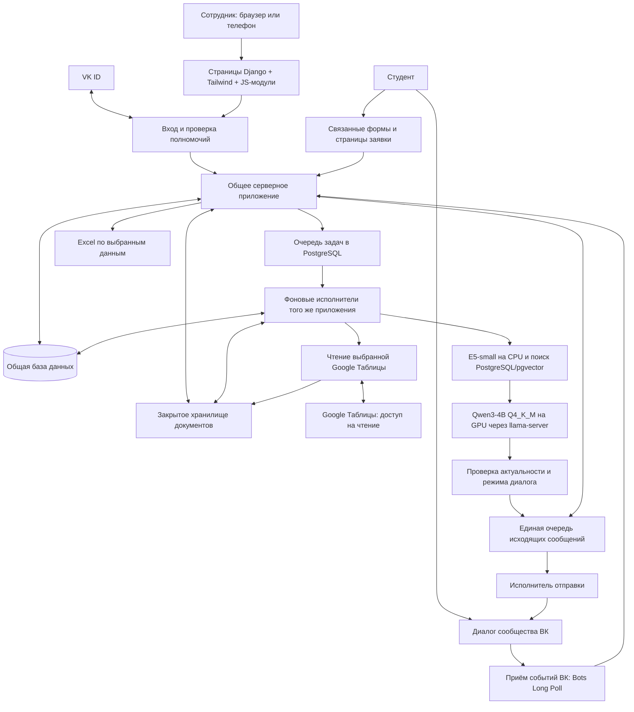
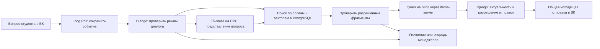

# Техническая спецификация MVP спортивного портала «Альянс»

- **Автор:** команда проекта «Альянс», подготовка с Codex.
- **Дата согласования:** 6 ноября 2026 года.
- **Стадия:** согласованная техническая спецификация MVP. Условия приёмки и включения внешних функций приведены в §28.
- **Исходная версия репозитория:** 7c9d899.
- **Источник требований:** [MVP.md](MVP.md), действующие предметные разделы и §20–27.

Документ охватывает согласованный MVP спортивного портала. Серверная основа использует Python, Django и PostgreSQL (§9.7), а прикладные операции разделены по модулям (§9.9–9.11). Контракты, критерии приёмки и порядок реализации собраны в §15–29. Условия внешних проверок перечислены в §28.2.

## 1. Назначение и общий обзор

Университетскому спортивному клубу нужен единый инструмент для поддержки студентов, организации мероприятий, поддержания составов и учёта занятий. Менеджеры выполняют работу в веб-кабинете; студент задаёт вопросы и получает сообщения через сообщество ВК, а необходимые поля регистрации заполняет через связанную форму. Руководитель получает сводные сведения и Excel из тех же рабочих данных.

Главный принцип: полезное действие менеджера одновременно создаёт сведения для руководителя. Заявку, состав или посещаемость не требуется повторно переписывать в отдельную отчётную таблицу. Визуальный язык кабинета опирается на доступный HTML-прототип, а состав экранов и их поведение — на действующие требования.

Реализация идёт законченными очередями. Первая объединяет настоящий вход сотрудников через VK ID, одобрение доступа, управление материалами, получение сообщений ВК, поиск ответа с локальной моделью, общую очередь поддержки, ответ человека и закрытие обращения. RAG означает, что перед подготовкой ответа модель получает найденные фрагменты опубликованных материалов клуба. Готовность первой очереди не означает готовность всего MVP.

Следующие очереди добавляют мероприятия, заявки, составы, занятия, посещаемость, рассылки и инструменты руководителя. Порядок работ и зависимости приведены в §29.

## 2. Проблема и существующий процесс

По собранным сведениям, заявки и контакты сейчас находятся в формах и таблицах, различающихся между направлениями. Менеджеры переносят данные, вручную связываются со студентами и отвечают на повторяющиеся организационные вопросы. Руководителю приходится получать и объединять сведения для собственной отчётности.

Это создаёт повторную работу, риск устаревших списков и затрудняет проверку, откуда взялось итоговое число. При этом точные образцы документов, форм и итогового отчёта ещё нужно получить у клуба; их содержимое не считается известным по одному описанию процесса.

Нужен продукт, в котором сотрудники видят актуальные рабочие записи, студент получает понятный ответ или помощь человека, а руководитель может перейти от показателя к его исходным данным. Работающие сейчас привычки используются как контекст; точное повторение цепочки Яндекс Формы → Google Таблица не является обязательной целью.

## 3. Пользователи и организационные условия

| Пользователь | Результат, который ему нужен |
| --- | --- |
| Студент | Получить клубную информацию, обратиться к человеку, подать свою заявку, узнать состояние и расписание, управлять членством и уведомлениями |
| Капитан команды | Подать командную заявку с отдельными игроками, видеть её состояние, передавать изменения организатору и подтвердить отказ от участия |
| Менеджер/организатор | Разобрать поддержку, обновить материалы, обработать заявки, вести мероприятие, составы, расписание и рассылки |
| Ответственный за посещаемость | С телефона отмечать людей в удобный момент занятия и видеть сохранённый результат |
| Руководитель | Видеть деятельность клуба, составы и неполные сведения; получать Excel и оставлять адресные пометки |
| Уполномоченный на доступ | Проверить нового сотрудника, назначить разрешённую роль и отозвать рабочий доступ |

Роль и подтверждённая учётная запись — разные понятия. Вход VK ID не даёт рабочие полномочия автоматически. В закрытом пилоте менеджеры имеют согласованный общий рабочий доступ; административные действия выделены отдельно. Административная матрица приведена в §9.12–9.13 и §17. Предметные полномочия заданы в контрактах соответствующих операций.

Команда разработки состоит из трёх студентов второго курса и работает преимущественно с Codex. Жёсткий календарный срок не задан. Первый пилот планируется на домашнем компьютере пользователя: i3-12100F, около 16 ГБ оперативной памяти, RTX 3050 с 8 ГБ видеопамяти. Компьютер можно оставлять включённым; доступность, удалённый доступ и скорость предстоит проверить.

## 4. Цели и признаки достижения

| Цель | Как распознать результат |
| --- | --- |
| Помочь студентам и разгрузить менеджеров | На согласованном наборе вопросов бот отвечает по опубликованным материалам, уточняет или передаёт человеку; число передач само по себе не является показателем качества |
| Сделать передачу человеку полноценной | Обращение сохранено, до назначения оно в общей очереди без владельца, после назначения владелец один, видна переписка, ответ приходит в тот же диалог ВК; после передачи модель не отвечает вместо сотрудника |
| Убрать повторный перенос данных | Принятая заявка используется в рабочих списках и отчётах без обязательного повторного заполнения нескольких таблиц |
| Дать руководителю проверяемую картину | Сводка за период связана с исходными записями; команды, участия и уникальные люди не смешиваются; выгрузка воспроизводит выбранный метод расчёта |
| Сделать интерфейс пригодным для реальной работы | Для всех включённых действий описаны экраны, права, состояния ошибок и мобильное поведение; поддержка и посещаемость доступны с телефона |
| Сохранять данные и управлять сбоями | Повторы не создают дубли, ошибка не выдаётся за успех, неизвестный исход отправки виден; есть проверенная процедура копирования и восстановления |
| Обеспечить закрытый рабочий доступ | Неодобренный и заблокированный сотрудник не получает рабочие данные через интерфейс или прямое обращение к серверу |

Цель полного короткого ответа бота — ориентировочно 4–5 секунд. Она измеряется до содержательного сообщения ВК на выбранной конфигурации и при зафиксированной нагрузке; заглушка ожидания не считается ответом. До испытаний скорость, качество и одновременное обслуживание нескольких студентов не гарантируются. Объём контрольных вопросов и допустимые пороги нужно определить до пилота.

## 5. Объём всего MVP и первая очередь

| Часть | Включённый результат | Очередь/граница |
| --- | --- | --- |
| Вход и доступ | Настоящий VK ID, заявка сотрудника, одобрение, разрешённая роль, отзыв доступа | Первая очередь |
| Поддержка ВК | Реальный приём и отправка, общая очередь, владелец, возврат, важность и завершение | Первая очередь |
| Материалы и RAG | Загрузка документов и Excel; Google Таблицы по ссылке через служебный аккаунт с ручным обновлением; подготовка, публикация/замена/снятие, поиск, локальная модель, источники и честное отсутствие ответа | Первая очередь |
| Кабинет первой очереди | Вход/статус, главная, обращения, база знаний, материал, доступ сотрудников; внутренняя индикация работы | Первая очередь, описания §26 MVP |
| Мероприятия | Создание, ответственный и помощники, дата/адрес, заявки и команды, ручной допуск, участие, результаты, завершение/архив и отмена | Последующие очереди; правила §3.2–3.3 MVP |
| Турнирное проведение | Время и площадки матчей, ручное назначение и частичный расчёт; визуальная организация этапов в выбранном ограниченном объёме | Ограниченный набор форматов и автоматизации утверждён в §24.2. Регламент первого турнира проверяется до приёмки по §28.2 |
| Составы | Секции и сборные, ручное одобрение вступления/возврата в секцию, несколько секций, самостоятельный подтверждённый выход, актуализация и история | Последующие очереди; отбор в сборную вне программы |
| Занятия и посещаемость | Разовые занятия/серии, перенос/отмена, мобильные отметки, сохранённая история | Последующие очереди |
| Сообщения студентам | Приглашения, расписания и напоминания через ВК, выбор аудитории, просмотр/подтверждение, результат и ошибки, настройки отказа | Последующие очереди; канал отправки общий с поддержкой |
| Руководитель и Excel | Сводки периода, составы, полнота, исходные записи, адресные пометки, выгрузки с листами «Итоги» и «Подробности» | Последующие очереди; опираются на рабочие модули |
| Эксплуатация | Запуск, диагностика, копии/восстановление, проверенный способ доступа и измерение нагрузки | Поэтапно, до соответствующего рабочего пилота |

Допуск команды и наличие заявки не доказывают посещение. В турнире учитывается весь начальный состав команды, отмеченной участвовавшей; поимённая явка турнира не вводится. Для занятий «не отмечен» отличается от «отсутствовал». Эти различия должны сохраниться в данных, интерфейсе и отчётах.

Разовый перенос исходных контактов по §23.6 включается после получения подходящего образца таблицы. Без образца перенос откладывается и приёмка MVP может завершиться без него. Автоматическая отправка от личного VK-аккаунта менеджера — неподтверждённая возможность, которую необходимо исследовать отдельно; наличие входа VK ID её не подтверждает. Возможность отправки с личного аккаунта проверяется отдельно от приёмки MVP.

## 6. Вне согласованного MVP

- Публичный медиасайт, публикация новостей, рейтинг направлений и специализированные списки прохода.
- Университетский SSO до получения разрешения; отдельная библиотека рабочих документов и шаблонов сотрудников. Документы для RAG при этом включены.
- Универсальные конструкторы форм, отчётов и всех спортивных форматов; произвольный импорт Excel и обязательная постоянная синхронизация Google Таблиц.
- Оплаты, бронирование залов, турникеты, подробная статистика игроков и обязательная поимённая явка командного турнира.
- Telegram и внешний мессенджер сотрудников внутри портала. Внешние сводки сотрудникам отложены; уведомления внутри кабинета включены.
- Автоматическая университетская проверка действительности студенческого и статуса обучения.

Собственные формы регистрации и необходимые страницы участника не являются отложенным публичным медиасайтом. Реализация RAG не превращает бота в собеседника по любым спортивным темам: он помогает только в рамках клуба и разрешённой информации.

## 7. Что ещё предстоит определить

Эти параметры уточняются до включения соответствующего этапа по §28.2.

1. Серверная основа выбрана: Python + Django + PostgreSQL (§9.7). Организация кода выбрана: вариант 1 (§9.9–9.11). Основа веб-кабинета выбрана: Django-шаблоны + Tailwind CSS + модульный обычный JavaScript (§9.17). Для приёма событий ВК выбран Bots Long Poll с возможностью последующей замены на Callback (§9.18). Базовые версии закреплены в [requirements.txt](../apps/backend/requirements.txt). Остальные версии и запуск проверяются на стенде. Связь идентификаторов подтверждается на пилоте по §19.4 и §23.
2. Испытание утверждённой стартовой связки: Qwen3-4B-Instruct-2507 Q4_K_M через llama.cpp на GPU и multilingual-e5-small на CPU, поиск PostgreSQL/pgvector (§9.20–9.23). Ревизия и файлы E5 закреплены в §9.22. Для Qwen и среды исполнения ещё проверяются конкретные артефакты и совместимость. Качество, память и задержка измеряются на стенде. Стартовый контекст 4096 и одна генерация одновременно относятся к первой проверке, а не к гарантии производительности.
3. Назначение конкретных ответственных сотрудников и проверка правил доступа на пилоте. Контракты рабочих прав и восстановления описаны в §17 и §23.
4. Поддерживаемые расширения и обработка документов/таблиц по реальным образцам, точные поля форм; набор эталонных вопросов и образец выгрузки руководителя. Google Таблицы подключаются по ссылке через служебный аккаунт с ручным обновлением и публикацией (§9.14–9.15).
5. Регламент первого турнира, в том числе очки, равенство мест и технические исходы. Объём автоматизации согласован в §24.2.
6. Реальный способ удалённого доступа, настройки копий, нагрузка и условия допуска к пилоту.

## 8. Структура спецификации

- [Архитектура и первая очередь поддержки](#архитектура) — §9–11.
- [Сопоставление с коммитом коллеги](#сопоставление-с-коммитом) — §12.
- [Размещение документации](#размещение-документации) — §13.
- [Операции поддержки, данные, HTTP и подключения](#операции-поддержки) — §14–20.
- [Мероприятия, секции, занятия, уведомления и отчётность](#мероприятия) — §21–27.
- [Приёмка и план реализации](#приёмка) — §28–29.

Основания продуктовых решений приведены в [MVP.md](MVP.md). Для входа §2 и §13 сравнивают варианты, включая сопровождение локальных учётных данных и приглашений. Действует VK ID с одобрением по §17. Для форм §3.2 и §9 сравнивают защищённую форму с перепиской и внешней формой. Выбрана форма §21.4, чтобы править и проверять командный список в одном месте. Для турниров §14 рассматривает внешний сервис и гибкий конструктор. Действует ограничение первыми форматами по §24.2. Внешний компонент проверяется на отсутствие повторного ввода, а новые произвольные зависимости требуют отдельной проверки правил и цены сопровождения.

Условия внешних проверок вынесены в §7 и §28.2. Текущие localStorage, переключатель профилей и поиск по словам служат демонстрации.

<a id="архитектура"></a>

## 9. Техническая архитектура

### 9.1. Основание и граница решений

Из требований уже следует одна общая серверная система: бот, кабинет и формы используют общие рабочие данные. Локальная модель работает отдельным процессом. Google Таблицы не являются обязательным промежуточным хранилищем, а Excel формируется из данных приложения по запросу.

Выбрано одно серверное приложение на Django, разделённое на предметные модули с отдельными прикладными операциями. Веб-запросы и фоновые задания могут выполняться отдельными процессами того же приложения и использовать те же правила. Разделение процессов не означает отдельные независимо разрабатываемые микросервисы.

Серверная основа утверждена в §9.7. Организация кода также утверждена (§9.9–9.11). Долговечность заданий, правила отправки и хранение заданы в §9.19, §15–16 и §9.4. Диаграмма показывает обязанности компонентов. Схема и HTTP-контракты поддержки описаны в §15–16. Выбор реализации очереди и внешние подключения проверяются по §19.4 и §29.

### 9.2. Общая схема



Для пилота выбран Bots Long Poll; будущая замена получателя на Callback предусмотрена границей подключения (§9.18). HTTPS-доступ к кабинету и формам нужен независимо от этого выбора. Схема не обещает доступность домашнего ПК извне без настройки сети.

### 9.3. Модули общего приложения

| Модуль | За что отвечает | Когда нужен |
| --- | --- | --- |
| Пользователи и доступ | Внутренние идентификаторы, внешние учётные записи, заявки сотрудников, роли, отзыв и серверные проверки | Первая очередь |
| Поддержка | Переписка, состояния обращения, общая очередь, единственный владелец, передача, возврат, завершение и история | Первая очередь |
| База знаний | Оригиналы, извлечённый текст, версии, подготовка и публикация; поиск доступных фрагментов | Первая очередь |
| Подготовка ответа | Выбор опубликованных материалов, обращение к модели, ссылки на источники, уточнение или передача человеку | Первая очередь |
| Подключение ВК и отправки | Входящие события, сопоставление канала, разрешения, исходящие попытки, ошибки, приоритеты и настройки сообщений | Первая очередь; расширяется для рассылок |
| Мероприятия и турниры | Карточка, ответственный и помощники, заявки, допуск, команды, снимок начала, матчи, участие, результаты и архив | Следующие очереди MVP |
| Секции и сборные | Составы, заявки и решения по секциям, несколько членств, выход и история | Следующие очереди MVP |
| Расписание и посещаемость | Серии и отдельные занятия, переносы, отмены, отметки с телефона | Следующие очереди MVP |
| Сводки и экспорт | Расчёт показателей из рабочих записей, полнота, детализация, адресные пометки, Excel «Итоги»/«Подробности» | Следующие очереди MVP |
| Внутренние уведомления и журнал | События для сотрудников, прочтение, авторство изменений и техническая диагностика | Основа в первой очереди; расширение с модулями |

Один модуль не должен обходить правила другого прямым произвольным исправлением его записей. Например, рассылка использует подтверждённую заявку и настройки получателя, а отчёт читает снимок турнира, а не подменяет его текущим составом секции. Границы вызовов и транзакций будут закреплены в контрактах.

### 9.4. Хранение и фоновые операции

Архитектура хранения и асинхронной обработки пилота опирается на монолитную СУБД PostgreSQL на выбранном сервере, локальное файловое хранилище с контентной адресацией (CAS) и изолированные фоновые процессы-исполнители ограниченной параллельности. Реализация должна исключать удержание транзакций при длительных внешних вызовах, сохранять целостность файлов и защищать фоновые операции от повторов. Эти требования проверяются по §9.4.2, §9.19 и §28.

#### 1. Монолитная база данных и управление целостностью
Все прикладные модули (пользователи, поддержка, мероприятия, секции, расписание, рабочая история действий, исходящие намерения и очередь фоновых задач) размещаются в едином экземпляре PostgreSQL на сервере приложения. База данных доступна исключительно во внутреннем контуре сервера и не публикуется в публичные сети. Журнал удалений мероприятий хранится в отдельном кластере PostgreSQL с независимым архивом WAL по §29.4. Откат рабочей базы не откатывает журнал.

Бизнес-инварианты (единственный владелец тикета, непротиворечивость состава участников, недопустимость повторных заявок) обеспечиваются транзакциями и декларативными ограничениями СУБД (`UniqueConstraint`, `CheckConstraint`), а не проверками интерфейсного кода.

#### 2. Фоновые операции и модель выполнения
Фоновые действия (подготовка документов, векторизация, инференс LLM, исходящие отправки в ВК, генерация отчётов) выносятся за пределы синхронного цикла обработки веб-запросов и выполняются отдельными процессами-исполнителями.
- **Запрет открытых транзакций при I/O**: категорически запрещено удерживать открытую транзакцию БД при выполнении сетевых вызовов (VK API, llama-server) или длительных CPU-вычислений.
- **Захват задачи с ограниченным сроком владения**: исполнитель получает право выполнять сохранённую задачу короткой транзакцией по правилам §9.19. Способ захвата определяется после проверки кандидата очереди. Работа выполняется вне транзакции БД.
- **Условная фиксация результата**: перевод задачи в терминальное состояние (`done`, `failed`, `unknown_outcome`) выполняется отдельной короткой транзакцией, если задача ещё выполняется и исполнитель сохраняет действующее право на фиксацию по §9.19. При истечении аренды или потере токена результат не применяется к рабочим записям во избежание гонок конкурирующих исполнителей.
- **Идемпотентность и неопределённые исходы**: исходящее внешнее действие и его уникальный ключ сохраняются атомарно с породившим его изменением по §9.19. Если отправка в ВК могла состояться, задача переходит на сверку по правилам соответствующего сценария. Автоматический повтор до установления исхода запрещён.

Детальные правила очереди, классификация ошибок и управление исполнителями зафиксированы в §9.19.

#### 3. Контентно-адресуемое хранилище файлов (CAS)
Оригиналы документов хранятся в закрытом каталоге сервера по путям, вычисляемым от их SHA-256 хеша (`/storage/files/<hash[:2]>/<hash[2:4]>/<sha256>`). Файлы на диске неизменяемы (immutable) и защищены от прямой перезаписи.

Сведения о файлах, правах доступа, пользовательских именах и привязках к сущностям хранятся в PostgreSQL. Доступ к содержимому файлов осуществляется строго через приложение с валидацией прав; знание хеша не даёт права на скачивание. Регламент двухэтапной фиксации файлов и сборки мусора (GC) с защитным карантином описан в §9.4.1.

#### 4. Производный поисковый индекс
Поисковые данные (полнотекстовые векторы `tsvector` и векторные представления `vector(384)`) являются производными и строятся на базе опубликованных версий документов (§9.20). Индекс строго версионирован: подготовка нового поколения поисковых данных выполняется до переключения активной версии, а переключение выполняется атомарно. Отозванные документы исключаются из поисковой выдачи немедленно на уровне предикатов SQL-запроса независимо от времени физической очистки старых фрагментов.

#### 5. Согласованность резервного копирования

Для небольших объектов хранение байтов в PostgreSQL упрощает согласованный снимок. Оно увеличивает объём основной базы и нагрузку на её копирование и восстановление. Для пилота выбрано закрытое CAS на диске, чтобы большие неизменяемые файлы не росли вместе с рабочей БД. Цена решения — согласованное копирование двух частей, проверка файлов и отдельный жизненный цикл. Выбор проверяется на объёмах клуба и пересматривается, если комплект нельзя восстановить в согласованное время или сопровождение двух хранилищ непропорционально объёму файлов.
Резервный комплект включает согласованный логический или физический снимок PostgreSQL и архив каталога CAS-хранилища. До начала дампа блокируется физическое удаление файлов CAS. Барьер действует до окончания копирования файлов. Добавление новых неизменяемых файлов продолжается. Регламент валидации архивов и восстановления описан в §9.4.2.

#### 9.4.1. Спецификация контентно-адресуемого хранилища файлов (CAS)

Готовность хранилища проверяется по этапам. На 1А достаточно закрытого хранения неизменяемого объекта с проверкой целостности и выдачи после проверки доступа. На 1В подключаются серверные копии вложений, истечение срока, безопасная очистка и параллельная выдача по §16.24–16.25. На 1Г проверяется совместное хранение версий материалов и вложений по правилам ниже. На 1Д на предметных данных проверяется восстановление по §9.4.2 до работы с реальными файлами. Способ выдачи через веб-сервер закрепляется после выбора рабочей среды и проверки размера файлов и нагрузки.

1. **Разделение сущностей хранения**:
   - `file_object` (физический объект): первичный ключ `sha256` (CHAR(64)), размер в байтах `size_bytes`, дата фиксации `created_at`.
   - `document_version` (содержательная версия): внешний ключ на `file_object`, номер версии, статус публикации (`draft`, `published`, `archived`).
   - `document_attachment` (пользовательский контекст): пользовательское исходное имя файла, MIME-тип, автор загрузки, связь с бизнес-сущностью (секция, регламент, обращение).
   - Одинаковое содержимое разных документов или версий ссылается на единую запись `file_object` без дублирования байтов на диске.

2. **Подготовка, размещение и фиксация ссылки**:
   - *Этап 1 (Запись во временный буфер)*: поток байтов сохраняется во временный файл в каталоге `/storage/tmp/<upload_uuid>.tmp`. На лету вычисляется SHA-256 хеш и контролируется предельный размер.
   - *Этап 2 (Проверка и размещение)*: временный и целевой каталоги находятся на одной файловой системе. Под блокировкой хеша обработчик завершает запись, проверяет размер и хеш и синхронизирует содержимое файла до атомарного размещения. Если объект уже существует, обработчик проверяет его размер и SHA-256 и синхронизирует файл перед повторным использованием. Перед фиксацией ссылки в обоих случаях синхронизируются целевой каталог и все родительские каталоги до подтверждённого устойчивого корня CAS включительно. Это требуется и для уже видимого файла, который мог остаться после сбоя до синхронизации каталогов. При новом перемещении дополнительно синхронизируется исходный каталог. Блокировка хеша удерживается до коммита ссылки. Способ синхронизации проверяется на выбранной ОС и файловой системе. Ошибка любого шага или несовпадение хеша запрещают фиксацию новой ссылки.
   - *Этап 3 (Фиксация в БД)*: в транзакции создаётся или обновляется запись `file_object` и привязанные к ней сущности (`document_version`, `document_attachment`). Если транзакция завершается ошибкой, файл остаётся на диске как невостребованный и ожидает регламентной очистки.

3. **Сборщик мусора (Garbage Collector) и защита от гонок**:
   - Физическое удаление файлов с диска выполняется отдельным регламентным процессом (GC).
   - **Защитный карантин (Grace Period)**: запрещено удалять файлы, возраст которых меньше 24 часов по разнице текущего времени и `mtime`, даже если ссылки на них в БД отсутствуют. Возраст служит дополнительным фильтром. От гонки с загрузкой защищают блокировка и проверка актуальных ссылок.
   - **Двухфазная маркировка (Mark-and-Sweep)**:
     1. *Фаза Mark*: сканирование БД в транзакции `REPEATABLE READ`, формирование реестра всех активных `sha256` из `file_object`.
     2. *Фаза Sweep*: сканирование каталога `/storage/files/`. Файл удаляется только при соблюдении обоих условий: хеш отсутствует в реестре активных ссылок И возраст файла превышает 24 часа.
   - Перед удалением кандидата GC берёт общую с операциями фиксации CAS блокировку по хешу и заново проверяет наличие записи `file_object` в актуальной БД. Операция фиксации удерживает эту блокировку от проверки или размещения целевого файла до коммита ссылки. Это защищает повторное использование старого файла, оставшегося на диске после отката. Сеть и подготовка временного файла происходят до блокировки.
   - Временные файлы из `/storage/tmp/` удаляются после 24 часов только под общей с загрузчиком блокировкой по ID загрузки, если запись и размещение уже не выполняются. Проверяются сбои до синхронизации файла, после размещения и до коммита ссылки, повтор с повреждённым остатком и повторное использование видимого файла после сбоя между перемещением и синхронизацией каталогов с последующей потерей питания.

4. **Изоляция доступа к содержимому**:
   - Каталог `/storage/` закрыт для прямого чтения через веб-сервер (Nginx/Caddy). Прямые URL к файлам по хешу отсутствуют.
   - Скачивание выполняется через авторизованный эндпоинт Django, проверяющий права текущего пользователя на привязанную сущность (`document_attachment`).
   - Один из вариантов выдачи больших файлов на Linux — проверка прав в Django и передача фактической выдачи веб-серверу через `X-Accel-Redirect` (Nginx) или `X-Sendfile`. Вариант подходит после проверки рабочей среды и гарантий чтения и очистки по §16.24–16.25.

#### 9.4.2. Регламент резервного копирования и восстановления

1. **Создание согласованного резервного комплекта**:
   - Резервный комплект состоит из двух неразрывных компонентов:
     а) Дамп базы данных PostgreSQL в кастомном бинарном формате: `pg_dump -Fc --blobs`;
     б) Инкрементальная копия каталога `/storage/files/`, созданная с помощью `rsync` или `restic`.
   - **Протокол согласованности без длинной паузы**:
     1. До начала дампа общий барьер запрещает новые физические удаления CAS и дожидается завершения начатых. Все пути физической очистки соблюдают барьер до конца копирования файлов.
     2. Дамп PostgreSQL завершается успешно до начала копирования CAS. Барьер физических удалений сохраняется до завершения копирования файлов. Если дамп не завершился, комплект не публикуется. Поскольку физические файлы в CAS иммутабельны (новые добавляются, старые не модифицируются), любой файл, ссылка на который попадёт в дамп БД, уже зафиксирован на диске и прошёл `fsync`.
     3. Выполняется синхронизация каталога файлов `/storage/files/` во внешнее хранилище. Появление новых файлов во время копирования безвредно: они просто станут кандидатами на очистку при восстановлении на более ранний дамп.
     4. Снимается барьер удаления. Дамп и снимок файлов получают один идентификатор поколения и неизменяемый манифест. Комплект становится доступен для восстановления после проверки обоих компонентов и атомарной публикации отметки о готовности. Следующее копирование не меняет завершённое поколение. При очистке сроков учитываются все комплекты, которые ещё можно восстановить.
   - Резервные копии шифруются и перемещаются на изолированный физический носитель или удалённый сервер.

2. **Процедура верификации архива при восстановлении**:
   - Восстановление выполняется в новую пустую изолированную БД: `pg_restore --exit-on-error -d <db_name> <dump_file>`. На стенде проверяется загрузка и фиксация нового файла во время создания дампа: для каждой ссылки в дампе файл присутствует в том же комплекте. После следующего копирования проверяется доступность предыдущего поколения. Сбой между сохранением дампа и файлов не делает неполный комплект доступным.
   - До распаковки оператор выделяет отдельный корень CAS, недоступный рабочему приложению и его сборщику мусора. БД и этот корень образуют одну изолированную пару. Проверка выполняется по этой паре, даже если рабочая среда на том же хосте продолжает работу. Для переключения рабочей среды оператор останавливает старые процессы, блокирует запись и переключает БД и корень CAS вместе. Автозапуск, удаление файлов и внешние отправки остаются выключенными до выполнения регламента. На стенде проверяется восстановление при работающем сборщике исходной среды.
   - **Обязательная автоматическая проверка целостности**:
     ```sql
     -- Скрипт верификации: извлечение всех зарегистрированных хешей
     SELECT sha256, size_bytes FROM file_object;
     ```
     Для каждой строки проверяется физическое наличие файла на диске и соответствие размера. Недостающие файлы фиксируются как критическое нарушение целостности архива.
   - Проверка контрольных сумм SHA-256 выборочной совокупности файлов (или полного объёма при регулярном тестовом восстановлении).

3. **Протокол запуска исполнителей после восстановления (Защита от повторных внешних эффектов)**:
   - Снимок может не содержать подтверждения внешнего вызова или самого действия, выполненного после его создания. Охват сверки задают шаги 3–6, включая ранее завершённые ошибкой ответы, для которых в копии может отсутствовать более поздняя попытка.
   - **Порядок холодного старта**:
     1. Запрещается автоматический запуск фоновых воркеров при старте СУБД.
     2. До любых новых внешних отправок останавливаются старые экземпляры приложения и блокируется запись в восстановленную БД из кабинета, Long Poll и других исполнителей. Изоляция сохраняется до завершения санитарной обработки; одного отключения автозапуска нового воркера недостаточно.
     3. Санитарная обработка выполняется согласованными транзакциями по связанным записям. Для исходящих заданий `send_vk_message`, `send_vk_bot_part` и `send_notification` выбираются состояния `pending`, `processing`, `retry_scheduled` и уже имеющийся `unknown_outcome`. Последнее состояние включается для повторяемости процедуры и исправления ранее рассогласованных записей. Для поддержки связь задания с `response_id` и `attempt_id` обязательна в `payload` (§16.7); принадлежность попытки ответу и обращения проверяется до изменения. Задания частей бота и восстановленные части без задания обрабатываются по §15.11.
     4. Для каждой группы поддержки блокируются обращение → ответ → попытка → задание. В одной транзакции незавершённые задание, попытка и ответ переводятся в `unknown_outcome`; прежний токен аренды заменяется, `locked_until` очищается, у попытки `finished_at=NULL`, в задании и причине ответа фиксируется `recovered_from_backup`. Текст, UUID команды, `vk_random_id` и привязка черновика сохраняются; новое задание отправки не создаётся. При ошибке любое изменение этой группы откатывается. Задания других каналов проходят такой же протокол со своими записями исходящих операций, не с таблицами поддержки.
     5. **Особенность восстановления исторической копии:** `started_at=NULL` в копии не доказывает отсутствие внешнего вызова после момента копирования. Такое значение сохраняется как факт копии и не заполняется вымышленным временем; попытка и ответ всё равно блокируются в `unknown_outcome`. Восстановление — отдельное основание неизвестности, отличное от обычного падения исполнителя в актуальной БД. После него проверка `started_at=NULL` сама по себе не разрешает отправку.
     6. Если задание ссылается на отсутствующую/чужую попытку или восстановленные записи имеют противоречивый подтверждённый исход, автоматический запуск отправок не разрешается до разбора. Нельзя затирать установленный успех либо менять принадлежность записи ради прохождения обработки. Состояния подтверждённых до копии отправок без незавершённого задания сохраняются; это не восстанавливает действия, целиком отсутствующие в копии. До возобновления записи для каждого восстановленного ответа со статусом `failed` устанавливается индивидуальная блокировка ручного повтора по §15.10. Она покрывает случай, когда новая попытка после копирования целиком отсутствует в восстановленной БД.
     7. Повторный запуск обработки не создаёт сетевых попыток, сообщений и новых UUID команд. Воркеры и запись из кабинета включаются после проверки согласованности обработанных групп, установки всех индивидуальных блокировок и разбора нарушений связности. Ответы, ожидающие сверки, сохраняют собственные запреты после включения кабинета. Сверка неизвестного результата не вызывает отправку; её результат сохраняется атомарно для связанных записей по §15.1 и §9.19. Для неизвестности без доказательств блокировка сохраняется, а не снимается по таймеру.
     8. Производные поисковые данные (векторы pgvector) валидируются и при необходимости ставятся в очередь на фоновое перестроение. Восстановленные публикации допускаются к ответам только после сверки актуальности по §18.1.
     9. До открытия входа аннулируются восстановленные сеансы и незавершённые попытки входа. До запуска постановщиков обычных напоминаний применяется карантин §26.4, в том числе для отправок, отсутствующих в снимке. Права сотрудников и привязки сотрудников и участников сверяются по регламенту ниже, §17.5 и §23.5.

##### Проверка прав и привязок после отката

1. При плановом восстановлении ответственный за эксплуатацию блокирует новые записи в исходную рабочую БД, дожидается завершения или отката пишущих транзакций и фиксирует её конечную позицию WAL. Подтверждение с идентификаторами среды, кластера и ветви PostgreSQL сохраняется вне восстанавливаемых баз. Оно теряет силу, если исходная база снова приняла записи. Источником сверки служит остановленная актуальная БД либо проверенная базовая копия с непрерывной цепочкой WAL, воспроизведённой до этой независимо подтверждённой точки. Последний доступный сегмент сам по себе полноту не подтверждает.
2. По доверенному источнику ответственный сверяет действующие допуски, роли, назначения, делегирования и привязки, включая отзывы и переносы после снимка. Пока сверка не завершена, обычный вход, первичная привязка, доступ к данным и фоновые отправки блокируются для затронутых профилей и внешних идентификаторов. При неизвестном охвате карантин охватывает все профили и внешние идентификаторы, включая отсутствующие в снимке. Обычный вход по ранее неизвестному идентификатору и автоматическое создание профиля запрещены до завершения общей сверки. Для уже проверенных групп доступ открывается явно. Для подтверждения личности под карантином разрешены служебные операции по §17.5 и §23.5, без выдачи обычного сеанса.
3. Сервер применяет сверенный результат для всей связанной группы одной транзакцией: блокирует профили и идентификаторы, отключает устаревшие привязки, записывает актуального владельца идентификатора и заменяет действующий набор прав, делегирований и назначений подтверждённым набором. Назначения, не вошедшие в подтверждённый набор, закрываются с сохранением истории. Сервер увеличивает версии прав, привязок и сеансов затронутых профилей и сохраняет основание сверки. Снятие карантина для проверенной группы фиксируется в той же транзакции. Старый идентификатор остаётся зарезервированным для истории и не создаёт новый профиль. При сбое или конфликте группа остаётся закрытой. Снятие карантина входа само по себе не разрешает отправки, ожидающие сверки по этому разделу и §26.
4. При утрате полного источника ответственный использует аварийный служебный порядок §17.5. Затем личность, привязка и текущие полномочия каждого открываемого профиля подтверждаются заново по независимым сведениям клуба. Для участника отдельно подтверждается связь с существующим профилем по §23.5. При отсутствии достаточного подтверждения профиль и связанные идентификаторы остаются закрытыми. Результат применяется в порядке пункта 3.

**Проверки восстановления при реализации:** копия с `pending` и `started_at=NULL`, после которой сообщение реально ушло, после восстановления даёт неизвестность на всех трёх уровнях и не отправляется повторно; сбой между обновлениями откатывает всю группу; повторная обработка ничего не отправляет; отсутствующая связь или противоречивый исход блокируют запуск; ручной повтор из кабинета недоступен до сверки. Подтверждённая история не подменяется предположениями, потерянные после момента копии события не объявляются восстановленными.

### 9.5. Первый сквозной путь и защита от запоздалого ответа

1. Сотрудник входит через VK ID. Сервер связывает подтверждённую внешнюю учётную запись с внутренним пользователем; до одобрения показывает только разрешённое состояние заявки. Связь этого идентификатора с отправителем сообщений сообщества проверяется отдельно.
2. Менеджер загружает материал. Подготовка создаёт новую версию и фрагменты; загрузка сама по себе не публикует материал. До явной замены продолжает действовать прежняя опубликованная версия. Ошибка подготовки новой версии не снимает старую.
3. Событие ВК сохраняется с ключом защиты от повторов. После надёжного приёма создаётся обработка; повтор того же события не порождает новое обращение или второй ответ.
4. Сервер проверяет режим диалога. Если обращение передано людям, сообщение направляется в соответствующую очередь/переписку без нового ответа AI. Иначе поиск выбирает только опубликованные и разрешённые студенту источники; внутренние данные сотрудников автоматически в RAG не попадают.
5. При достаточном основании модель готовит короткий ответ с источниками. При отсутствии основания, конфликте, неприемлемом ожидании или явном запросе человека применяется согласованный путь уточнения/передачи. Посторонняя тема получает объяснение границ помощи.
6. Перед постановкой AI-ответа на отправку и непосредственно перед попыткой отправки сервер повторно проверяет актуальность входного сообщения, режима диалога и версий источников. Результат устаревшего вычисления отбрасывается. Переход к человеку и допуск отправки должны иметь определённый порядок для одного диалога; уже начатый внешний сетевой вызов невозможно обещать отозвать задним числом. Порядок синхронизации передачи и допуска отправки задан в §15.11. Поведение внешнего канала проверяется по §19.4.
7. Менеджер атомарно берёт обращение. Сервер допускает ответ только действующего владельца с сохранёнными полномочиями. Его ответ проходит через тот же механизм исходящих сообщений; сохранение текста, принятие ВК и фактическое прочтение студентом не смешиваются.

Если отмена занятия или отказ от уведомлений зафиксированы до допуска попытки, старое напоминание не отправляется (§25.2, §26.1). Если допуск зафиксирован первым, сервер сохраняет подтверждённый исход либо оставляет неизвестный исход на сверке по §26.3. Свойства дедупликации ВК проверяются по §19.4.

### 9.6. Ограничения домашнего запуска

Сервер, база, файлы и модель могут размещаться на одном ПК пилота, но модель запускается отдельно и получает ограниченную очередь. Отказ или перегрузка модели не должны блокировать вход сотрудников, чтение сохранённых данных и обработку людьми. Независимость процессов не защищает от выключения всего компьютера; нужны автозапуск, резервное копирование вне единственного диска и проверка восстановления.

Предлагается не давать модели прямой доступ к базе и операциям приложения: она получает разрешённые текстовые фрагменты и возвращает проект ответа. Допуск сотрудников, изменение состава и отправку рассылки выполняет сервер по явным правилам. Загрузка документа не даёт его содержимому полномочий изменять инструкции или вызывать действия.

На RTX 3050 8 ГБ скорость и параллельность сначала измеряются. Название серверного фреймворка не доказывает достижение 4–5 секунд. Нужно измерить отдельно ожидание в очереди, поиск, генерацию и отправку ВК, а затем весь путь. Стартовые модели и параметры описаны в §9.20–9.23. Рабочие лимиты и пороги принимаются по измерениям; поиск PostgreSQL/pgvector и запуск модели ответа через llama.cpp выбраны в §9.20–9.21.

Перед рабочим пилотом сравниваются два размещения. Один домашний узел упрощает связь с локальной GPU, но выключение узла останавливает кабинет и канал. Размещение веба и БД отдельно от домашней модели позволяет им работать независимо, но требует защищённой связи с моделью и проверенного режима её недоступности. Выбор подтверждается тестами HTTPS, доступа в закрытый кабинет, возврата VK ID, автозапуска, восстановления и недоступности модели. Допустимый простой согласуется до включения реальных данных.

### 9.7. Серверное основание — выбран Django

Оба варианта сохраняют общую модульную систему, отдельную локальную модель и специальный интерфейс по прототипу. Оба требуют настоящей интеграции VK ID, проверки прав, миграций, фоновых исполнителей и испытаний; ни один не даёт готовый MVP установкой библиотеки. Пользователь выбрал вариант А: Python + Django + PostgreSQL. Сравнение ниже сохранено как основание решения; FastAPI не входит в выбранный серверный стек. База и интеграции ещё не реализованы.

| | Вариант А: Python + Django + PostgreSQL | Вариант Б: Python + FastAPI + PostgreSQL |
| --- | --- | --- |
| Механизм | Использовать встроенные средства Django для данных, миграций, пользователей, групп, прав и сессий; поверх них написать правила клуба и API кабинета | Собрать явный API на FastAPI; для доступа к базе и миграций добавить SQLAlchemy/Alembic, определить и реализовать единый механизм пользователей, прав и сессий |
| Что даёт | Больше общих средств учёта и доступа поставляется одной системой; техническая админка пригодна для ограниченных служебных задач | Контракты API и валидация запросов занимают центральное место; выбор остальных компонентов отделён от API-фреймворка |
| Цена | Нужно освоить соглашения Django; встроенные права не заменяют предметные ограничения, например ответ только владельцу обращения | Больше интеграционных решений и согласования между библиотеками; готовые средства безопасности не равны готовой корпоративной системе |
| Когда подход не оправдывается | Если команда начнёт обходить правила приложения через прямое редактирование технической админки либо дублировать встроенную систему отдельной несовместимой системой пользователей | Если команда не закрепит единые правила сессий, доступа и транзакций: разные обработчики могут начать выполнять их по-разному |

Django документирует встроенные пользователей, группы, права и серверные сессии с идентификатором в cookie; его админка не предназначена для замены всего пользовательского интерфейса. [Система доступа](https://docs.djangoproject.com/en/5.2/topics/auth/), [границы админки](https://docs.djangoproject.com/en/5.2/ref/contrib/admin/).

FastAPI документирует валидацию, OpenAPI и средства подключения безопасности. Его `BackgroundTasks` выполняются в процессе приложения; долговечные отправки и обработка модели в этом проекте проектируются отдельно. [Возможности FastAPI](https://fastapi.tiangolo.com/features/), [фоновые задачи](https://fastapi.tiangolo.com/tutorial/background-tasks/).

Оценки трудоёмкости в таблице — проектное сравнение состава работ, а не результат замеров этих двух реализаций. Ссылки проверены 1 ноября 2026 года; конкретные поддерживаемые версии и совместимость зависимостей ещё предстоит закрепить для выбранного стека. Фронтенд позднее утверждён в §9.17: Django-шаблоны + Tailwind CSS + модульный обычный JavaScript. Приём событий ВК описан в §19. Удалённый доступ подтверждается испытанием рабочего размещения по §28.2.

**Решение пользователя от 1 ноября 2026 года:** вариант А, Django. Контракты и проверяемые этапы приведены в §15–29.

### 9.8. Архитектурные требования и способ их проверки

Пользователь отдельно подтвердил требование модульности и возможности развития проекта. Это относится к обоим вариантам стека. Название фреймворка и наличие каталогов по модулям не являются доказательством выполнения требования. Ниже — предлагаемые проверяемые ограничения; конкретные интерфейсы и распределение файлов уточняются в последующих частях спецификации.

| Требование | Как реализовать и проверить |
| --- | --- |
| Границы предметных модулей | У поддержки, базы знаний, мероприятий, составов и остальных модулей есть обозначенные обязанности, принадлежащие им данные и разрешённые точки взаимодействия. Проверки зависимостей запрещают циклические импорты и обход этих точек. Общие справочники имеют конкретного владельца. |
| Единое выполнение бизнес-правил | Веб-обработчик, событие ВК и фоновое задание вызывают один прикладной сценарий. Критические правила — единственный владелец обращения, допуск, фиксация состава, право отправки — проверяются на сервере при каждом соответствующем действии. Тесты проверяют запреты и конкурирующие изменения, а не только успешные ответы. |
| Отделение внешних подключений | Предметные сценарии не зависят от формата ответа VK API, SDK модели или компонентов браузера. Подключения переводят внешние данные в согласованные внутренние контракты. Замена модели или добавление университетского SSO не требует переписывать турнирные правила. Интерфейсы вводятся на реальных границах; создавать обёртку над каждым классом не требуется. |
| Явные зависимости и транзакции | В спецификации перечислены разрешённые вызовы между модулями и операции, которые должны сохраняться атомарно. Блокировки базы не удерживаются на время генерации или сетевого вызова ВК. Изменение рабочих данных и создание исходящего намерения не теряются между двумя несогласованными записями. Общая база допускает необходимые транзакции; она не даёт любому модулю право произвольно менять чужие записи. |
| Расширение без копирования процессов | Новый вид спорта, форма поддерживаемого шаблона или поставщик входа добавляется через определённую точку расширения. Изменяемые правила и настройки отделяются от одинакового процесса. Новые спортивные правила всё равно требуют проектирования и проверки; универсальность всех форматов заранее не обещается. |
| Масштабирование по измеренной нагрузке | У веб-приложения нет единственной копии рабочих данных в памяти процесса. При добавлении экземпляров общими остаются база, сессии, файлы, задания и координация обработки одного диалога. Исполнители допускают ограниченное увеличение числа процессов с проверкой захвата заданий, порядка и повторов. Модель и база могут остаться пределом производительности: дополнительные веб-процессы сами его не устраняют. |
| Управляемые изменения данных и контрактов | Схема базы изменяется миграциями; внешние и внутренние контракты описаны явно. Обновление приложения учитывает сохранённые задания старой версии. Для каждого этапа указаны порядок обновления, совместимость и восстановление, включая случаи, где обратная миграция невозможна без потери данных. |
| Проверяемая эксплуатация | Логи связывают обращение, входящее событие, задание и попытку отправки без публикации токенов и лишних персональных данных. Проверяются сбой модели, повтор события, перезапуск исполнителя, истечение сеанса, отзыв прав и восстановление копии. Зависимости фиксируются; секреты отделены от Git. |

Практический критерий для разработки коллегами: у каждого модуля должны быть контракт, правила владения данными, состояния, проверки и понятная точка подключения к общей системе. В плане файлов потребуется указать, какие проверки удерживают эти границы. Структура каталогов сама по себе этому критерию не соответствует.

Разделение на независимо развёртываемые сервисы остаётся возможным направлением при появлении конкретной потребности; оно не является обещанием переноса без затрат. Сначала следует измерять узкое место и проверять, достаточно ли настройки запросов, индексов, ограничений очереди или отдельного исполнителя. Формальный полный набор шаблонов Clean Architecture, DDD или CQRS этим документом не утверждается: конкретную структуру выбираем по обязанностям и проверкам, с учётом команды из трёх человек и домашнего пилота.

### 9.9. Организация кода: выбран вариант 1

Архитектурное основание остаётся общим: предметные модули внутри одного серверного приложения, отдельные процессы фоновых исполнителей и модели. Пользователь утвердил вариант 1 от 1 ноября 2026 года: прикладные операции с контролируемой зависимостью от Django ORM. Вариант 2 ниже сохранён как рассмотренная альтернатива. Это отдельная ось выбора от Django/FastAPI: сам по себе FastAPI не означает Clean Architecture, а Django не исключает её.

**Вариант 1. Прикладные сценарии с контролируемой зависимостью от фреймворка.** Модуль содержит входные обработчики, именованные операции изменения, запросы чтения, модели данных и внешние подключения. Операция вроде «Взять обращение» или «Одобрить заявку» может прямо использовать ORM и транзакции выбранного стека. HTTP-обработчики и обработчики ВК переводят входные данные и вызывают эти операции; правила не размножаются по обработчикам. Самостоятельные расчёты, например построение последовательности времени матчей, оформляются без сетевого и файлового ввода-вывода.

- Цена: изменения фреймворка и ORM могут затронуть прикладные операции; проверки операций с базой требуют настоящей тестовой базы.
- Условия применимости: команда принимает зависимость от выбранного стека и удерживает её внутри владельца данных. Замена VK API и модели изолирована отдельно.
- Когда граница ломается: обработчики начинают самостоятельно изменять записи, чужие модули импортируют внутренние ORM-модели для записи, один файл сценариев превращается в неограниченный набор обязанностей. Формальное наличие каталога `services` этого не исправляет.

**Вариант 2. Прикладное и предметное ядро, независимое от фреймворка.** Предметные состояния и правила не импортируют ORM, веб-фреймворк или SDK. Прикладные операции работают с явно заданными интерфейсами хранилищ, транзакций и внешних действий. Инфраструктурные реализации связывают эти интерфейсы с базой, ВК и моделью. В точке сборки приложения выбираются конкретные реализации. Предметные объекты и записи ORM могут иметь разные представления.

- Цена: дополнительные интерфейсы, преобразования и проверки соответствия; нужно явно определить, где начинаются транзакции и как сохраняются ограничения базы. Замена базы всё равно требует миграций и испытаний.
- Условия применимости: команда готова поддерживать отдельную предметную модель и проверять направление зависимостей; сложность правил или потребность в независимых реализациях оправдывают эту работу.
- Когда граница ломается: архитектура существует только на схеме, а ядро обращается к глобальной ORM-сессии; абстракции скрывают существенные блокировки и порядок операций; тесты с подставными хранилищами проходят, но реальная база допускает гонки.

Оба варианта позволяют поддерживать качество. Различие — в изоляции от фреймворка, стоимости разработки и характере тестов. Утверждён вариант 1: его прикладные операции соответствуют сценариям клуба и позволяют использовать выбранный Django без отдельной копии всей предметной модели. Изоляция внешних подключений, контроль зависимостей и проверки входят в выбранный подход. Конкретизация — в §9.11. Запланированные файлы приведены в §29.2.

### 9.10. Правила разработки для выбранной организации кода

#### Явный путь действия

Каждое изменение имеет один именованный прикладной вход, понятные входные/выходные данные, проверку инициатора и состояния, границу транзакции и определённые ошибки. Например, «Одобрить заявку в секцию»:

1. Получить внутренний идентификатор инициатора из проверенного сеанса, а не из произвольного поля запроса.
2. Проверить рабочий доступ и право выполнить операцию; права и состояние заявки проверить в согласованной транзакционной границе, исключающей обход при конкурентном изменении.
3. Защитить заявку от конкурирующего решения и проверить её актуальную версию.
4. Одной транзакцией сохранить решение, членство, запись истории и намерение уведомить студента. Ограничения базы защищают от второго действующего членства в том же направлении.
5. После фиксации отдельно обработать уведомление через общий механизм отправки. Недоступность ВК не отменяет сохранённое решение; повторная отправка запроса на одобрение не создаёт ещё одно членство.

Это описание архитектурной обязанности, не окончательный контракт состояния заявки или формат API. Порядок проверки полномочий и блокировок задан в §17.4, решение по заявке секции — в §22.2.

Для существенных бизнес-действий предлагаются прямые вызовы вместо скрытых цепочек ORM-сигналов и глобальной шины событий. Отложенный эффект записывается явно и имеет отслеживаемое состояние. Документация Django также предупреждает о трудности сопровождения сигналов и предлагает прямой вызов, где это возможно; это основание для ограничения, а не запрет всех технических сигналов. [Документация сигналов](https://docs.djangoproject.com/en/5.2/topics/signals/).

#### Владение данными и чтение

У каждого набора данных один предметный владелец, который выполняет изменения. Другие модули используют его опубликованные операции и контракты; зависимости перечисляются явно. Для сценария, затрагивающего несколько модулей, задаётся конкретный координатор и транзакционная граница, а не взаимные вызовы по кругу.

Сложные выборки руководителя и Excel могут объединять данные нескольких модулей через явно описанные запросы только для чтения. Не требуется загружать по одному объекту ради каждого столбца отчёта. Такие запросы зависят от документированных схем/проекций и меняются вместе с миграциями; доступ к ним не даёт права менять данные чужого модуля. Отдельная система CQRS или копия всей базы этим разделом не вводится.

Общие идентификаторы, форматы ошибок и технические средства получают ограниченные обязанности. Раздел `common`/`utils` не становится местом для спорных бизнес-правил. Новую абстракцию вводят для конкретной границы или повторяющегося поведения, с описанием её ответственности.

#### Минимальные проверки перед объединением изменений

| Проверка | Что должна обнаружить |
| --- | --- |
| Форматирование и статический анализ | Несогласованный стиль, неиспользуемый код, типовые ошибки; точные инструменты и конфигурация фиксируются со стеком |
| Типы на контрактах и в новом серверном коде | Несовместимые входы/выходы и необработанные варианты; непроверенные данные внешнего API валидируются на входе, аннотация типов их не подтверждает |
| Контракты импортов | Циклы, запрещённый доступ к внутренним модулям и зависимость ядра от инфраструктуры, если выбран вариант 2 |
| Предметные проверки | Переходы состояний, правила ролей, дедлайн, запрет изменения стартового состава, выключение AI после передачи |
| Интеграционные проверки с PostgreSQL | Ограничения, миграции, конкурирующее взятие обращения, повтор одобрения и транзакционное сохранение исходящего намерения; SQLite не подменяет эти проверки |
| Проверки подключений | Формат и повторы реальных событий ВК, отзыв разрешения, тайм-аут, устаревший ответ модели; локальные подстановки дополняются отдельными проверками реального подключения |
| Сквозной сценарий затронутого модуля | Наблюдаемый результат пользователя и корректные состояния ошибки, включая поведение интерфейса |

Пример подходящего инструмента архитектурного контроля для Python — Import Linter: он поддерживает запрещённые импорты, защищённые модули, слои и отсутствие циклов. Его конфигурация должна отражать выбранную архитектуру; наличие установленного пакета не доказывает соблюдение границ. Он также не обнаруживает произвольные SQL-запросы и нарушения бизнес-правил. [Контракты Import Linter](https://import-linter.readthedocs.io/en/stable/contract_types/).

Тесты пишутся под существенные риски и поведение. Процент покрытия и ограничение длины файла не заменяют проверки сценариев. Общие проверки выполняются автоматически перед объединением; расширенные испытания GPU, ВК и восстановления запускаются отдельно и имеют записанный результат. Разработка с Codex подчиняется тем же правилам: небольшое изменение в пределах конкретного модуля, просмотр diff, применимые проверки, затем объединение.

#### Решения, которые можно восстановить из документации

Для каждого существенного выбора в этой спецификации фиксируются причина, альтернативы, ограничения и условие пересмотра. В инструкциях для разработки требуется отразить выбранные границы и команды проверок. Незавершённое решение не выдаётся за выполненное; исключение из архитектурного правила сопровождается конкретной причиной и оценкой влияния. Реестр файлов для выбранного Django и варианта организации кода приведён в §29.2.

**Утверждено:** Django и организация кода по варианту 1. Дальнейшая спецификация использует это основание. Утверждение основы не заменяет последующую проработку и согласование API, данных и оставшихся технических подключений.

### 9.11. Выбранная организация кода на Django

Профиль ниже конкретизирует утверждённый пользователем вариант 1. Раздел определяет организацию кода. Схема и HTTP-контракты поддержки приведены в §15–16. Он рассчитан на команду из трёх человек, общий рабочий кабинет с несколькими предметными направлениями и домашний пилот. Основание выбора — характер работы: большинство операций изменяет связанные записи с проверкой прав и состояний; основные внешние границы — ВК, модель, документы и выгрузки. Дополнительное полностью независимое от ORM ядро сейчас не обосновано отдельной потребностью. Если появится сложная предметная область, её независимое ядро можно спроектировать локально, оценив стоимость и совместимость.

#### Распределение обязанностей внутри модуля

Это логические роли будущих файлов, а не обязательные одинаковые каталоги для каждого простого справочника. Небольшую роль допустимо держать в одном файле; рост делится по связанным сценариям, без изменения контрактов.

| Часть | Обязанность | Ограничение |
| --- | --- | --- |
| Входные обработчики | Разобрать HTTP-запрос, событие ВК или параметры задания; проверить формат и вызвать нужную операцию | Не реализуют самостоятельно допуск, переход состояния или изменение состава |
| Прикладные операции | Выполнить именованное действие с инициатором: взять обращение, опубликовать версию, принять заявку; проверить право, состояние, конкурентный доступ и транзакцию | Могут использовать Django ORM внутри своего модуля; не зависят от объекта HTTP-запроса и SDK ВК/модели |
| Запросы чтения | Вернуть разрешённые списки, карточки и показатели с фильтрацией, пагинацией и контролем объёма выборок | Не меняют состояние при чтении; межмодульные отчёты оформляются явно по §9.10 |
| Модели и ограничения | Задать сохраняемые сущности, связи, допустимые значения и ограничения целостности | Техническое сохранение модели само по себе не запускает скрытую цепочку бизнес-действий |
| Предметные правила и расчёты | Выразить проверяемые правила и расчёты, например последовательность начала матчей или допустимость перехода | Не выполняют сетевые вызовы; самостоятельные вычисления проверяются без базы |
| Контракт модуля | Описать разрешённые операции, типы входа/выхода и ошибки для других модулей | Не раскрывает изменяемые ORM-объекты как общий способ правки данных |
| Внешние подключения | Выполнить конкретный запрос ВК, обращение к модели, чтение поддерживаемого документа или создание файла | Не получают права самостоятельно решать, кого допускать, как закрывать обращение и кому разрешено писать |

Схема одного действия: входной обработчик → прикладная операция → правила и ORM своего модуля → зафиксированные данные/исходящее намерение → отдельный исполнитель внешнего действия. Прикладной сценарий является точкой оркестрации; ни общий контроллер, ни техническая админка не подменяют его.

Внутренние запросы не должны случайно запускаться при сериализации или обращении другого модуля к ленивому ORM-объекту. На границе контракта возвращается определённый результат с нужными данными. Это не требование дублировать каждую модель отдельным классом: отдельное представление вводится на границе взаимодействия и проверяется по контракту.

#### Что закрепить до первой реализации

Для первой очереди §15–20 задают данные, переходы и права: сотрудники/учётные записи, обращения/сообщения, материалы/версии, входящие события, задания и исходящие попытки. У каждой операции должны быть определены успешный результат, отказ, повтор, конфликт и последствия перезапуска. Поля нельзя окончательно выводить только из демонстрационных данных.

Используем средства Django для транзакций и ограничений, но задаём их под сценарий. `transaction.atomic()` обеспечивает совместную фиксацию изменений, а не автоматически решает все гонки. Где требуется исключить конкурирующее изменение, выбирается конкретная блокировка, условное обновление либо ограничение базы и проверяется на PostgreSQL. Сетевые вызовы не выполняются под длительной блокировкой. [Транзакции Django](https://docs.djangoproject.com/en/5.2/topics/db/transactions/), [блокировки строк](https://docs.djangoproject.com/en/5.2/ref/models/querysets/#select-for-update).

Контракты кабинета, бота и внутренних операций описываются согласованно: одинаковые значения состояний, устойчивые идентификаторы, предсказуемые ошибки и явная проверка полномочий. По времени задаются хранение, часовой пояс отображения и правила дедлайна. Для отправок задаётся различие между сохранением намерения, принятием ВК и неизвестным исходом. Для поддержки применяются HTTP-контракты §16. Реализация очереди выбирается по результатам проверки §9.19.

#### Качество кода и пригодность продукта проверяются отдельно

| Область | Какое свидетельство потребуется |
| --- | --- |
| Сопровождаемость | Другой участник команды по документации находит владельца операции, запускает приложение и проверки; изменения не требуют обхода границ модуля |
| Надёжность данных | Конкурирующие менеджеры не получают одно обращение одновременно; повтор запроса не создаёт лишнюю заявку/членство; начало турнира сохраняет неизменяемый состав |
| Рабочий доступ | Неодобренный, заблокированный и пользователь без права не выполняют запрещённую операцию даже прямым запросом; вход VK ID не назначает роль автоматически |
| Удобство | Менеджер проходит согласованный сценарий на телефоне/компьютере и понимает, что сохранено, что требует действия и почему операция не выполнилась |
| Поддержка и RAG | На реальных материалах проверены ответы, источники, отсутствие ответа, передача и пауза AI; записано измерение полной задержки при известной нагрузке |
| Отчётность | Показатель и Excel совпадают с исходными записями и согласованным методом учёта; недостаточно заполненные данные явно видны |
| Эксплуатация | Запуск после перезагрузки, доступ сотрудников, диагностика, резервная копия и восстановление испытаны; восстановление не вызывает неконтролируемую повторную отправку |

Прохождение автоматических тестов не заменяет испытание реальными сотрудниками. Сначала проверяется законченный путь поддержки на ограниченной пилотной аудитории, затем остальные очереди всего MVP. Для пилота заранее составляются сценарии и условия приёмки; фактические наблюдения записываются, а замечания возвращаются в конкретные операции и экраны.

Конфигурация рабочего запуска должна пройти применимые проверки Django, включая `manage.py check --deploy`, и отдельную проверку внешнего доступа. Эта команда не проверяет за нас интеграцию ВК, предметные права или восстановление; её результат — одна из проверок готовности. [Подготовка Django к размещению](https://docs.djangoproject.com/en/5.2/howto/deployment/checklist/).

#### Порядок реализации согласованных контрактов

Первый серверный путь поддержки и контракты остальных очередей описаны в §15–29. Каждая очередь реализуется и проверяется по своему результату.

Каждый будущий этап разработки заканчивается проверяемым пользовательским результатом и описанными ограничениями. Допустимый результат этапа — например, реальный вопрос ВК, сохранённый в кабинете, и реальный ответ назначенного менеджера в тот же диалог; визуальная имитация этого пути таким результатом не считается. Работающая первая очередь также не объявляется готовностью всего MVP.

Предложенная архитектура уменьшает риск смешения обязанностей, но качество подтверждается реализацией и проверками. Сейчас изменяется только спецификация: производственный Django-код, фоновые исполнители и подключения ещё не созданы.

**Решение пользователя от 1 ноября 2026 года:** вариант 1 из §9.9 с модульностью, отдельными прикладными операциями и выделенными подключениями ВК и модели. Вариант 2 остаётся рассмотренной альтернативой. План реализации приведён в §29 и проверяется вместе со спецификацией.

### 9.12. Назначение администраторов и делегирование

**Решение пользователя от 1 ноября 2026 года:** руководитель обязательно может самостоятельно назначать администраторов. Он также может выдать конкретному администратору разрешение выполнять такие назначения по своим решениям. Это отдельное разрешение, а не неотъемлемое свойство роли администратора.

Отсюда следуют обязательные различия:

- Руководитель назначает администраторов сам и выбирает, кому делегировать выполнение этих действий.
- Обычный администратор не получает право назначать других администраторов только в силу своей роли.
- У конкретного администратора может быть явно выдано дополнительное разрешение; сервер проверяет его при соответствующем действии.
- Назначение администратора, выдача дополнительного разрешения и фактическое действие по нему — разные записи истории. В них нужно сохранять инициатора, адресата и время.
- Рабочая административная роль клуба не означает доступ к серверу, токенам или безусловный обход прикладных проверок.

**Уточнение, утверждённое пользователем 1 ноября 2026 года:** делегированное разрешение действует до явного отзыва руководителем. Пока оно активно, отдельное подтверждение каждого назначения в приложении не требуется; отдельный процесс согласования каждого назначения не вводится. После отзыва новые назначения по этому разрешению запрещаются сервером, в том числе из уже открытого кабинета. Выдача и отзыв сохраняются в истории. Порядок проверки при конкурентном отзыве и назначении определён в §17.4.

**Границы делегирования, утверждённые пользователем 1 ноября 2026 года:**

- Только руководитель выдаёт и отзывает дополнительное право назначать администраторов.
- Администратор с этим правом может назначать новых обычных администраторов. Назначение не передаёт дополнительное право назначения автоматически.
- Администратор не может выдавать или отзывать это дополнительное право у других; для его получения требуется действие руководителя.
- Дополнительное право не позволяет менять роль руководителя или блокировать его доступ. Сервер проверяет не только право инициатора, но и допустимость действия над конкретным адресатом.

Проверки при реализации: обычный администратор не может назначить администратора; уполномоченный может назначить обычного, но не передать ему дополнительное право; скрытая кнопка не заменяет запрет прямого запроса; попытки изменить роль или заблокировать руководителя отклоняются; отзыв разрешения запрещает новые назначения. Успешные изменения отражаются в истории.

**Управление доступом, утверждённое пользователем 1 ноября 2026 года:** любой администратор может одобрить заявку обычного менеджера или заблокировать его рабочий доступ. Снять административные права или заблокировать администратора может только руководитель. Дополнительное право назначения не даёт права снимать полномочия других администраторов. Блокировка прекращает рабочий доступ, но сохраняет историю действий и созданные записи сотрудника.

Матрица согласованных административных действий:

| Действие | Обычный менеджер | Администратор | Администратор с правом назначения | Руководитель |
| --- | --- | --- | --- | --- |
| Одобрить заявку обычного менеджера | Нет | Да | Да | Да |
| Заблокировать рабочий доступ обычного менеджера | Нет | Да | Да | Да |
| Разблокировать обычного менеджера | Нет | Да | Да | Да |
| Разблокировать администратора | Нет | Нет | Нет | Да |
| Полностью отозвать допуск менеджера (§17.4) | Нет | Да | Да | Да |
| Полностью отозвать допуск администратора (§17.4) | Нет | Нет | Нет | Да |
| Назначить обычного администратора | Нет | Нет | Да | Да |
| Снять административную роль или заблокировать администратора | Нет | Нет | Нет | Да |
| Выдать или отозвать дополнительное право назначения | Нет | Нет | Нет | Да |

Таблица касается административных действий, а не всех рабочих операций клуба. Проверка права назначения учитывает действующий административный доступ и дополнительное разрешение: блокировка или снятие административной роли не должны оставлять возможность назначать администраторов. Администратор, даже с дополнительным правом, не может обойти ограничение, сначала понизив другого администратора до менеджера и затем заблокировав его. Изменение прав и запись истории выполняются согласованно; прямые запросы проверяются так же, как действия через кабинет.

Проверки при реализации: обычный администратор может обработать доступ менеджера, но не снять роль администратора; администратор с дополнительным правом также получает отказ при снятии роли или блокировке администратора; руководитель может выполнить эти операции. После блокировки сотруднику недоступны рабочие операции из уже открытого кабинета. Созданные им записи и история сохраняются.

**Повторная заявка после отказа — решение пользователя от 1 ноября 2026 года:** пользователь может самостоятельно повторно подать заявку на рабочий доступ. Новая заявка снова требует ручного решения уполномоченного сотрудника и не выдаёт прав автоматически. Отказ по прежней заявке сохраняется в истории, повторная подача использует тот же внутренний профиль. На профиль допускается только одна ожидающая решения заявка; повтор одного запроса не создаёт вторую активную заявку. Интервал составляет один час от отказа по §17.2.

Блокировка уже допущенного сотрудника — отдельное состояние. Повторная подача или повторный вход через VK ID не снимают блокировку и не обходят её. Разблокировка выполняется по утверждённому ниже порядку. Интерфейс отказа должен предлагать повторную подачу, если она доступна по состоянию и ограничению частоты; интерфейс блокировки не выдаёт её за способ восстановления.

Проверки при реализации: после отказа можно создать новую ожидающую заявку, не получая рабочего доступа; прежнее решение остаётся в истории. Два одновременных повторных запроса создают не более одной активной заявки. Повторный вход заблокированного не снимает ограничение; попытка повторной заявки не обходит блокировку.

**Разблокировка сотрудника — решение пользователя от 1 ноября 2026 года:**

- Обычного менеджера может разблокировать любой действующий администратор, включая администратора с дополнительным правом назначения, либо руководитель.
- Администратора может разблокировать только руководитель. Дополнительное право назначения не расширяет полномочия на разблокировку администраторов.
- Разблокировка возвращает доступ с сохранёнными правами. Роли и дополнительные разрешения, отдельно отозванные до разблокировки, не восстанавливаются автоматически.
- Используется тот же внутренний профиль: новый аккаунт и повторная заявка не требуются. История блокировок и восстановления, инициатор и время сохраняются.

При реализации разблокировка меняет состояние доступа, а не копирует полномочия из старого снимка профиля. Сервер проверяет текущую роль адресата, право инициатора и актуальное состояние; точный порядок конкурентных изменений будет задан в контракте. Возврат доступа не означает автоматическую повторную отправку пропущенных уведомлений или выполнение действий от имени сотрудника.

Проверки при реализации: администратор разблокирует менеджера, но получает отказ при разблокировке администратора; руководитель может разблокировать администратора. После разблокировки сотрудник работает только с сохранёнными и неотозванными правами; отозванное право назначения не возвращается. Повтор операции не создаёт второй профиль или новую заявку. История блокировки и восстановления сохраняется.

**Координатор поддержки.** Команда выбирает координатора из действующих менеджеров поддержки. Руководитель или администратор с действующим рабочим доступом выдаёт и отзывает право в кабинете. Сервер сохраняет назначение или отзыв вместе с автором и временем. Право действует в пределах обращений и истории, уже доступных этому менеджеру. Оно даёт право вернуть чужое обращение в очередь, передать его другому допущенному менеджеру и запускать сверку по условиям §16.19–16.21. При отзыве права, блокировке или утрате допуска к поддержке сервер отклоняет новую команду координации, в том числе из ранее открытой вкладки. Сервер проверяет право при записи команды и её точном повторе. Выполненные назначения и их история сохраняются.

Первоначальное назначение руководителя, защита последних руководящих прав и аварийное восстановление согласованы в §9.13. Открыты их техническая реализация, обработка конкурентных действий, данные, API и остальные рабочие разрешения; таблица не заменяет полную матрицу продукта.

### 9.13. Первоначальный доступ руководителя и восстановление управления

**Порядок, утверждённый пользователем 1 ноября 2026 года:**

1. Первого руководителя назначает разработчик при настройке системы служебной командой на сервере, после входа руководителя через VK ID. Используется существующий внутренний профиль с подтверждённой внешней учётной записью. Публичного действия «стать руководителем» нет.
2. Приложение не позволяет оставить систему без действующего руководителя: нельзя снять последние руководящие права или выполнить другое изменение доступа, оставляющее систему без такого пользователя. Проверка должна учитывать конкурентные операции, а не только состояние на момент открытия экрана.
3. При потере доступа к ВК ответственный за сервер после подтверждения личности руководителя вручную связывает новый подтверждённый способ входа с его существующим внутренним профилем. Старый вход и сеансы отключаются; восстановление сохраняется в истории. Совпадение имени не является подтверждением личности.

Назначение первого руководителя и аварийное восстановление — служебные операции, требующие доступа к серверу. Обычное одобрение сотрудников и назначение администраторов выполняются в кабинете по §9.12. Административная роль в кабинете не даёт доступа к служебной команде. Первоначальное назначение не должно оставаться публичным или повторно доступным способом получить руководящие права после настройки.

Восстановление сохраняет внутренний идентификатор, рабочие записи и историю руководителя. Оно не создаёт новый независимый профиль с потерей связей. В истории должно быть видно, что выполнено служебное восстановление, а не обычное действие сотрудника из кабинета. Секреты и токены не включаются в журнал.

Команды первоначального назначения и восстановления, проверка личности, замена привязки и защита последнего руководителя определены в §17.5. Само утверждение этого порядка не доказывает, что восстановление уже испытано, и не вводит университетский SSO в MVP.

Проверки при реализации:

- Неодобренный пользователь не может назначить себя руководителем через HTTP, форму или событие ВК.
- Первоначальная настройка назначает выбранный подтверждённый профиль; повтор не создаёт второго профиля и не превращается в обход последующего управления правами.
- Изменение доступа не оставляет приложение без действующего руководителя, включая конкурирующие запросы.
- После служебного восстановления новый проверенный вход открывает прежний профиль; старый вход и ранее действовавшие сеансы не дают рабочего доступа.
- История и рабочие связи сохранены; операция восстановления отражена отдельно, без публикации секретов.

Это согласованные требования и проверки для дальнейшей реализации. Команды и механизмы пока не реализованы.

### 9.14. Таблицы как источники базы знаний

**Требование пользователя от 1 ноября 2026 года:** помимо текстовых источников нужна загрузка Excel и Google Таблиц в базу знаний бота. Пользователь уточнил оговорку «Build»: имеется в виду Google. Это загрузка справочной информации для ответов, а не автоматическое создание заявок, составов или посещаемости из произвольной таблицы. Рабочая база приложения остаётся общей PostgreSQL.

Стартовое предложение по другим источникам — обычный текст, DOCX и PDF с извлекаемым текстом. Для Excel необходимо закрепить конкретные поддерживаемые расширения: первым кандидатом является XLSX, поддержка старого XLS или файлов с макросами автоматически не обещается. Точные ограничения проверяются на образцах клуба.

Подготовка таблицы должна сохранять смысл данных: название листа, заголовки и связь значений одной строки. Нельзя превратить таблицу в несвязанный поток ячеек и считать такую обработку успешной. Менеджер перед публикацией видит подготовленное содержимое и явно разрешает его использование ботом. Внутренние списки и персональные сведения не попадают в ответы только потому, что оказались в том же файле; границы публикуемого содержимого должны быть видны при проверке. Пользователь утвердил выбор листов и столбцов перед публикацией; порядок описан в §9.16. Выбор отдельных диапазонов строк этим решением не утверждается.

Пользователь выбрал прямое подключение Google Таблиц по ссылке при условии разумной сложности для MVP. Оценка: для чтения выбранных таблиц это ограниченная интеграция, если владелец может предоставить приложению доступ. Настройка доступа, подготовка снимка, ошибки и проверка публикации входят в работу; техническое подключение ещё не проверено. Ниже сохранено сравнение вариантов; выбран вариант Б. Служебный аккаунт и ручное обновление утверждены в §9.15.

| Вариант | Путь менеджера и механизм | Цена и условия отказа |
| --- | --- | --- |
| А. Через выгруженный файл | Менеджер выгружает Google Таблицу в XLSX и загружает её тем же способом, что Excel; проверяет и публикует полученный снимок | Нет прямого подключения Google в приложении. Для обновления нужно выгрузить новую версию вручную; изменения исходной таблицы не появляются автоматически |
| Б. Прямое подключение по ссылке | Менеджер указывает таблицу; приложение после настройки доступа получает её содержимое, готовит снимок и предлагает публикацию. Для обновления используется кнопка «Обновить из Google», затем проверка и отдельная публикация новой версии | Нужны интеграция Google, проверка доступа и обработка отозванных разрешений/сетевых ошибок. Одна ссылка на закрытую таблицу не даёт права её читать. Утверждён доступ через служебный аккаунт (§9.15) |

Google документирует экспорт таблиц в XLSX. Для обращения к закрытым данным через API требуется соответствующая авторизация; области доступа Sheets API задаются на уровне файла, а не отдельного листа. Это не отменяет ограничения на используемую приложением и публикуемую часть содержимого. [Форматы экспорта Google](https://developers.google.com/workspace/drive/api/guides/ref-export-formats), [области доступа Sheets API](https://developers.google.com/workspace/sheets/api/scopes). Проверено 1 ноября 2026 года.

Ни один вариант сам по себе не вводит постоянную синхронизацию рабочих данных клуба с Google Таблицами. При любом выбранном механизме извлечение, проверка и явная публикация должны сохранять правила версий базы знаний. Загрузка снимка не считается готовым ответом на произвольный вычислительный вопрос по таблице. Формулы, объединённые ячейки, скрытые листы, большие файлы и структура таблиц требуют отдельного контракта обработки и проверки на реальных примерах.

**Выбранное направление:** Google Таблицы добавляются по ссылке. Загрузка Excel сохраняется отдельным способом. Ручная выгрузка Google в XLSX остаётся доступной через загрузку файла, но не заменяет выбранное прямое подключение. Способ доступа и ручное обновление утверждены в §9.15. Контракты подготовки и обновления описаны в §9.15–9.16 и §18.3. Пределы и работу интеграции проверяют на образцах клуба.

### 9.15. Доступ к Google Таблицам — выбран служебный аккаунт и ручное обновление

**Решение пользователя от 1 ноября 2026 года:** для MVP утверждены служебный аккаунт приложения с доступом на чтение конкретных таблиц и ручное обновление через кнопку «Обновить из Google». Каждая обновлённая версия проходит проверку и отдельную публикацию. Приложение сохраняет подготовленную версию локально для поиска; обращение студента к боту не должно каждый раз зависеть от сетевого чтения Google. Чтение по ссылке не означает редактирование источника или постоянную синхронизацию всей рабочей базы.

| Способ доступа | Как работает | Цена и условия отказа |
| --- | --- | --- |
| А. Один служебный аккаунт приложения | При настройке создаётся сервисный аккаунт Google. Владелец или сотрудник с правом выдавать доступ делится нужным файлом с адресом этого аккаунта как с читателем. Затем менеджер указывает ссылку в кабинете. На сервере используется доступ только для чтения | Нет отдельного подключения личного Google-аккаунта каждого менеджера. Нужно один раз настроить интеграцию и открыть доступ к каждому источнику. Если политика владельца/университета запрещает такое предоставление доступа, схема не сработает без разрешённого альтернативного способа |
| Б. Подключение Google-аккаунта сотрудника через OAuth | Сотрудник разрешает приложению чтение доступных ему таблиц; приложение получает данные от его имени в пределах выданного разрешения | Не требуется делиться таблицей со служебным адресом, но нужны подключение/отключение Google, безопасное хранение и обновление токенов, обработка отзыва и смены сотрудника. Ограничения организации могут распространяться и на этот вариант; он не является способом обхода запрета |

Оба способа относятся только к подключению источников. Вход сотрудников в кабинет остаётся через VK ID с локальным одобрением; Google не становится вторым обязательным способом входа в портал.

Утверждён вариант А: ограниченная команда явно предоставляет чтение выбранных файлов служебному аккаунту приложения. Персональное OAuth-подключение каждого сотрудника остаётся рассмотренной альтернативой и не входит в выбранный путь MVP. Потребуется короткая проверка на реальной таблице клуба; её доступность по одной ссылке не считается проверенной.

Проектная оценка состава работ: настройка Google-проекта/учётных данных, серверное подключение чтения, проверка ссылки и идентификатора, выбор содержимого, подготовка версии, ошибки и проверки прав. Это отдельная интеграционная задача, а не одна операция чтения URL. Календарная оценка без доступа и образцов не задаётся.

Google описывает сервисный аккаунт как способ доступа приложения к разрешённым ему ресурсам. Документация gspread показывает явное предоставление доступа таблицы адресу сервисного аккаунта. Это подтверждение механизма, а не выбор gspread обязательной библиотекой проекта. [Учётные данные Google](https://developers.google.com/workspace/guides/create-credentials), [пример предоставления доступа сервисному аккаунту](https://docs.gspread.org/en/latest/oauth2.html#for-bots-using-service-account).

Утверждённый пользовательский путь: предоставить чтение → вставить ссылку → получить сведения о таблице и определить допустимое содержимое → подготовить/проверить → опубликовать. Для дальнейших правок используется «Обновить из Google»: загружается новая версия для проверки, затем сотрудник отдельно публикует её. До публикации новой версии бот использует прежнюю опубликованную. Изменение исходной Google Таблицы само по себе не обновляет ответы. Автоматическое обновление по расписанию и публикация без проверки в выбранный порядок MVP не входят. Для содержимого утверждён выбор листов и столбцов с предварительным просмотром (§9.16); подробная компоновка экрана ещё предстоит.

Задача чтения выполняется в фоне с ограничением объёма и времени; результат не выдаётся за полный при обрезании данных. При недоступности, отсутствии прав или ограничении частоты показывается соответствующая ошибка. Неудачное обновление не заменяет действующую опубликованную версию пустой. Google задаёт квоты и рекомендует задержки повторов при их превышении. [Ограничения Sheets API](https://developers.google.com/workspace/sheets/api/limits).

**Снятие при потере Google-доступа — решение пользователя от 1 ноября 2026 года:** материал снимается с публикации только вручную уполномоченным сотрудником по уже согласованным правам базы знаний. Обнаруженная потеря доступа к исходной Google Таблице не снимает опубликованную копию автоматически. Бот продолжает использовать последнюю опубликованную локальную версию, пока сотрудник явно не снимет её или не опубликует подготовленную замену.

При следующей попытке чтения недоступность источника показывается как ошибка обновления. В карточке должно быть понятно, что обновление не выполнено и для ответов используется сохранённая опубликованная версия; отображается время её загрузки/публикации. Неудачная попытка не изменяет эти даты как будто данные обновились. При ручном обновлении мгновенное обнаружение отзыва не обещается: отдельные постоянные фоновые проверки не вводятся.

Ручное снятие исключает материал из нового поиска и контекста ответа по общим правилам публикации; сохранённая копия и история не удаляются этим действием. Восстановление Google-доступа само по себе не обновляет и не публикует содержимое: сотрудник использует «Обновить из Google», проверяет новую версию и отдельно публикует её. Автоматическое снятие при потере доступа остаётся рассмотренным, но не выбранным вариантом.

До подключения реальных таблиц ответственный за эксплуатацию хранит учётные данные служебного аккаунта вне репозитория и рабочей БД, в защищённом хранилище секретов выбранной среды. Доступ на чтение получает только процесс подключения Google и уполномоченный оператор. Токены и содержимое ключей не записываются в журналы, экспорт, резервные копии приложения или сообщения об ошибках. В резервном комплекте хранится ссылка на секрет без его значения. Регламент фиксирует ответственного, получение, замену, отзыв и восстановление доступа. После отзыва или смены ключа процесс обновляет секрет, а ошибку доступа показывает без раскрытия данных. Испытание проверяет ограничение доступа, замену и отсутствие секретов в репозитории, диагностике и копиях. Отзыв Google-доступа и снятие публикации внутри приложения — независимые действия; отзыв нельзя выдавать за автоматическое удаление ранее скопированных данных. При загрузке по ссылке сервер извлекает идентификатор поддерживаемого источника и обращается к согласованному API; произвольные URL не используются как неограниченная загрузка сервером. Публикация таблицы не должна автоматически выдавать студенту доступ к закрытому оригиналу.

Проверки при реализации: таблица, предоставленная служебному аккаунту для чтения, загружается по ссылке; недоступная таблица даёт понятную ошибку. Обновление создаёт ещё не опубликованную версию и не меняет текущие ответы. После проверки и явной публикации поиск использует новую версию. Ошибка чтения не стирает прежнюю опубликованную. Запись в Google не запрашивается и не выполняется, личный Google-вход менеджера не требуется. Сам ответ студенту использует локально сохранённые сведения без сетевого чтения Google по каждому вопросу. Потеря доступа, обнаруженная при обновлении, показывает ошибку, но оставляет опубликованную копию доступной боту с прежними датами версии. После ручного снятия эта копия не участвует в новом поиске и подготовке ответа; история сохранена. Возврат Google-доступа не публикует и не обновляет материал автоматически.

Выбор листов и столбцов, обработка формул и публикация снимка описаны в §9.16 и §18.3. Ограничения формата и объёма проверяются на образцах клуба. Отзыв Google-доступа обнаруживается при обновлении. Опубликованный снимок снимается вручную по §18.1.

### 9.16. Выбор листов и столбцов таблицы для бота

**Решение пользователя от 1 ноября 2026 года:** в MVP включён выбор листов и столбцов для Excel и Google Таблиц перед публикацией содержимого в базе знаний.

Утверждённый пользовательский путь:

1. После загрузки файла или получения Google Таблицы менеджер видит список листов.
2. Выбирает нужные листы и столбцы.
3. Проверяет предварительный вид выбранных данных с сохранёнными заголовками и связями значений строк.
4. Явно публикует подготовленную версию для бота.

Например, можно опубликовать день, время, место и контакт менеджера, оставив внутренние комментарии и номера студенческих вне публикуемой части. Не выбранные данные не должны попадать в поисковые фрагменты для студента, контекст модели или источники ответа. Это ограничение действует на сервере, а не только в отображаемой таблице.

При обновлении сохраняется прежний выбор листов и столбцов. Новые столбцы не включаются автоматически. Если структура изменилась и прежние выбранные столбцы нельзя уверенно определить, система просит менеджера проверить настройки; неоднозначная версия не публикуется до разрешения проблемы. Ранее опубликованная версия действует по существующим правилам замены.

Выбор сохраняется вместе с конкретной подготовленной/опубликованной версией. Правка выбора относится к новой подготовке и не должна незаметно менять уже опубликованный материал. Сервер формирует предварительный просмотр и данные для поиска из одного и того же выбранного содержимого. Сопоставление листов и столбцов между версиями, обработка повторяющихся и пустых заголовков, вставок и перестановок описаны в §18.3. Нельзя считать сопоставление верным только потому, что совпала позиция столбца.

Выбор публикуемого содержимого внутри приложения не меняет Google-права на исходный файл: служебный аккаунт получает разрешение на чтение файла по правилам Google. Наличие доступа к файлу не означает разрешение публиковать все его данные. Эта граница уже следует из §9.14–9.15.

Проверки при реализации:

- Из файла с несколькими листами и столбцами в предварительный просмотр, поиск и контекст модели попадает только выбранное содержимое.
- Новый столбец исходной таблицы не появляется в базе знаний автоматически.
- Неоднозначная смена структуры требует проверки; неверный столбец не подставляется незаметно по старому номеру.
- При обновлении применён сохранённый выбор; до явной публикации новой версии ответы используют прежнюю опубликованную.
- Прямой запрос не позволяет подменить подготовленные данные и обойти проверенный выбор; публикация относится к конкретной версии подготовки.

Этим решением не вводятся произвольные вычисления по таблицам или универсальный редактор Excel. Правила подготовки и выбора данных описаны в §18.3. Лимиты, поддержка сложных форматов и дополнительные поля интерфейса проверяются на образцах клуба.

### 9.17. Выбрано: Django-шаблоны + Tailwind CSS + обычный JavaScript

**Решение пользователя от 1 ноября 2026 года:** страницы кабинета формирует Django из HTML-шаблонов, стилизация выполняется статическим Tailwind CSS, интерактивность — отдельными ES-модулями обычного JavaScript. React, Vue и HTMX рассмотрены как альтернативы и не входят в выбранный стек фронтенда. Выбранная серверная основа Django + PostgreSQL, модульные сервисные операции и серверная проверка бизнес-инвариантов сохраняются. DRF не используется по умолчанию.

Этот набор ориентирован на сценарии первой очереди MVP. Отказ от клиентского SPA-фреймворка означает, что управление DOM, жизненный цикл обработчиков, синхронизация состояния и сетевой обмен распределяются по явным модульным контрактам приложения, не создавая при этом громоздкий универсальный UI-фреймворк.

#### Формирование страниц: выбран вариант А

Обычный HTML + Tailwind + JavaScript допускает два способа архитектурного соединения с Django:

| | А. HTML-страницы формирует Django | Б. Отдельный HTML/JS-фронтенд получает данные через API |
| --- | --- | --- |
| Механизм | Django формирует HTML из шаблонов. JS-модули добавляют интерактивность и обращаются к серверным эндпоинтам для обновления нужных данных | Статические HTML-страницы и JS-модули получают JSON и отображают данные. Сервер Django предоставляет согласованный API |
| Цена | Нужно поддерживать серверные шаблоны и явные контракты интерактивных операций; работа интерфейса опирается на серверную модель формирования страниц | Нужно самостоятельно организовать отображение, клиентскую загрузку данных, переходы и состояние; сохраняются накладные расходы отдельного API даже без React |
| Условия отказа от подхода | Если при росте взаимодействий размываются границы шаблонов и JS, возникает конкуренция за владение DOM и дублирование разметки | Если всё состояние, маршрутизация и сетевые запросы концентрируются в общем файле, возникает трудно сопровождаемый самодельный фреймворк |

Утверждён вариант А: страницы Django плюс отдельные JS-модули для интерактивных областей. Таблица сохранена как основание выбора. Бизнес-операции остаются отдельными от шаблонов и HTTP-обработчиков; интерактивные действия обращаются к конкретным серверным операциям с описанными контрактами. Отдельное клиентское приложение, формирующее весь кабинет исключительно через JSON API, для MVP не выбрано. Это не исключает точечные JSON-операции там, где они оправданы сценарием.

В обоих вариантах сохраняются настоящий вход через VK ID, локальное одобрение сотрудников администратором и серверная проверка прав. Для пилота предлагаются единый HTTPS-источник, серверные сессии Django с идентификатором в защищённой cookie (`HttpOnly`, `SameSite=Lax`) и CSRF-защита изменяющих запросов. Контракт входа задан в §17.1. Использование JWT и хранение серверных данных в `localStorage` не вводятся.

Прототип интерфейса остаётся визуальным и сценарным ориентиром: наличие статического HTML и JS в прототипе не превращает его `localStorage`, переключатель профилей и клиентский поиск в производственные механизмы.

#### Повторное использование разметки и форматы ответов

1. **Единый источник разметки (Django Partials)**:
   - Для первоначального серверного рендеринга страницы и последующего обновления динамического блока используется общий partial-шаблон Django (включаемый через ``).
   - Серверные HTML-фрагменты (`text/html`) — предпочтительный способ обновления интерактивных областей интерфейса (список тикетов, блок сообщений диалога, карточка участника).
   - Категорически запрещено дублировать серверную верстку в клиентских строковых JS-шаблонах (`template literals`).
   - Использование клиентского тега `<template>` допускается только для сугубо локальных элементов интерфейса (например, временный индикатор загрузки), но не заменяет серверные partial-шаблоны для сущностей, отображаемых при начальной загрузке страницы.
2. **Декларация форматов эндпоинтов**:
   - Каждый интерактивный серверный маршрут имеет строго определённый формат ответа:
     * `text/html` — для обновления блоков разметки готовыми серверными фрагментами;
     * `application/json` — для передачи структурированных данных, результатов мутаций и сигналов синхронизации (например, подтверждение перехвата, статус отправки, черновики), когда генерация HTML на клиенте не дублирует серверные шаблоны.

#### Модульность JavaScript, владение DOM и безопасность

1. **Декомпозиция по рабочим областям**:
   - Код организуется в нативные браузерные ES-модули (`import`/`export`), распределённые по изолированным подсистемам: поддержка (`support/`), база знаний (`kb/`), сотрудники и доступ (`accounts/`), мероприятия и секции (`activities/`). Общие утилиты выносятся в служебный слой (`shared/api.js`, `shared/dom.js`, `shared/modal.js`).
   - Архитектура исключает появление единого монолитного JS-файла и глобального изменяемого объекта состояния для всех экранов.
2. **Изоляция привязок от стилей**:
   - JavaScript-модули не привязываются к служебным классам оформления Tailwind CSS.
   - Для поиска элементов в DOM и связывания обработчиков используются только семантические `data-*` атрибуты (например, `data-action="take-ticket"`, `data-target="messages-list"`).
3. **Владение участками DOM и жизненный цикл**:
   - У каждого динамически обновляемого блока DOM есть ровно один модуль-владелец.
   - Для обновляемых списков и таблиц применяется делегирование событий на стабильном родительском контейнере (`addEventListener` на корне списка). Прямые обработчики на дочерних элементах используются только при наличии явной процедуры их освобождения.
   - Повторная замена фрагментов HTML или открытие экранов не должны накапливать слушатели событий в памяти.
   - Временные компоненты (модальные окна, выпадающие списки) предусматривают явную очистку ресурсов при закрытии/размонтировании и обязательный возврат фокуса на элемент, инициировавший открытие.
   - Экземпляры `AbortController` применяются адресно — там, где требуется гарантированная отмена фоновых сетевых запросов или слушателей (например, при прерывании поиска или размонтировании активного диалога), но не навязываются каждому тривиальному интерфейсному узлу.
4. **Безопасность манипуляций с DOM**:
   - Пользовательский неформатированный текст вставляется исключительно через свойство `textContent` либо атрибуты полей ввода (`input.value`).
   - Серверные HTML-фрагменты формируются шаблонизатором Django с активным автоэкранированием и вставляются согласованным способом с заменой целевого содержимого узла.
   - Учитываются ограничения браузерных API:
     * метод `replaceChildren()` принимает DOM-узлы или строки (интерпретируя строки как текстовые узлы `Text`, а не парсит HTML-разметку);
     * метод `insertAdjacentHTML()` не выполняет автоматическую санитаризацию и требует доверенного серверного HTML-источника;
     * метод `setAttribute()` не защищает от опасных схем (`javascript:...`) и требует проверки передаваемых имён атрибутов и значений.
   - Произвольный форматированный пользовательский ввод на этапе MVP отсутствует; его возможное появление в будущем потребует отдельной серверной политики санитаризации разметки.

#### Асинхронность, повторные действия и конкурентный доступ

В клиентском коде строго разграничиваются три независимые асинхронные задачи:

1. **Устаревшие ответы чтения (Stale Reads)**:
   - При быстром переключении фильтров, пагинации или поисковом вводе предшествующие незавершённые запросы отменяются через `AbortController`.
   - Вспомогательно контролируется монотонный идентификатор запроса (sequence counter), гарантирующий отбрасывание запоздавших ответов и исключающий гонки отрисовки (Race Conditions).
2. **Защита от повторной отправки (Double Submit)**:
   - Нажатие кнопки мутирующего действия немедленно переводит её в состояние блокировки (`disabled = true` и визуальный индикатор ожидания) на время выполнения сетевого вызова.
   - Блокировка элемента в DOM рассматривается как защита интерфейса от случайного клика, но не заменяет серверную гарантию: команды сопровождаются стабильным клиентским идентификатором (`client_operation_id`), контролируемым базой данных (§15). Исключение — автосохранение личного черновика: его защита основана на точном совпадении ожидаемой серверной ревизии ([§15.4.3](#support-invariant-3)), а UUID не заменяет эту проверку.
3. **Конкурентные изменения данных (State Conflicts)**:
   - Сервер выявляет конфликты версий (например, расхождение `assignment_version` при попытке перехвата уже назначенного тикета) и возвращает статус `HTTP 409 Conflict`.
   - Клиентский модуль перехватывает 409, прекращает операцию и инициирует обновление экрана актуальным серверным состоянием.
   - Клиентская отмена сетевого вызова через `AbortController` не гарантирует прерывание уже начатой серверной бизнес-операции.
   - При обрыве связи до получения ответа результат классифицируется как неизвестный исход (`unknown_outcome`), исключая слепые автоматические повторы неиздемпотентных запросов и предоставляя пользователю способ проверки фактического статуса (§14.3).

#### Сетевой клиентский слой, сессии и обработка ошибок

1. **Единый клиентский модуль сетевого обмена**:
   - Интерактивные асинхронные вызовы инкапсулируются в компактный служебный модуль обмена (`apiClient`):
     * автоматически извлекает CSRF-токен из защищённой cookie `csrftoken` (или мета-тега) и прикрепляет заголовок `X-CSRFToken` ко всем изменяющим same-origin запросам (`POST`, `PUT`, `PATCH`, `DELETE`);
     * проверяет соответствие полученного заголовка `Content-Type` ожидаемому типу (`text/html` или `application/json`);
     * разграничивает аппаратные сетевые сбои (обрыв сети), программную отмену запроса (`AbortError`) и ошибки протокола HTTP;
     * остаётся нейтральным к бизнес-логике конкретных предметных экранов.
2. **Дифференцированная обработка кодов HTTP**:
   - `401 Unauthorized`: отсутствие действующей сессии. Сервер интерактивных эндпоинтов возвращает структурированный ответ с кодом 401 вместо тихого перенаправления (302 Redirect) на полную HTML-страницу входа. Заголовок `X-Requested-With`, если он передаётся клиентом, лишь обозначает контекст вызова, но не является средством аутентификации и не изменяет поведение Django автоматически.
   - `403 Forbidden`: сессия валидна, но прав на данное действие недостаточно (например, ответ не из своего обращения). Статус не трактуется как истечение сессии и не инициирует ложное перенаправление на повторный вход.
   - `409 Conflict`: конкурентное несовпадение ревизий либо обязательное предупреждение перед выполнением действия (§14.4).
   - `400 Bad Request` / `422 Unprocessable Entity`: ошибки валидации переданных параметров формы.
   - `500 Internal Server Error`: внутренняя техническая ошибка сервера.
   - **Запрет маскировки ошибок**: ошибки прикладной логики категорически запрещено передавать с HTTP-статусом успешного выполнения (`200 OK` с телом `{"success": false}`).

#### Сохранение ввода, состояние в URL и доступность (a11y)

1. **Сохранение введённых данных и фокус**:
   - При обнаружении ошибок валидации введённые пользователем данные сохраняются: при серверном рендеринге данные возвращаются в контексте формы, при AJAX-валидации — сохраняются в полях ввода без сброса.
   - Сообщения об ошибках связываются с полями ввода через атрибуты доступности (`aria-invalid="true"`, `aria-describedby`); ошибки уровня формы группируются в сводном блоке. Фокус программно переводится на блок ошибок или первое ошибочное поле.
   - Частичное обновление соседних блоков страницы не должно уничтожать несохранённый ввод или сбрасывать фокус активного элемента.
2. **Синхронизация состояния с URL**:
   - Параметры экрана, которые должны воспроизводиться при обновлении или передаче ссылки (фильтры списков, строка поиска, активная вкладка, номер страницы), согласуются со свойствами `request.GET` при начальной серверной отрисовке.
   - Изменение параметров без полной перезагрузки страницы фиксируется через `history.pushState` (смена фильтра, переход по пагинации) или `history.replaceState` (коррекция второстепенных параметров). Обработчик `window.onpopstate` обеспечивает корректную навигацию браузера «Назад / Вперёд».
   - При смене фильтров или текста поиска пагинация сбрасывается на первую страницу. Некорректные query-параметры приводятся сервером к значениям по умолчанию без генерации 500-й ошибки.
   - Секретные данные, CSRF-токены и пароли в URL не помещаются.
3. **Управление фокусом и клавиатурная доступность**:
   - Интерактивные модальные окна и всплывающие панели поддерживают управление с клавиатуры: закрытие по клавише `Escape`, удержание перехода фокуса внутри окна (focus trap) и возврат фокуса на элемент-триггер при закрытии.
   - Мобильное поведение и сенсорные области кнопок проверяются по паспортам экранов.

#### Сборка Tailwind CSS и доставка ES-модулей

1. **Сборка стилей через Tailwind CLI**:
   - Для рабочего размещения стили компилируются в статический CSS-файл с помощью автономного **Tailwind CLI**.
   - Работа интерфейса не требует запущенного Node.js-сервера в эксплуатации. Использование Play CDN в рабочем размещении запрещено.
   - Имена классов в HTML-шаблонах и JS-модулях задаются только полными статическими строками (динамическая конкатенация имён классов запрещена, чтобы обеспечить их обнаружение сканером Tailwind).
   - Смена визуальных состояний элементов выполняется через семантические `data-*` атрибуты и статические селекторы Tailwind (`data-[state=active]:...`) либо через вызовы `classList` с полными именами классов. Нативные атрибуты (`disabled`, `hidden`) используются по прямому назначению.
2. **Организация и версионирование ES-модулей**:
   - Дерево модулей строится с понятным направлением зависимостей без циклических импортов; искусственные ограничения глубины импортов не вводятся.
   - Доставка нативных браузерных ES-модулей согласуется со сбором статики Django (`collectstatic`).
   - Поскольку стандартный механизм `ManifestStaticFilesStorage` не выполняет автоматическую замену относительных путей внутри JS-файлов вида `import './utils.js'`, способом разрешения зависимостей в рабочей среде является формирование серверного **Import Map** (`<script type="importmap">`) с соответствием хешированных имён либо версионирование через согласованные query-параметры. Выбор конкретного механизма закрепляется при настройке сборки статики.

**Утверждено:** вариант А — Django-шаблоны (с общими partial-шаблонами как единым источником разметки), статический Tailwind CSS (сборка через Tailwind CLI без Node.js в runtime) и модульный нативный JavaScript (ES-модули по рабочим областям, селекторы через `data-*`, безопасные DOM-операции, изолированный клиентский слой обмена с обработкой CSRF и ошибок 4xx/5xx). Маршруты интерактивных операций заданы в §16. Команды сборки и доставка ES-модулей через карту импортов описаны в §29.3. Производственный код здесь не создаётся.

### 9.18. Получение событий сообщества ВК — выбран Bots Long Poll

Решение относится к входящим сообщениям и поддерживаемым событиям сообщества. Оно не выбирает способ входа VK ID, не заменяет проверку доступности исходящей отправки и не означает автоматическую отправку от личного аккаунта менеджера.

| | А. Bots Long Poll | Б. Callback API |
| --- | --- | --- |
| Механизм | Отдельный процесс приложения устанавливает запросы к серверу ВК и получает события. Ему нужен исходящий доступ к ВК | ВК отправляет события на настроенный адрес нашего приложения; приложение проверяет запрос, сохраняет событие и подтверждает приём |
| Размещение | Для входящих событий бота не нужен публичный принимающий HTTP-адрес на домашнем ПК. Доступ сотрудников к кабинету, формы и VK ID всё равно требуют отдельной настройки HTTPS | Нужен стабильный публичный адрес приёма, достижимый со стороны ВК, и настройка подтверждения сервера |
| Цена | Постоянный процесс получения, контроль единственного активного получателя для сообщества, позиция чтения, переподключение и диагностика разрывов | Подтверждение/проверка источника, быстрый надёжный приём без ожидания модели, повторы и ошибки внешнего вызова нашего адреса |
| Условия сбоя | Потеря связи, истечение параметров подключения или простой могут привести к разрыву получения; восстановление истории нельзя считать неограниченным без проверки протокола | Недоступность адреса или неуспешное подтверждение нарушают приём; повторы и порядок событий нельзя подменять гарантией доставки ровно один раз |

**Решение пользователя от 1 ноября 2026 года:** для первого пилота выбран вариант А, Bots Long Poll. Пользователь отдельно подтвердил необходимость возможности последующего перехода на Callback при появлении такой потребности. Таблица сохранена как основание выбора. В MVP реализуется выбранный приём через Long Poll; параллельная реализация второго транспорта не требуется. Настройка приёма бота не требует отдельного публичного endpoint, но кабинет, формы и вход VK ID всё равно нуждаются в отдельно настроенном HTTPS-доступе.

Официальный SDK VKCOM описывает Long Poll и Callback. Для выбранного Long Poll применяются контракты §19.1–19.4. Свойства реального канала проверяются до его включения. [Получение событий в официальном SDK](https://github.com/VKCOM/vk-php-sdk/blob/master/README.md#6-groups-updates).

#### Общие требования к приёму

- Получатель только проверяет поддерживаемое событие и надёжно сохраняет его с задачей дальнейшей обработки. Он не ждёт генерацию модели или ответ менеджера.
- Повтор события не создаёт второй диалог, сообщение или исходящий ответ. Состав ключа повтора определяется по реальному контракту событий выбранной версии API и проверяется на примерах.
- Сохраняются сообщество, тип события, идентификаторы сообщения/диалога и состояние обработки, необходимые для диагностики и повторного выполнения. Минимальный состав сохраняемого payload и срок хранения ещё предстоит задать; токены не попадают в журнал.
- Порядок обработки одного диалога и актуальность ответа контролируются общими правилами поддержки; смена входящего транспорта не разрешает AI отвечать после передачи человеку.
- Ошибка получения видна в техническом состоянии. «Событий нет» не используется как доказательство исправной связи.

Для выбранного Long Poll предусматривается отдельная команда запуска того же Django-приложения. Курсор чтения продвигается после надёжного сохранения принятой порции событий. Атомарное сохранение, единственный читатель и восстановление после разрыва описаны в §19.1. Читатель может перезапускаться отдельно от веб-кабинета; состояние приёма не хранится только в памяти процесса.

При последующей реализации Callback подтверждение приёма бизнес-события должно следовать после надёжного сохранения; тип подтверждения адреса обрабатывается отдельно по протоколу ВК. У запроса проверяются предусмотренные протоколом сведения о сообществе и секрете, а не только произвольное поле отправителя. Конкретные ответы, ограничения и защита HTTP-приёма закрепляются в контракте.

#### Граница подключения и последующий переход на Callback

Получатель событий отделяется от правил поддержки, поиска, модели и отправки. Long Poll преобразует внешнее событие в согласованный внутренний контракт и передаёт его на надёжное сохранение/общую обработку. При дальнейшем добавлении Callback новый получатель выполняет ту же роль. Режим диалога, очередь менеджеров, история, поиск и правила ответа не должны зависеть от способа получения события.

Внутренний контракт должен сохранять необходимые идентификаторы ВК, тип события и сведения для защиты от повторов; точные поля задаются по проверенной версии API. Ключ повтора не должен зависеть только от имени транспорта или случайного идентификатора, созданного получателем: одно и то же сообщение при переключении не должно становиться новым только из-за смены подключения.

Переход потребует создать и настроить HTTP-приём Callback, подтвердить адрес в ВК, проверить входящие события и секрет, выполнить контролируемое переключение и проверить отсутствие дублей/необъяснённых пропусков. Два несогласованных потока приёма не запускаются одновременно как способ миграции. Исходящие сообщения по-прежнему используют общий механизм отправки. Смена входящего транспорта не требует переписывать предметные правила при соблюдении этого контракта, но требует разработки подключения и эксплуатационных проверок.

Граница общего обработчика проектируется в MVP; работающий Callback-получатель откладывается до фактической необходимости. Возможность будущего перехода не выдаётся за уже выполненную интеграцию.

Проверки будущей реализации: реальное сообщение появляется в кабинете; повтор не дублирует его; перезапуск получателя не теряет уже сохранённое событие; недоступность модели не останавливает приём; разрыв получения виден и восстанавливается в пределах проверенных возможностей ВК. Время ожидания/получения входит в измерение полного ответа 4–5 секунд, а не исключается из него.

**Утверждено:** Bots Long Poll для пилота и отдельная граница приёма, позволяющая позднее подключить Callback без изменения правил поддержки. Контракт событий, команды и восстановление описаны в §19.1 и §9.4.2. Версия API, библиотека и внешние свойства канала проверяются до его включения по §19.4. Настройки сообщества, токены и сетевые параметры в этом обсуждении не изменяются.

### 9.19. Фоновые задачи — выбрана PostgreSQL с возможностью перехода на Celery/Redis

Фоновая задача — сохранённое поручение приложению, например подготовить документ, обратиться к модели, обновить Google Таблицу или отправить сообщение. Сотрудник должен видеть состояние действия, а веб-запрос не должен ждать завершения всей работы. Наличие отдельного процесса ещё не обеспечивает сохранность поручения и правильность повтора.

**Решение пользователя от 1 ноября 2026 года:** для пилота выбран вариант А — сохранённые задания в PostgreSQL с отдельными исполнителями приложения. Требуется возможность позднее перейти на вариант Б, Celery + Redis, при необходимости. Сравнение ниже сохранено как основание выбора; оба механизма одновременно в MVP не реализуются.

| | А. Сохранённые задания в PostgreSQL и отдельные исполнители приложения | Б. Celery + Redis в поддерживаемой среде Linux |
| --- | --- | --- |
| Механизм | Задание записывается в общую базу; исполнитель атомарно берёт готовое задание и выполняет предусмотренный обработчик | В базу записываются рабочие изменения и исходящее намерение; согласованный отправитель передаёт поручение через Redis исполнителям Celery |
| Организационная цена | Меньше обязательных служб. Нужно выбрать/реализовать и проверить механизм захвата, срок владения, восстановление, повтор, приоритеты и диагностику; наличие таблицы не даёт готовый диспетчер | Готовые средства выполнения и повторов, но нужны Redis, конфигурация Celery и поддерживаемая среда запуска. Согласование базы и брокера, идемпотентность и неизвестный исход внешнего действия остаются обязанностями приложения |
| Пригодность для домашнего ПК | Не требует именно Celery или отдельного брокера; команды исполнителей проектируются под выбранную среду. Пригодность PostgreSQL, парсеров и модельного процесса всё равно проверяется | Официально Celery не поддерживает нативный Windows. На Windows-ПК нужна отдельно настроенная поддерживаемая Linux-среда, например WSL2/контейнеры с проверенной конфигурацией, либо другой сервер |
| Когда вариант становится проблемой | Недостаточно испытанная собственная очередь либо тяжёлые выборки мешают рабочей базе; незаметно строится универсальный диспетчер вместо ограниченного набора нужных операций | Дополнительные службы не настроены на восстановление, очередь расходится с состоянием базы или команда рассчитывает, что готовый инструмент автоматически исключает повторные внешние действия |

PostgreSQL описывает блокировки и `SKIP LOCKED` как механизм, применимый к таблицам-очередям; на этапе 1А сначала проверяется готовая библиотека фоновых задач поверх PostgreSQL. Celery описывает работу через брокер и отдельно указывает отсутствие поддержки Windows. [PostgreSQL](https://www.postgresql.org/docs/current/sql-select.html), [архитектура Celery](https://docs.celeryq.dev/en/stable/getting-started/introduction.html), [ограничение Windows](https://docs.celeryq.dev/en/stable/faq.html#does-celery-support-windows). Источники проверены 1 ноября 2026 года.

#### Проверка кандидата и обязательное поведение очереди

До реализации этапа 1А на используемой версии PostgreSQL проверяется Procrastinate по отдельному перечню файлов §29.2. Проверка покрывает атомарную постановку вместе с предметной записью, восстановление сохранённого задания после перезапуска, запрет записи устаревшим исполнителем и неизвестный исход после допуска к внешнему вызову. Последний сценарий проверяется имитацией потери подтверждения. Реальный ВК проверяется на следующих этапах по §19.4. Команда фиксирует, какие гарантии даёт библиотека и какие обеспечивает приложение. История и итог доставки принадлежат предметным записям приложения. Кандидат подходит, если его можно совместить с обязательными гарантиями, в том числе с атомарной фиксацией предметного результата по §16.7. Если проверка не проходит, команда фиксирует причину и выбирает ограниченную реализацию очереди на PostgreSQL.

Ниже обязательны наблюдаемое поведение, порядок блокировок и границы атомарности. Имена таблиц, SQL захвата и пробуждения описывают вариант для собственной части очереди. Конкретный механизм закрепляется после проверки кандидата. Прикладные операции используют единую точку постановки и проверку права исполнителя на фиксацию.

1. **Транзакционная постановка задачи (Transactional Outbox)**:
   - Запись задачи в таблицу `background_task` выполняется строго в рамках той же транзакции БД, которая фиксирует порождающее бизнес-изменение (создание обращения, загрузка версии документа, ответ менеджера).
   - Задача получает уникальный `idempotency_key` (UUID), формируемый детерминированно от бизнес-события.
   - На таблицу навешивается ограничение `UniqueConstraint(fields=['task_type', 'idempotency_key'])`, блокирующее создание дублирующих заданий на уровне ядра СУБД.

2. **Двухфазный протокол аренды (Lease Protocol с токеном владения)**:
   - Воркер выполняет выборку и захват задачи короткой транзакцией:
     ```sql
     WITH next_task AS (
         SELECT id FROM background_task
         WHERE status IN ('pending', 'retry_scheduled')
           AND scheduled_at <= now()
         ORDER BY priority DESC, id ASC
         FOR UPDATE SKIP LOCKED
         LIMIT 1
     )
     UPDATE background_task t
     SET status = 'processing',
         lease_token = gen_random_uuid(),
         locked_until = now() + t.lease_duration,
         attempt_count = attempt_count + 1,
         updated_at = now()
     FROM next_task
     WHERE t.id = next_task.id
     RETURNING t.id, t.task_type, t.payload, t.lease_token, t.lease_duration;
     ```
   - Транзакция захвата **немедленно фиксируется (COMMIT)**. Время удержания блокировки измеряется на рабочей конфигурации.
   - Воркер выполняет полезную работу вне транзакции СУБД.
   - **Продление аренды (Heartbeat)**: для длительных задач воркер обязан периодически (с интервалом $\le \frac{1}{2}$ от `lease_duration`) выполнять продление аренды:
     ```sql
     UPDATE background_task
     SET locked_until = clock_timestamp() + lease_duration,
         updated_at = clock_timestamp()
     WHERE id = :task_id
       AND lease_token = :my_token
       AND status = 'processing'
       AND locked_until > clock_timestamp();
     ```
     Если запрос возвращает 0 обновлённых строк, воркер считает аренду утраченной и прекращает дальнейшую работу. Просроченную аренду нельзя оживить heartbeat даже при неизменном токене. Новые внешние вызовы запрещены; уже допущенный вызов нельзя гарантированно отозвать, его результат устанавливается сверкой без прямой записи устаревшим исполнителем.

3. **Условная фиксация терминального статуса**:
   - Завершение задачи фиксируется отдельной короткой транзакцией строго по предикату владения:
     ```sql
     UPDATE background_task
     SET status = :final_status, -- 'done', 'failed', 'unknown_outcome'
         result = :result_payload,
         locked_until = NULL,
         updated_at = clock_timestamp()
     WHERE id = :task_id
       AND lease_token = :my_token
       AND status = 'processing'
       AND locked_until > clock_timestamp()
     RETURNING id;
     ```
   - Для отправки поддержки этот `UPDATE` — условие допуска фиксации результата, а не отдельный коммит. В одной короткой транзакции блокируются обращение → ответ → попытка → задание; после успешного условного `UPDATE` обновляются связанные ответ/попытка, однократно добавляется подтверждённое сообщение и при необходимости очищается только совпавшая версия черновика. Любой сбой откатывает всю группу, включая изменение задания. Точкой проверки действующей аренды является успешный условный `UPDATE` под блокировкой; до коммита группа недоступна другому исполнителю для изменения.
   - Если обновлено 0 строк, вся фиксация откатывается: устаревший исполнитель не меняет задачу, попытку, ответ, сообщение или черновик. Результат его внешнего вызова не считается доказательством неотправки. При уже допущенном вызове отдельная процедура восстановления аренды переводит незавершённые задание, попытку и ответ в `unknown_outcome` одной транзакцией с тем же порядком блокировок, повторно проверяя текущее состояние и истечение аренды; прежний токен заменяется. Если другой допустимый обработчик уже зафиксировал результат, он не затирается. Дальнейший исход устанавливается сверкой, а не прямой записью старого исполнителя.
   - При обычной потере аренды **до** допуска в актуальной БД (`started_at=NULL`, попытка ещё `in_flight`, нет режима восстановления копии) разрешён новый захват того же задания с новым токеном; это не новая сетевая попытка и не ручной повтор установленной ошибки. Старый исполнитель не проходит допуск. После восстановления копии действует более строгий карантин §9.4.2, даже при `started_at=NULL`.
   - При проверке срока используется фактическое время БД `clock_timestamp()`, а не время начала транзакции `now()`, которое может устареть за время ожидания блокировки. Семантика функций подтверждена [официальной документацией PostgreSQL](https://www.postgresql.org/docs/16/functions-datetime.html), проверено 4 ноября 2026 года. Приведённый SQL иллюстрирует обязательную проверку срока для собственной части очереди.

   **Проверки при реализации:** совпавший токен с истёкшим сроком не допускает heartbeat/результат; изменённый токен и терминальный статус не допускают запись; истечение срока во время ожидания блокировки выявляется фактическим временем БД; сбой фиксации любой дочерней записи откатывает также задачу; устаревший исполнитель не очищает черновик и не добавляет сообщение; восстановление аренды и нормальное завершение сериализуются, не затирая подтверждённый исход.


4. **Система пробуждения и резервный опрос**:
   - `LISTEN / NOTIFY` используется исключительно как транспорт прерывания сна воркера (сигнал пробуждения `NOTIFY background_task_channel`).
   - Основным и единственным надёжным источником правды остаётся таблица `background_task`.
   - Воркер выполняет опрос таблицы при старте, после восстановления соединения, по сигналу `NOTIFY`, а также по таймеру:
     - Если в очереди есть отложенные задачи: таймер выставляется на $\min(\text{now}() + 15\,\text{с}, \text{ближайший } \text{scheduled\_at})$;
     - Если очередь пуста: резервный поллинг выполняется с интервалом раз в 15–30 секунд на случай пропуска уведомления `NOTIFY`.

5. **Классификация сбоев, повторы и состояние `unknown_outcome`**:
   - **Внутренние преходящие ошибки (Transient DB / OS errors)**: повтор по формуле экспоненциального отступа с полным случайным джиттером (Full Jitter):
     $$t_{wait} = \text{random}(0, \min(t_{max}, t_{base} \cdot 2^{attempt}))$$
   - **Неопределённый исход внешнего вызова (`unknown_outcome`)**: если допуск к внешнему вызову сохранён, а достоверный исход отсутствует, задача переводится в статус `unknown_outcome`. Это правило действует и при сбое между фиксацией допуска и вызовом. Для отправок ВК после допуска автоматический повтор запрещён до установления исхода по правилам соответствующего сценария. Требуется сверка или передача оператору.
   - **Исчерпание попыток выполнения задачи (Dead Letter)**: после сбоя или утраты аренды повторный захват допускается, пока число уже использованных захватов меньше `max_attempts`. Последний разрешённый захват может успешно завершиться. Если нужен ещё один захват, а бюджет исчерпан, для отправки поддержки применяется согласованный переход задания и связанных записей ниже. Бюджет захватов фонового задания учитывается отдельно от ручных сетевых попыток менеджера.

   | Состояние незавершённой отправки при исчерпании бюджета | Задание | Попытка и логический ответ |
   | --- | --- | --- |
   | В актуальной БД подтверждено отсутствие допуска к сети. Попытка зарезервирована, `started_at=NULL`, карантина восстановления нет | `dead_letter` | Попытка `failed`, серверное `finished_at`, `vk_error_code=NULL`. Ответ `failed` с причиной `queue_exhausted_before_dispatch`. Ручной повтор возможен по обычным условиям §16.8 |
   | Внешний вызов мог состояться, а результат ещё не установлен | `unknown_outcome` | Попытка и ответ `unknown_outcome`, у попытки `finished_at=NULL`. Разрешена сверка, ручной повтор блокируется |

   Переход выполняется одной транзакцией с блокировками обращение → ответ → попытка → задание. Проверяются текущая связь, состояние записей и действующая аренда либо право обработчика восстановления просроченной аренды по п. 3. Подтверждённые успех, ошибка и отмена сохраняются. Повтор обработки терминального задания не создаёт попытку и не меняет фактический исход. Причина исчерпания бюджета сохраняется в диагностике задания. После восстановления исторической копии действует §9.4.2, включая карантин при `started_at=NULL`.

6. **Оценка библиотек очереди поверх PostgreSQL**:
   - **Procrastinate** — приоритетный кандидат для испытания с Django. Совместимость с транзакциями приложения, захват, пробуждение, повторы и восстановление проверяются на этапе 1А.
   - **PgQueuer**: рассмотрен как альтернатива. Требует `asyncpg` и отдельной изоляции транзакционного контекста при работе со стандартными моделями Django ORM.
   - Прикладные обработчики проектируются через чистые входные интерфейсы (DTO и примитивные типы), что ограничивает объём изменений в прикладной логике при возможном переходе на Celery/Redis.

7. **Пример настройки собственной таблицы очереди после замеров**:
   ```sql
   ALTER TABLE background_task SET (
       fillfactor = 70,
       autovacuum_vacuum_scale_factor = 0.01,
       autovacuum_vacuum_cost_limit = 1000
   );
   CREATE INDEX idx_task_fetch ON background_task (priority DESC, scheduled_at ASC)
   WHERE status IN ('pending', 'retry_scheduled');
   ```

#### Защита от поздних повторов для любой реализации

Семь дней — ориентир очистки записей `done`. Защита от повторов действует независимо от механизма очереди. Перед подключением типа задачи владелец фиксирует источник дедупликации и допустимое окно повторов. Если устойчивого предметного ключа и записи результата достаточно, постановка сверяет их под предметной блокировкой. Иначе после очистки задачи остаётся компактный след её ключа на всё допустимое окно. Команды вне окна отклоняются до постановки. Без отдельного следа допускаются только доказанно безопасные повторные вычисления. Проверяется повтор завершённой задачи после её физической очистки.

#### Граница механизма очереди и последующая замена

Прикладной обработчик выполняет работу — например, готовит версию документа или отправляет разрешённое сообщение. Получение поручения, захват задания, планирование попытки и передача исполнителю относятся к механизму очереди. Обработчики используют прикладные операции Django, но не должны напрямую зависеть от вызовов Celery, клиента Redis или цикла опроса таблицы.

В MVP задаётся единая точка постановки задач и контракт их выполнения. Задание имеет устойчивый идентификатор и версию формата; для выполнения передаются необходимые идентификаторы и данные, а не экземпляры HTTP-запроса, ORM-объекты или произвольный исполняемый код. Контракт постановки, выполнения и восстановления заданий описан в §9.19 и §9.4.2. Бизнес-намерения, состояния и история остаются в PostgreSQL; Redis при возможном переходе не становится единственным источником истины о выполненном действии.

При переходе на Celery/Redis новый механизм передаёт задания тем же прикладным обработчикам через согласованный контракт. Сохраняются проверки повторов, актуальности, полномочий и исходящей отправки. Точный способ использования идентификатора задачи в Celery не считается гарантией однократного выполнения: состояние и допустимость действия проверяет приложение.

До переключения требуется подготовить поддерживаемую среду, проверить режимы подтверждения/повторов Celery, определить судьбу ожидающих и выполняемых заданий и отдельно разобрать отправки с неизвестным исходом. Выбирается процедура завершения старых заданий либо контролируемого переноса. Два несогласованных механизма не должны одновременно считать себя владельцем одной задачи. Форматы сохранённых заданий и сроки актуальности проверяются на совместимость.

Архитектурная граница создаётся в MVP; работающий Celery-адаптер и перенос не включаются в текущую очередь работ автоматически. Замена потребует настройки и испытаний, но не должна требовать переписывать сами правила подготовки документов, поддержки и отправок.

**Утверждено:** долговечная очередь на PostgreSQL с проверяемыми гарантиями этого раздела. Библиотеку, способ пробуждения, схему и настройки хранения выбирают по результатам 1А. Прикладной интерфейс сохраняет возможность перехода на Celery/Redis.

### 9.20. Поиск сведений для RAG — выбраны PostgreSQL и pgvector

Сначала поиск находит разрешённые фрагменты, затем модель получает их для подготовки ответа. Смысловое сходство с вопросом не доказывает, что найден ответ: правила достаточности, противоречия, уточнения и передачи человеку остаются обязательными. Объём контекста и пороги нельзя назначить на основании одного удачного примера.

**Решение пользователя от 1 ноября 2026 года:** выбран вариант А — поиск внутри PostgreSQL с расширением pgvector, сочетающий поиск по словам и смысловой поиск. Первый помогает находить точные названия, термины и формулировки; второй ищет близкие по смыслу фрагменты, даже если студент использовал другие слова. Для второго отдельная модель преобразует запрос и фрагменты в числовые представления — эмбеддинги. Это отдельный компонент от модели, формулирующей ответ. Для первой проверки выбрана multilingual-e5-small на CPU (§9.22–9.23); её качество на русском языке должно быть проверено на материалах клуба.

Выбрано хранение и поиск в PostgreSQL с pgvector. Сравнение с отдельным Qdrant сохранено как основание решения:

| | А. PostgreSQL + расширение pgvector | Б. Отдельный Qdrant для смыслового индекса |
| --- | --- | --- |
| Механизм | Документы, фрагменты, версии и векторы находятся в PostgreSQL. Поиск по словам и векторам объединяется в приложении по определённому правилу | Документы и права остаются в PostgreSQL, а векторы и необходимые поисковые метки — в отдельном сервисе Qdrant. Результаты сопоставляются с разрешёнными фрагментами |
| Цена | Нужно установить расширение, настроить запросы/индексы и проверить нагрузку на общую базу. Для нативного Windows официальная инструкция предусматривает отдельную сборку либо альтернативный способ установки | Дополнительная служба, размещение/доступ и поддержание согласованности двух хранилищ; публикация/снятие не должны запаздывать только потому, что индекс обновляется отдельно |
| Когда вариант пересматривается | Измеренная нагрузка поиска мешает рабочим операциям либо нужны возможности отдельной поисковой системы | Стоимость отдельной службы и синхронизации не оправдывается объёмом/нагрузкой; права или версии расходятся с рабочей базой |

Утверждён вариант А: общая база упрощает связь фрагмента с публикацией и сокращает число отдельных служб. Это не гарантия скорости или качества; потребуются установка и испытания. Вариант Б остаётся рассмотренной альтернативой при конкретной потребности отдельно развивать поиск; его параллельная реализация не требуется. Выбор хранилища сам по себе не выбирает модель эмбеддингов, генератор ответа или параметры поиска.

PostgreSQL документирует полнотекстовый поиск. pgvector документирует хранение/поиск векторов, сочетание с полнотекстовым поиском и варианты установки, включая особенности Windows. Qdrant документирует отдельное локальное развёртывание и операции векторного поиска. [Поиск PostgreSQL](https://www.postgresql.org/docs/current/textsearch-intro.html), [pgvector и гибридный поиск](https://github.com/pgvector/pgvector#hybrid-search), [установка pgvector на Windows](https://github.com/pgvector/pgvector#windows), [Qdrant](https://qdrant.tech/documentation/quickstart/). Проверено 1 ноября 2026 года.

#### Параметры поискового пайплайна и векторного индекса

1. **Версионность и двухпоколенная индексация (Generational Indexing)**:
   - Каждый подготовленный снимок версии документа имеет собственное изолированное поколение в `kb_document_fragment`. Несколько подготовленных снимков одной версии могут сосуществовать.
   - Фрагмент содержит текст, служебные заголовки, `tsvector` (для языка `'russian'`) и вектор `embedding` типа `vector(384)`.
   - **Атомарное переключение**: новое поколение индексируется полностью в фоновом режиме со статусом `is_active = false`. Подтверждение полноты индексации делает версию готовой. Только явная публикация по §18.1 запускает переключение в одной транзакции:
     ```sql
     UPDATE kb_document_version
     SET is_published = false, published_prepared_snapshot_id = NULL
     WHERE document_id = :doc_id AND is_published;
     UPDATE kb_document_version
     SET is_published = true, published_prepared_snapshot_id = :prepared_snapshot_id
     WHERE id = :new_version_id AND document_id = :doc_id;
     UPDATE kb_document_fragment
     SET is_active = (version_id = :new_version_id
                      AND prepared_snapshot_id = :prepared_snapshot_id)
     WHERE document_id = :doc_id;
     ```
   - **Немедленный отзыв**: при снятии документа с публикации в одной транзакции очищается указатель опубликованного снимка и его фрагменты получают `is_active=false`. Для порядка отзыва и допуска бота используется блокировка строки документа по §15.11. Фрагменты исключаются из выдачи мгновенно на уровне SQL-фильтра, не дожидаясь фоновой очистки.

2. **Стратегия поиска: Точный поиск (Flat) vs HNSW**:
   - **Базовый режим пилота (Точный поиск)**: первое испытание выполняется точным сканированием (Exact Flat Scan) по отфильтрованному подмножеству:
     ```sql
     SELECT f.id, f.content, (1 - (f.embedding <=> :query_vec)) AS similarity
     FROM kb_document_fragment f
     JOIN kb_document_version v ON v.id = f.version_id
     WHERE f.is_active AND v.is_published
       AND f.prepared_snapshot_id = v.published_prepared_snapshot_id
       AND f.access_level <= :user_access_level
     ORDER BY f.embedding <=> :query_vec
     LIMIT :top_k;
     ```
     *Обоснование*: точный поиск ранжирует всё разрешённое подмножество по выбранной метрике. Задержку и долю найденных нужных источников измеряют на рабочих данных и фильтрах.
   - **Условия перехода к HNSW**: HNSW испытывается, если точный поиск не укладывается в согласованный бюджет задержки. На тех же данных и фильтрах проверяются задержка и качество выдачи. Для итеративного сканирования (`hnsw.iterative_scan`) требуется pgvector 0.8.0 или новее.

3. **Гибридный поиск и объединение рангов (Reciprocal Rank Fusion)**:
   - Обе ветви выборки кандидатов читают один снимок PostgreSQL: в одном SQL-запросе либо в одной короткой транзакции `REPEATABLE READ`. Эмбеддинг запроса вычисляется до открытия транзакции. RRF объединяет результаты этого снимка. Если публикация фиксируется между ветвями, ни один результат не смешивает поколения. Перед использованием источников сервер повторно проверяет их актуальность по §18.1 и §15.11.
     1. Полнотекстовый поиск: `websearch_to_tsquery('russian', :query)` с ранжированием по `ts_rank_cd`;
     2. Семантический поиск: косинусное расстояние через `<=>`.
   - Объединение результатов выполняется по алгоритму RRF (Reciprocal Rank Fusion) с константой $k = 60$:
     $$RRF\_Score(d) = \frac{w_{text}}{60 + \text{rank}_{text}(d)} + \frac{w_{vec}}{60 + \text{rank}_{vec}(d)}$$
     Начальные веса для испытаний: $w_{text} = 0.4$, $w_{vec} = 0.6$ (подлежат калибровке на тестовом датасете вопросов клуба).
   - Фильтрация дубликатов выполняется по уникальному идентификатору фрагмента `id`.

#### Общие границы поиска

- Исходные документы и выбранные части таблиц преобразуются в фрагменты с устойчивой ссылкой на материал, версию и место в источнике. У таблиц сохраняется связь заголовков со значениями выбранной строки; исключённые столбцы не попадают в контекст через соседние фрагменты или метаданные.
- Право использования и действующая публикация проверяются при поиске и перед использованием результата. Проиндексированный черновик или снятая версия не становятся разрешёнными только из-за наличия вектора. Перед отправкой учитываются общие проверки актуальности §9.5.
- Название, описание, вид спорта и контекст вопроса могут помогать поиску, но сами по себе не определяют приоритет противоречащих регламентов. Более свежая загрузка или более высокое сходство не считаются автоматическим доказательством правильности.
- Поисковое представление версионируется вместе с моделью/параметрами, которыми оно получено. Запрос сравнивается с совместимыми представлениями; смена модели эмбеддингов требует управляемой перестройки индекса и проверки качества.
- Поисковый индекс является производным: его можно восстановить из подготовленных версий и параметров. Перестройка не должна незаметно включить снятый материал или остановить обычную работу кабинета.
- Для модели ответа выбирается ограниченный набор действительно относящихся к вопросу фрагментов; вся база и произвольные внутренние таблицы в запрос не передаются. Источники ответа доступны для диагностики с учётом прав; закрытый оригинал не становится публичным автоматически.
- Алгоритм объединения результатов, число кандидатов, размеры фрагментов, фильтрация, пороги и необходимость дополнительного ранжирования определяются отдельным контрактом и испытанием. Настройка на скорость не должна удалять существенные условия ответа.

У модуля базы знаний должен быть один явный контракт поиска для автоматического ответа и помощи менеджеру, с нужными ограничениями доступа/контекста. Получатель ВК, экран и модель ответа не делают собственные независимые запросы к векторному хранилищу в обход этого контракта. При необходимости замены поискового backend меняется его подключение и перестраивается индекс; правила разрешения публикации и внутренние ссылки сохраняются. Такая замена всё равно требует настройки и проверки результатов.

Нагрузка на GPU/CPU и память оценивается вместе с локальной моделью ответа на доступном ПК. Эмбеддинги документов предлагается готовить фоном; вычисление представления вопроса входит в измерение полной задержки. Стартовое исполнение модели эмбеддингов выбрано на CPU (§9.23); допустимая параллельность и нагрузка ещё требуют измерения.

Для приёмки нужен набор реальных русскоязычных вопросов: точная формулировка, перефразирование, похожие термины разных направлений, отсутствующее правило, конфликт источников, снятая версия и исключённая часть таблицы. Проверяются найденные основания, дальнейший ответ/передача и время всего пути. Синтетические примеры помогают отладить механизм, но не подтверждают качество на неизвестных документах клуба.

**Утверждено:** PostgreSQL + pgvector (базовый точный поиск Flat Scan по разрешённому подмножеству с типом `vector(384)` и косинусным расстоянием; опциональный HNSW по результатам замеров, с итеративным сканированием на pgvector 0.8.0 или новее; гибридное RRF-объединение с полнотекстовым поиском `'russian'`; двухпоколенная атомарная инвалидация). Следующие технические задачи — провести калибровку весов RRF на реальных вопросах клуба, описать совместимую установку и миграции. Никакой показатель качества или задержки этим выбором не считается измеренным заранее. Расширение и модели в этом обсуждении не устанавливаются.

### 9.21. Запуск локальной модели ответа — выбран llama.cpp

Модель ответа — обученные веса, а программа запуска загружает эти веса, использует CPU/GPU и предоставляет приложению способ получить результат. Выбор программы не доказывает пригодность конкретной модели. Обработка источников и поиск выполняются нашим приложением: программа запуска получает уже подготовленный вопрос с разрешёнными фрагментами, а не автоматически управляет всей базой клуба.

| | А. llama.cpp, сервер llama-server | Б. Ollama |
| --- | --- | --- |
| Механизм | Отдельный процесс загружает совместимый GGUF и принимает запросы от приложения; конфигурация запуска явно задаёт модель, контекст, использование GPU и параллельность | Отдельная программа управляет локальными моделями и принимает запросы через API; предусмотрены загрузка модели, параметры генерации и время удержания модели в памяти |
| Цена | Нужно выбрать совместимую сборку, файл модели/шаблон диалога и сохранить проверенные параметры запуска; автозапуск и диагностика также входят в настройку | Более готовое управление моделями, но также нужно закрепить точные артефакты, параметры, GPU-исполнение, удержание в памяти и поведение при перегрузке |
| Когда вариант пересматривается | Настройка/сопровождение конкретной конфигурации оказываются неудобнее готового управления моделями либо отсутствует нужная совместимость | Управление загрузкой/распределением ресурсов не даёт требуемой предсказуемости в проверенной конфигурации либо нужный артефакт/режим не поддерживается |

llama.cpp документирует CUDA, серверные запросы, контекст и число слотов исполнения. Ollama документирует нативную работу в Windows с GPU и API с параметрами генерации/удержания в памяти. [llama.cpp](https://github.com/ggml-org/llama.cpp), [сервер llama.cpp](https://github.com/ggml-org/llama.cpp/blob/master/tools/server/README.md), [Ollama в Windows](https://docs.ollama.com/windows), [API Ollama](https://docs.ollama.com/api/chat). Проверено 1 ноября 2026 года.

**Решение пользователя от 1 ноября 2026 года:** выбран вариант А, llama.cpp с отдельным процессом llama-server. Параметры конкретного GGUF, контекста, размещения на GPU и параллельности закрепляются после испытания на RTX 3050 8 ГБ. Это выбор способа запуска, а не измеренное превосходство над Ollama и не утверждение конкретных весов. Вариант Б сохранён как рассмотренная альтернатива, его параллельная реализация не требуется. Производительность подтверждается на зафиксированном артефакте и сценарии.

#### Граница приложения и модели

- Приложение использует один контракт подготовки ответа через выделенное подключение. Экран, получатель ВК и предметные модули не делают собственные независимые запросы к программе модели.
- Модель получает допустимые фрагменты, вопрос и необходимую ограниченную историю. У неё нет прямого доступа к рабочей базе, токенам ВК и административным операциям. Результат возвращается приложению, которое проверяет состояние диалога/источников и решает, можно ли ставить ответ на отправку.
- Запуск выполняется отдельно от веб-приложения и получения событий. Отказ модели не останавливает уже согласованные ручную поддержку и работу кабинета. Приложение различает загрузку, готовность, занятость, ошибку и превышение времени ожидания по фактическим данным подключения.
- Для пилота требуется контролируемый доступ к программе модели только со стороны приложения. Публичный интернет-доступ к её API не вводится. Точные адреса и способ связи с процессом определяются с учётом выбранной среды запуска.
- Версия программы, артефакт модели и его происхождение/контрольная сумма, формат квантования, шаблон запроса, размер контекста и параметры исполнения фиксируются для воспроизводимости. Упоминание семейства модели без этих данных не считается готовой конфигурацией.
- Замена программы запуска меняет подключение и настройки, но не правила допуска источников, передачи человеку и исходящей отправки. Совместимость шаблона, параметров и поведения проверяется заново; одинаковый HTTP-формат не гарантирует одинаковое содержание ответа.

#### Что измерить до обещания скорости

На фактическом ПК i3-12100F / около 16 ГБ RAM / RTX 3050 8 ГБ проверяются загрузка и стабильное исполнение. Сначала измеряется один запрос после загрузки модели, затем согласованная параллельная нагрузка. Отдельно учитываются холодный запуск, ожидание очереди, поиск/эмбеддинг запроса, подготовка контекста, генерация и отправка ВК. Основная цель остаётся полным коротким ответом примерно за 4–5 секунд, а не появлением первого символа.

Проверяется, как меняются память, качество и время при разном контексте и длине ответа. Ответ нельзя сокращать ценой потери существенных условий. Обработка документов и модель эмбеддингов также используют ресурсы ПК: их нагрузка учитывается, а не исключается из проверки. Число одновременно исполняемых генераций, очередь, тайм-ауты и режим длительных рассуждений задаются после выбора совместимой модели и испытания, а не включаются без проверки по умолчанию.

Настройку выполняют разработчики/ответственный за запуск; обычный менеджер работает в кабинете и не должен запускать модель вручную перед каждым ответом. Автозапуск и восстановление процесса входят в эксплуатационный план, который ещё предстоит написать.

Это решение относится к программе запуска основной модели ответа. В §9.23 позднее утверждена стартовая связка для испытаний: Qwen3-4B-Instruct-2507 Q4_K_M на GPU и E5-small на CPU. Ревизии весов, совместимые библиотеки, точные настройки и результаты проверки ещё предстоят; утверждение стартовой связки не делает её испытанным победителем.

**Утверждено:** llama.cpp/llama-server как программа запуска модели ответа. Стартовые модели, формат и распределение CPU/GPU позднее утверждены в §9.23; конкретные артефакты, сборка и остальные параметры ещё предстоят. Для приёмки нужны измерения качества, памяти и полного времени ответа. В этом обсуждении модели и программы не скачиваются и не запускаются.

### 9.22. Стартовая модель смыслового поиска — выбрана E5-small для проверки

Выбор PostgreSQL/pgvector определил хранилище, но не модель, которая вычисляет поисковые представления. Она отдельно обрабатывает фрагменты и вопрос; основная модель ответа через llama.cpp затем получает найденные тексты. В составе связки §9.23 пользователь утвердил E5-small на CPU для первой проверки. Доказанное качество на ещё не полученных материалах клуба этим не объявляется.

| | А. intfloat/multilingual-e5-small | Б. Qwen/Qwen3-Embedding-0.6B |
| --- | --- | --- |
| Характеристика источника | Компактная многоязычная модель; выход 384 числа, вход до 512 токенов | Многоязычная модель на 0,6 млрд параметров; контекст до 32K, настраиваемая размерность до 1024 |
| Предлагаемая роль | Первый кандидат для коротких подготовленных фрагментов, с начальным измерением на CPU | Кандидат сравнения, если первый не находит нужные сведения или короткий вход мешает качеству |
| Цена и условия отказа | Требует корректной подготовки и разбиения длинных источников; её достаточность для вопросов клуба пока неизвестна | Более крупная модель требует отдельной оценки памяти и задержки; длинный допустимый вход не означает быстрый запрос |

Для первой проверки утверждён вариант А на CPU: это оставляет GPU основной модели ответа. Ожидаемая экономия ресурсов — проектное основание для эксперимента, не результат измерения на i3-12100F. Размер модели не доказывает ни её достаточность, ни превосходство другого кандидата. При неудовлетворительном результате сравнение проводится на одном наборе вопросов и опубликованных версий, а не на разных удобных примерах.

Карточка E5 указывает размер представления 384, обрезание длинного входа до 512 токенов, префиксы `query: ` для запроса и `passage: ` для фрагмента, включая неанглийские тексты, и нормализацию в примере использования. Эти требования нужно учитывать; нельзя молча обрезать конец регламента и считать весь документ проиндексированным. Карточка Qwen указывает иной размер/формат и поддержку инструкций. [E5-small](https://huggingface.co/intfloat/multilingual-e5-small), [Qwen3-Embedding-0.6B](https://huggingface.co/Qwen/Qwen3-Embedding-0.6B). Проверено 1 ноября 2026 года.

#### Спецификация пайплайна эмбеддингов E5 и изоляция CPU-ресурсов

1. **Контракт модели `intfloat/multilingual-e5-small`**:
   - Размерность эмбеддинга: фиксированная `384`.
   - Зафиксированная [ревизия артефакта на Hugging Face](https://huggingface.co/api/models/intfloat/multilingual-e5-small/revision/614241f622f53c4eeff9890bdc4f31cfecc418b3) — `614241f622f53c4eeff9890bdc4f31cfecc418b3`.
   - Файл FP32 — `onnx/model.onnx`. Токенизатор загружается из корня той же ревизии, включая `tokenizer.json`, `tokenizer_config.json`, `special_tokens_map.json` и `sentencepiece.bpe.model` при необходимости. Перед испытанием 1Г проверяются загрузка из пустого кеша, контрольные суммы используемых файлов, конечный ненулевой вектор из 384 элементов и воспроизводимость обработки запроса и фрагмента.
   - **Обязательный контракт префиксов**:
     - Для индексируемых фрагментов документов: `"passage: " + text`;
     - Для пользовательских поисковых запросов: `"query: " + text`.
     - Карточка E5 предупреждает об ухудшении качества при пропуске префикса.
   - **Бюджет токенизации и чанкинг**:
     - Максимальный входной контекст модели: 512 токенов (включая спецтокены `[CLS]`, `[SEP]` и префикс).
     - Максимальный размер текстового чанка при разбиении регламентов: не более 400 токенов (запас под заголовки и префикс).
   - **Пулинг и нормализация**:
     - Применяется Average Pooling (Mean Pooling) по маске внимания (`attention_mask`).
     - Выходной вектор обязательно подвергается $L_2$-нормализации: $\mathbf{v}_{norm} = \frac{\mathbf{v}}{\|\mathbf{v}\|_2}$. Для единичных векторов квадрат евклидова расстояния равен удвоенному косинусному расстоянию. Порядок выдачи совпадает, численные пороги различаются. В пилоте пороги калибруются по косинусной метрике.

2. **Среда исполнения (Runtime) и управление памятью**:
   - Базовая среда исполнения на CPU: **ONNX Runtime** (модель FP32).
   - Квантование INT8 не применяется по умолчанию и требует предварительного замера деградации качества ранжирования (MRR@10) на контрольном датасете.
   - Модель инициализируется один раз при старте процесса-исполнителя (singleton-сессия) и удерживается в памяти. Потребление памяти измеряется на рабочей конфигурации. Повторная инициализация сессии на каждый запрос запрещена.

3. **Изоляция и приоритизация ресурсов CPU**:
   - Аппаратная платформа пилота: Intel Core i3-12100F (4 физических ядра / 8 потоков).
   - **Разделение приоритетов**:
     1. *Поисковые запросы студентов (Latency-critical)*: выполняются с наивысшим приоритетом в синхронном цикле обработки вопроса. Лимит инференса: 2 потока ONNX (`intra_op_num_threads = 2`).
     2. *Фоновая пакетная векторизация документов (Throughput-critical)*: выполняется фоновым воркером с пониженным приоритетом.
   - Обе сессии ONNX используют `intra_op_num_threads=2` и последовательный режим выполнения.
   - **Стартовые настройки фонового воркера векторизации**:
     - Переменные окружения: `OMP_NUM_THREADS=2`, `MKL_NUM_THREADS=2`, `ORT_NUM_THREADS=2`.
     - На уровне ОС (systemd unit): `CPUQuota=200%` (не более 2 эквивалентов ядер) и `Nice=10`.
   - На выбранной ОС под совместной нагрузкой проверяются фактическое число потоков обеих сессий, применение квоты фонового процесса и задержка поиска, PostgreSQL, Django и приёмника Long Poll. Квота ограничивает процессорное время. Число потоков задаётся в параметрах сессии.

Кандидаты этого раздела рассмотрены в единой стартовой компоновке (§9.23). Утверждена E5-small на CPU через ONNX Runtime FP32 (с настройкой числа потоков ONNX и отдельной квотой фонового процесса) для первой проверки; Qwen3-Embedding-0.6B остаётся альтернативой сравнения. Решение не заменяет испытание связки; веса не скачиваются, вычисления не запускаются.

### 9.23. Единая стартовая компоновка RAG — утверждена для испытаний

**Решение пользователя от 1 ноября 2026 года:** утверждена приведённая ниже стартовая связка для первой проверки MVP. Этот раздел собирает ранее выбранные компоненты и модели в одну проверяемую конфигурацию для фактического ПК: i3-12100F, около 16 ГБ RAM, RTX 3050 8 ГБ. Он не начинает повторный выбор основной модели с нуля. Назначение Qwen и E5 различается: первая составляет ответ, вторая помогает найти подходящие фрагменты.

| Часть | Стартовая конфигурация | Размещение и роль |
| --- | --- | --- |
| Получение событий | Уже выбранный Bots Long Poll | Отдельный процесс; сохраняет события и передаёт общей обработке |
| Кабинет и правила | Уже выбранный Django с предметными модулями, HTML-шаблоны/Tailwind/JS | CPU; рабочие права, состояния и проверка действий |
| Рабочая база и поиск | Уже выбранная PostgreSQL с полнотекстовым поиском и pgvector | CPU/RAM; публикации, фрагменты, векторы, рабочие данные и сохранённые задачи |
| Модель смыслового поиска | Выбрана для первой проверки intfloat/multilingual-e5-small | На CPU, управляемая загруженная копия; вычисляет представления вопроса и подготовленных фрагментов |
| Модель ответа | Выбрана для первой проверки Qwen3-4B-Instruct-2507, GGUF Q4_K_M | На RTX 3050 через уже выбранный llama.cpp/llama-server; получает найденные тексты и составляет ответ |
| Фоновые исполнители и отправка | Уже выбранные задания PostgreSQL и общие обработчики | Подготовка документов, обновления, генерация/отправка имеют ограничения ресурсов; приём и ответ менеджера не ждут окончания тяжёлой подготовки |

Исполнение E5 на CPU — утверждённое стартовое распределение ресурсов, которое нужно проверить на i3-12100F вместе с рабочими процессами. Оно не означает, что CPU имеет неограниченную ёмкость: массовое индексирование и вопрос студента должны иметь согласованный порядок и предел нагрузки. Обычные веб-процессы не загружают каждый собственную копию обеих моделей.

Qwen3-4B-Instruct-2507 действительно опубликована разработчиком и является моделью только с режимом non-thinking. GGUF Q4_K_M присутствует в репозитории квантованных артефактов Unsloth; это отдельный поставщик сборки, а не оригинальные веса от команды Qwen. Перед запуском фиксируются конкретный файл, ревизия, контрольная сумма и совместимая сборка llama.cpp. Наличие файла не доказывает качество или задержку на нашем ПК. [Оригинальная Qwen](https://huggingface.co/Qwen/Qwen3-4B-Instruct-2507), [GGUF Unsloth](https://huggingface.co/unsloth/Qwen3-4B-Instruct-2507-GGUF), [E5-small](https://huggingface.co/intfloat/multilingual-e5-small). Источники проверены 1 ноября 2026 года.

#### Путь одного вопроса



Ветка человека применяется по согласованным правилам: явный запрос сотрудника, отсутствие основания, противоречие или соответствующее состояние обращения. Диаграмма не означает, что каждый вопрос сначала должен пройти все вызовы модели. Пока обращение у людей, режим исключает самостоятельные ответы AI.

Источниками служат подготовленные опубликованные версии документов и выбранные части Excel/Google Таблиц. Google читается при ручном обновлении, а не на каждом вопросе студента. Новая подготовка не заменяет опубликованную версию до явной публикации. Отзыв Google-доступа не снимает локальную публикацию автоматически, как уже согласовано в §9.15.

#### Начальная конфигурация для испытания, не обещание производительности

- Qwen загружена заранее и работает отдельным процессом с GPU-ускорением. Сначала проверяется одна одновременно исполняемая генерация; затем поведение двух параллельных запросов и согласованной нагрузки, включая ожидание очереди.
- Начальная настройка контекста для испытания — 4096 токенов на запрос, включая системные правила, ограниченную историю, найденные фрагменты и место под ответ. Это утверждённый стартовый параметр эксперимента, который можно пересмотреть по качеству и памяти. Используется токенизатор модели; число символов не заменяет подсчёт бюджета.
- Ориентир короткого ответа из исходного плана — около 100–150 токенов, без потери существенных условий. Увеличение длины или необходимость большего контекста проверяются отдельно; нельзя объявить цель скорости достигнутой путём обрезания нужного содержания.
- У E5 сохраняются требования карточки к подготовке запроса/фрагмента и размеру входа. Длинный регламент не обрезается молча: он разбивается и остаётся связан с источником. Профиль индекса содержит ревизию модели, нормализацию и размерность 384, если используется именно эта конфигурация.
- Тексты документов не являются исполняемыми инструкциями; приложение контролирует источники и доступ, а генератор не получает токены ВК, произвольный доступ к базе или право выполнять административные действия.

Для E5 используется ONNX Runtime на CPU, FP32. Ревизия, префиксы, настройки потоков поискового запроса и отдельные ограничения фоновой векторизации описаны в §9.22. Их применимость проверяется на рабочей среде. Ollama и Qwen3-Embedding-0.6B остаются рассмотренными альтернативами.

#### Как принять или пересмотреть эту связку

Сначала проверяется загрузка и расход CPU/RAM/VRAM. Затем на одном наборе реальных материалов/вопросов отдельно проверяются нахождение нужного источника, обоснованность русского ответа и передача человеку. Измеряется весь путь от события ВК до готового сообщения, включая E5, поиск, ожидание и генерацию. Холодный запуск и медленные случаи показываются отдельно; первый символ не считается полным ответом.

Цель 4–5 секунд остаётся непроверенной до испытания. Если поиск не находит основания, пересматриваются извлечение, фрагменты, поиск и при необходимости E5. Если основания найдены, но ответ неверен, проверяются запрос, контекст и Qwen. Если нарушается время, определяется, где именно задержка, прежде чем менять модель или жертвовать качеством. При нехватке сведений и перегрузке действует согласованный путь поддержки, без бесконечной очереди скрытых попыток.

Изменение модели поиска требует совместимой перестройки индекса; изменение модели ответа — проверки шаблона, памяти, качества и времени. Общие правила доступа, публикации, передачи и отправки сохраняются. Так пересматривается конкретная слабая часть по данным проверки, а не произвольно заменяется вся система.

**Утверждено для первого испытания:** Qwen3-4B-Instruct-2507 Q4_K_M через llama.cpp на GPU + multilingual-e5-small на CPU через ONNX Runtime FP32 (с настройкой числа потоков ONNX и отдельной квотой фонового процесса) + гибридный поиск PostgreSQL/pgvector; начальный контекст 4096 токенов и одна одновременно исполняемая генерация с последующей проверкой параллельных запросов. Качество, память и полная задержка ещё не измерены. Веса не скачиваются и программы не запускаются.

## 10. Сквозные сценарии первой очереди и обработка сообщений

Этот раздел переводит принятые решения в наблюдаемое поведение первой очереди. Он ещё не задаёт физические таблицы, имена API-полей или окончательные серверные маршруты. Основание — действующие §2–3.1 и §20–26 MVP, административные решения §9.12–9.13 и утверждённые технические компоненты §9.14–9.23. Полный MVP по-прежнему включает следующие рабочие модули.

### 10.1. Критические сквозные сценарии

В сценариях используются контролируемые тестовые материалы и профили. Их примеры не считаются реальными сведениями клуба. Проверка качества поддержки отдельно требует настоящих материалов и вопросов.

| Сценарий | Дано | Действие | Наблюдаемый результат |
| --- | --- | --- | --- |
| Вход сотрудника | Подтверждён VK ID, рабочего доступа нет | Пользователь подаёт заявку; администратор одобряет обычного менеджера | До одобрения доступен собственный статус, рабочие данные закрыты. После одобрения открываются разрешённые разделы; повтор запроса не создаёт вторую активную заявку |
| Подготовка источника | Менеджер имеет рабочий доступ | Добавляет текст/поддерживаемый документ либо таблицу; проверяет подготовку и публикует | До готовности и публикации содержимое не участвует в ответах. У таблицы используются только выбранные листы и столбцы; авторство и версия сохранены |
| Ответ по материалам | В опубликованной версии есть достаточное основание для тестового вопроса | Студент отправляет сообщение сообществу | Long Poll сохраняет событие; E5/поиск находят разрешённые фрагменты; Qwen готовит ответ; после проверки актуальности сообщение уходит в тот же диалог. Использованные версии доступны для диагностики |
| Передача сотруднику | Студент просит человека либо часть/весь вопрос не имеет достаточного непротиворечивого основания | При частичном основании бот даёт достоверный частичный ответ и передаёт оставшееся по §10.5; явный запрос человека обрабатывается по общему правилу | Причина, переписка, уже отправленные ответы и оставшиеся вопросы доступны менеджеру. AI перестаёт отвечать уже при ожидании человека, а не только после назначения владельца |
| Подключение менеджера | Идёт активная автоматическая помощь, менеджер видит необходимость вмешательства | Менеджер явно подключается из журнала/диалога | Создаётся одно обращение с назначением ему и историей; AI выключен. Конкурентное подключение или существующий другой владелец не дают двойного назначения (§10.9) |
| Взятие и ответ | Обращение находится в общей очереди | Два менеджера одновременно берут его; назначенный пишет ответ | Владельцем становится один. Другой видит актуальное назначение. Только действующий владелец с нужными правами отвечает через общий механизм отправки; сохранение текста не выдаётся за принятие сообщения ВК |
| Возврат и помощь коллег | Менеджер не может продолжать; либо коллега/координатор обнаружил зависшее обращение | Владелец возвращает в очередь; координатор возвращает/переназначает; другой менеджер может явно забрать себе без согласия владельца (§14.2, решение 2 ноября) | После возврата владельца нет. После перехвата или переназначения владелец один. История и возраст открытого обращения сохранены; возврат повышает приоритет, перехват сохраняет текущую важность. AI выключен. Обычный менеджер берёт себе, а не назначает третьего сотрудника |
| Завершение | Идёт человеческая поддержка | Студент отмечает решение; либо менеджер закрывает забытое обращение | Сохранены история, инициатор и время. Закрытие менеджером не выдаётся за подтверждение удовлетворённости студентом |
| Сообщение после закрытия | Предыдущее обращение закрыто | Студент задаёт новый вопрос либо явно сообщает, что старый не решён | Новая тема начинает новый цикл с сохранением истории. Явное нерешённое продолжение направляется людям по §10.7. Старая кнопка при открытой карточке другого цикла отклоняется по §19.3 |
| Обновление Google-источника | Есть опубликованный снимок, служебный аккаунт имеет чтение | Менеджер нажимает «Обновить из Google», проверяет и публикует | Новая подготовка не меняет ответы до публикации. Сохранён выбор содержимого, новые столбцы не добавлены автоматически; неоднозначность структуры требует проверки |
| Google-источник недоступен | Есть опубликованный снимок | Обновление не может прочитать таблицу | Виден сбой и прежняя дата успешного снимка. Бот использует опубликованную копию до ручного снятия/замены; ошибка не удаляет её и не создаёт успешного обновления |
| Отказ модели или перезапуск | Входящее событие/задача уже сохранены | Модель недоступна либо исполнитель перезапущен | Приём и ручной кабинет продолжают работать в пределах доступности общей системы. Видны состояние и ошибка; повтор не создаёт дубль локальной операции. Неизвестный исход внешней отправки не превращается в слепой повтор |

Сценарии опираются на принятые правила. Их техническое исполнение и успешное прохождение пока не подтверждены.

### 10.2. Общий порядок обработки вопроса

1. Принять поддерживаемое событие сообщества, определить внешние идентификаторы по проверенному контракту и сохранить с защитой от повторов. Продвигать получение событий только по согласованному протоколу надёжного приёма.
2. Сохранить исходное сообщение в истории диалога. Учётная запись отправителя сообщения не считается автоматически идентификатором VK ID или сотрудником; связь идентификаторов описана в §23.2 и проверяется по §19.4.
3. Проверить текущий режим и активное человеческое обращение. Во время ожидания/работы человека сообщение добавляется в его переписку; новая задача самостоятельного ответа AI не создаётся.
4. В автоматическом режиме применить правила границ клуба и контекста. При явном запросе сотрудника перейти к передаче без обязательной генерации. Посторонняя тема получает объяснение возможностей; неопределённость требует подходящего уточнения.
5. Если нужен ответ по базе, получить представление вопроса, выполнить словесный/смысловой поиск только по разрешённой публикации, проверить достаточность оснований и подготовить ограниченный контекст. При отсутствии основания/конфликте не пытаться компенсировать пробел общими знаниями модели. Если основание есть только для части, применять частичный ответ и передачу по §10.5.
6. Передать контекст Qwen через выделенное подключение. Сохранить для диагностики профиль моделей/поиска, использованные версии, состояние и времена обработки с учётом прав и ограничений хранения.
7. До допуска ответа к отправке проверить актуальность сообщений конкретного запроса, режима диалога и источников с учётом контекстного объединения §10.3. Применить общий протокол, определяющий порядок с передачей человеку; уже начатый внешний сетевой вызов не обещается отозвать задним числом.
8. Выполнить исходящую попытку и сохранить её фактическое состояние. Различать локальное сохранение, принятие ВК, известную ошибку и неизвестный исход. Прочтение студентом не следует автоматически из успешного API-вызова.

Уточнение 2 ноября: используется отметка «Долго открыто» по возрасту человеческого обращения (§11.6), а не задержка ответа конкретного менеджера. Новый порог уточняется для пилота; прежние 30 минут не считаются утверждённым значением. Переписка и смена владельца возраст не обнуляют. Причина важности и время создания видны сотруднику.

### 10.3. Несколько сообщений до ответа — объединение по контексту

**Решение пользователя от 1 ноября 2026 года:** сообщения объединяются там, где это позволяет контекст. Близость по времени или простое следование одного сообщения за другим недостаточны. Все исходные сообщения сохраняются отдельно в истории, даже если обрабатываются как один логический запрос.

| Пример до ответа бота | Требуемое поведение |
| --- | --- |
| «Хочу в секцию» → «По баскетболу» → «Что нужно для записи?» | Уточнения относятся к одному вопросу и учитываются вместе |
| «По баскетболу» → «Исправлю: по волейболу» | Явное исправление обновляет контекст этого запроса; исходная история сохраняется |
| «Как записаться на баскетбол?» → «И когда турнир по волейболу?» | Самостоятельный вопрос не подменяет первый и не считается автоматически уточнением только из-за соседства; оба должны остаться учтёнными |
| Сообщение с неясной связью с предыдущим вопросом | Если без выяснения нельзя корректно ответить, применяется уточнение; система не должна уверенно приписывать неизвестный контекст |

Если связанная новая часть пришла до начала отправки подготовленного AI-ответа, актуальность конкретного запроса обновляется. Ожидающее поручение использует обновлённый контекст; уже вычисленный устаревший результат по этому запросу не отправляется. При уже идущей генерации конкретный способ отмены/повторной подготовки зависит от проверенного подключения, но не должен создавать неограниченное число генераций на одного студента. Ранее не отвеченные части вопроса не теряются только потому, что последнее сообщение короче.

Самостоятельная новая тема не отменяет другой ещё не отвеченный вопрос автоматически. Проверка актуальности различает изменение конкретного запроса и появление отдельного запроса; глобальное правило «отправлять ответ только на самое последнее сообщение диалога» непригодно. При передаче человеку общий режим диалога по-прежнему выключает самостоятельные ответы AI независимо от числа тем.

Окно ожидания/объединения и предел ожидания ещё предстоит определить с учётом цели 4–5 секунд. Это не ожидание произвольного «окончания набора»: интерфейс ВК не считается надёжным обещанием, что человек больше ничего не допишет. При уже начатой внешней отправке её нельзя безусловно отменить; последующее уточнение обрабатывается по актуальной истории без обещания отзыва отправленного.

Для человеческой поддержки новые сообщения уже согласованно относятся к активному обращению. Они не создают дополнительные карточки и не включают AI. Разделение тем в автоматическом режиме не меняет это правило. Текст ответа менеджера не отправляется и не заменяется автоматически при поступлении уточнения.

Проверки при реализации: связанные уточнения дают актуальный общий контекст; явное исправление не оставляет старое условие действующим; самостоятельная тема не стирает прежний вопрос; повтор события не создаёт дополнительную часть; передача человеку подавляет AI; история всех сообщений сохранена. Порядок конкурентной обработки описан в §19.2 и §15.11. Способ классификации намерений и временные границы проверяются на пилоте.

Для нескольких самостоятельных вопросов пользователь выбрал критерий быстродействия: формат ответа определяется сравнением полной задержки при сохранении качества, а не предпочтением числа сообщений (§10.4). Конкретная схема пока не измерена и не объявлена победителем. Действия студента описаны в §10.7 и §19.2–19.3, получение и хранение вложений — в §16.24–16.25. Числовые лимиты, распознавание намерений и доступность форматов ВК проверяются на пилоте.

### 10.4. Несколько вопросов: выбор по измеренному времени

Сравнение этого подраздела относится к вопросам, для каждого из которых найдены достаточные основания. Если часть ответа требует менеджера, действует §10.5: время ожидания человека не выдаётся за задержку генерации и не включается в обещание ответа AI за 4–5 секунд.

**Решение пользователя от 1 ноября 2026 года:** если один способ ответа работает быстрее другого, выбирать более быстрый. Предпочтение одного или двух сообщений ВК заранее не закрепляется. Полнота, правильность, источники и согласованные ограничения остаются требованиями продукта; выигрыш за счёт пропуска одного вопроса или существенных условий не считается ускорением подходящего решения.

Количество генераций и количество сообщений ВК — разные параметры. Одна генерация может подготовить ответы на несколько вопросов, а приложение затем может отправить их вместе либо отдельно. Поэтому нельзя заранее заключить, что два сообщения требуют двух генераций или что одно сообщение обязательно быстрее.

Для проверки рассматриваются:

| Схема | Генерация и отправка | Что проверить |
| --- | --- | --- |
| А. Одна генерация, одно сообщение | Оба вопроса и относящиеся к ним основания передаются в согласованном контексте; ответ отправляется с понятным разделением тем | Время до полного ответа на оба вопроса, отсутствие смешения правил/источников и пропусков |
| Б. Одна генерация, два сообщения | Результат той же подготовки разделяется на отдельные ответы; приложение отправляет их по порядку | Разницу во времени отправки, порядок и состояние каждой части; повтор второй попытки не должен повторно посылать уже отправленную первую часть |
| В. Отдельные генерации и сообщения | Каждый вопрос обрабатывается отдельно в рамках лимита одной одновременно исполняемой генерации на первом испытании | Время первого ответа, ожидание второго, суммарную задержку, качество и влияние на другие диалоги |

Схема А — предлагаемый первый контрольный вариант для измерения. Ожидание экономии на повторной подготовке контекста и отправке является гипотезой: объединённый контекст тоже имеет стоимость, а готовый отдельный ответ иногда может прийти раньше. Результата испытания пока нет. Реализация всех схем как постоянных пользовательских настроек MVP не требуется; сравнение может быть ограниченным экспериментом.

#### Условия сравнения

- Используются те же модели/артефакты, публикации, наборы вопросов и ожидаемые факты. Все варианты должны сохранить ответы на оба самостоятельных вопроса и не раскрывать исключённые части источников.
- Фиксируются параметры генерации, размер контекста, фактические входные/выходные токены и прогретость модели. Нельзя сравнивать холодный запуск одного варианта с прогретым другого или незаметно урезать содержание.
- Измеряется задержка для каждого вопроса от его получения до полного соответствующего ответа и время получения всех ответов. Первое слово или служебное «обрабатывается» не считаются ответом. Время до первого содержательного ответа также записывается отдельно, чтобы различать ранний частичный результат и завершение всей работы.
- Записываются ожидание задачи, представление вопроса/поиск, подготовка контекста, генерация и исходящие попытки. Журнал принятия ВК не выдаётся за доказательство прочтения; пользовательское получение проверяется отдельно в сквозном испытании.
- Проверка повторяется на разных парах вопросов, без посторонней нагрузки и при согласованной нагрузке других диалогов. Показываются обычные и медленные случаи, а не один лучший запуск.
- Применяются проверки актуальности §10.3, выключения AI при передаче и повторов отправки. Потеря вопроса, дубли или нарушение этих правил исключают вариант независимо от скорости.

llama-server документирует данные о времени обработки входа и генерации. Они помогают разобрать задержку модели, но не включают автоматически всё время от ВК до ВК, поэтому нужны отметки приложения и сквозная проверка. [Времена исполнения llama-server](https://github.com/ggml-org/llama.cpp/blob/master/tools/server/README.md). Проверено 1 ноября 2026 года.

По измерениям выбирается вариант с лучшим полным временем при выполнении требований качества и нагрузки. Результат, конфигурация и ограничения фиксируются в спецификации; при разнице в пределах наблюдаемого разброса нельзя объявлять доказанное преимущество. Цель 4–5 секунд остаётся ориентиром полного ответа, а не гарантией выбранной без испытаний схемы.

Сейчас утверждён критерий выбора. Схемы ещё не реализованы, модели не запускались, измерения не получены. Число повторов, реальные контрольные материалы и пороги приёмки ещё предстоит закрепить.

### 10.5. Частичный ответ и передача оставшегося менеджеру

**Решение пользователя от 1 ноября 2026 года:** если бот может достоверно ответить только на часть вопроса или набора вопросов, он даёт частичный ответ, а оставшееся передаёт менеджеру. Недостаток сведений по одной части не требует скрывать полезную информацию по другой; неизвестная часть не заполняется предположением.

Пример с переходом в другую тренировочную группу, использованный при обсуждении, пользователь отклонил как не соответствующий устройству клуба. Такая структура не выводится из примера и не становится новой сущностью/сценарием MVP.

Требуемое поведение:

1. Отделить части, для которых есть достаточное опубликованное основание, от оставшихся вопросов. Если неизвестное условие влияет на достоверность предполагаемого частичного ответа, эту зависимую часть нельзя выдавать как подтверждённую.
2. Сообщить только достоверную часть с подходящими источниками и понятно обозначить, что оставшийся вопрос передаётся сотруднику. Формат и число сообщений выбираются по применимому критерию §10.4 без потери этой информации.
3. Сохранить полную переписку и передать нерешённые вопросы в общую очередь. Менеджер должен видеть, какие части уже отвечены, содержание ответа, фактическое состояние отправки и что осталось решить. Сохранённый проект ответа не помечается как доставленный студенту.
4. После передачи в режим ожидания человека самостоятельные ответы AI прекращаются для диалога по уже принятому правилу. Новые сообщения поступают в активное обращение; отсутствие назначенного владельца не включает AI обратно.
5. Менеджер продолжает работу в том же диалоге. Достоверный частичный ответ не закрывает обращение целиком и не считается подтверждением решения студентом.

Подготовка частичного ответа, его отправка и передача требуют определённого порядка. Частичный ответ не становится исключением, разрешающим запоздалую отправку AI после переключения к людям. Если передача уже состоялась либо ответ утратил актуальность, самостоятельный AI-ответ не отправляется; доступный проект/сведения о нём показываются менеджеру с честным статусом. Сбой частичной отправки не должен бесконечно блокировать передачу оставшихся вопросов. Порядок отправки, передачи и сверки описан в §15.11–15.12 и §16.21. Числовые пределы ожидания определяются по испытаниям.

Сценарий не отменяет немедленную передачу по явному запросу сотрудника и не требует обязательной генерации перед такой передачей. Для отсутствия сведений и для перегрузки модели сохраняются ранее принятые разные правила. Успешное частичное информирование не гарантирует срок последующего ответа человека.

Проверки при реализации: известная часть отвечает только по разрешённым сведениям; неизвестная передаётся с понятной причиной. История содержит исходные вопросы и фактически отправленный текст. Передача выключает AI; ещё не отправленный устаревший результат не уходит после неё. Менеджер видит неотвеченные части и отличает сохранение от подтверждённой отправки. Неудачная частичная отправка не теряет вопросы и не даёт ложного признака полного решения.

### 10.6. Текст и вложения в переписке поддержки

**Решение пользователя от 1 ноября 2026 года:** в MVP бот автоматически обрабатывает текст. Голосовые сообщения, фотографии и файлы принимаются для человеческой поддержки; автоматическое распознавание речи и изображений откладывается. Наличие вложения не означает, что выбранная текстовая модель его прочитала или прослушала.

| Состояние и вход | Поведение |
| --- | --- |
| Автоматический режим, обычный текст | Общий путь проверки контекста, поиска и ответа/передачи |
| Автоматический режим, только голосовое/фото/документ | Понятная просьба кратко описать вопрос текстом и возможность позвать менеджера. Само вложение не создаёт автоматически человеческое обращение без применимого основания/действия |
| Автоматический режим, текст вместе с вложением | Обрабатывается доступный текст. Если для ответа необходимо понять содержимое вложения, бот просит текстовое описание или предлагает сотрудника; не утверждает, что изучил файл. Самостоятельные достаточные части текста могут обрабатываться по §10.5 |
| Студент выбирает человека | В обращении доступны исходные сообщения и их вложения, а не только просьба пересказать их заново |
| Диалог уже в ожидании/работе человека | Новое вложение добавляется в то же активное обращение, AI не включается и не создаётся новая карточка |

В кабинете менеджер видит тип вложения и его состояние, может просмотреть поддерживаемое фото, прослушать голосовое либо получить файл предусмотренным безопасным способом. Неподдерживаемое, удалённое или недоступное вложение показывает понятную проблему; ошибка не подменяется пустым сообщением и не обозначается успешным просмотром. Возможность получения каждого типа должна быть проверена через реальный API сообщества.

Вложения привязаны к исходному сообщению, диалогу и имеющемуся обращению. На них распространяются права просмотра переписки; получение файла прямым запросом не обходит рабочий доступ. Повтор события не создаёт второй экземпляр сообщения/вложения. Вложения студента не попадают в базу знаний автоматически: их подготовка и публикация требуют отдельных прав и явного действия по правилам материалов.

#### Хранение и выдача

Защищённые серверные копии, повторное получение, сроки, очистка, права выдачи и ошибки описаны в §16.24–16.25. Типы вложений, их доступность и практические пределы проверяются на тестовом сообществе по §19.4. Служебные учётные данные остаются на сервере.

Проверки при реализации: вложение-only получает просьбу о тексте/предложение сотрудника, а не выдуманное описание; текст с вложением не выдаётся за автоматический анализ самого файла. После передачи менеджер видит то же вложение в истории; при действующем человеческом обращении новые вложения добавляются без дублей и включения AI. Неодобренный/заблокированный сотрудник не получает защищённое содержимое прямым запросом. Недоступность файла показана явно.

Утверждён пользовательский порядок, не безусловная поддержка любых форматов или вечное хранение каждого файла. При проектировании и испытании закрепляются реальные ограничения. Дополнительные модели распознавания речи и изображений в эту очередь MVP не включаются.

### 10.7. Действия студента и сообщения после закрытия

**Решение пользователя от 1 ноября 2026 года:** в боте предусмотрены три явных действия для управления своим вопросом. Серверная обработка, кнопки и проверка внешнего контракта описаны в §19.2–19.4.

| Действие | Назначение и результат |
| --- | --- |
| «Вопрос решён» | Студент подтверждает завершение соответствующего вопроса/обращения. Сохраняются инициатор и время; действие не закрывает другой новый вопрос |
| «Позвать менеджера» | Явный запрос человека без обязательного продолжения AI. Применяется общий путь очереди и выключения самостоятельных ответов модели |
| «Вопрос не решён» после закрытия | По §19.3 создаётся связанное продолжение или возвращается уже открытое продолжение того же цикла. Если открыта карточка другого цикла, старая кнопка отклоняется. Закрытая карточка сохраняется в истории |

Новый самостоятельный вопрос после закрытия по умолчанию начинает новый цикл. Студента не заставляют каждый раз выбирать, продолжает ли он прежний. Если по смыслу он явно сообщает, что прежний вопрос остался нерешённым, применяется связанное продолжение для людей, в том числе при текстовом сообщении вместо кнопки.

Отдельные «Спасибо», «Понятно» и аналогичные завершённые благодарности после закрытия остаются в истории, но не создают новое обращение, задачу менеджеру или самостоятельную генерацию ответа. Сообщение целиком оценивается по контексту: «Спасибо, но я так и не понял, куда обращаться» содержит нерешённое продолжение, а «Спасибо, а когда турнир?» может содержать новую тему. Нельзя проверять только наличие слова «спасибо» или подстроки «понятно». Простая благодарность сама по себе также не подменяет явное подтверждение закрытия действующего обращения.

#### Привязка и повторы

- Явное действие относится к конкретному вопросу/обращению и фактическому отправителю ВК. Сервер проверяет, что студент вправе действовать над этим объектом; идентификатор в payload не является доказательством права.
- Старое нажатие не применяется автоматически к текущему новому обращению. Сервер проверяет адресат действия и актуальное состояние, возвращает понятный результат вместо незаметного изменения другого объекта.
- Повторное событие или нажатие не создаёт дубль продолжения и не закрывает другую запись. Идемпотентность определяется в контракте действия, а не только отключением кнопки в интерфейсе.
- Если человеческое обращение уже активно, свободный текст остаётся в его истории по §19.2. Кнопка продолжения возвращает открытую карточку того же цикла. Если открыта карточка другого цикла, сервер отклоняет старую кнопку по §19.3, сохраняя карточку, её связи и контекст. Второе параллельное активное обращение не создаётся.
- При запросе человека AI выключается уже до назначения менеджера. История сохраняется; повторная просьба в открытой карточке не меняет её время создания (§11.6).

Конкретные тексты служебных подтверждений и способ изменения доступности старых кнопок уточняются вместе с интеграцией ВК. Истёкшее или неподходящее действие не выдаётся за успех. Отсутствие возможности визуально убрать старую кнопку не отменяет серверную проверку.

Проверки при реализации: студент закрывает собственный актуальный вопрос; старое действие не закрывает новый; чужой идентификатор отклоняется. Повтор «Вопрос не решён» не создаёт два продолжения. После закрытия отдельное «Спасибо» не создаёт работу, сообщение с новым вопросом запускает новый цикл, а явно нерешённое продолжение направляется людям со связью с историей. AI остаётся выключенным при существующем человеческом обращении.

Согласован пользовательский порядок. Логическое создание запроса автоматической обработки и человеческой карточки определено в §11. Логические состояния утверждены в §11.6. Точные события/идентификаторы и проверяемый способ определения текстового намерения ещё должны быть описаны до реализации; безошибочное понимание произвольного текста не обещается.

### 10.8. Просмотр автоматических ответов и контроль качества

**Требование пользователя от 1 ноября 2026 года:** сотрудники должны видеть, что отвечает бот, особенно во время пилота, чтобы находить и исправлять проблемы. Автоматически обработанные запросы сохраняются и доступны для просмотра, даже если передачи человеку не было. Уточнение не отменяет выбранное разделение данных §11.

В разделе обращений предусматриваются два представления:

- Представления человеческой работы используют два статуса, отдельного владельца и возраст открытого обращения (§11.6); общая очередь — открытые без владельца.
- Журнал ответов бота — автоматические ответы и связанная переписка. Просмотр записи не означает назначения менеджера или открытия человеческого обращения.

Это дополнительное представление внутри согласованного кабинета. Компоновка журнала и маршруты описаны в §16.22; новый самостоятельный большой модуль аналитики этим требованием не вводится.

Для проверки ответа сотруднику доступны исходный вопрос и связанные уточнения, фактически отправленный текст, время и состояние отправки, использованные материалы/версии и переход к соответствующей переписке. Для технической диагностики сохраняются профиль моделей/поиска и времена обработки по уже заданным правилам; их представление отделяется от обычного чтения ответа. Фильтры периода и результата обработки позволяют найти нужный случай без ручного просмотра всей переписки.

Подготовленный, отклонённый или неуспешно отправленный текст не показывается как фактически полученный студентом. Журнал должен различать подготовку, принятие ВК, ошибку и неизвестный исход; принятие ВК не доказывает прочтения. Несколько отправленных частей ответа остаются связаны с запросами и попыткой генерации. Версия использованного источника не подменяется сегодняшней после обновления документа.

На журнал, историю и источники распространяются рабочие права кабинета. Публичный доступ или доступ неодобренного/заблокированного сотрудника не появляется. Просмотр не раскрывает токены и не даёт права менять конфигурацию модели. Менеджер может отдельно подключиться к активному автоматическому диалогу по §10.9; просмотр и отметка проблемы сами по себе этого не выполняют.

**Решение пользователя от 1 ноября 2026 года:** к ответу добавляется простая отметка «Есть проблема» с необязательным комментарием сотрудника. Отметка связана с конкретным сохранённым ответом; сохраняются автор и время, чтобы вернуться к неудачному примеру и использованным версиям источников. Уже отправленный студенту текст не переписывается. Отметка сама по себе не создаёт человеческое обращение, не переключает режим диалога, не обучает модель и не публикует новые знания. Решение от 4 ноября 2026 года: любой сотрудник с действующим допуском к записи журнала может менять и снимать пометку независимо от её автора; подробности прав, версий и истории утверждены в §16.18. Фильтры и источники строк журнала описаны в §16.22.

Минимальные проверки просмотра: успешный автоматический ответ виден без создания человеческой карточки; из журнала открываются исходные сообщения и версия источника. Черновик/неуспешная попытка не выдаются за отправленный ответ. Обычный просмотр не назначает владельца, не меняет режим и не засоряет очередь людей. Неодобренный и заблокированный не получают записи прямым запросом. Сотрудник с нужными правами может отметить конкретный ответ с комментарием или без него; автор и время сохраняются. Отметка не меняет исходный ответ, режим диалога и рабочую очередь.

Фильтры, поля API и состояния журнала заданы в §16.22. Сроки хранения диагностических деталей согласуются до запуска по §28.2. Требование особенно важно для пилота, но автоматическое отключение журнала после пилота не выбрано.

### 10.9. Подключение менеджера к активному автоматическому диалогу

**Решение пользователя от 1 ноября 2026 года:** менеджер может самостоятельно подключиться к активному автоматическому диалогу, например заметив неверный ответ в журнале. Это отдельное явное действие «Подключиться к диалогу», а не следствие просмотра или отметки «Есть проблема».

Утверждённый путь:

1. Менеджер с действующим рабочим доступом открывает активный автоматический диалог и выбирает подключение.
2. Создаётся человеческое обращение, сразу назначенное этому менеджеру, со связью с исходными вопросами, ответами и историей. Причина указывает инициативное подключение сотрудника, а не вымышленный запрос студента или автоматически приписанную неудачу поиска.
3. Диалог переводится в человеческую поддержку, самостоятельные ответы AI прекращаются. Менеджер пишет пояснение или исправление через кабинет и общий механизм отправки.
4. Завершение и дальнейшая работа выполняются по ранее согласованным правилам: студент подтверждает решение, менеджер может закрыть забытое обращение, история сохраняется.

Активность определяется серверным состоянием соответствующего вопроса/диалога, а не тем, открыт ли экран сотрудника или находится ли студент онлайн. Действие предназначено для активной автоматической помощи; разрешение самостоятельно возобновлять давно закрытую переписку или делать произвольную инициативную рассылку из журнала этим решением не вводится. Точный набор допустимых состояний задаётся в подробном контракте.

#### Назначение и конкурентные действия

Создание/получение единственного активного человеческого обращения, назначение владельца и переключение режима должны быть согласованы транзакционно. Два одновременно подключающихся сотрудника не получают двух владельцев или две активные карточки. Второй получает фактическое состояние и владельца, без ложного сообщения об успешном подключении.

Если человеческое обращение уже существует, отдельная вторая карточка не создаётся. Свободное обращение берётся обычной операцией взятия с теми же проверками; если владельцем уже является другой сотрудник, обычное подключение не обходит его назначение. С 2 ноября 2026 года для явного перехвата себе доступна отдельная операция менеджера (§14.2); назначение третьему сотруднику остаётся операцией координатора. Обычное подключение само по себе не перехватывает занятую карточку. Повтор своего успешного действия не создаёт новую работу.

После переключения ещё не отправленный устаревший результат AI не допускается к отправке. При уже начатом внешнем сетевом вызове действуют ограничения §9.5: отзыв задним числом не обещается, фактический результат сохраняется. Порядок синхронизации задан в §15.11 и §16.23. Проверка выполняется сервером.

Исправление отправляется новым сообщением менеджера. Старый ответ бота остаётся в истории с исходным текстом и версиями источников. Исправление данных базы знаний выполняется отдельно через существующие загрузку/проверку/публикацию; подключение к студенту само по себе не меняет материалы и не обучает модель.

Проверки при реализации: менеджер подключается к активной автоматической помощи и становится единственным владельцем; AI выключен. Конкурирующее/повторное подключение не создаёт дубли. Чужое действующее назначение не обходится. Отзыв доступа запрещает действие прямым запросом. Отметка проблемы без подключения не меняет режим. Старый ответ сохранён, ручное исправление имеет свой статус отправки и автора. Действие над неподходящим состоянием не применяется к другому новому вопросу.

Поля операции, состояния, ошибки и аудит заданы в §16.23.

## 11. Структура данных поддержки — выбрано разделение запросов и обращений

**Решение пользователя от 1 ноября 2026 года:** выбрано отдельное хранение запросов автоматической обработки и обращений менеджеру, связанных с постоянным диалогом и исходными сообщениями. Это влияет на продолжения после закрытия, объединение сообщений, частичные ответы и дальнейшие API. Здесь выбирается логическое разделение; точные Django-модели, первичные ключи, поля, индексы и миграции ещё не назначаются.

### 11.1. Два варианта учёта

| | А. Единая карточка для автоматической и человеческой обработки | Б. Отдельный запрос к боту и отдельное обращение менеджеру |
| --- | --- | --- |
| Механизм | Каждый содержательный запрос создаёт карточку с состояниями автоматической помощи, передачи и работы человека. Общая очередь показывает только требующие сотрудника | Сообщения образуют запросы автоматической обработки; карточка человеческого обращения появляется при передаче. С ней связаны исходные вопросы, ответы и общая история |
| Цена | Меньше разных типов карточек, но их состояния должны различать автоматический ответ, подтверждение решения и ручную работу | Больше связей и проверок согласованности, зато состояния работы модели и назначения менеджера имеют отдельные обязанности |
| Условия проблемы | Отправка AI-ответа начинает ошибочно считаться решённым обращением; автоматические записи засоряют рабочую очередь | Связи между запросами и обращением теряются, история дублируется, передача создаёт несколько параллельных карточек |

Утверждён вариант Б: постоянный диалог, сообщения, запросы автоматической обработки и отдельная человеческая работа имеют разные жизненные циклы. Он не меняет диалог студента в ВК и не требует от студента выбирать внутренние номера. Вариант А сохранён как рассмотренная альтернатива. Просмотр автоматических ответов обязателен для пилота и описан в §10.8; отделение рабочей очереди не скрывает ответы бота от сотрудников.

### 11.2. Утверждённое логическое разделение варианта Б

| Объект | Что означает и хранит |
| --- | --- |
| Диалог | Постоянная связь с конкретным диалогом сообщества ВК; режим автоматической/человеческой поддержки. Не исчезает при закрытии отдельного обращения |
| Сообщение | Отдельное входящее/исходящее сообщение, направление, время, внешние идентификаторы, текст и связанные вложения. Фактическая отправка учитывается отдельно от подготовленного текста |
| Запрос автоматической обработки | Учтённый содержательный вопрос/части вопроса и ссылки на исходные сообщения; актуальность, попытки поиска/генерации, основания и результат. Связанные уточнения могут обновлять его контекст, самостоятельная тема не подменяет его |
| Обращение менеджеру | Ручная работа по переданной нерешённой части: причина, связанные запросы, статус «Открыто»/«Закрыто», отдельное назначение единственного владельца, история передачи и связь с прежним закрытым обращением |
| Личный черновик ответа | Один актуальный текст на автора/обращение без признака промежуточного ответа, версия и время изменения; отдельный от истории отправленных сообщений объект (§11.5) |

Запрос автоматической обработки создаётся при содержательном запросе в автоматическом режиме, а не при каждом техническом событии, приветствии или отдельной благодарности. Способ определения содержательного запроса и пограничные случаи задаются контрактом §10.3/10.7 и проверяются на примерах. Обращение менеджеру создаётся при необходимости передачи, включая инициативное подключение к активному автоматическому диалогу (§10.9); если активное уже существует, новые сообщения и нужный контекст относятся к нему. Точная привязка команды человека без предшествующего текста также должна быть описана, без обязательной генерации или потери запроса.

Одна человеческая карточка может ссылаться на несколько нерешённых вопросов одного диалога. Это сохраняет правило единственного активного человеческого обращения и не требует отдельного менеджера на каждую тему. Последующая переписка людей сохраняется как сообщения; выделение каждого предложения менеджера/студента в отдельный автоматический запрос не вводится.

История сообщений не копируется независимо в каждый объект. Карточки и запросы ссылаются на неё; необходимые границы и диагностические снимки определяются отдельно, чтобы история старого обращения не изменялась незаметно при новой работе.

### 11.3. Обязательные свойства выбранного разделения

- Автоматически обработанный вопрос не появляется в очереди как задача менеджеру. Его история сохраняется; рабочая очередь предназначена для вопросов, требующих человека.
- «Ответ подготовлен», «ответ принят ВК», «студент подтвердил решение» и «закрыто менеджером» — разные факты. Считать отправку AI-ответа доказанным решением нельзя.
- Несколько исходных сообщений и несколько вопросов могут входить в один пользовательский контекст, но их связи не теряются. Снятие/обновление источника, новое уточнение и человеческий режим учитываются перед отправкой.
- После закрытия новое содержательное обращение не переписывает старую историю. Явное нерешённое продолжение сохраняет ссылку на прежнее, а уже активная человеческая карточка не дублируется.
- Нельзя назначить двух владельцев одной человеческой карточки или создать два активных человеческих обращения в одном диалоге конкурирующими запросами. Защита требуется в транзакциях и ограничениях базы, а не только в интерфейсе.
- Права на историю, сообщения и вложения проверяются сервером. Доступ к одному идентификатору не разрешает получать произвольный чужой объект прямым запросом.

Django поддерживает ограничения уникальности с условиями, что применимо к защите единственной активной записи при точно заданных состояниях. Ограничение и транзакционный порядок описаны в §15.2–15.4; один декоратор или проверка наличия записи в Python не заменяют конкурентную защиту. [Ограничения Django](https://docs.djangoproject.com/en/5.2/ref/models/constraints/#uniqueconstraint). Проверено 1 ноября 2026 года.

Это разделение не требует отдельной системы отчётности поддержки. Просмотр автоматических ответов включён в MVP (§10.8) как дополнительное представление в разделе обращений; контракты и компоновка описаны в §16.22. Числа автоматических ответов, передач и подтверждённых решений при необходимости должны выводиться из разных сохранённых фактов, а не смешиваться в один показатель.

**Утверждено:** отдельные запросы боту и обращения менеджеру со связями с общим диалогом/сообщениями. Просмотр ответов бота сохраняется обязательной функцией. Логические состояния и переходы утверждены в §11.6. Модель полей, ограничений и операций описана в §15–16.

### 11.4. Переписка без типа промежуточного ответа — решение 2 ноября

**Утверждено пользователем 2 ноября 2026 года:** у сообщения менеджера нет отметки «промежуточный ответ», у обращения нет признака стороны ожидания. Это заменяет решение от 1 ноября о типе ответа и переключении между ожиданием менеджера/студента.

Менеджер отправляет необходимое количество сообщений как обычную переписку. Подготовка, подтверждённая отправка, ошибка или неизвестный исход сохраняются как факты сообщения, но сами по себе не закрывают обращение, не снимают назначение и не меняют статус. Написанное «Уточню и вернусь», вопрос студенту и окончательный ответ обрабатываются одинаково с точки зрения статуса карточки.

Не вводятся переключатели ожидания ни у отдельных сообщений, ни у всей карточки. Новый ответ студента добавляется к открытому обращению, не создавая перехода в отдельное состояние ожидания. Закрытие — явное действие студента либо менеджера по согласованным правилам; перехват — отдельное изменение владельца (§14.2).

Статус и назначение описаны в §11.6. Длительность — возраст открытого человеческого обращения от его создания; она не доказывает, кто должен ответить и кто допустил задержку. Подсветка называется «Долго открыто», без утверждения о просрочке менеджера. Отправка любого количества сообщений не обнуляет возраст карточки.

Проверки при реализации: у поля отправки нет выбора промежуточного характера; API черновика/отправки не требует этого признака. Успешная отправка и входящий ответ сохраняют открытый статус и владельца. Ошибка не маскируется под успешную отправку. Только отдельное действие закрытия завершает карточку. Позднее подтверждение отправки не закрывает её и не изменяет новое назначение.

### 11.5. Серверный черновик ответа менеджера

**Решение пользователя от 1 ноября 2026 года:** в MVP включено автоматическое сохранение черновиков текстовых ответов на сервере. Черновик связан с внутренним пользователем-сотрудником и конкретным человеческим обращением; его автор может продолжить после перезагрузки страницы или с другого устройства. Отправка студенту остаётся отдельным ручным действием.

Сохраняются текст, автор, обращение, время изменения и версия черновика. Признака промежуточного ответа нет (§11.4, решение 2 ноября). На пару автор/обращение предусматривается один актуальный черновик; несколько вкладок или устройств не создают независимые неразличимые записи. Поля и API описаны в §15.2 и §16.9.

#### Права и привязка

- Черновик доступен автору при действующем рабочем доступе и разрешении видеть соответствующее обращение; персональный черновик не становится автоматически общим сообщением всех сотрудников. Он не виден студенту.
- Создание/изменение текста для ответа выполняется в допустимом состоянии редактора действующего владельца открытого обращения. Сохранённый ранее текст не даёт права ответить после переназначения или закрытия. Проверка отправки повторяется сервером независимо от наличия черновика.
- Смена обращения использует отдельную привязку. Старый текст не подставляется как ответ новому студенту. Передача владельца не передаёт личный черновик другому сотруднику автоматически.
- Блокировка/отзыв рабочих прав прекращает доступ к операциям с черновиком. Восстановление входа использует прежний внутренний профиль и не создаёт новую копию только из-за смены внешней привязки.

#### Сохранение и конкурирующие правки

Сохранение выполняется после короткой паузы/события редактирования; точный интервал ещё предстоит закрепить. «Сохранено» показывается только после подтверждения сервером именно текущей версии текста. Если после начала запроса пользователь продолжил ввод, подтверждение старой версии не обозначает новый текст сохранённым.

При временной ошибке введённый текст остаётся в открытом редакторе, видна несохранённость и доступен повтор. Без подтверждения сервера сохранность последних изменений после закрытия вкладки не обещается. Постоянное хранение служебного текста в localStorage этим решением не вводится.

Сохранение учитывает ожидаемую версию черновика. Одновременные изменения с двух устройств не перетираются молча: конфликт показывает наличие другой версии и сохраняет текущий локальный ввод для выбора/сравнения. Универсальный редактор совместной работы не требуется; достаточно явного разрешения конфликта. Конкретный формат результата и действия интерфейса задаются в контракте.

#### Отправка и очистка

При ручной отправке фиксируется самостоятельный снимок текста и привязки ответа для исходящего сообщения. Тип «промежуточный» не сохраняется. Последующее редактирование черновика не меняет уже подготовленную/начатую отправку. Повтор отправки и неизвестный исход выполняются по общему протоколу, а не повторным произвольным чтением текущего текста поля.

Автоматическая очистка относится только к успешно отправленной версии. Новые правки, сделанные после её фиксации, не удаляются при позднем подтверждении старой отправки. Неудачная попытка или неизвестный исход не очищают текст как будто он успешно отправлен. Атомарная фиксация и условная очистка описаны в §16.7 и §16.9.

Проверки при реализации: сохранённый текст восстанавливается у автора после перезагрузки/с другого устройства; выбора типа промежуточного ответа нет. Чужой черновик недоступен прямым запросом. После переназначения наличие текста не позволяет отправить ответ. Позднее подтверждение сохранения не скрывает новые несохранённые изменения; конфликт двух устройств не затирает текст. Отправляется зафиксированный снимок, ошибка сохраняет черновик, подтверждение старого сообщения не удаляет новые правки. Студент не получает ничего только из-за автосохранения.

Лимиты, интервал сохранения, состояния интерфейса и ошибки операций определены в §16.9. Срок хранения старых и неотправленных черновиков согласуется до работы с реальными данными по §28.2. Производственный код и текущая демонстрация этим разделом не изменяются; её хранение текста в памяти остаётся ограничением демо.

### 11.6. Два статуса обращения и отдельное назначение — утверждено 2 ноября

**Актуальное решение пользователя от 2 ноября 2026 года:** человеческое обращение имеет только статусы «Открыто» и «Закрыто». Ответственный хранится отдельно. Статусы «В очереди» и «В работе» как самостоятельные значения заменены сочетанием открытого статуса и назначения. Признак ожидания менеджера/студента и тип промежуточного сообщения отменены (§11.4). Проверка версии режима и запроса AI сохраняется.

| Статус | Значение |
| --- | --- |
| Открыто | Работа не завершена. Владельца может ещё не быть либо назначен один менеджер. До явного закрытия любое количество сообщений сохраняет этот статус |
| Закрыто | Студент подтвердил решение или менеджер закрыл обращение. История, автор/основание закрытия и сведения о прежних назначениях сохраняются. Отправлять новые ответы по закрытому назначению нельзя |

#### Назначение и представления кабинета

- «Все открытые» — все доступные открытые обращения; «Общая очередь» — открытые без владельца; «Мои» — открытые у текущего сотрудника. Это фильтры, а не отдельные статусы. «Все открытые» позволяет найти карточку коллеги для явного перехвата; просмотр не назначает владельца.
- Открытую карточку с другим владельцем можно просмотреть при наличии доступа и явно забрать себе (§14.2). Ответ отправляет только действующий владелец с нужными правами.
- Взятие, возврат, перехват и переназначение изменяют назначение, но сохраняют статус «Открыто», переписку и возраст карточки. Координатор сохраняет право вернуть чужую карточку в очередь либо назначить третье лицо.
- В одном диалоге допускается не более одного открытого человеческого обращения; в нём не более одного действующего владельца. Исторические назначения закрытых карточек не дают права ответа и не считаются активными.
- «Закрытые» — отдельное представление истории. Старое действие не применяется к новой карточке; явное нерешённое продолжение образует новую связанную работу по прежним правилам, а не незаметно переписывает старую.

#### Возраст и подсветка

Возраст открытого обращения считается от серверного времени создания человеческой карточки до текущего момента. Время начала диалога ВК и время последнего сообщения — другие факты. Взятие, ответ, возврат и перехват возраст не обнуляют. В одинаковой группе важности раньше созданные открытые карточки показываются выше.

При достижении настраиваемого порога открытая карточка получает отметку «Долго открыто». Возраст, причина важности и владелец видны сотруднику. Отметка действует и на назначенные карточки: система не определяет, кто сейчас должен ответить. Числовой порог уточняется с пилотной командой; прежние 30 минут не становятся автоматически порогом новой метрики. Нет расчёта нарушенного SLA менеджера, времени его текущего ожидания или автоматической паузы на ответ студента.

Закрытие убирает карточку из открытых списков и текущей подсветки, но сохраняет время создания/закрытия и историю. Повторное закрытие не меняет первое зафиксированное время. Конкретные поля времени и версия карточки фиксируются в схеме; время интерфейса не подменяет серверные факты.

#### Режим диалога и защита от устаревшей работы

Для диалога различаются автоматическая помощь и человеческая поддержка. Создание активной человеческой карточки и переключение к людям согласуются одной транзакцией. У открытого обращения без владельца AI уже выключен. При закрытии текущей карточки диалог снова допускает автоматическую помощь для нового содержательного вопроса; само закрытие не запускает новую генерацию.

В согласованной технической модели хранится версия режима/периода обработки диалога, меняющаяся при передаче людям и завершении человеческой работы. Задания и результаты AI связаны с той версией, в которой были разрешены, и с актуальностью конкретного запроса. Простого признака «сейчас автоматический режим» недостаточно: старый результат мог начаться до передачи человеку, завершиться после закрытия карточки и ошибочно пройти проверку снова включённого режима.

Перед допуском к отправке проверяются текущая версия режима, состояние/версия конкретного запроса и действующие источники. При несовпадении старый результат не отправляется. Организационное перераспределение внутри человеческой поддержки не включает AI. При закрытии отдельного автоматического вопроса проверка относится к нему и не должна отменять другой самостоятельный ещё не отвеченный запрос только из-за его соседства.

Формат версии и транзакционный порядок описаны в §15.4 и §16. Это требование контроля актуальности, а не обещание остановить уже начатый сетевой вызов ВК задним числом. Сохраняется ограничение §9.5 и честное состояние исходящей попытки.

#### Основные переходы

| Событие | Результат |
| --- | --- |
| Запрос человека / недостаток оснований | Одно открытое обращение без владельца, человеческий режим и сохранённые причина/контекст; частичный ответ — по §10.5 |
| Подключение менеджера к автоматическому диалогу | Одно открытое обращение, сразу назначенное ему; человеческий режим (§10.9) |
| Взять свободную карточку | Открыто, владелец — инициатор; возраст сохранён |
| Вернуть в очередь | Открыто без владельца, история и причина важности сохранены; возраст не обнулён, AI выключен |
| Перераспределить координатором | Открыто, один новый владелец либо отсутствие владельца; история и возраст сохранены |
| Забрать себе у другого менеджера | Открыто с новым единственным владельцем; старое право отправки прекращено; возраст и важность сохранены (§14.2) |
| Любой ответ менеджера принят ВК | Факт отправки сохранён; статус «Открыто» и назначение не меняются |
| Новое сообщение студента в открытом обращении | Переписка дополнена в том же обращении; статус, назначение и человеческий режим сохранены |
| Ошибка/неизвестный исход отправки | Честное состояние отправки без ложного подтверждения; статус обращения не меняется |
| Студент подтверждает решение / владелец закрывает | Закрыто с автором, основанием и временем; старые задания AI не возобновляются |
| Новый вопрос после закрытия | Новый автоматический запрос по правилам контекста, прежняя карточка сохранена |
| Явно нерешённое продолжение | Новая связанная карточка либо работа в уже открытой карточке по §10.7. Старая кнопка для несвязанного цикла отклоняется по §19.3 |

Права проверяются при действии и перед допустимым последующим эффектом. Отзыв доступа или смена назначения не оставляют старому владельцу право отвечать из прежней вкладки/черновика. Другой менеджер может забрать обращение себе; координатор также может перераспределить. Исторические назначения не подменяются сегодняшними данными.

Проверки: два конкурентных взятия или перехвата дают одного владельца. Возврат и ответ не закрывают карточку. Новое сообщение студента не включает AI при открытой человеческой работе. Старая кнопка закрытия не завершает другую карточку. Результат AI до передачи, пришедший после закрытия, не отправляется. Возраст сохраняется после переписки и смены владельца; отметка «Долго открыто» не называется просрочкой менеджера. История и черновики не теряются.

**Утверждено:** два статуса, отдельный владелец, отсутствие стороны ожидания и типа промежуточного ответа, возраст открытого обращения и сохранение защиты от устаревшей работы AI. Эти правила заменяют прежнюю редакцию 1 ноября. Текущая демонстрация и производственный код этим решением не изменены.

<a id="сопоставление-с-коммитом"></a>

## 12. Сопоставление с коммитом коллеги — 1 ноября 2026 года

**Статус:** сопоставление с коммитом коллеги. Сценарий §12.4 утверждён пользователем 1 ноября 2026 года и внесён в MVP. Остальные предложения этого раздела не утверждены автоматически; действующие решения §9–11 сохраняются.

### 12.1. На какой версии основана работа

Проверен коммит [`e2e13872d8c8bb3b1a6348079dc1b161e403f39d`](https://github.com/FoigelVladimir/alliance-bot/commit/e2e13872d8c8bb3b1a6348079dc1b161e403f39d), «Добавлена папка с Obsidian-структурой проекта». Его непосредственный родитель — наш `7c9d89974c3adfc8508ba8a2b641c290f817f968`. Следовательно, в истории Git это действительно дополнение поверх нашей работы.

Добавлены только 15 файлов в `obsidian_alliance/`: девять Markdown-заметок и шесть файлов настроек Obsidian. Из 352 добавленных строк 288 относятся к настройкам. Три заметки — «Контрольный план», «Расписание», «Сборные» — пустые. Есть ссылки на ещё не созданные заметки. Код приложения, схема базы, интеграции и тесты этим коммитом не добавлены. Это начальная карта понятий, а не реализованные модули или завершённая спецификация.

Сравнение выполнено как с `MVP.md` непосредственно в родительском коммите, так и с текущим локальным черновиком. Наши последующие незакоммиченные решения нельзя считать известными коллеге по этой Git-основе. Однако отказ от Google Таблиц как обязательного рабочего слоя уже был в родительском `MVP.md`, §1, строка 39; это расхождение возникло не из-за более позднего выбора Django/PostgreSQL.

### 12.2. Что можно использовать и что требует согласования

| Материал коллеги | Связь с нашим MVP | Как использовать |
| --- | --- | --- |
| Перечень сведений в «Google Таблица» | Сотрудники, контакты отборов, составы и расписания уже затронуты нашим планом | Использовать как список для обследования существующих данных: получить реальный образец, определить поля и владельцев. Сам перечень не подтверждает наличие или качество этих данных и не утверждает универсальный импорт. |
| Вопросы, на которые бот не ответил, поступают в управление знаниями | Уже есть передача человеку, история, журнал ответов и отметка проблемы. Повторное использование проверенного ответа как материала пока не описано отдельным действием | Утверждено для MVP: из подходящего вопроса и выбранного ответа сотрудник вручную создаёт черновик материала, проверяет и отдельно публикует по существующему процессу. Фильтр таких вопросов помогает видеть пробелы без отдельной очереди обращений. |
| Ручная подборка частых вопросов и ответов | Подходит под уже предусмотренный обычный текстовый материал | Оформлять вопрос заголовком, ответ — содержимым. Для этого не требуется отдельная база FAQ или дообучение модели. Документы и таблицы остаются другими источниками знаний. |
| Загрузка и изменение знаний | Уже предусмотрены обработка, проверка, публикация и обновление | Сопоставить заметку с существующим модулем. Термин «период обновления» разделить на ручное изменение материала и публикацию новой версии; для Google утверждено ручное обновление. Автоматическое расписание обновлений не вводить из этой заметки. |
| Расписание, временное расписание, контрольный план сезона | В MVP есть мероприятия и регулярные/разовые занятия, изменения расписания и отчёты | Сначала сопоставить термины с этими сущностями. «Контрольный план» — пустая заметка; нельзя по её названию утверждать отдельную систему планирования и сравнения плана с фактом. |
| Контакты персонала и организационные должности | Нужны понятные контакты клуба; доступ сотрудников уже описан отдельно | Использовать только предназначенные студентам сведения. Должность и разрешения в программе различать: запись о капитане сама по себе не выдаёт доступ сотрудника, а роль тренера в организации не требует отдельной лестницы полномочий. Упоминание нескольких руководителей — сведения для проверки, а не готовое правило назначения привилегий. |
| Рассылки об изменениях расписания и событиях | Уже включены уведомления и рассылки через ВК с выбором аудитории, настройками получателя и результатами доставки | Использовать как примеры для проверки сценариев. Автоматическое оповещение об изменении любого состава требует отдельного определения получателей и пользы; оно не утверждено только потому, что упомянуто в заметке. |
| Excel-экспорт участников через бота | В MVP утверждён экспорт в кабинете менеджера и руководителя | Сохранить кабинет основным местом выгрузки. Выдача файлов сотруднику через ВК — дополнительный канал с отдельной проверкой прав и получателя; необходимости добавлять его в MVP пока не установлено. |
| Медиаплан, реестр соцсетей, инвентарь | Обнаружены как пункты списка и ссылки, без описанных процессов и критериев готовности | Пока оставить в списке для уточнения. Они не становятся обязательными модулями MVP. Публичная медийная часть отложена; отдельный учёт имущества не согласован. |

### 12.3. Расхождения, которые нельзя переносить автоматически

1. **Google Таблица как база всего проекта.** Если коллега описал сегодняшнюю работу клуба, заметка полезна как описание исходного положения. Если это предложение будущей архитектуры, оно расходится с уже принятой общей базой приложения. В нашей схеме PostgreSQL хранит рабочие данные; Google может быть источником выбранных материалов базы знаний и согласованного первоначального переноса контактов. Эти назначения не создают постоянную двустороннюю синхронизацию.
2. **База знаний только из FAQ и Google.** Такой перечень уже нашего согласованного состава источников. Его можно взять как примеры материалов, но нельзя исключить документы и другие утверждённые способы ввода. Публичность исходной таблицы также не заменяет проверку того, какие сведения разрешено показывать студентам.
3. **Передача неизвестного вопроса в управление знаниями.** Это полезно для улучшения материалов, но не заменяет оперативную передачу менеджеру поддержки. Студенту нужен ответ сейчас; заполнение пробела в базе знаний может выполняться позже.
4. **Иерархия должностей как иерархия доступа.** Организационный список не подменяет утверждённые правила руководителя, администраторов, делегирования и работы небольшой общей команды менеджеров.
5. **Размер базы знаний и размер контекста модели.** Это разные ограничения. Нельзя ограничить весь набор материалов выбранным контекстом модели: поиск выбирает подходящие фрагменты для отдельного ответа. Допустимые размеры файлов, объём хранилища и время обработки предстоит определить по реальным материалам и оборудованию, а не назначать по заметке произвольный общий предел.

### 12.4. Утверждено: вопрос → проверенный ответ → материал

**Утверждено пользователем 1 ноября 2026 года.** Работа поддержки связана с пополнением знаний через явное создание черновика из обращения. Используются существующие история и редактор материалов:

1. Вопрос передаётся менеджеру по действующим правилам; причина передачи сохраняется. В журнале можно отобрать вопросы, где не хватило сведений. Пометка «Есть проблема» остаётся отдельным сигналом: ошибка ответа и отсутствие материала — разные случаи.
2. Менеджер отвечает студенту. Решение обращения не требует сначала пополнить базу знаний.
3. Если ответ подходит для повторного использования, уполномоченный сотрудник выбирает действие создания черновика материала. Вопрос и выбранный ответ служат заготовкой, ссылка на исходное обращение остаётся доступной сотрудникам с соответствующим правом. Это действие не меняет отправленную переписку.
4. Сотрудник убирает личные данные и частные обстоятельства, проверяет факты, при необходимости прикладывает регламент и проверяет, не существует ли уже подходящий материал. Выбор между обновлением существующего и созданием нового остаётся явным действием человека.
5. Только после ручной публикации материал попадает в поиск для будущих вопросов. Отзыв материала работает по общим правилам базы знаний.

Выбран вариант с явным действием создания черновика из обращения; более узкая альтернатива только с фильтром и ручным копированием не выбрана. Действие доступно сотрудникам с действующими правами чтения исходного обращения и управления материалами. Создание черновика не закрывает обращение, не возобновляет AI и не отправляет студенту сообщение. Связь с обращением остаётся внутренней и не раскрывает переписку через опубликованный материал. Этот вариант требует проверки сотрудником и не улучшает знания сам по себе, если пробелы не разбирают.

Проверки для разработки: черновик до публикации не участвует в поиске; при создании исходная переписка не меняется; пользователь без нужных прав не может прочитать обращение или создать материал через прямой запрос; публикация выполняется отдельным действием и учитывает актуальные права; сбой создания черновика не мешает ответу студенту и закрытию обращения. Связь, повтор команды и операции редактора описаны в §18.4.

Не предлагаются автоматическая публикация ответов менеджера, обучение модели на переписке, обязательная обработка всех закрытых обращений или автоматическое объединение похожих вопросов. Ответ менеджера сам по себе не становится проверенным общим правилом клуба.

### 12.5. Как согласовать документы

Основной перечень требований остаётся в `MVP.md`, технические решения собраны в этой спецификации. Заметки Obsidian можно использовать как краткую карту с понятными связями, но сначала устранить противоречия и указать, где описана текущая работа клуба, где утверждённая цель, а где только предложение. Не размножать в карте независимые полные версии требований. Настройки расположения окон Obsidian не являются архитектурным решением приложения.

Переход из обращения к черновику материала согласован и включён в MVP (§12.4). Остальные предложения по коммиту требуют отдельных решений; Google Таблицы не становятся основной базой, экспорт через бота и учёт инвентаря этим согласованием не добавлены. Коммит коллеги прочитан через Git без слияния и без замены текущих локальных правок.

<a id="размещение-документации"></a>

## 13. Размещение документации в репозитории

Требования сохранены целиком в `docs/MVP.md`, действующий технический документ — эта спецификация, а `docs/СПЕЦИФИКАЦИЯ.md` ведёт к ней. Исходные обсуждения и выжимки находятся в `docs/research/`, визуальный прототип — в `docs/design/`. Содержание исходных материалов не переопределяет более поздние согласованные решения.

Краткие страницы `docs/bot/README.md`, `docs/web/README.md` и `docs/ai/README.md` направляют к соответствующим разделам этих двух документов. Они не являются параллельными спецификациями. README в `apps/backend`, `apps/frontend` и `infra` связывают назначение каталога с материалами для разработки. Полные требования не копируются в каталоги исходного кода.

Это организация материалов, а не изменение архитектуры или готовая структура всех исходных файлов. Бот и веб-обработчики остаются частями общей серверной системы Django; отдельный транспортный процесс не делает бота самостоятельной бизнес-системой. `apps/frontend` пока содержит существующую статическую демонстрацию. Будущие Django-шаблоны и статические ресурсы будут размещены по подробному плану реализации; прототип не объявляется готовым производственным фронтендом.

Каталог с именем `models` для документации не создаётся: модели данных Django относятся к своим предметным модулям, а локальные веса AI хранятся вне Git. `/models/` уже исключён из репозитория. Фактические каталоги исходного кода, зависимости и команды запуска появляются при реализации согласованного плана; папки-заглушки не означают готовность этих модулей.

<a id="операции-поддержки"></a>

## 14. Прикладные операции поддержки

Раздел описывает предметные операции поддержки по §10–11. Схема данных задана в §15, маршруты, параметры и ошибки — в §16.

### 14.1. Взять свободное обращение в работу — утверждено

#### Пользовательский результат

Менеджер открывает свободное обращение и нажимает «Взять в работу». После подтверждения сервера карточка сохраняет статус «Открыто», менеджер становится единственным владельцем и получает право отвечать. Если другой сотрудник успел раньше, интерфейс показывает актуальное назначение, сохраняя возможность прочитать доступную историю. Проигравшее конкурентное нажатие не создаёт второго владельца.

Это применение уже согласованных правил: общая очередь, один владелец, права ответа у владельца, AI выключен на всём протяжении человеческой поддержки. Взятие не означает, что студент получил ответ.

#### Вход и результат операции

Действующий HTTP-контракт взятия, поля запроса и ответы заданы в §16.4. Инициатор определяется сервером по сессии.

Сервер проверяет текущие полномочия и сохраняет взятие по §15.4–15.5. Правила повтора, состояния уже назначенной карточки и ошибки применяются по §16.4.

#### Изменение данных

В одной транзакции сервер проверяет карточку и назначение и защищает изменение от конкурирующих действий. Успешное взятие сохраняет открытый статус, устанавливает владельца, увеличивает версию и записывает событие истории с инициатором и серверным временем. История и назначение сохраняются вместе: частичное сохранение одного без другого недопустимо. Одной предварительной проверки в интерфейсе недостаточно; порядок блокировок и запись истории заданы в §15.4.1.

Время создания и возраст открытого обращения сохраняются; взятие не начинает новый отсчёт и не определяет, кто должен ответить. Причина передачи, важность, связанные вопросы и история также сохраняются. Правила двух статусов и подсветки — §11.6.

Человеческий режим остаётся включённым. Не создаётся новый запрос к модели, не отправляется уведомление ВК и не считается отправленным ответ менеджера. Явное взятие занятого обращения себе относится к отдельной операции §14.2. Выбор третьего лица как владельца остаётся операцией координатора; этот endpoint не меняет чужое назначение. Прямое подключение к автоматическому диалогу выполняется отдельной командой §16.23.

#### Повторы и работа интерфейса

Во время запроса кнопка показывает выполнение. Право отправки ответа не считается полученным до подтверждения сервера. При конфликте интерфейс обновляет карточку и показывает, кто её ведёт или что она закрыта; автоматически перехватывать обращение нельзя.

Если сеть оборвалась после сохранения, клиент повторяет ту же команду. По §15.5 и §16.4 успех возможен при действующем доступе, открытой карточке, том же владельце и той же результирующей версии назначения. Возврат и повторное взятие тем же менеджером меняют версию, поэтому прежний повтор получает конфликт и не меняет карточку.

#### Проверки при реализации

- Два сотрудника одновременно берут одну версию: один получает назначение, второй — конфликт; в истории одно успешное взятие.
- Повтор после потери ответа сервера не дублирует назначение и событие истории.
- Старое нажатие после возврата/переназначения не перезаписывает нового владельца и не восстанавливает старого.
- Закрытая карточка не открывается этим действием; сотрудник с отозванным доступом не получает успех через повтор.
- Возраст, важность, исходные сообщения, открытый статус и человеческий режим сохраняются; обращение к модели и отправка ВК не выполняются.
- Ошибка записи истории откатывает назначение; из интерфейса с конфликтом нельзя отправить ответ как владелец.

**Утверждено пользователем 2 ноября 2026 года с дополнением о явном перехвате:** свободное обращение берётся по этому контракту; чужое назначение меняется отдельным действием §14.2. Сохраняются ожидаемая версия, повтор без второго назначения и конфликт при конкурентном изменении. Таблицы, обработчики и тесты этим документом не созданы.

### 14.2. Забрать обращение у другого менеджера — утверждено

**Решение пользователя от 2 ноября 2026 года:** любой активный менеджер с правами работы в поддержке и доступом к обращению может забрать его себе без подтверждения прежнего владельца. Пример — прежний менеджер потерял интернет и не может ответить. Ограничение использования критическими ситуациями обсуждается с командой вне приложения: сервер не определяет критичность, не ждёт истечения заданного срока и не требует обязательного комментария или разрешения координатора.

#### Явное действие и границы

В занятой карточке показаны владелец и отдельное действие «Забрать себе». До успешного ответа сервера чужой редактор недоступен. Обычная кнопка взятия из очереди или повтор запроса после конфликта не превращаются в скрытый перехват. Обычный менеджер может назначить владельцем себя; передать третьему лицу или вернуть чужое обращение в очередь по-прежнему может координатор своим отдельным полномочием. Право перехвата не даёт доступа к закрытым для инициатора объектам, назначению администраторов или настройкам координатора.

Действующий маршрут, версия назначения и правила повторов определены в §16.5.

Условия успеха: действующий доступ; карточка «Открыто» и назначена другому менеджеру; ожидаемая версия совпала. Сервер одной транзакцией меняет владельца на инициатора, увеличивает версию и сохраняет событие: кто, когда, у кого и кому передал. Статус остаётся «Открыто»; единственный владелец сохраняется без промежуточного появления в общей очереди. Время создания/возраст, важность, причина исходной передачи, сообщения и связи не меняются. Перехват сам по себе не повышает приоритет и не отправляет студенту сообщение. AI остаётся выключенным.

Успех — `200` с актуальным назначением и версией. Закрытая, вернувшаяся в очередь или конкурентно изменившаяся карточка даёт `409`; интерфейс обновляет данные и требует нового явного действия. К уже свободной карточке применяется §14.1. Если менеджер уже владелец, операция не создаёт повторного события и не обновляет назначение. Отсутствие сессии, прав, доступного объекта или корректных параметров обрабатывается по соглашению §14.1; прежний успех не обходит актуальную проверку доступа.

Повтор одной команды не выполняет новое переназначение. Если после первого успеха назначение снова изменилось, повтор сообщает конфликт и актуальное состояние, а не возвращает прежнего владельца. Новое намерение требует обновлённой карточки и новой команды. Проверка и запись результата команды выполняются с той же транзакционной защитой, что и смена владельца; точная схема хранения повторов входит в общий контракт команд.

#### Прежний владелец, черновики и отправка

Прежний менеджер после обновления видит нового владельца и недоступный редактор отправки. Сервер проверяет актуальное назначение независимо от состояния старой вкладки. Личный черновик прежнего владельца сохраняется по §11.5 и не становится доступен новому владельцу автоматически. Отсутствие связи у прежнего менеджера не мешает перехвату; при возвращении соединения старый экран обновляет назначение. Для открытой карточки выбран GET-опрос: 5 секунд в видимой вкладке и 30 секунд в скрытой; детали §16.17.

Неотправленные ответы и фоновые задания прежнего назначения не получают право отправиться после перехвата. Разрешение привязывается к конкретному назначению: совпадение идентификатора менеджера после последующего повторного назначения не возобновляет старые отправки автоматически. Проверки применяются перед допуском внешнего действия, а не только при нажатии кнопки. Эти правила войдут в общий контракт отправки.

Уже начатый сетевой вызов ВК нельзя гарантированно отозвать: он может завершиться после перехвата. Фактический результат сохраняется честно и не меняет обратно владельца; позднее подтверждение не погашает более новый вопрос. Поэтому не обещается, что ранее начатая отправка исчезнет у студента. Состояние незавершённой/неопределённой отправки должно быть видно в истории; чтение истории и сверка описаны в §16.14 и §16.20.

#### Проверки при реализации

- Два менеджера одновременно перехватывают одну версию: успех у одного, конфликт у другого, одно событие смены владельца.
- Повтор после потери ответа не создаёт второго события и не восстанавливает старое назначение после следующей передачи.
- Старый владелец не может отправить ответ из прежней вкладки или через отложенное задание; его личный черновик сохранён и не выдан коллеге.
- Перехват сохраняет открытый статус, возраст, важность, сообщения и режим AI; согласие, комментарий, таймер или право координатора не требуются.
- Закрытая, свободная или недоступная карточка не забирается этим действием; роль с правом только чтения не становится менеджером через этот endpoint.
- Сбой записи истории откатывает назначение. Поздний результат уже начатого запроса ВК не восстанавливает прежнего владельца и не скрывает новый вопрос.

**Утверждён функциональный порядок и его ограничения.** Идентификаторы, повторы, блокировки, отправка и обновление экрана описаны в §15.4.2, §16.5, §16.7 и §16.17. Производственного кода этим разделом не создано.

### 14.3. Отправка ответа менеджером — выбран ручной повтор

**Решение пользователя от 2 ноября 2026 года:** при установленной ошибке отправки ответа менеджера повтор запускается вручную менеджером, а не автоматически приложением. Выбор относится к человеческим ответам поддержки; он не назначает политику всех фоновых задач, ответов AI или массовых рассылок. Два статуса обращения, один владелец и правила черновиков сохраняются. Автоматические индикаторы отправки не являются дополнительными статусами обращения и не требуют ручных отметок.

#### Что видит менеджер

| Автоматический индикатор сообщения | Значение и действие |
| --- | --- |
| Отправляется | Приложение сохранило отправку и обрабатывает её. Повторное нажатие не создаёт второй экземпляр |
| Отправлено | Есть подтверждённый результат принятия сообщения ВК. Это не утверждение, что студент прочитал текст |
| Не отправлено | Есть установленный отказ либо известно, что внешняя отправка не началась. Текст и понятная причина сохранены; доступность повтора определяется причиной и актуальными правами |
| Проверяем отправку | Внешний вызов мог выполниться, но результат неизвестен. Сообщение не помечается ни успешным, ни доказанно неотправленным. Сначала уточняется результат; слепая отправка новой копии не запускается |

Отмена ещё не начатой отправки из-за закрытия/смены назначения отображается отдельно с причиной, а не как ошибка ВК. Это исход технической операции, не новый этап ручной работы менеджера. Закрытие с проблемой отправки разрешено после предупреждения (§14.4); точные транзакции и поля остаются частью общего контракта.

#### Сохранение и проверки

Отправка возможна только из открытого обращения действующим владельцем с нужными полномочиями. Сервер проверяет сессию, объект, назначение и текст. Подготовка отправки сохраняет неизменяемый снимок текста, обращения, адресата, автора и конкретного назначения. Смена текста в редакторе после этого не изменяет начатую отправку.

Внутренний идентификатор команды отличает повтор одного нажатия от нового сообщения. Повтор после потери ответа сервера возвращает сведения о той же логической отправке, не создаёт новую и не читает вместо зафиксированного текста новые правки черновика. Исходящая запись и задание сохраняются согласованно; поля и порядок сохранения описаны в §15.2, §15.4.4 и §16.7.

Перед допуском каждого внешнего действия снова проверяются полномочия и актуальность конкретного назначения (§14.2). Возврат или перехват не даёт старому заданию отправиться после повторного назначения того же человека. Уже начатый сетевой вызов не обещается отозвать: его поздний фактический результат сохраняется, не возвращая старого владельца.

Для одного логического сообщения сохраняется постоянная привязка к средству дедупликации ВК; при техническом повторе не генерируется новый идентификатор как для нового текста. В официальной схеме VKCOM параметр `random_id` у `messages.send` описан как защита от повторной отправки. Однако схема сама по себе не подтверждает срок/область дедупликации или возможность восстановления результата при каждом сбое. До включения внешней отправки в пилоте нужно закрепить поддерживаемую версию API и проверить эти свойства на реальном сообществе. [Официальная схема VKCOM](https://github.com/VKCOM/vk-api-schema/blob/master/messages/methods.json), проверено 2 ноября 2026 года. Сценарии проверки — §19.4. Первичный источник: [исходный JSON](https://raw.githubusercontent.com/VKCOM/vk-api-schema/master/messages/methods.json).

После подтверждённой успешной отправки очищается только соответствующая версия личного черновика; новые правки не удаляются (§11.5). При ошибке или неизвестном результате текст не очищается как успешно отправленный. Успех, отказ и неопределённый результат не закрывают обращение, не меняют владельца, не обнуляют возраст и не включают AI.

#### Ручной повтор — утверждено

После установленного отказа/сбоя менеджер видит «Не отправлено», сохранённый текст и понятную причину. Для ошибки, которую можно устранить, доступно явное «Повторить». Даже при краткой временной ошибке приложение не запускает новый внешний вызов самостоятельно: это решение пользователя, а не настройка числа автоматических попыток.

Перед повтором сервер проверяет открытый статус, действующие права и актуальность назначения. Ручная кнопка не восстанавливает отозванное право и не оживляет поручение прежнего назначения (§14.2). После перехвата старое задание остаётся отменённым/недопущенным; новый владелец при необходимости готовит собственный ответ, а не автоматически выполняет действие от имени прежнего. Запрет сообщений или другая неустранённая причина объясняется сотруднику; нажатие кнопки не обещает успешной доставки.

Явный повтор создаёт учтённую команду новой попытки той же логической отправки: исходный снимок текста, адресат и связь с сообщением сохраняются. Двойное нажатие «Повторить» и повтор этой HTTP-команды после обрыва связи с кабинетом не создают две попытки. Идентификатор команды повтора отличается от первоначального нажатия, а идентификатор логического сообщения и его привязка к дедупликации ВК не меняются. Уточнение типа идентификаторов и транзакционного ограничения входит в общий протокол команд.

Изменённый в редакторе текст не подставляется в старую попытку: другой текст отправляется отдельным явным действием как новое сообщение. Успех ручного повтора учитывается по общему правилу условной очистки черновика, не удаляя последующие правки. Статус обращения остаётся «Открыто», владелец и возраст не меняются.

Неизвестный результат не считается доказанной ошибкой: если сообщение могло уйти, доступно «Проверить отправку», а слепой повтор новой копии не запускается. Если сверка установила успех — фиксируется успех; если установлено, что отправки не было, менеджер может явно повторить её. Когда результат нельзя установить, сообщение остаётся с понятным признаком неизвестного исхода. Ручное действие не обходит эту защиту.

Проверка результата сама по себе не является повторной отправкой: чтение состояния и сверка с доступными подтверждениями могут выполняться приложением автоматически. Повтор HTTP-команды к нашему серверу тоже не должен незаметно запускать новый вызов ВК после зафиксированной ошибки: он возвращает ту же отправку. Возобновление ещё не начатого первоначального задания не приравнивается к повтору установленно неудачной попытки; различение должно быть доказано журналом операций.

**Альтернатива не выбрана:** ограниченные автоматические повторы безопасных временных ошибок уменьшали бы ручную работу, но пользователь предпочёл явный запуск менеджером. Автоматические проверки результата сохраняются. Способ сверки, классификация отказов и свойства дедупликации требуют проверки VK API; число автоматических повторов ответа менеджера не настраивается, поскольку такой режим не выбран.

#### Проверки при реализации

- Двойное нажатие и повтор после разрыва связи с кабинетом дают одну логическую отправку с тем же снимком текста.
- Установленная временная ошибка не порождает автоматический повтор; он начинается только после отдельного нажатия действующего менеджера. Двойной клик повторяет не более одной попытки.
- Неизвестный исход не даёт отправить вторую копию кнопкой повтора; проверка результата не запускает отправку.
- Изменённый текст не подменяет снимок старой попытки; утраченные права/назначение блокируют повтор.
- Установленный отказ не отображается успехом; подтверждённый приём ВК не называется прочтением.
- Тайм-аут после возможного внешнего выполнения не создаёт вторую копию; состояние и дальнейшие действия видны.
- Перехват и отзыв прав прекращают допуск старых неотправленных заданий, но не скрывают позднее подтверждение уже начатого вызова.
- Подтверждение старой версии не удаляет новый ввод черновика. Любой исход отправки сохраняет открытый статус карточки и её возраст.

**Утверждена политика ручного повтора ответов менеджера.** Операции и классификация результатов описаны в §15.4.5, §16.8 и §16.20. Реальная доставка ВК проверяется по §19.4.

### 14.4. Закрытие обращения — разрешено после предупреждения

**Решение пользователя от 2 ноября 2026 года:** менеджер может закрыть обращение при неотправленном ответе или незавершённой отправке после явного предупреждения и подтверждения. Блокировать закрытие до устранения ошибки не выбрано. Ранее согласованные права закрытия, история и защита от устаревших операций сохраняются.

#### Основание уже принято

Студент подтверждает решение явным действием в своём диалоге ВК, привязанным к конкретному обращению. Менеджер-владелец может закрыть обращение, если студент забыл это сделать. Доступ и актуальность назначения проверяет сервер. Обычный другой менеджер сначала явно забирает карточку себе, а не закрывает её от имени прежнего владельца. Отправка текста сама по себе не завершает обращение; автоматического закрытия по истечении заданного срока нет.

Закрытие фиксирует статус «Закрыто», серверное время, инициатора и основание, сохраняя переписку, события назначения и личные черновики по правилам их хранения. Карточка исчезает из открытых списков и отметки «Долго открыто», оставаясь доступной в истории при наличии прав. Повтор того же действия не переписывает первое закрытие, не создаёт второе событие и не затрагивает новую карточку.

Закрытие прекращает право на новые отправки по этому человеческому назначению и меняет версию режима диалога. Неначатые старые задания больше не получают допуск; закрытие не возобновляет старые AI-результаты и не генерирует ответ само по себе. Для нового содержательного вопроса применяются правила нового цикла (§10.7, §11.6). Уже начатый сетевой вызов ВК нельзя обещать отозвать, его поздний результат сохраняется без повторного открытия или изменения автора закрытия.

#### Нельзя потерять факт неотправленного ответа

В момент закрытия могут оставаться личный черновик, установленная ошибка отправки или неопределённый результат внешнего вызова. Это разные факты: черновик не обязан быть отправлен, известная ошибка не равна неопределённому исходу. Ни один из них не должен отображаться как успешный ответ только потому, что карточку закрыли.

Сохранённый черновик не удаляется и не отправляется автоматически при закрытии. Неподтверждённые локальные правки редактора не выдаются за сохранённые сервером; предупреждение о них должно соответствовать §11.5. Ручной повтор после ошибки не выполняется из закрытого или устаревшего назначения (§14.3).

Если закрытие подтверждает сам студент, его решение не следует автоматически игнорировать из-за технической проблемы отправки менеджера: сообщение, ошибка и возможный поздний результат сохраняются отдельно. Защита от старой кнопки другого обращения и проверка связи отправителя остаются обязательными. Порядок закрытия и обработки входящих действий описан в §15.4.6 и §19.2–19.3.

#### Предупреждение и явное подтверждение — утверждено

Если у обращения есть актуальная неотправленная, выполняющаяся или неопределённая отправка, менеджер при закрытии видит её фактическое состояние и два действия: вернуться к переписке либо подтвердить закрытие. Обычное закрытие без проблемы отправки не требует такого дополнительного подтверждения. Историческая ошибка отдельной попытки, после которой то же сообщение успешно принято ВК, не считается текущей проблемой отправки.

Формулировка соответствует факту, например:

- Установленная ошибка: «Есть неотправленное сообщение. Всё равно закрыть обращение?»
- Отправка ещё обрабатывается: «Сообщение ещё отправляется. Закрыть обращение?»
- Неизвестный исход: «Отправка не подтверждена: сообщение могло уйти. Закрыть обращение?»

Предупреждение не утверждает отсутствие отправки, если оно неизвестно, и не обещает отозвать уже начатый вызов. Если затронуто несколько актуальных отправок, предупреждение учитывает их состояния, а не только последнюю запись. Обязательный текстовый комментарий менеджера этим решением не вводится.

Подтверждение закрытия проверяется сервером вместе с действующим доступом, назначением и актуальностью карточки. Нельзя обойти предупреждение прямым запросом или применить старое подтверждение к другому обращению/существенно изменившейся ситуации. Если между предупреждением и подтверждением появился новый контекст обращения или изменились отправки, сервер возвращает актуальные данные для повторного осознанного действия; автоматического закрытия поверх конфликта нет. Поля версии и форма ответа определены в §15.6 и §16.10.

После подтверждения фиксируется закрытие менеджером, в том числе факт согласия с предупреждением и какие отправки им были охвачены. Это не считается подтверждением решения студентом и не превращает сообщение в успешно отправленное. Инициатор, время, история, текст и известный фактический исход сохраняются.

Неначатые старые задания теряют допуск и отменяются с причиной; их не возобновляют ручным повтором из закрытой карточки. Уже начатый вызов или неизвестный результат не помечается отменённым без основания: позднее подтверждение записывается честно, не открывая карточку заново, не меняя её владельца/автора закрытия и не запуская повтор. Сохранённые личные черновики не удаляются и не отправляются при закрытии.

**Альтернатива не выбрана:** блокировка закрытия до полного разбора отправки защищала бы от забытого ответа, но могла бы удерживать уже решённый вопрос открытым из-за недоступного канала. Выбрано явное предупреждение с возможностью закрыть и проверяемой историей.

#### Проверки при реализации

- Без проблемы отправки обычное закрытие не требует дополнительного предупреждения об отправке.
- При установленной ошибке, выполняющейся отправке и неизвестном исходе предупреждение показывает соответствующий факт; прямой запрос не обходит подтверждение.
- Отказ от подтверждения сохраняет открытый статус, владельца и исходящие записи без запуска отправки.
- После подтверждения карточка закрыта, согласие менеджера и факты отправки сохранены отдельно; не появляется ложное подтверждение решения студентом.
- Новое сообщение/изменение отправки или назначения делает старое подтверждение неприменимым без обновления; повтор закрытия не меняет первоначальные факты и не закрывает новую карточку.
- Неначатое задание после закрытия не отправляется; поздний результат начатого вызова не меняет закрытие и не порождает повтор.
- Сохранённые черновики не теряются, ошибка и неизвестность не выглядят успешным ответом. Историческая ошибка уже успешно отправленного сообщения не создаёт ложного предупреждения.

**Функциональное поведение утверждено.** Атомарность, поля и версия подтверждения, ответы API и обновление интерфейса описаны в §15.4.6, §15.6 и §16.10. Свойства внешнего канала проверяются по §19.4.

## 15. Физическая схема данных модуля поддержки (PostgreSQL / Django ORM)

Раздел переводит логические сущности §11.2 и согласованные правила §11.4–11.6, §14.1–14.4 в физическую реляционную модель базы данных PostgreSQL для Django ORM. Архитектура задаёт ограничения конкурентного доступа и правила повторов. Уникальность UUID команд кабинета обеспечивается единым реестром (§15.9). Свойства дедупликации ВК требуют уточнений.

### 15.1. Архитектурные принципы и инварианты целостности

1. **Первичные ключи и внешние идентификаторы ВК**:
   - Все таблицы используют стандартные первичные ключи `id = models.BigAutoField(primary_key=True)`. В PostgreSQL 14+ и Django 4.1+ этот тип генерирует стандартный SQL-столбец `bigint GENERATED BY DEFAULT AS IDENTITY` (вместо устаревшего `bigserial`).
   - Идентификаторы диалогов и пользователей ВК (`peer_id`, `from_id`) хранятся в 64-битных знаковых полях `BigIntegerField`.
   - Внешний идентификатор сообщения `conversation_message_id` уникален **исключительно внутри конкретного диалога** (`peer_id`). Глобальный `UNIQUE` на `conversation_message_id` запрещён. Задан составной уникальный индекс: `UniqueConstraint(fields=['dialog', 'conversation_message_id'], name='uq_support_msg_dialog_cmid')`.
2. **Сквозная идемпотентность мутаций (`client_operation_id` и `vk_random_id`)**:
   - Дедупликация команд не привязывается к изменяемому состоянию тикета. Поле `client_operation_id` не хранится в `support_ticket`.
   - Единый реестр `support_command_registry` резервирует `client_operation_id` для всех UUID-команд кабинета (§15.9). Журналы назначения, ответы, попытки и история оценки хранят собственные результаты и используют UUID как ссылку на принятую команду в рамках прикладной операции.
   - Первичная попытка `initial` использует UUID команды `send` и входит в её результат. Ручная попытка `manual_retry` создаётся по собственной команде с новым UUID.
   - В `support_outgoing_response` фиксируется поле `vk_random_id = models.BigIntegerField()`. Оно назначается один раз при создании ответа и передаётся в VK API `messages.send(random_id=...)` во всех попытках этого ответа. Допустимый диапазон, правила выделения без коллизий в области применения ключа, срок и область дедупликации ВК предстоит подтвердить по §14.3. Неизвестный результат сохраняется до сверки.
3. **Целостность состояний `support_ticket`**:
   - Ровно два допустимых статуса: `open` и `closed`. Контролируется через `CheckConstraint(check=Q(status__in=['open', 'closed']), name='chk_support_ticket_status_valid')`.
   - Назначение менеджера (`current_owner_id`) хранится отдельно; `NULL` означает нахождение тикета в общей очереди.
   - Не более одного открытого обращения на диалог: частичный индекс `UniqueConstraint(fields=['dialog'], condition=Q(status='open'), name='uq_support_ticket_one_open_per_dialog')`.
   - Консистентность атрибутов закрытия проверяется на уровне СУБД:
     `CheckConstraint(check=Q(status='open', closed_at__isnull=True, closed_by__isnull=True, closed_warning_ack=False) | Q(status='closed', closed_at__isnull=False), name='chk_support_ticket_closed_attrs')`.
4. **Черновики (`support_draft`) и защита от out-of-order автосохранения**:
   - Черновик изолирован уникальным ограничением на автора и обращение: `UniqueConstraint(fields=['ticket', 'author'], name='uq_support_draft_ticket_author')`.
   - **Уточнение, утверждённое пользователем 4 ноября 2026 года**: клиент передаёт `expected_draft_revision` — серверную ревизию прочитанного черновика. Обновление допускается только при `expected_draft_revision == current_revision`; новую ревизию назначает сервер как `current_revision + 1`. Клиент не присваивает серверную ревизию при каждом вводе и не может перезаписать чужую правку, прислав большее число. Поле в БД остаётся `revision = models.PositiveBigIntegerField(default=1)`; `0` во входном запросе означает ожидание отсутствующей записи. Несовпадение даёт `409` без изменения текста. Порядок запросов и первое создание описаны в [§15.4.3](#support-invariant-3).
5. **Изоляция перехвата (`assignment_version`), попыток отправки и закрытия с предупреждением**:
   - `support_outgoing_response` имеет статусы `pending`, `sent`, `failed`, `unknown_outcome`, `cancelled_by_takeover` (`CheckConstraint(check=Q(status__in=['pending', 'sent', 'failed', 'unknown_outcome', 'cancelled_by_takeover']))`).
   - **Правило перехвата**: при инкременте `support_ticket.assignment_version` в той же транзакции исходящие ответы старого назначения теряют право на новую отправку. Ответы в статусах `pending` и `failed` со старой версией (`assignment_version < ticket.assignment_version`) переводятся в `cancelled_by_takeover` только при отсутствии уже допущенного внешнего вызова или неизвестного результата. Зарезервированная попытка с `started_at=NULL` ещё не считается начатым вызовом и отменяется без сети по §16.7. Уже начатые вызовы и `unknown_outcome` не отменяются задним числом: их фактический исход сохраняется по правилу ниже.
   - **Правило `manual_retry`**: создание новой попытки сетевой отправки допускается исключительно под пессимистической блокировкой `SELECT ... FOR UPDATE` тикета при выполнении условий: `response.assignment_version == ticket.assignment_version` и `response.status == 'failed'`, при отсутствии попыток со статусами `in_flight` или `unknown_outcome`. Неизвестность не считается установленной ошибкой и блокирует как ручной, так и автоматический повтор этого ответа.
   - **Аппаратные ограничения попыток в `support_outgoing_attempt`**:
     1. Допустимые типы: `CheckConstraint(check=Q(attempt_type__in=['initial', 'manual_retry']))`.
     2. Допустимые статусы: `CheckConstraint(check=Q(status__in=['in_flight', 'succeeded', 'failed', 'unknown_outcome']))`.
     3. Запрет новой попытки при выполняющемся вызове или незавершённой сверке: `UniqueConstraint(fields=['response'], condition=Q(status__in=['in_flight', 'unknown_outcome']), name='uq_outgoing_attempt_single_in_flight')`.
     4. Не более одной первичной попытки на ответ: `UniqueConstraint(fields=['response'], condition=Q(attempt_type='initial'), name='uq_outgoing_attempt_single_initial')`.
   - **Неизвестный результат — решение пользователя от 4 ноября 2026 года**: попытка имеет четыре состояния: `in_flight` («Выполняется»), `succeeded` («Успех»), `failed` («Ошибка»), `unknown_outcome` («Результат неизвестен»). Переход попытки в `unknown_outcome` атомарно переводит связанный ответ в `unknown_outcome`. Изменение обеих записей выполняется одной транзакцией с блокировками в порядке: обращение → ответ → попытка. Межтабличный инвариант обеспечивается общей прикладной операцией; отдельные `CheckConstraint` его не обеспечивают. Это правило применяется и к первичной попытке, и к ручному повтору.
   - **Завершение сверки**: подтверждённый приём ВК переводит попытку в `succeeded`, ответ — в `sent`, с однократной регистрацией сообщения; установленная неотправка переводит попытку и ответ в `failed`. Обе записи меняются атомарно. Если доказательств недостаточно, обе остаются в `unknown_outcome`; истечение времени и отсутствие найденного сообщения сами по себе не доказывают неотправку. Сверка не вызывает `messages.send`. После установленной ошибки ручной повтор требует отдельного действия и всех проверок назначения и доступа. Закрытие, перехват и отзыв прав не снимают неизвестность; поздний результат сохраняется, не открывая карточку и не восстанавливая старое назначение. Обработчик проверяет исходное состояние под блокировкой: поздняя фиксация тайм-аута не может затереть уже подтверждённый успех.
   - **Семантика `closed_warning_ack`**: флаг подтверждения закрытия проверяется и обязан быть передан как `True`, если на момент закрытия есть актуальная проблема отправки: установленная ошибка, выполняющийся вызов или `unknown_outcome`, в том числе незавершённый вызов прежнего назначения (§14.4). Ранее предусмотренная проверка непустого личного черновика сохраняется отдельно; черновик не считается неизвестным результатом отправки. Подтверждение не переводит попытку или ответ из `unknown_outcome` в успех, ошибку либо отмену.

---

### 15.2. Спецификация таблиц и полей

#### Таблица `support_dialog` (Диалог сообщества ВК)
Хранит постоянное состояние переписки сообщества с пользователем ВКонтакте. Не удаляется при завершении отдельных обращений.

| Поле | Тип Django / PostgreSQL | Ограничения | Описание |
| --- | --- | --- | --- |
| `id` | `BigAutoField` / `bigint IDENTITY` | `PRIMARY KEY` | Внутренний суррогатный идентификатор диалога |
| `vk_peer_id` | `BigIntegerField` / `bigint` | `UNIQUE, NOT NULL` | Идентификатор диалога/собеседника в ВК (`peer_id`) |
| `mode` | `CharField(max_length=20)` | `NOT NULL, default='ai_auto'` | Режим: `ai_auto` (бот) или `human_support` (люди) |
| `mode_version` | `PositiveIntegerField` / `integer` | `NOT NULL, default=1` | Версия режима; увеличивается для отсечения фонового AI |
| `created_at` | `DateTimeField` / `timestamptz` | `NOT NULL, auto_now_add=True` | Время первого входящего события |
| `updated_at` | `DateTimeField` / `timestamptz` | `NOT NULL, auto_now=True` | Время последнего обновления диалога |

#### Таблица `support_message` (Сообщение диалога)
Единый реестр входящих и фактически отправленных сообщений.

| Поле | Тип Django / PostgreSQL | Ограничения | Описание |
| --- | --- | --- | --- |
| `id` | `BigAutoField` / `bigint IDENTITY` | `PRIMARY KEY` | Внутренний идентификатор сообщения |
| `dialog_id` | `ForeignKey(support_dialog)` | `ON DELETE CASCADE, NOT NULL, INDEX` | Связь с постоянным диалогом |
| `ticket_id` | `ForeignKey(support_ticket)` | `ON DELETE PROTECT, NULL, blank=True, INDEX` | Одно человеческое обращение сообщения либо `NULL` для автоматического диалога (§15.7) |
| `direction` | `CharField(max_length=20)` | `NOT NULL` | `inbound`, `outbound_bot`, `outbound_manager` |
| `conversation_message_id` | `BigIntegerField` / `bigint` | `NULL, blank=True` | Порядковый номер сообщения внутри диалога ВК |
| `sender_vk_id` | `BigIntegerField` / `bigint` | `NULL, blank=True` | Идентификатор отправителя в ВК (для входящих) |
| `author_user_id` | `ForeignKey(auth_user)` | `ON DELETE SET_NULL, NULL, blank=True` | Менеджер-автор (для `outbound_manager`) |
| `text` | `TextField` | `NOT NULL, default=''` | Текст сообщения |
| `raw_payload` | `JSONField` | `NULL, blank=True` | Payload кнопок ВК или данные события Callback/LongPoll |
| `created_at` | `DateTimeField` / `timestamptz` | `NOT NULL, default=timezone.now, INDEX` | Серверное время фиксации |

**Индексы и ограничения таблицы `support_message`**:
* `UniqueConstraint(fields=['dialog', 'conversation_message_id'], name='uq_support_msg_dialog_cmid')` — гарантирует уникальность внешнего номера только в пределах конкретного диалога.
* `Index(fields=['ticket', 'created_at', 'id'], name='idx_support_msg_ticket_time')` — чтение истории конкретного обращения с устойчивой сортировкой.
* `CheckConstraint(check=~Q(direction='outbound_manager') | Q(ticket__isnull=False), name='chk_support_msg_manager_ticket')` — фактически отправленный ответ менеджера всегда относится к конкретному обращению.

#### Таблица `support_message_attachment` (Вложения сообщений)
Метаданные вложений (голосовые сообщения, фотографии, документы), принятых из ВК.

| Поле | Тип Django / PostgreSQL | Ограничения | Описание |
| --- | --- | --- | --- |
| `id` | `BigAutoField` / `bigint IDENTITY` | `PRIMARY KEY` | Внутренний идентификатор |
| `message_id` | `ForeignKey(support_message)` | `ON DELETE CASCADE, NOT NULL, INDEX` | Связанное сообщение |
| `attachment_type` | `CharField(max_length=30)` | `NOT NULL` | `photo`, `audio_message`, `doc`, `graffiti`, `other` |
| `vk_attach_id` | `CharField(max_length=100)` | `NULL, blank=True` | Строковый ID вложения в API ВК |
| `source_position` | `PositiveIntegerField` | NOT NULL, UNIQUE вместе с `message_id` | Позиция в исходном сохранённом перечне вложений |
| `source_ref` | `JSONField` | nullable, только сервер | Данные для разрешённого получения исходного вложения по §16.24 |
| `file_object_id` | FK `file_object` / SHA-256 | nullable, PROTECT | Копия в закрытом CAS |
| `state` | `CharField(max_length=20)` | NOT NULL | `metadata_only`, `preparing`, `ready`, `unsupported`, `unavailable` |
| `reason_code` | `CharField(max_length=50)` | nullable | Безопасная причина недоступности или отказа |
| `verified_content_type` | `CharField(max_length=100)` | nullable | Тип файла, проверенный при подготовке |
| `prepared_at`, `expires_at` | `DateTimeField` / `timestamptz` | nullable | Время готовности копии и срок её выдачи по §16.25 |
| `meta_info` | `JSONField` | `default=dict` | Размер, длительность аудио, имя исходного файла |

Для `ready` обязательны `file_object_id`, `verified_content_type`, `prepared_at` и `expires_at`. В других состояниях доступной копии нет. Подготовка, выдача и проверка срока описаны в §16.24–16.25.

#### Таблица `support_ai_request` (Запрос автоматической обработки)
Фиксация логического вопроса к RAG-боту и текущего состояния обработки; оценка конкретного сохранённого ответа отделена по §16.18.

| Поле | Тип Django / PostgreSQL | Ограничения | Описание |
| --- | --- | --- | --- |
| `id` | `BigAutoField` / `bigint IDENTITY` | `PRIMARY KEY` | Идентификатор запроса модели |
| `dialog_id` | `ForeignKey(support_dialog)` | `ON DELETE CASCADE, NOT NULL, INDEX` | Связанный диалог |
| `request_version` | `PositiveIntegerField` | `NOT NULL, default=1` | Версия для отмены при быстрых уточнениях |
| `request_version_started_at` | `DateTimeField` / `timestamptz` | `NOT NULL` | Серверное время фиксации текущей версии вопроса по §15.12 |
| `status` | `CharField(max_length=30)` | `NOT NULL` | `pending`, `searching`, `generating`, `answered_full`, `answered_partial`, `escalated_to_human`, `stale_cancelled`, `failed` |
| `normalized_query` | `TextField` | `NOT NULL` | Очищенный текст вопроса с учётом объединения уточнений |
| `sources_used` | `JSONField` | `default=list` | Использованные фрагменты знаний и скоры |
| `created_at` | `DateTimeField` | `NOT NULL, auto_now_add=True, INDEX` | Время фиксации запроса |
| `finished_at` | `DateTimeField` | `NULL, blank=True` | Время завершения генерации |

**Утверждённое уточнение (§16.18):** поля текущей оценки `problem_flag`, `problem_comment`, `flagged_by_id`, `flagged_at` исключены из строки изменяемого запроса как источник истины. Оценка должна принадлежать конкретному неизменяемому сохранённому ответу, а не автоматически переходить на новый результат генерации этого запроса. Предлагаемые данные оценки и её история описаны в §16.18; физическая сущность сохранённого AI-ответа, части и связанные оценки утверждены в §15.8. Статусы подготовки запроса и отправки частей разделены в §15.11.

#### Таблица `support_ticket` (Человеческое обращение)
Основная рабочая сущность очереди поддержки.

| Поле | Тип Django / PostgreSQL | Ограничения | Описание |
| --- | --- | --- | --- |
| `id` | `BigAutoField` / `bigint IDENTITY` | `PRIMARY KEY` | Номер карточки обращения |
| `dialog_id` | `ForeignKey(support_dialog)` | `ON DELETE PROTECT, NOT NULL, INDEX` | Диалог студента |
| `status` | `CharField(max_length=10)` | `NOT NULL, default='open'` | Строго `'open'` или `'closed'` |
| `current_owner_id` | `ForeignKey(auth_user)` | `ON DELETE SET_NULL, NULL, blank=True, INDEX` | Текущий менеджер (`NULL` — в общей очереди) |
| `assignment_version` | `PositiveIntegerField` | `NOT NULL, default=1` | Ревизия назначения (инкремент при взятии/перехвате) |
| `importance` | `CharField(max_length=20)` | `NOT NULL, default='normal'` | `normal`, `high` (возвращённые в очередь получают `high`) |
| `escalation_reason` | `CharField(max_length=50)` | `NOT NULL` | Причина эскалации (`user_request`, `rag_no_data`, `manager_joined`) |
| `opened_at` | `DateTimeField` | `NOT NULL, default=timezone.now, INDEX` | Время создания карточки (база возраста «Долго открыто») |
| `closed_at` | `DateTimeField` | `NULL, blank=True` | Время закрытия карточки |
| `closed_by_id` | `ForeignKey(auth_user)` | `ON DELETE SET_NULL, NULL, blank=True` | Сотрудник, выполнивший закрытие (`NULL` если закрыл студент) |
| `closed_reason` | `CharField(max_length=40)` | `NULL, blank=True` | `student_resolved`, `manager_resolved`, `manager_forced_with_warning`, `related_continuation` |
| `closed_warning_ack`| `BooleanField` | `NOT NULL, default=False` | Признак осознанного закрытия при наличии проблем отправки / черновика |
| `parent_ticket_id` | `ForeignKey('self')` | `ON DELETE SET_NULL, NULL, blank=True` | Связь с прошлым тикетом для продолжений «Вопрос не решён» |

**Индексы и ограничения таблицы `support_ticket`**:
* `UniqueConstraint(fields=['dialog'], condition=Q(status='open'), name='uq_support_ticket_one_open_per_dialog')` — не более одного открытого обращения на диалог.
* `CheckConstraint(check=Q(status__in=['open', 'closed']), name='chk_support_ticket_status_valid')` — ограничение на допустимые статусы.
* `CheckConstraint(check=Q(status='open', closed_at__isnull=True, closed_by__isnull=True, closed_warning_ack=False) | Q(status='closed', closed_at__isnull=False), name='chk_support_ticket_closed_attrs')` — консистентность атрибутов закрытия.

#### Таблица `support_ticket_mutation_log` (Журнал мутаций и идемпотентности тикета)
Журналирует операции над тикетом и обеспечивает идемпотентность команд `take`, `takeover`, `return_to_queue`, `reassign_coordinator`, `close` и `join_ai_dialog`.

| Поле | Тип Django / PostgreSQL | Ограничения | Описание |
| --- | --- | --- | --- |
| `id` | `BigAutoField` / `bigint IDENTITY` | `PRIMARY KEY` | Идентификатор записи аудита |
| `ticket_id` | `ForeignKey(support_ticket)` | `ON DELETE CASCADE, NOT NULL, INDEX` | Связанный тикет |
| `actor_id` | `ForeignKey(auth_user)` | `ON DELETE SET_NULL, NULL, blank=True` | Инициатор действия (сотрудник или `NULL` для студента) |
| `client_operation_id` | `UUIDField` | `UNIQUE, NOT NULL` | Клиентский UUID для сквозной идемпотентности |
| `action` | `CharField(max_length=32)` | `NOT NULL` | `take`, `takeover`, `return_to_queue`, `reassign_coordinator`, `close`, `join_ai_dialog` |
| `resulting_assignment_version` | `PositiveIntegerField` | `NOT NULL` | Результирующая версия назначения тикета после операции |
| `payload` | `JSONField` | `default=dict` | Намерение, его fingerprint и результат (§15.5); при закрытии с предупреждением — проверенное подтверждение и снимок (§15.6) |
| `created_at` | `DateTimeField` | `NOT NULL, default=timezone.now` | Серверное время выполнения мутации |

#### Таблица `support_draft` (Личный серверный черновик)
Обеспечивает автосохранение ответа менеджера с защитой от неупорядоченных сетевых пакетов.

| Поле | Тип Django / PostgreSQL | Ограничения | Описание |
| --- | --- | --- | --- |
| `id` | `BigAutoField` / `bigint IDENTITY` | `PRIMARY KEY` | Идентификатор черновика |
| `ticket_id` | `ForeignKey(support_ticket)` | `ON DELETE CASCADE, NOT NULL` | Обращение |
| `author_id` | `ForeignKey(auth_user)` | `ON DELETE CASCADE, NOT NULL` | Автор черновика |
| `text` | `TextField` | `blank=True, default=''` | Текст ответа |
| `revision` | `PositiveBigIntegerField` | `NOT NULL, default=1` | Серверная ревизия: запись при совпадении ожидаемой, затем инкремент; клиент значение не назначает ([§15.4.3](#support-invariant-3)) |
| `updated_at` | `DateTimeField` | `NOT NULL, auto_now=True` | Серверное время последнего обновления |

**Индексы и ограничения таблицы `support_draft`**:
* `UniqueConstraint(fields=['ticket', 'author'], name='uq_support_draft_ticket_author')` — один черновик на пару сотрудник-тикет.

#### Таблица `support_outgoing_response` (Снимок намерения отправки)
Фиксирует неизменяемый снимок ответа менеджера, привязанный к конкретной версии назначения. Поля привязки исходного черновика утверждены вместе с §16.7 4 ноября 2026 года.

| Поле | Тип Django / PostgreSQL | Ограничения | Описание |
| --- | --- | --- | --- |
| `id` | `BigAutoField` / `bigint IDENTITY` | `PRIMARY KEY` | Идентификатор логического ответа |
| `ticket_id` | `ForeignKey(support_ticket)` | `ON DELETE PROTECT, NOT NULL, INDEX` | Обращение |
| `author_id` | `ForeignKey(auth_user)` | `ON DELETE PROTECT, NOT NULL` | Менеджер-автор |
| `assignment_version`| `PositiveIntegerField` | `NOT NULL` | Ревизия назначения тикета на момент нажатия «Отправить» |
| `text_snapshot` | `TextField` | `NOT NULL` | Неизменяемый снимок текста сообщения |
| `source_draft_id_snapshot` | `BigIntegerField` | `NULL, blank=True` | Неизменяемый ID исходного личного черновика для условной очистки (§16.7), не FK |
| `source_draft_revision` | `PositiveBigIntegerField` | `NULL, blank=True` | Неизменяемая серверная ревизия этого черновика; оба поля заданы вместе либо оба `NULL` |
| `client_operation_id`| `UUIDField` | `UNIQUE, NOT NULL` | UUID команды создания ответа |
| `vk_random_id` | `BigIntegerField` | `NOT NULL` | Детерминированный `random_id` для дедупликации в VK API |
| `status` | `CharField(max_length=30)` | `NOT NULL, default='pending'` | `pending`, `sent`, `failed`, `unknown_outcome`, `cancelled_by_takeover` |
| `failure_reason` | `TextField` | `blank=True, default=''` | Причина ошибки при неудаче |
| `created_at` | `DateTimeField` | `NOT NULL, default=timezone.now` | Серверное время фиксации команды |
| `confirmed_sent_at` | `DateTimeField` | `NULL, blank=True` | Время получения подтверждения от ВКонтакте |
| `message_id` | `ForeignKey(support_message)` | `ON DELETE SET_NULL, NULL, blank=True` | Связанное сообщение в диалоге после успеха |

**Индексы и ограничения таблицы `support_outgoing_response`**:
* `CheckConstraint(check=Q(status__in=['pending', 'sent', 'failed', 'unknown_outcome', 'cancelled_by_takeover']), name='chk_outgoing_response_status_valid')` — строгий перечень допустимых состояний.
* `chk_outgoing_response_draft_pair`: ID и ревизия исходного черновика либо оба `NULL`, либо оба положительные. Проверка принадлежности и точного совпадения текста выполняется транзакционно в §16.7; сравнить разные таблицы одним `CheckConstraint` нельзя.

#### Таблица `support_outgoing_attempt` (Сетевые попытки вызова VK API)
Регистрирует зарезервированные попытки и допущенные вызовы `messages.send` по конкретному ответу. Уточнение nullable `started_at` утверждено вместе с §16.7 4 ноября 2026 года; четвёрка состояний сохраняется.

| Поле | Тип Django / PostgreSQL | Ограничения | Описание |
| --- | --- | --- | --- |
| `id` | `BigAutoField` / `bigint IDENTITY` | `PRIMARY KEY` | Идентификатор попытки |
| `response_id` | `ForeignKey(support_outgoing_response)` | `ON DELETE CASCADE, NOT NULL, INDEX` | Связанный логический ответ |
| `client_operation_id` | `UUIDField` | `UNIQUE, NOT NULL` | UUID команды попытки (`initial` = response UUID, `manual_retry` = новый UUID) |
| `attempt_type` | `CharField(max_length=20)` | `NOT NULL` | Только `initial` или `manual_retry` |
| `status` | `CharField(max_length=20)` | `NOT NULL, default='in_flight'` | `in_flight`, `succeeded`, `failed`, `unknown_outcome` |
| `initiated_by_id` | `ForeignKey(auth_user)` | `ON DELETE PROTECT, NOT NULL` | Сотрудник, запустивший вызов |
| `started_at` | `DateTimeField` | `NULL, blank=True` | Граница допуска внешнего вызова; до допуска зарезервированной попытки — `NULL` (§16.7) |
| `finished_at` | `DateTimeField` | `NULL, blank=True` | Время установления окончательного результата; при `in_flight` и `unknown_outcome` остаётся `NULL` |
| `vk_error_code` | `IntegerField` | `NULL, blank=True` | Код ошибки VK API (например, 901 — запрет сообщений) |
| `raw_vk_response` | `JSONField` | `NULL, blank=True` | Полный сырой ответ VK API для аудита |

**Индексы и ограничения таблицы `support_outgoing_attempt`**:
* `CheckConstraint(check=Q(attempt_type__in=['initial', 'manual_retry']), name='chk_outgoing_attempt_type_valid')`
* `CheckConstraint(check=Q(status__in=['in_flight', 'succeeded', 'failed', 'unknown_outcome']), name='chk_outgoing_attempt_status_valid')`
* `UniqueConstraint(fields=['response'], condition=Q(status__in=['in_flight', 'unknown_outcome']), name='uq_outgoing_attempt_single_in_flight')` — запрещает вторую выполняющуюся попытку и новую попытку до разрешения неизвестного результата предыдущей.
* `UniqueConstraint(fields=['response'], condition=Q(attempt_type='initial'), name='uq_outgoing_attempt_single_initial')` — исключает повторное создание первичной попытки.

---

### 15.3. Справочные декларации моделей Django ORM

Этот раздел служит ориентиром для схемы и миграций. Обязательные статусы, связи и ограничения описаны в §15.2, правила допуска и транзакционной записи — в §15.4–15.12 и §16. Декларации сверяются с этими контрактами перед реализацией.

Ниже приведены декларации ранее описанных моделей человеческой поддержки. Снимок ответа и оценка включаются в модели и миграции по уже описанной схеме §15.8. Пример ниже охватывает часть моделей поддержки:

```python
import uuid
from django.conf import settings
from django.db import models
from django.db.models import Q
from django.utils import timezone


class SupportDialog(models.Model):
    id = models.BigAutoField(primary_key=True)
    vk_peer_id = models.BigIntegerField(unique=True)
    mode = models.CharField(
        max_length=20,
        choices=[("ai_auto", "AI Auto"), ("human_support", "Human Support")],
        default="ai_auto",
    )
    mode_version = models.PositiveIntegerField(default=1)
    created_at = models.DateTimeField(auto_now_add=True)
    updated_at = models.DateTimeField(auto_now=True)

    class Meta:
        db_table = "support_dialog"


class SupportMessage(models.Model):
    id = models.BigAutoField(primary_key=True)
    dialog = models.ForeignKey(
        SupportDialog, on_delete=models.CASCADE, related_name="messages"
    )
    ticket = models.ForeignKey(
        "SupportTicket",
        on_delete=models.PROTECT,
        null=True,
        blank=True,
        related_name="messages",
    )
    direction = models.CharField(
        max_length=20,
        choices=[
            ("inbound", "Inbound"),
            ("outbound_bot", "Outbound Bot"),
            ("outbound_manager", "Outbound Manager"),
        ],
    )
    conversation_message_id = models.BigIntegerField(null=True, blank=True)
    sender_vk_id = models.BigIntegerField(null=True, blank=True)
    author_user = models.ForeignKey(
        settings.AUTH_USER_MODEL,
        on_delete=models.SET_NULL,
        null=True,
        blank=True,
    )
    text = models.TextField(default="", blank=True)
    raw_payload = models.JSONField(null=True, blank=True)
    created_at = models.DateTimeField(default=timezone.now, db_index=True)

    class Meta:
        db_table = "support_message"
        constraints = [
            models.UniqueConstraint(
                fields=["dialog", "conversation_message_id"],
                name="uq_support_msg_dialog_cmid",
            ),
            models.CheckConstraint(
                check=(~Q(direction="outbound_manager") | Q(ticket__isnull=False)),
                name="chk_support_msg_manager_ticket",
            ),
        ]
        indexes = [
            models.Index(fields=["ticket", "created_at", "id"], name="idx_support_msg_ticket_time")
        ]


class SupportTicket(models.Model):
    id = models.BigAutoField(primary_key=True)
    dialog = models.ForeignKey(
        SupportDialog, on_delete=models.PROTECT, related_name="tickets"
    )
    status = models.CharField(
        max_length=10,
        choices=[("open", "Open"), ("closed", "Closed")],
        default="open",
    )
    current_owner = models.ForeignKey(
        settings.AUTH_USER_MODEL,
        on_delete=models.SET_NULL,
        null=True,
        blank=True,
        related_name="owned_tickets",
    )
    assignment_version = models.PositiveIntegerField(default=1)
    importance = models.CharField(
        max_length=20,
        choices=[("normal", "Normal"), ("high", "High")],
        default="normal",
    )
    escalation_reason = models.CharField(max_length=50)
    opened_at = models.DateTimeField(default=timezone.now, db_index=True)
    closed_at = models.DateTimeField(null=True, blank=True)
    closed_by = models.ForeignKey(
        settings.AUTH_USER_MODEL,
        on_delete=models.SET_NULL,
        null=True,
        blank=True,
        related_name="closed_tickets",
    )
    closed_reason = models.CharField(max_length=40, null=True, blank=True)
    closed_warning_ack = models.BooleanField(default=False)
    parent_ticket = models.ForeignKey(
        "self",
        on_delete=models.SET_NULL,
        null=True,
        blank=True,
        related_name="continuations",
    )

    class Meta:
        db_table = "support_ticket"
        constraints = [
            models.UniqueConstraint(
                fields=["dialog"],
                condition=Q(status="open"),
                name="uq_support_ticket_one_open_per_dialog",
            ),
            models.CheckConstraint(
                check=Q(status__in=["open", "closed"]),
                name="chk_support_ticket_status_valid",
            ),
            models.CheckConstraint(
                check=(
                    Q(
                        status="open",
                        closed_at__isnull=True,
                        closed_by__isnull=True,
                        closed_warning_ack=False,
                    )
                    | Q(status="closed", closed_at__isnull=False)
                ),
                name="chk_support_ticket_closed_attrs",
            ),
        ]


class SupportTicketMutationLog(models.Model):
    id = models.BigAutoField(primary_key=True)
    ticket = models.ForeignKey(
        SupportTicket, on_delete=models.CASCADE, related_name="mutation_logs"
    )
    actor = models.ForeignKey(
        settings.AUTH_USER_MODEL,
        on_delete=models.SET_NULL,
        null=True,
        blank=True,
    )
    client_operation_id = models.UUIDField(unique=True)
    action = models.CharField(max_length=32)
    resulting_assignment_version = models.PositiveIntegerField()
    payload = models.JSONField(default=dict, blank=True)
    created_at = models.DateTimeField(default=timezone.now)

    class Meta:
        db_table = "support_ticket_mutation_log"


class SupportDraft(models.Model):
    id = models.BigAutoField(primary_key=True)
    ticket = models.ForeignKey(
        SupportTicket, on_delete=models.CASCADE, related_name="drafts"
    )
    author = models.ForeignKey(
        settings.AUTH_USER_MODEL, on_delete=models.CASCADE
    )
    text = models.TextField(default="", blank=True)
    revision = models.PositiveBigIntegerField(default=1)
    updated_at = models.DateTimeField(auto_now=True)

    class Meta:
        db_table = "support_draft"
        constraints = [
            models.UniqueConstraint(
                fields=["ticket", "author"],
                name="uq_support_draft_ticket_author",
            )
        ]


class SupportOutgoingResponse(models.Model):
    id = models.BigAutoField(primary_key=True)
    ticket = models.ForeignKey(
        SupportTicket, on_delete=models.PROTECT, related_name="responses"
    )
    author = models.ForeignKey(
        settings.AUTH_USER_MODEL, on_delete=models.PROTECT
    )
    assignment_version = models.PositiveIntegerField()
    text_snapshot = models.TextField()
    source_draft_id_snapshot = models.BigIntegerField(null=True, blank=True)
    source_draft_revision = models.PositiveBigIntegerField(null=True, blank=True)
    client_operation_id = models.UUIDField(unique=True)
    vk_random_id = models.BigIntegerField()
    status = models.CharField(
        max_length=30,
        choices=[
            ("pending", "Pending"),
            ("sent", "Sent"),
            ("failed", "Failed"),
            ("unknown_outcome", "Unknown Outcome"),
            ("cancelled_by_takeover", "Cancelled By Takeover"),
        ],
        default="pending",
    )
    failure_reason = models.TextField(blank=True, default="")
    created_at = models.DateTimeField(default=timezone.now)
    confirmed_sent_at = models.DateTimeField(null=True, blank=True)
    message = models.ForeignKey(
        SupportMessage,
        on_delete=models.SET_NULL,
        null=True,
        blank=True,
    )

    class Meta:
        db_table = "support_outgoing_response"
        constraints = [
            models.CheckConstraint(
                check=Q(
                    status__in=[
                        "pending",
                        "sent",
                        "failed",
                        "unknown_outcome",
                        "cancelled_by_takeover",
                    ]
                ),
                name="chk_outgoing_response_status_valid",
            ),
            models.CheckConstraint(
                check=(
                    Q(source_draft_id_snapshot__isnull=True, source_draft_revision__isnull=True)
                    | Q(source_draft_id_snapshot__gt=0, source_draft_revision__gt=0,
                        source_draft_id_snapshot__isnull=False, source_draft_revision__isnull=False)
                ),
                name="chk_outgoing_response_draft_pair",
            )
        ]


class SupportOutgoingAttempt(models.Model):
    id = models.BigAutoField(primary_key=True)
    response = models.ForeignKey(
        SupportOutgoingResponse,
        on_delete=models.CASCADE,
        related_name="attempts",
    )
    client_operation_id = models.UUIDField(unique=True)
    attempt_type = models.CharField(
        max_length=20,
        choices=[("initial", "Initial"), ("manual_retry", "Manual Retry")],
    )
    status = models.CharField(
        max_length=20,
        choices=[
            ("in_flight", "In Flight"),
            ("succeeded", "Succeeded"),
            ("failed", "Failed"),
            ("unknown_outcome", "Unknown Outcome"),
        ],
        default="in_flight",
    )
    initiated_by = models.ForeignKey(
        settings.AUTH_USER_MODEL, on_delete=models.PROTECT
    )
    started_at = models.DateTimeField(null=True, blank=True)
    finished_at = models.DateTimeField(null=True, blank=True)
    vk_error_code = models.IntegerField(null=True, blank=True)
    raw_vk_response = models.JSONField(null=True, blank=True)

    class Meta:
        db_table = "support_outgoing_attempt"
        constraints = [
            models.CheckConstraint(
                check=Q(attempt_type__in=["initial", "manual_retry"]),
                name="chk_outgoing_attempt_type_valid",
            ),
            models.CheckConstraint(
                check=Q(status__in=["in_flight", "succeeded", "failed", "unknown_outcome"]),
                name="chk_outgoing_attempt_status_valid",
            ),
            models.UniqueConstraint(
                fields=["response"],
                condition=Q(status__in=["in_flight", "unknown_outcome"]),
                name="uq_outgoing_attempt_single_in_flight",
            ),
            models.UniqueConstraint(
                fields=["response"],
                condition=Q(attempt_type="initial"),
                name="uq_outgoing_attempt_single_initial",
            ),
        ]
```

---

### 15.4. Транзакционные сценарии соблюдения инвариантов конкурентного доступа

#### 15.4.1. Взятие обращения из общей очереди (`take`)
1. Проверить сессию и доступ к обращению. В транзакции заблокировать обращение и обработать совпавший UUID по §15.5. Для нового UUID проверить открытый статус и совпадение ожидаемой версии.
2. Если владельца нет, назначить инициатора, увеличить `assignment_version` на один и сохранить команду с `changed=true`. Ответ — `200`.
3. Если инициатор уже владелец, сохранить технический результат команды с `changed=false` и вернуть `200`. Версия назначения и история смены владельца сохраняются.
4. Закрытый статус, несовпадение версии или другой владелец дают `409`. Изменение назначения и запись команды фиксируются одной транзакцией. Полный HTTP-контракт — §16.4.

<a id="support-invariant-2"></a>

#### 15.4.2. Перехват занятого обращения другим менеджером (`takeover`, §14.2)
1. Проверяются сессия, права, доступность обращения и повтор команды по §15.5. Сохранённый результат не возвращается до этих проверок.
2. В транзакции: `SELECT ... FOR UPDATE` по `support_ticket` с проверкой: `status = 'open' AND current_owner_id IS NOT NULL AND current_owner_id != request.user AND assignment_version = expected_version`. При несовпадении — `HTTP 409 Conflict`.
3. Инкремент ревизии: `current_owner = request.user`, `assignment_version = assignment_version + 1`.
4. **Каскадная отмена устаревших отправок прежнего владельца**: в той же транзакции ответы со старой версией назначения и статусом `pending`/`failed` переводятся в `cancelled_by_takeover`, если нет попытки `unknown_outcome` либо `in_flight` с ненулевым `started_at`. Условие проверяется по связанным попыткам под общей блокировкой обращения. Зарезервированные попытки (`in_flight`, `started_at=NULL`) отменяются до сети: состояние `failed`, серверное `finished_at`, код ошибки ВК `NULL`, причина отмены в ответе/задании. Они не мешают отмене ответа; уже допущенные вызовы и неизвестность ею не маскируются.
5. Начатые попытки продолжают учитываться, ответы в `unknown_outcome` сохраняют блокирующий статус до сверки, даже после смены назначения. Поздний результат не возвращает прежнего владельца.
6. Запись в `support_ticket_mutation_log` с сохранением `client_operation_id`, прежнего владельца и новой версии.

<a id="support-invariant-3"></a>

#### 15.4.3. Сохранение черновика с защитой от запаздывающих запросов (`save_draft`, §11.5)

1. Клиент передаёт текст и `expected_draft_revision`, прочитанную с сервера. Для отсутствующего черновика передаётся `0`; существующая запись имеет ревизию не меньше `1`. Локальный счётчик ввода, если он используется в интерфейсе, не является серверной ревизией.
2. После проверки сессии и доступа запрос выполняется в транзакции под блокировкой обращения, общей с закрытием (§15.6). Заново проверяются открытый статус и действующее назначение инициатору: чужой личный черновик не редактируется, а старое назначение не даёт права сохранить новый текст после перехвата. Затем читается личный черновик инициатора.
3. Если запись отсутствует и ожидаемая ревизия равна `0`, сервер создаёт её с `revision=1`. Если запись уже существует при ожидаемом отсутствии либо исчезла при ненулевой ожидаемой ревизии, возвращается `409 draft_revision_conflict`. Блокировка обращения и уникальность пары автор/обращение сериализуют первое создание с двух устройств.
4. Для существующей записи сравниваются ревизии. Только при точном совпадении сервер одной записью сохраняет текст, устанавливает `revision=current_revision+1` и обновляет `updated_at`. Клиентское значение не используется как новая ревизия. При несовпадении — `409 draft_revision_conflict`, без записи текста и без инкремента. Даже одинаковый текст не делает устаревший запрос новым успешным сохранением.
5. Успешный ответ содержит текст, фактическую серверную ревизию и время сохранения. При конфликте действующий владелец получает актуальную версию только своего черновика для сравнения; доступ проверяется до её выдачи. «Сохранено» показывается лишь для того локального текста, который подтверждён сервером; более новый ввод остаётся несохранённым.
6. В одной вкладке на одно обращение выполняется не более одного запроса сохранения одновременно. Пока он выполняется, правки накапливаются локально. После успеха следующий запрос содержит последний текст и полученную серверную ревизию. После `409` или потери подтверждения очередь сохранения приостанавливается: серверный текст перечитывается, локальный сохраняется для сравнения. Автоматическая подстановка свежей ревизии и запись поверх чужой правки запрещены. Разрешение конфликта — отдельное осознанное действие автора.
7. Очистка и любая другая запись текста также увеличивают ревизию на сервере. При обычном очищении сохраняется строка с пустым текстом, а не удаляется запись с последующим сбросом ревизии к `1`; старая вкладка не может получить ложное совпадение версии. Условная очистка после подтверждённой отправки подчиняется §11.5 и будет уточнена вместе с контрактом `send`.

Проверки при реализации:

- Два устройства прочитали ревизию `5`: первое сохраняет с ожиданием `5` и получает `6`; запрос второго с ожиданием `5` даёт `409`, даже если его локальный счётчик уже достиг `7`.
- При одновременном первом сохранении с ожиданием `0` создаётся одна запись ревизии `1`; второе устройство получает конфликт, не перезаписывая текст.
- Запоздавший запрос со старой ожидаемой ревизией не изменяет более свежий текст. После потери ответа повтор со старой ревизией не создаёт нового сохранения; клиент перечитывает свой черновик, сохраняя локальный ввод.
- Новый ввод во время сохранения не получает ложную отметку «Сохранено». Он отправляется следующим запросом только после подтверждения предыдущего.
- Очистка увеличивает ревизию; старый запрос после очистки не восстанавливает текст. Изменение ревизии черновика делает ранее выданный токен закрытия устаревшим (§15.6).
- Перехват или закрытие до обработки отложенного сохранения блокируют запись; личный текст другого сотрудника не выдаётся.

#### 15.4.4. Создание ответа и первая отправка (`send_response`, §14.3)
1. Клиент передаёт `client_operation_id` (UUID), `expected_assignment_version` и текст ответа.
2. После проверки сессии, прав и доступности обращения выполняется проверка повтора по §15.5 в `support_outgoing_response`. Найденный ответ не создаётся заново; изменённые параметры не подменяют сохранённый снимок текста.
3. В транзакции под `SELECT ... FOR UPDATE` тикета проверяется: `ticket.status == 'open'`, `ticket.current_owner == request.user`, `ticket.assignment_version == expected_assignment_version`.
4. Назначение и сохранение одного `vk_random_id` на логический ответ по §15.1. Алгоритм выделения и проверка диапазона остаются зависимостью контракта отправки ВК.
5. Создание `SupportOutgoingResponse` со статусом `pending` и `SupportOutgoingAttempt` со статусом `in_flight`, `attempt_type='initial'`, `client_operation_id = response.client_operation_id`.
6. В той же транзакции записывается фоновое задание (§9.19). После коммита HTTP возвращает принятие команды; внешний вызов выполняется только воркером по §16.7, вне веб-запроса и транзакции. Попытка до допуска имеет `started_at=NULL`; это резервирование, а не уже начатый сетевой вызов.
7. По подтверждённому результату вызова одной транзакцией статус попытки переводится в `succeeded` или `failed`, а статус `SupportOutgoingResponse` — соответственно в `sent` или `failed`. При успехе однократно создаётся запись `SupportMessage(direction='outbound_manager')` с `ticket_id=response.ticket_id` и диалогом этого обращения, даже если сейчас в диалоге уже открыта другая карточка (§15.7).
8. Если вызов мог выполниться, но подтверждение не получено (например, тайм-аут, обрыв соединения или потеря исполнителя после начала вызова), одной транзакцией попытка и ответ переводятся в `unknown_outcome`. Поле `finished_at` остаётся `NULL`. Повтор не ставится в очередь; допускается только сверка результата. Фиксация учитывает уже сохранённый результат и не затирает успех более поздним сообщением о тайм-ауте.

#### 15.4.5. Ручной повтор отправки (`manual_retry`, §14.3)
1. Клиент передаёт новый `client_operation_id` (UUID) для попытки и ID ответа `response_id`.
2. После проверки сессии, прав и доступности обращения выполняется проверка повтора по §15.5 в `support_outgoing_attempt.client_operation_id`. Повтор уже принятой команды не создаёт дополнительную попытку, даже если её исход изменился.
3. В транзакции под `SELECT ... FOR UPDATE` родительского тикета проверяется:
   ```python
   ticket.status == "open"
   and ticket.current_owner == request.user
   and response.ticket_id == ticket.id
   and response.assignment_version == ticket.assignment_version
   and response.status == "failed"
   ```
4. Проверяется отсутствие попыток `in_flight` и `unknown_outcome`. При наличии неизвестного результата возвращается конфликт без создания попытки. Затем создаётся `SupportOutgoingAttempt` с переданным клиентским `client_operation_id`, `attempt_type='manual_retry'`, `status='in_flight'`, `started_at=NULL`; связанный ответ переводится из `failed` в `pending`, и записывается задание очереди в той же транзакции. Уникальный индекс `uq_outgoing_attempt_single_in_flight` дополнительно запрещает новую попытку при выполняющейся отправке или незавершённой сверке.
5. После коммита внешний вызов ВК выполняется только фоновым исполнителем по §16.7 с исходным, неизменным `response.vk_random_id`. Результат фиксируется по тем же правилам, что у первичной отправки: неизвестность атомарно блокирует и попытку, и ответ.

<a id="support-invariant-6"></a>

#### 15.4.6. Закрытие обращения с предупреждением (`close`, §14.4)
1. Клиент передаёт `client_operation_id`, `expected_assignment_version` и `confirm_warning`; при подтверждении предупреждения обязателен `warning_token` по §15.6. Одного булева флага недостаточно.
2. Проверяются действующая сессия, права, доступность обращения и повтор команды по §15.5. Повтор ранее успешного закрытия возвращает первоначальные факты без второго события; проверка токена нужна для нового выполнения, а не для повторного закрытия уже закрытой карточки.
3. В транзакции закрытия сначала блокируется строка диалога по §15.11, затем тикет под `SELECT ... FOR UPDATE`:
   * Для нового выполнения проверяются `ticket.status == 'open'`, ожидаемая версия назначения и права сотрудника на закрытие. Совпадение флага подтверждения не заменяет ни одну из проверок.
   * Выполняется проверка наличия активных проблем:
     а) Ответы текущей версии назначения в статусе `failed`: `response.objects.filter(ticket=ticket, assignment_version=ticket.assignment_version, status='failed').exists()`;
     б) Выполняющиеся попытки, ответы и попытки в `unknown_outcome`, а также ответы с активной блокировкой восстановления по §15.10. Проверка охватывает прежние назначения. Активная блокировка выставляет `has_unknown_outcome` даже при сохранённом `failed`;
     в) Непустой черновик владельца: `SupportDraft.objects.filter(ticket=ticket, author=ticket.current_owner).exclude(text='').exists()`.
   * При хотя бы одном из перечисленных условий без подтверждения сервер возвращает `409` с описанием показанного предупреждения и `warning_token` по §15.6, без изменения обращения и без записи успешной команды. Флаги `has_failed_responses`, `has_in_flight_attempts`, `has_unknown_outcome`, `has_uncommitted_draft` отражают фактически обнаруженные условия.
   * При `confirm_warning=true` сервер проверяет подпись, привязку токена и совпадение снимка с текущими данными. Отсутствующее, подменённое или устаревшее подтверждение не закрывает обращение. При изменении данных требуется новое явное действие по §15.6, даже если проблема отправки уже исчезла.
   * Если проблем нет и подтверждение не передавалось ЛИБО проверено актуальное подтверждение:
     - Обновление: `status = 'closed'`, `closed_at = timezone.now()`, `closed_by = request.user`, `closed_reason = manager_resolved` при обычном закрытии либо `manager_forced_with_warning` при подтверждённом предупреждении. `closed_warning_ack` отражает факт подтверждения предупреждения. В той же транзакции диалог возвращается в автоматический режим с увеличением версии по §11.6 и §14.4.
     - Неначатые задания теряют допуск к отправке. Начатые попытки и ответы/попытки в `unknown_outcome` не помечаются отменёнными: их фактический исход продолжает учитываться и сверяться. Подтверждение закрытия не снимает блокировку повтора. Причина отмены неначатых заданий сохраняется отдельно от результата внешнего вызова.
     - Запись в `support_ticket_mutation_log` с `action='close'`; при подтверждении сохраняются проверенный снимок предупреждения и факт согласия по §15.6.

#### 15.4.7. Проверки неизвестного результата при реализации

- Тайм-аут после возможного выполнения внешнего вызова переводит попытку и ответ в `unknown_outcome` одной транзакцией; сбой записи откатывает оба изменения.
- Ручной повтор при `unknown_outcome` отклоняется; новый UUID команды не обходит проверку и ограничение уникальности.
- Сверка не отправляет сообщение. При неопределённом результате состояние сохраняется; доказанный успех и доказанная неотправка меняют обе записи атомарно.
- Две параллельные фиксации результата не создают два сообщения и не затирают подтверждённый успех неизвестностью.
- Перехват или закрытие во время неизвестности сохраняет её и историю; закрытие требует предупреждения, поздний успех не открывает карточку заново.
- После установленной сверкой ошибки старое назначение или закрытый статус по-прежнему запрещают повтор; новое внешнее действие не запускается автоматически.

### 15.5. Повтор команды: текущий доступ и неизменное намерение

Уточнение от 4 ноября 2026 года согласует §15.4 с утверждёнными правилами §14.1–14.3. Идемпотентность означает отсутствие повторного действия, а не бессрочное право получить старый успешный ответ.

#### Проверки до возврата результата

1. Проверить действующую сессию, рабочий доступ и доступность объекта инициатору. Потеря сессии даёт `401`, блокировка или отзыв полномочий — `403`, отсутствующий либо недоступный объект — `404`. Поиск старой команды не раскрывает чужие сообщения, тексты ответов и черновики.
2. Под блокировкой целевого объекта проверить UUID в едином реестре (§15.9). Сравнить инициатора, тип операции, идентификатор объекта и неизменные параметры. Несовпадение даёт `409 operation_mismatch` без раскрытия сохранённой команды.
3. Для совпавшей команды применить правила актуального состояния из таблицы ниже. Не выполнять заново изменение, создание задания или сетевой вызов. Для новой команды проверить ожидаемую версию и все условия операции, сохранить изменение и запись команды одной транзакцией.
4. Уникальность реестра сериализует конкурентные запросы с одним UUID даже для разных маршрутов и объектов. При занятом UUID читается зафиксированная запись и применяется контракт повтора. Детальный порядок — §15.9.

| Операция | Допустимый результат повтора |
| --- | --- |
| `take`, `takeover` | `200` с текущим состоянием, только если обращение всё ещё открыто, принадлежит инициатору и версия назначения равна результату этой команды. При возврате, перехвате, закрытии или последующем повторном назначении того же сотрудника — `409` без изменения данных |
| `return_to_queue`, `reassign_coordinator` | Применяется та же проверка сохранённого постусловия и результирующей версии. Если оно уже изменилось — `409`; старое назначение не восстанавливается |
| `send`, `manual_retry` | Вернуть идентификаторы той же логической отправки/попытки и их текущий фактический исход, если назначение ещё актуально и обращение открыто. Сохранённый результат не требует, чтобы попытка всё ещё была `failed`: иначе повтор успешного `retry` ошибочно стал бы новой попыткой. При изменении назначения или закрытии — `409`; доступные сведения об отправке можно показать без нового действия |
| `close` | Если это та же успешно выполненная команда и то же закрытие, вернуть первоначальные факты закрытия без нового события, изменения времени и повторного подтверждения. Обычный другой UUID не считается повтором первого закрытия и даёт конфликт закрытого состояния |
| `prepare_attachment` | Возвращается исходная подготовка и доступное текущее состояние вложения по §16.24 |
| `join_ai_dialog` | Возвращается состояние той же открытой карточки с исходным владельцем и версией назначения по §16.23 |
| `reconcile_response`, `reconcile_ai_part` | Возвращается сохранённая проверка по §16.20 или §16.21. Действующие права запуска проверяются снова. Повтор UUID сохраняет исходную запись проверки |

Личное автосохранение черновика использует ожидаемую серверную ревизию ([§15.4.3](#support-invariant-3)); UUID команды не заменяет проверку её точного совпадения. После потери ответа устаревшая ожидаемая ревизия может дать конфликт: клиент перечитывает свой текст, а не повторяет запись с автоматически обновлённой ревизией.

#### Состав сохраняемого намерения

В `support_ticket_mutation_log.payload` сохраняются `request`, `request_fingerprint` и `result`. `request` содержит нормализованные параметры операции; `request_fingerprint` — SHA-256 канонической JSON-записи инициатора, действия, объекта и этих параметров; `result` — идентификаторы и факты выполненной операции. JSON канонизируется одинаково: фиксированные имена полей, сортировка ключей, UTF-8, отсутствие незначащих пробелов. Типы и значение текста сохраняются; бизнес-поля не обрезаются и не заменяются текущими данными при повторе.

Для `take`, `takeover`, `return_to_queue` и `reassign_coordinator` сохраняются ожидаемая версия и целевое назначение, когда оно допустимо. Для `close` — ожидаемая версия, признак подтверждения и, если оно применялось, проверенная смысловая нагрузка токена. Строка подписи не является новым бизнес-намерением: тот же подписанный снимок при техническом повторе остаётся тем же подтверждением.

Для `send` намерение сверяется по автору, обращению, версии назначения, неизменному `text_snapshot` и паре ID/ревизия исходного черновика существующего ответа (§16.7), включая явное отсутствие привязки. Для `manual_retry` — по инициатору, родительскому ответу и типу попытки; текст берётся только из исходного снимка. Изменение любого из этих параметров при том же `client_operation_id` даёт `409`, а не перезапись намерения. Совпадение UUID ответа и его первичной попытки — предусмотренная связь §15.1, а не две независимые команды.

Предупреждение закрытия без выполненного изменения не занимает UUID в журнале успешных команд. После просмотра предупреждения и явного подтверждения клиент создаёт новый UUID для подтверждённого намерения; дальнейшие сетевые повторы используют его без изменения параметров. Сервер не подставляет свежую версию вместо ожидаемой и не исполняет команду повторно после конфликта.

### 15.6. Подтверждение закрытия подписанным токеном

**Решение пользователя от 4 ноября 2026 года:** выбран токен с подписью сервера. Отдельная таблица выданных предупреждений не создаётся. Наличие токена не даёт право закрытия: сервер заново проверяет сессию, права, объект, назначение и состояние.

#### Выдача и содержимое

Когда новое закрытие требует предупреждения по §14.4, сервер в короткой транзакции под блокировкой обращения формирует описание проблемы и снимок данных. Ответ `409` содержит это описание и `warning_token`. Карточка остаётся открытой, успешная команда закрытия ещё не записывается.

Токен подписывается штатным механизмом `django.core.signing` с JSON-сериализацией и отдельным пространством подписи `support.close-warning.v1`. Подпись защищает целостность, но не скрывает содержимое; текст переписки и черновиков в токен не включается. Основание механизма: [официальная документация Django о подписи объектов и salt](https://docs.djangoproject.com/en/5.1/topics/signing/), проверено 4 ноября 2026 года. Эта ссылка не закрепляет производственную версию Django.

Подписываемая нагрузка содержит:

| Поле | Значение |
| --- | --- |
| `purpose` | Только `close_support_ticket` |
| `schema_version` | `1`, версия формата снимка |
| `actor_id`, `ticket_id` | Инициатор и конкретное обращение |
| `assignment_version` | Версия назначения при показе предупреждения |
| `snapshot_digest` | SHA-256 канонического снимка, описанного ниже |

Снимок включает статус и владельца обращения, версию назначения, режим и версию режима диалога; максимальный внутренний ID входящего сообщения диалога; упорядоченный по ID набор исходящих ответов обращения (ID, автор, версия назначения, статус, причина ошибки, связь с подтверждённым сообщением и ID активной блокировки восстановления либо её отсутствие); их попытки (ID, тип, статус, код ошибки и времена начала/окончания); ID, автора и ревизию личного черновика, участвующего в предупреждении, либо явный признак его отсутствия. В снимок включаются и незавершённые отправки прежних назначений. Канонизация использует правила §15.5. Конкретное предупреждение формируется из того же снимка, который подписывается.

Новая попытка имеет новый ID; новый входящий контекст — новый внутренний ID сообщения; возврат назначения увеличивает `assignment_version`; правка черновика увеличивает его ревизию. Поэтому возвращение к внешне похожему состоянию не делает старый снимок актуальным. Дополнительный счётчик версии карточки ради предупреждения не вводится.

#### Проверка и атомарность

1. До проверки токена проверить сессию, права и доступность объекта. Для уже выполненной команды закрытия применяется §15.5 без повторного выполнения.
2. Для нового закрытия с `confirm_warning=true` проверить наличие токена, подпись, назначение `purpose`, версию формата, инициатора, обращение и ожидаемую версию назначения. Токен другого сотрудника или обращения не принимается, даже если состояние похоже.
3. Под блокировкой обращения заново собрать текущий снимок и сравнить его digest с подписанным. Между проверкой снимка и записью закрытия транзакция не завершается. Все операции, меняющие участвующие данные — входящее сообщение, назначение, режим, создание ответа/попытки, результат отправки, сверка и автосохранение черновика — используют ту же блокировку обращения до изменения этих данных. После неё дочерние строки блокируются в стабильном порядке: ответы по ID, попытки по ID, черновик. Сетевые вызовы и генерация модели выполняются вне этой транзакции.
4. Отсутствующий или неверный токен при подтверждении даёт `409` без закрытия. Несовпадение снимка даёт `409` с актуальным описанием; если предупреждение всё ещё требуется, выдаётся новый токен. Интерфейс показывает изменения и ждёт нового явного действия. Если проблема исчезла, предлагается обычное закрытие новым действием; старое подтверждение не применяется автоматически.
5. При совпадении снимка закрытие и событие истории фиксируются одной транзакцией. В `payload` события сохраняются `warning_confirmation`: инициатор, серверное время согласия, проверенная нагрузка токена и снимок показанного предупреждения с затронутыми ID и состояниями отправок. Сохраняется только ссылка на ревизию личного черновика, без раскрытия его текста другим сотрудникам. `closed_warning_ack=true` отмечает согласие; он не меняет фактические исходы отправок.

Токен передаётся в теле запроса; он не заменяет CSRF-защиту и не помещается в URL. Повтор той же успешно выполненной команды проверяется по журналу: он не зависит от возможности снова собрать уже изменившийся после закрытия снимок. Ротация ключа или изменение формата, после которых подпись перестала приниматься, приводят к повторному показу предупреждения, а не к обходу проверки.

**Не выбранный вариант:** хранение каждого показанного предупреждения отдельной записью в БД. Оно позволило бы отдельно отмечать выдачу и использование, но добавило бы таблицу и обслуживание записей. Выбранный вариант хранит в журнале факт успешного согласия и проверенный снимок; просмотр предупреждения сам по себе не считается отдельным событием согласия.

#### Проверки при реализации для обоих уточнений

- После успешного взятия карточку передали или вернули: старый UUID даёт конфликт, не меняет владельца и не добавляет событие. Повторное назначение тому же сотруднику с новой версией не возобновляет старую команду.
- Перед повтором отозваны права: старый успех недоступен; UUID другого сотрудника, объекта, действия или изменённого текста не раскрывает его результат.
- Два параллельных одинаковых запроса создают одну мутацию, отправку или попытку; повтор `retry` после успеха не создаёт новый вызов ВК.
- Подменённый токен, другой инициатор, обращение, назначение либо новый входящий контекст запрещают подтверждённое закрытие.
- Изменение отправки, новая попытка, сверка или новая ревизия черновика после показа предупреждения делают токен устаревшим; параллельное закрытие и такое изменение упорядочиваются общей блокировкой.
- Успешное закрытие сохраняет показанные факты; повтор после потери HTTP-ответа возвращает первоначальное закрытие без повторной проверки старого снимка, нового времени или второго события.
- Закрытие с `unknown_outcome` сохраняет неизвестность; поздняя сверка сохраняет фактический исход без открытия карточки и без автоматического повтора.

### 15.7. Одно сообщение — одно человеческое обращение

**Решение пользователя от 4 ноября 2026 года:** выбран nullable `support_message.ticket_id`, без таблицы связей сообщений с несколькими обращениями. Сообщение сохраняет постоянный `dialog_id`. Если задан `ticket_id`, его диалог обязан совпадать с диалогом сообщения; это проверяет общая прикладная операция под блокировкой соответствующего обращения, поскольку обычный межтабличный `CheckConstraint` это не обеспечивает.

- В автоматическом цикле до передачи человеку сообщения могут иметь `ticket_id=NULL`; отсутствие карточки не скрывает их из будущего журнала автоматических ответов.
- Операция создания человеческого обращения получает конкретные ID исходных сообщений текущего вопроса, уточнений и уже фактически отправленных частей ответа. Вместе с созданием карточки она привязывает только эти сообщения того же диалога, у которых ещё нет обращения. Точный источник этого набора будет закреплён в контрактах автоматической обработки и ВК; выбор всего интервала дат не заменяет явные ID.
- Входящие сообщения активной человеческой работы привязываются к конкретному открытому обращению при надёжном сохранении события. Создание карточки, закрытие и маршрутизация входящего сообщения должны быть согласованы так, чтобы событие не оказалось одновременно в двух циклах; точный порядок приёма событий закрепляется в контракте Long Poll. Повтор внешнего события сохраняет прежнюю привязку, не переносит сообщение в текущую на момент повтора карточку.
- При успешной отправке менеджера `ticket_id` сообщения берётся из неизменяемого `support_outgoing_response.ticket_id`, а не из «сейчас открытого» обращения диалога. Поздний успех после закрытия остаётся фактом прежней карточки, не открывает её и не подменяет переписку новой.
- Ненулевую привязку нельзя менять обычными командами или повтором обработки. Повтор назначения того же `ticket_id` ничего не меняет; попытка назначить другой ID — конфликт и разбор, а не перепривязка либо дублирование сообщения. Привязка сообщения сама по себе не меняет время создания карточки.
- История конкретной карточки выбирается по `ticket_id`. История предшествующего обращения доступна отдельно по `parent_ticket_id` и с самостоятельной проверкой доступа; сообщения прежней карточки не копируются в новую и не учитываются второй раз. Сообщение без карточки не прикрепляется к произвольному обращению только ради отображения.
- `PROTECT` сохраняет историю при попытке удалить связанную карточку. Сроки хранения и отдельная административная процедура удаления/обезличивания не задаются обычным HTTP API поддержки.

В §15.2–15.3 добавлены поле и индекс истории; маршрутизация входящих событий описана в §19.2. Детали §15.7, поле/индекс/ограничение §15.2–15.3 и контракты чтения §16.12–16.16 утверждены пользователем 4 ноября 2026 года после локальной проверки связности истории, доступа и сохранности ввода.

### 15.8. Сохранённый AI-ответ, отдельные части и история оценки

**Схема утверждена 5 ноября 2026 года.** Результат ответа и его части хранятся отдельными строками с внешними ключами. Схема задаёт снимок результата, соответствие частей вопросам и общую оценку по §16.18. Протокол исходящих попыток бота утверждён в §15.11.

Все новые таблицы имеют `id = BigAutoField` (`bigint`), время хранится в `timestamptz`. Внешние ключи ниже используют `PROTECT`: обычное удаление связанных записей не должно уничтожать проверяемую историю. Блокировка/отключение сотрудника не требует физического удаления его внутренней учётной записи. Административное удаление/обезличивание — отдельный регламент, не команда изменения оценки.

#### `support_ai_answer` — неизменяемый результат одной генерации

| Поле | Django / PostgreSQL | Обязательность и назначение |
| --- | --- | --- |
| `dialog_id` | FK `support_dialog` / bigint | NOT NULL, INDEX; постоянный диалог |
| `generation_operation_id` | UUIDField / uuid | NOT NULL, UNIQUE; стабильная команда фиксации результата |
| `mode_version_snapshot` | PositiveIntegerField / integer | NOT NULL, CHECK >= 1; версия режима при подготовке |
| `model_snapshot` | JSONField / jsonb | NOT NULL; идентификатор/контрольная сумма артефакта модели и фактические параметры генерации |
| `retrieval_snapshot` | JSONField / jsonb | NOT NULL; версии embedding-модели, профиля поиска и настройки, фактически использованные при подготовке |
| `timings_snapshot` | JSONField / jsonb | NOT NULL; измеренные этапы и токены; отсутствующее измерение — null, не вымышленный ноль |
| `snapshot_schema_version` | PositiveIntegerField / integer | NOT NULL, default=1, CHECK >= 1; формат снимков |
| `content_sha256` | CharField(64) / varchar(64) | NOT NULL; SHA-256 канонического содержимого результата и его связей |
| `created_at` | DateTimeField / timestamptz | NOT NULL, серверное время фиксации |

Одна генерация может отвечать на несколько логических запросов (§10.4). Поэтому в ответ не добавляется единственный `request_id`: связь описана следующей таблицей. Повторная генерация получает новый `generation_operation_id` и новый ответ, даже если текст совпал. Повтор фиксации того же UUID возвращает прежний ID только при совпадении снимка; другое содержимое даёт конфликт без перезаписи.

Снимок создаётся после получения сохраняемого содержательного результата. Обработка без результата сохраняет отдельную запись для журнала по §16.22. Допуск к отправке и приём ВК фиксируются по §15.11.

#### `support_ai_answer_input` — версии вопросов и использованные источники

| Поле | Django / PostgreSQL | Обязательность и назначение |
| --- | --- | --- |
| `answer_id` | FK `support_ai_answer` / bigint | NOT NULL, INDEX |
| `request_id` | FK `support_ai_request` / bigint | NOT NULL, INDEX |
| `request_version_snapshot` | PositiveIntegerField / integer | NOT NULL, CHECK >= 1; конкретная версия вопроса |
| `query_snapshot` | TextField / text | NOT NULL; вопрос в том виде, на который готовили ответ |
| `sources_snapshot` | JSONField / jsonb | NOT NULL, массив фактически использованных фрагментов |

`UniqueConstraint(answer, request)` запрещает две версии одного запроса внутри одного результата. Каждый ответ имеет хотя бы одну входную запись; это проверяется общей операцией фиксации, поскольку обычный CHECK родительской строки не проверяет наличие дочерних строк.

Схема элемента `sources_snapshot` версии 1: `material_id`, `publication_version`, `prepared_snapshot_id`, `fragment_id`, `fragment_text`, `fragment_sha256`, `rank`, `scores`. Идентификаторы/версии и числовые показатели сохраняются в согласованных типах; отсутствующий показатель — null. Текст и хеш фрагмента фиксируются при подготовке, а не загружаются из сегодняшней публикации при открытии журнала. Пустой массив означает отсутствие использованных фрагментов, не успешную проверку фактов. Точные FK на версии материалов будут согласованы с физической схемой базы знаний; JSON здесь — исторический снимок использованного содержимого, не рабочая копия всей базы.

#### `support_ai_answer_input_message` — исходные сообщения

Поля: `input_id` — FK `support_ai_answer_input`, NOT NULL; `message_id` — FK `support_message`, NOT NULL. Уникальность `(input_id, message_id)`, индекс по `message_id`. Каждая входная запись имеет хотя бы одно исходное сообщение; проверяет операция фиксации.

Связи хранят конкретные исходные сообщения вопроса/уточнений. Одно сообщение с несколькими вопросами может быть источником нескольких входных записей; это не копирование сообщения. Такая связь не меняет его единственный человеческий `ticket_id` (§15.7): источники AI-ответа и принадлежность человеческому обращению — разные отношения. Все связанные запросы и сообщения должны относиться к диалогу ответа; межтабличное соответствие проверяется в общей операции. Запрос сохраняется по своей версии и тексту снимка, даже если его рабочая строка позже изменилась.

#### `support_ai_answer_part` — одна часть для одного сообщения ВК

| Поле | Django / PostgreSQL | Обязательность и назначение |
| --- | --- | --- |
| `answer_id` | FK `support_ai_answer` / bigint | NOT NULL, INDEX |
| `position` | PositiveIntegerField / integer | NOT NULL, CHECK >= 1; порядок частей |
| `text_snapshot` | TextField / text | NOT NULL; точный неизменяемый текст одной отправляемой части |
| `message_id` | OneToOneField `support_message` / bigint | NULL, UNIQUE; только подтверждённое фактическое сообщение |

`UniqueConstraint(answer, position)` и индекс `(answer, position)` задают чтение частей. Операция фиксации требует хотя бы одну часть, позиции `1..N` без пропусков, непустой содержательный текст и соблюдение лимита одного сообщения ВК. Здесь часть — единица внешней отправки, а не абзац текста: одна генерация/одно сообщение даёт одну часть, одна генерация/два сообщения — две. Границы выбираются при подготовке и сохраняются до отправки; уже зафиксированные части не объединяются и не разрезаются задним числом.

После подтверждения ВК `message_id` допускается заполнить один раз. Проверяются диалог, направление `outbound_bot`, соответствие отправляемому снимку и принадлежность подтверждённому результату конкретной части; повтор той же связи идемпотентен, другая связь даёт конфликт. Наличие связи означает подтверждённый факт, а не прочтение студентом. `NULL` не означает доказанную ошибку: часть могла ещё не отправляться, быть отменена или иметь неизвестный результат. Эти состояния и все сетевые попытки должен хранить следующий проект протокола исходящих отправок бота, а не угадывать интерфейс по nullable FK.

Неизменяемы текст и принадлежность части ответу; разрешённое заполнение подтверждённой связи — отдельный факт доставки. Поздний исход не создаёт другую часть/другой ответ. Если вопрос уже передан человеку, привязка подтверждённого бот-сообщения к человеческой карточке выполняется только через установленные связи исходного цикла, без переноса в случайную текущую карточку диалога. Точный транзакционный порядок фиксируется в следующем контракте исходящих отправок.

#### `support_ai_answer_part_input` — соответствие частей вопросам

Поля: `part_id` — FK `support_ai_answer_part`, NOT NULL; `input_id` — FK `support_ai_answer_input`, NOT NULL. Пара уникальна, по `input_id` предусмотрен индекс. Связи записываются при фиксации снимка. Обе записи пары должны принадлежать одному ответу, что проверяется в той же транзакции.

Одна часть может относиться к нескольким вопросам, а ответ на один вопрос может занимать несколько частей. Каждая содержательная часть связывается со всеми вопросами, которых касается её текст. Входной вопрос может не иметь ни одной такой связи, если бот не подготовил для него содержательного ответа. Служебная фраза о передаче сотруднику сама по себе не считается ответом на вопрос.

Связь показывает, какой вопрос затронут в тексте. Факт принятия ВК определяется по каждой части отдельно, а полнота решения вопроса не выводится автоматически из этой связи. Если первая из двух частей подтверждена, журнал сможет показать, к каким вопросам относится её фактический текст и какие части ещё не подтверждены. Сохранение перечня нерешённых вопросов и их передача описываются следующим контрактом по §10.5.

#### `support_ai_answer_review` — текущая общая оценка

| Поле | Django / PostgreSQL | Ограничения |
| --- | --- | --- |
| `answer_id` | OneToOneField `support_ai_answer` / bigint | NOT NULL, UNIQUE |
| `problem_flag` | BooleanField / boolean | NOT NULL, default=false |
| `comment` | CharField(2000) / varchar(2000) | NOT NULL, default='' |
| `revision` | PositiveBigIntegerField / bigint | NOT NULL, CHECK >= 1; назначает сервер |
| `flagged_by_id` | FK сотрудника / bigint | NULL; автор активного периода пометки |
| `flagged_at` | DateTimeField / timestamptz | NULL; время начала активного периода |
| `updated_by_id` | FK сотрудника / bigint | NOT NULL; последний сохранивший |
| `updated_at` | DateTimeField / timestamptz | NOT NULL; серверное время сохранения |

CHECK: при `problem_flag=true` оба `flagged_by_id/flagged_at` заданы; при false оба NULL. Чтение не создаёт строку; отсутствие представляется ревизией `"0"`. Переходы авторства — §16.18. Текст AI-ответа, исходы его частей и профили моделей в строку оценки не копируются и не изменяются её командами.

#### `support_ai_answer_review_event` — история и защита повторов

| Поле | Django / PostgreSQL | Ограничения |
| --- | --- | --- |
| `review_id` | FK `support_ai_answer_review` / bigint | NOT NULL, INDEX; ответ определяется через оценку |
| `actor_id` | FK сотрудника / bigint | NOT NULL; автор конкретного действия |
| `client_operation_id` | UUIDField / uuid | NOT NULL, UNIQUE |
| `expected_revision` | PositiveBigIntegerField / bigint | NOT NULL, CHECK >= 0 |
| `resulting_revision` | PositiveBigIntegerField / bigint | NOT NULL, CHECK = expected_revision + 1 |
| `request_payload` | JSONField / jsonb | NOT NULL; исходный флаг, комментарий и ожидаемая ревизия |
| `before_state` | JSONField / jsonb | NOT NULL; состояние до действия, включая признак отсутствия строки |
| `after_state` | JSONField / jsonb | NOT NULL; полный результат действия, включая авторство |
| `created_at` | DateTimeField / timestamptz | NOT NULL; серверное время действия |

Уникальность `(review_id, resulting_revision)`, индекс `(review_id, resulting_revision)` для истории. У первой записи `expected_revision=0`, в `before_state` явно указано отсутствие оценки. История не очищается при снятии пометки. Повтор UUID проверяется до конфликта ревизии; инициатор и ответ восстанавливаются из события и его связей, параметры сравниваются без подмены. После чужой правки возвращаются отдельно сохранённая `resulting_revision` и текущая оценка, как в §16.18.

#### Фиксация, неизменяемость и проверки

- Ответ, входные снимки, связи исходных сообщений, упорядоченные части и их соответствие вопросам создаются одной транзакцией. UUID генерации защищён UNIQUE; при конфликте читается прежний снимок и сравнивается содержимое. Нельзя сохранить родителя без частей или потерять один из вопросов, а затем объявить результат полным.
- `content_sha256` считается по каноническому JSON версии 1: диалог, UUID генерации, версия режима, профили моделей/поиска, измерения, входные снимки с источниками и исходными ID, позиции/тексты частей и пары «позиция части, ID запроса». Входные снимки упорядочиваются по ID запроса, исходные ID внутри снимка — по возрастанию, источники сохраняют исходный порядок, части идут по позиции, пары сортируются по позиции и ID запроса. Ключи объектов сортируются, текст не обрезается. В хеш не входят ID новых строк, текущая оценка и поздняя связь с подтверждённым сообщением. Содержимое снимка после фиксации не изменяется обычными прикладными операциями; повторная генерация создаёт новый снимок.
- Для изменения оценки: блокировка ответа → проверка допуска и единого реестра UUID → чтение/блокировка оценки и проверка ревизии для новой команды → изменение текущей строки и добавление события → один коммит (§15.9, §16.18). При любом сбое вся операция откатывается. Сетевых вызовов и генерации внутри транзакции нет.
- Для отображения оценки берётся текущая строка этого ответа, для истории — события по её ID; не ищется «последняя оценка запроса». Удаление исторического автора обычным каскадом запрещено FK, отключение доступа сохраняет его ID.
- Проверить при реализации: несколько вопросов одной генерации; повтор исходного сообщения; два/один отправляемых фрагмента; повтор фиксации UUID с тем же/другим содержимым; изменение исходного запроса или публикации после фиксации; конкурирующие оценки и повтор старого UUID после чужой правки; сохранение истории при блокировке сотрудника; поздняя связь сообщения без второй части и без перепривязки текста.
- Для частичного ответа проверить, что подтверждённая первая часть видна по её вопросам, а отменённая или неизвестная вторая не учитывается как принятая ВК. Повтор UUID с изменённым соответствием частей вопросам даёт конфликт.

Следующие контракты описывают попытки каждой части, журнал запросов без созданного ответа, маршруты журнала и подключение менеджера. Поле `message_id` связывает часть с подтверждённым сообщением ВК.

### 15.9. Единый реестр UUID команд кабинета

**Решение пользователя от 5 ноября 2026 года.** Один клиентский UUID закрепляется за одной принятой командой во всём API кабинета поддержки. Совпадение UUID между разными командами даёт `409 operation_mismatch`, включая гонку между разными маршрутами. Схема и порядок записи утверждены 5 ноября 2026 года после проверки контрактов повторов, отката и конкурентных запросов. Проверка гонок на PostgreSQL включена в реализацию.

#### Область действия

Реестр применяется к `take`, `takeover`, `return_to_queue`, `reassign_coordinator`, `send`, `manual_retry`, `close`, `save_ai_answer_review`, `reconcile_response` (§16.20), `reconcile_ai_part` (§16.21), `join_ai_dialog` (§16.23) и `prepare_attachment` (§16.24). При добавлении новой UUID-команды кабинета её контракт включает этот же протокол. Личное автосохранение использует проверку ревизии из [§15.4.3](#support-invariant-3). Внешние события ВК, задачи очереди и серверные команды генерации сохраняют собственные идентификаторы и область дедупликации.

Одна принятая команда `send` включает логический ответ, первичную попытку и задание. UUID у ответа и первичной попытки может совпадать, поскольку это результат одного вызова API. Запись в реестре одна. Команда `manual_retry` получает собственный UUID.

#### Таблица `support_command_registry`

| Поле | Django / PostgreSQL | Назначение |
| --- | --- | --- |
| `id` | BigAutoField / bigint | Первичный ключ |
| `client_operation_id` | UUIDField / uuid | NOT NULL, UNIQUE для всей таблицы |
| `actor_id` | FK внутреннего сотрудника / bigint | NOT NULL, PROTECT. Инициатор из сессии |
| `action` | CharField(40) / varchar(40) | NOT NULL. Код команды из области действия |
| `target_type` | CharField(20) / varchar(20) | NOT NULL. `ticket`, `response`, `ai_answer`, `ai_part`, `ai_processing_run` или `attachment` |
| `target_id` | PositiveBigIntegerField / bigint | NOT NULL, CHECK > 0. Внутренний ID цели |
| `request_fingerprint` | CharField(64) / varchar(64) | NOT NULL. SHA-256 канонического намерения по §15.5 |
| `created_at` | DateTimeField / timestamptz | NOT NULL. Серверное время записи |

Для `manual_retry` и `reconcile_response` цель — логический ответ, для оценки — сохранённый AI-ответ, для `reconcile_ai_part` — часть ответа бота, для `join_ai_dialog` — запись автоматической обработки, для `prepare_attachment` — вложение. Для остальных перечисленных команд цель — обращение. Соответствие типа цели действию проверяется обработчиком. Сохранённые результаты читаются из предметных таблиц по UUID и типу команды. Они содержат данные результата, уже предусмотренные соответствующим контрактом. Реестр хранит идентификаторы и отпечаток намерения. Нормализованный текст, история и исход отправки остаются в предметных записях. Локальные ограничения уникальности в этих записях сохраняются.

#### Порядок записи и повтора

1. Проверить сессию, формат и доступ к запрошенной цели. В транзакции заблокировать эту цель и проверить действующий доступ. Для команд отправки целью блокировки служит родительское обращение с проверкой связи ответа, для оценки — сохранённый AI-ответ. Сверка части использует порядок блокировок §16.21, подключение менеджера начинается с блокировки диалога по §16.23, подготовка вложения — с блокировки исходного сообщения по §16.24.
2. Найти UUID в реестре. При наличии записи сопоставить инициатора, действие, цель и отпечаток нормализованных параметров. Для `close` используется смысловая нагрузка подтверждения по §15.5. Несовпадение даёт `409 operation_mismatch` с общей ошибкой. Сведения о чужой команде и её цели не возвращаются.
3. Если записи нет, попытаться вставить её через `INSERT … ON CONFLICT (client_operation_id) DO NOTHING RETURNING id` в той же транзакции. При конфликте повторно прочитать уже зафиксированную строку на уровне Read Committed и выполнить проверку п. 2. Обработчик, обнаруживший чужую запись, завершает запрос без блокировки цели этой записи. Если первая транзакция откатилась, конкурентная вставка может занять UUID.
4. Для совпавшей команды прочитать предметный результат и применить условия актуального доступа и состояния по §15.5 либо §16.18. Для новой команды проверить ожидаемую ревизию и остальные бизнес-условия, затем сохранить предметный результат, историю и необходимые задания вместе с записью реестра. Вся группа коммитится один раз. Успешный технический результат `take` с `changed=false` тоже закрепляет UUID.
5. Ошибка валидации, конфликт состояния, отказ доступа или предварительное предупреждение закрытия откатывают вставку новой записи. Ошибка предметной записи откатывает также реестр и задание. Зафиксированный UUID сохраняется столько же, сколько поддерживается повтор его команды. Очистка предметного результата должна сохранять занятость UUID либо выполняться по отдельно согласованному сроку повторов и архивирования.

#### Проверки при реализации

- Одновременные `take` и `send` с одним UUID на разных обращениях дают ровно одну принятую команду, вторая получает `409 operation_mismatch`. Та же проверка применяется к гонке с командой оценки.
- Одновременные копии одинакового `send` создают одну запись реестра, один ответ, одну первичную попытку и одно задание. После потери HTTP-ответа результат читается по прежнему UUID.
- Откат после вставки UUID оставляет предметные таблицы и реестр согласованными. Последующая допустимая команда с этим UUID может успешно выполниться.
- Перехват, закрытие, отзыв полномочий и изменение оценки после первой команды обрабатываются по соответствующим правилам повтора. Занятость UUID сама по себе не выдаёт доступ и не восстанавливает прежнее состояние.

### 15.10. Блокировка повтора отдельного ответа после восстановления

**Решение пользователя от 5 ноября 2026 года.** Ручной повтор блокируется по каждому восстановленному ответу до его сверки. Остальные ответы обслуживаются по действующим правилам. Схема и переходы утверждены 5 ноября 2026 года после проверки правил закрытия, перехвата и поздней сверки. Контракт доказательств сверки определён в §16.20. Возможности реального сообщества ещё предстоит подтвердить.

#### Установка блокировки и возобновление работы

После перевода незавершённых групп в `unknown_outcome` по §9.4.2 регламент открывает блокировку для каждой восстановленной строки `support_outgoing_response` со статусом `failed`. Из старого состояния отказа нельзя вывести отсутствие последующего вызова. Выборка выполняется до включения воркеров и записи из кабинета. Она охватывает и ответы без незавершённого задания в копии. В журнале операции восстановления до обработки сохраняется `recovery_run_id`, единый для повторного запуска этой процедуры на той же восстановленной БД.

Сохранённые `failed` у ответа и его прежних попыток остаются фактами копии. Текущую неопределённость выражает активная блокировка. После проверки полноты её установки кабинет может возобновить работу. Новые ответы, созданные после восстановления, используют обычный контракт. Действия, целиком отсутствующие в копии, остаются задачей сверки интервала по §9.4.2.

#### Таблица `support_response_recovery_guard`

| Поле | Django / PostgreSQL | Назначение |
| --- | --- | --- |
| `id` | BigAutoField / bigint | Первичный ключ |
| `response_id` | FK `support_outgoing_response` / bigint | NOT NULL, PROTECT |
| `recovery_run_id` | UUIDField / uuid | NOT NULL. ID запуска восстановления |
| `opened_at` | DateTimeField / timestamptz | NOT NULL. Время установки |
| `resolved_at` | DateTimeField / timestamptz | NULL. NULL означает активную блокировку |
| `resolution` | CharField(24) / varchar(24) | NULL либо `accepted_by_vk`, `not_sent_verified`, `superseded` |
| `evidence_ref` | TextField / text | NULL до подтверждения. Ссылка на сохранённое подтверждение без секретов |
| `resolved_by_id` | FK сотрудника / bigint | NULL для серверной сверки или замены при новом восстановлении. Для действия сотрудника хранится его ID с PROTECT |

Уникальность `(response_id, recovery_run_id)` обеспечивает повторяемость установки. Частичное ограничение UNIQUE по `response_id` при `resolved_at IS NULL` даёт максимум одну активную блокировку. `resolved_at` и `resolution` заполняются вместе. Для `accepted_by_vk` и `not_sent_verified` требуется непустая ссылка на подтверждение. Новый запуск восстановления может заменить прежнюю активную блокировку в одной транзакции, завершив старую с `superseded` и создав новую. Замена не разрешает повтор. Повтор того же запуска не создаёт дубль и не открывает уже разрешённый случай заново.

#### Допуск и завершение сверки

- Проверка блокировки для нового `retry` выполняется под блокировками обращение → ответ, до записи новой попытки и задания. Проверка внешнего допуска использует те же блокировки и перечитывает запрет перед вызовом. Воспроизведение сохранённой команды выдаёт её результат по §15.5 без новой отправки.
- Обработчик сверки фиксирует результат под блокировками обращение → ответ → блокировка и проверяет, что сверялась именно текущая активная запись. Ответ старой сверки для завершённой или заменённой блокировки не применяется к новой. Перехват и закрытие сохраняют блокировку.
- Если подтверждён приём ВК именно этой логической отправки, записываются или связываются фактическое сообщение и статус ответа `sent`. `confirmed_sent_at` фиксирует момент установления подтверждения. В той же транзакции блокировка завершается как `accepted_by_vk` с подтверждением. Сохранённые отказавшие попытки остаются в истории. Сетевую попытку, которой нет в копии, не воссоздают предположительно. Черновик при восстановительной сверке сохраняется.
- Если подтверждено отсутствие приёма ВК для логического ответа за затронутый интервал, сохраняется `failed`, блокировка завершается как `not_sent_verified`. Это разрешает проверить обычные условия §16.8 при следующем явном действии менеджера. Завершение сверки само по себе не создаёт задачу и не вызывает отправку.
- При недостатке доказательств запись остаётся активной. Отсутствие найденного сообщения или истечение времени не считаются подтверждением неотправки. Допустимые доказательства и права запуска сверки определены в §16.20. Возможности реального сообщества ещё предстоит подтвердить.

#### Проверки при реализации

- После копии с `failed` повтор принят ВК, затем БД восстановлена. Новый `retry` получает `409 recovery_verification_required` при открытой карточке и действующем владельце. Новые попытка и задание не создаются, а другой ответ без блокировки по-прежнему можно повторить по общим правилам.
- Повтор запуска санитарной обработки сохраняет одну блокировку. Возобновление работы проверяет полноту установки. Поздний результат сверки прежнего запуска не снимает новую блокировку.
- При подтверждённом успехе сохраняются факт отправки и история прежнего отказа. При подтверждённой неотправке разблокировка не отправляет сообщение. Сбой записи сохраняет согласованное прежнее состояние.
- DTO чтения показывает запрет повтора. Изменение блокировки меняет снимок предупреждения закрытия, выданный для прежнего состояния. Закрытие не снимает запрет.

### 15.11. Исходящие части ответа бота

**Контракт утверждён 5 ноября 2026 года.** Для доставки частей ответа бота и её попыток выбраны отдельные таблицы. Очередь, транспорт ВК и классификация внешних исходов общие с отправкой менеджера.

#### Записи доставки и попытки

| Таблица | Поля и ограничения |
| --- | --- |
| `support_ai_part_delivery` | `id` bigint PK, `part_id` FK PROTECT UNIQUE, `status`, nullable `vk_random_id` bigint, nullable `reason_code`, `created_at`, `updated_at`. Статусы: `waiting`, `pending`, `sent`, `failed`, `cancelled`, `unknown_outcome`. |
| `support_ai_part_attempt` | `id` bigint PK, `delivery_id` FK PROTECT UNIQUE в первой очереди, серверный `operation_id` UUID UNIQUE, `status`, `created_at`, nullable `started_at`, `finished_at`, `reason_code`, `vk_error_code`. Статусы: `in_flight`, `succeeded`, `failed`, `unknown_outcome`. У незавершённых исходов `finished_at=NULL`, у окончательных исходов задано серверное время. |

Время хранится в `timestamptz`. Перечни статусов и заполнение `finished_at` защищены ограничениями CHECK. Состояние доставки хранится отдельно от снимка §15.8. Снимок и по одной строке доставки `waiting` на часть создаются одной транзакцией. `pending` означает, что попытка и задание сохранены. `sent` требует подтверждённого `support_ai_answer_part.message_id` (§15.8). Пустая связь с сообщением совместима с несколькими состояниями, и журнал читает состояние доставки явно. `answered_full` и `answered_partial` в строке запроса описывают результат подготовки. Для фактической отправки журнал использует записи частей.

При первой постановке части приложение сохраняет один `vk_random_id` и атомарно создаёт попытку `in_flight` с `started_at=NULL` и задание `send_vk_bot_part` (§9.19). Ключ задания равен `attempt.operation_id`. В `payload` обязательны `delivery_id` и `attempt_id`. Ссылки и совпадение UUID проверяются по БД при обработке. Повтор постановки возвращает существующую запись. Ключ ВК выделяется в общей области для отправителей сообщества и остаётся неизменным. Диапазон и правила выделения подтверждаются в пилоте [проверкой ключа исходящей отправки ВК (C3)](#vk-check-c3). Серверный UUID попытки относится к очереди и не регистрируется как команда кабинета (§15.9).

#### Порядок частей и внешний допуск

1. Только первая ожидающая часть может получить задание, если все предыдущие части этого ответа в `sent`. Сохранённые `waiting` проверяются фоновым обработчиком постановки, в том числе после рестарта в актуальной БД. Сохранение снимка и успех предыдущей части пробуждают обработчик. Пропущенный сигнал подхватывается резервным опросом. При постановке и непосредственно перед вызовом проверяются автоматический режим, версия режима, актуальность всех версий вопросов снимка и право использовать каждый снимок источника. Для каждого фрагмента сверяются версия материала и идентификатор подготовленного снимка с текущим указателем публикации по §9.20. Замена снимка той же версии блокирует допуск старого ответа. Уточнение проверяется через версию конкретного запроса. Самостоятельное входящее сообщение, не меняющее ни одного из запросов снимка, сохраняет актуальность результата.
2. Изменение версии запроса, смена режима, постановка и допуск сериализуются по строке диалога. Если для транзакции нужно проверить источники, она сначала блокирует постоянные строки соответствующих документов по возрастанию ID. Публикация и отзыв берут те же строки перед сменой активной версии (§9.20). Затем порядок такой: диалог → обращение при изменении привязки истории → ответ бота → доставки и попытки по ID внутри каждой таблицы → задания по ID. Другие операции, которым нужны обе строки, берут диалог перед обращением. Захват задания фиксируется отдельной короткой транзакцией (§9.19).
3. До первой постановки под блокировкой диалога проверяется, что ни один вопрос в той же версии уже не зарезервирован для отправки другим сохранённым ответом. Резервирование определяется по наличию попытки у части другого ответа с той же парой `request_id / request_version_snapshot` во входном снимке. Оно сохраняется и после завершения попытки. Повтор генерации или параллельное выполнение для той же версии вопроса не создаёт вторую цепочку. При пересечении версий части конкурирующего снимка получают `cancelled` с причиной `request_version_already_reserved`. Независимые актуальные вопросы из этого снимка сохраняются в обработке. В той же транзакции на них ставится повторная подготовка по §10.3. Её серверный ключ определяется диалогом, версией режима и упорядоченным набором пар «запрос, версия», а исполнитель перечитывает режим, версии и действующие резервы. Если передачу человеку уже зафиксировали, контекст остаётся в человеческой карточке. Это защищает самостоятельный вопрос от потери при отмене общего ответа.
4. Под блокировками проверяются отсутствие карантина, точная связь задачи с текущей попыткой, действующая аренда, `status=in_flight` и `started_at=NULL`. Если с ответом связано поручение передачи, допуск также проверяет его срок по §15.12. Допуск устанавливает `started_at` один раз, а получивший его исполнитель после коммита выполняет один вызов ВК. Если первой состоялась передача человеку или отзыв источника, допуск закрыт. Если первым зафиксирован допуск, вызов может завершиться после переключения. Поздний результат сохраняется по исходной части и не возвращает диалог боту.
5. Обычный успех фиксирует `done / succeeded / sent`, сообщение и его связь с частью одной транзакцией при действующей аренде. Используется ключ сообщения из §15.1. Повтор того же подтверждения идемпотентен. Если другое сообщение уже связано с частью, новая запись отклоняется для разбора. Следующая часть остаётся `waiting` до постановки с повторной проверкой актуальности.

#### Сбой, отмена и поздний исход

| Событие | Задание / попытка / доставка |
| --- | --- |
| Сбой до допуска в актуальной БД, есть бюджет | `retry_scheduled / in_flight / pending`. Следующий исполнитель захватывает то же задание с новой арендой. |
| Бюджет исчерпан до допуска | `dead_letter / failed / failed` с `queue_exhausted_before_dispatch`. |
| Версия режима, вопроса или источника больше не подходит до допуска | `failed / failed / cancelled` с локальной причиной и пустым `started_at`. Если задание ещё не создавалось, отменяется только доставка. |
| Подтверждённая неотправка ВК | `failed / failed / failed` с проверенным основанием отказа. |
| Вызов мог состояться, доказательства исхода нет | `unknown_outcome` у всех трёх записей. Аренда отзывается, `finished_at` остаётся пустым. |

Все переходы изменяют связанные записи одной транзакцией. При потере аренды обработчик восстановления повторно проверяет статус, срок и `started_at` под теми же блокировками. Устаревший исполнитель не может зафиксировать исход или добавить сообщение. При смене режима передача отменяет старые `waiting` и `pending` без допуска, отзывает их аренды и сохраняет допущенные вызовы и неизвестные исходы.

Для первой очереди предусмотрена одна зарезервированная попытка на часть. Повтор захвата до допуска использует её же. Окончательный отказ, отмена или неизвестность прекращают автоматическую цепочку и отменяют последующие `waiting` в той же транзакции. Позднее доказательство меняет исход конкретной неизвестной части по критериям §16.20. При доказанном приёме ВК сохраняется сообщение, при доказанной неотправке сохраняется `failed`. Если попытка и задание присутствуют, они обновляются вместе с доставкой. При недостатке доказательств сохраняется неизвестность. Сверка не ставит новую отправку. Полномочия и запуск сверки именно бот-части остаются отдельным контрактом. Фиксация нерешённых вопросов, срок ожидания и привязка позднего сообщения к обращению описываются в §15.12.

#### Восстановление из копии

- До запуска отправок санитарная обработка §9.4.2 применяет к `send_vk_bot_part` те же проверки связности. Восстановленные `pending` и уже неизвестные отправки, у которых есть попытка, переходят в `unknown_outcome` согласованно с попыткой и заданием. Токен заменяется, срок аренды очищается. `started_at=NULL` сохраняет факт копии.
- Восстановленная `waiting` часть могла получить задание и уйти после создания копии. Если у неё нет попытки, доставка переводится в `unknown_outcome` с `recovered_from_backup` и пустым `vk_random_id`. При повторной обработке такая группа допустима, если у неё по-прежнему нет задания и попытки. Подтверждённый до копии исход сохраняется. При недостатке доказательств новый вызов по старой части закрыт.
- Фоновые генерации и повторно полученные входящие события из затронутого восстановлением интервала проходят проверку восстановления до автоматического ответа. Генерация нового снимка не обходит блокировку старых входов. Условия автоматического допуска таких событий закрепляются с курсором восстановления Long Poll. Пока они не установлены, старый контекст доступен для работы сотрудника.

#### Проверки при реализации

- Первая часть принята ВК, вторая потеряла результат. Первая остаётся `sent`, вторая `unknown_outcome`, третья не получает задачу.
- Передача и отзыв источника, закоммиченные первыми, закрывают допуск. Если допуск зафиксирован первым, сохраняется возможность зарегистрировать исход после передачи. Новое обращение не получает сообщение прежнего цикла по одному лишь совпадению диалога.
- Повтор постановки, смена аренды и исчерпание бюджета не создают дополнительного вызова. Сбой записи результата откатывает задачу, попытку, доставку и сообщение вместе.
- Снимок с уже зарезервированным вопросом и отдельным новым вопросом отменяется целиком. Новый вопрос остаётся в обработке, повторная подготовка ставится только для незарезервированной версии.
- Из копии с `waiting` или `pending` восстанавливается блокирующий исход, даже если в ней нет следов внешнего допуска. Повтор восстановления не добавляет попыток. При неполной связи очередь остаётся в карантине до разбора.

### 15.12. Передача нерешённых вопросов менеджеру

**Контракт утверждён 5 ноября 2026 года.** Для частичного ответа по §10.5 действует общий срок с момента фиксации текущей версии вопроса. Подготовка и отправка используют один бюджет. Длительность бюджета предстоит проверить на пилоте.

#### Что сохраняется до передачи

- При сохранении входного контекста сервер фиксирует `request_version_started_at` для новой версии запроса. Он меняется вместе с `request_version`, когда связанное сообщение меняет содержание вопроса (§10.3). Повтор входящего события, ожидание в очереди и повтор запуска исполнителя сохраняют время начала версии. Независимый вопрос имеет собственное время.
- Сервер сохраняет поручение, как только установил, что часть текущего вопроса требует менеджера. Это может произойти до готовности текста. Поручение содержит ID диалога, версию режима, неизменяемый перечень вопросов с версиями, временем их фиксации и ссылками на исходные сообщения, а также описание оставшейся работы. Устойчивый ключ включает диалог, версию режима и упорядоченный набор пар «запрос, версия». Повтор с тем же ключом использует существующую запись и её исход.
- `handoff_deadline_at` равен самому раннему времени начала версии среди вопросов поручения плюс длительность общего бюджета. Сервер записывает рассчитанный срок вместе с поручением и заданием на этот срок. Повтор проверки, задержка генерации и появление самостоятельного вопроса не перезапускают отсчёт. Если срок уже достигнут в момент сохранения решения о передаче, приложение выполняет передачу в этой же транзакции.
- Сохранённый ответ связывается с поручением по ID в той же транзакции, которая сохраняет его части. Для подготовленного фрагмента фиксируется набор частей, необходимый, чтобы подтвердить приём именно этого фрагмента ВК. Связь «часть касается вопроса» в §15.8 позволяет показать текст, но сама по себе не закрывает вопрос. Если текст появился после передачи, он может быть сохранён в истории с отменённой отправкой.
- Поручение проверяется при фиксации исходов отправки и по заданию на срок. Резервная проверка подбирает просроченные незавершённые поручения после сбоя или рестарта. Обе ветви выполняют одну идемпотентную операцию. При отсутствии установленной причины передачи временный отказ или перегрузка модели обрабатываются по MVP §26. Студент может повторить позже или явно позвать человека.

#### Уточнения и состав вопросов

Уточнение создаёт новую версию только затронутого запроса. Под блокировкой диалога обработчик повторно проверяет сохранённые версии при уточнении и перед передачей. Устаревший вывод о нехватке сведений для изменённого вопроса не применяется к его новой версии. Для неё сначала проверяется актуальное основание передачи. Если поручение ещё применимо к оставшимся вопросам, его рабочий срок пересчитывается по самому раннему из их исходных сроков с тем же сохранённым бюджетом. Изменение рабочего срока увеличивает ревизию таймера и атомарно ставит задачу с новым сроком и ключом «поручение, ревизия». Старое задание завершается без передачи, если ревизия изменилась. Резервная проверка использует рабочий срок из поручения. Сроки самостоятельных вопросов сохраняются. Если в группе остаётся актуальная причина передачи, контекст всех открытых вопросов, по которым после переключения нужна работа сотрудника, попадает в ту же карточку. Поручение, у которого больше нет актуальной причины передачи, завершается как заменённое.

Явный запрос человека обрабатывается сразу под блокировкой диалога с текущим контекстом, включая исходное сообщение с просьбой. Он не ждёт ни подготовки частичного текста, ни срока поручения.

#### Граница отправки и передачи

Достижение срока закрывает новый допуск частей этого поручения. Под блокировкой диалога исполнитель перечитывает `handoff_deadline_at` и сравнивает с текущим временем БД. Ожидание заканчивается раньше, когда все части связанного сохранённого ответа приняты ВК либо его цепочка прекратилась из-за подтверждённой ошибки, отмены или неизвестности. Поручение без готового ответа ждёт рабочего срока или подтверждённого прекращения подготовки. Неизвестный исход сохраняется при передаче. Если сетевой допуск состоялся до срока, его результат можно зафиксировать позже по §15.11.

Операция передачи под блокировкой диалога создаёт одно открытое обращение без владельца либо использует уже открытое обращение того же цикла с его текущим владельцем. В одной транзакции она сохраняет версию и причину передачи, привязывает актуальные вопросы и их исходные сообщения, фиксирует ID карточки у поручения, переключает режим и отменяет недопущенные отправки по §15.11. Если тот же цикл уже передан и закрыт, повтор возвращает прежнюю карточку. Устаревшее поручение не создаёт обращение в новом цикле. Новое входящее сообщение направляется по режиму, который зафиксирован под той же блокировкой.

Список для менеджера включает остаток, для которого бот не нашёл основания, и подготовленные фрагменты, принятие которых ВК не подтверждено. В истории отдельно видны части в `sent`, `failed`, `cancelled` и `unknown_outcome`. Уточнение и передача не превращают успешную отправку в признак решения студентом.

Подтверждённые сообщения привязываются к карточке по §15.7. Для конкретных отправок, вошедших в переданный контекст, операция фиксирует связь доставки с карточкой даже при отсутствии подтверждённого сообщения. Если ВК подтвердит отправку позднее, обработчик берёт карточку по этой связи, даже если она уже закрыта. При отсутствии связи сообщение остаётся в журнале бота. Поздний исход дополняет фактическую историю. Он сохраняет решение менеджера о закрытии и первоначальный перечень переданных вопросов.

#### Сценарии проверки

- Для двух актуальных вопросов общий срок берётся по более раннему. Если подготовка израсходовала весь бюджет, новая часть не получает допуск. Зависшая генерация не задерживает уже сохранённое поручение.
- Повтор входящего события сохраняет версию и её срок. Уточнение пересчитывает срок своего вопроса, а самостоятельный вопрос сохраняет исходный срок. Устаревшая причина передачи не применяется к изменённому вопросу.
- Две части приняты ВК. Менеджер получает только остаток, для которого не было основания. Если первая принята, а вторая неизвестна, менеджер также видит фрагмент второй с неподтверждённым исходом.
- Срок истёк во время попытки. Уже допущенный вызов сохраняет свой исход. Следующая часть отменяется. Повтор задания передачи возвращает ту же карточку.
- Явный запрос человека приходит между постановкой и допуском части. Передача фиксируется сразу, воркер получает отказ в допуске.
- Позднее подтверждение после закрытия первой карточки и открытия второй остаётся в истории первой. При восстановлении срок поручения не разрешает возобновить отправку старых частей.

## 16. HTTP API модуля поддержки

Подготовка начата 4 ноября 2026 года. §15.5–15.6, правило ожидаемой серверной ревизии черновика и блок §16.1–16.6 согласованы пользователем после проверки. §16.7–16.11 и связанные уточнения полей §15 утверждены пользователем 4 ноября 2026 года с исправлениями проверки аренды (§9.19) и согласованного карантина после восстановления копии (§9.4.2). Пользователь выбрал связь сообщения с одной карточкой через nullable ticket_id (§15.7). Детали связи (§15.7) и контракты чтения (§16.12–16.16) утверждены пользователем 4 ноября 2026 года после локальной проверки; блокирующих противоречий внутри этого блока не выявлено. Это проверка документа, не испытание реализации. Периодический GET-опрос с разной частотой видимой/скрытой вкладки (§16.17) утверждён пользователем 4 ноября 2026 года после локальной проверки. Блокирующих расхождений в пределах этого блока не выявлено; это проверка спецификации, не испытание браузера и сервера. Журнал автоматических ответов и защищённая выдача вложений описаны в §16.18–16.25. Производственные обработчики не созданы.

### 16.1. Граница команд и форматы ответов

| Операция | Маршрут | Формат ответа | Контракт |
| --- | --- | --- | --- |
| Взять свободное обращение | `POST /support/tickets/{ticket_id}/take/` | `application/json` | §16.4 |
| Передать назначенное обращение другому менеджеру | `POST /support/tickets/{ticket_id}/reassign/` | `application/json` | §16.19 |
| Запросить сверку исхода ответа | `POST /support/responses/{response_id}/reconcile/` | `application/json` | §16.20 |
| Запросить сверку части ответа бота | `POST /support/ai-parts/{part_id}/reconcile/` | `application/json` | §16.21 |
| Подключиться к автоматическому диалогу | `POST /support/ai-processing-runs/{run_id}/join/` | `application/json` | §16.23 |
| Подготовить вложение | `POST /support/attachments/{attachment_id}/prepare/` | `application/json` | §16.24 |
| Забрать обращение себе у коллеги | `POST /support/tickets/{ticket_id}/takeover/` | `application/json` | §16.5 |
| Вернуть обращение в очередь | `POST /support/tickets/{ticket_id}/return/` | `application/json` | §16.6 |
| Создать ответ | `POST /support/tickets/{ticket_id}/send/` | `application/json` | §16.7 |
| Повторить установленно неудачную отправку | `POST /support/responses/{response_id}/retry/` | `application/json` | §16.8 |
| Сохранить личный черновик | `POST /support/tickets/{ticket_id}/draft/` | `application/json` | §16.9 |
| Закрыть обращение | `POST /support/tickets/{ticket_id}/close/` | `application/json` | §16.10 |
| Оценить ответ бота | `POST /support/ai-answers/{answer_id}/review/` | `application/json` | §16.18 |

Таблица перечисляет команды модуля поддержки. Для форматов запросов и ошибок применяются соответствующие подразделы §16.

Команды получают JSON и возвращают JSON, включая ошибки. Их ответ сообщает результат действия и данные для синхронизации, но не содержит собранную на клиенте HTML-разметку. Чтение визуальных блоков возвращает `text/html` из общих Django partials по §9.17; страницы и фрагменты используют одни шаблоны. Маршруты чтения, параметры и обновляемые блоки описаны в §16.12–16.17. Успех команды не зависит от последующего успеха чтения HTML: если обновление экрана оборвалось, повторяется чтение, а не выполненное изменение.

### 16.2. Общий запрос, типы и доступ

- Методы трёх операций назначения — только `POST`. Тело — JSON-объект с `Content-Type: application/json`, ожидаемый формат — `Accept: application/json`. В запросе используются текущая серверная сессия и `X-CSRFToken`; ни UUID команды, ни заголовок AJAX не дают полномочий. Проверка CSRF выполняется и для повторов.
- `ticket_id`, `response_id`, ID сотрудников и остальные `bigint`-идентификаторы в DTO передаются десятичными строками. Это исключает потерю точности при работе браузера с большими ID. Идентификатор из пути проверяется до обращения к объекту; ID из тела не может подменить объект пути.
- `client_operation_id` — UUID одной команды. При сетевом повторе сохраняются UUID и параметры; новое осознанное действие после обновления карточки получает новый UUID. Инициатор определяется только по сессии.
- `expected_assignment_version` — обязательное положительное целое в диапазоне поля `assignment_version`. Это версия назначения, а не версия черновика, режима AI или входящих сообщений. Для изменения назначения сервер проверяет её после проверки повтора по §15.5.
- Для трёх операций назначения тело содержит ровно два поля: `client_operation_id` и `expected_assignment_version`. `owner_id`, `actor_id`, новые статусы и неизвестные поля не принимаются. Перехват всегда назначает инициатора; назначение третьему сотруднику относится к отдельному полномочию координатора.
- Время в DTO — строка ISO 8601 с часовым поясом, в UTC с суффиксом `Z`. Клиент отображает время пользователю; возраст обращения считается от неизменного `opened_at`.
- Проверяются действующий рабочий доступ, право работы в поддержке и доступ к объекту. При возврате чужого обращения дополнительно проверяется право координации. До завершения проверки прав сервер не возвращает сохранённые команды, сведения о владельце или содержимое обращения.
- Персональные ответы этих маршрутов помечаются `Cache-Control: no-store`. В служебный журнал ошибок не записываются тексты переписки, черновики, CSRF и строки токенов подтверждения.

Пример запроса операции назначения; примеры в §16 — синтетические:

```json
{
  "client_operation_id": "75ac72ad-9e70-45cc-b817-386203f091a7",
  "expected_assignment_version": 7
}
```

### 16.3. Результат, конфликт и порядок выполнения

#### DTO результата назначения

При успехе операции назначения возвращается `200 application/json`:

```json
{
  "operation": {
    "client_operation_id": "75ac72ad-9e70-45cc-b817-386203f091a7",
    "action": "take",
    "replayed": false,
    "changed": true
  },
  "ticket": {
    "id": "1042",
    "status": "open",
    "current_owner_id": "17",
    "assignment_version": 8,
    "importance": "normal",
    "opened_at": "2026-11-04T09:00:00Z"
  }
}
```

`action` принимает `take`, `takeover`, `return_to_queue` или `reassign_coordinator`; `replayed=true` означает возврат результата уже выполненной команды. `changed` описывает результат исходной команды: при её техническом повторе значение остаётся прежним, но новое изменение не выполняется. Для обычного возврата в очередь `current_owner_id=null`, `importance=high`. DTO не включает чужие личные черновики, историю сетевых вызовов и внутренние ответы VK API.

#### DTO ошибки

```json
{
  "error": {
    "code": "assignment_version_conflict",
    "message": "Назначение обращения изменилось. Обновите карточку.",
    "field_errors": {}
  },
  "ticket": {
    "id": "1042",
    "status": "open",
    "current_owner_id": "23",
    "assignment_version": 9,
    "importance": "normal",
    "opened_at": "2026-11-04T09:00:00Z"
  }
}
```

`error.code` — машинный код, `message` — понятный текст, `field_errors` — объект с массивами сообщений по именам полей. `ticket` добавляется только при конфликте состояния доступного объекта; при `401`, `403`, `404` и конфликте UUID чужой команды этого ключа нет. Клиент не делает вывод о праве записи только из наличия DTO. Нет `200` с замаскированной ошибкой и нет перенаправления интерактивного запроса на страницу входа.

| HTTP | Применение в этом блоке | Примеры `error.code` |
| --- | --- | --- |
| `400` | Невалидный JSON, не объект, пропущенное/лишнее поле, неверный UUID или тип/диапазон версии | `invalid_request` |
| `401` | Нет действующей сессии, при корректной CSRF-проверке запроса | `authentication_required` |
| `403` | CSRF не прошёл, сотрудник заблокирован или нет права действия | `csrf_failed`, `permission_denied` |
| `404` | Обращение отсутствует или вне области доступа | `ticket_not_found` |
| `405` | Неподдерживаемый метод; заголовок `Allow: POST` | `method_not_allowed` |
| `415` | Тело передано с неподдерживаемым Content-Type | `unsupported_media_type` |
| `409` | Ожидаемая версия/статус/назначение изменились либо UUID использован для другого намерения | `assignment_version_conflict`, `ticket_closed`, `ticket_assigned`, `ticket_unassigned`, `already_owner`, `operation_mismatch`, `operation_state_changed` |
| `500` | Необработанная внутренняя ошибка без раскрытия деталей | `internal_error` |

`422` остаётся общим кодом для смысловой валидации текста и других значений следующих контрактов; для запросов назначения ошибки формы обрабатываются по общему контракту `400` выше. CSRF и предварительная проверка сессии должны иметь описанные JSON-ответы и для ошибок middleware; поведение не появляется автоматически от `X-Requested-With`.

#### Транзакционная граница

После проверок формата и доступа сервер начинает транзакцию, блокирует обращение и заново проверяет актуальные условия. Далее проверяет повтор по §15.5, а для новой команды — ожидаемую версию, статус и допустимость назначения. Изменение обращения и запись команды/истории фиксируются вместе. Ответ об успехе отправляется только после коммита. Порядок последующих блокировок согласуется с §15.6; сетевых запросов ВК в этих операциях нет.

Сбой записи истории откатывает изменение назначения. Потеря HTTP-ответа после коммита не означает откат: клиент повторяет ту же команду, а сервер применяет §15.5. При `409` клиент обновляет доступные данные, сохраняет введённый текст и ждёт нового действия; свежая версия не подставляется в старую команду автоматически. После `500` или сетевого сбоя интерфейс не объявляет действие неисполненным без проверки.

### 16.4. `take` — взять свободное обращение

**Маршрут:** `POST /support/tickets/{ticket_id}/take/`. Вход и выход — §16.2–16.3.

Новое назначение допускается при `status=open`, `current_owner_id=null` и совпадении ожидаемой версии. Сервер устанавливает владельцем инициатора, увеличивает `assignment_version` на один и сохраняет событие `take`. Статус, важность, исходный возраст, сообщения и человеческий режим не меняются. Ответ — `200`, `action=take`, `changed=true`.

Если открытое обращение уже принадлежит инициатору и ожидаемая версия совпадает, возвращается `200`, `changed=false` без инкремента версии и нового события смены владельца (§14.1). В журнале команды сохраняется технический результат с `result.changed=false`, чтобы UUID оставался привязан к этому намерению; он не отображается и не учитывается как новое событие взятия. Это не повтор предыдущей команды, поэтому `replayed=false`.

Закрытие, несовпавшая версия или другой владелец дают `409`; чужое обращение не забирается этим маршрутом. Технический повтор успешного `take` возвращает `200`, `replayed=true`, только пока сохранены открытый статус, владелец и результирующая версия. После дальнейших назначений — `409 operation_state_changed`, даже если владельцем снова стал тот же сотрудник.

### 16.5. `takeover` — забрать обращение себе

**Маршрут:** `POST /support/tickets/{ticket_id}/takeover/`. Вход и выход — §16.2–16.3.

Для новой команды нужны открытый статус, другой текущий владелец и совпадающая версия. Согласие прежнего владельца, комментарий, таймер и право координации не требуются (§14.2). Сервер меняет владельца на инициатора, увеличивает `assignment_version` на один и фиксирует `takeover` с прежним/новым владельцем. Возраст, статус и важность сохраняются.

Неначатые отправки старого назначения теряют допуск по §15.1 и [§15.4.2](#support-invariant-2). Начатые вызовы и `unknown_outcome` не отменяются задним числом. Ни смена владельца, ни её повтор не запускают AI и не отправляют студенту сообщения. Личный черновик прежнего владельца не передаётся новому.

Успех — `200`, `action=takeover`, `changed=true`. Свободная карточка даёт `409 ticket_unassigned`: интерфейс предлагает отдельное взятие из очереди, без автоматической подмены операции. Если инициатор уже владелец при новой команде, возвращается `409 already_owner` без изменения или нового события. Технический повтор именно выполненного перехвата обрабатывается по §15.5 и может вернуть `200`, `replayed=true`; совпадение владельца при другом UUID само по себе не делает запрос повтором.

### 16.6. `return` — вернуть обращение в общую очередь

**Маршрут:** `POST /support/tickets/{ticket_id}/return/`. Вход и выход — §16.2–16.3.

Новое действие допускается для открытого назначенного обращения с совпадающей версией. Обычный менеджер возвращает своё обращение; чужое — только сотрудник с правом координации. Попытка обычного менеджера вернуть актуальное чужое обращение даёт `403 permission_denied`; при несовпавшей версии применяется `409` без выполнения старого намерения. UUID, новый `owner_id` и старый экран не дают права координации.

В одной транзакции сервер устанавливает `current_owner_id=null`, увеличивает `assignment_version` на один, выставляет `importance=high` и сохраняет событие `return_to_queue` с инициатором и прежним владельцем. Открытый статус и `opened_at` сохраняются, AI остаётся выключенным. Старые задания теряют право на отправку; начатые и неизвестные вызовы учитываются по тем же правилам, что при перехвате. Черновик прежнего владельца сохраняется лично за ним.

Ответ — `200`, `action=return_to_queue`, `changed=true`. Новая команда к уже свободной карточке даёт `409 ticket_unassigned`. Технический повтор выполненного возврата даёт `200`, `replayed=true`, только пока карточка открыта, свободна и её версия совпадает с результатом команды. После нового взятия/закрытия — `409 operation_state_changed`, без возврата в очередь. При повторе право возврата проверяется с учётом прежнего владельца из сохранённой команды: возврат чужого обращения по-прежнему требует действующего права координации, даже если карточка сейчас свободна.

#### Проверки этого блока при реализации

- Два сотрудника берут или перехватывают одну версию: одно изменение, второй получает `409`; журнал и владелец согласованы.
- После возврата и нового взятия тем же менеджером повтор первого UUID получает `409 operation_state_changed`. Назначение и история остаются без изменений.
- Потеря HTTP-ответа и параллельный повтор одного UUID не создают вторую смену владельца. Новый запрос с тем же UUID, но изменённой версией/объектом не исполняется.
- Новое взятие уже своего обращения с актуальной версией даёт `changed=false`, не меняя возраст и историю назначений; повтор технического результата не теряет его UUID.
- Возврат собственного обращения помещает его в общую очередь с `importance=high`; чужое не возвращается без права координации.
- Координатор возвращает чужое обращение, затем теряет только право координации. Пока рабочий доступ действует, карточка остаётся открытой и свободной с той же результирующей версией. Точный повтор того же UUID получает `403 permission_denied`. Карточка, версия и история не меняются.
- Перехват и возврат не стирают `unknown_outcome`, не передают личный черновик и не запускают отправку/AI.
- После блокировки сотрудника повтор старого успеха не выдаёт рабочие данные. Ошибки CSRF/сессии не подменяются HTML или `200`.
- Ошибка обновления HTML после успешной команды приводит к повторному чтению, а не к новой команде с другим UUID.

### 16.7. `send` — принять ответ менеджера к отправке

**Маршрут:** `POST /support/tickets/{ticket_id}/send/`. Общие сессия, CSRF, формат JSON, доступ, типы ID и ошибки — §16.2–16.3. Отправки выполняются фоновыми процессами по уже выбранному §9.4; синхронное ожидание ВК внутри веб-запроса не вводится.

#### Вход

```json
{
  "client_operation_id": "4ba694c6-0538-424a-8da3-012e8c34de7e",
  "expected_assignment_version": 8,
  "text": "Уточните, пожалуйста, вид спорта.",
  "source_draft": {"id": "91", "revision": "6"}
}
```

Все четыре поля обязательны; `source_draft` может быть `null`. Текст — строка с хотя бы одним непробельным символом. Пробелы и переносы сохраняются в неизменяемом снимке; скрытого обрезания и разбиения на несколько сообщений нет. Неизвестные поля, адресат, произвольный автор, тип промежуточного ответа и клиентский статус не принимаются.

Лимит текста этой редакции — 9000 кодовых точек Unicode; превышение или пустой текст дают `422` с ошибкой поля `text`. Основание числа — `maxLength: 9000` параметра `message` в [официальной схеме VKCOM для messages.send](https://raw.githubusercontent.com/VKCOM/vk-api-schema/master/messages/methods.json), проверено 4 ноября 2026 года. До реального пилота проверяются Unicode и фактическая поддерживаемая версия VK API; один текст схемы не доказывает принятие всех таких сообщений платформой. Черновик допускает сохранение более длинного текста (§16.9), который нельзя отправить без сокращения.

Если `source_draft` задан, это личный черновик инициатора этого обращения: его ID, серверная ревизия и текст должны точно совпасть с переданным текстом под блокировкой. Несовпадение — `409 draft_revision_conflict`, без создания отправки. При `source_draft=null` текст фиксируется непосредственно из запроса; автоматическая очистка какого-либо черновика не допускается. Это позволяет явно отправить введённый текст без подмены снимка текущим содержимым базы.

Ревизии `PositiveBigIntegerField` передаются десятичными строками, как остальные 64-битные значения; версия назначения остаётся положительным JSON-числом по §16.2.

#### Приём и фоновое исполнение

1. Проверить текущий доступ к поддержке и объекту, затем повтор по §15.5. Для новой команды нужны открытая карточка, инициатор как текущий владелец и совпадающая версия назначения. Сравнение намерения включает также `source_draft`: новый источник очистки нельзя подставить при том же UUID.
2. Под общей блокировкой обращения создать неизменяемый ответ `pending`, первичную попытку `in_flight` с `started_at=NULL` и задание очереди. Запись всех трёх атомарна. `source_draft_id_snapshot` и `source_draft_revision` сохраняются из проверенной привязки либо оба `NULL`; это снимок, который не изменяется при повторе. Ключ задания привязан к UUID команды; первичная попытка использует тот же UUID по §15.1. `payload` задания обязательно содержит внутренние `response_id` и `attempt_id`, используемые исполнителем и санитарной обработкой после восстановления (§9.4.2); связь проверяется по БД.
3. После коммита вернуть `202`. Это подтверждение сохранённого задания, а не приёма сообщения ВК. Воркер не должен начинать сеть внутри этой транзакции или веб-запроса.
4. Воркер перед внешним допуском через интерфейс очереди проверяет действующую аренду по §9.19, включая владение и срок по фактическому времени БД, отсутствие карантина восстановления и активной блокировки ответа (§15.10), текущий доступ автора, открытый статус, владельца, версию назначения, ответ и попытку. Попытка `in_flight` с `started_at=NULL` — зарезервированная, ещё не допущенная к внешнему вызову. В короткой транзакции допуска `started_at` устанавливается сервером; далее транзакция завершается и выполняется вызов ВК с неизменным `vk_random_id`.
5. После границы допуска нельзя достоверно считать вызов неначатым только из-за отсутствия результата: потеря исполнителя, тайм-аут или истечение аренды переводят попытку и ответ в `unknown_outcome` одной транзакцией. Другой исполнитель не повторяет `messages.send` при ненулевом `started_at`. Требования аренды §9.19 сохраняются: устаревший исполнитель не фиксирует результат при истёкшей аренде, смене токена или статуса. Задача, попытка, ответ, сообщение и условная очистка участвуют в одной транзакции фиксации; при непрохождении проверки она полностью откатывается. Дальнейший фактический исход устанавливается сверкой.
6. До допуска отменённое назначение или закрытие запрещают сетевой вызов. Попытка фиксируется как `failed` с `started_at=NULL`, `finished_at` и установленным фактом отсутствия внешнего вызова; код ошибки ВК не выдумывается. При перехвате ответ сохраняет `cancelled_by_takeover`. При закрытии причина отмены сохраняется в задании и `failure_reason`; ответ `pending` переводится в `failed` с причиной `closed_before_dispatch`, а не в несуществующий в схеме `cancelled_by_close`. UI показывает отмену до отправки по причине, не ошибку ВК. Смена назначения не стирает уже начатую попытку.
7. Подтверждённый приём фиксирует `succeeded` / `sent` и сообщение диалога однократно; установленная неотправка — `failed` / `failed`. Неизвестность не превращается в ошибку по таймеру, ручной повтор после неё запрещён до сверки. Сбой платформы не меняет уже возвращённый `202` на задним числом неуспешную HTTP-команду: состояние читается отдельно.

В §15.2–15.3 для этой схемы утверждены два поля привязки черновика и nullable `started_at`. Список состояний попытки остаётся из четырёх элементов. В актуальной БД состояние `in_flight` охватывает резервирование и допущенное выполнение; различие определяется `started_at`, а не наличием задачи в памяти процесса. После восстановления исторической копии это поле не доказывает отсутствие вызова: связанные записи переводятся в `unknown_outcome` по §9.4.2 и не допускаются к сети до сверки.

#### Условная очистка и DTO

Только при первом подтверждённом успехе сервер в той же транзакции результата ищет личный черновик по сохранённому ID, автору, обращению и ревизии. При совпадении очищает текст и увеличивает серверную ревизию; строка не удаляется. При новой ревизии, другом ID либо отсутствии привязки ничего не очищается. Повторная фиксация успеха не выполняет вторую очистку. При закрытой карточке личные черновики сохраняются по §14.4: поздний успех не запускает их очистку. Ошибка, отмена и неизвестность также не очищают текст.

Пример `202`:

```json
{
  "operation": {
    "client_operation_id": "4ba694c6-0538-424a-8da3-012e8c34de7e",
    "action": "send",
    "replayed": false
  },
  "response": {
    "id": "301",
    "ticket_id": "1042",
    "status": "pending",
    "assignment_version": 8,
    "message_id": null,
    "recovery_verification_required": false
  },
  "attempt": {
    "id": "501",
    "type": "initial",
    "status": "in_flight",
    "started_at": null,
    "finished_at": null
  }
}
```

Поле `response.recovery_verification_required` отражает активную блокировку, в том числе при воспроизведении принятой до копирования команды.

При корректном повторе UUID: `202`, если команда всё ещё обрабатывается (`pending` или `unknown_outcome`); `200`, если известен её итог (`sent` или `failed`). Возвращаются те же ID и текущий исход, `replayed=true`, без нового задания. После изменения назначения/закрытия — `409` по §15.5. Ни `202`, ни `200` сами по себе не означают прочтение студентом; исход определяется `response.status`.

### 16.8. `retry` — вручную повторить установленно неудачную отправку

**Маршрут:** `POST /support/responses/{response_id}/retry/`.

```json
{
  "client_operation_id": "6dbeb146-5b01-44d9-afae-cf04a2a73de2",
  "expected_assignment_version": 8
}
```

Оба поля обязательны. Новая ручная попытка получает новый UUID; технический повтор этого нажатия сохраняет его. Текст, адресат, `vk_random_id`, привязка черновика и исходное назначение не принимаются от клиента и не изменяются. Ответ не существует или вне доступной области — `404 response_not_found`.

После проверки доступа и повтора команды под блокировкой обращения/ответа нужны открытый статус, действующий владелец-инициатор, совпадение ожидаемой версии, исходного назначения ответа и текущего назначения, `response.status=failed`, отсутствие `in_flight`/`unknown_outcome` и отсутствие активной блокировки восстановления по §15.10. Активная блокировка даёт `409 recovery_verification_required`. Новая запись реестра, попытка и задание при этом не фиксируются. Для неизвестности — `409 outcome_unknown`; выполняющейся попытки — `409 response_in_progress`; уже успешного ответа — `409 response_already_sent`; старого назначения — `409 assignment_version_conflict`. Закрытая карточка и отмена не обходятся новым UUID.

При успехе одной транзакцией создаются попытка `manual_retry` с `started_at=NULL` и задание, ответ переводится в `pending`. HTTP — `202`, DTO как в §16.7 с `action=manual_retry`, прежним ID ответа и новым ID попытки. Повтор уже принятого UUID проверяется до требования `failed`: он возвращает ту же попытку с текущим исходом (`202` для незавершённого, `200` для установленного), не создаёт третью попытку после её успеха. Исполнение, неизвестность и условная очистка — по §16.7. Автоматических повторов после установленной ошибки нет.

### 16.9. `draft` — сохранить свой черновик

**Маршрут:** `POST /support/tickets/{ticket_id}/draft/`.

```json
{
  "expected_assignment_version": 8,
  "expected_draft_revision": "6",
  "text": "Уточните, пожалуйста, вид спорта."
}
```

Все поля обязательны. `client_operation_id` здесь не используется: применяется утверждённая проверка точного совпадения серверной ревизии ([§15.4.3](#support-invariant-3)), а не журнал мутаций назначения. `expected_draft_revision` — неотрицательная десятичная строка в диапазоне поля; `"0"` означает отсутствие записи. Смена назначения проверяется отдельно. Подмена автора/ID чужого черновика невозможна: автор берётся из сессии, обращение — из пути.

Текст — строка, включая пустую для очистки. Утверждённый вместе с этим контрактом предел сохраняемого черновика — 20000 кодовых точек Unicode; превышение даёт `422 draft_too_long`, не стирая локальный ввод. Это внутренний предел продукта, не ограничение VK API; текст длиннее лимита `send` сохраняется, но не отправляется до сокращения. Неверный формат JSON/типов/ревизий — `400`; новые записи разрешены только владельцу открытого обращения с актуальной версией назначения.

При совпадении ревизии — сохранение по [§15.4.3](#support-invariant-3) и `200`:

```json
{
  "draft": {
    "id": "91",
    "ticket_id": "1042",
    "text": "Уточните, пожалуйста, вид спорта.",
    "revision": "7",
    "updated_at": "2026-11-04T09:03:00Z"
  }
}
```

При несовпадении — `409 draft_revision_conflict` и такой же объект текущего собственного черновика вместо изменения. Если записи нет, `draft=null`, а ожидаемое отсутствие обозначено `draft_revision="0"`. При отсутствии доступа или утрате назначения текст не выдаётся как часть ошибки сохранения; прежний автор может отдельно прочитать свой сохранённый текст при действующем доступе к обращению (§11.5), но это не даёт права его изменять.

В одной вкладке сохранения сериализуются. Конфликт или потеря HTTP-ответа останавливают автосохранение до перечитывания и разрешения расхождения; новый UUID не считается способом его обойти. При подтверждении старого текста новая локальная правка остаётся несохранённой.

### 16.10. `close` — закрыть обращение

**Маршрут:** `POST /support/tickets/{ticket_id}/close/`.

```json
{
  "client_operation_id": "35485017-253a-47c3-8653-739f0e7c9bee",
  "expected_assignment_version": 8,
  "confirm_warning": false,
  "warning_token": null
}
```

Все поля обязательны: обычное закрытие — `confirm_warning=false` и `warning_token=null`; подтверждённое — `true` и строка токена. Типы и лишние поля проверяются как в §16.2; `true` без пригодного токена не закрывает карточку и возвращает `409 warning_token_invalid`. Для новой команды менеджер должен быть текущим владельцем открытой карточки с совпадающей версией; чужую сначала явно забирает себе (§14.4). Отдельный HTTP-путь координатора для обхода назначения здесь не вводится. Закрытие студентом относится к контракту событий ВК.

Перед обычным закрытием сервер проверяет текущие ошибки, зарезервированные и выполняющиеся попытки, неизвестные результаты, активные блокировки восстановления и непустой личный черновик по [§15.4.6](#support-invariant-6) и §15.10. Активная блокировка включается в предупреждение об неизвестном исходе. Запись в списке ответов сохраняет исходный `status` и содержит `recovery_verification_required=true`. Закрытие сохраняет блокировку. Если требуется подтверждение — `409 close_warning_required`; карточка не меняется, успешный UUID в журнал не записывается. Ответ содержит `error` по §16.3 и `warning`:

```json
{
  "error": {
    "code": "close_warning_required",
    "message": "Отправка не подтверждена: сообщение могло уйти. Закрыть обращение?",
    "field_errors": {}
  },
  "warning": {
    "has_failed_responses": false,
    "has_in_flight_attempts": false,
    "has_unknown_outcome": true,
    "has_uncommitted_draft": false,
    "responses": [{"id": "301", "status": "unknown_outcome"}],
    "warning_token": "<подписанный сервером токен>"
  }
}
```

Текст соответствует фактам, как в §14.4. Зарезервированная, ещё не допущенная попытка описывается как ожидающая отправки, неизвестный результат — как сообщение, которое могло уйти. При нескольких проблемах предупреждение перечисляет все, включая незавершённые вызовы прежних назначений. Личный черновик не выдаётся за неудачную отправку.

После явного согласия клиент отправляет новую команду с новым UUID, `confirm_warning=true` и выданным токеном. Подпись, снимок, общая блокировка и сохранение согласия — §15.6. Подмена/отсутствие токена даёт `409 warning_token_invalid`; изменение снимка — `409 close_warning_stale` с актуальным предупреждением и новым токеном, если он ещё требуется. Исчезновение проблемы не запускает автоматическое закрытие: интерфейс предлагает новое обычное действие.

При новом успешном закрытии сервер применяет атомарный сценарий §15.4.6 и правила подтверждения §15.6. Черновики сохраняются. Закрытие не подтверждает отправку ответа или решение вопроса студентом.

Успех — `200`:

```json
{
  "operation": {
    "client_operation_id": "35485017-253a-47c3-8653-739f0e7c9bee",
    "action": "close",
    "replayed": false
  },
  "ticket": {
    "id": "1042",
    "status": "closed",
    "current_owner_id": "17",
    "assignment_version": 8,
    "importance": "normal",
    "opened_at": "2026-11-04T09:00:00Z",
    "closed_at": "2026-11-04T09:04:00Z",
    "closed_by_id": "17",
    "closed_reason": "manager_resolved",
    "closed_warning_ack": false
  }
}
```

Повтор той же успешной команды возвращает первоначальные факты с `replayed=true` после актуальной проверки доступа, без новой проверки уже изменившегося снимка и без нового события. Другой UUID к закрытой карточке — `409 ticket_closed`. При записи закрытия сохраняется текущий владелец как исторический факт; закрытые карточки не попадают в открытые очереди независимо от этого поля.

### 16.11. Проверки второй части API при реализации

- Приём `send` атомарен с ответом, попыткой и задачей. `202` не отображается как «Отправлено». Ошибка постановки откатывает все три записи.
- Исчерпание бюджета до допуска к ВК переводит задание в `dead_letter`, попытку и ответ — в установленную неотправку. Исчерпание бюджета после возможного вызова сохраняет все три записи в `unknown_outcome`. Повтор обработки и гонка с подтверждённым результатом сохраняют уже установленный исход (§9.19, пункт 5 «Классификация сбоев»).
- Два запроса одного UUID создают одну логическую отправку; другой текст или привязка черновика при том же UUID дают конфликт, а не подмену данных.
- Обычное падение до допуска в актуальной БД не считается неизвестным внешним результатом; после границы допуска без подтверждения сохраняется `unknown_outcome` и не допускается повторный вызов другим воркером. После восстановления копии неизвестность сохраняется и при `started_at=NULL`, поскольку копия не отражает последующие действия.
- Потеря назначения перед допуском блокирует сеть; поздний фактический результат начатого вызова не возвращает прежнего владельца и не меняет закрытие.
- Ручной повтор требует установленной ошибки и актуального назначения; неизвестность, выполняющаяся попытка и закрытие дают конфликт. Повтор принятого UUID после успеха не создаёт новый вызов.
- Поздний успех очищает только привязанный совпавший черновик, один раз; новый ID/ревизия, отсутствующая привязка и закрытие сохраняют текст.
- Два устройства с одной ожидаемой ревизией не перезаписывают друг друга. Запоздавшее сохранение и потеря ответа не приводят к автоматической записи с подставленной свежей ревизией.
- Старый или чужой токен не закрывает обращение. Изменение отправки/входящего сообщения/черновика после предупреждения требует нового явного подтверждения.
- Закрытие с неизвестным результатом сохраняет его, отменяет только неначатые задания и не удаляет личные черновики. Повтор закрытия не меняет первого автора, времени и основания.
- Совпавший, но просроченный токен аренды не разрешает запись результата; условная фиксация задачи и всех связанных записей атомарна. После восстановления копии карантин применяется согласованно к заданию, попытке и ответу, а непроверенные группы не допускают ручной повтор.

### 16.12. Маршруты чтения и границы ответа

| GET-маршрут | Формат успеха | Назначение |
| --- | --- | --- |
| `/support/` | `text/html` | Полная страница очереди |
| `/support/tickets/{ticket_id}/` | `text/html` | Полная страница конкретного обращения |
| `/support/fragments/tickets/` | `text/html` | Список обращений, счётчики и пагинация; формы фильтров остаются вне заменяемой области |
| `/support/tickets/{ticket_id}/fragments/header/` | `text/html` | Шапка: статус, назначение, возраст и допустимые действия |
| `/support/tickets/{ticket_id}/fragments/history/` | `text/html` | Страница истории этой карточки, без редактора ответа |
| `/support/tickets/{ticket_id}/state/` | `application/json` | Текущее назначение и подсказки о разрешённых действиях |
| `/support/responses/{response_id}/state/` | `application/json` | Фактический исход конкретного ответа и последней попытки |
| `/support/tickets/{ticket_id}/draft/` | `application/json` | Только личный черновик инициатора и возможность его редактирования |

Формат каждого маршрута фиксирован, а не выбирается заголовком AJAX. `HEAD` поддерживается для GET-маршрутов с теми же заголовками и проверками, без тела и действий. У маршрута черновика GET читает, POST сохраняет по §16.9; неподдерживаемый метод даёт `405` с `Allow: GET, HEAD, POST`. У остальных маршрутов чтения — `Allow: GET, HEAD`.

Чтение не берёт обращение, не меняет приоритет, не закрывает карточку, не сохраняет/очищает черновик и не запускает отправку или модель. Чтение `state` неизвестной отправки показывает сохранённые сведения, но не запускает внешнюю сверку и не является повтором. Проект команды запуска сверки описан отдельно от GET в §16.20.

Перед каждым чтением проверяются сессия, текущий доступ к поддержке и объекту. JSON-маршруты и HTML-фрагменты при ошибке возвращают JSON DTO §16.3: `401`, `403`, `404`, без редиректа и без HTML вместо ошибки. Фрагмент вставляется в DOM только при успешном HTTP и ожидаемом Content-Type. Полные страницы могут вести на обычный вход при отсутствии сессии; рабочие данные до проверки не рендерятся. Для всех персональных ответов — `Cache-Control: no-store`.

### 16.13. Очередь, карточка и история

#### Очередь

Полная страница и фрагмент очереди принимают одни параметры:

| Параметр | Значение |
| --- | --- |
| `view` | `queue` — открытые без владельца; `mine` — открытые инициатора; `open` — все доступные открытые; `closed` — доступные закрытые. По умолчанию `queue` |
| `q` | Строка до 200 кодовых точек: поиск без учёта регистра по тексту привязанных к карточке сообщений; десятичный запрос также сопоставляется с точным ID карточки |
| `page` | Положительный номер страницы, по умолчанию `1`; фиксированный размер — 50 карточек |

Поиск выполняется только после ограничения доступной областью и выбранным представлением, не по чужим черновикам, служебным payload или сообщениям других карточек того же диалога. Несколько совпавших сообщений дают одну карточку. Имя студента показывается только при наличии реальных связанных данных; отсутствие профиля не заменяется выдуманными ФИО. Поиск по профилям не обещается до контракта их хранения и связи с ВК.

Открытые карточки сортируются по `importance=high` прежде `normal`, затем по `opened_at` и ID по возрастанию (§3.1 MVP). Закрытые — по `closed_at` и ID по убыванию. «Долго открыто» рассчитывается отдельно от возраста и важности по настроенному порогу; не означает просрочку конкретного менеджера. До выбора порога система не подставляет прежние условные 30 минут.

Некорректный `view` заменяется на `queue`, некорректная/неположительная `page` — на `1`, `q` обрезается до 200 точек только для поиска, не для отправки. Выход за последнюю страницу приводится к последней существующей, а пустой результат — к странице `1`. Нормализованные параметры отражаются в ссылках фрагмента и URL. Это нормализация чтения по §9.17, не автоматическое исправление параметров изменяющих команд.

Пагинация очереди отражает живые рабочие данные и не обещает неизменный снимок списка между запросами: карточка может уйти на другую страницу после назначения. Сбой чтения не отображается как пустая очередь или нулевой счётчик. Счётчики используют ту же область доступа; пересекающиеся категории не суммируются как независимые люди/обращения.

#### Конкретная карточка

Полная страница и шапка показывают только текущую карточку, доступное реальное имя/идентификатор диалога, статус, владельца, возраст, причину передачи и разрешённые действия. `closed_at`, `closed_by` и основание закрытия появляются только из сохранённых фактов. Ссылка на родительскую карточку не выдаёт её переписку: переход снова проверяет доступ.

Редактор ответа имеет отдельный стабильный DOM-контейнер. Он получает личный текст через GET черновика и не является частью фрагментов шапки, очереди или истории. Закрытая карточка и чужое назначение не разрешают редактирование; свой старый черновик можно читать отдельно по §11.5. Права из HTML — подсказка для интерфейса, не серверная гарантия будущего POST.

#### История карточки

История содержит сообщения с её `ticket_id`, исходящие намерения её `support_outgoing_response` и события `support_ticket_mutation_log`; технические результаты `changed=false` не изображаются новой сменой владельца. Непринятый ВК текст показывается как исходящая операция со своим фактическим состоянием, а не как отправленное сообщение. При успехе связанная пара ответ/сообщение отображается одной записью, с отдельным фактическим временем приёма ВК, без второй копии текста. Метаданные вложения относятся к его сообщению; защищённое скачивание выполняется по §16.24.

Страница истории — последние 50 записей в согласованном порядке. Для сортировки запись сообщения использует `created_at`, операция ответа — время создания снимка, событие — `created_at`; при равном времени применяются ранг типа записи (`message=0`, `response=1`, `event=2`) и ID. Связанное с ответом сообщение не участвует как вторая самостоятельная запись. При позднем успехе запись ответа обновляет исход, не превращаясь в сообщение новой карточки.

Для более ранней страницы используется `before` — непрозрачный подписанный сервером курсор минимального ключа уже выданной страницы (её самой ранней записи), связанный с `ticket_id` и версией формата. Граница строгая: записи раньше указанного ключа, максимум 50. Сервер выбирает ближайшие к границе 50 более ранних записей в обратном порядке и затем разворачивает их для чтения; уже показанные записи не включаются повторно. В ответе сообщения показаны в прямом порядке чтения и есть ссылка на предыдущую страницу при наличии данных. Недействительный, подменённый либо чужой курсор даёт `400 invalid_cursor`, а не чтение другой карточки. Подпись курсора не заменяет проверку доступа.

История — текущие сохранённые данные, не замороженный экспорт. Пока она просматривается, могут появиться поздние сообщения или измениться исход отправки; GET не гарантирует их автоматическое появление на уже загруженных страницах. Для обновления выбран GET-опрос по §16.17; при чтении старых страниц изменения последней страницы показываются отдельно. При обновлении сохраняется привязка прокрутки к стабильному типу/ID записи; если пользователь читает старую часть, интерфейс не переносит его принудительно к последнему сообщению.

### 16.14. JSON-состояние карточки, ответа и личного черновика

#### Карточка

GET `/support/tickets/{ticket_id}/state/` возвращает `200`:

```json
{
  "ticket": {
    "id": "1042",
    "status": "open",
    "current_owner_id": "17",
    "assignment_version": 8,
    "importance": "normal",
    "opened_at": "2026-11-04T09:00:00Z"
  },
  "permissions": {
    "can_take": false,
    "can_takeover": false,
    "can_reassign": false,
    "can_return": true,
    "can_send": true,
    "can_close": true,
    "can_edit_draft": true
  },
  "observed_at": "2026-11-04T09:03:00Z"
}
```

`permissions` рассчитываются по текущему сотруднику и состоянию; это не сохранённые роли браузера. `can_send=true` означает допуск к операции по состоянию назначения, а не успешную проверку ещё не переданного текста или право платформы писать адресату. `observed_at` — время формирования ответа, не версия блокировки и не значение для `expected_assignment_version`. Закрытая карточка дополнительно включает факты закрытия из §16.10.

#### Отправка

GET `/support/responses/{response_id}/state/` возвращает `200`:

```json
{
  "response": {
    "id": "301",
    "ticket_id": "1042",
    "status": "unknown_outcome",
    "assignment_version": 8,
    "message_id": null,
    "failure_reason": "Результат отправки пока не подтверждён.",
    "recovery_verification_required": false
  },
  "last_attempt": {
    "id": "501",
    "type": "initial",
    "status": "unknown_outcome",
    "started_at": "2026-11-04T09:03:01Z",
    "finished_at": null
  },
  "can_retry": false
}
```

Последняя попытка определяется по ID, а не nullable `started_at`; зарезервированная попытка и восстановленная копия могут иметь `NULL`. Допустимость повтора требует установленного отказа, открытой карточки, текущего назначения, отсутствия незавершённых попыток и отсутствия активной блокировки восстановления (§16.8). DTO ответа дополнительно содержит булево поле `recovery_verification_required`. При активной блокировке `can_retry=false`, а интерфейс показывает «После восстановления требуется сверка отправки» вместо вывода о доказанной неотправке текущего ответа. Причина в DTO — безопасный понятный текст, без токенов, полного ответа ВК и внутренних исключений. Доступ определяется по родительской карточке; чужой/отсутствующий ответ даёт `404 response_not_found`. Чтение доступной старой отправки разрешено и после её закрытия/перехвата, но право повторять из этого не следует.

#### Свой черновик

GET `/support/tickets/{ticket_id}/draft/` возвращает `200` с собственным объектом `draft` из §16.9, дополнительным `editable` и текущей `assignment_version`. При отсутствии строки:

```json
{
  "draft": null,
  "draft_revision": "0",
  "editable": true,
  "assignment_version": 8
}
```

Существующий личный черновик читается автором при действующем доступе к обращению, даже после смены владельца или закрытия; тогда `editable=false`. Сервер не подменяет его черновиком текущего владельца. Параметры выбора чужого автора не принимаются. GET не создаёт пустую строку, не увеличивает ревизию и не очищает текст. Другой UUID запроса или открытие новой вкладки не создают новый личный черновик.

### 16.15. Обновление частей страницы и сохранность ввода

- Первоначальная страница и HTML-фрагменты используют один набор Django partials (§9.17); браузер не собирает второй комплект разметки бизнес-сущностей из JSON. JSON меняет служебное состояние и доступность действий, HTML-фрагменты — принадлежащие им области.
- Каждый GET связан с конкретными карточкой, параметрами и целевым контейнером. При смене карточки/фильтра старые запросы отменяются и дополнительно отбрасываются по локальному номеру запроса; поздний ответ не вставляется в другую карточку. Одного `AbortController` недостаточно для гарантии порядка.
- Замена шапки, очереди, истории и контекста не пересоздаёт редактор, не меняет его текст и не запускает автосохранение/отправку. Чтение личного черновика для первоначального заполнения применяется только если после начала чтения пользователь ещё не изменил локальный текст. Иначе обе версии сохраняются для явного сравнения.
- Подтверждение старого автосохранения не снимает признак более нового локального ввода. Конфликт версии не разрешается подстановкой свежей ревизии; потеря связи не считается пустым черновиком. Уход с неподтверждённым вводом требует предупреждения по §26 MVP.
- Новый владелец, закрытие и доступность действий проверяются по актуальному чтению и каждому POST. У прежнего владельца редактирование/отправка блокируются, локальный ввод не перепривязывается к другому сотруднику или обращению. Просмотр прежнего личного текста остаётся отдельным чтением при сохранённых правах.
- При `401`/`403` рабочие фрагменты больше не обновляются и команды не выполняются; интерфейс закрывает рабочее представление и предлагает вход/сообщает об отзыве доступа. Сохранность неподтверждённого ввода при таком прекращении доступа не обещается. Ошибка чтения доступной карточки сохраняет последний показанный экран с отметкой неактуальности, а не выдаёт старые сведения за свежие.
- Пользователь выбрал периодический GET-опрос: видимая вкладка — раз в 3–5 секунд, скрытая — примерно раз в 30 секунд. Конкретный порядок циклов, возврата к вкладке и обработки ошибок описан в §16.17; наличие маршрута `state` само по себе не означает уже подключённое автообновление.

### 16.16. Проверки контрактов чтения при реализации

- Новый вопрос в том же диалоге и поздний успех старого ответа не перемешивают карточки. Перепривязка ненулевого `ticket_id` к другой карточке отвергается, повтор события сохраняет исходную связь.
- Очередь и счётчики учитывают доступ и выбранное представление; поиск нескольких сообщений не дублирует карточку и не ищет по чужим черновикам.
- Закрытая карточка остаётся доступной по правам, но не выдаёт разрешение записи. Ссылка на прежнюю карточку не обходит её проверку доступа.
- Один отправленный ответ представлен одной записью истории. Ошибка/неизвестность не маскируются под доставленное сообщение, отмена до допуска не называется ошибкой ВК.
- История с одинаковыми временами имеет устойчивый дополнительный порядок; подменённый курсор или курсор другой карточки не раскрывает данные.
- GET черновика читает только свой текст, не создаёт строку и не меняет ревизию. Поздний ответ чтения не стирает новый локальный ввод.
- Поздний фрагмент прежней карточки не вставляется в текущую. Обновление списка/шапки/истории сохраняет редактор, фокус и положение чтения.
- Прямые запросы фрагментов/состояния после отзыва доступа отклоняются. Ошибочный HTTP или Content-Type не вставляются как HTML; `404` не раскрывает существование чужого объекта.

Журнал, оценка, подключение менеджера и выдача вложений описаны в §16.18 и §16.22–16.24. Механизм обновления задан в §16.17. Связи запросов, ответов и частей описаны в §15.8 и §15.11; nullable `ticket_id` их не заменяет.

### 16.17. Периодический опрос видимой и скрытой вкладки

**Решение пользователя от 4 ноября 2026 года:** выбран опрос существующих GET-маршрутов. Когда вкладка видна, запрашивать данные раз в 3–5 секунд; когда скрыта — реже, ориентировочно раз в 30 секунд. Для первой реализации в разрешённом диапазоне фиксируется 5 секунд для видимой вкладки и 30 секунд для скрытой. Детали исполнения ниже утверждены пользователем 4 ноября 2026 года после проверки переключений видимости, обработки ошибок, старых чтений и отзыва доступа.

#### Видимость, расписание и один выполняющийся цикл

| Событие / состояние | Действие |
| --- | --- |
| Первое открытие экрана | Первоначальное серверное представление, затем один цикл сверки и обычный таймер |
| `document.visibilityState=visible` | Целевой интервал между запусками — 5 секунд при доступном сервере |
| `document.visibilityState=hidden` | Перепланирование следующего цикла на 30 секунд; уже выполняющееся чтение можно завершить |
| Возврат из `hidden` в `visible` | Один немедленный цикл, затем режим 5 секунд |
| Возврат после сна, восстановления соединения или страницы из back/forward cache | Один цикл сверки текущего экрана, без воспроизведения всех пропущенных тиков |
| Смена карточки или применённых фильтров | Новый контекст чтения, отмена/отбрасывание старых GET и один цикл для нового контекста |

Видимость определяется через Page Visibility API и событие `visibilitychange`, а не только через фокус окна. Это признак видимости документа по браузеру, не доказательство внимания человека. Браузер может замедлять или приостанавливать таймеры скрытой вкладки; 30 секунд — целевой интервал, а не гарантия фонового выполнения. После возврата выполняется сверка фактического состояния, а не догоняющая серия запросов. Основание: [документация Page Visibility API](https://developer.mozilla.org/en-US/docs/Web/API/Page_Visibility_API), проверено 4 ноября 2026 года.

На одно открытое представление работает один контроллер опроса, один таймер и не более одного выполняющегося цикла. Следующий запуск планируется через `setTimeout` с учётом начала предыдущего цикла и текущего режима; `setInterval` с накоплением незавершённых запросов не используется. Если цикл занял дольше интервала, следующий обычный запуск назначается через текущий интервал после его окончания, без серии немедленных повторов.

События возврата, восстановления сети и ручного обновления объединяются в одно намерение сверки. Если цикл уже выполняется, допускается только один отложенный немедленный цикл после его завершения. Смена видимости не создаёт второй таймер. Внутри цикла независимые чтения разных областей могут выполняться параллельно; два чтения одной области одновременно не запускаются. Тайм-аут отдельного GET — 10 секунд с отменой запроса и обработкой как ошибки чтения.

Контроллер освобождает таймер, запросы и обработчики при уходе с экрана. Каждая вкладка выполняет собственный опрос; выбор общего ведущего окна через межвкладочную координацию не входит в первую реализацию. Эти интервалы — стартовые параметры пилота; их стоимость проверяется по числу активных вкладок, запросам и фактической задержке сервера.

#### Какие данные читать

- Если показан список, читать его фрагмент для применённых `view/q/page`. Форма поиска, ещё не применённый ввод, выбранная карточка и редактор остаются в стабильных DOM-контейнерах. Опрос не нажимает «Найти», не меняет фильтр и не подменяет URL сам по себе.
- Если открыта карточка, читать её `state` и страницу истории, которую сейчас просматривает сотрудник. Изменение назначения/статуса/доступных действий вызывает чтение шапки по тому же контексту. Если список также виден, он обновляется в этом же цикле. Закрытая карточка остаётся читаемой: поздний исход ранее допущенной отправки может ещё измениться.
- Если открыта более ранняя страница истории, дополнительно читать последнюю страницу без замены прочитанной старой страницы. По стабильным ключам записей и их фактическим состояниям определять наличие изменений и показывать уведомление «В истории есть обновления». Переход к последним записям выполняется по действию сотрудника; принудительной прокрутки нет. Повторные уведомления о том же уже отмеченном состоянии не накапливаются.
- Состояния видимых исходящих операций берутся из истории. Не создаётся отдельный вечный таймер для каждого сообщения и не опрашиваются все когда-либо созданные ответы. GET отдельного ответа остаётся для адресной проверки известной отправки; он не начинает сверку ВК.
- Личный черновик не перечитывается для замены текста каждые 5 секунд. Он читается при входе в карточку, после явного запроса или конфликта по §16.9. Изменения другого устройства обнаруживаются проверкой ожидаемой ревизии при сохранении; локальный ввод не перезаписывается фоновым чтением. Автосохранение остаётся отдельным механизмом и не запускается тиком опроса.

В цикле используются уже описанные GET-маршруты. SSE, WebSocket, отдельная очередь уведомлений и новые записи «обновлений экрана» в БД не вводятся. Опрос не запускает `send`, `retry`, `close`, сохранение черновика, генерацию или внешнюю сверку.

#### Применение результатов и ошибки

1. Каждый результат связан с поколением текущего экрана, ID карточки, параметрами и номером запроса своей области. После смены контекста или отзыва доступа старые результаты отбрасываются, даже если отменённый запрос всё-таки вернулся. Данные разных карточек не смешиваются.
2. После успешного изменяющего действия выполняется один цикл чтения, не дожидаясь таймера. Ответ команды сначала фиксируется локально как результат именно её UUID; чтение подтверждает текущее состояние и не превращается в повтор команды. GET, начатые до этой команды, не применяются после её успешного результата: поколение чтения обновляется, затем запрашиваются свежие данные. Это предотвращает возврат старого владельца/статуса на экране.
3. HTML применяется по стабильным областям с сохранением редактора, фокуса и якоря прокрутки (§16.15). При чтении старой страницы обновляются её состояния, а не заменяется весь диалог последней страницей. Новое назначение блокирует прежнему владельцу запись; неотправленный текст не становится черновиком коллеги.
4. При сетевом сбое, тайм-ауте или `5xx` сохраняется последний экран с отметкой неактуальности. После последовательных ошибок пауза чтения увеличивается до 10, затем 20, затем 30 секунд; для скрытой вкладки она не меньше 30 секунд. Один успешный цикл возвращает обычный режим. Изменяющие команды автоматически не повторяются. Частичная ошибка не превращает данные соседних успешно прочитанных областей в пустые.
5. При `429`/`503` с корректным `Retry-After` следующий фоновый запрос к серверу выполняется не раньше указанного срока. Возврат к видимой вкладке не обходит этот срок. Некорректный заголовок не вызывает частый цикл: используется обычная пауза ошибок. При офлайн-состоянии не воспроизводятся пропущенные запросы; событие восстановления связи лишь инициирует одну попытку чтения.
6. `401`/`403` прекращают опрос рабочего представления по §16.15. Общее поколение сразу меняется: успешные ответы остальных запросов того же цикла не возвращают рабочие данные на экран после этой ошибки. При `404` конкретной карточки она показывается недоступной и больше не опрашивается; доступный список может обновляться независимо. Неверный курсор истории (`400 invalid_cursor`) останавливает эту область до явного перехода к актуальной истории, а не запускает бесконечный повтор.
7. Перехват или блокировка могут произойти между двумя чтениями; интервалы 5/30 секунд не являются гарантией мгновенного отзыва интерфейса. Авторитетны текущие серверные проверки каждого POST, независимо от старых разрешений в браузере. Опрос не увеличивает срок действия назначения и не делает действие допустимым на время до следующего тика.

**Рассмотренная альтернатива:** серверные события (SSE) с последующим GET-чтением. Пользователь выбрал периодический опрос; постоянное соединение, восстановление пропущенных событий и эксплуатация канала событий в текущую архитектуру не входят. Возврат к SSE возможен отдельным решением при измеренной необходимости.

#### Проверки при реализации

- На видимой вкладке при нормальной связи цикл планируется раз в 5 секунд, на скрытой — раз в 30 секунд. Переключения не накапливают таймеры и не создают параллельные циклы.
- Медленный/зависший GET не порождает новую пачку поверх предыдущей; тайм-аут освобождает цикл. После сна нет серии запросов за пропущенные интервалы.
- Возврат к вкладке и восстановление сети вызывают одну сверку; при действующем `Retry-After` запрос ждёт допустимого срока.
- Успех `take`/`takeover`/`close` не затирается GET, начатым до команды. Результат старой карточки не применяется в новой; `401`/`403` не отменяется поздним успехом соседнего запроса.
- Новое сообщение и поздний исход видны при чтении актуальной страницы; при чтении старой появляется уведомление, сохраняются позиция, редактор и локальный текст. Поиск, который ещё набирают, не заменяется применённым запросом опроса.
- Ошибка чтения не выдаётся за ноль или отсутствие текста. Ошибки увеличивают паузу до 30 секунд, успешное чтение возвращает выбранный режим, mutating POST не запускаются таймером.

### 16.18. Общая пометка качества сохранённого ответа бота

**Решение пользователя от 4 ноября 2026 года:** любой сотрудник с действующим доступом к конкретной записи журнала может изменить либо снять пометку «Есть проблема», поставленную коллегой. Право не ограничивается автором или координатором. Сам факт входа без одобренного рабочего доступа этого права не даёт. Детали версии, истории и API ниже утверждены пользователем после локальной проверки 4 ноября 2026 года. Физическая схема оценки и сохранённого ответа задана в §15.8.

#### Объект пометки и сохраняемые данные

На один неизменяемый сохранённый AI-ответ существует одна общая текущая оценка. Если ответ отправлен несколькими частями, оценка относится к сохранённому результату целиком, с доступом к его частям; это не отдельные независимые оценки каждого сотрудника. Повторная генерация создаёт другой сохранённый результат и не наследует пометку автоматически. Уже отправленный текст и использованные версии источников не переписываются при оценке.

В утверждённой схеме §15.8 используются две связанные записи оценки: `support_ai_answer_review` — текущая оценка с уникальным `answer_id`; `support_ai_answer_review_event` — неизменяемая история её сохранений. `answer_id` должен ссылаться на неизменяемый сохранённый ответ, физическая схема которого утверждена в §15.8; ID изменяемого запроса `support_ai_request` не является его заменой. Поэтому §15.2 больше не объявляет поля оценки в запросе источником истины. Поля и ограничения утверждены в §15.8, ORM и миграции пока не завершены.

| Данные текущей оценки | Значение |
| --- | --- |
| `answer_id` | Конкретный сохранённый ответ, один для всех сотрудников |
| `problem_flag` | Действует ли сейчас пометка «Есть проблема» |
| `comment` | Необязательное пояснение последнего сохранения, в том числе снятия пометки |
| `revision` | Серверная 64-битная ревизия оценки; `0` в API означает, что строки ещё нет |
| `flagged_by_id`, `flagged_at` | Кто и когда начал текущий активный период пометки |
| `updated_by_id`, `updated_at` | Кто и когда последний раз сохранил оценку/комментарий |

При переходе `false → true` автором текущей пометки становится инициатор, время назначает сервер. Правка комментария при `true → true` сохраняет первоначальные `flagged_by/flagged_at`, но меняет `updated_by/updated_at`. Снятие `true → false` обнуляет текущие `flagged_by/flagged_at`, не удаляя историю. Новая постановка после снятия начинает новый активный период. Комментарий не обязателен ни для постановки, ни для снятия.

Каждое принятое новое сохранение увеличивает `revision` на один, включая сохранение тех же значений новым намерением. Событие истории содержит ID ответа, инициатора, серверное время, `client_operation_id`, нормализованные входные параметры, ожидаемую и полученную ревизии, состояние до/после и результат команды. Старый комментарий не исчезает из истории при замене новым. Обычный API не редактирует и не удаляет события; история доступна тем же допущенным сотрудникам, а не публично. Защита авторства при удалении учётной записи задана ограничением PROTECT в §15.8; блокировка сотрудника не удаляет историю.

#### HTTP-контракт

GET `/support/ai-answers/{answer_id}/review/` — `application/json`, текущая оценка и корневое булево поле `can_edit`, рассчитанное по текущему допуску. Он не создаёт строку. Если оценки нет: `review=null`, `review_revision="0"`, `can_edit=true` для допущенного сотрудника. Применяются проверки доступа и правила ошибок чтения §16.12; конкретная запись журнала должна быть доступна, иначе `404 ai_answer_not_found` без раскрытия её содержания.

POST того же маршрута принимает ровно:

```json
{
  "client_operation_id": "ad8d72b4-3bb7-4922-ae82-cc082c3db49c",
  "expected_review_revision": "3",
  "problem_flag": false,
  "comment": "Проверили источник; ответ соответствует действующим правилам."
}
```

Все поля обязательны; `comment` может быть пустой строкой. Предел комментария — 2000 кодовых точек Unicode, превышение даёт `422 comment_too_long`. Ожидаемая ревизия — неотрицательная десятичная строка в диапазоне серверного поля. Неверный JSON, типы, UUID, пропущенные или лишние поля — `400 invalid_request`. Автор и время из клиента не принимаются. Сессия и CSRF обязательны, как у других изменяющих команд.

В короткой транзакции блокируется сохранённый ответ, проверяются текущий допуск и повтор команды по единому реестру (§15.9), затем ожидаемая ревизия оценки. При отсутствии оценки разрешено только ожидание `"0"`; сервер создаёт ревизию `1`. Для существующей строки требуется точное совпадение, после чего текущая оценка и событие истории сохраняются вместе с ревизией `current+1`. Ошибка записи события откатывает изменение оценки. Такая же блокировка сериализует первое сохранение двух сотрудников. Если ответ/оценка уже недоступны, старый UUID не обходит отказ.

Успех — `200`:

```json
{
  "operation": {
    "client_operation_id": "ad8d72b4-3bb7-4922-ae82-cc082c3db49c",
    "action": "save_ai_answer_review",
    "replayed": false,
    "applied_revision": "4"
  },
  "review": {
    "answer_id": "701",
    "problem_flag": false,
    "comment": "Проверили источник; ответ соответствует действующим правилам.",
    "revision": "4",
    "flagged_by_id": null,
    "flagged_at": null,
    "updated_by_id": "23",
    "updated_at": "2026-11-04T10:00:00Z"
  }
}
```

Конфликт ожидаемой ревизии — `409 review_revision_conflict` с текущей оценкой доступного ответа. Локальный комментарий сохраняется для сравнения; свежая ревизия не подставляется автоматически. Повтор UUID сравнивает инициатора, ответ, ожидаемую ревизию, флаг и точный комментарий; изменение намерения даёт `409 operation_mismatch`. При точном повторе возвращаются факт ранее выполненной команды (`replayed=true`, исходная `applied_revision`) и отдельно текущая оценка. Если после неё работал коллега, текущая `review.revision` может быть больше; старый результат не выдаётся за актуальное состояние и не применяется повторно. Потеря HTTP-ответа не создаёт второе событие.

PUT/PATCH/DELETE не вводятся; снятие выполняется явным POST с `problem_flag=false`. Поддерживаются GET/HEAD и POST с фиксированными форматами, ошибки — DTO §16.3. Изменение пометки не меняет текст/исход отправки, режим диалога, назначение или приоритет обращения, не создаёт человеческую карточку, новую генерацию либо материал базы знаний. Обновление журнала после успеха следует правилам чтения; фоновый GET не заменяет редактируемый комментарий.

#### Проверки при реализации

- Два допущенных сотрудника могут изменить одну общую оценку; чужое авторство не даёт запрета, но устаревшая ревизия даёт конфликт без перезаписи.
- Постановка, редактирование комментария, снятие и повторная постановка сохраняют автора каждого действия и первоначального автора активной пометки по описанным правилам.
- Одновременное первое сохранение создаёт одну текущую оценку; другая команда получает `409`. Отсутствие комментария не запрещает постановку/снятие.
- Двойное нажатие и повтор после потери ответа создают одно событие. Изменённый комментарий при старом UUID не переписывает намерение; последующая оценка коллеги не отменяется повтором.
- Новая генерация/новый сохранённый ответ не получает старую оценку по совпадению запроса или текста. Части исходного ответа доступны для проверки, а не перепривязываются к новому результату.
- Блокировка/отзыв доступа запрещают прямой GET/POST и повтор старого успеха. Оценка не запускает AI, отправку, передачу менеджеру или публикацию источника.

### 16.19. Переназначение координатором

**Контракт утверждён 5 ноября 2026 года после проверки прав, назначения и повторов.** Полномочие передать назначенное обращение другому сотруднику уже согласовано в MVP §3.1 и §14.2. Право координатора проверяется на сервере по §9.12 вместе с доступом к конкретному обращению. Согласие прежнего владельца и ожидание таймера не требуются.

#### Кандидаты на назначение

GET `/support/tickets/{ticket_id}/reassign-targets/` возвращает `200 application/json` с массивом `targets`. У каждого элемента внутренний `id` строкой и `display_name` для выбора в кабинете. Список содержит действующих менеджеров с правом работать именно с этим обращением, за исключением инициатора и текущего владельца. Сортировка по отображаемому имени, затем по ID. Пустой список означает отсутствие подходящих кандидатов на момент чтения. Общие правила прав и ошибок — §16.12. Полные профили, контакты и внешние идентификаторы в ответ не включаются.

Чтение требует действующего права координации и доступа к обращению. Отсутствие права даёт `403`, недоступное или отсутствующее обращение — `404`. Для закрытой или свободной карточки список пуст. При выполнении команды пригодность выбранного кандидата проверяется заново.

#### Команда

POST `/support/tickets/{ticket_id}/reassign/` принимает ровно три поля:

```json
{
  "client_operation_id": "29e92ed6-ceb0-4fc7-95f9-7742bff6e42c",
  "expected_assignment_version": 8,
  "target_owner_id": "29"
}
```

Версия и ID используют типы §16.2. Для назначения третьего лица здесь используется `target_owner_id`. Назначение себе выполняется командой взятия или перехвата. Возврат в общую очередь выполняется командой `return`.

В транзакции под блокировкой обращения сервер проверяет актуальное право координации и доступ к объекту, затем реестр UUID по §15.9. Для новой команды нужны открытый статус, текущий владелец, совпавшая версия и действующее право выбранного сотрудника работать с этой карточкой. Предварительно полученный список кандидатов не даёт полномочий. Проверка допуска кандидата и запись назначения согласуются с операциями изменения его доступа в БД. Если отзыв доступа уже зафиксирован, назначение отклоняется. При последующем отзыве новый владелец теряет право действовать по общим правилам.

Сервер заменяет владельца, увеличивает `assignment_version` на один и записывает событие `reassign_coordinator` с инициатором, прежним и новым владельцами, временем и версиями. Событие и UUID сохраняются вместе с назначением. Статус остаётся открытым, возраст, важность и переписка сохраняются. AI остаётся выключенным. Личный черновик прежнего владельца остаётся доступен только ему по правилам чтения. Для старой отправки действует тот же переход, что при перехвате по [§15.4.2](#support-invariant-2). Зарезервированная попытка до допуска отменяется, допущенные вызовы и неизвестные исходы сохраняют свои факты. Активная блокировка восстановления сохраняется по §15.10.

#### Ответы и повтор

Успех — `200` с DTO §16.3, `action=reassign_coordinator`, `changed=true` и новым `ticket.current_owner_id`. В состоянии карточки §16.14 поле `permissions.can_reassign` означает доступность операции по текущим правам и состоянию карточки. Оно не подтверждает пригодность конкретного кандидата.

| Условие для новой команды | Ответ |
| --- | --- |
| Инициатор не имеет действующего права координации | `403 permission_denied` |
| Карточка отсутствует или недоступна | `404 ticket_not_found` |
| Карточка закрыта или свободна | `409 ticket_closed` либо `409 ticket_unassigned` |
| Изменилась версия | `409 assignment_version_conflict` |
| Кандидат отсутствует, заблокирован или не имеет доступа к карточке | `409 target_owner_unavailable`, без уточнения защищённых причин |
| Кандидат совпадает с инициатором либо текущим владельцем | `422 invalid_target_owner` |

Общие ошибки сессии, формата и CSRF — §16.3. При конкуренции нескольких изменений на одной версии применяется первое допустимое изменение. Повтор принятого UUID не создаёт вторую передачу. После повторной проверки доступа и права координации он возвращает `200` с `replayed=true`, если карточка открыта и сохраняет полученные тогда владельца и версию. После дальнейшего изменения возвращается `409 operation_state_changed`. Тот же UUID с другим получателем либо другой командой даёт `409 operation_mismatch`.

Проверки при реализации охватывают передачу без согласия прежнего владельца, отказ обычному менеджеру, отзыв доступа у выбранного кандидата, гонку с возвратом и перехватом, потерю HTTP-ответа и повтор после очередной передачи. Отдельно проверяются сохранение личного черновика, допущенного вызова и блокировки восстановления.

### 16.20. Сверка неизвестного результата отправки ВК

**Контракт утверждён 5 ноября 2026 года.** Сверка относится к логическому ответу менеджера, его неизвестной попытке или активной блокировке восстановления. Она читает доказательства исхода. Все операции сверки выполняются без вызова `messages.send`. Реальные возможности ВК и правила выделения ключа остаются условиями пилота.

#### Возможности канала и критерии доказательства

Схема VKCOM описывает `messages.getHistory` с доступом по токену сообщества, чтение по известным идентификаторам и необязательное поле `random_id` у исходящих сообщений. `messages.send` принимает `random_id` для предотвращения повтора. Эти сведения задают кандидатов для проверки. Наличие поля в схеме само по себе не гарантирует полноту истории, постоянную доступность ключа в ответах или возможность доказать отрицательный исход. [Методы сообщений VKCOM](https://github.com/VKCOM/vk-api-schema/blob/master/messages/methods.json) · [Объекты сообщений VKCOM](https://github.com/VKCOM/vk-api-schema/blob/master/messages/objects.json)

| Результат | Достаточное основание | Изменение |
| --- | --- | --- |
| `accepted_by_vk` | Сохранённый ответ ВК с подтверждённым идентификатором, однозначно привязанный к этой отправке. Либо подтверждённое исходящее сообщение нужного сообщества и диалога, однозначно сопоставленное со снимком ответа по проверенному корреляционному ключу | Сохранить фактическое сообщение однократно и установить `sent` |
| `not_sent_verified` | Достоверный факт отсутствия допуска для попытки в актуальной БД либо полученный от ВК окончательный отказ для точно установленного вызова с проверенной семантикой кода. Для логического ответа все способные привести к отправке вызовы должны быть охвачены доказательством, включая затронутый восстановлением интервал | Установить подтверждённую неотправку и снова применять обычные условия ручного повтора |
| `unresolved` | Доступа к данным нет, чтение неполно, ключ отсутствует, результаты неоднозначны либо подтверждений недостаточно | Сохранить неизвестный исход или активную блокировку |

Совпадение текста, близкое время, пустая история, тайм-аут и отсутствие события сами по себе дают `unresolved`. При поиске в истории по `random_id` совпадение принимается только после проверки области уникальности ключа для всех отправителей этого сообщества, включая период после копии. Подтверждаются направление, диалог, идентификатор сообщения и согласованность с сохранённым снимком. При коллизии, повторном использовании ключа или невозможности проверить его происхождение сверка сохраняет неопределённость. До испытания на реальном сообществе этот способ сопоставления выключен. Пользовательский текст или ручной выбор похожего сообщения не подменяют доказательство.

#### Действие и фоновая проверка

POST `/support/responses/{response_id}/reconcile/` принимает только `client_operation_id` в формате §16.2. Проект использует действующие полномочия работы с обращением. Запустить сверку может его текущий владелец либо координатор с доступом к карточке. Для закрытого обращения действие доступно координатору с доступом к истории. Назначение, режим диалога и права отправки при сверке сохраняются.

В транзакции обращение → ответ сервер заново проверяет допуск, сверяет UUID через §15.9 и определяет цель сверки. Для обычной неопределённости это ID актуальной неизвестной попытки, для восстановления — ID активной блокировки. Если одновременно есть оба признака, записи требуют проверки согласованности. Операция сохраняет неопределённость и возвращает `409 reconciliation_state_inconsistent`. По штатному регламенту незавершённые отправки переводятся в `unknown_outcome`, а индивидуальная блокировка ставится на оставшиеся `failed`. При отсутствии актуального предмета сверки возвращается `409 reconciliation_not_required`. При уже работающей сверке того же ответа новая команда получает `409 reconciliation_in_progress`, а точный повтор принятого UUID возвращает уже созданную проверку.

Запись проверки и фоновое задание создаются в одной транзакции с UUID команды. Задание использует общий механизм очереди и аренды (§9.19), но исполняет только чтение. При захвате задания `queued` переходит в `running` после проверки нового токена и актуальности цели. Доступные данные читаются без удержания транзакции. Параметры предела страниц, срока чтения и включения методов задаются после проверки токена и нагрузки пилота. Крайнее время чтения `lookup_deadline_at` фиксируется при создании проверки и сохраняется при повторном захвате. При ожидании квоты ВК действует §16.21. Превышение предела даёт `unresolved`. Потерю аренды обрабатывает процедура восстановления очереди. Под блокировками §16.20 она повторно проверяет истечение аренды и актуальность цели. При оставшемся бюджете она обновляет токен аренды, убирает прежний срок аренды и атомарно переводит задание в `retry_scheduled`, а проверку в `queued`. Следующий воркер перечитывает данные ВК. При исчерпании бюджета она переводит задание в `dead_letter`, проверку в `finished/unresolved` с `lookup_budget_exhausted` и сохраняет исход отправки. При уже изменившейся цели она завершает проверку как `unresolved/target_changed` и задание как `done`. Просроченный воркер не может применить полученное доказательство.

Успех постановки — `202 application/json` с `operation.client_operation_id`, `operation.action=reconcile_response`, `operation.replayed` и объектом `reconciliation` с `id`, `response_id`, `status` и `outcome`. Статусы проверки — `queued`, `running`, `finished`. До завершения `outcome=null`, после — одно из трёх значений таблицы. Точный повтор завершённой команды возвращает `200` с её результатом после проверки действующего доступа. Чтение `GET /support/responses/{response_id}/state/` возвращает в поле `last_reconciliation` DTO последней проверки либо `null`. Запуск проверки и чтение её результата остаются разными операциями.

#### Данные проверки и фиксация

Предлагается таблица `support_outgoing_reconciliation` с `id`, `response_id` FK, `client_operation_id` UUID UNIQUE, `actor_id` FK, `target_attempt_id` или `target_recovery_guard_id` FK, статусом, исходом, ссылкой на подтверждение, безопасным кодом причины, `created_at`, `lookup_deadline_at` и `finished_at`. Ровно одно целевое поле задано. Принадлежность цели ответу проверяется под блокировками. Частичная уникальность по `response_id` для `queued/running` ограничивает число активных проверок одной. Для установленного исхода ссылка на подтверждение обязательна. Для `unresolved` сохраняется причина, например `history_unavailable`, `no_unique_match`, `lookup_budget_exhausted` или `target_changed`. Ссылка указывает на неизменяемую защищённую запись `support_outgoing_reconciliation_evidence`. Она содержит `id`, уникальный `reconciliation_id` FK, `source_kind`, серверное `observed_at`, `rule_version` и JSON `facts`. В `facts` сохраняется достаточный набор проверенных атрибутов. Для найденного сообщения это область сообщества и диалога, внешний ID, направление и использованный ключ сопоставления. Для отказа это идентификатор вызова и проверенный код. Для локального доказательства это идентификаторы записей и факт отсутствия допуска в актуальной БД. Для восстановления фиксируются границы проверенного интервала и основание его покрытия. Токен ВК и сырой ответ не сохраняются в этой записи. В §15.10 `evidence_ref` указывает на ID этой записи. Доказательство создаётся вместе с фиксацией исхода в одной транзакции.

Фиксация проходит под блокировками обращение → ответ → целевая попытка или блокировка → проверка → задания в порядке их ID. Блокируются задание сверки и связанное исходящее задание, если изменяется его результат. Предикат действующей аренды §9.19 применяется к заданию сверки. Под теми же блокировками проверяются текущая цель и сохранённый исход. При смене цели проверка завершается с `unresolved/target_changed`, сохраняя новый исход. Если подтверждение меняет исходящее задание в `unknown_outcome`, отдельный переход сверки под действующей арендой задания сверки переводит его в `done` для приёма ВК либо в `failed` для доказанной неотправки. Для этого перехода проверяются точная связь задания с целевой попыткой и его текущий статус `unknown_outcome`. Прежняя аренда исходящего задания не возобновляется. Подтверждённое событие, обработанное независимо, может завершить отправку первым. Сверка затем фиксирует смену цели и сохраняет это событие. При ошибке записи откатывается вся группа.

- Для неизвестной попытки подтверждённый факт обновляет попытку, ответ, подтверждённое сообщение при наличии и связанное исходящее задание согласованно по §15.1 и §9.19. Новое сообщение относится к исходному обращению. Для черновика применяется правило условной очистки §16.7.
- Для восстановления применяется §15.10. История сохранённых отказов и черновик сохраняются, а разблокировка происходит вместе с фиксацией доказанного исхода.
- При `unresolved` завершается только проверка. Фоновое чтение и повтор POST не создают исходящую попытку. Новый запуск после завершения требует новой явной команды или отдельно согласованного автоматического правила.

#### Восстановление копии с незавершённой сверкой

До включения кабинета регламент §9.4.2 завершает восстановленные `queued/running` сверки как `finished/unresolved` с причиной `recovered_from_backup`, а связанные задания чтения как `failed`. Проверка и задание изменяются одной транзакцией. Аренда отзывается новым токеном и очисткой `locked_until`. Неизвестная попытка и блокировка ответа продолжают действовать по §9.4.2 и §15.10. Старый UUID возвращает запись этой завершённой проверки. Для свежего чтения потребуется новый UUID и актуальная цель. Повтор регламента сохраняет уже завершённые проверки.

#### Условия проверки перед пилотом

На тестовом диалоге реального сообщества зафиксировать поддерживаемую версию ВК, форму ответа `messages.send`, права токена на чтение, наличие и надёжность корреляционных полей, диапазон и область ключа, поведение при повторе и однозначные коды отказа. Проверить принятый вызов с потерянным локальным ответом, достоверный отказ, отсутствие совпадения, удалённое или недоступное сообщение, совпадающий текст двух отправок, восстановление старой копии и гонку с поздним подтверждением. Отдельно проверить исчерпание бюджета чтения, потерю аренды до фиксации, атомарный переход исходящего задания из неизвестности и восстановление копии с активной сверкой. Протокол должен показывать, какое доказательство использовано и почему при остальных исходах ручной повтор остаётся закрытым. Алгоритм выделения `random_id` без коллизий и реальное испытание канала остаются зависимостями C3.

### 16.21. Сверка неизвестного исхода части ответа бота

**Контракт утверждён 5 ноября 2026 года.** На каждую ревизию неизвестного исхода допускается одна автоматическая проверка при наличии проверенного способа чтения. Сотрудник может запустить новую сверку. Сверка относится к конкретной доставке из §15.11 и не задерживает передачу менеджеру по §15.12.

#### Предмет сверки и доказательства

- Цель содержит ID доставки, её текущую ревизию неизвестности и ID попытки, если она сохранилась. В `support_ai_part_delivery` записываются `uncertainty_revision` (nullable UUID), `uncertainty_since` (nullable timestamptz) и nullable ID запуска восстановления. При входе в `unknown_outcome` сервер атомарно назначает новую ревизию и время. Новый запуск восстановления заменяет ревизию и сохраняет свой ID. Повтор санитарной обработки того же запуска сохраняет ревизию. При разрешении исхода последняя ревизия остаётся в истории. Действующая цель определяется по паре «текущий статус `unknown_outcome`, текущая ревизия».
- Используются критерии §16.20 и те же защищённые данные доказательства. `accepted_by_vk` требует однозначного сопоставления именно этой части с подтверждённым сообщением сообщества в нужном диалоге. `not_sent_verified` требует достоверной неотправки для всей области неизвестности. При восстановлении эта область включает интервал после копии. `started_at=NULL` в копии и отсутствие сообщения при чтении истории не доказывают неотправку.
- У восстановленной части может не быть попытки и корреляционного ключа. Для неё подходит только независимое доказательство, которое однозначно устанавливает факт для этой части или покрывает всю область возможной отправки. При его отсутствии проверка завершается `unresolved`. Попытка и ключ не восстанавливаются предположительно. Поиск по `random_id` возможен только после испытаний C3, как в §16.20.

#### Фоновая проверка и запись результата

- Запуск создаёт запись проверки и задачу чтения в одной транзакции. Состояния `queued`, `running`, `finished`, ограничение числа чтений и обработка потери аренды следуют §16.20. Проверка цели и запись результата проходят под блокировками диалог → обращение при привязке истории → ответ → доставка → попытка при наличии → проверка → задания по ID. Действующий токен задания чтения и совпавшая ревизия неизвестности обязательны при фиксации.
- Доказанный приём ВК фиксирует `sent` и связывает доставку с фактическим сообщением по §15.8 и §15.11. Если попытка и исходящее задание сохранились, они в той же транзакции переходят в `succeeded` и `done`. Сообщение относится к карточке по сохранённой связи §15.12, даже если она уже закрыта. Доказанная неотправка фиксирует `failed` у доставки и связанных записей при наличии. Неизвестный исход при недостатке доказательств остаётся блокирующим.
- При восстановлении незавершённые проверки завершаются как `finished/unresolved` с причиной `recovered_from_backup`. В той же транзакции их задания переходят в `failed`, токены аренды заменяются и сроки аренды очищаются. Для свежего чтения создаётся новая проверка с текущей ревизией. Завершённые проверки доступны в истории. Позднее доказательство дополняет историю доставки и сохраняет прежние решения о передаче и закрытии.

#### Автоматический запуск и пределы чтения

1. Переход в `unknown_outcome` сохраняет кандидата на проверку в самой доставке. Обработчик постановки просыпается после коммита и резервно опрашивает БД. Под блокировками он сверяет статус, ревизию, состояние карантина и применимость хотя бы одного проверенного источника доказательств. Если проверенного способа нет, доставка остаётся неизвестной и фоновая проверка не создаётся.
2. Для текущей ревизии приложение ставит максимум одну автоматическую проверку. Если ручная проверка этой ревизии уже принята, автоматическая не дублирует её. Потеря аренды в пределах бюджета повторяет захват того же задания по §16.20. `unresolved` завершает автоматическую проверку. Следующая проверка этой ревизии запускается только явным действием сотрудника.
3. После восстановления кандидаты доступны только по завершении карантина. Постановщик просматривает их ограниченными порциями по `uncertainty_since` и ID. Курсор просмотра продвигается и за пропущенные записи, чтобы первые доставки без доказательств не задерживали следующие. Для чтения ВК действуют общие на сообщество пределы частоты и одновременных вызовов. Ручные и автоматические сверки учитываются одним ограничителем, включая ручное чтение §16.20. Автоматические используют выделенную долю, чтобы оставить ресурс ручным проверкам. Ограничитель общий для исполнителей и применяется к каждому внешнему запросу, включая чтение отдельной страницы. Без квоты исполнитель под действующей арендой переводит задачу в `retry_scheduled`, проверку в `queued`, сохраняет `scheduled_at` по следующему допустимому времени ограничителя и освобождает аренду. При исчерпании бюджета захватов §9.19 задача завершается в `dead_letter`, при истечении срока чтения или невозможности получить квоту до него — в `done`. В обоих случаях проверка переходит в `finished/unresolved` с `lookup_budget_exhausted`. Тот же переход для ручной сверки ответа применяется по §16.20.
4. До пилота настраиваются размеры порции, частота, параллельность, максимальное число страниц и срок проверки. Пока способ чтения и лимиты внешнего канала не подтверждены, автоматический вызов этого способа выключен. Восстановленная доставка без ключа может получить проверку по другому проверенному источнику, если тот способен однозначно сопоставить часть. Отсутствие подходящего источника сохраняет блокировку.

#### Запись проверки и команда сотрудника

`support_ai_part_reconciliation` хранит ID, FK доставки, целевую ревизию, nullable FK попытки, `trigger=automatic|manual`, nullable `actor_id` и `client_operation_id`, статус, исход, безопасный код причины, `created_at`, `lookup_deadline_at` и nullable `finished_at`. У ручной проверки сотрудник и UUID обязательны. У автоматической оба поля пусты. Частичные ограничения UNIQUE разрешают одну автоматическую проверку на пару «доставка, ревизия» и одну проверку в `queued/running` на доставку. Запись и задание `reconcile_vk_bot_part` создаются вместе. Задача адресуется по ID проверки и проверяет связь с доставкой. Подтверждённый исход требует защищённой неизменяемой записи `support_ai_part_reconciliation_evidence` с уникальным FK проверки и полями доказательства из §16.20.

POST `/support/ai-parts/{part_id}/reconcile/` принимает только `client_operation_id` по §16.2. Для части без карточки действие доступно сотруднику с действующим доступом к записи журнала бота. Для части с открытой карточкой нужен текущий владелец либо координатор с доступом к карточке. Для закрытой карточки нужен координатор с доступом к истории. Проверка прав одинакова при запуске из обоих экранов.

Под блокировками сервер проверяет права, затем реестр UUID §15.9. Новая команда с действующей неизвестностью ставит задачу и возвращает `202`. Для новой команды при активной сверке возвращается `409 reconciliation_in_progress`, при установленном исходе — `409 reconciliation_not_required`. Повтор принятого UUID возвращает его сохранённую проверку при действующем доступе, с `202` для незавершённой и `200` для завершённой. Формат ответа следует §16.20 с `action=reconcile_ai_part` и `part_id` вместо `response_id`. Если доступных доказательств нет, ручная проверка завершится `unresolved` с безопасной причиной. Чтение карточки и журнала возвращает сохранённое состояние и последнюю проверку по текущей ревизии либо `null`.

#### Проверки при реализации

- Два постановщика и ручная команда конкурируют за одну доставку. Активная проверка одна. Повтор UUID, перехват задачи и завершение `unresolved` не порождают новую автоматическую проверку.
- Массовое восстановление не создаёт всплеск внешних вызовов. Лимит соблюдается общими счётчиками исполнителей. Части без проверенного источника остаются неизвестными.
- Позднее подтверждение, истечение аренды или новая ревизия неизвестности не позволяют устаревшей сверке изменить итог. Подтверждённое сообщение сохраняет привязку к исходной закрытой карточке.

### 16.22. Журнал автоматической помощи

**Контракт утверждён 5 ноября 2026 года.** В журнале одна строка на сохранённый ответ, включая общий ответ на несколько вопросов. Обработка, завершившаяся без ответа, имеет отдельную строку с причиной.

#### Строки журнала и их источники

| Тип строки | Ключ и время | Содержимое |
| --- | --- | --- |
| `answer` | `answer_id`, `support_ai_answer.created_at` | Сохранённые вопросы и их версии, ответ и его части, подтверждения ВК, использованные источники, передача и текущая оценка |
| `no_answer` | `processing_run_id`, время завершения обработки | Снимки вопросов и исходных сообщений, код причины завершения и сведения о передаче при её наличии. Список частей пуст |

Готовый ответ из нескольких частей и на несколько вопросов появляется один раз. Новая генерация с другим сохранённым ответом имеет свою строку и свою оценку. Старый случай без результата остаётся доступен после успешной повторной подготовки. Незавершённая обработка появится в списке после сохранения результата или окончательного завершения без ответа.

#### Фиксация обработки без ответа

- При принятии обработки приложение сохраняет `support_ai_processing_run` с `id`, серверным `operation_id` UUID UNIQUE, `dialog_id`, версией режима, `created_at` и статусом `running`. Если требуется фоновая задача, она ставится в той же транзакции с ключом от `operation_id`. Для завершённой обработки сохраняются `finished_at` и ровно один исход. Статус `answer_saved` требует ссылки `answer_id` FK PROTECT UNIQUE. Статус `no_answer` требует кода причины и пустого `answer_id`. Код хранит причину, например `no_reliable_basis`, `model_unavailable`, `processing_budget_exhausted` или `superseded`. Срок активности обработки и окно для подключения менеджера сохраняются по §16.23.
- `support_ai_processing_input` связывает обработку с версиями запросов. Уникальна пара `run_id / request_id`. Сохраняются версия запроса и текст вопроса. `support_ai_processing_input_message` хранит уникальные пары «вход обработки, исходное сообщение» с FK PROTECT. Снимки и связи записываются вместе с обработкой до подготовки ответа. Текущая редакция запроса не подменяет старый снимок. Все связи проверяются на принадлежность диалогу.
- Для `answer_saved` UUID обработки совпадает с `generation_operation_id` из §15.8. Запись ответа, его частей и исхода обработки выполняется одной транзакцией. Повтор той же операции читает сохранённый исход. Несовместимый повтор отклоняется. Повтор захвата задания использует ту же обработку, а новая подготовка получает новый UUID. Исполнитель фиксирует исход под блокировкой диалога и обработки. Для фоновой обработки в той же транзакции он проверяет действующую аренду, завершает задание и записывает исход. При ошибке откатываются обе записи. Исчерпание бюджета задания завершает незакрытую обработку как `no_answer` одной транзакцией с заданием. При карантине §9.4.2 восстановленная незавершённая обработка, которую нельзя возобновить, завершается с `recovered_from_backup`. Журнал показывает, что результат отсутствует в восстановленных данных, а возможность внешней отправки определяется отдельно по §15.11.
- Завершённый исход обработки неизменяем. Подтверждения ВК и передача человеку читаются из связанных записей по §15.11–15.12. При передаче с обработкой связывается конкретная карточка через nullable `handoff_ticket_id` FK PROTECT. Связь фиксируется при передаче даже до готовности текста, сохраняется после закрытия и не перепривязывается к новому обращению. Обработка может позже закончиться сохранённым текстом с отменённой отправкой либо исходом `no_answer`. Просьба студента сразу позвать человека без запуска бота остаётся событием человеческой карточки.

#### Маршруты и фильтры

- Полная страница `GET /support/ai-journal/` и фрагмент `GET /support/fragments/ai-journal/` используют одну серверную разметку списка по §9.17 и §16.15. Параметры периода, результата и страницы применяются одинаково. Каждый запрос проверяет рабочий доступ к журналу и к возвращаемым записям. Персональные ответы отдаются с `Cache-Control: no-store` по §16.12.
- `GET /support/ai-answers/{answer_id}/` открывает страницу ответа. `GET /support/ai-processing-runs/{run_id}/` открывает детали завершённой обработки без ответа. Страницы используют правила доступа и ошибок §16.12. Маршрут оценки остаётся отдельным по §16.18.
- Для подготовленного текста видны соответствующие вопросы. Фактически отправленной считается только часть в `sent` с подтверждённым сообщением. Если одна часть принята, а вторая неизвестна, показываются оба исхода. Фильтр «неизвестная отправка» находит такую запись, даже если другая часть уже принята ВК. Итог сверки показывается отдельно по §16.21.
- Просмотр исходных сообщений, опубликованных версий и вложений проходит самостоятельную проверку доступа. Снимок показывает использованную версию источника. При отсутствии доступа к материалу защищённый текст скрывается и в самом снимке. Перейти в человеческую карточку можно по сохранённой связи и при наличии доступа к ней.
- Оценка читается по `answer_id` по §16.18. Просмотр журнала, фильтрация и переходы в истории выполняют только чтение. Сверка и подключение менеджера имеют собственные команды.

| Параметр | Правило |
| --- | --- |
| `from`, `to` | Необязательные календарные даты `YYYY-MM-DD` в часовом поясе, указанном в кабинете. Границы переводятся в UTC. Начало первого дня включено, начало дня после `to` исключено. Фильтр использует время строки из таблицы выше |
| `result` | `all`, `answer`, `no_answer`. По умолчанию `all` |
| `delivery` | `all` либо конкретный статус части из §15.11. Строка ответа подходит, если хотя бы одна доступная часть имеет выбранный статус. Строки без ответа подходят только под `all` |
| `page` | Положительный номер страницы. Размер 50 строк по §16.13. По умолчанию первая страница |

Параметры нормализуются по §9.17. Ошибочная дата или обратный интервал сбрасывают фильтр периода с видимым сообщением. Фильтры применяются после ограничения доступа и до пагинации. Список сортируется по времени строки от новых к старым. Для одинакового времени порядок задаётся типом строки (`answer` перед `no_answer`) и числовым ID по убыванию. Связи с вопросами, источниками и частями не умножают число строк. Пагинация отражает текущий список по §16.13. Ошибка чтения и отсутствие записей показываются разными состояниями.

#### Проверки при реализации

- Один ответ на два вопроса и из двух частей даёт одну строку и одну оценку. Два сохранённых ответа на один вопрос дают две строки.
- Историческая обработка без ответа видна со своим вопросом и причиной после уточнения и успешной новой генерации. Повтор задания и истёкшая аренда не создают второй исход.
- Пара `sent / unknown_outcome` отображается раздельно и попадает под оба соответствующих фильтра. Позднее подтверждение обновляет исход части и сохраняет ключ и время строки.
- Одинаковые времена у разных типов строк дают стабильный порядок. Границы периода одинаковы для полной страницы и фрагмента. Прямой запрос закрытой записи, материала или карточки повторно проверяет права.

### 16.23. Подключение менеджера к автоматическому диалогу

**Контракт утверждён 5 ноября 2026 года.** Окно для подключения менеджера начинается при завершении автоматической обработки.

#### Цель команды и проверка доступа

- `POST /support/ai-processing-runs/{run_id}/join/` получает ровно два поля: `client_operation_id` и положительное целое `expected_mode_version` в диапазоне `mode_version`. Карточка ответа из §16.22 передаёт ID связанной обработки. Команда из переписки использует ID той обработки, которую сервер показал как доступную для подключения. Инициатор определяется из сессии. Тело, CSRF и ошибки следуют §16.2–16.3.
- В доступном представлении обработки сервер выдаёт `can_join` и при доступном действии — `run_id` и `expected_mode_version`. Если в переписке есть несколько подходящих обработок, сервер показывает самую новую по `created_at` и ID. В журнале проверяется обработка конкретного ответа или строки без ответа. Команда применяется к ID, который видел менеджер. Она перечитывает состояние и не подменяет выбранную обработку более новой.
- Для новой команды требуются действующие права менеджера и доступ к записи. Под блокировкой диалога проверяются автоматический режим и совпадение ожидаемой, сохранённой и текущей версий режима. Все версии вопросов из выбранной обработки должны совпасть с текущими. Проверка окна выполняется по времени БД после получения блокировки.
- UUID закрепляется за `join_ai_dialog`, ID обработки и ожидаемой версией режима в едином реестре §15.9. Точный повтор проверяется до проверки окна новой команды. Он находит карточку по событию подключения. При действующем доступе, открытой карточке, том же владельце и той же версии назначения возвращается её состояние. Изменение версии назначения даёт конфликт, даже если карточку потом вернули тому же менеджеру.

#### Окно активности

- При создании обработки §16.22 сервер сохраняет `processing_deadline_at` по её бюджету. В статусе `running` подключение доступно до этого срока. Повтор фонового задания сохраняет этот срок.
- При сохранении `answer_saved` или окончательной причины `no_answer` сервер в той же транзакции фиксирует `finished_at` и рассчитывает `join_until = finished_at + join_window`. После завершения подключение доступно до `join_until`. При `clock_timestamp() >= join_until` окно истекло. Длительность `join_window` задаётся перед пилотом. Настройка применяется при завершении обработки и сохраняется в рассчитанном сроке.
- Для исходов `superseded` и `recovered_from_backup` окно не открывается. Просмотр, оценка, поздняя сверка и повтор обработки сохраняют исходное время завершения. Новый независимый вопрос имеет своё окно и сохраняет срок ранее обработанного вопроса. Связанное уточнение делает старую версию непригодной для подключения даже до истечения её окна.

#### Переключение режима и конкурентные действия

При успешном подключении приложение создаёт одну открытую карточку с владельцем-инициатором, начальной версией назначения и причиной `manager_joined`. В той же транзакции оно переводит диалог в человеческий режим, увеличивает `mode_version`, сохраняет контекст вопросов и привязки сообщений, обработок и доставок по §15.7, §15.12 и §16.22. Недопущенные отправки прежнего режима отменяются по §15.11. Допущенный ранее вызов сохраняет свой фактический исход. Подтверждение после переключения относится к сохранённой карточке.

Событие `join_ai_dialog` в `support_ticket_mutation_log` хранит карточку, инициатора, UUID команды, ID выбранной обработки, прежнюю и новую версии режима и итоговую версию назначения. Создание карточки, смена режима, история и запись реестра коммитятся вместе. Исправление отправляется обычной командой менеджера по §16.7.

Для новой команды сервер сначала сверяет ожидаемую версию с версией выбранной обработки. Несовпадение даёт `409 ai_dialog_stale`. При совпадении, если явная передача или другой менеджер успели первыми, сохранённая связь этой обработки с её открытой карточкой даёт `409 human_ticket_exists`. Состояние возвращается в `ticket` по §16.3, а `ticket_url` ведёт на эту карточку. Оба значения выдаются при наличии доступа к ней. Для свободной карточки применяется отдельное взятие §16.4. Занятая карточка сохраняет владельца. При устаревшей обработке или версии режима без такой открытой карточки возвращается `409 ai_dialog_stale`. После истечения срока активности возвращается `409 ai_dialog_inactive`. Открытая карточка другого цикла в ответ не подставляется.

Успех новой команды возвращает `201` с `operation` и `ticket` по структуре §16.3, `action=join_ai_dialog`, `changed=true` и новой версией режима `mode_version`. Точный повтор возвращает `200` и `replayed=true` при действующем результате. При изменившемся назначении или закрытии возвращается `409 operation_superseded`.

#### Проверки при реализации

- Быстрая и медленная обработка получают одинаковое окно от своего `finished_at`. На точной границе окна новый POST отклоняется. Повтор команды, принятой до границы, возвращает ту же карточку при сохранённом назначении.
- Уточнение делает старую версию непригодной. Просмотр, оценка и поздняя сверка сохраняют время окончания. Восстановленный прерванный результат виден в журнале без нового окна.
- Два менеджера или менеджер и явная передача конкурируют за один диалог. Результатом служит одна открытая карточка. Повтор старой команды после закрытия или переназначения сохраняет фактическое состояние.
- Отправка без допуска отменяется при подключении. Поздний результат допущенного вызова попадает в историю своего цикла. Кнопка из старого журнала не может изменить другой диалог или новый цикл.

### 16.24. Защищённый просмотр вложений поддержки

**Контракт утверждён 5 ноября 2026 года.** Защищённая копия запрашивается явным действием сотрудника. Входящее сообщение сохраняет метаданные вложения.

#### Привязка и доступ

- Вложение принадлежит исходному сообщению по `support_message_attachment.message_id` (§15.2). Диалог и карточка определяются через сообщение. Повтор одного принятого события находит прежние вложения по уникальной паре «сообщение, позиция в сохранённом перечне». Повтор сохраняет уже подготовленную копию и её состояние. При передаче человеку меняется привязка сообщения по §15.7, а ID вложения сохраняется.
- Все маршруты проверяют текущую сессию, рабочий доступ и право на чтение именно исходного сообщения. Для сообщения с карточкой проверяется доступ к истории этой карточки. Для сообщения без карточки используется разрешённый контекст журнала или автоматической переписки, в котором сервер действительно выдаёт это сообщение. Доступ к диалогу или другой карточке с тем же студентом сам по себе не разрешает выдачу файла. Недоступный объект даёт `404` по правилам §16.12.
- Байты готового файла выдаются из закрытого CAS после проверки доступа, как в §9.4.1. Ссылка указывает на вложение, а приложение находит связанный `file_object`. Клиент не получает токен сообщества, исходный URL ВК, путь на диске или прямую ссылку по хешу. Ответы персональные с `Cache-Control: no-store` и `X-Content-Type-Options: nosniff`. Новый запрос после отзыва доступа проверяется снова.
- Просмотр внутри кабинета разрешён для проверенного перечня безопасных форматов фото и аудио. Документы выдаются как скачивание с безопасным именем. HTML и другие активные форматы не отображаются внутри кабинета. При подготовке копии сервер проверяет источник, ограничения времени и размера и фактический формат файла. Серверный загрузчик принимает только адреса из разрешённого канала, проверяет назначения перенаправлений и исключает обращения к внутренним адресам. Набор типов и ограничения проверяются на пилоте ВК.

#### Подготовка по запросу

1. `POST /support/attachments/{attachment_id}/prepare/` принимает только `client_operation_id` по §16.2. Под блокировками исходного сообщения и вложения сервер проверяет права и реестр UUID (§15.9). Для `metadata_only` и повторяемой причины `unavailable` новая команда `prepare_attachment` ставит задачу `fetch_vk_support_attachment`, переводит вложение в `preparing` и возвращает `202`. Запись команды, подготовки и задачи фиксируется одной транзакцией.
2. `support_attachment_preparation` хранит ID, FK вложения и инициатора, UUID команды UNIQUE, `created_at`, nullable `finished_at`, состояние `active`, `succeeded`, `failed` или `cancelled` и безопасный код причины. Частичная уникальность по вложению для `active` допускает одну текущую подготовку. Задание содержит ID подготовки и вложения и использует UUID команды как ключ. Точный повтор с действующим доступом возвращает исходную подготовку (`202` при активной, `200` при завершённой) и отдельно текущий статус вложения. Новая команда во время подготовки получает `409 attachment_preparing`; для уже готовой копии — `409 attachment_already_ready`. Окончательная недоступность или неподдерживаемый тип дают `409 attachment_unavailable`. Во всех трёх случаях возвращается доступное состояние, а новая запись команды откатывается.
3. Перед внешним чтением и перед публикацией копии исполнитель перепроверяет доступ инициатора к исходному сообщению, точную связь активной подготовки и действующую аренду (§9.19). В случае отзыва прав задача завершается, подготовка становится `cancelled`, вложение возвращается в `metadata_only`. Другой сотрудник с доступом может запустить свою подготовку. Сеть и проверка содержимого выполняются вне транзакции.
4. Загрузчик разрешает обновление истёкшей ссылки только через проверенный способ получения ссылки для того же вложения ВК. Адрес из запроса сотрудника не принимается. При подтверждённой недоступности источника подготовка завершается с безопасной причиной, например `source_unavailable` или `source_link_expired`. Временный сетевой сбой и потеря аренды повторяют чтение в пределах бюджета §9.19. При потере аренды обработчик восстановления под блокировками перечитывает состояние подготовки и срок аренды, отзывает старый токен и при оставшемся бюджете ставит то же задание на повтор. Подготовка сохраняет `active`, вложение — `preparing`. Если повторный захват больше невозможен, в одной транзакции задача переходит в `dead_letter`, подготовка в `failed`, вложение в `unavailable` с `fetch_budget_exhausted`. История сохраняет метаданные сообщения.
5. После проверки содержимого применяется протокол CAS §9.4.1. Готовность, проверенный тип, FK копии, завершение подготовки и задания фиксируются атомарно. Устаревший исполнитель не привязывает файл. При отказе фиксации непривязанные байты остаются под регламентом GC. Связь готового вложения учитывается при очистке ссылок на `file_object`. Вложения не публикуются в базе знаний без отдельного действия.

#### Чтение и ошибки

| Маршрут | Назначение |
| --- | --- |
| `GET /support/attachments/{attachment_id}/state/` | JSON с `id`, типом, состоянием, безопасной причиной, допустимыми действиями, размером готового файла и сроком выдачи `expires_at`. История карточки и журнал используют те же данные |
| `GET /support/attachments/{attachment_id}/content/` | Проверенный фото- или аудиоформат для просмотра или прослушивания |
| `GET /support/attachments/{attachment_id}/download/` | Скачивание проверенной копии с безопасным именем |

Чтение, включая `HEAD`, не запускает подготовку. В состоянии `metadata_only` сотрудник видит действие «Подготовить файл». При временной недоступности можно явно повторить подготовку новой командой. `unsupported` и окончательная недоступность показывают причину и сохраняют метаданные. Прямое чтение байтов без готовой копии возвращает `409` с состоянием и допустимыми действиями. Неподдерживаемый просмотр готового документа возвращает `409 attachment_preview_unavailable` и сообщает, что доступно скачивание. Все чтения поддерживаемого диапазона для аудио проходят ту же проверку прав, что и полное скачивание. Одна уже разрешённая передача байтов может завершиться после отзыва прав. Каждый новый запрос проверяется заново.

#### Восстановление и проверка

- Связь готовой копии с CAS входит в резервный комплект. Если при восстановлении файл отсутствует, контроль целостности §9.4.2 фиксирует нарушение, а выдача возвращает `503 attachment_storage_unavailable`. Отсутствующая готовая копия требует разбора целостности хранилища по §9.4.2. Чтение не ставит новую подготовку вместо отсутствующего файла.
- Восстановленная незавершённая подготовка завершается как `cancelled`, задача как `failed`, вложение возвращается в `metadata_only` с `recovered_from_backup`. Прежняя аренда отзывается до запуска исполнителей. Для новой подготовки нужен явный запрос и текущий доступ. Готовые проверенные копии сохраняются.
- Проверяются повтор входящего события, одновременная подготовка двумя сотрудниками, смена привязки сообщения, отзыв прав до и во время подготовки, чтение диапазонов на телефоне, истечение ссылки ВК и восстановление без локальной копии.

Жизненный цикл серверной копии описывается в §16.25. Список форматов, размеры и время загрузки фиксируются перед реализацией. Поддержка исходных типов и обновления ссылки проверяется с токеном тестового сообщества ВК.

### 16.25. Очистка серверных копий вложений

**Контракт утверждён 5 ноября 2026 года.** Серверная копия доступна семь суток с момента подготовки. Просмотр и скачивание не продлевают срок.

#### Что происходит по истечении срока

1. При переводе вложения в `ready` сервер фиксирует `prepared_at` по часам БД и `expires_at = prepared_at + 168 часов`. Время хранится в UTC. Повтор принятой команды, повторное использование уже лежащих в CAS байтов, чтение состояния, просмотр и скачивание срок действующей копии не меняют. Новый срок начинается только после успешной новой подготовки.
2. При `clock_timestamp() >= expires_at` новое чтение байтов, включая новый запрос диапазона, получает `409 attachment_cache_expired`. Состояние и история показывают «Срок хранения копии истёк» и действие «Подготовить файл», если есть проверенный источник. Это действует и до запуска очистки. Чтение не изменяет данные.
3. Фоновая очистка выбирает просроченные `ready` по `expires_at`. Под блокировкой вложения она повторно проверяет состояние, `file_object_id`, `prepared_at` и срок. Если срок прошёл, она снимает ссылку на CAS, очищает поля готовой копии и возвращает вложение в `metadata_only` с `cache_expired`. Сообщение, метаданные и история подготовки сохраняются. Новая команда подготовки может выполнить этот же переход и поставить задачу в одной транзакции, если очистка ещё не сняла ссылку. Точный повтор старого UUID возвращает прежнюю подготовку и текущее состояние. При недоступности оригинала в ВК показывается причина по §16.24.
4. Задача проверки невостребованного объекта создаётся в той же транзакции, что и снятие ссылки. Она под блокировкой по хешу удаляет просроченные записи выдачи, затем проверяет все ссылки и действующие выдачи. Если их нет, запись `file_object` удаляется, а байты убирает сборщик мусора по §9.4.1. При активной выдаче проверка переносится на её окончание. Файл с другой ссылкой, например из базы знаний, сохраняется. При снятии последней ссылки любая подсистема запускает ту же проверку. Резервный обход подбирает объекты без ссылок после перезапуска.

#### Передача байтов и восстановление

- Перед выдачей сервер берёт блокировку по хешу, затем проверяет сообщение и вложение, права, текущую ссылку и срок. При действующей копии он регистрирует `file_read_lease` с UUID выдачи, FK PROTECT на `file_object` и предельным временем передачи. Выдача, разрешённая до истечения срока копии, может завершиться. После подтверждённого окончания запись выдачи удаляется. Транспорт ограничивает длительность передачи предельным временем. Если транспорт не подтверждает завершение, защита сохраняется до этого времени. `HEAD` проверяет срок и доступ без регистрации передачи байтов.
- Очистка применяется к серверной копии. Оригинал в ВК и файл на устройстве сотрудника остаются под управлением соответствующего сервиса или устройства. Резервные копии удаляются по своему графику. При восстановлении до открытия кабинета сервер использует исходный `expires_at` и снимает ссылки на просроченные копии. Восстановление сохраняет исходный срок. Защиты выдачи из копии снимаются после остановки прежних исполнителей по §9.4.2.

#### Проверки при реализации

- До границы семь суток копия доступна. На границе новый запрос отклоняется, а уже начатая выдача может закончиться. Повторные просмотры сохраняют `expires_at`.
- Просроченную копию можно явно подготовить снова до запуска очистки. Запоздалая очистка прежней копии сохраняет новую, в том числе при совпадении хеша.
- Общие байты сохраняются, пока на них ссылается другое вложение или материал. После снятия последней ссылки сборщик освобождает место с учётом действующих выдач и карантина.
- Восстановление просроченной копии сохраняет метаданные и закрывает выдачу. Если оригинал недоступен, повторная подготовка показывает причину.

## 17. Вход сотрудников и рабочий доступ

### 17.1. Вход через VK ID

**Контракт утверждён 5 ноября 2026 года.** Сотрудник начинает вход кнопкой кабинета и переходит на страницу авторизации ВК. Вход через VK ID подтверждает внешнюю учётную запись. Доступ к рабочим данным требует отдельного одобрения и действующих прав по MVP §3 и §9.12–9.13. Контракты заявок, выдачи ролей и отзыва доступа следуют отдельно.

#### Общая серверная часть

- Django хранит одноразовую попытку входа со случайным `state` (в БД хранится его хеш), привязкой к анонимной серверной сессии, секретной частью PKCE и `expires_at`. Стартовое значение срока — 10 минут. Адрес возврата и ID приложения берутся из конфигурации среды. Новый старт из той же анонимной сессии отменяет незавершённую попытку. Начать вход под другой учётной записью можно после выхода из кабинета.
- Старт, возврат и выход сериализуются по одной серверной записи браузерной сессии. При возврате сервер под блокировкой проверяет срок, привязку к сессии и `state`, затем один раз меняет статус с `pending` на `exchanging`. Сеть выполняется вне транзакции. После обмена сервер под той же блокировкой снова проверяет срок, статус и привязку. Смена локальной сессии и завершение попытки фиксируются вместе. Если попытку отменил новый вход или выход, результат обмена отбрасывается. Повторный callback не меняет состояние и не обменивает тот же код снова. При сбое обмена сотрудник начинает вход заново. Временные данные попытки удаляются при завершении или по истечении срока.
- Для привязки используется подтверждённый идентификатор пользователя из ответа VK ID на серверный запрос профиля. Уникальная пара «провайдер, внешний идентификатор» ведёт к одному внутреннему профилю. Первый вход атомарно создаёт профиль без рабочих прав и привязку. При конфликте уникальности создание второго профиля откатывается. Сервер перечитывает сохранённую привязку и использует связанный профиль. Имя и фотография показываются как данные профиля. Совпадение имён и переданные браузером идентификаторы не связывают аккаунты. Отключённая привязка остаётся занятой и не порождает новый профиль при повторном входе.
- При успешном входе сервер заменяет анонимный идентификатор сессии. Перед созданием сессии сервер перечитывает профиль и активную привязку под блокировками профиля и привязки. Рабочая сессия содержит ID внутреннего профиля, ID привязки и значение `session_epoch` из профиля. При каждом авторизованном запросе проверяются актуальность `session_epoch` и принадлежность активной привязки этому профилю. Новый или ожидающий решения пользователь видит только собственный профиль и форму или состояние заявки. Рабочие запросы дополнительно проверяют текущий допуск. Заблокированный профиль видит состояние доступа. Вход с отозванным допуском подтверждает привязку для процедуры §17.4 и показывает состояние допуска. Рабочие запросы такого профиля отклоняются. Выход завершает локальную сессию и отменяет незавершённый вход этой сессии.
- В сессию браузера, адрес возврата, рабочую БД и диагностические журналы не попадают токены VK ID. Они используются только для серверной проверки входа. Идентификаторы отправителей сообщений сообщества и разрешение на отправку проверяются в отдельных контрактах ВК.

Официальный SDK VK ID показывает авторизацию с PKCE, обмен кода с `device_id` и получение сведений о пользователе. Это основание для общего серверного потока. Формат возврата, параметры приложения и выбранный способ входа проверяются на зарегистрированном тестовом приложении. [Официальный VK ID Web SDK](https://github.com/VKCOM/vkid-web-sdk) · [Реализация авторизации SDK](https://github.com/VKCOM/vkid-web-sdk/blob/master/src/auth/auth.ts)

#### Переход и возврат

- Кнопка «Войти через ВК» отправляет форму на `POST /auth/vk/start/` с защитой CSRF. Сервер создаёт одноразовую запись и возвращает перенаправление на настроенную страницу VK ID. В запросе используются идентификатор приложения, зарегистрированный адрес возврата, `state` и открытая часть PKCE. Cookie сессии кабинета получает `Secure`, `HttpOnly` и `SameSite=Lax` для выбранного возврата верхнего уровня через GET.
- `GET /auth/vk/callback/` принимает результат провайдера. Для обмена кода сервер проверяет `code`, `state`, `device_id` и привязку к одноразовой записи. Точные поля и формат проверяются с тестовым приложением. После обработки сервер переводит браузер на фиксированную страницу кабинета без параметров провайдера. Произвольный адрес возврата из браузера не принимается. Ответы входа используют `Cache-Control: no-store` и `Referrer-Policy: no-referrer`. Параметры callback, коды и токены исключаются из журналов приложения и веб-сервера.
- `POST /auth/logout/` с защитой CSRF завершает сессию приложения и возвращает на страницу входа. Отказ пользователя, чужой `state`, истёкшая или использованная запись и ошибка ВК показывают безопасную причину и кнопку повторного входа. Проверяются переход и возврат с телефона и компьютера, повтор callback, старый callback после нового входа, конкурентный первый вход, доступ до одобрения и поведение при блокировке.

### 17.2. Подача заявки на рабочий доступ

**Контракт утверждён 5 ноября 2026 года.** Новую заявку на том же профиле можно подать через один час после отказа. Рассмотрение и назначение ролей следуют отдельным контрактом по §9.12.

#### Состояние и данные

- `staff_access_application` хранит ID, FK внутреннего профиля, UUID подачи `client_operation_id`, пояснение `club_activity`, состояние `pending`, `approved` или `rejected` и серверное время подачи `submitted_at`. Для `pending` поля `decided_by_id`, `service_decision_event_id` и `decided_at` пусты. Завершённая заявка хранит серверное время решения и ровно один источник. Для обычного решения это FK автора, для начального назначения руководителя — FK служебного события по §17.5. Состояние и поля решения сохраняются вместе. Частичное ограничение UNIQUE по профилю для `pending` разрешает одну заявку на рассмотрении. Пара «профиль, UUID подачи» уникальна во всех состояниях.
- Заявка сохраняет сведения о запросе доступа. Рабочие права и блокировка берутся из отдельного состояния профиля. Отказ по прежней заявке остаётся в истории. Повторный вход, новый VK-профиль с тем же именем и сведения из пояснения не дают полномочий на чужой профиль.

#### Подача и чтение

- `GET /access/application/` возвращает JSON с состоянием собственного профиля, `application` и `can_apply`. Последняя заявка определяется по `submitted_at` и ID по убыванию. При отсутствии заявки `application=null`. При временном ограничении возвращается `retry_after_at`. Пользователь без заявки получает пустую форму, ожидающий — статус, после отказа видит решение и доступность повтора. Для заблокированного профиля этот маршрут возвращает состояние блокировки и возможность выхода. При рабочем допуске доступен переход в кабинет. Состояние допуска определяется независимо от последней заявки.
- `POST /access/application/` принимает `client_operation_id` и необязательную строку `club_activity` длиной до 1000 кодовых точек. Отсутствующее пояснение сохраняется как пустая строка и совпадает с ней при проверке повтора. Инициатор и профиль определяются по текущей сессии с подтверждённой привязкой. Клиент не передаёт ID заявителя, роль, статус или поля решения. Сессия и защита CSRF обязательны.
- Под блокировкой профиля сервер проверяет действующий вход и отсутствие блокировки, затем UUID. Точный повтор с тем же пояснением возвращает ту же заявку с её сохранённым текущим решением. Другой текст с тем же UUID даёт `409 operation_mismatch`. Повтор не изменяет состояние профиля и не создаёт новую заявку. UUID подачи относится к операциям доступа, его область задаёт уникальная пара на профиле. Реестр кабинета поддержки §15.9 применяется к командам поддержки.
- Для новой команды сервер проверяет отсутствие блокировки, рабочего допуска и ожидающей заявки. Первая заявка доступна сразу. Самостоятельная повторная подача применяется, когда последнее решение — отказ. Если ранее выданный доступ отозван, самостоятельная подача недоступна. Повторный допуск возможен через руководителя по §17.4. Отзыв определяется по состоянию доступа профиля, включая допуск, выданный без заявки. При принятии создаётся `pending`, ответ — `201` с объектом `application`. Точный повтор возвращает `200` с исходной заявкой. Объект содержит ID, статус, собственное пояснение, время подачи и время решения при его наличии. При ожидающей заявке сервер возвращает `409 application_pending` с собственной заявкой, при блокировке — `403`, при действующем допуске — `409 access_already_granted`. После снятия ранее выданного допуска возвращается `409 application_not_available`. Отказ в создании не резервирует UUID.
- Подача и рассмотрение используют одну блокировку профиля. Если решение об отказе успело первым, новая подача применяет срок от этого отказа. Если успело одобрение, рабочий допуск закрывает новую подачу. Параллельный старт из двух вкладок создаёт одну ожидающую заявку. Ошибки возвращаются в общем формате §16.3, персональные данные отдаются с `Cache-Control: no-store`.

#### Срок повторной подачи

Сервер рассчитывает `retry_after_at = decided_at + 60 минут` от зафиксированного отказа по последней заявке. Время передаётся в UTC по §16.2. `GET` вычисляет `can_apply` по тому же правилу, что и новый `POST`. До `retry_after_at` новый запрос получает `429 application_retry_too_soon` с этим временем. На самой границе подача разрешена при соблюдении остальных условий. Повтор входа, чтение страницы и отклонённая попытка подачи отсчёт не сдвигают. После нового отказа час считается от нового решения.

#### Проверки при реализации

- Сразу после отказа новая команда получает `429`. При наступлении срока две параллельные подачи создают одну ожидающую заявку. Прежний отказ сохраняется.
- Повтор принятого UUID возвращает исходную заявку с её текущим решением, включая отказ. Заменённое пояснение с тем же UUID даёт конфликт.
- Вошедший, но заблокированный пользователь не подаёт заявку. Клиентские поля роли, автора и решения отклоняются.

### 17.3. Рассмотрение заявки на рабочий доступ

**Контракт утверждён 5 ноября 2026 года.** Пояснение отказа заявителю необязательно. Решение принимается вручную после проверки личности по известному контакту клуба. Правила назначения ролей следуют матрице §9.12.

#### Кто принимает решение

- Действующий администратор или руководитель может одобрить или отклонить заявку обычного сотрудника. При одобрении сервер проверяет запрошенную роль. Роль `manager` доступна любому такому проверяющему. Роль `administrator` доступна руководителю и действующему администратору с дополнительным разрешением на назначение. Одобрение администратора не выдаёт дополнительное разрешение автоматически. Первоначальное назначение руководителя относится к служебному сценарию §9.13.
- На странице «Сотрудники» сервер выдаёт только допустимые действия и роли для текущего проверяющего. Заявитель и обычный менеджер не получают доступ к очереди заявок. Прямые запросы проходят ту же проверку.

#### Решение и рабочий допуск

- `GET /staff/access/applications/` показывает список заявок в HTML уполномоченному сотруднику. `GET /staff/access/applications/{application_id}/` возвращает JSON с пояснением заявителя, `identity_version`, состоянием заявки и профиля и допустимыми действиями. Рабочий допуск берётся из состояния профиля, а история решений — из заявок и журнала доступа.
- Обе команды принимают `client_operation_id` и положительное целое `expected_identity_version` из прочитанных деталей. `POST /staff/access/applications/{application_id}/approve/` дополнительно принимает `role`. `POST /staff/access/applications/{application_id}/reject/` дополнительно принимает необязательный `applicant_message`. Сессия и защита CSRF обязательны. Автор, профиль заявителя, время и итоговый статус определяются сервером. Ошибки следуют §16.3.
- Сервер блокирует профили проверяющего и заявителя в порядке ID, затем заявку. Под блокировками он проверяет текущий допуск проверяющего и разрешение именно на запрошенную роль или отказ. Своя заявка исключена из допустимых целей. Затем он проверяет UUID принятой команды. Ошибка допуска не раскрывает сохранённое решение по UUID. Снятие роли, делегированного права или блокировка используют те же блокировки профиля, поэтому решение и отзыв полномочий получают однозначный порядок.
- Для новой команды сервер проверяет, что заявка в `pending`, профиль допускает первое решение и у заявителя есть действующая подтверждённая привязка. `identity_version` начинается с 1 и меняется при замене или отключении привязки входа. Изменение имени или фото версию сохраняет. Несовпадение с `expected_identity_version` даёт `409 applicant_identity_changed`. Проверяющий перечитывает детали и подтверждает личность заново. Другой UUID по рассмотренной заявке даёт `409 application_already_decided`. Для профиля с уже выданным, отозванным или заблокированным доступом возвращается `409 applicant_access_changed`.
- Одобрение в одной транзакции сохраняет `approved`, `decided_by_id`, `decided_at`, состояние доступа `granted`, роль и новую `access_version` по §17.4. Отказ сохраняет `rejected` с автором, временем и текстом для заявителя, если он введён. Это время запускает час до повторной подачи по §17.2. Состояние допуска при отказе сохраняется.
- Журнал доступа сохраняет UUID решения, автора, ID заявки и профиля, действие, проверенную версию привязки, время, прежнее и новое состояние допуска и назначенную роль при одобрении. Уникальная пара «автор, UUID» защищает административные команды доступа от дублей. Тот же UUID с другой заявкой, действием или нормализованными параметрами даёт `409 operation_mismatch`. Точный повтор при действующих правах возвращает прежнее решение и отдельно текущее состояние профиля. Проверки нового решения к повтору не применяются. Новое решение и точный повтор возвращают `200` с сохранённым решением, текущим состоянием допуска и признаком `replayed`. Решение, допуск и запись истории фиксируются вместе.

#### Необязательное пояснение

`applicant_message` — строка до 1000 кодовых точек. Пропущенное, пустое или состоящее из пробелов пояснение сохраняется пустой строкой. Для проверки повтора используется сохранённое нормализованное значение. В форме поле подписано «Пояснение для заявителя». Текст отображается как обычный текст и хранится с исходным решением.

Собственное чтение по §17.2 показывает пояснение при его наличии. При пустом поле заявитель видит «Доступ не предоставлен» и время, когда можно подать новую заявку. Служебные сведения о проверке личности и журнал доступа в этот ответ не попадают.

#### Проверки при реализации

- Отказ без пояснения и отказ с пояснением сохраняют одно решение. В обоих случаях час считается от `decided_at`.
- Два конкурирующих решения дают один результат. Повтор принятого UUID не меняет дату, пояснение или роль. Тот же UUID с другим текстом даёт конфликт.
- Отзыв права или смена привязки перед одобрением отклоняют новую команду. Запрос своей заявки или роли вне полномочий не выдаёт рабочий доступ.

### 17.4. Управление действующим доступом сотрудников

**Контракт утверждён 5 ноября 2026 года.** Полностью отозвать рабочий допуск обычного менеджера может действующий администратор или руководитель. Начальное назначение руководителя и аварийное восстановление относятся к §9.13.

#### Состояние и полномочия

- Внутренний профиль хранит `access_state` со значениями `not_granted`, `granted`, `revoked`, роль `manager`, `administrator` или `leader` после первого допуска, nullable `blocked_at`, положительную `access_version` и отдельное положительное поколение рабочего допуска, начинающееся с 1. Дополнительное право назначения хранится отдельно. Рабочая операция требует `granted`, отсутствия блокировки, действующей привязки входа и разрешения на конкретное действие. Сессия ссылается на профиль. Права перечитываются при каждом рабочем запросе.
- Действующий администратор или руководитель блокирует и разблокирует обычного менеджера. Только руководитель блокирует и разблокирует администратора. Блокировка сохраняет профиль, роль и историю. Разблокировка снимает блокировку и возвращает только действующие полномочия. Отдельно отозванные права остаются отозванными.
- Руководитель или действующий администратор с дополнительным правом может назначить обычным администратором незаблокированного менеджера с `granted`. Назначение в ходе рассмотрения заявки регулируется §17.3. Назначение само по себе не даёт права назначать других администраторов. Дополнительное право выдаёт и отзывает только руководитель. Пока его обладатель заблокирован, право недоступно для использования. Руководитель может отозвать его и в этом состоянии.
- Только руководитель снимает административную роль и возвращает сотруднику роль менеджера. Состояние блокировки при этом сохраняется. Если есть неотозванное дополнительное право, руководитель сначала явно отзывает его с отдельной записью истории. Последующее назначение администратором не возобновляет это право. Обычные команды кабинета не меняют роль руководителя.
- Полный отзыв допуска переводит профиль из `granted` в `revoked`, в том числе если он заблокирован. Для менеджера это может сделать действующий администратор или руководитель, для администратора — только руководитель. Если у администратора есть дополнительное право назначения, полный отзыв явно прекращает и это право в той же транзакции с записью в истории. Роль сохраняется как последняя назначенная и не даёт полномочий при `revoked`. Повторный вход, заявка и разблокировка сохраняют отозванный допуск. Повторная выдача выполняется только руководителем по команде `regrant_access` ниже. При полном отзыве сервер увеличивает `session_epoch` и прекращает делегированные рабочие права, включая координацию поддержки. В той же транзакции сервер завершает действующее назначение менеджера секции и увеличивает отдельное поколение рабочего допуска, делая недействительными назначения команды мероприятия по §21.1. Другие делегированные рабочие права прекращаются. Блокировка, разблокировка и повторная выдача допуска поколение не меняют. История назначений сохраняется. Повторная выдача допуска их не активирует.

#### Команды и порядок выполнения

- Для повторного допуска сотрудник заново входит через VK ID. Сервер принимает доказательство только из попытки VK ID, начатой после фиксации последнего отзыва. При завершении входа сервер привязывает доказательство к профилю, событию отзыва и версии действующей привязки. Доказательство действует 24 часа, используется один раз и теряет силу при смене привязки или новом отзыве. Вход для подтверждения не выдаёт рабочего доступа. Руководитель сверяет личность и выбирает «Выдать допуск заново» в списке отозванных профилей. Команда `regrant_access` применима только к `revoked` при действующем подтверждении той же привязки. Сервер повторно проверяет подтверждение, версию привязки и допуск руководителя под блокировками профилей. Успех сохраняет прежний профиль и историю, устанавливает `granted` и роль `manager`, очищает `blocked_at`, увеличивает `session_epoch` и требует нового входа. Старые дополнительные права и назначения не возобновляются. При недоступной или изменившейся привязке команда не выполняется до подтверждения личности и привязки.

- Страница «Действующие сотрудники» выдаёт текущие роль, состояние и допустимые действия. Перед блокировкой и полным отзывом интерфейс показывает имя и последствия операции. Изменение идёт через `POST /staff/access/profiles/{profile_id}/change/` с `client_operation_id`, `expected_access_version` и `action`. Допустимы `block`, `unblock`, `assign_administrator`, `remove_administrator`, `grant_appoint_administrator`, `revoke_appoint_administrator`, `revoke_access`, `regrant_access`. Новые роли и произвольные наборы прав клиент не передаёт. Сессия, CSRF и ошибки следуют §16.2–16.3.
- Сервер блокирует профили инициатора и адресата в порядке ID. Он проверяет текущие права инициатора на это действие над этим адресатом, затем запись UUID по §17.3. Для новой команды проверяются `expected_access_version` и применимость действия. Несовпадение версии даёт `409 access_version_conflict`, неприменимое действие — `409 access_state_conflict`. `block` и `unblock` применяются к профилю с `granted` в соответствующем состоянии блокировки. Профиль с `revoked` сохраняет свой статус при попытке разблокировки. Успешное изменение увеличивает `access_version` и записывает автора, адресата, время, действие и состояния до и после в журнал в одной транзакции. Успех и точный повтор возвращают `200` с сохранённым результатом и текущим состоянием. При повторе применяется проверка текущих прав, а прежнее действие не выполняется заново.
- Команды, меняющие доступ, используют ту же блокировку профиля, что и окончательная проверка полномочий перед рабочей записью или внешним допуском отправки. Если операции нужны другие блокировки, профили берутся первыми по ID, включая инициатора и затронутых участников. Для секций §22, объединения §23.4 и занятий §25 сервер после профилей блокирует секции по ID, затем назначения, заявки, членства и занятия в стабильном порядке внутри каждой группы. Операции с несколькими типами записей соблюдают этот порядок. Набор участников предварительно определяют чтением и проверяют после захвата блокировок. Если появился новый нужный профиль, транзакцию начинают заново с полным набором. Отзыв сначала блокирует профили, затем затронутые секции и назначения. Проверяются параллельный отзыв при рассмотрении заявки, переносе членства и записи посещаемости. После фиксации отзыва новая работа с прежними полномочиями отклоняется. Уже допущенная внешняя отправка сохраняет фактический исход по §16.7. Работа сотрудника остаётся в истории, а открытые обращения можно взять или переназначить по правилам §14.2.

#### Проверки при реализации

- Действующий администратор отзывает допуск менеджера и получает отказ при той же команде в отношении администратора. Руководитель отзывает допуск администратора и прекращает его право назначать других.
- Гонка назначения с отзывом дополнительного права разрешается порядком фиксации. Если право отозвано первым, назначение не происходит.
- После блокировки или полного отзыва уже открытый кабинет теряет рабочий доступ. Разблокировка действует для сохранённого допуска и не возобновляет отозванный. Профиль и история сохраняются.
- Повторный допуск бывшего менеджера и администратора выдаёт только руководитель. Проверяются отказ без подтверждения или после смены привязки, роль обычного менеджера, недействительность старой сессии, сохранение истории и отсутствие прежних дополнительных прав и прав менеджера секции после нового входа, включая повтор старой команды. Обмен VK ID, начатый до отзыва, и доказательство от предыдущего отзыва для повторного допуска не принимаются.
- Точный повтор не меняет версию доступа и не создаёт новое событие. Старый экран с другой версией получает конфликт.

### 17.5. Назначение первого руководителя и восстановление входа

**Контракт утверждён 5 ноября 2026 года.** При восстановлении можно перенести подтверждённый VK ID из пустого профиля. Рабочие записи и решения остаются на прежнем внутреннем профиле руководителя.

#### Первое назначение

- Руководитель сначала входит через VK ID по §17.1. Ответственный за сервер сверяет личность по известному организационному контакту и выбирает ID уже созданного профиля. Служебная команда `bootstrap_staff_leader --profile-id … --expected-identity-version …` проверяет действующую подтверждённую привязку. Источником роли служит команда на сервере.
- Транзакция блокирует единственную запись управления доступом клуба и профиль. При незавершённой начальной настройке она сохраняет `granted`, роль `leader`, новую `access_version` и событие начального назначения. В той же транзакции запись управления помечается как инициализированная. Повтор для того же назначения показывает сохранённый результат. После инициализации смена профиля через эту команду запрещена, в том числе если доступ к ВК у руководителя потерян.
- Если профиль успел подать заявку, команда завершает её как `approved` со ссылкой на служебное событие. Для этого случая сохраняются `decided_at` и `service_decision_event_id` вместо `decided_by_id`. У завершённой заявки должен быть ровно один из этих источников решения: проверяющий сотрудник либо служебное событие. Повтор сохраняет первое время и ту же заявку.
- Операции, влияющие на наличие действующего руководителя, сначала блокируют запись управления, затем профили по ID. Действующим считается `leader` с `granted`, без блокировки и с активной подтверждённой привязкой. После начальной настройки транзакция проверяет, что в итоговом состоянии остаётся хотя бы один такой профиль. Операции кабинета из §17.4 не изменяют руководящую роль.

#### Служебное восстановление

1. Ответственный за сервер подтверждает личность руководителя вне приложения и выполняет `begin_staff_leader_recovery --profile-id … --expected-identity-version …`. Одноразовая операция хранит ID прежнего профиля, ожидаемую версию привязки, срок, хеш одноразового кода и состояние. Код передаётся руководителю по проверенному каналу. Служебное право на восстановление определяется доступом к серверной команде, как в §9.13.
2. Руководитель подтверждает новый VK ID по одноразовой ссылке. Используется серверный обмен кода и проверка профиля по §17.1. Возврат VK ID связан с операцией восстановления и текущей браузерной попыткой. Подтверждённый идентификатор один раз сохраняется как доказательство и переводит операцию в `verified`. Этот возврат не создаёт обычную сессию или рабочий профиль. Просроченная, отменённая или уже подтверждённая операция не принимает другое доказательство.
3. Команда `recover_staff_leader --recovery-id …` под блокировками записи управления, профилей по ID, привязок по ID и операции восстановления перечитывает доказательство, срок, ожидаемую версию, действующий статус руководителя и допустимость нового идентификатора. Новый идентификатор берётся из серверного доказательства. Команда отключает старую привязку, связывает новую с тем же профилем, увеличивает `identity_version`, `access_version` и `session_epoch`, помечает операцию завершённой и сохраняет событие восстановления одной транзакцией. Старый идентификатор остаётся зарезервированным за прежней историей входа. Старые сеансы теряют силу по §17.1. Повтор показывает сохранённый результат.
4. Права и рабочая история сохраняются. Событие указывает ответственное за сервер лицо, ID прежнего профиля, ID операции, время и ссылки на привязки. Одноразовый код, параметры авторизации и токены в историю не попадают. После восстановления пользователь проходит обычный вход с новой привязкой. При восстановлении резервной копии прежние сеансы и незавершённые операции входа и восстановления аннулируются до открытия кабинета. Ответственный сверяет действующие права и привязки с подтверждёнными сведениями об изменениях после копии. Исторический снимок может содержать уже отключённую привязку. До сверки вход и рабочий доступ остаются закрыты.

#### Аварийное назначение руководителя после отката

Если полного источника прав нет, ответственный за эксплуатацию использует отдельный служебный режим восстановления под карантином. До работы с реальными данными клуб фиксирует вне рабочих баз, кто и по какому каналу может подтвердить действующие полномочия руководителя при аварии. Ответственный получает и сохраняет там же подтверждение для конкретной среды и человека. Восстановленная роль, старый VK ID и возможность выполнить серверную команду сами по себе полномочий не подтверждают.

Ответственный открывает одноразовую операцию по тому же протоколу VK ID, что и выше. Она привязана к инциденту, выбранному внутреннему профилю и независимому основанию назначения. Отдельная служебная команда аварийного назначения доступна только в карантине и проверяет действующее подтверждение полномочий, срок операции, подтверждённый VK ID и отсутствие неразрешённого конфликта профилей. При конфликте с другим непустым профилем требуется сверка до назначения. Под общей блокировкой управления и блокировками затронутых профилей команда выдаёт роль руководителя только проверенному профилю и применяет привязку и новые версии по §9.4.2. Старые делегирования не переносятся. В одной транзакции сохраняются результат и ссылка на внешнее основание, а профиль открывается только для нового входа. Повтор той же операции возвращает сохранённый результат. Остальные профили остаются в карантине до своей проверки.

#### Перенос из пустого профиля

- Если подтверждённый VK ID свободен, команда создаёт привязку к прежнему профилю руководителя. Если он уже связан с другим профилем, команда показывает ID этого профиля и требует явный параметр `--transfer-empty-profile-id` с совпадающим ID. Это подтверждение относится к конкретному профилю из результата проверки. Если при фиксации свободный идентификатор успел занять обычный вход, конфликт уникальности откатывает восстановление. Ответственный перечитывает состояние и отдельно подтверждает перенос при необходимости.
- Под блокировками исходный профиль должен иметь `not_granted`, подтверждённую привязку из операции и не иметь других привязок, заявок, действующих или прежних прав и рабочих записей. Сеансы обычного входа сами по себе допустимы. Подача заявки и выдача прав используют ту же блокировку профиля. Если они успели первыми, перенос останавливается без изменений. Профиль с рабочей историей или другой привязкой требует отдельного разбора.
- В транзакции восстановления сервер переносит только подтверждённую привязку. Пустой профиль сохраняется отключённым, его `session_epoch` и `identity_version` увеличиваются. В истории отдельно фиксируются источник и получатель переноса, ID привязки, инициатор и время. Профили сохраняют собственные ID. Войдя снова через новый VK ID, руководитель получает прежний рабочий профиль.

#### Проверки при реализации

- Повтор начального назначения сохраняет прежнего руководителя. Конкурирующие операции не оставляют систему без действующей руководящей привязки.
- Просроченное доказательство и подмена ID источника отклоняются. Если из пустого профиля в процессе подали заявку или получили права, перенос прекращается.
- После переноса прежние сеансы руководителя и пустого профиля теряют силу. Повторное восстановление по тому же ID возвращает сохранённое событие. Новый вход открывает прежний профиль руководителя с сохранёнными правами и историей.

## 18. База знаний

### 18.1. Публикация, замена и снятие материала

**Контракт утверждён 5 ноября 2026 года.** Подготовленная версия становится доступна боту после явной публикации сотрудником. Смена версии и снятие с публикации влияют на новые ответы по §9.5, §9.20 и §15.11. Подготовка файлов и редактирование черновиков описываются отдельно.

#### Готовность и действующая версия

- Постоянная запись материала хранит `publication_revision`. Версия хранит ссылку на источник, проверенный снимок подготовленного текста и идентификатор готового поколения фрагментов. Готовность и публикация учитываются отдельно. Для материала допускается не более одной опубликованной версии.
- Подготовка извлекает текст, проверяет полноту индекса и отмечает поколение готовым с `is_active=false`. Подготовленный снимок и его состав становятся неизменяемыми для публикации. Новая правка создаёт новый снимок для просмотра. Ошибка, пустой результат или неполное поколение не дают опубликовать версию. Действующая публикация сохраняется при подготовке или ошибке замены.
- В закрытом MVP сотрудники с действующим доступом к кабинету поддержки могут публиковать материалы (MVP §3.1). Сотрудник с этим правом видит извлечённый текст и предупреждение, что после публикации бот сможет использовать его в ответах студентам. Черновик из обращения проходит ту же проверку по §12.4. Ссылка на обращение и исходный файл сохраняют собственные правила доступа.

#### Команды публикации

| Команда | Запрос | Условие |
| --- | --- | --- |
| `POST /knowledge/materials/{material_id}/publish/` | `client_operation_id`, `expected_publication_revision`, `version_id` и `prepared_snapshot_id` просмотренного снимка | Версия принадлежит материалу. Снимок совпадает с подготовленным, индекс готов, а базовая ревизия актуальна по §18.2 |
| `POST /knowledge/materials/{material_id}/unpublish/` | `client_operation_id`, `expected_publication_revision`, `version_id` действующей версии | Просмотренная действующая версия совпадает с текущей |

Сервер проверяет сессию, CSRF, доступ к материалу и право публикации. Под блокировкой профиля и строки материала он перечитывает права и команду, затем проверяет ревизию и соответствие версии. Устаревшая ревизия или другой снимок дают `409` с доступным текущим состоянием. Неготовая версия даёт `409 material_not_ready`. Клиент заново открывает предварительный просмотр перед новым действием.

Публикация в одной транзакции делает выбранную версию действующей, выключает прежнюю версию и её поколение, включает готовое поколение выбранного снимка, увеличивает `publication_revision` и сохраняет событие. Снятие выключает действующую версию и её поколение, увеличивает ревизию и сохраняет событие. Текст, прежние версии и исходные файлы остаются в истории. Фоновая индексация не меняет состояние публикации.

Событие публикации хранит UUID команды, сотрудника, материал, действие, версии до и после, идентификатор просмотренного снимка, новую ревизию и время. Уникальная пара «сотрудник, UUID» применяется к этим командам. Точный повтор возвращает исходное событие и текущее состояние материала при действующем доступе. Тот же UUID с другим намерением даёт `409 operation_mismatch`. Повтор снятия не снимает позже опубликованную версию. Ошибка записи откатывает указатель версии, состояние индекса и историю вместе.

#### Что получает поиск

Обе ветви поиска выбирают только разрешённые фрагменты точного опубликованного снимка по §9.20. Проверяются два готовых поколения одной версии, позднее завершение подготовки и снятие публикации. Отдельный сценарий фиксирует публикацию между полнотекстовой и векторной выборками: обе ветви текущего поиска используют прежний общий снимок, следующая выборка видит новое поколение, а проверка актуальности отсекает устаревшие источники до использования. В выдаче остаётся только просмотренное и опубликованное поколение. Публикация и снятие берут ту же блокировку материала, которую использует проверка источников перед допуском ответа бота по §15.11. Если снятие или замена зафиксированы первыми, подготовленный ответ со старым источником не допускается. Если внешний вызов уже допущен, его фактический исход сохраняется. Журнал показывает версию источника, использованную при подготовке.

При восстановлении старой копии сначала проверяется актуальность восстановленной публикации и разрешённого содержимого. Статус публикации в копии не доказывает, что после неё материал не сняли. Пока это не подтверждено, версия исключается из поиска и допуска ответа. Перестроение индекса сохраняет это ограничение. Снятые после копии версии остаются выключенными, а непроверенную версию сотрудник может заново проверить и явно опубликовать.

#### Проверки при реализации

- Новая готовая версия отсутствует в поиске до явной публикации. Ошибка подготовки оставляет действующей прежнюю версию.
- Два сотрудника с одной ревизией не публикуют две версии. Успешное переключение видно в поиске целиком, а сбой сохраняет прежнее состояние.
- Снятие сразу исключает источник из новых поисков. Подготовленный до снятия ответ заново проверяет источник перед допуском. Повтор старой команды не меняет следующую публикацию.
- Прямой запрос без рабочих полномочий отклоняется. Сохранённая история показывает автора, время и использованные версии.

### 18.2. Черновики и подготовка источников

Перед подключением каждого формата проверяются ограничения входных и распакованных байтов, числа частей, страниц и ячеек, времени, памяти и временного диска. Парсер выполняется отдельно с этими ограничениями. При превышении лимита или остановке процесса подготовка завершается ошибкой с понятной причиной, временные данные удаляются, прежняя опубликованная версия сохраняется. До приёмки проверяется небольшой сжатый файл с чрезмерным объёмом распаковки и сохранение доступности кабинета во время отказа.

**Контракт утверждён 5 ноября 2026 года.** Для одного материала можно вести несколько параллельных черновиков. Сохранение черновика, подготовка источника и публикация выполняются отдельными операциями.

#### Источники

| Источник | Что сохраняется и проверяется |
| --- | --- |
| Текст | Снимок введённого текста. Пустой результат нельзя передать на публикацию |
| Файл | Закрытая копия источника в CAS, имя и результат проверки формата и размера. Начальные форматы для проверки на образцах — PDF с текстовым слоем, DOCX и XLSX. Если текст не извлечён, показывается ошибка подготовки |
| Google Таблица | Идентификатор источника и снимок, прочитанный служебным аккаунтом по §9.15. Ручное обновление готовит новый снимок. Ошибка чтения сохраняет прежнюю публикацию |
| Ответ из обращения | Явно выбранные вопрос и ответ служат заготовкой по §12.4. При создании проверяется доступ к обращению и материалам. Сотрудник убирает личные данные и проверяет факты. Ссылка на переписку остаётся внутренней |

Excel и Google Таблицы проходят выбор листов и столбцов по §9.16. Предпросмотр и фрагменты для поиска строятся из одного сохранённого набора выбранных данных. При обновлении новый столбец не включается автоматически, а неоднозначность при сопоставлении требует проверки сотрудника.

#### Сохранение и подготовка

- Каждый черновик имеет собственный `version_id` в `kb_document_version`. В нём хранятся ID материала, автор создания, название, описание, метки, выбранный источник, `draft_revision` и `base_publication_revision`, зафиксированная при создании. В карточке материала отдельно показаны действующая публикация и все доступные черновики с автором, временем изменения и готовностью. Несколько черновиков могут принадлежать одному сотруднику.
- Сохранение относится к конкретному `version_id` и использует `expected_draft_revision`. Правки разных черновиков независимы. Если другой сотрудник сохранил тот же черновик первым, сервер возвращает `409 draft_revision_conflict` и текущую ревизию, а редактор сохраняет локальный ввод для сравнения. Опубликованный снимок редактируется через создание нового черновика.
- Подготовка ставит задание §9.19 с ID версии, ревизией черновика и ID записи подготовки. Повтор команды возвращает прежнюю запись подготовки. Для одной ревизии черновика одновременно допускается одна активная подготовка. Редактирование или сверка создаёт новую ревизию и убирает готовность прежнего снимка для публикации. В той же транзакции активная подготовка прежней ревизии завершается с причиной `superseded`, её задача переводится в `failed` и аренда отзывается. Уже начатое чтение может завершиться, но старый исполнитель не запишет его как результат текущей подготовки. При фиксации воркер под блокировками материала, версии и задачи проверяет текущую ревизию, запись подготовки и действующую аренду. Устаревший результат не присваивается новой ревизии. При исчерпании бюджета задача и подготовка завершаются согласованно. Текущая ревизия показывает ошибку, если ей принадлежала эта подготовка.
- Готовый снимок содержит версию источника, подготовленный текст, выбранные данные и готовое поколение фрагментов. Состояние готовности фиксируется только после проверки полноты. Пустой или обрезанный результат и ошибки чтения или индексации сохраняются как ошибка подготовки с причиной. Сотрудник может исправить источник и запустить новую подготовку. Публикация всегда относится к конкретному просмотренному снимку по §18.1.
- Сохранение черновика, повтор подготовки и ошибка источника не меняют действующую публикацию. История хранит автора и время подготовки и отдельно автора и время публикации.

#### Маршруты работы с черновиком

| Операция | Маршрут | Назначение |
| --- | --- | --- |
| Создать материал и первый черновик | `POST /knowledge/materials/` | Создаёт обе записи вместе |
| Создать ещё один черновик | `POST /knowledge/materials/{material_id}/drafts/` | Создаёт отдельный черновик на текущей ревизии публикации |
| Прочитать или сохранить черновик | `GET /knowledge/materials/{material_id}/drafts/{version_id}/`, `POST` на тот же путь | Возвращает ревизию и состояние или сохраняет изменения с ожидаемой ревизией |
| Запустить подготовку | `POST /knowledge/materials/{material_id}/drafts/{version_id}/prepare/` | Ставит подготовку конкретной сохранённой ревизии |
| Сверить с новой публикацией | `POST /knowledge/materials/{material_id}/drafts/{version_id}/rebase/` | После сравнения с текущей публикацией обновляет базовую ревизию черновика |

Все маршруты проверяют рабочий доступ и принадлежность черновика материалу. POST принимает `client_operation_id`, использует защиту CSRF и тот же журнал команд, что и §18.1. Уникальная пара «сотрудник, UUID» распространяется на создание, сохранение, подготовку, сверку и публикацию. Сохранение, подготовка и сверка принимают `expected_draft_revision`. Сверка дополнительно принимает `expected_publication_revision`. Для файлов запрос ссылается на закрытый источник, ранее принятый приложением, в пределах доступа сотрудника.

#### Публикация при нескольких черновиках

Публикующий выбирает конкретный `version_id` и готовый `prepared_snapshot_id`. Под блокировкой материала сервер требует совпадения `base_publication_revision` черновика с текущей `publication_revision`. Публикация и снятие увеличивают ревизию материала по §18.1. Остальные черновики сохраняются со своими правками. Пометка о необходимости сверки определяется несовпадением базовой и текущей ревизий. Они могут быть прочитаны и отредактированы. Попытка опубликовать черновик на прежней базе получает `409 draft_base_changed`, даже если клиент уже перечитал текущую ревизию публикации.

Сверка показывает сотруднику его черновик и текущую публикацию. Явное действие обновляет `base_publication_revision`, увеличивает `draft_revision` и требует заново подготовить и просмотреть снимок. Текст и выбор источника автоматически не переносятся из текущей публикации. Если публикация изменилась ещё раз, сервер возвращает конфликт.

Проверяются две независимые правки, гонка сохранений одного черновика, результат устаревшей подготовки, публикация двух кандидатов и повторная проверка оставшегося черновика. Отдельно проверяются закрытый исходный файл, ошибочное обновление Google и предпросмотр выбранных столбцов. Детали чтения таблиц, форматы и пределы источников закрепляются в последующих контрактах.

### 18.3. Подготовка Excel и Google Таблиц

Для материалов, доступных студентам, источником поиска служит проверенный набор значений. Ячейки с формулами исключаются по умолчанию, даже если источник возвращает только вычисленное значение. Если значение нужно для ответа, сотрудник переносит его в проверенный снимок без формулы и отдельно подтверждает, что оно разрешено к публикации. Если источник не позволяет отличить формулу от готового значения, его принимают только как отдельно подготовленный и проверенный снимок. Это правило действует и при обновлении. Проверяются ссылки на скрытый или исключённый столбец, другой лист и внешний источник.

**Контракт утверждён 5 ноября 2026 года.** При обновлении выбор переносится по однозначным заголовкам. Каждый новый снимок проходит предпросмотр и явную публикацию по §9.14–9.16 и §18.1.

#### Снимок и выбор данных

- XLSX читается из конкретной закрытой копии файла. Google Таблица читается служебным аккаунтом только при явном подключении или обновлении. Сервер проверяет идентификатор источника и сохраняет локальный снимок чтения. Предпросмотр и индексация используют один и тот же снимок. Изменения Google Таблицы после чтения попадут в новый снимок только при следующем обновлении.
- Для Google лист определяется парой «ID таблицы, `sheetId`». Название листа сохраняется для отображения. Для нового XLSX предыдущий лист сопоставляется по проверяемому имени и структуре, а не по позиции вкладки. Внутри конкретного снимка каждый лист и столбец имеют собственный ключ. [Свойства листа в Google Sheets API](https://developers.google.com/workspace/sheets/api/reference/rest/v4/spreadsheets/sheets#SheetProperties)
- Выбор сохраняет ID снимка, выбранные листы, заголовки и ключи столбцов. Пользователь отмечает столбцы, а сервер проверяет принадлежность ключей этому снимку и черновику. Значения строк и заголовков поступают из снимка. Устаревший выбор требует перечитать текущую версию. Источник, черновик и готовый предпросмотр защищены рабочими правами по §18.2.
- Сервер определяет формулу по исходному типу ячейки до чтения вычисленного значения. В служебном предпросмотре для студенческого источника формула отмечается предупреждением без вычисленного значения. Студенческий снимок и индекс используют только проверенный набор значений без формул. Нужное вычисленное значение допускается лишь через отдельно проверенный снимок, как указано выше. Сервер не пересчитывает формулы и не загружает внешние ссылки. Предпросмотр проверенного набора и индекс читают один и тот же снимок.
- Пустой выбранный набор, неподдерживаемая структура, неоднозначные объединённые ячейки или выход за лимиты дают причину ошибки. Частичный результат не объявляется готовым. Точные размеры, поддержка сложных таблиц и отображение дат и чисел проверяются на образцах клуба. До явной публикации нового снимка действующая версия сохраняется по §18.1.

#### Перенос выбора при обновлении

1. Обновление использует ранее проверенный выбор конкретной исходной версии материала. Для Google нужна та же таблица и тот же `sheetId`. Для XLSX сотрудник явно начинает замену файла этого материала. Лист сопоставляется по единственному совпадающему имени. Смена Google Таблицы или неопределённый лист требуют нового выбора.
2. Внутри совпавшего листа сервер сравнивает заголовки выбранных столбцов. Для сравнения используются нормализация Unicode NFC и удаление пробелов по краям. Регистр и остальные символы сохраняются. Заголовок должен быть непустым и встречаться ровно один раз в каждом снимке. Позиция столбца используется для чтения ячеек в конкретном снимке.
3. Если все выбранные столбцы сопоставлены однозначно, новый снимок получает те же столбцы в сохранённом порядке выбора. Перестановка или вставка постороннего столбца не требуют повторного выбора. Новые столбцы остаются исключёнными. Предпросмотр показывает состав и значения нового снимка перед явной публикацией.
4. Если заголовок пуст, переименован, исчез или продублирован, либо выбранный столбец скрыт, лист скрыт или отсутствует, версия получает `selection_required`. Сервер показывает, что нужно проверить, сохраняет однозначные совпадения как подсказки и ждёт явного подтверждения полного выбора. Для повторного выбора скрытого столбца сотрудник сначала делает его видимым в источнике и создаёт новый снимок. Пока выбор не сохранён, версия не готова к публикации.

#### Сохранение выбора

Для выбранного черновика `GET /knowledge/materials/{material_id}/drafts/{version_id}/table-selection/` возвращает ID текущего снимка, доступные ключи видимых листов и столбцов, сохранённый выбор и причины ручной проверки. Сервер отклоняет ручной выбор скрытого листа или столбца. `POST` на тот же маршрут принимает `client_operation_id`, `expected_draft_revision`, `source_snapshot_id` и полный выбранный набор ключей. Сервер сверяет ревизию и снимок, сохраняет выбор и увеличивает ревизию черновика по §18.2. Старый предпросмотр теряет готовность к публикации. Данные для нового предпросмотра и индекса строятся из сохранённого набора.

«Обновить из Google» выполняет `POST /knowledge/materials/{material_id}/versions/{version_id}/refresh-google/` с `client_operation_id` и `expected_publication_revision`. Сервер проверяет принадлежность версии и источник Google. Команда создаёт новый черновик и ставит чтение по §18.2. Версия из пути определяет исходный выбор столбцов. Ошибка источника оставляет прежнюю публикацию доступной по §9.15. Чтение таблицы, перенос выбора и готовый предпросмотр не меняют действующую версию.

#### Проверки при реализации

- Перестановка выбранных столбцов и вставка нового столбца с личными данными сохраняют только прежний набор. Индекс и предпросмотр используют одинаковые значения.
- Пустой, исчезнувший, переименованный или продублированный заголовок требует ручной проверки. Отсутствующий лист не подменяется другим с той же позицией.
- Запрос с ключами другого снимка отклоняется. Поздняя подготовка старой ревизии не меняет новый выбор.
- При потере Google-доступа новый снимок не публикуется. Действующая локальная версия сохраняет свой состав и даты.

### 18.4. Помощь сотруднику и черновик материала из обращения

- Экран обращения показывает зафиксированную причину передачи человеку и историю по §16.12–16.16. Поиск сотрудника использует общий поиск по опубликованным материалам (§9.20) и текущие права. `GET /support/tickets/{ticket_id}/knowledge-search/` возвращает подходящие фрагменты, название и источник. По запросу сотрудника фрагмент вставляется в редактор ответа. Отправка остаётся отдельной командой §16.7.
- `POST /knowledge/drafts/from-support/` принимает `client_operation_id`, ID обращения, ID выбранных сообщений вопроса и ответа и при обновлении ID существующего материала. Сервер проверяет право читать обращение, принадлежность сообщений его истории и право создавать или редактировать материал. Ответ выбирается из подтверждённых сообщений сотрудника. Проверка повтора выполняется до создания нового черновика.
- В одной транзакции сервер сохраняет черновик, закрытую ссылку происхождения на обращение и сообщения и результат команды. Повтор возвращает тот же черновик. Прежняя переписка и состояние обращения сохраняются. Сотрудник убирает частные сведения, проверяет содержание и вручную публикует редакцию по §18.1–18.2. В поиск попадает только опубликованный текст. Доступ к внутренней ссылке проверяется отдельно.

Проверяются пустой поиск, чтение закрытого источника без доступа, вставка фрагмента, повтор создания, сбой сохранения, доступ к происхождению и исключение черновика из поиска.

## 19. События сообщества ВК

### 19.1. Приём через Bots Long Poll

**Контракт утверждён 5 ноября 2026 года.** При разрыве приёма доступная история восстанавливается автоматически в проверенных пределах. Случаи с неизвестной полнотой остаются на ручном разборе.

Официальный SDK получает сервер, ключ и позицию через `groups.getLongPollServer`, читает порции запросом `a_check` и различает ошибку позиции и истечение ключа. Это основание для проекта подключения. Срок доступности пропущенных событий и правила восстановления проверяются на тестовом сообществе. [Клиент Long Poll в официальном SDK VKCOM](https://github.com/VKCOM/vk-php-sdk/blob/master/src/VK/CallbackApi/VKCallbackApiLongPollExecutor.php)

#### Курсор и надёжное сохранение

- На сообщество хранится одна запись приёма с подтверждённой позицией `ts`, токеном и сроком аренды читателя, временем последней успешной порции и состоянием канала. Ключ подключения и токен сообщества не попадают в журнал событий. Только действующий читатель подтверждает порцию. Сетевое ожидание выполняется вне транзакции.
- В транзакции под блокировкой записи приёма сверяются токен, срок аренды и позиция, с которой запросили порцию. Затем события записываются в единый входящий журнал, входящие сообщения и метаданные сохраняются по §19.2, для принятых новых событий создаются задачи обработки и сохраняется следующая позиция. Сбой откатывает всю порцию и позицию. Смена читателя лишает прежнего исполнителя права подтвердить пришедшую позже порцию. Пустая успешная порция обновляет состояние связи.
- Сетевой сбой повторяет чтение с последней подтверждённой позиции. После истечения ключа получатель запрашивает новые параметры и пробует продолжить с сохранённой позиции по проверенному контракту ВК. Если продолжение недоступно, читатель под действующей арендой сохраняет разрыв и при наличии новой позиции начинает новый период чтения. Токен читателя заменяется. Позиции хранятся как значения протокола, а известные времена — отдельно. Новый курсор не считается доказательством полноты предыдущего интервала.

#### Событие и обработка

- Входящий журнал хранит сообщество, тип события, время приёма, нормализованные идентификаторы, безопасный статус и необходимые данные для обработчика. Для `message_new` кандидат ключа защиты от повторов — сообщество, диалог и `conversation_message_id`. Проверка на реальных событиях должна подтвердить достаточность этих полей. Внутренний ключ не зависит от Long Poll или будущего Callback.
- Повтор известного события сохраняет исходную запись и задачу. Поддерживаемое событие без обязательной идентичности помещается в карантин для разбора. Позиция продвигается только если оно тоже надёжно учтено. Повреждённая порция целиком, которую нельзя разобрать и учесть, позицию не меняет. Неподдерживаемый тип фиксируется с безопасной диагностикой без запуска предметной обработки.
- Приём не ждёт генерации или отправки. Отдельный обработчик применяет режим диалога, прикрепляет сообщения и вложения и создаёт работу по §10 и §15.7. Подтверждение исходящей отправки и действия студента получают собственные правила обработки. Данные, поднятые из старого интервала после сбоя или восстановления копии, помечаются как исторические. Автоматическая генерация для такого интервала заблокирована по §15.11.

#### Ограниченное восстановление истории

1. `vk_long_poll_gap` хранит ID сообщества и периода чтения, последнюю надёжно сохранённую позицию, новую позицию при её наличии, времена обеих границ, причину и состояние разбора. Открытие разрыва закрывает автоматические ответы сообщества и атомарно ставит одно задание чтения истории, если этот путь проверен на пилоте. При отсутствии проверенного пути разрыв сразу ждёт ручного разбора. После восстановления старой копии применяется тот же запрет, пока сервер не подтвердит непрерывность приёма.
2. Исполнитель использует уже известные диалоги и проверенный способ обнаружить новые диалоги в пределах интервала. Кандидаты для пилота — `messages.getConversations` для списка диалогов и `messages.getHistory` для переписки. Для обоих методов нужно подтвердить права токена сообщества, состав идентификаторов и условия чтения страниц. Официальная схема описывает эти методы, но по ней нельзя установить полноту истории за время простоя. [Схема методов сообщений VKCOM](https://raw.githubusercontent.com/VKCOM/vk-api-schema/master/messages/methods.json)
3. Чтение ограничено по интервалу, числу диалогов и страниц, времени и квоте сообщества. Квота делится со сверками §16.20–16.21. В истории сохраняются проверенные диалоги, фактически просмотренный диапазон, число найденных и уже известных сообщений, причины пропусков. Если достигнут лимит, не найдено доказательство границы, метод недоступен либо остались типы событий, которые этот способ не восстанавливает, результат отмечается как неполный. При исчерпании захватов задание переходит в `dead_letter`, а разрыв в той же транзакции помечается как требующий ручного разбора. Пустой результат сам по себе не закрывает разрыв.
4. Найденные сообщения сохраняются как исторические с ID разрыва и тем же ключом сообщения, что у входящего потока. Уже сохранённое сообщение сохраняет прежнюю запись и привязку. Новая историческая запись доступна сотруднику для разбора. Она не создаёт автоответ, новую карточку или повторное выполнение старой кнопки. Позднее событие Long Poll с тем же ключом не запускает обработку заново. Исходящая запись может служить доказательством сверки только по правилам §16.20–16.21.

#### Возобновление

После установки новой позиции входящие события продолжают сохраняться. До подтверждения границы они доступны сотруднику для разбора, а автоматическая обработка приостановлена. Открытие разрыва увеличивает `automation_epoch` и приостанавливает автоматические ответы под блокировкой записи приёма. При постановке автоматической работы и перед допуском ответа та же запись блокируется до строк материалов и диалога. Сервер проверяет отсутствие запрета и совпадение поколения из входного события, обработки и ответа. Это упорядочивает открытие разрыва и допуск. Вызов, допущенный до фиксации разрыва, сохраняет свой исход. Ответственный подтверждает возобновление для конкретного разрыва и текущего периода чтения. Если полнота не установлена, в истории фиксируется, какие пропуски остались, кто подтвердил возобновление и с какой границы. Старые и сомнительные сообщения сохраняют режим истории. Автоответы снова разрешаются для новых событий за подтверждённой границей. Прежние задания сохраняют старое поколение и не получают допуск после снятия паузы. События, принятые во время паузы, не запускают отложенную генерацию после возобновления. Повтор команды не снимает запрет с более позднего разрыва.

При реализации проверяются сбой до и после коммита порции, истечение аренды, потеря ключа, повтор сообщения между историей и Long Poll, новое сообщение во время паузы, исчерпание лимита чтения и восстановление старой копии.

### 19.2. Новое сообщение и маршрутизация диалога

**Контракт утверждён 5 ноября 2026 года.** Приём сохраняет сообщение. Маршрутизация решает, нужно ли обновить вопрос бота, передать его сотруднику или оставить сообщение в истории. Действия кнопок получают отдельный контракт по §10.7.

#### Что фиксируется при приёме

- В пилоте одно настроенное сообщество. Вход проверяет принадлежность событию этого сообщества. Диалог определяется по `peer_id` в его пределах. Идентификатор отправителя сообщения используется для переписки и не выдаёт права сотрудника через VK ID.
- Для нового входящего сообщения с проверенной идентичностью транзакция §19.1 блокирует запись приёма, затем нужные диалоги в стабильном порядке. Она сохраняет `support_message`, метаданные вложений по §16.24 и запись маршрутизации. Запись хранит порядковый номер приёма внутри диалога, `mode_version`, `automation_epoch` и признак текущего или исторического входа. Метаданные файлов сохраняются без подготовки копии.
- Если при приёме есть открытая человеческая карточка и сообщение относится к текущему потоку, её ID фиксируется сразу в `support_message.ticket_id` по §15.7. Закрытие использует ту же блокировку диалога. Сообщение, сохранённое первым, уже присутствует в истории и проверке закрытия. Сообщение, принятое после закрытия, проходит правила нового цикла. Повтор входящего события сохраняет прежнюю запись и привязку.
- У восстановленного сообщения привязка к карточке появляется только по подтверждённой связи с её циклом. Иначе оно остаётся в истории диалога для разбора.

#### Обработка по порядку диалога

Короткие операции маршрутизации применяются по сохранённому порядку приёма. Если нужна классификация текста, она выполняется вне транзакции. При записи результата сервер повторно проверяет порядок, версию режима и актуальность контекста. Если бюджет маршрутизации исчерпан, запись получает `needs_review` и освобождает очередь диалога. Вопросы, на которые могло повлиять неразобранное сообщение, сохраняют запрет отправки. Независимый подтверждённый вопрос может продолжить обработку. Длительная генерация ответа выполняется отдельной задачей после маршрутизации.

| Случай | Результат |
| --- | --- |
| При приёме уже была открытая карточка | Сообщение остаётся в ней, включая вложения. Обработка не переносит его в новую карточку и не создаёт генерацию |
| В текущем цикле явно попросили менеджера | Применяется передача §15.12 сразу, без ожидания ответа модели. Если активная карточка уже есть, используется она |
| В автоматическом режиме пришло уточнение | Под блокировкой диалога обновляется версия только связанного вопроса по §10.3 |
| Пришёл самостоятельный вопрос | Создаётся отдельный запрос автоматической обработки. Остальные вопросы сохраняют версии |
| После закрытия пришла благодарность, новый вопрос или явное продолжение | Благодарность остаётся в истории. Самостоятельный вопрос начинает новый цикл. Явное нерешённое продолжение создаёт связанную человеческую работу по §10.7 |
| Есть только вложение | В автоматическом режиме применяется просьба описать вопрос текстом или позвать менеджера по §10.6. В человеческом режиме вложение остаётся в карточке |
| Происхождение сообщения или его связь с циклом не подтверждены | Запись доступна сотруднику для разбора. Автоматическая генерация и привязка к произвольной текущей карточке запрещены |

При переключении к человеку операция §15.12 фиксирует точные ID уже принятых сообщений этого цикла, включая те, чья классификация ещё выполняется. Они связываются с этой карточкой. Поздний обработчик использует сохранённую связь. Если цикл уже сменился и такой связи нет, запись остаётся в истории для разбора.

Перед отправкой бот проверяет, закончена ли маршрутизация более поздних входов, которые могли изменить вопрос. Пока связь не определена, допуск ждёт в пределах бюджета обработки. Если сообщение признано самостоятельной темой, прежний вопрос сохраняет версию. Если оно уточняет вопрос, прежний ответ теряет актуальность по §15.11. Исчерпание бюджета не даёт отправить ответ по непроверенному контексту.

Исторические сообщения и сообщения, принятые во время паузы §19.1, не запускают отложенные автоответы. При известной текущей человеческой карточке свежие сообщения продолжают попадать в её переписку. Проверяются закрытие до и после приёма, повтор события, поздняя классификация после передачи, независимый вопрос и явное уточнение перед допуском бота.

#### Ручной разбор сообщений без карточки

Исторические входящие сообщения, сообщения, принятые во время паузы, и записи `needs_review`, не связанные с обращением, помещаются в сохраняемый список «Требует разбора» в рабочем кабинете поддержки. Список показывает разрешённые сотруднику записи, время, диалог, текст или признак вложения и причину разбора. Непрочитанная запись остаётся в списке после возобновления канала. Просмотр не создаёт обращение и не запускает AI.

Сотрудник с действующим правом поддержки и доступом к диалогу открывает запись и выбирает одно действие: передать вопрос в очередь менеджеров либо отметить, что ответ не требуется, указав причину. Перед передачей кабинет показывает выбранные связанные сообщения. Сервер проверяет текущие права и происхождение, под общей блокировкой диалога повторно проверяет состояние карточки и сообщений. Для нового открытого цикла он одной транзакцией создаёт человеческое обращение, связывает подтверждённые сообщения этого цикла, выключает AI, сохраняет результат разбора и событие истории. Если подходящая человеческая карточка уже открыта, сервер связывает с ней только подтверждённые сообщения её цикла и сохраняет тот же результат без второй карточки. При неясной принадлежности к открытому циклу сотрудник оставляет запись на разборе до выяснения. Точный повтор команды возвращает сохранённый результат при действующих правах и не создаёт дубликатов. Взятие обращения и ответ студенту выполняются по §16.4 и §16.7. Отметка «ответ не требуется» сохраняет автора, причину и время, не создаёт отправку и не удаляет историю.

Проверяются восстановленный исторический вход, новое сообщение во время паузы и `needs_review` после исчерпания бюджета, включая случаи без открытой карточки, с подходящей карточкой и с неясной связью. Проверяются повтор команды, параллельное создание обращения, отзыв доступа, сохранение записи после возобновления и ответ менеджера в исходный диалог.

### 19.3. Действия студента в диалоге ВК

**Контракт утверждён 5 ноября 2026 года.** Действия «Вопрос решён», «Позвать менеджера» и «Вопрос не решён» используют кнопки без отдельной реплики в чате. Для поставленного в очередь обращения короткое подтверждение — «Менеджер скоро подключится.»

#### Привязка и повтор

- При выдаче кнопки сервер сохраняет непрозрачный идентификатор действия, сообщество, диалог, ожидаемого отправителя ВК, тип действия, точный ID вопроса или карточки, ожидаемую версию контекста и срок. В `payload` передаётся только идентификатор действия. Источник идентичности нажатия — проверенное входящее событие, а не произвольные поля `payload`.
- Обработчик проверяет отправителя и диалог, затем под блокировкой диалога и целевой записи проверяет срок, версию и допустимое состояние. Для нового действия нужна текущая цель. У автоматического вопроса проверяются ID и версия вопроса. У человеческой карточки проверяется ID карточки её цикла. Смена менеджера не меняет адресата кнопки. Для продолжения дополнительно проверяется исходное закрытие и отсутствие нового несвязанного цикла, даже если диалог остался в автоматическом режиме. Уже использованное действие для того же отправителя возвращает сохранённый результат без повторного изменения. Историческое событие из §19.1 не выполняет действие.
- Действие, его результат и изменения карточки или вопроса сохраняются вместе. Устаревшая или чужая кнопка не применяется к новому обращению. Служебное подтверждение отправляется только после коммита. Результат сохраняется даже при сбое показа подтверждения.

#### Правила действий

| Действие | Проверка и результат |
| --- | --- |
| «Вопрос решён» | Студент закрывает собственную актуальную карточку или подтверждает решение конкретного автоматического вопроса. Для карточки сохраняются время, инициатор ВК и `student_resolved`. Неначатые отправки теряют допуск, допущенные исходы остаются в истории по §14.4. Подтверждение автоматического вопроса применяется только к этому вопросу и не создаёт карточку |
| «Позвать менеджера» | Для актуального цикла запускается передача по §15.12. Если его карточка уже открыта, возвращается она с прежним временем создания. AI прекращает работу при передаче |
| «Вопрос не решён» | Для конкретной закрытой карточки создаётся новое обращение со ссылкой `parent_ticket_id`. Если это продолжение уже открыто, возвращается оно. Если открыта другая карточка несвязанного цикла, старая кнопка не меняет её |

Обычный текст обрабатывается по §19.2. Надпись кнопки сама по себе не подтверждает право на её выполнение. Явная просьба позвать человека и текст о нерешённом вопросе могут быть обработаны по правилам контекста §10.7.

#### Кнопка и короткое подтверждение

1. Кнопка типа `callback` приходит как отдельное событие `message_event`. Приём §19.1 сохраняет событие и задачу обработки. Кандидат ключа транспортного повтора — сообщество, `peer_id`, `user_id` и `event_id`. Идентификатор действия должен совпадать с исходной записью. Область уникальности и стабильность ключа при повторах проверяются на пилоте. Повтор события не создаёт новую обработку. Нажатие не создаёт строку сообщения в переписке.
2. В той же транзакции, что и решение, сервер сохраняет одно задание подтверждения на событие. После коммита оно вызывает `messages.sendMessageEventAnswer` с `event_id`, `user_id`, `peer_id` и коротким текстом в `event_data`. Подтверждение относится только к этому нажатию. Срок доступности и точный формат текста проверяются на тестовом сообществе. Исполнитель под действующей арендой проверяет срок и фиксирует один допуск к вызову. При возможном вызове без результата подтверждение остаётся с неизвестным исходом. Повтор события не вызывает показ заново. Истёкшее подтверждение завершается с технической причиной. Ни один из этих исходов не меняет решение и не создаёт сообщение в чате.
3. «Менеджер скоро подключится.» показывается после сохранения нового обращения в очереди или для уже открытого обращения этого цикла, которое ещё ждёт назначения. Если к обращению уже назначен менеджер, подтверждение сообщает об этом. Новое нажатие уже использованной кнопки показывает, что действие выполнено ранее, без изменения карточки.

Официальная схема описывает кнопку и структуру события. Официальный SDK содержит метод ответа на событие. Доставка через выбранный Long Poll и показ короткого подтверждения на телефоне и в браузере проверяются на пилоте. [Схема кнопок VKCOM](https://raw.githubusercontent.com/VKCOM/vk-api-schema/master/messages/objects.json) · [Схема событий VKCOM](https://raw.githubusercontent.com/VKCOM/vk-api-schema/master/callback/objects.json) · [Метод в SDK VKCOM](https://github.com/VKCOM/vk-php-sdk/blob/master/src/VK/Actions/Messages.php)

Проверяются повтор нажатия, чужой отправитель, истёкший срок, гонка с закрытием менеджером, новое обращение после закрытия и потеря подтверждения при уже сохранённом результате.

### 19.4. Проверка интеграции ВК перед пилотом

Для каждого исходящего класса задаются предел ожидания и поведение при превышении. Оба задания по §19.3 используют один сохранённый крайний срок от входящего события. Истечение срока подтверждения не отменяет допустимое действие студента, зафиксированное независимо от подтверждения. Для интерактивной поддержки резервируется исполняющая ёмкость, которую массовые отправки и сверка занять не могут. Допуск к внешним вызовам проходит через общий ограничитель квоты сообщества, который сохраняет резерв для интерактивных действий. Подтверждение кнопки получает общий предельный срок от сохранения входящего события до начала исходящего вызова по подтверждённым свойствам ВК. Резерв охватывает обработку входящей кнопки и исполнение исходящего подтверждения, включая резервное пробуждение при потере сигнала. Исполнитель проверяет оставшееся время непосредственно перед вызовом, а испытание учитывает также задержку доставки события до его сохранения, если она входит во внешний срок ВК. До включения подтверждений этот путь проверяется под рассылкой, индексацией и потерей сигнала на каждой стадии. После истечения срока запоздалое подтверждение не заменяет сохранённый результат операции. Размер массовой пачки и допустимая совместная нагрузка определяются на стенде до включения соответствующих функций.

**План утверждён 6 ноября 2026 года.** Проверки выполняются в тестовом сообществе и в отдельных тестовых диалогах. Они определяют, какие возможности ВК можно включить в первой очереди. Для входа сотрудников используется отдельное зарегистрированное тестовое приложение VK ID.

| Что проверяем | Сценарий | Что должно быть зафиксировано |
| --- | --- | --- |
| Вход сотрудника, §17.1 | Успешный вход, отказ, устаревший и повторный возврат с телефона и компьютера | Версия и параметры приложения, формат возврата, один внутренний профиль. Рабочие данные остаются закрыты до одобрения |
| Приём и разрыв, §19.1–19.2 | Повтор порции, падение до и после коммита, смена ключа и разрыв с новым курсором | Поля идентичности события, сохранение позиции, отсутствие дублей и подтверждённая граница. Отдельно отмечаются доступные диалоги и типы событий, которые история не покрывает |
| Кнопки, §19.3 | Нажатие в браузере и на телефоне, повтор и устаревшая кнопка, задержка подтверждения | Время, в течение которого ВК принимает ответ на событие, видимый текст «Менеджер скоро подключится.» и отсутствие новой реплики. Потеря подтверждения сохраняет одно обращение |
| Вложения, §16.24–16.25 | Фото, голосовое, документ, истёкшая исходная ссылка, прерывание и повтор подготовки | Доступные форматы и права токена, возможность обновить ссылку, проверка защищённой выдачи и читаемая причина недоступности |
| <a id="vk-check-c3"></a>Исходящая отправка и ключ C3, §14.3 | Ответ менеджера и часть бота. Повтор с тем же `random_id`, разные диалоги и отправители, значения около заявленных границ | Версия API, форма подтверждения, допустимые значения, наблюдаемая область действия ключа и результат каждого вызова. Повторы выполняются только в тестовых диалогах |
| Неизвестный исход, §16.20–16.21 | ВК принял сообщение, а приложение потеряло ответ. Окончательный отказ, похожие тексты, позднее событие и восстановление старой копии | Какое доказательство привязывает результат к конкретной попытке. При недостатке доказательств исход остаётся неизвестным и повтор заблокирован |

#### Что требуется для включения отправки

- Для `random_id` фиксируется подтверждённый диапазон и правило общего выделения ключей для отправителей сообщества. Отдельная проверка одновременно резервирует ключи для бота и менеджера, восстанавливает снимок, сделанный до последней выдачи ключей, и проверяет следующий допуск. Выданные после снимка ключи не выдаются снова. Если это невозможно гарантировать, отправка остаётся закрытой. Исчерпание безопасного диапазона также закрывает допуск. Наблюдение, что один повтор сработал, не устанавливает срок или область дедупликации.
- Способы чтения истории и автоматической сверки включаются только в подтверждённых пределах. Протокол различает проверенную часть истории и неизвестный остаток. Пустой ответ чтения не доказывает неотправку и не закрывает разрыв.
- В отчёте по каждой проверке сохраняются версия API и конфигурация без секретов, ожидаемый и фактический исход, минимальное доказательство и решение о включении функции. Результат помечается как подтверждённый, неподдерживаемый или неизвестный. Непроверенное свойство остаётся условием пилота.

После отдельных проверок проходит сквозной сценарий первой очереди: сотрудник входит и получает допуск, публикует проверенный источник, тестовый студент задаёт вопрос, бот отвечает или передаёт его менеджеру, менеджер отвечает, студент закрывает своё обращение. Отдельно повторяется ветка с потерянным подтверждением отправки. Для тестов требуются тестовое сообщество, разрешённые тестовые аккаунты и рабочие учётные данные в конфигурации среды.

## 20. План реализации первой очереди

**Порядок работ утверждён 6 ноября 2026 года.** Работу разбиваем по результатам, которые можно проверить отдельно. Рабочая серверная часть создаётся в `apps/backend/`. В `apps/frontend/` сейчас статическая демонстрация сценариев, а в `infra/` — описание будущего запуска.

| Шаг | Работа | Проверяемый результат |
| --- | --- | --- |
| 1. Серверное основание | После предварительной проверки очереди по §9.19 и §29.2 создать Django-проект, настройки окружений и миграции PostgreSQL, подключить выбранную очередь и подготовить закрытое хранение неизменяемого объекта по §9.4.1 | На пустой БД применяются миграции. Запущенный заново исполнитель получает сохранённое задание. Сбой фиксации не оставляет частично записанные данные |
| 2. Вход и допуск | Реализовать профиль, вход VK ID, заявки, решения, роли и служебные операции (§17) | Вошедший без допуска видит только собственное состояние. После одобрения открывается кабинет. Блокировка действует и в уже открытой сессии |
| 3. Ручная поддержка и приём ВК | Подключить Long Poll, историю и очередь, назначение, черновик, отправку, закрытие и действия студента (§15–16, §19). Подключить защищённую выдачу, истечение срока и очистку серверных копий вложений по §16.24–16.25 | На локальном стенде тестовый запрос появляется в одной карточке, а ответ владельца адресован тому же диалогу. Реальная отправка включается после проверки канала и ключей §19.4. Повтор события или команды не создаёт дубликат. Потеря подтверждения оставляет неизвестный исход |
| 4. Материалы и поиск | Подготовить источники, черновики, публикацию и поиск (§9.14–9.20, §18) | Бот получает подготовленный материал после явной публикации. Ошибка замены оставляет прежнюю версию. Снятие исключает материал из нового поиска. Предпросмотр таблицы совпадает с данными индекса |
| 5. Ответ бота и работа с результатом | Подключить модель, проверку оснований, отправку частей, передачу человеку, журнал и сверку (§10, §15.8, §15.11–15.12, §16.18–16.23) | В журнале видны подтверждённые части и неизвестные исходы. При передаче менеджер видит нерешённое и может продолжить. Новые сообщения в человеческом режиме не включают AI |
| 6. Запуск пилота | Оформить команды запуска и восстановления в `infra/`. Пройти проверки ВК §19.4 и сквозные сценарии с тестовыми аккаунтами и материалами клуба | Есть журнал фактических результатов. Проверены перезапуск, восстановление, права, задержка и качество ответов. Выполнено сравнение трёх способов поддержки по §28.2. Неподтверждённые свойства канала сохраняют оговорённые ограничения |

В рабочей версии серверные операции используются и кабинетом, и обработчиками ВК. Интерфейс строится из Django-шаблонов с общими частями страниц по §9.17. Демонстрация остаётся ориентиром для сценариев. Настройки среды и секреты разделяются, а `.env.example` описывает только необходимые переменные.

Сетевые ошибки, гонки и восстановление можно проверять локально до подключения тестового ВК. Такая проверка показывает свойства приложения. Проверки провайдера из §19.4 начинаются параллельно при появлении тестовых доступов. Вход, чтение и отправка включаются после подтверждения требований соответствующего канала. На шаге 6 результаты подтверждаются сквозным проходом. Точные форматы и пределы источников, тайминги, проверенный способ выделения ключа ВК и команды рабочего запуска фиксируются до включения соответствующих функций.

Эта последовательность покрывает первую очередь поддержки. Следующие модули полного MVP остаются в общем плане. Готовность первой очереди определяется фактической проверкой пути от входа сотрудника до завершения тестового обращения.

<a id="мероприятия"></a>

## 21. Мероприятия и регистрация

### 21.1. Карточка мероприятия и команда организаторов

**Контракт утверждён 6 ноября 2026 года.** При создании мероприятия сотрудник явно выбирает ответственного. Заявки, допуск и фиксация состава получают следующие контракты по MVP §3.2–3.3.

#### Карточка и регистрация

- У мероприятия свой ID, название, вид спорта, формат участия, дата и время, часовой пояс, место, площадки при необходимости и один ответственный. Вид спорта и формат участия хранятся отдельно. Регистрационная форма и ссылка относятся к конкретному мероприятию.
- Создание карточки и открытие регистрации — отдельные действия. Перед открытием менеджер проверяет условия и срок. В карточке указан часовой пояс. На границе срока сервер прекращает принимать новые заявки, включая запросы со страницы, открытой раньше. Заявки, сохранённые до срока, остаются доступны для проверки. Количество заявок не закрывает регистрацию автоматически.
- Одновременные изменения карточки проверяют её ожидаемую ревизию. При несовпадении сервер возвращает текущее состояние и сохраняет ввод сотрудника для сравнения. Изменения условий формы, приёма заявок и начала турнира получают отдельные проверки по следующим контрактам.

#### Ответственный и помощники

- Мероприятие могут создавать менеджеры секций и вышестоящие должности по MVP §3.3. Создание проверяет текущий рабочий допуск. Для пилота создать мероприятие и быть назначенным ответственным могут менеджер секции, администратор и руководитель с действующим рабочим доступом. Правило применяется при создании карточки и смене ответственного.
- На мероприятии хранится один ответственный и список помощников. Ответственный и помощники имеют одинаковые права на рабочие действия с настройками, заявками, участниками и результатами мероприятия. Управление списком помощников и передача роли ответственного регулируются отдельно по §21.2. Добавляет и удаляет помощников ответственный. Редактирование карточки само по себе не меняет команду. В закрытом MVP сохраняется общий рабочий доступ менеджеров. Решения по заявкам принимает только действующий ответственный или помощник этого мероприятия по §21.6.
- Изменения карточки и команды сохраняют автора и время. Добавление помощника проверяет его действующий допуск. Для пары «мероприятие, помощник» допускается одно действующее назначение. История предыдущих назначений сохраняется. Ответственный хранится обязательной ссылкой на профиль с защитой от удаления и не дублируется в списке помощников. Полномочия и порядок смены ответственного заданы в §21.2.

При назначении ответственного или помощника сервер сохраняет поколение рабочего допуска профиля. Полный отзыв увеличивает это поколение по §17.4. Ссылка на прежнего ответственного сохраняется для истории и замены. Прежнее назначение помощника остаётся в истории. При проверке прав команды сервер требует действующий рабочий допуск и совпадение поколения назначения с текущим поколением профиля. Блокировка приостанавливает доступ, а разблокировка сохраняет неотозванное назначение. Повторная выдача допуска после полного отзыва требует нового назначения. Общее рабочее право закрытого пилота проверяется отдельно.

#### Создание с явным назначением

1. В форме создания есть обязательное поле «Ответственный». Список включает самого создателя и других сотрудников с текущим рабочим допуском и правом организовывать мероприятия. `GET /events/responsible-candidates/` возвращает только доступных кандидатов с ID и именем. Для чтения нужны права создания мероприятия.
2. `POST /events/` принимает `client_operation_id`, обязательный `responsible_profile_id` и настройки карточки из этого раздела. Сервер определяет создателя из сессии. Под блокировками профилей создателя и выбранного сотрудника в порядке ID сервер проверяет права создателя, затем UUID. Для новой команды он проверяет допуск и права выбранного сотрудника. Если у кандидата отозвали доступ между выбором и сохранением, команда возвращает `409 responsible_not_eligible`. Отсутствующее поле даёт ошибку валидации.
3. Карточка, выбранный ответственный и событие создания сохраняются одной транзакцией. Событие хранит отдельно автора создания и ответственного. При успешном создании возвращается `201` с ID карточки и её начальной ревизией. Регистрация открывается отдельно.
4. UUID создания уникален для пары «создатель, UUID». Точный повтор при действующем доступе возвращает сохранённый результат и актуальную карточку с `200`. Замена ответственного или других параметров при том же UUID даёт `409 operation_mismatch`. После создания ответственный меняется отдельной командой.

Проверяются выбор себя и коллеги, отсутствие выбора, отзыв допуска кандидата перед сохранением и повтор команды. Также проверяются изменение со старой ревизией, добавление помощника и закрытие приёма заявок на границе срока.

### 21.2. Изменение команды мероприятия

**Контракт утверждён 6 ноября 2026 года.** Действующий ответственный может сам передать роль. Если ответственный недоступен, руководитель может назначить другого сотрудника. Недоступность оценивает руководитель и указывает причину. Сервер проверяет полномочия, пригодность кандидата, ревизию и непустую причину.

#### Помощники

- Действующий ответственный может добавить или удалить помощника. Добавление требует действующего допуска сотрудника и права работать с мероприятием. Удаление доступно и для помощника, чей рабочий доступ уже отозван. Текущий ответственный не добавляется в список помощников. Повторное добавление после полного отзыва создаёт новое назначение, прежнее остаётся в истории.
- `POST /events/{event_id}/helpers/` принимает `client_operation_id`, `expected_event_revision`, `helper_profile_id` и `action=add|remove`. Сервер проверяет права по актуальной карточке. Сотрудник, который может редактировать настройки, заявки или результаты, получает управление списком помощников только как ответственный.
- Добавление и удаление меняют состав команды и оставляют событие с автором и временем. Общие рабочие права закрытого MVP применяются по §21.1. Решения по заявкам ограничены составом команды по §21.6.

#### Смена ответственного

- `POST /events/{event_id}/responsible/` принимает `client_operation_id`, `expected_event_revision` и `responsible_profile_id`. Поле `replacement_reason` обязательно только при замене руководителем. Кандидат должен иметь действующий рабочий допуск и право организовывать мероприятия. При передаче сервер проверяет, что инициатор остаётся действующим ответственным. При замене недоступного сотрудника руководитель указывает `replacement_reason`: непустую строку до 1000 кодовых точек. При обычной передаче самим ответственным пояснение не требуется. Причина сохраняется в истории. При отзыве допуска прежнего ответственного карточка сохраняет его ID до смены.
- Смена записывает новое назначение ответственного с текущим поколением допуска и завершает его действующее назначение помощника, если оно есть. Остальные помощники сохраняются. Прежнего ответственного новый ответственный может явно добавить в помощники. Назначение, изменение списка и событие истории фиксируются вместе.

#### Повторы и параллельные действия

Профили инициатора и выбранного сотрудника блокируются по ID, затем блокируется карточка. После проверки текущего доступа к карточке сервер проверяет UUID и намерение. Точный повтор возвращает прежнее событие и актуальный состав при действующем доступе к карточке. Это позволяет увидеть результат передачи даже прежнему ответственному, если ему по-прежнему доступна карточка. UUID проверяется в общем журнале команд мероприятий по паре «сотрудник, UUID». Тот же UUID с другим намерением даёт `409 operation_mismatch`.

Для новой команды сервер заново проверяет право на конкретное действие, доступ кандидата при назначении и совпадение ревизии карточки. При несовпадении возвращается `409 event_revision_conflict` с текущим составом в пределах доступа. Назначение уже действующего ответственного новым UUID даёт `409 responsible_unchanged`. Если прежний ответственный после полного отзыва вновь допущен, руководитель может явно назначить его заново. Совпадение ID с сохранённой исторической ссылкой этому не препятствует. Успешное изменение увеличивает ревизию и сохраняет в истории прежний и новый состав. Сбой записи откатывает оба изменения.

#### Проверки при реализации

- Ответственный передаёт роль допущенному сотруднику. Если новый ответственный был помощником, сервер убирает дублирующую запись, а остальные помощники сохраняются.
- Руководитель заменяет недоступного ответственного с сохранением причины. Помощник без роли ответственного получает отказ при попытке смены.
- Гонка передачи с добавлением помощника сохраняет только изменения с актуальной ревизией и правами. После передачи прежний ответственный не может добавить помощника новым запросом.
- После полного отзыва и повторного допуска прежний ответственный не меняет команду, а прежний ответственный и помощник не решают заявки до явного нового назначения. Проверяются прямой запрос и точный повтор решения по §21.6. Блокировка и разблокировка без полного отзыва сохраняют назначение.
- Отзыв допуска кандидата до фиксации запрещает назначение. Точный повтор успешной передачи возвращает прежнее событие и не меняет состав снова.

### 21.3. Открытие регистрации и срок подачи

**Утверждено 6 ноября 2026 года.** Организатор может заново открыть регистрацию после дедлайна отдельным действием до начала мероприятия.

#### Публикация формы

- Подготовка карточки и открытие регистрации — отдельные действия. Перед открытием организатор видит предпросмотр формы, формат участия, условия и дату окончания в часовом поясе мероприятия. Форма относится к одному мероприятию и одной опубликованной редакции. Поля и правила смены редакции описаны в §21.4.
- `POST /events/{event_id}/registration/open/` принимает `client_operation_id`, `expected_event_revision`, `form_revision_id` и `registration_deadline_at`. Сервер проверяет рабочие права, готовность формы и будущий срок. Первое открытие доступно, пока у мероприятия ещё не было периода регистрации. Регистрацию открывают только до подтверждённого начала и при отсутствии отмены. Первое открытие, текущий период приёма и событие истории фиксируются вместе. Общая ссылка показывает условия мероприятия. Просмотр и изменение собственной заявки требуют подтверждённого участника по MVP §4 GF-04.
- Публикация формы не принимает и не допускает участников автоматически. Организатор рассматривает полученные заявки отдельно. Количество поданных заявок не влияет на момент закрытия регистрации.

#### Как действует срок

- Время хранится в UTC, а кабинет и форма показывают его в часовом поясе мероприятия. Подача проверяется по фактическому времени БД под блокировкой мероприятия. При `clock_timestamp() >= registration_deadline_at` новая заявка получает `409 registration_closed`, даже если форму открыли раньше. Несданный черновик остаётся черновиком.
- Подача, изменение срока и начало мероприятия используют ту же блокировку. Состояние проверки и время принятия сохраняются вместе с заявкой. Если проверка прошла до срока и транзакция записалась, заявка считается принятой на рассмотрение. Точный повтор уже принятой подачи возвращает её результат, включая повтор после истечения срока.
- До дедлайна организатор может явно изменить срок через `POST /events/{event_id}/registration/deadline/` с `client_operation_id`, `expected_event_revision` и новым `registration_deadline_at`. Сервер проверяет ожидаемую ревизию, отсутствие начала и отмены, действующий период приёма и будущий новый срок. На границе действующего срока доступно повторное открытие. История сохраняет старое и новое время и автора. Период приёма и ранее поданные заявки сохраняются.
- После дедлайна сохраняются просмотр, рассмотрение и исправление уже поданных заявок по правилам мероприятия. Эти действия отличимы от новой подачи. Начало мероприятия и фиксация состава требуют отдельного решения организатора.

#### Повторное открытие

- `POST /events/{event_id}/registration/reopen/` принимает `client_operation_id`, `expected_event_revision` и новый `registration_deadline_at`. Под блокировкой мероприятия сервер проверяет права организатора, истечение прежнего срока, будущий новый срок, готовность формы и отсутствие начала или отмены мероприятия. Если регистрацию ещё не открывали или она всё ещё открыта, запрос повторного открытия возвращает `409 registration_state_conflict` и показывает доступное действие: первое открытие или изменение срока.
- Новый период получает свой `registration_window_id`, серверное время открытия и новый срок. Повторное открытие использует редакцию, действующую на момент команды. Публикация другой редакции — отдельная операция по §21.4. Пауза, старый срок, новый срок и автор остаются в истории. Уже поданные заявки сохраняют свои ID и состояния. Общая ссылка на мероприятие открывает текущий период.
- Новая подача передаёт ID периода, который видел участник. Если форма осталась открыта с предыдущего периода, сервер возвращает `409 registration_window_changed`. Введённое сохраняется в редакторе или доступном черновике. Участник перечитывает срок и подтверждает подачу в новом периоде. Точный повтор ранее принятой подачи возвращает её сохранённый результат по прежнему периоду.
- Первое открытие, изменение срока, повторное открытие, подача, начало и отмена мероприятия используют одну блокировку карточки. Для новой команды сервер берёт текущее время из БД после получения блокировки и сравнивает с ним применимые сроки. Новый срок должен быть строго позже этого времени. Для точного повтора с действующим правом чтения сервер возвращает прежнее событие до проверки текущего состояния, ожидаемой ревизии и сроков. Успешная новая команда меняет ревизию карточки и добавляет запись в журнал по §21.2.

Проверяются подача на границе срока, изменение срока одновременно с подачей и после ожидания блокировки, форма из предыдущего периода, повтор принятой команды, конкуренция открытия и повторного открытия с началом или отменой мероприятия, сохранение прежних заявок.

### 21.4. Индивидуальная и командная формы регистрации

**Утверждено 6 ноября 2026 года.** После первой поданной заявки организатор может опубликовать совместимую редакцию формы для следующих заявок.

#### Форматы и данные

- Организатор выбирает один из двух шаблонов. Вид спорта задаётся отдельно от формата участия. В индивидуальной заявке одна запись участника и контакт для связи. Категория выбирается из заданного списка, если мероприятие использует категории.
- В командной заявке капитан вводит название команды, свои контактные данные и добавляет игроков отдельными строками. Капитан, который сам играет, явно добавляет себя в состав. Если регламент задаёт размер команды, сервер проверяет количество игроков при подаче. Срок регистрации действует по §21.3 независимо от количества заявок.
- Для каждого участника обязательны номер студенческого билета и ссылка на профиль ВК. Номер хранится как текст с начальными нулями. ФИО, учебная группа и точный формат номера уточняются по образцам. Эти сведения используются для рассмотрения заявки. Подтверждение личности и доступ к своим данным определяются отдельно по MVP §4 GF-04.
- Публичная ссылка показывает мероприятие и условия. Доступ к своему черновику и заявке проверяет сервер по GF-04. Для пилота набор настраиваемых параметров ограничен возможностями шаблонов.

#### Публикация редакции

- Опубликованная редакция неизменяема. Она включает формат участия, поля со стабильными ключами, подсказки и параметры проверки. Каждая поданная заявка хранит ID редакции, по которой её принял сервер. При рассмотрении и исправлении этой заявки используются поля и правила её редакции.
- До первой подачи организатор может сменить формат или параметры в рамках готового шаблона. С момента первой успешной подачи закрепляются формат и правила проверки уже опубликованных полей. Отмена или отклонение заявки и повторное открытие регистрации сохраняют это ограничение.
- После первой подачи совместимая редакция может добавить необязательное поле из набора шаблона или уточнить подсказку без изменения смысла поля. Существующие ключи, типы, обязательность и правила проверки полей, категории и ограничения размера команды сохраняются. В заявках по прежней редакции добавленное поле отсутствует.
- Первую редакцию публикует команда открытия по §21.3. После первого открытия `POST /events/{event_id}/registration/form/publish/` принимает `client_operation_id`, `expected_event_revision` и `form_revision_id` подготовленной редакции этого мероприятия. Организатор с правом менять настройки может опубликовать её до начала и при отсутствии отмены, в том числе между периодами приёма. Действующий срок и ID периода сохраняются.
- Сервер проверяет команду по §21.2. Под общей блокировкой карточки он проверяет готовность редакции, сравнивает её с действующей и проверяет наличие первой принятой подачи. Несовместимое изменение после первой подачи возвращает `409 registration_form_incompatible`. Переключение текущей редакции, увеличение ревизии карточки и запись истории с автором, временем и обоими ID фиксируются вместе. Точный повтор возвращает сохранённое событие.

#### Подача из открытой формы

- Сервер под общей блокировкой карточки сначала проверяет право заявителя и точный повтор ранее принятой подачи. Для новой подачи он проверяет, что приём открыт, затем сверяет ID периода и редакции, которые видел участник. Если при открытом приёме изменился ID периода, независимо от совпадения редакции возвращается `409 registration_window_changed` по §21.3. При совпадении периода и смене редакции возвращается `409 registration_form_changed`.
- После обновления формы сохраняются значения полей, которые совпадают по ключу, смыслу и типу. Если до первой подачи сменился формат участия, прежний черновик остаётся доступным владельцу, а данные, требующие переноса между форматами, участник вводит сам. Подача выполняется только после явного подтверждения актуальной формы.
- При конкуренции публикации и первой подачи порядок задаёт блокировка карточки. Если подача прошла первой, публикация проверяется на совместимость. Если публикация прошла первой, заявитель получает актуальную форму перед новой подачей.

Проверяются добавление необязательного поля, отклонение изменения обязательного поля, сохранение прежней редакции при исправлении заявки, публикация между периодами, подача из старого черновика и точный повтор принятой подачи после публикации.

### 21.5. Черновик и первая подача заявки

**Утверждено 6 ноября 2026 года.** На одно мероприятие капитан может подать одну командную заявку. Рассмотрение, правки после подачи и отказ от участия описываются отдельно.

#### Черновик и доступ

- Страница мероприятия показывает условия и срок регистрации. Для создания, чтения, сохранения и подачи своей заявки участник подтверждает доступ по MVP §4 GF-04. Сервер определяет владельца из подтверждённого сеанса. Для командной заявки владельцем становится капитан. Запись игрока в составе не даёт права читать заявку команды.
- Черновик относится к одному мероприятию и одной редакции формы. Он допускает незаполненные обязательные поля и сохраняется на сервере. «Мои заявки» возвращает владельца к записи после истечения ссылки. Дедлайн закрывает первую подачу, а сохранённый черновик остаётся доступным владельцу.
- `POST /events/{event_id}/applications/drafts/` открывает существующий черновик владельца для текущего формата или создаёт его при открытом приёме. Черновик другого формата сохраняется отдельной записью, если организатор сменил формат до первой подачи. При наличии поданной заявки действие ведёт к ней. Параллельные запросы под блокировкой карточки получают одну и ту же запись для владельца и текущего формата.
- `GET /events/{event_id}/applications/{application_id}/` возвращает владельцу запись и допустимые действия. `POST /events/{event_id}/applications/{application_id}/draft/` сохраняет правки черновика. Команды передают `client_operation_id`, а сохранение дополнительно передаёт `expected_application_revision`, `form_revision_id` и введённые значения. Сервер под блокировкой карточки и затем заявки проверяет доступ, повтор команды, состояние и ревизию черновика. При переходе на новую редакцию он проверяет, что редакция действует для того же формата. При конфликте введённые значения остаются в форме для сверки. После истечения срока существующий черновик можно сохранять до начала или отмены мероприятия.

#### Отправка на рассмотрение

- `POST /events/{event_id}/applications/{application_id}/submit/` принимает `client_operation_id`, `expected_application_revision`, `registration_window_id` и `form_revision_id`. Команда подаёт сохранённую ревизию черновика. Перед отправкой интерфейс сохраняет последние правки и передаёт полученную ревизию. Сервер под блокировкой карточки и заявки проверяет доступ, точный повтор команды и наличие уже поданной заявки владельца. Для новой подачи он проверяет срок, период и текущую редакцию по §21.3–21.4, затем состояние и ревизию черновика. Редакция, переданная в команде, должна совпадать и с текущей опубликованной редакцией, и с редакцией сохранённого черновика.
- Сервер проверяет обязательные поля и правила шаблона. При ошибке форма показывает проблемные поля, а заявка остаётся черновиком. Успешная подача одной транзакцией переводит ту же запись в состояние «Отправлена», фиксирует редакцию формы, период, серверное время, результат формальной проверки и событие истории. Участник видит «Заявка получена». Решение о допуске принимает организатор.
- Сервер запоминает результат успешной команды по паре «владелец, UUID». Точный повтор при действующем доступе возвращает сохранённое подтверждение. Тот же UUID с другим намерением возвращает `409 operation_mismatch`. Вторая команда подачи уже поданной записи не создаёт новой заявки. Успешная команда подачи, её результат и событие истории записываются в одной транзакции.

#### Одна поданная заявка на владельца

- Ключ ограничения — мероприятие и внутренний ID подтверждённого владельца по GF-04. В командном формате владельцем является капитан, в индивидуальном — сам участник. Для второй команды нужен другой капитан.
- При первой подаче сервер под блокировкой карточки проверяет ключ. База дополнительно обеспечивает его уникальность среди записей, у которых зафиксирована первая подача. Если тот же владелец пытается подать другой черновик, сервер возвращает `409 application_already_submitted` и ссылку на его поданную заявку. Если черновик уже был подан другой командой из соседней вкладки, ответ также ведёт к той же записи. Точный повтор успешной команды по-прежнему возвращает прежнее подтверждение.
- Истечение срока, новый период, отклонение и отказ от участия сохраняют факт первой подачи. Исправления идут через прежнюю заявку. Если команда отказалась, организатор может до начала вернуть эту же заявку на рассмотрение по MVP §3.3. Повторная привязка аккаунта по GF-04 сохраняет внутреннего владельца и ограничение. При объединении двух профилей сервер выявляет совпадения поданных заявок по мероприятию до переноса. При наличии такого совпадения перенос блокируется до отдельного разбора по GF-04, а обе записи и их история сохраняются.

Проверяются возврат к черновику, чужая заявка, две вкладки, смена формата до подачи, подача на границе дедлайна, ошибки полей, несовпадение редакции или периода, повтор успешной команды и попытка создать вторую заявку после повторного открытия или отказа.

### 21.6. Рассмотрение заявки, уточнение и допуск

**Утверждено 6 ноября 2026 года.** При отклонении заявки организатор обязательно указывает внутреннюю причину. Пояснение для заявителя заполняется по желанию. Отказ участника от участия и снятие уже выданного допуска описываются отдельно.

#### Очередь и решения организатора

- Действующий ответственный и помощники мероприятия с действующим рабочим допуском имеют одинаковое право рассматривать заявки. Только они могут допустить команду, отклонить заявку, вернуть её на уточнение или возобновить рассмотрение. Общего рабочего доступа для этих действий недостаточно. Черновики участников в очередь не попадают. Участник по GF-04 видит состояние своей заявки и адресованные ему пояснения.
- Заявка в состоянии «Отправлена» может перейти в «Допущена», «Требует уточнения» или «Отклонена». Для допуска нужны действующая формальная проверка данных по сохранённой редакции и явное решение организатора. Результат формальной проверки связан с конкретным набором данных заявки и её редакцией формы. При успешной правке новые данные и результат их проверки сохраняются вместе. Изменение только статуса сохраняет связь с проверенными данными. Допущенные команды доступны для сетки по правилам турнира.
- При возврате на уточнение организатор оставляет обязательное конкретное замечание, которое видит владелец. Владелец меняет данные той же заявки в пределах её сохранённой редакции и отправляет исправления. При успешной проверке состояние снова «Отправлена». Первая подача, её срок и история сохраняются. Исправления доступны после дедлайна до начала мероприятия при отсутствии отмены.
- Организатор может исправить уже отправленную или допущенную заявку до начала мероприятия. Сервер повторяет формальную проверку по редакции заявки. Ошибочные изменения остаются в редакторе. Успешное исправление допущенной заявки сохраняет действующий допуск и записывается в историю.

#### Запись решения

- `POST /events/{event_id}/applications/{application_id}/review/` принимает `client_operation_id`, `expected_application_revision`, действие `admit|request_changes|reject|reconsider` и поля выбранного действия. Для `request_changes` обязательно видимое заявителю поле `participant_explanation`. Для `reject` обязательно поле `internal_reason`, а `participant_explanation` необязательно. Для `reconsider` обязательно поле `internal_reason`, а `participant_explanation` отсутствует. Для `admit` оба поля отсутствуют. Обязательное поле после удаления пробелов по краям должно содержать текст. Пустое необязательное пояснение считается отсутствующим. Правки организатора и отправка уточнений владельцем используют отдельные команды с ожидаемой ревизией заявки. Отправка уточнений применяет срок для правок, а первая подача продолжает применять §21.5.
- Под блокировками профиля инициатора, карточки и заявки в этом порядке сервер проверяет текущий рабочий допуск и действующее назначение инициатора ответственным или помощником по §21.1, затем точный повтор. При отсутствии права сервер отклоняет команду, включая повтор из ранее открытой вкладки. Для новой команды он проверяет ревизию заявки, текущий статус, отсутствие начала или отмены мероприятия и условия действия. Конкурирующие изменения не перезаписывают друг друга. Новая ревизия заявки, её статус и событие с автором, временем и пояснениями сохраняются вместе. Команда организатора использует журнал §21.2. Намерение включает действие, заявку, ожидаемую ревизию и оба применимых поля. Точный повтор при действующем доступе возвращает прежний результат без нового события. Изменённое намерение с тем же UUID возвращает `409 operation_mismatch`.
- До начала и при отсутствии отмены организатор может отдельным действием `reconsider` вернуть отклонённую заявку в «Отправлена». История отказа, ID заявки и факт первой подачи сохраняются. Повторный допуск требует отдельного решения. Отказ от участия и снятие допуска регулируются §21.7.
- Решение сразу видно владельцу в «Моих заявках». Отправка сообщения о решении определяется отдельно правилами уведомлений.

#### Видимость причины отклонения

- Внутренняя причина сохраняется в истории решения. Её могут читать сотрудники с действующим правом рассматривать заявки мероприятия. Пояснение заявителю хранится отдельным полем и доступно подтверждённому владельцу заявки.
- Сервер формирует представление для владельца из разрешённых полей. В «Моих заявках» и в ответе по GF-04 отображаются статус «Отклонена» и пояснение, если оно задано. Внутренняя причина отсутствует в участнических ответах, представлении истории и данных для участнических уведомлений. При отклонении без пояснения отображается только статус решения.

Проверяются решение ответственного и помощника, отказ допущенному менеджеру вне команды, отказ при отзыве допуска или удалении помощника, в том числе при повторе команды. Также проверяются допуск после формальной проверки, уточнение после дедлайна, параллельные решения, гонка правок с началом, отклонение с пояснением и без него, запрет пустой внутренней причины и выдача истории с разными правами.

### 21.7. Отказ от участия и снятие допуска

**Утверждено 6 ноября 2026 года.** Организатор может подтвердить технические поражения по нескольким выбранным матчам одной командой.

#### Фиксация отказа

- Капитан через бота открывает свою заявку и явно подтверждает отказ, увидев название турнира и команды. Сервер проверяет владельца по GF-04. Организатор с правом рассмотрения может зафиксировать отказ, полученный от капитана другим способом. Снятие допуска организатором — отдельное действие с обязательным основанием. В истории различаются эти действия, их авторы и время.
- До старта отказ применяется к заявке в состоянии «Отправлена», «Требует уточнения» или «Допущена». После старта обычный отказ доступен для допущенной команды. Для заявок, оставшихся без решения на старте, действует §21.8. Снятие допуска применяется к допущенной заявке. Оба действия сохраняют заявку, её состав и факт первой подачи. После отмены или завершения мероприятия обычный отказ недоступен. После завершения участник может обратиться к организатору для исправления фактов.
- Сервер под блокировкой карточки и заявки проверяет текущий доступ, повтор и ожидаемую ревизию. Новое состояние и история фиксируются вместе. При наличии назначенных матчей сервер в той же транзакции помечает затронутые незавершённые матчи как требующие решения. Для команд, потерявших право участия, сохраняются места в уже опубликованной сетке. Новая расстановка их не включает.
- После отказа или снятия допуска система исключает заявку из расписаний и напоминаний, предназначенных для действующих участников. Возможность нового приглашения на регистрацию проверяется по §26.2. Для уже поставленного задания сервер проверяет её текущий статус перед началом отправки. Сообщение, переданное каналу до фиксации отказа, может дойти позже. Подтверждение отказа и адресные организационные сообщения обрабатываются отдельно. Состояние видно в кабинете независимо от доставки сообщения.

#### Последствия для матчей

- Организатор видит список оставшихся назначенных матчей. Уже сыгранные матчи и подтверждённые результаты сохраняются. Матчи с начатой игрой, встречным отказом или другим спорным состоянием требуют отдельной проверки. Будущие матчи, которые ещё не назначены, обрабатываются правилами прохождения по сетке.
- В группах применяется настроенный технический результат. В плей-офф исход влияет на прохождение соперника по правилам турнира. Список можно подготовить после фиксации отказа. Запись результатов доступна после подтверждённого начала турнира по MVP §3.3.
- До начала организатор может вернуть отказавшуюся команду на рассмотрение в той же заявке. Допуск снова принимается вручную. При наличии назначенных матчей перед повторным допуском организатор сверяет их состояние. При возврате на рассмотрение прежний отказ перестаёт быть действующим основанием для новой записи технических исходов. Связанные с ним назначенные матчи остаются на сверке до решения о допуске и проверки сетки. Ранее подтверждённые технические исходы меняются только отдельной командой исправления. После начала состав остаётся зафиксированным, а восстановление участия требует отдельной сверки по MVP §3.3.

#### Подтверждение выбранных матчей

- Организатор видит соперника и предложенный результат каждого матча. Он выбирает один или несколько матчей по одному действующему отказу или снятию допуска. Матчи, требующие отдельного разбора, исключены из выбора.
- `POST /events/{event_id}/applications/{application_id}/technical-results/confirm/` принимает `client_operation_id`, ID события отказа или снятия допуска и непустой список уникальных ID матчей с ожидаемыми ревизиями и показанными результатами. Сервер проверяет право организатора записывать результаты и точный повтор по журналу §21.2.
- Новая команда использует общую блокировку карточки и тот же порядок блокировки записей, что и обычная запись результата. Сервер проверяет подтверждённое начало и возможность обычной записи результатов, затем сверяет основание, принадлежность матчей мероприятию, их ревизии, отсутствие начатой игры или результата, актуальное состояние соперников и вычисленные технические исходы. У команды, снявшейся до старта, матч связывается с её сохранённым местом в сетке. Для технического поражения включать её игроков в снимок старта не требуется. Если хотя бы один выбранный матч больше не соответствует предложению, сервер возвращает `409 technical_results_conflict` с изменившимися позициями. Организатор обновляет список и подтверждает его заново.
- При успехе сервер сохраняет все выбранные исходы, обновлённые предложения переходов по §24.2 и событие истории одной транзакцией. История связывает каждый исход с матчем и основанием. Точный повтор возвращает сохранённый результат подтверждения без новой записи исходов. Команда с тем же UUID и изменённым списком возвращает `409 operation_mismatch`.

Проверяются отказ до и после назначения игр, снятие допуска, подтверждение нескольких матчей, гонка с записью результата или отказом соперника, полный откат списка при конфликте, повтор команды, возврат на рассмотрение и прекращение напоминаний.

### 21.8. Начало командного турнира и фиксация состава

**Утверждено 6 ноября 2026 года.** Командный турнир можно начать с заявками без решения после явного подтверждения их списка. Условия фактического участия в личном соревновании описываются отдельно.

#### Предпросмотр и старт

- Плановые дата и время показываются в карточке. Фактическое начало фиксирует организатор с правом начать турнир. Перед подтверждением он видит допущенные команды и их игроков, заявки без решения и назначенные матчи, которые требуют сверки.
- `GET /events/{event_id}/start/preview/` возвращает доступный организатору предпросмотр и его версию. Версия учитывает ревизию карточки, заявки, влияющие на старт, их состояния и ревизии, а также показанное состояние сетки и матчей. `POST /events/{event_id}/start/` принимает `client_operation_id`, `expected_event_revision` и `start_preview_version`. Если в предпросмотре есть заявки без решения, интерфейс показывает их отдельным списком и передаёт `confirm_pending_applications=true` после явного подтверждения организатором.
- Сервер под общей блокировкой карточки проверяет актуальный доступ и повторы по §21.2. Для новой команды он проверяет право начать турнир, отсутствие отмены, ожидаемую ревизию карточки и повторно собирает данные предпросмотра. Проверка версии и запись снимка используют один набор данных под той же блокировкой. Данные игроков для снимка берутся из сохранённых заявок. Если состав, очередь или показанная сетка изменились, сервер возвращает `409 event_start_preview_changed`. Организатор сверяет новую версию и снова подтверждает старт. Если версия совпадает, но список заявок без решения не подтверждён, сервер возвращает `409 pending_applications_confirmation_required`. Оба ответа оставляют турнир в прежнем состоянии.
- Начало одной транзакцией сохраняет серверное время, автора, один снимок допущенных команд с заявками и данными игроков на этот момент, состояние «Начался», новую ревизию карточки и событие истории с ID и статусами заявок, которые остались без решения. Точный повтор по §21.2 возвращает сохранённое событие и ID снимка. Новый запрос к уже начавшемуся турниру возвращает ссылку на существующий снимок без повторной фиксации.

#### Действия после старта

- После старта закрыты первая подача, изменение состава и допуск. Сервер отклоняет такие команды под той же блокировкой. Запуск матча и запись его результата доступны после фиксации старта. Нерешённый матч блокирует собственный запуск, пока организатор не разберёт его по правилам сетки. Ожидающее техническое поражение снявшейся команды не требует включать её в снимок или записывать результат до старта.
- Снимок сохраняет привязку к заявкам и состав, использованный на момент старта. Поздние изменения общего профиля или состава секции не меняют снимок. Отметка фактического участия команды и результаты матчей хранятся отдельно. Отчёт использует игроков из снимка тех команд, чьё участие подтвердил организатор.

#### Заявки без решения на старте

- В список попадают поданные заявки в состояниях «Отправлена» и «Требует уточнения». Подтверждение относится к конкретной версии предпросмотра. Если заявка поступила или изменилась между предпросмотром и командой, требуется подтверждение актуального списка.
- Эти заявки сохраняют исходный статус и историю. Сервер определяет эти заявки по списку в событии старта и показывает владельцу и организаторам итог для данного турнира «Турнир начался, заявка осталась без допуска». Для таких записей сервер закрывает действия рассмотрения, уточнения и отказа по §21.7. Снимок включает только допущенные команды.

Проверяются старт без заявок на рассмотрении, старт с подтверждённым списком и без подтверждения, новая подача после предпросмотра, гонка старта с допуском, отказом и изменением состава, повтор команды, отображение заявок без решения, назначенный матч снявшейся команды и неизменность снимка после старта.

### 21.9. Учёт участия и завершение командного турнира

**Утверждено 6 ноября 2026 года.** Пояснение при исправлении отметки участия в архиве необязательно. Исправление результатов матчей и зависимых мест применяется по GF-08.

#### Отметка участия

- Организатор отмечает участие команды из снимка старта (§21.8). Для каждой команды доступны состояния «Не отмечено», «Участвовала» и «Не участвовала». Сразу после старта все команды имеют состояние «Не отмечено». Допуск, отказ после старта и технический результат сами по себе не выставляют отметку. Команда, успевшая сыграть до отказа, может быть отмечена участвовавшей.
- `POST /events/{event_id}/team-participation/{snapshot_team_id}/` принимает `client_operation_id`, `expected_participation_revision` и выбранную отметку. Сервер под блокировкой карточки и отметки проверяет текущий доступ и точный повтор по §21.2. Для новой команды сервер проверяет право на правку в текущем состоянии турнира, принадлежность команды его снимку и ожидаемую ревизию. Изменение увеличивает ревизию отметки и фиксирует новое и прежнее значения, автора и время. История и отметка сохраняются одной транзакцией. Снимок остаётся неизменяемым.
- Сводка и Excel считают команды с отметкой «Участвовала» и игроков из их составов на старте. Если в снимке пять игроков, а играли трое, в отчёте учитываются пять. Неотмеченные команды показываются как пробел в данных. Подтверждённый ноль виден, когда отметки заполнены и ни одна команда не участвовала. Сумма игроков по командам или событиям обозначает число учтённых участий.

#### Завершение и архив

- Организатор подтверждает факт проведения и завершения турнира. Предпросмотр показывает незаполненные отметки и недостающие сведения об итогах. Завершение допустимо с такими пробелами. Сервер фиксирует состояние «Завершён», автора, серверное время и видимые на момент подтверждения пробелы. Турнир учитывается как проведённый. Сводка показывает текущую неполноту по действующим отметкам и итогам. Список пробелов при завершении остаётся в истории.
- `GET /events/{event_id}/finish/preview/` возвращает версию предпросмотра, учитывающую карточку, отметки участия и состояние итогов. `POST /events/{event_id}/finish/` принимает `client_operation_id`, `expected_event_revision` и `finish_preview_version`. Сервер под общей блокировкой проверяет право завершить турнир, точный повтор и для новой команды подтверждённый старт, текущее состояние, ревизию и версию предпросмотра. При изменении показанных данных сервер возвращает `409 event_finish_preview_changed`, и организатор сверяет их заново. Статус, новая ревизия карточки, событие и результат команды сохраняются вместе.
- В архиве организатор с правом исправлять завершённый турнир использует ту же команду отметки. В запросе можно передать `correction_note`. Пустое пояснение после удаления пробелов по краям считается отсутствующим. Если пояснение задано, оно сохраняется в том же событии истории. История всегда содержит автора, время и оба значения. Завершение и снимок сохраняются. Актуальная сводка и новая выгрузка используют исправленное значение. Для каждой выгрузки листы «Итоги» и «Подробности» строятся из одного согласованного состояния отметок и снимка. Уже скачанный файл сохраняет данные на момент формирования. Для правок результатов или мест с зависимыми матчами действует порядок GF-08.

Проверяются техническая победа без отметки участия, отказ после сыгранного матча, различие между нулём и неполнотой, завершение с пробелами, устаревший предпросмотр, повтор команды, архивная правка с пояснением и без него и исправление отчёта без изменения снимка.

### 21.10. Результаты матчей и сверка итогов турнира

**Утверждено 6 ноября 2026 года.** Пока итоги требуют сверки, сводка и новая выгрузка показывают статус сверки вместо мест и призёров.

#### Матч и итоговые места

- Организатор сохраняет итоговый счёт и победителя, если это требуется правилами турнира. Технический исход содержит стороны и основание, а числовой счёт применяется по регламенту турнира. Пакетная запись технических поражений следует §21.7. Факт участия команды берётся из отдельной отметки по §21.9.
- Организатор сверяет итоговые места и призёров по сохранённым результатам. Если регламент позволяет рассчитать места, сервер показывает расчёт для подтверждения. При недостатке данных или неоднозначном результате он показывает, что требует решения. Подтверждённые места и протокол, если приложен, относятся к тому же турниру. Факт проведения и готовность итогов показываются отдельно.
- Обычная запись результата доступна во время начатого турнира до завершения или остановки. Исправление подтверждённого результата использует процедуру ниже и доступно в архиве по праву исправлять завершённый или прерванный турнир. Для прерванного турнира действует ограничение на будущие матчи по §21.13.

#### Исправление подтверждённого результата

- `POST /events/{event_id}/matches/{match_id}/result-correction/preview/` принимает предложенный результат и возвращает версию предпросмотра, прежний и новый исход, затронутые пары и места, а также состояние зависимых матчей. Зависимости проверяются по всей затронутой цепочке. Версия связывает исходные ревизии результата, сетки, затронутых матчей и итогов с предложенным изменением.
- `POST /events/{event_id}/matches/{match_id}/result-correction/` принимает `client_operation_id`, предложенный результат, версию предпросмотра и основание, если затронута зависимая игра, которая уже началась, завершилась или получила подтверждённый технический результат. Сервер проверяет доступ и повтор по §21.2. Под общей блокировкой карточки он сверяет версию и зависимости. Если состояние изменилось, требуется новый предпросмотр. Обычная запись, пакет технических исходов, старт матча и исправление используют общую блокировку карточки.
- Пока все затронутые зависимые игры ещё не начались и у них нет подтверждённых результатов, сервер применяет показанное исправление, пересчитанные пары и места вместе с историей одной транзакцией. Если итоговые места ещё требуют подтверждения, расчёт сохраняется как ожидающий проверки. Если для турнира уже открыта сверка, это исправление сохраняет её статус и обновляет данные для сверки.
- Если зависимая игра уже началась, завершилась или получила подтверждённый технический результат, сервер сохраняет исправление исходного матча с основанием и отмечает турнир «Итоги требуют сверки». Соперники и результаты затронутых матчей с зафиксированными фактами сохраняются. Организатор видит расхождения, сверяет сыгранные факты, при необходимости меняет ещё не начатые пары без результата и итоговые места, затем отдельно подтверждает согласованный итог. Команда подтверждения использует тот же журнал повторов по §21.2 и общую блокировку карточки. Сервер сверяет версию предпросмотра, проверяет все открытые расхождения и повторно проверяет, что меняемые пары ещё не начали играть и не имеют подтверждённого результата. Подтверждение сохраняет автора, время и изменения. После нового исправления нужен актуальный предпросмотр сверки.
- Изменённое расписание рассылается только по отдельной команде организатора.

#### Сводка и Excel во время сверки

- Исправленный результат и статус «Итоги требуют сверки» сохраняются вместе. Пока действует этот статус, в текущем блоке итогов карточки, сводке и новой Excel-выгрузке вместо итоговых мест и призёров отображается статус сверки. Последняя подтверждённая таблица доступна в истории карточки сотрудникам с соответствующим доступом. Расчёт для сверки виден в рабочем представлении организатора.
- Завершённый турнир остаётся проведённым. Сведения о фактическом участии и составе на старте по §21.9 по-прежнему доступны. Листы «Итоги» и «Подробности» используют один согласованный статус сверки. Подтверждение согласованных итогов сохраняет новую таблицу и снимает статус сверки одной транзакцией. Следующая сводка и новая выгрузка используют подтверждённые места.

Проверяются исправление до начала зависимых игр, гонка с началом зависимого матча, сохранение сыгранных фактов и технических результатов, повтор команды, устаревший предпросмотр сверки, отсутствие мест и призёров в текущих итогах до подтверждения, сохранение учёта участия и показ новой таблицы после подтверждения.

### 21.11. Отмена и удаление мероприятия до старта

**Утверждено 6 ноября 2026 года.** Содержимое удалённых заявок очищается ближайшей фоновой обработкой. Для восстановления старой копии используется отдельный журнал удалений. Раздел описывает удаление мероприятия до фактического старта, включая уже отменённое мероприятие. Остановка начатого турнира описана в §21.13. Исключение ошибочно завершённой карточки из отчётности описано в §21.14. Правила уведомления основаны на MVP §3.3 GF-15.

#### Предпросмотр и подтверждение

- Организатор с правом удаления видит название, дату, число поданных заявок и состояние отправок участникам. Если сообщения о мероприятии уже отправлялись или исход начатой отправки неизвестен, организатор выбирает «Удалить и сообщить об отмене» либо «Удалить — участники уведомлены другим способом». Во втором случае в истории сохраняется отметка организатора о выбранном способе. Когда отправку ни одного сообщения ещё не начали, достаточно обычного подтверждения.
- `GET /events/{event_id}/deletion/preview/` возвращает данные и версию предпросмотра. `POST /events/{event_id}/deletion/` принимает `client_operation_id`, `expected_event_revision`, версию предпросмотра и выбранное действие. Сервер под общей блокировкой карточки проверяет актуальный доступ, точный повтор, состояние мероприятия и актуальность данных, на которых основан выбор. Если появились новые заявки или изменилась значимая информация об отправках, организатор сверяет новый предпросмотр.
- После принятия команды сервер закрывает регистрацию, убирает карточку и её заявки из рабочих списков и прекращает новые обычные уведомления по мероприятию. До окончательной фиксации команда имеет предварительный статус «Удаление выполняется». Кабинет показывает его отдельно от подтверждённого удаления. Публичная ссылка показывает, что регистрация недоступна. Удалённое событие не входит в сводку проведённых. Общие профили, членство в секциях и данные других событий сохраняются.
- Операция сохраняет минимальную служебную запись об удалении и результат команды. Точный повтор уполномоченного сотрудника возвращает прежний результат по служебной записи, в том числе после очистки. Исходная команда и её точный повтор возвращают ID операции и статус «Удаление выполняется», пока окончательная фиксация не завершена. После неё результат содержит подтверждение удаления и ссылку на статус уведомления, если оно было создано. Служебная запись и история отправки доступны по рабочим правам отдельно от карточки.

#### Сообщение об отмене

- В режиме «Удалить и сообщить об отмене» транзакция окончательной фиксации удаления создаёт одно задание рассылки с названием, датой и сообщением об отмене. Задание хранит минимальный набор адресатов, выбранный по правилам уведомлений, включая затронутых адресатов отправок с неизвестным исходом. Для выполнения задания сохраняются сведения об адресатах и результатах, необходимые независимо от видимости карточки.
- Перед внешним вызовом обработчик обычной рассылки под общей блокировкой мероприятия проверяет, что отправка разрешена, и сохраняет начало попытки с адресатом. Удаление использует ту же блокировку. Если попытку зафиксировали первой, её возможный адресат учитывается в предпросмотре и при отмене, в том числе пока исход неизвестен. После принятия команды удаления новая обычная попытка не начинается. Недоступные адресаты и ошибки отменяющего сообщения видны организатору. Точный повтор удаления не создаёт второе задание.

#### Очистка заявок

- При окончательной фиксации удаления сервер ставит одно задание очистки по ID мероприятия. С момента принятия команды заявки и черновики недоступны организаторам и участникам, в том числе через прямые ссылки и повторы участнических команд. Очистка доступна при первом запуске обработчика после удаления. Отдельного срока на восстановление заявок нет.
- Обработчик проверяет служебную отметку удаления и очищает содержимое заявок и черновиков этого мероприятия, записи игроков и копии анкетных данных в истории заявок и сохранённых ответах команд. Если удаляемая запись ссылается на файл в CAS, обработчик снимает ссылку по §9.4.1. Общие данные человека и ссылки других событий сохраняются.
- Служебная запись хранит ID мероприятия, автора и время удаления, выбранное действие и результат команды. Задание уведомления сохраняет только данные, необходимые для отправки сообщения об отмене и проверки её исхода. Очистка может завершиться раньше рассылки. При сбое обработчик продолжает очистку по тому же заданию. Повторная обработка пропускает уже очищенные записи.

#### Фиксация удаления в отдельном журнале

1. Под общей блокировкой карточки сервер принимает проверенную команду и сохраняет её в рабочей базе как ожидающую записи в журнал. В той же транзакции он закрывает доступ, обычные отправки и любые другие изменения карточки, в том числе начало турнира и подачу заявки. Сервер сохраняет выбранный режим уведомления и, если нужно, минимальный снимок сообщения и адресатов. Точный повтор возвращает текущий статус этой команды. Новый запрос на удаление возвращает ссылку на уже принятую операцию.
2. Обработчик добавляет неизменяемую запись в базу журнала отдельного кластера PostgreSQL по §29.4. Этот кластер восстанавливается независимо от рабочей базы. Запись включает идентификатор среды, постоянный UUID мероприятия, идентификатор команды, устойчивый идентификатор автора, отпечаток подтверждённого запроса без исходных полей, время и выбранный режим уведомления. UUID мероприятия создаётся при создании карточки и сохраняется в копиях. Журнал обеспечивает однократную запись по ключу «среда, мероприятие». Анкетные данные и списки адресатов в журнал не попадают.
3. После подтверждения записи в журнале сервер завершает удаление в рабочей базе и ставит задания очистки и выбранного уведомления. Кабинет показывает «Удалено» только после подтверждённой записи в независимом журнале и окончательной фиксации в рабочей базе. С этого подтверждения система гарантирует, что карточка не откроется после отката. Если запись в журнале появилась раньше окончательного ответа, восстановление также сохраняет карточку закрытой по записи журнала. Если журнал недоступен или ответ потерялся, мероприятие остаётся закрытым, а обработчик сверяет запись и повторяет тот же шаг по тому же ключу. Если журнал уже содержит отметку той же команды, обработчик завершает рабочую транзакцию без второй записи. Если отметка расходится с локальной командой, мероприятие остаётся закрытым до сверки. Очистка и рассылка начинаются после её фиксации.

#### Восстановление старой копии

- Если рабочая база утрачена до записи удаления в независимом журнале и в рабочем снимке нет предварительной команды, операция не считается подтверждённой. После проверки полноты журнала карточка может вернуться в состояние из снимка. Очистка и рассылка об отмене по потерянной команде не запускаются. Если организатор по-прежнему хочет удалить карточку, он подтверждает новую команду.

- Перед открытием доступа сервер сверяет восстановленные мероприятия с журналом удалений, полнота которого подтверждена по §29.4, в порядке §9.4.2 и MVP GF-20. Для всех найденных совпадений он восстанавливает закрытое состояние и ставит очистку. По записи журнала сервер восстанавливает подтверждение удаления, даже если команда или карточка целиком отсутствуют в снимке. Он ищет отметку по среде и UUID мероприятия до ответа об отсутствующей карточке. Для повтора без карточки подтверждение доступно только автору с действующим рабочим допуском и действующим общим правом организовывать мероприятия по §21.1, при совпадении UUID команды и отпечатка. Это право ограничено чтением результата собственной команды. Для повтора при наличии карточки сервер применяет текущие права по карточке. При отсутствии права сервер не раскрывает отметку. Очистка ставится только при наличии локальных данных. Если статус уведомления неизвестен, ответ указывает на сверку. Если журнал недоступен или его полноту нельзя подтвердить, восстановленные мероприятия остаются закрытыми. Отметки хранятся как минимум пока может быть восстановлена копия, в которой соответствующее мероприятие ещё доступно.
- Сохранённая в копии команда, которая ещё ждёт записи в журнал, остаётся закрытой для доступа. Если полный журнал подтверждает отсутствие отметки, обработчик продолжает ту же команду после завершения восстановления.
- Исход уведомления об отмене сверяется отдельно. Если копия не содержит задания или снимка адресатов, сервер сохраняет отметку о необходимости сверки. Ответственный использует доступные подтверждения по §9.4.2. Автоматическая повторная рассылка по восстановленному списку заявок не запускается.

Проверяются гонка удаления с началом турнира, подачей и отправкой, сбой до и после записи в журнал, потеря рабочей базы до записи в журнал и возврат карточки из снимка при отсутствии команды, сохранение закрытия при потере рабочей базы после записи в журнал, повтор команды после очистки, восстановление копии до удаления, повтор по отметке без карточки после отката на снимок до её создания, недоступность журнала, сохранение задания уведомления без карточки и независимость данных других событий.

### 21.12. Личное соревнование и фактическое участие

**Утверждено 6 ноября 2026 года.** Система предлагает отметить участие по подтверждённым личным результатам, которые фиксируют выступление. Организатор подтверждает предложения.

#### Список на старте и итоги

- Индивидуальные заявки подаются, проверяются и рассматриваются по §21.3–21.6. На подтверждённом старте сервер сохраняет фактическое время начала, допущенных участников и их категории по тому же принципу, что и в §21.8. Предпросмотр показывает, кто войдёт в снимок, и поданные заявки, которые останутся без допуска. Для старта с такими заявками требуется явное подтверждение списка.
- Организатор отдельно фиксирует фактическое участие и результат. Отметка относится к записи участника в снимке. Итоговое место или приз привязывается к этой записи и категории, если категория задана. Участник может фактически участвовать и остаться без места или приза.
- Сводка и Excel включают подтверждённое фактическое участие. Непроверенные записи отмечаются как неполнота. Завершение и архивные правки используют правила §21.9. Изменение отметки или результата сохраняет историю и не меняет снимок.

#### Отметка участия по результатам

- У каждой записи снимка есть состояния «Не отмечено», «Участвовал» и «Не участвовал». Для записи «Не отмечено» система предлагает «Участвовал», если с ней связан подтверждённый результат, который фиксирует выступление по правилам этого формата. Допуск, место или приз сами по себе, неявка, технический исход и неподтверждённый результат не дают такого предложения. При нескольких выступлениях в списке одна отметка на участника.
- Организатор видит основание каждой подсказки и может подтвердить один или несколько выбранных пунктов. Для остальных записей он выставляет отметку вручную, в том числе если человек участвовал без внесённого результата. Отсутствие предложения оставляет запись неотмеченной. В отчёт попадают только сохранённые отметки «Участвовал».
- `GET /events/{event_id}/individual-participation/` возвращает уполномоченному организатору отметки, предложения и версию списка. `POST /events/{event_id}/individual-participation/confirm/` принимает `client_operation_id`, версию списка и непустой список уникальных ID участников снимка. Версия учитывает текущие отметки и подтверждённые результаты, на которых основаны предложения. Под общей блокировкой карточки сервер проверяет доступ и точный повтор по §21.2. Для новой команды он проверяет подтверждённый старт, право на правку в текущем состоянии соревнования, версию списка и применимость каждого выбранного предложения. Если список устарел, сервер возвращает `409 participation_proposals_changed` без записи отметок. При успехе выбранные отметки и их история сохраняются одной транзакцией с указанием автора, времени и результатов-оснований.
- Ручная отметка использует ожидаемую ревизию записи и тот же порядок проверки, что в §21.9. Изменение или отзыв результата обновляет список предложений. Уже подтверждённую отметку может изменить организатор. Если прежнее основание перестало подтверждать выступление, кабинет показывает запись для ручной проверки, а сводка и новая выгрузка помечают учёт участия как требующий проверки. Действующая отметка учитывается до нового решения организатора. Организатор может изменить отметку или подтвердить то же значение вручную. Оба действия закрывают проверку и сохраняют автора, время и прежнее основание в истории.

Проверяются допущенный участник без отметки, участие без призового места, технический или неподтверждённый результат, несколько выступлений, изменение результата или ручной отметки после просмотра списка, точный повтор, завершение с пробелами и архивная правка.

### 21.13. Досрочная остановка соревнования

**Утверждено 6 ноября 2026 года.** Прерванные соревнования показываются отдельно от проведённых. Раздел описывает окончательную остановку уже начатого соревнования. Удаление до старта регулирует §21.11. Временная пауза с последующим продолжением остаётся отдельным решением. Работа с ошибочно завершёнными архивными карточками рассматривается в §21.14.

#### Остановка и сохранение фактов

- Организатор с правом завершать соревнование видит предпросмотр: зафиксированный старт, сыгранные матчи или подтверждённые выступления, незавершённые игры и отметки участия. Он явно подтверждает остановку и указывает причину.
- `GET /events/{event_id}/interruption/preview/` возвращает предпросмотр и его версию. `POST /events/{event_id}/interruption/` принимает `client_operation_id`, `expected_event_revision`, `interruption_preview_version` и обязательное текстовое основание. Под общей блокировкой карточки сервер проверяет доступ, точный повтор по §21.2, наличие старта, текущее состояние и актуальность предпросмотра. Успех сохраняет состояние «Прервано», причину, автора и серверное время в одной транзакции. Команда действует только для начатого соревнования. Если соревнование уже завершено, сервер возвращает конфликт состояния. Если изменились данные предпросмотра, организатор сверяет их заново.
- Стартовый снимок, сыгранные матчи, подтверждённые выступления и отметки участия сохраняются. Неоконченные игры остаются видны с состоянием на момент остановки. Сам факт остановки не создаёт победителей, технических поражений или отметок о неявке. Если места ещё не подтверждены, в сводке отображается состояние итогов. Проверенные факты можно уточнять по правилам архивной правки и GF-08.
- После остановки сервер под общей блокировкой карточки закрывает запуск новых матчей, обычную запись результатов, пакетное подтверждение технических исходов и новые попытки отправки напоминаний. Уполномоченный организатор может внести уже произошедшие до остановки факты отдельной архивной правкой с сохранением истории. Если правка влияет на сетку или места, организатор сверяет итоги по §21.10. Будущие матчи остаются остановленными, а сохранённое расписание служит историей. Уведомление об остановке отправляется по отдельному явному действию организатора.

#### Учёт в сводке и Excel

- Сводка показывает прерванные соревнования отдельной строкой «Прервано». Счётчик проведённых учитывает соревнования, завершённые по §21.9 и §21.12. Прерванное соревнование учитывается отдельно независимо от количества подтверждённых участий и архивных правок.
- В деталях и Excel у прерванного соревнования видны статус, подтверждённое участие и сохранённые результаты. Итоговые места отображаются, если их подтвердил организатор и они не требуют сверки. В остальных случаях показывается состояние итогов. Оба листа Excel используют одно состояние карточки и её данных.

Проверяются остановка до первой игры и после сыгранной игры, гонка с записью результата или обычным завершением, повтор команды, отдельный счётчик прерванных, сохранение фактов и отображение неполных итогов.

### 21.14. Ошибочно завершённая архивная карточка

**Утверждено 6 ноября 2026 года.** Руководитель может исключить ошибочно завершённую карточку из отчётности и вернуть её в учёт. Карточка сохраняется в архиве.

- Ошибки в счёте, местах и отметках участия исправляются в исходной карточке по §21.9–21.13. Если мероприятие состоялось, эти правки сохраняют факт проведения и историю.
- Отдельный случай — подтверждённое завершение карточки, созданной по ошибке или как дубль. Такая запись может завысить число мероприятий и участий в сводке. Удаление до старта по §21.11 к архивной карточке не применяется.

#### Исключение и возврат в отчётность

- Действие доступно руководителю для завершённой архивной карточки. При исключении он выбирает ошибочное завершение или дубль и указывает причину. Для дубля обязательна ссылка на другую завершённую карточку, которая учитывается в отчётности и доступна руководителю. При возврате руководитель отдельно подтверждает действие и указывает причину.
- `GET /events/{event_id}/reporting-status/preview/` показывает, какой вклад карточка добавит или уберёт из сводки и новой выгрузки. Предпросмотр учитывает завершение, подтверждённое участие, итоги и состояние сверки. Предпросмотр получает предполагаемое действие и вид исключения. Для дубля он получает и показывает ID выбранной основной карточки. `POST /events/{event_id}/reporting-status/` принимает `client_operation_id`, действие `exclude|restore`, версию предпросмотра, причину, вид исключения при `exclude` и ID основной карточки для дубля. Версия связывает намерение и ревизии затронутых данных.
- Сервер проверяет актуальное право руководителя и точный повтор по §21.2. Для новой команды он блокирует затронутые карточки в порядке ID, проверяет ожидаемое состояние и версию предпросмотра. При возврате ID основной карточки берётся из действующей связи и повторно проверяется под блокировкой. Дубль не может ссылаться на себя. Все изменения такой связи используют блокировки обеих карточек. Если данные изменились, сервер возвращает `409 reporting_preview_changed`. Основную карточку нельзя исключить, пока на неё ссылаются исключённые дубли. Возврат дубля в учёт закрывает его действующую ссылку на основную карточку, а прежняя связь остаётся в истории.
- Сервер сохраняет признак исключения отдельно от состояния мероприятия, увеличивает ревизию карточки и записывает автора, время, основание, прежнее и новое значения и ссылку для дубля. Запись истории и результат команды фиксируются одной транзакцией. Точный повтор возвращает прежний результат. Обычные архивные правки сохраняют действующий признак исключения.

#### Архив, сводка и Excel

- В архиве карточка сохраняет статус «Завершён» и получает пометку «Исключено из отчётности». Для дубля видна ссылка на основную карточку в пределах доступа. Заявки, снимок старта, участие и результаты остаются в истории карточки.
- Сводка и оба листа новых отчётных выгрузок исключают вклад такой карточки в число проведённых мероприятий, участия и результаты. После возврата в учёт используется её текущее состояние, включая неполноту и сверку итогов. Уже сформированный файл сохраняет данные на момент выгрузки.

Проверяются отказ сотруднику без полномочий, исключение ошибочной карточки и дубля, попытка сослаться на себя или исключённую карточку, конкуренция исключений двух карточек, изменение участия после предпросмотра, возврат в учёт и согласованность листов Excel.

## 22. Секции и сборные

### 22.1. Подача заявки на вступление в секцию

**Утверждено 6 ноября 2026 года.** После отклонения студент может сразу подать новую заявку, если секция принимает заявки. Одобрение, включение в состав и выход описываются отдельно.

#### Настройка секции и открытие приёма

1. Руководитель или администратор с действующим рабочим доступом создаёт карточку секции с закрытым приёмом и назначает менеджера из сотрудников с действующим рабочим допуском. Руководитель или администратор может заменить назначение. Карточка и начальное назначение сохраняются вместе. Изменения назначения сохраняют автора и время.
2. Назначенный менеджер открывает карточку в кабинете и готовит анкету по согласованному образцу, проверяет её в предпросмотре и назначает действующую редакцию. Сохранение черновика само по себе не открывает приём. Уже поданные заявки сохраняют свою редакцию.
3. Менеджер открывает или закрывает приём в кабинете. Для открытия нужна действующая редакция формы. Сервер под блокировкой секции проверяет текущие полномочия, сохраняет настройку и записывает автора и время. Бот показывает секцию для новой заявки только при открытом приёме. После закрытия ранее выданная ссылка не позволяет подать новую заявку. Уже принятые заявки остаются доступными для просмотра и рассмотрения.

Для рабочих изменений секции и занятия применяется порядок блокировок §17.4. Назначение даёт менеджеру право настраивать анкету и приём, рассматривать заявки, вести и подтверждать состав этой секции. Сервер проверяет действующий допуск и незавершённое назначение при каждой такой команде, включая точный повтор. При полном отзыве допуска назначение закрывается по §17.4. До нового назначения команды отклоняются и после повторного допуска. После смены менеджера прежнее назначение теряет силу сразу. Общий просмотр в закрытом пилоте применяется в пределах действующего доступа и сам по себе не даёт права выполнять эти команды в другой секции. Доступ к отметкам занятия регулируется отдельно по §25.3.

#### Подача и просмотр заявки

- Студент выбирает секцию в боте и открывает её форму по защищённой ссылке. Сервер связывает заявку с внутренним профилем из подтверждённого сеанса по GF-04. Студент видит только свои заявки и состояния. Один профиль может подать заявки в разные секции и состоять в них одновременно.
- Сервер проверяет, что секция принимает заявки, сверяет форму и обязательные поля, сохраняет редакцию формы и отправленные данные. Точный набор полей секции определяется по образцу. Номер студенческого и ссылка на профиль ВК требуют отдельного подтверждения для формы секции. Поданная заявка получает состояние «Ожидает решения». После одобрения менеджером и записи членства студент сможет прийти на первое занятие.
- `POST /sections/{section_id}/applications/` принимает `client_operation_id`, `form_revision_id` и данные формы. Для новой команды сервер под блокировками профиля и затем секции проверяет действующее членство и наличие заявки на рассмотрении. Решение менеджера по заявке и изменения членства используют тот же порядок блокировок. Открытие и закрытие приёма, а также смена действующей редакции формы используют блокировку секции. Если уже есть действующее членство или заявка на рассмотрении, интерфейс ведёт к существующей записи. Для пары «секция, человек» база обеспечивает уникальность заявки на рассмотрении. История прежних обращений и периодов членства сохраняется.
- Успешная подача, её подтверждение и событие истории сохраняются вместе. Под блокировками профиля и секции сервер проверяет текущий доступ и ищет команду по паре «профиль, UUID» до проверок приёма, редакции формы и текущего состояния. Точный повтор возвращает прежнее подтверждение с ID прежней заявки. Тот же UUID с другой секцией, редакцией или данными получает `409 operation_mismatch`. Текущее решение студент видит при открытии заявки. После выхода из секции повторное вступление требует новой заявки и ручного одобрения. Восстановление связи с ВК использует прежний внутренний профиль по GF-04.

Если приём открыт, но редакция анкеты изменилась до первой подачи, сервер возвращает `409 section_form_changed` и не создаёт заявку. Страница сообщает об обновлении анкеты и предлагает открыть действующую редакцию. Введённые значения остаются на открытой странице до явного перехода. Студент проверяет новую анкету и отправляет её отдельной командой. Если приём закрыт, интерфейс сообщает о закрытии. Точный повтор уже принятой подачи возвращает прежнее подтверждение по правилу выше.

#### Новая подача после отклонения

- В своей отклонённой заявке студент может выбрать «Подать новую заявку», если приём открыт. Сервер принимает новую команду с новым UUID и проверяет действующую редакцию формы. Новая заявка получает свой ID и состояние «Ожидает решения». Отклонённая заявка сохраняется с прежним решением и историей.
- Если подача поступила одновременно с отклонением прежней заявки, порядок определяется блокировками. Пока старая заявка на рассмотрении, сервер возвращает ссылку на неё. После записи отклонения новая команда может создать заявку сразу при выполнении условий приёма.

Проверяются создание секции и назначение менеджера, отказ менеджеру другой секции и отказ после смены назначения, настройка новой секции из кабинета, отказ в открытии без действующей анкеты, появление секции в боте после открытия, запрет новой заявки по прежней ссылке после закрытия, подача из открытой анкеты после смены редакции, чужая ссылка, одновременная подача, подача в две секции, действующее членство, повтор после выхода, новая заявка сразу после отказа, закрытие приёма и точный повтор прежней подачи после отказа.

### 22.2. Решение по заявке и включение в состав секции

**Утверждено 6 ноября 2026 года.** При отклонении заявки в секцию менеджер обязательно указывает пояснение, которое видит студент. По MVP §3.4 решение принимается вручную, а одобрение и запись членства фиксируются вместе.

#### Рассмотрение и решение

- Менеджер с рабочим правом рассматривать заявки видит список ожидающих и данные, поданные по сохранённой редакции формы. Решение принимает сотрудник с действующим допуском. Окончание приёма закрывает новые подачи, а ранее поданные заявки остаются на рассмотрении.
- `POST /sections/{section_id}/applications/{application_id}/review/` принимает `client_operation_id`, `expected_application_revision`, действие `approve|reject` и поля решения. Под блокировками профилей инициатора и заявителя по ID, затем секции и заявки сервер проверяет текущий доступ и точный повтор. Для новой команды он сверяет принадлежность заявки секции, ожидаемую ревизию, статус «Ожидает решения» и условия действия. Конкурирующее решение получает конфликт и актуальное состояние.
- При одобрении одна транзакция создаёт действующее членство, переводит заявку в «Одобрена», связывает её с новым периодом членства, записывает автора, серверное время, событие истории и результат команды. База обеспечивает одно действующее членство на пару «секция, человек». Повторное вступление создаёт новый период и сохраняет прежний. Если действующее членство уже появилось другим способом, команда возвращает конфликт для разбора менеджером.
- При отклонении сервер сохраняет статус «Отклонена», автора, время и пояснение студенту по правилам ниже. Членство не создаётся. Новая подача регулируется §22.1. Точный повтор любого успешного решения возвращает его прежний результат без повторного изменения состава или записи нового уведомления.

#### Подтверждение студенту

- Статус сразу доступен владельцу заявки по GF-04. «Одобрена» означает, что членство записано. Текущий статус членства отображается отдельно от исторического решения по заявке.
- Задание сообщения о решении создаётся в транзакции решения. Перед отправкой обработчик проверяет настройки уведомлений, подтверждённую связь с ВК и актуальность сообщения. При одобрении указываются возможность прийти на занятие, а при наличии сведений — расписание и место. Перед началом каждой попытки приглашения обработчик под блокировками профиля и секции проверяет, что действует именно период членства, созданный этим одобрением, и фиксирует допуск к отправке. Выход использует те же блокировки. Если выход зафиксирован первым, новая попытка не начинается. Ошибка или недоступность отправки видна менеджеру и не меняет решение и состав. Повторный захват до допуска сохраняет то же задание. После подтверждённой ошибки менеджер создаёт новую попытку и задание для той же логической отправки по §26.3. Неизвестный исход остаётся на сверке. Проверяется выход из секции между попытками.

#### Пояснение при отклонении

- Для `reject` запрос содержит `participant_explanation`. После удаления пробелов по краям поле должно содержать текст. Если пояснение отсутствует или пустое, сервер возвращает ошибку поля. Заявка остаётся на рассмотрении. Для `approve` это поле отсутствует.
- Подтверждённый владелец видит статус «Отклонена» и пояснение в своей заявке. Инициативное сообщение в ВК сообщает статус и ведёт к защищённой записи. Пояснение доступно там независимо от настроек уведомлений. При новой подаче по §22.1 прежнее решение и пояснение сохраняются в истории прежней заявки.
- Журнал команд сохраняет действие, заявку, ожидаемую ревизию и пояснение как часть намерения. Точный повтор отклонения возвращает исходное решение. Повтор того же UUID с изменённым пояснением возвращает `409 operation_mismatch`.

Проверяются параллельные решения, ошибка записи членства, повтор одобрения и отклонения, отклонение с пустым пояснением, просмотр пояснения владельцем, ранее завершённое членство, закрытие приёма, отключённые уведомления и выход или повторное вступление до отправки старого приглашения.

### 22.3. Выход из секции и выбытие из состава

**Утверждено 6 ноября 2026 года.** Уже созданные списки будущих занятий после выхода обновляются по подтверждению менеджера. Самостоятельный выход через бота и выбытие по действию менеджера основаны на MVP §3.4.

#### Завершение членства

- В «Моих секциях» студент выбирает секцию и явно подтверждает выход. Подтверждение показывает название секции и относится к конкретному действующему периоду членства. Сервер проверяет владельца по GF-04. Выход вступает в силу после сохранения, без одобрения менеджером.
- Менеджер с правом вести состав может завершить членство по подтверждённому обращению в поддержку либо при актуализации состава. Он явно выбирает участника и секцию. История различает самостоятельный выход, выход по обращению и выбытие по решению менеджера. Текст из переписки сам по себе не изменяет состав.
- Команда передаёт ID периода членства, ожидаемую ревизию и `client_operation_id`. Под блокировками затронутых профилей по ID, затем секции и периода сервер проверяет актуальный доступ и точный повтор. Для новой команды он проверяет принадлежность периода секции и человеку, его ревизию и действующее состояние. Повтор успешной команды возвращает прежнее подтверждение. Старое подтверждение выхода не завершает новый период после повторного вступления.
- Успешное действие фиксирует серверное время окончания, автора, источник и историю. Человек исчезает из действующего состава секции. Общий профиль, остальные секции, сборные, заявки на турниры и прежняя посещаемость сохраняются. Для новой записи в секцию студент подаёт заявку по §22.1.
- После выхода обычные напоминания по этой секции не допускаются к отправке по завершённому периоду. Проверка текущего периода перед попыткой использует те же блокировки, что и §22.2. При повторном вступлении действуют прежние настройки уведомлений.

#### Обновление списков будущих занятий

- До подтверждения менеджером строка завершённого периода в списке будущего занятия видна с пометкой «Выбыл из секции». Сервер определяет пометку по окончанию связанного периода членства и началу занятия. Для ещё не начатого занятия используется плановое время, для начатого — зафиксированное время начала, если оно есть. Если период закончился до начала или в момент начала, строка без отметки сохраняет пометку даже после занятия и не считается неявкой. Такая строка исключена из напоминаний и обычной отметки посещения. Выход после начала не меняет историю занятия и сохранённые отметки.
- В предпросмотр попадают уже созданные занятия этой секции, у которых время начала ещё не наступило, занятие не началось и строка завершённого периода остаётся в списке без сохранённой отметки. Менеджер видит затронутые занятия и выбирает, какие списки обновить. Если занятие началось или у строки есть сохранённая отметка, строка остаётся в истории занятия.
- `GET /sections/{section_id}/memberships/{membership_id}/future-rosters/preview/` возвращает список и его версию. `POST /sections/{section_id}/memberships/{membership_id}/future-rosters/` принимает `client_operation_id`, версию предпросмотра и непустой список выбранных ID занятий без повторов.
- Сервер под блокировкой секции проверяет доступ и точный повтор. Для новой команды он блокирует затронутые занятия в порядке ID и повторно сверяет их состояние, время, ревизии и строки завершённого периода. Изменение расписания и запись посещения используют тот же порядок. Будущее время проверяется по текущему времени БД после блокировки. Если выбранное занятие изменилось или перестало быть будущим, сервер возвращает `409 future_rosters_changed` без изменений. Менеджер сверяет список заново.
- При успехе сервер исключает выбранные строки из рабочих списков и одной транзакцией записывает автора, время, затронутые занятия и результат команды. История сохраняется. Строки другого периода, включая новое членство того же человека, обрабатываются отдельно. Новые списки используют действующий состав на момент формирования.

Проверяются выход владельца и отказ постороннему, выбытие менеджером, две одновременные команды, старое подтверждение после повторного вступления, ожидающее напоминание, выбранные занятия, начало занятия между просмотром и подтверждением, сохранённая отметка и повтор обновления списков.

### 22.4. Ручное ведение составов секций и сборных

**Утверждено 6 ноября 2026 года.** При переносе действующего спортсмена менеджер может одной командой записать подтверждённое членство и закрыть ожидающую заявку со статусом «Уже в составе». Раздел также описывает внесение отобранных спортсменов в сборную. Новые участники секции проходят одобрение заявки по §22.2. Отбор в сборную проходит вне приложения.

#### Добавление и история состава

- Менеджер с правом вести состав открывает нужную секцию или сборную и выбирает профиль, надёжно сопоставленный с человеком. Для переноса действующего спортсмена отдельная привязка к ВК не требуется. Если профиля ещё нет, менеджер создаёт запись с предусмотренными для состава сведениями. Совпадение имени и непроверенный контакт не объединяют записи. Сомнительные совпадения направляются на разбор по GF-04.
- Менеджер указывает источник и основание добавления. Система сохраняет автора, серверное время записи и дату, на которую подтверждено действующее членство. Более раннюю дату вступления записывают при наличии подтверждения. Если она неизвестна, дата переноса хранится отдельно и не выдаётся за дату вступления. Сервер проверяет, что подтверждённые даты не образуют пересечения с известным прошлым периодом членства в том же направлении. При противоречии менеджер сначала разбирает историю.
- Под блокировками направления и профиля сервер проверяет актуальный доступ, точный повтор команды и наличие действующего членства. Для действующего членства он показывает существующую запись. Новое членство, результат команды и событие истории сохраняются одной транзакцией. Секции и сборные имеют независимые периоды членства. Включение в состав не меняет настройки уведомлений и не подтверждает прошлое посещение.

#### Перенос при заявке на рассмотрении

- Если при добавлении действующего спортсмена в секцию найдена ожидающая заявка того же человека, кабинет показывает её менеджеру. Для переноса менеджер явно подтверждает источник и основание, по которым спортсмен уже состоял в секции, и выбирает действие «Внести в состав и закрыть заявку». Действие требует прав вести состав и рассматривать заявки этой секции.
- `POST /sections/{section_id}/memberships/import-existing/` принимает `client_operation_id`, ID профиля, источник и основание переноса, подтверждённые даты при наличии, а при совместном закрытии заявки — её ID и ожидаемую ревизию. Если заявки на рассмотрении нет, обычный перенос использует тот же маршрут без полей закрытия.
- Под блокировками затронутых профилей по ID, затем секции и ожидающей заявки сервер проверяет доступ, точный повтор по журналу команд и актуальность данных. Одобрение по §22.2 и перенос используют тот же порядок блокировок. После проверки точного повтора сервер сначала проверяет действующее членство. Если оно уже создано, сервер показывает существующую запись в пределах доступа. В остальных случаях, если после просмотра появилась ожидающая заявка или выбранная заявка изменилась, сервер возвращает конфликт и показывает текущее состояние в пределах доступа.
- Успех одной транзакцией записывает период членства, переводит выбранную заявку в «Уже в составе», связывает её с периодом, сохраняет данные заявки, автора, время, основание и результат команды. Состояние «Уже в составе» закрывает рассмотрение. Студент видит его в своей заявке по GF-04, а текущее членство — в «Моих секциях». Точный повтор возвращает те же ID заявки и членства.

Проверяются перенос без ожидающей заявки, закрытие заявки при переносе, появление заявки после просмотра, параллельное одобрение или отклонение, сбой транзакции, точный повтор, совпадение имён, неизвестная дата вступления и независимые членства в секции и сборной.

### 22.5. Подтверждение актуальности состава

**Утверждено 6 ноября 2026 года.** Менеджер подтверждает актуальность состава по необходимости. Кабинет показывает дату последней проверки и изменения после неё.

#### Проверка списка

- Для каждой секции и сборной кабинет показывает действующий состав, ответственного и последнее подтверждение. Менеджер с правом вести состав открывает полный список и явно подтверждает, что проверил его. Пустой список можно подтвердить, если он действительно пуст. Пока подтверждений не было, кабинет показывает «Состав не проверен».
- Предпросмотр показывает действующих участников, их категории в составе, если они используются, и ревизию состава. Добавление, выбытие, замена ссылки на профиль при объединении записей и изменение категории в составе увеличивают эту ревизию и сохраняют событие в истории под блокировкой направления. Это правило действует для ручных команд, одобрения заявки и переноса состава. Команда подтверждения принимает `client_operation_id` и `expected_roster_revision`. Под той же блокировкой сервер проверяет рабочий доступ, точный повтор и для новой команды совпадение ревизии. При несовпадении сервер возвращает `409 roster_changed`. Менеджер сверяет обновлённый список.
- Успешная команда одной транзакцией сохраняет автора, серверное время, подтверждённую ревизию и результат команды. Точный повтор возвращает сохранённое подтверждение с прежним временем. Действующий состав остаётся рабочим списком. Если текущая ревизия отличается от подтверждённой, кабинет показывает дату последней проверки, пометку «Состав изменился после проверки» и изменения после подтверждённой ревизии. Само подтверждение не меняет членство или посещаемость.
- Руководитель видит те же сведения о проверке по каждому направлению. Поздняя проверка не заполняет прошлую историю и не меняет даты вступления.
- Менеджер сам выбирает момент проверки. Кабинет показывает состояние по последней подтверждённой ревизии и не рассчитывает срок следующей проверки.

Проверяются первый просмотр без подтверждения, пустой список, гонка с добавлением, выбытием или сменой категории, точный повтор и видимость изменений после проверки.

## 23. Доступ участника и общая запись человека

### 23.1. Защищённая ссылка и возврат к своим заявкам

**Утверждено 6 ноября 2026 года.** Тот же подтверждённый аккаунт может повторно открыть ссылку до истечения её срока. Первичная привязка аккаунта, разбор несовпадений и восстановление доступа описываются отдельно.

#### Вход из бота

- Публичная страница показывает условия события или секции и ведёт в бота. Бот определяет отправителя из проверенного входящего события. Для выбранной формы или раздела «Мои заявки» сервер выдаёт краткоживущую ссылку, связанную с этим отправителем и назначением перехода.
- При открытии ссылки приложение проверяет срок и назначение, затем проверяет участнический сеанс через ВК и его подтверждённую связь с отправителем в боте. Если сеанса нет, приложение предлагает вход. Если связи ещё нет, пользователь проходит отдельное подтверждение. Ссылка сама не подтверждает связь аккаунтов и не открывает данные.
- После подтверждения сервер переводит участника на страницу без ключа ссылки в адресе. При каждом чтении и изменении заявки он проверяет подтверждённый внутренний профиль и владельца записи. Для капитана и игрока действуют разные права по §21.5 и GF-04. Вход участника не выдаёт рабочие права.
- Если ссылка истекла, бот по команде «Мои заявки» выдаёт новую. Существующие черновики и поданные заявки сохраняются. Пересланная ссылка при входе под другим аккаунтом не открывает данные. Сервер не использует совпадение числовых идентификаторов VK ID и сообщений как доказательство связи. Допустимый механизм их подтверждения проверяется на пилоте.

#### Повторное открытие ссылки

- Успешное открытие сохраняет возможность использовать ссылку до исходного срока. При каждом открытии сервер проверяет назначение ссылки и актуальную связь подтверждённого аккаунта с отправителем. На другом устройстве без участнического сеанса нужно войти. Открытие из чужого аккаунта оставляет ссылку доступной владельцу.
- Если во время входа срок истёк, сервер после возврата предлагает получить новую ссылку в боте. Срок ссылки и срок подтверждённого сеанса учитываются отдельно. Уже открытая страница продолжает работать в пределах действующего сеанса и текущего права на запись.
- Сервер связывает ссылку и подтверждённый сеанс с текущей версией связи отправителя с аккаунтом. Отзыв или замена повышает версию, поэтому прежние ссылки и сеансы не возобновляются при повторной привязке. Перед записью данных сервер сверяет версию под той же блокировкой, которую использует отзыв. Сервер хранит назначение перехода на своей стороне и после открытия использует адрес без ключа ссылки.

Проверяются повторное открытие в двух вкладках и на другом устройстве, истечение срока во время входа, возврат к черновику, пересылка ссылки, вход другим аккаунтом, отзыв привязки, открытие до подтверждения связи и попытка прочитать чужую заявку.

### 23.2. Первичная привязка аккаунта участника

**Утверждено 6 ноября 2026 года.** Первичную привязку участник подтверждает кнопкой в том же диалоге с ботом ВК, из которого открыл ссылку. Проверка личности для объединения старых записей и восстановление доступа описываются отдельно.

#### Общие проверки

- Бот получает отправителя из проверенного входящего события. Браузерный вход использует серверную проверку VK ID по §17.1. Сервер повторно использует внутренний профиль подтверждённого аккаунта VK ID. Числовые значения идентификаторов из разных источников хранятся с указанием источника. Совпадение чисел, имени или введённой ссылки на профиль само по себе не устанавливает связь.
- Если связи ещё нет, после входа в браузере сервер создаёт краткоживущую попытку. Она связана с выданной ссылкой, исходным отправителем, аккаунтом VK ID и браузерным сеансом. До подтверждения попытки в боте заявка и черновик недоступны. Истечение срока ссылки или попытки закрывает этот переход.
- Сервер принимает подтверждение только из проверенного события от исходного отправителя. Перед завершением он проверяет срок, актуальность попытки и обе привязки. Если одна из сторон уже связана с другим аккаунтом или профилем, попытка останавливается для разбора. Подтверждение не переносит существующие заявки, членства или рабочие права между профилями.
- Успешное подтверждение фиксирует связь и её версию в одной транзакции с завершением попытки. Уникальность активных связей и общая блокировка предотвращают конфликт при подтверждении из двух вкладок. Повтор подтверждения той же попытки возвращает прежний результат. Приложение открывает данные только после проверки связи и владельца по §23.1.

#### Кнопка подтверждения в диалоге ВК

- После входа в браузере сервер показывает состояние «Подтвердите вход в боте». В том же личном диалоге, где бот выдал ссылку, появляется запрос с кнопкой «Подтвердить», сведениями об аккаунте из проверенного входа и назначением перехода. Запрос содержит только сведения, необходимые для проверки входа. В данных кнопки находится ссылка на одноразовую попытку. Бот отправляет один запрос на попытку, а сервер ограничивает число новых попыток.
- Сервер принимает нажатие только от исходного отправителя в исходном диалоге. Кнопка подтверждает конкретную попытку, даже если были открыты другие вкладки. Перед фиксацией сервер повторно проверяет сроки ссылки и попытки, действующий браузерный сеанс с тем же подтверждённым аккаунтом и отсутствие конфликта привязок. Выход или смена аккаунта отменяет незавершённую попытку. Отмена и подтверждение проверяют состояние сеанса и попытки под общей блокировкой. Перед отправкой запроса бот также проверяет, что попытка ещё ожидает подтверждения. Нажатие с чужого аккаунта, истёкшая кнопка и повтор использованной кнопки не создают новую привязку.
- Страница проверяет состояние своей попытки из того же браузерного сеанса. После подтверждения сервер повторно проверяет актуальную привязку и право на запись и открывает нужную форму или список своих заявок. Если кнопка не появилась или попытка истекла, страница предлагает начать заново из бота. Доступ остаётся закрытым до подтверждения.

Проверяются получение кнопки в исходном диалоге, пересланная ссылка, чужой отправитель, истечение срока, другой браузерный сеанс, конфликт действующей привязки, повтор нажатия и конкуренция двух попыток. Доставка запроса и проверка события кнопки подтверждаются на реальном сообществе до включения в пилот.

### 23.3. Подключение игрока к расписанию команды

**Утверждено 6 ноября 2026 года.** Игрок передаёт несовпадение менеджеру кнопкой «Попросить проверить».

#### Подключение

- После подачи командной заявки капитан получает ссылку на бота для игроков этой команды. Игрок открывает её и подтверждает подключение к этому турниру. Категории сообщений он выбирает отдельно по §26.1. Ссылка задаёт команду и мероприятие. Бот определяет отправителя из проверенного события. Список игроков и данные заявки доступны её владельцу по §21.5.
- Сервер сверяет отправителя с профилями игроков заявки. Подключение допустимо, когда надёжно сопоставленный аккаунт однозначно относится к записи игрока этой команды. Способ проверки соответствия профиля ВК и отправителя подтверждается на пилоте. Имя, номер студенческого или выбор строки из состава не дают право на подключение.
- При совпадении сервер сохраняет связь с конкретной записью игрока и турниром. Повтор подтверждения использует прежнюю связь. Рассылка отдельно проверяет действующий состав, состояние заявки, настройки уведомлений и доступность отправки. Подключение не меняет общую подписку на анонсы.
- При отсутствии однозначного совпадения бот сообщает, что аккаунт не удалось связать с командой, и показывает кнопку «Попросить проверить». Игрок может сначала открыть исходную ссылку под нужным аккаунтом. Данные других игроков и заявки не раскрываются. После нажатия кнопки менеджер получает запись на разбор и передаёт её уполномоченному администратору данных по GF-04. Администратор сверяет связь через известный контакт игрока, капитана или организатора, указывает основание и проверяет, что состав не изменился. До решения отправка этому аккаунту по заявке недоступна.

#### Передача на разбор по кнопке

- Кнопка относится к конкретной попытке подключения и действует для её отправителя. При нажатии сервер проверяет отправителя по событию ВК, срок действия кнопки, действующую ссылку команды и актуальность заявки. Проверка и создание запроса используют общую блокировку мероприятия, как и правка состава. Если состав или связь аккаунта изменились, сервер заново проверяет совпадение. Когда связь уже можно подтвердить обычным путём, бот предлагает повторить подключение.
- Если несовпадение сохраняется, сервер записывает запрос на разбор и результат нажатия одной транзакцией. Менеджер с доступом к заявкам этого мероприятия видит запрос в кабинете. До явного нажатия кнопки попытка подключения остаётся видимой только игроку.
- Ключ открытой записи — ID командной заявки и проверенный идентификатор отправителя с указанием его источника. База обеспечивает одну открытую запись на этот ключ, включая уже переданные администратору случаи. Повтор события возвращает прежний результат. Новая попытка с теми же данными ведёт к существующей записи. После завершения разбора прежние данные не открывают запись снова. Если изменились относящиеся к сопоставлению сведения о составе или подтверждённом аккаунте, игрок может передать новое несовпадение кнопкой.
- В записи сохраняются команда, отправитель, причина несовпадения, проверенная ревизия заявки и история разбора. Перед решением администратор сверяет актуальный состав и привязки. Если данные изменились, он обновляет проверку. При подтверждении сервер под общей блокировкой мероприятия повторно проверяет заявку, запись игрока и её действующую связь. Если она уже подтверждена для другого аккаунта, спор требует отдельной сверки привязок. После успешной проверки основание, связь и закрытие запроса сохраняются одной транзакцией. При отсутствии подтверждения администратор закрывает запись с указанием причины. До подтверждения аккаунт не получает расписание этой команды через рассылку.

Проверяются совпавший игрок, несовпадение до и после нажатия кнопки, попытка нажать с чужого аккаунта, истёкшая кнопка, два одновременных запроса, повтор после закрытия, изменение состава, отказ уведомлений и решение по устаревшим данным.

### 23.4. Объединение дублей профиля участника

**Утверждено 6 ноября 2026 года.** Если у двух профилей есть действующее членство в одной секции, администратор при объединении явно выбирает, какой период остаётся действующим. По GF-04 объединение разрешено после подтверждения, что две записи относятся к одному человеку. Восстановление доступа после утраты аккаунта описывается отдельно.

#### Проверка и перенос

- Уполномоченный администратор данных проверяет связь через известные контакты и записывает основание. По совпадению имени, номера студенческого или непроверенной ссылки объединение не выполняется. Администратор видит оба профиля и выбирает основной.
- В предпросмотре видны затронутые заявки, членства, посещения и привязки, а также конфликты. Совпавшие поданные заявки на одно мероприятие блокируют перенос до отдельного разбора по §21.5. Если по одной секции после переноса оказались бы две ожидающие заявки либо ожидающая заявка и действующее членство, менеджер сначала разбирает их по §22.2 и §22.4. Объединение не принимает решение по заявке. Противоречащие друг другу подтверждённые аккаунты разбираются отдельно. Рабочие права и их отзыв управляются по §17. Объединение не переносит рабочие права или рабочую историю с отключаемого профиля. Такой конфликт требует отдельного решения по §17.
- Команда принимает `client_operation_id`, ID обоих профилей, версию предпросмотра, основание и выбранный ID сохраняемого периода для каждого совпадения действующих членств. Сервер проверяет актуальное право, точный повтор и ревизии затронутых записей. Операция блокирует профили инициатора и обоих участников по ID, затем затронутые секции и сборные по ID и затронутые мероприятия по ID. После этого сервер повторно определяет связанные записи и соблюдает общий порядок §17.4 для заявок, членств и занятий. Это сохраняет порядок операций с составами и мероприятиями. Если появился новый затронутый объект или изменились данные предпросмотра, сервер откатывает команду. Администратор сверяет обновлённые данные.
- После подтверждения сервер одной транзакцией переносит допустимые связи на основной профиль, связывает исходный профиль с ним для истории и сохраняет автора, время и происхождение записей. Исходный профиль перестаёт использоваться для нового входа. Старые сеансы и ссылки, которые могли открыть данные под прежним владельцем, отзываются. Снимки старта турниров и факты посещений сохраняются. Если изменился действующий состав, обновляется его ревизия по §22.5.

#### Два действующих членства в одном направлении

- Предпросмотр показывает оба периода, подтверждённые даты, источники и связанные занятия. Для каждого совпадения администратор выбирает один из показанных периодов. Сервер под блокировками сверяет, что оба периода по-прежнему относятся к объединяемым профилям и одному направлению, и проверяет актуальность выбора. Для независимых членств в разных направлениях выбор не требуется.
- В транзакции объединения второй период помечается как дубль и связывается с оставшимся действующим периодом. История сохраняет обе записи, их источники и основание выбора. Действующий состав показывает одну запись. При повторе команды возвращается прежний результат.
- Учёт посещения группирует записи по конкретному занятию и основному профилю. Одинаковые подтверждённые отметки учитываются один раз. При одной подтверждённой и одной пустой отметке учитывается подтверждённая. Если отметки «Присутствовал» и «Отсутствовал» противоречат друг другу, администратор видит расхождение в предпросмотре. До подтверждённого исправления по правилам посещаемости объединение блокируется. Выбор действующего периода сам по себе не меняет отметки. Исходные отметки и их происхождение остаются в истории.

Проверяются совпадение только по имени, пересечение заявок, спорные привязки, выбор одного из двух действующих членств, повтор команды, изменение данных после предпросмотра, отзыв прежнего сеанса, совпавшие и противоречивые отметки одного занятия и сохранение истории посещений.

### 23.5. Восстановление доступа участника

**Утверждено 6 ноября 2026 года.** Старый доступ закрывается в момент окончательного подтверждения нового аккаунта. По GF-04 участник возвращается к тому же внутреннему профилю. Восстановление рабочих прав регулируется §17.

#### Проверка и новая привязка

- Уполномоченный администратор данных проверяет, что человек действительно владеет прежним профилем, через известный организационный контакт. Он сохраняет основание проверки и открывает операцию восстановления. База обеспечивает одну незавершённую операцию на профиль. Имя, номер студенческого и новая ссылка на ВК сами по себе не позволяют открыть прежние заявки.
- Администратор передаёт приглашение для операции по проверенному каналу. Участник подтверждает новый аккаунт в браузере и связывает его с проверенным отправителем в боте по правилам §23.2. Доказательства нового входа и нажатия сохраняются для одной операции восстановления. До подтверждения администратором новый аккаунт не получает доступ к старому профилю. Если новый аккаунт уже связан с другим профилем, сервер проверяет его записи и привязки. Перенос из пустого профиля требует явного подтверждения администратора. Сервер повторно проверяет, что у этого профиля нет заявок, членств, рабочих прав, истории и привязок помимо подтверждённых в операции. Если это условие нарушено, восстановление останавливается до разбора по §23.4 или §17.

#### Одновременная смена доступа

- Создание операции, подтверждение нового аккаунта, отмена и истечение срока сами по себе не меняют старую привязку. При окончательной фиксации сервер проверяет право администратора и точный повтор. Для новой команды он под блокировками профилей, привязок и операции проверяет срок, версию операции, прежнюю версию привязки, доказательство нового входа и доступность нового аккаунта.
- Одна транзакция отключает прежние привязки участника, сохраняет подтверждённые новые привязки к прежнему внутреннему профилю, повышает версию доступа, завершает операцию и записывает автора, время и основание. Если состояние изменилось или фиксация завершилась ошибкой, переключение целиком откатывается. Точный повтор возвращает сохранённый результат. Старые ссылки, сеансы и незавершённые кнопки подтверждения теряют силу после фиксации. Для доступа через новый аккаунт участник входит заново.
- Заявки, членства, история посещений и настройки уведомлений остаются на прежнем профиле. Перед новой попыткой отправки сервер сверяет действующую привязку. Задание, адресованное старому аккаунту, исключается из отправки после смены. Возможность отправить сообщение на новый аккаунт проверяется отдельно.
- При восстановлении из копии сервер отзывает восстановленные участнические сеансы, ссылки и незавершённые попытки привязки. До открытия доступа и отправок действующие привязки сверяются с подтверждёнными изменениями после копии по §9.4.2 и GF-20. Профиль с неподтверждённой актуальной привязкой остаётся закрыт до разбора. Если полного источника нет, администратор данных с уже проверенными правами открывает описанную выше одноразовую операцию в служебном режиме карантина. Вход VK ID в этом режиме открывает краткоживущий служебный браузерный контекст, привязанный к одноразовой операции. Для подтверждения отправителя сервер может отправить одно служебное сообщение с кнопкой только в проверенный диалог нового аккаунта. Это единственное исключение из запрета исходящих отправок для данной операции. Кнопка ограничена сроком операции и сохраняет доказательство только для неё. Они не создают профиль или обычный сеанс, не показывают заявки и не допускают исходящих прикладных отправок. Администратор подтверждает связь с прежним профилем по независимым сведениям клуба. Сервер применяет результат и снимает карантин только для подтверждённой группы одной транзакцией по §9.4.2. Участник затем входит заново.

Проверяются обращение без достаточного подтверждения, занятый новый аккаунт, две попытки восстановления, истечение срока и отмена, сбой между отключением старой привязки и записью новой, повтор команды, старый сеанс после фиксации и доступ к прежним заявкам после нового входа.

### 23.6. Разовый перенос исходных контактов

**Утверждено 6 ноября 2026 года.** Разовый перенос выполняется после получения подходящего образца. До этого в журнале приёмки указывается, что перенос отложен из-за отсутствия исходных данных. Приёмка остальных функций продолжается. Снимок принимается после разбора всех выбранных строк. Проблемные строки исправляются или явно исключаются до подтверждения. Точный набор полей и сопоставление столбцов зависят от реального образца.

#### Подготовка и приёмка

- Уполномоченный сотрудник выбирает согласованные листы и пилотную аудиторию. Сервер фиксирует снимок источника, дату получения и сопоставление полей. В предпросмотре видны пригодные строки, ошибки, возможные дубли и записи, которые уже есть в приложении. Подтверждение относится к этому снимку.
- Контакт после отбора хранится с источником и известными интересами. Импорт контакта не создаёт членство, заявку на мероприятие или подтверждённую привязку аккаунта. Возможность отправки и настройки уведомлений проверяются отдельно. Сомнительное совпадение с рабочим профилем разбирается по GF-04.
- После приёмки контакты пилотной аудитории ведут в приложении. Исходный снимок остаётся доступен как источник. Повторная загрузка не перезаписывает рабочие правки. Изменения из нового снимка требуют отдельного предпросмотра и подтверждения.

#### Разбор строк и подтверждение

- Исходный снимок неизменяем. Исправления сопоставления, уточнения по строкам и исключения сохраняются в новой рабочей редакции подготовки. Если сотрудник исправил данные в самой таблице, сервер получает новый снимок. Для явного исключения сохраняются ссылка на строку снимка, причина и автор. Предпросмотр раздельно показывает новые контакты, уже существующие записи, исключённые строки и оставшиеся проблемы.
- Команда подтверждения принимает `client_operation_id`, ID импорта и версию предпросмотра. Версия связывает снимок, правила сопоставления, решения по строкам и состояние затронутых рабочих записей. Сервер проверяет полномочия и точный повтор. Затем он блокирует запись пилотной аудитории, импорт и затронутые записи и заново сопоставляет строки. Параллельные приёмки для этой аудитории используют ту же блокировку. Для подтверждённого уникального идентификатора база исключает вторую рабочую запись при конкурирующем создании. При конфликте сервер откатывает приёмку и предлагает сверить новый предпросмотр. Если данные изменились, сотрудник сверяет новый предпросмотр.
- При любой неразрешённой ошибке или сомнительном совпадении в выбранном наборе сервер возвращает список проблем без частичного переноса. После разбора всех строк одна транзакция сохраняет согласованный набор, историю исключений и результат импорта. Подтверждённые существующие контакты повторно не создаются, их рабочие данные сохраняются. Точный повтор возвращает прежний результат. Повтор загрузки принятого снимка для той же аудитории показывает сохранённый результат приёмки. Ключ принятого снимка включает аудиторию, выбранный источник и отпечаток данных выбранных листов. Время загрузки и номер команды не меняют этот ключ.

Проверяются неверное сопоставление столбцов, блокировка всего набора из-за одной строки, явное исключение и новый предпросмотр, параллельная правка рабочего контакта, сбой записи, повтор команды и снимка, совпадение имён и перенос контакта без подключения к рассылке.

## 24. Расписание и проведение матчей

### 24.1. Площадки, время матчей и отдых команд

**Утверждено 6 ноября 2026 года.** Если команде не хватает отдыха по плану, организатор видит предупреждение и может опубликовать расписание после явного подтверждения исключения. Раздел описывает планирование уже определённых матчей по MVP §14. Форматы сетки и правила назначения соперников описываются отдельно.

#### Планирование на площадках

- У мероприятия один адрес и несколько именованных площадок. Запланированный матч содержит площадку этого мероприятия, время начала и длительность слота. В списке и сетке показываются одни и те же данные. Время хранится в UTC и отображается в часовом поясе мероприятия с датой при переходе через полночь. Плановый старт соревнования и время первого матча задаются отдельно.
- Организатор распределяет матчи по площадкам и задаёт их порядок. Для расчёта на каждой площадке он указывает первый старт, длительности и перерывы. Следующий старт равен предыдущему старту плюс длительность предыдущего слота и перерыв после него. Исключения для отдельного матча участвуют в расчёте. Время окончания последней игры определяется концом её слота.
- При ручном изменении времени или площадки сервер показывает предпросмотр и затронутые матчи. Сохранённое вручную время, которое организатор закрепил, остаётся на месте при пересчёте. Если пересчёт с ним конфликтует, это видно в предпросмотре. Начатые и завершённые игры сохраняют свои даты и площадки. Подтверждение проверяет версию предпросмотра под блокировкой мероприятия. Сообщение об изменении расписания отправляется отдельной командой.

#### Проверки перед публикацией

- Сервер проверяет расписание на всех площадках. Публикация блокируется при пересечении слотов на одной площадке, одновременной игре известной команды или старте зависимого матча раньше конца матча, из которого поступает соперник. В черновике проблемные матчи видны для исправления. Слоты сравниваются как интервалы от начала включительно до конца исключительно. Если будущая команда ещё неизвестна, сервер показывает неполноту проверки, помечает назначение как условное и повторяет проверку, когда состав пары становится известен.
- Минимальный отдых команды задаёт организатор. Он считается от планового конца её предыдущего матча до следующего старта на любой площадке. Перерыв на площадке проверяется отдельно. Если минимум отдыха ещё не задан, кабинет показывает «Отдых не проверен».

#### Подтверждение исключения по отдыху

- Для каждого известного нарушения предпросмотр показывает команду, два последовательных матча, плановый интервал отдыха и заданный минимум. Организатор может изменить расписание или явно принять указанное исключение. Подтверждение действует только для показанной команды и этой пары последовательных матчей с теми же временами, длительностями и минимумом. При публикации сервер сверяет, что все известные предупреждения о недостаточном отдыхе подтверждены. Пересечение слотов и нарушения зависимостей по-прежнему блокируют публикацию.
- Команда публикации передаёт `client_operation_id`, версию предпросмотра и список подтверждённых предупреждений. Под блокировкой мероприятия сервер проверяет право публикации, точный повтор и актуальность плана. Если появилась новая проблема или изменилось подтверждаемое предупреждение, сервер возвращает обновлённый предпросмотр без публикации. Неизменившееся исключение можно сохранить при правке, которая его не затронула. Версия расписания и история подтверждений с автором и временем фиксируются вместе.
- Когда становится известен соперник, сервер заново проверяет затронутые пары. Если выявилось новое нарушение отдыха, кабинет показывает предупреждение для этих матчей. При обнаружении блокирующего пересечения матчей команды или нарушения зависимости сервер под блокировкой мероприятия одной транзакцией сохраняет назначение соперника, конфликт и новую ревизию расписания. Затронутые опубликованные назначения помечаются как требующие исправления. Сервер блокирует старт затронутых матчей и допуск новых отправок расписания, содержащих такие назначения, до исправления и повторной публикации проверенной версии. Уже допущенная отправка сохраняет фактический или неизвестный исход по §26.3; отмена её задним числом не обещается. Незатронутые матчи и сыгранные факты сохраняются. Перед публикацией или отправкой уточнённого расписания организатор корректирует план либо явно подтверждает новое исключение. Ранее опубликованное условное назначение не считается подтверждённым для новой пары до проверки.

Проверяются появление соперника с пересечением двух игр или нарушением зависимости после публикации, атомарная блокировка старта и новой отправки до исправления и повторной публикации, сохранение исхода уже допущенной отправки, две параллельные площадки, матч команды подряд на разных площадках, переход через полночь, закреплённое время, зависимая пара, неизвестный соперник, публикация с подтверждением исключения и без него, повтор команды и изменение предупреждения после предпросмотра.

### 24.2. Структура сетки и переходы между этапами

**Утверждено 6 ноября 2026 года.** Система создаёт матчи, рассчитывает места в группах и предлагает переходы по регламенту. Организатор подтверждает переходы. Правила первого формата сверяются с реальным турниром. Раздел отделяет спортивные связи между матчами от назначения времени и площадок по §24.1.

#### Структура и распределение

- В конструкторе организатор выбирает поддерживаемую структуру «Сразу плей-офф» или «Группы → плей-офф». В группах команды играют каждый с каждым в пределах группы. В плей-офф поражение завершает выступление команды в сетке. Правила очков, равенства и технических исходов задаются по согласованному регламенту первого формата.
- Команды выбираются из допущенных заявок. Организатор вручную размещает их по группам или стартовым позициям. Доступны перетаскивание и выбор позиции из списка. Предпросмотр показывает распределение, пустые позиции и переходы. При сохранении сервер под блокировкой мероприятия проверяет версию распределения, допуск, принадлежность каждой команды этому турниру и единственность её позиции на стартовом этапе. Повтор генерации из той же подтверждённой версии возвращает прежние матчи. Изменение опубликованной сетки сохраняет назначенные матчи снявшихся команд по §21.7 и защищает сыгранные факты по §21.10.
- Конструктор создаёт записи матчей и связи между ними. Будущая позиция содержит источник: например, «1-е место группы A» или «Победитель матча 4». При неполной стартовой сетке свободный проход обозначается отдельно и не создаёт сыгранный матч. Позиция остаётся условной, пока организатор не подтвердил переход. Для свободного прохода система предлагает продвижение по регламенту. Сыгранные матчи и подтверждённые исходы сохраняются при исправлениях по §21.10.

#### Расчёт мест и подтверждение переходов

- Сервер считает таблицу группы по подтверждённым результатам и версии регламента, сохранённой для турнира. Пока нужные матчи не завершены, промежуточная таблица видна с пометкой о неполноте. Для заполнения позиции по месту группы сервер предлагает команду, когда результаты и критерии регламента дают однозначный итог. После подтверждённого результата плей-офф сервер предлагает победителя для следующей позиции.
- Если регламент не разрешает равенство, кабинет показывает спорные места и их исходные результаты. Организатор сохраняет явное решение с основанием в пределах регламента. Решение относится к показанной версии результатов. Если они изменились, решение проверяется заново перед подтверждением перехода. Неподтверждённый результат или спорное место оставляют соответствующий переход условным.
- `GET /events/{event_id}/bracket/transitions/` показывает предложения, их основания и версию предпросмотра. `POST /events/{event_id}/bracket/transitions/confirm/` принимает `client_operation_id`, версию предпросмотра и выбранные переходы. Под блокировкой мероприятия сервер проверяет актуальные права, точный повтор, версию регламента, результаты и зависимости. Если данные изменились, нужен новый предпросмотр. Сервер принимает только ещё не начатые позиции без подтверждённого результата и проверяет, что в одной паре не оказалась одна и та же команда дважды. При успехе назначения, история и результат команды сохраняются вместе.
- Подтверждение перехода обновляет пару и запускает повторную проверку её времени и отдыха по §24.1. Если новый состав пары выявил конфликт, матч требует сверки перед запуском. Пакет технических результатов по §21.7 обновляет предложения переходов. При исправлении подтверждённого результата применяются правила §21.10. Явное подтверждение показанного пересчёта до начала зависимых игр может подтвердить новые пары в рамках той же команды.

Проверяются команда без допуска, повтор команды в распределении, пустая позиция, свободный проход, неполные результаты группы, равенство по регламенту, подтверждение перехода, устаревший предпросмотр, конфликт расписания после подстановки и исправление результата после начала зависимой игры.

### 24.3. Начало матча и первая запись результата

**Утверждено 6 ноября 2026 года.** Если матч сыграли без отметки старта, организатор может подтвердить факт игры и записать результат одним действием. Турнир должен быть начат по §21.8. Технические исходы и исправления результатов регулируются §21.7 и §21.10.

#### Начало матча

- Организатор с правом вести матчи явно запускает матч. Плановое время служит расписанием, а начало фиксируется отдельной командой. Перед запуском кабинет показывает соперников, площадку и состояние проверки расписания.
- `POST /events/{event_id}/matches/{match_id}/start/` принимает `client_operation_id` и `expected_match_revision`. Под общей блокировкой мероприятия и матча сервер проверяет актуальный доступ, точный повтор и для новой команды состояние турнира и матча, ревизию, подтверждённых соперников и отсутствие нерешённого конфликта. Матч не запускается, если площадка или одна из команд уже занята другим начатым матчем.
- Успех сохраняет соперников и площадку на момент начала, фактическое время, автора, состояние «Идёт», новую ревизию и событие истории. Дальнейшее изменение сетки не заменяет соперников начатого матча.

#### Запись сыгранного результата

- `POST /events/{event_id}/matches/{match_id}/result/` принимает `client_operation_id`, `expected_match_revision` и результат по сохранённому регламенту. Сервер проверяет счёт и победителя там, где он требуется, и сохраняет результат, состояние «Завершён», автора, время записи, историю и обновлённые предложения переходов одной транзакцией. Организатор подтверждает предложенный переход по §24.2.
- Под блокировками мероприятия и матча сервер проверяет актуальное право вести матчи и точный повтор. Для новой команды он проверяет, что турнир идёт, ревизия совпадает, а результат ещё не подтверждён. Для матча в состоянии «Идёт» используются соперники, сохранённые при старте, а `played_without_start` и ручное время начала не применяются. Для запланированного матча требуется явное подтверждение `played_without_start=true`. Другие состояния требуют отдельного разбора или исправления. Уже подтверждённый результат исправляется по §21.10. Начало, обычный результат, технический исход и исправление используют одну блокировку мероприятия и ревизию матча. Конкурирующая команда получает актуальное состояние и не перезаписывает более свежий факт.

#### Результат сыгранного матча без отметки старта

- Для ещё не начатого в приложении матча кабинет показывает подтверждённых соперников и предлагает действие «Записать результат сыгранного матча». Организатор явно подтверждает, что эти команды сыграли после начала турнира. Тот же маршрут результата принимает `played_without_start=true` и при наличии сведений `actual_started_at`. Ожидаемая ревизия относится к матчу с показанными соперниками.
- Сервер проверяет, что пара подтверждена, результат ещё отсутствует и у матча нет открытого разбора по §21.7. Если фактическое время известно, оно должно быть не раньше подтверждённого начала турнира и не позже текущего времени БД после блокировки. При известном противоречии с сохранённым фактом игры сервер направляет запись на сверку. Плановое время сохраняется отдельно. Если фактическое время неизвестно, поле остаётся пустым.
- При успехе сервер сразу сохраняет матч в состоянии «Завершён», фиксирует соперников, результат, автора, время записи и пометку «Старт внесён после игры», если фактическое время указано, либо «Результат внесён после игры» в остальных случаях. Промежуточная запись «Идёт» не создаётся. Точный повтор возвращает прежний результат. Если другой организатор уже запустил матч или записал технический исход, сервер возвращает конфликт и актуальное состояние.

Проверяются условная пара, конфликт площадки, параллельные запуски, запись после игры с известным и неизвестным временем, отсутствие явного подтверждения, повтор результата, гонка с запуском или техническим исходом и запрет обычной записи после завершения или остановки турнира.

## 25. Занятия и посещаемость

### 25.1. Разовые занятия и повторяющиеся серии

**Утверждено 6 ноября 2026 года.** При изменении серии менеджер может явно включить отдельные занятия, которые ранее перенёс вручную. По MVP §3.5 менеджер ведёт разовые занятия и серии на выбранный период.

#### Создание занятий

- Разовое занятие хранит секцию, дату, время, часовой пояс и место. Для серии менеджер задаёт дни недели, время и включительные даты начала и окончания. Для другого времени в отдельные дни можно создать другую серию. Часовой пояс задаётся при создании серии, а повторение рассчитывается по её местным датам.
- Предпросмотр показывает все создаваемые даты, время и количество занятий. Система создаёт отдельные датированные записи с собственными ID. У занятия серии есть неизменяемая исходная позиция в серии, чтобы ручной перенос сохранил связь с ней. Разовое дополнительное занятие не изменяет серию. Праздники исключаются только по явному действию менеджера.
- Команда принимает `client_operation_id` и версию предпросмотра. Под блокировкой секции сервер проверяет рабочий доступ, повтор команды и актуальность данных. Создание серии, её занятий и записи истории сохраняются вместе. Точный повтор возвращает сохранённые ID. Если есть занятие на то же время, менеджер видит пересечение перед созданием.

#### Изменение будущей части серии

- Менеджер может изменить одно занятие или будущую часть серии с выбранной местной даты включительно. Для массовой правки учитываются текущие даты занятий и даты предлагаемых позиций. Обе должны входить в изменяемую будущую часть. Предпросмотр показывает, какие даты добавятся, какие занятия изменятся и какие прекратят действовать. Сервер под блокировками секции и выбранных занятий проверяет версии и текущее состояние. Прошедшие, начатые занятия и сохранённые отметки посещаемости защищены от массовой правки.
- Отменённые вручную занятия остаются отменёнными при изменении серии. Перенос и отмена влияют на действующее расписание сразу после сохранения. Сообщение участникам требует отдельного предпросмотра и подтверждения по MVP §3.5.

#### Ручные переносы при изменении серии

- Перенесённые вручную будущие занятия показаны отдельно и по умолчанию сохраняют дату, время и место. Для каждого включённого занятия менеджер видит прежние данные и предлагаемую позицию в новом расписании. Если однозначной позиции нет, он выбирает её из доступных будущих позиций. Если подходящей позиции нет, занятие сохраняет ручной перенос.
- Предпросмотр связывает версию серии, выбранные ID занятий, их ревизии и предложенные даты. Одна позиция новой серии может быть занята только одной записью. При расчёте сервер сначала учитывает сохранённые занятия и отмены, затем явно выбранные переносы, затем создаёт записи для свободных позиций. Если включённое занятие занимает такую позицию, оно сохраняет свой ID и историю, а отдельное занятие для этой позиции не создаётся. Вручную отменённая позиция остаётся закрытой.
- Команда подтверждения передаёт `client_operation_id` и версию предпросмотра, включающую явный выбор перенесённых занятий. Под блокировками секции и занятий сервер повторно проверяет выбор, версии, состояние и отметки посещаемости. Для проверки будущего времени он использует текущее время БД после получения блокировок. Если выбранное занятие изменилось или больше не допускает массовую правку, сервер возвращает конфликт без применения серии. При успехе расписание, история и результат команды сохраняются одной транзакцией. Точный повтор возвращает прежний результат.

Проверяются разовое занятие, несколько дней серии, смена будущей части, сохранение невыбранного переноса и ручной отмены, явное включение перенесённого занятия без дубля, пересечение по времени, гонка с началом занятия или записью отметки и точный повтор команды.

### 25.2. Перенос и отмена отдельного занятия

**Утверждено 6 ноября 2026 года.** После переноса менеджер сам решает, отправить ли повторное напоминание через бота или сообщить участникам самостоятельно. По MVP §3.5 правка расписания вступает в силу при сохранении, а сообщение участникам подтверждается отдельно.

#### Сохранение изменения

- Менеджер с правом вести расписание видит текущее занятие, его список и историю уведомлений. Перенос сохраняет ID занятия и его связь с серией, задаёт новые дату, время или место и отмечает ручное исключение. Отмена сохраняет запись со статусом «Отменено». Если изменение серии убирает будущее занятие, сервер применяет к нему тот же порядок отмены.
- `POST /sections/{section_id}/lessons/{lesson_id}/schedule-change/` принимает `client_operation_id`, `expected_lesson_revision`, действие `reschedule|cancel` и новые параметры при переносе. Под блокировками секции и занятия сервер проверяет актуальный доступ, точный повтор и возможность изменить ещё не начатое будущее занятие. Прошедшие занятия и сохранённые отметки защищены. Версия расписания, событие истории и результат команды сохраняются вместе.
- Отмена прекращает допуск обычных напоминаний к отправке. При переносе обычное напоминание пересчитывается по текущей версии для адресатов, у которых отправка ещё не началась. Перед внешним вызовом обработчик под теми же блокировками сверяет версию и состояние занятия, проверяет право адресата получать уведомление и фиксирует начало попытки. Если изменение записано первым, старый вызов не начинается. Если раньше записано начало попытки, кабинет показывает состояние этой отправки.

#### Отдельное сообщение об изменении

- После правки кабинет показывает «Изменение сохранено, уведомление не отправлено». Предпросмотр содержит текущую дату и место либо факт отмены, версию изменения и получателей. При подтверждении сервер повторно проверяет версию и аудиторию, фиксирует одно задание на версию изменения и показывает статусы доставки. Повтор команды или новое подтверждение той же версии открывает прежнее задание.
- Если занятие изменилось ещё раз, старый предпросмотр требует обновления. Попытки отправить устаревшую версию блокируются до вызова канала. При новом подтверждении действуют настройки участника, текущее членство и доступность сообщений. Состояние расписания доступно по запросу в кабинете и боте независимо от доставки.

#### Решение о повторном напоминании

- Если обычная попытка уже началась, кабинет показывает по каждому адресату, выполняется ли отправка, завершилась ли она или её исход неизвестен. После переноса сервер ждёт решения менеджера о повторном напоминании для таких адресатов. Подтверждение сообщения о переносе само по себе не планирует ещё одно напоминание.
- Менеджер может выбрать «Отправить ещё одно напоминание», проверить получателей и время отправки до нового старта и подтвердить. Сервер под блокировками секции и занятия проверяет актуальную версию расписания и отсутствие отмены. Задание привязано к версии занятия и адресату. Точный повтор и повторное подтверждение той же версии не создают ещё одно напоминание тому же адресату. Перед отправкой повторно проверяются версия, членство и настройки уведомлений.
- Если менеджер решает сообщить сам, он может отметить «Сообщу сам». Это сохраняет его решение для текущей версии занятия. Задание повторного напоминания не создаётся. Отметка не считается подтверждением доставки.

Проверяются перенос без рассылки, отмена при ожидающем напоминании, пересчёт для адресатов без начатой отправки, выбор повторного напоминания и самостоятельного сообщения, неизвестный исход прежней отправки, повтор команды, новый перенос после предпросмотра, выход участника и недоступный адресат.

### 25.3. Посещаемость отдельного занятия

**Утверждено 6 ноября 2026 года.** Ответственный расставляет отметки с телефона и сохраняет изменённые строки одной кнопкой. По MVP §3.5 отметки можно внести в удобный момент занятия. На закрытом пилоте другой допущенный менеджер с рабочим доступом к занятию может открыть список и сохранить отметки без переназначения ответственного. В истории сохраняется сотрудник, который фактически внёс отметки. Ответственный за занятие остаётся прежним. Менеджер секции указывает ответственного из допущенных сотрудников при настройке занятия или серии. Для отдельного занятия он может заменить ответственного с сохранением автора и времени изменения. Ответственный подтверждает проведение по §27.1.

#### Список и отметки

- Ответственный открывает занятие и видит его список, основанный на членствах секции. Отметка относится к конкретной строке списка занятия. Ответственный может явно добавить пропущенную строку, если подтверждено, что период членства действовал на момент начала занятия. Сервер сохраняет добавление отдельно от отметок. Если занятие уже прошло, уточнение списка применяется по §25.4. Выбытие обрабатывается по §22.3. Прошлые списки не пересобираются при изменении текущего состава.
- Доступны значения «Не отмечено», «Присутствовал», «Отсутствовал». Начальное значение — «Не отмечено». Сервер отклоняет обычную запись для отменённого или будущего занятия. Отмена не считается неявкой. Завершать заполнение всех строк для сохранения не требуется. Факт проведения подтверждается отдельно по §27.1.
- `POST /sections/{section_id}/lessons/{lesson_id}/attendance/` принимает `client_operation_id` и непустой список изменённых строк без повторов с отметками и их ожидаемыми ревизиями. Сервер под блокировками секции и занятия проверяет действующий рабочий доступ к занятию, в том числе при точном повторе, а для новой записи — состояние занятия, принадлежность и актуальность строк. Записанные отметки, новые ревизии, автор, время и событие истории сохраняются одной транзакцией. Если одна из строк изменилась или больше недоступна для отметки, весь набор остаётся без изменений. Сервер возвращает `409 attendance_changed` с актуальными данными затронутых строк в пределах доступа.
- Исправление сохранённой отметки использует отдельное явное действие с историей прежнего и нового значения. Поздний выход из секции или объединение профилей сохраняют правила истории по §22.3 и §23.4. Сводка показывает незаполненные отметки отдельно от отсутствий.

#### Сохранение одной кнопкой

- Ответственный расставляет отметки, проверяет их и нажимает «Сохранить». До этого изменения остаются в открытой странице. При отправке кабинет показывает «Сохраняется» и удерживает отправленный набор до ответа. После подтверждения сервера он показывает «Сохранено» только для принятого набора и применяет новые ревизии строк из ответа. Перед уходом с несохранёнными изменениями кабинет предупреждает пользователя.
- При потере ответа кабинет сохраняет ввод и предлагает повторить тот же запрос с прежним UUID. Если сервер уже записал набор, точный повтор возвращает исходное подтверждение. При конфликте кабинет показывает введённые и текущие отметки для сравнения. После явного выбора пользователя обновлённый набор отправляется новой командой. Тот же UUID с другими отметками или ревизиями возвращает `409 operation_mismatch`.

Проверяются сохранение части списка, отменённое занятие, выбытие до и после начала, незаполненная строка, конфликт одной строки в наборе, потеря ответа, точный повтор, предупреждение при уходе и позднее исправление.

### 25.4. Поздний ввод и исправление посещаемости

**Утверждено 6 ноября 2026 года.** При исправлении посещаемости за прошедшее занятие пояснение заполняется по желанию. По MVP §3.5 пропущенную или ошибочную отметку уточняют в карточке занятия.

#### Уточнение прошлых занятий

- Уполномоченный сотрудник открывает прошедшее занятие и выбирает «Исправить отметки». Он видит сохранённый список, прежние значения и источник каждой отметки. Можно добавить пропущенную отметку, изменить ошибочную или вернуть «Не отмечено», если сведения не подтверждаются. Для отменённого занятия обычные исправления посещаемости недоступны.
- Если в списке не хватает человека, сотрудник может явно добавить строку с периодом членства, который действовал на момент занятия. Сервер определяет момент занятия по зафиксированному началу, а при его отсутствии — по сохранённому плановому времени. Под блокировками секции и занятия он проверяет, что период членства действовал на этот момент и для основного профиля ещё нет строки, пригодной для отметки. Добавление сохраняется в истории с указанием периода. Человек, чьё членство началось позже, не включается в прошлое занятие только на основании нынешнего состава.
- `POST /sections/{section_id}/lessons/{lesson_id}/attendance/corrections/` принимает `client_operation_id`, изменённые строки, их ожидаемые ревизии и необязательное поле `correction_note`. Пустое пояснение после удаления пробелов по краям считается отсутствующим. Сервер проверяет право на исправление и использует порядок блокировок и правила повтора §25.3. Каждое исправление, новая ревизия строки, событие истории и результат команды сохраняются одной транзакцией. История всегда содержит прежнее и новое значения, автора и время, а также пояснение при наличии. Если хотя бы одна строка изменилась, требуется сверка всего отправленного набора.
- Сводка и новая выгрузка используют действующие отметки. История сохраняет прежние значения, включая исправления для разбора дублей по §23.4. Добавление поздней отметки не требует повторно подтверждать весь список.

Проверяются поздний ввод, исправление с пояснением и без него, добавление отсутствующей строки, выход из секции после занятия, отменённое занятие, конфликт ревизий, точный повтор и обновление сводки.

## 26. Рассылки и уведомления ВК

### 26.1. Настройки уведомлений участника

**Утверждено 6 ноября 2026 года.** При первом подключении участник сам выбирает категории инициативных уведомлений. Право отключить любые инициативные сообщения закреплено в MVP §3.6.

#### Настройки и проверка перед отправкой

- В боте участник может отключить все уведомления, выбрать категории сообщений и настроить сообщения конкретной секции или турнира. Категории охватывают анонсы, расписания и напоминания, переносы и отмены, а также решения по заявкам. Сервер связывает команду с подтверждённым участником по GF-04. Команда изменения настроек относится к показанной ревизии. При конфликте бот показывает актуальные настройки и предлагает подтвердить выбор заново. Точный повтор возвращает сохранённый результат. Новый выбор и ревизия сохраняются вместе.
- Общий запрет имеет приоритет. Явный запрет в категории или для выбранной секции или турнира также исключает соответствующее сообщение. Для отправки требуется явно выбранная категория с применимой областью действия. Возврат общего разрешения сохраняет прежние отдельные настройки и не включает новые категории. Вступление, повторное вступление и новая заявка не включают ранее отключённые сообщения.
- Сервер проверяет настройки в предпросмотре аудитории и ещё раз перед началом попытки отправки. Проверка и отметка допуска используют общую блокировку настроек. Если отключение сохранилось раньше, попытка не начинается. Если попытка уже началась, кабинет показывает доступный исход. «Уведомления отключены» отображается отдельно от ошибки доставки.
- Подтверждённая связь с аккаунтом и возможность канала отправить сообщение проверяются отдельно. Настройки не меняют членство, заявки и доступ к своим сведениям. Ответ на явный запрос участника, например «Мои заявки», остаётся доступен при отключённых инициативных сообщениях.

#### Первоначальный выбор

- При первом подключении бот показывает категории и область действия каждого выбора. Например, расписание и напоминания можно включить только для выбранной секции, а анонсы клуба — отдельным выбором. Начальное состояние не содержит выбранных категорий. Сохранение включает только отмеченные участником категории в показанной области.
- Участник может пропустить выбор или сохранить пустой набор. Расписание и статусы остаются доступны по запросу. Подтверждение связи аккаунта, вступление в секцию и подключение игрока к конкретному турниру по §23.3 сами по себе не сохраняют выбор категорий. Бот предлагает настроить их отдельно. После восстановления старой копии инициативные отправки остаются закрытыми до сверки действующих настроек с подтверждёнными изменениями после копии. Получатель с неподтверждёнными настройками исключается до разбора.

Проверяются первый вход без выбора, сохранение пустого набора, отдельный выбор секции и анонсов, полное отключение и повторное включение, запрет категории, повторная заявка, выход и повторное вступление, отключение после постановки в очередь и ответ на прямой запрос.

### 26.2. Аудитория и подтверждение приглашений на турнир

**Утверждено 6 ноября 2026 года.** Организатор может повторно пригласить человека после отклонения заявки или добровольного отказа, пока открыт приём и действуют настройки уведомлений.

#### Предпросмотр и подтверждение

- Организатор с правом отправлять приглашения открывает турнир и готовит текст со ссылкой на регистрацию. Сервер предлагает контакты по виду спорта из рабочей базы, в том числе принятые по §23.6. Подтверждённые повторяющиеся адресаты учитываются один раз. Для контакта без надёжного сопоставления или подключения показывается отдельная причина недоступности.
- Предпросмотр показывает текст, дату и событие, разрешённую аудиторию и причины исключения. Учитываются настройки по §26.1, доступность отправки через сообщество и наличие заявки на этот турнир. Для командной заявки учитываются надёжно сопоставленные игроки и капитан. Черновик не считается поданной регистрацией. Заявки на другие турниры не влияют на этот фильтр.
- Команда с UUID и версией предпросмотра проверяет текущий доступ, актуальность текста, события и списка. При изменении предпросмотра организатор сверяет его заново. Успешное подтверждение сохраняет текст, утверждённый набор адресатов, явно выбранные повторные приглашения с ID прежних решений, автора и результат команды вместе с заданием отправки. Точный повтор открывает прежнее задание.
- Перед попыткой отправки сервер повторно проверяет, что приём ещё открыт, а также регистрацию получателя, его настройки и актуальную привязку. Если получатель подал заявку после подтверждения, он исключается по тому же правилу. Новые подходящие адресаты могут попасть только в отдельно подтверждённую рассылку. Исключения, ошибки и неподтверждённые исходы видны организатору отдельно. Эти фильтры относятся к приглашениям. Расписание и другие организационные уведомления используют свои правила.

#### Приглашение после отклонения или отказа

- Приглашение исключается, если у получателя есть хотя бы одна действующая заявка на этот турнир в состоянии «Отправлена», «Требует уточнения» или «Допущена» либо участие в такой командной заявке. Снятие допуска организатором также исключает адресата по этому основанию до отдельного решения о восстановлении. Отклонение при рассмотрении и добровольный отказ допускают повторное приглашение.
- В предпросмотре организатор видит прежнее состояние и явно выбирает таких адресатов. Если до попытки отправки заявка вернулась на рассмотрение, получатель исключается. Если после подтверждения списка появилось или изменилось решение, допускающее повторное приглашение, требуется новое явное включение адресата. Проверка регистрации и фиксация допуска к отправке используют общую с подачей блокировку мероприятия. Повторное приглашение сохраняет состояние заявки и прежнее решение. Владелец по защищённому переходу видит свою прежнюю заявку и может обратиться к организатору для её повторного рассмотрения. Решение о возврате принимает организатор по §21.6 или §21.7. Ссылка ведёт на страницу мероприятия. После подтверждённого входа сервер определяет доступные действия по владельцу. Другим игрокам чужая заявка не раскрывается.
- Вторая заявка того же владельца на это мероприятие по-прежнему не создаётся (§21.5). Правило повторного приглашения применяется только к новой явно подтверждённой рассылке.

Проверяются дубли контактов, регистрация игрока через капитана, действующая заявка, отклонение, добровольный отказ, снятие допуска, возврат на рассмотрение до отправки, попытка второй подачи, отписка, недоступный адресат, повтор подтверждения и заявка на другой турнир.

### 26.3. Отправка рассылки и результаты по адресатам

**Утверждено 6 ноября 2026 года.** После подтверждённой ошибки рассылку выбранным адресатам повторяет менеджер. Рассылки используют очередь §9.19 и общий канал сообщества ВК. По MVP GF-09 ответы поддержки имеют приоритет перед обычными массовыми приглашениями.

#### Рассылка, адресаты и попытки

- Рассылка хранит подтверждённый текст или версию шаблона, контекст, автора и список адресатов. Для каждого адресата есть одна логическая отправка и история попыток. Задание очереди ссылается на конкретную отправку и попытку. Создание рассылки и постановка её заданий сохраняются вместе. Повтор подтверждения возвращает прежнюю рассылку.
- Перед внешним вызовом обработчик проверяет право продолжить рассылку, версию события или занятия, привязку и настройки адресата. Под действующей арендой задания он фиксирует допуск и начало попытки по §9.19. Результат вызова обновляет задание, попытку и отправку одной транзакцией с проверкой аренды. После потери аренды исход устанавливается сверкой. Изменения, которые исключают отправку, используют те же блокировки, что и проверка. При исключении причина сохраняется без вызова канала.
- Менеджер видит «В очереди», «Отправляется», «ВК принял сообщение», «Исключён», «Ошибка» или «Результат неизвестен» по каждому адресату. Приём сообщения каналом не подтверждает прочтение. Сбой после допуска, при котором нельзя установить исход, сохраняет неизвестность и блокирует обычный повтор. После восстановления действует карантин §9.4.2. Повтор блокируется и для восстановленной подтверждённой ошибки, поскольку следующий вызов мог произойти после создания копии. Ручной повтор становится доступен после проверки интервала восстановления. Сверка использует только подтверждённые источники доказательств по §19.4.
- Обработчики рассылок используют выделяемую квоту общего канала. Пока поддержка ждёт отправки, она получает приоритет. Пределы темпа и одновременных вызовов определяются совместной проверкой на пилоте. Ожидание квоты видно в кабинете.

#### Ручной повтор после подтверждённой ошибки

- В карточке рассылки менеджер видит адресатов с установленной ошибкой, её причину и доступность повтора. Если достоверно установлено, что ВК не принял сообщение, менеджер может выбрать одного или нескольких допустимых адресатов. Неизвестный исход требует сверки. Возврат в очередь задания, которое ещё не начинало внешний вызов, следует §9.19 и сохраняет ту же попытку.
- `POST /notifications/campaigns/{campaign_id}/retry/` принимает `client_operation_id` и непустой список уникальных ID отправок с ожидаемыми ревизиями. Сервер проверяет рабочий доступ и точный повтор команды. Для новой команды он под общими блокировками рассылки и отправок повторно проверяет актуальность контекста и адресатов, подтверждённую ошибку, отсутствие незавершённой попытки и снятие ограничений восстановления. Если хотя бы одна выбранная отправка изменилась, требуется сверить список заново. Ни одна новая попытка из списка не ставится.
- При успехе одна транзакция создаёт новую попытку и задание для каждой выбранной отправки, обновляет её ревизию и сохраняет результат команды. Новая попытка сохраняет исходных адресата, содержание и ключ логической отправки. Повтор принятого UUID возвращает те же попытки. Изменённый запрос с тем же UUID возвращает `409 operation_mismatch`. Обычный повтор использует общую квоту и снова проходит проверку перед вызовом.

Проверяются частичная отправка, выбор одного и нескольких адресатов, отписка после постановки, подтверждённая ошибка, неизвестный исход, устаревшая ревизия одной отправки, точный повтор, откат на старую копию и приоритет поддержки при работающей рассылке.

### 26.4. Отправка расписаний и напоминания о занятиях

**Утверждено 6 ноября 2026 года.** Если при планировании обычного напоминания его расчётное время уже прошло, решение об отправке принимает менеджер. Расписание секции и команды и обычные напоминания описаны по MVP §3.6. Повторное напоминание после начатой отправки регулирует §25.2.

#### Расписание по подтверждению менеджера

- Для секции менеджер выбирает период и видит занятия, даты, время и место. Для турнира организатор выбирает команду и видит подтверждённые матчи, дату, время, площадку и адрес. Условные пары отмечены как предварительные. Матч без назначенного времени так и обозначается.
- Предпросмотр показывает актуальную версию расписания и адресатов. Для секции учитываются действующие членства, для команды — действующее участие и подтверждённые связи игроков по §23.3. Сервер применяет настройки по §26.1. Подтверждение создаёт рассылку по §26.3. Если версия изменилась до подтверждения, организатор сверяет новый предпросмотр. Перед каждой попыткой сервер повторно проверяет актуальность адресата и расписания.
- По командному расписанию каждый доступный игрок получает собственное сообщение. Недоступные адресаты видны организатору. Сохранённое изменение расписания вступает в силу отдельно от рассылки.

#### Обычное напоминание о занятии

- Менеджер может включить обычное напоминание и задать, за какое время до старта оно отправляется. Задание связано с конкретным занятием. При его выполнении сервер определяет адресатов по текущему составу, действующим настройкам и подтверждённой связи. Для одного занятия и получателя используется одна логическая обычная отправка. Смена версии расписания обновляет её до начала попытки, а после начала действует выбор менеджера по §25.2.
- Перед отправкой сервер сверяет текущее расписание, отсутствие отмены и то, что занятие ещё не началось. Ошибки и неизвестные исходы обрабатываются по §26.3. Напоминание не влияет на посещаемость или состояние обращения в поддержку.

#### Обычные напоминания после восстановления

До запуска исполнителей сервер помечает восстановленные занятия, для которых между снимком и остановкой исходной среды могли сформировать или отправить обычное напоминание. При неизвестном охвате карантин применяется ко всем восстановленным занятиям, у которых ещё возможна отправка. Он охватывает задания формирования адресатов, существующие отправки и возможные отправки, отсутствующие в снимке. До сверки запрещены автоматическое формирование, ручной запуск и допуск обычного напоминания для непроверенного получателя. Смена расписания и пересоздание задачи не снимают запрет. Сверка использует тот же ключ «занятие, получатель, тип напоминания». Подтверждённую отправку учитывают без повтора. Новая отправка допускается только при доказанном отсутствии прежней попытки либо после подтверждённой ошибки по §26.3 и при выполнении обычных условий §25.2 и §26.4. Если доказательств нет, запрет сохраняется.

Приёмка восстанавливает снимок до формирования адресатов после того, как исходная среда уже отправила напоминание. Проверяются запрет повторного автоматического и ручного запуска, сохранение запрета после пересчёта и допуск только для подтверждённо не отправленной записи при действующих условиях.

#### Решение менеджера после пропущенного времени напоминания

- При создании или пересчёте сервер сравнивает расчётное время с текущим временем БД под блокировкой занятия. Если расчётное время строго раньше текущего, а занятие ещё предстоит, кабинет показывает «Время напоминания прошло». Автоматическая отправка для этой версии не планируется. Проверка относится к созданию и пересчёту задачи. Ожидание очереди у уже запланированного напоминания подчиняется проверке будущего старта.
- Менеджер может проверить актуальный текст и получателей и подтвердить «Отправить напоминание» либо выбрать «Сообщу сам». Подтверждение отправки создаёт обычное напоминание для выбранных адресатов, у которых ещё не было начатой попытки. Решение привязано к версии занятия. «Сообщу сам» сохраняет выбор менеджера без задания и без отметки о доставке.
- Под блокировками секции и занятия сервер проверяет версию, будущий старт, отсутствие отмены и доступность получателей. Решение менеджера и задания сохраняются вместе. Если для версии уже сохранилось другое решение, сервер показывает его и требует обновить предпросмотр. Перед попыткой сервер ещё раз проверяет версию, состояние занятия и получателей. Для ручного запуска действует тот же ключ обычного напоминания по занятию и получателю. Точный повтор возвращает прежний результат. Если прежняя попытка уже началась, повтор регулирует §25.2.

Проверяются расписание секции и команды, условный матч, отмена, изменение расписания после предпросмотра, выход из состава, исключение адресата по настройкам, пропущенное расчётное время, решение «Сообщу сам», ручное подтверждение и его точный повтор.

## 27. Кабинет руководителя и отчётность

### 27.1. Сводка, показатели и переход к деталям

**Утверждено 6 ноября 2026 года.** Ответственный отдельно подтверждает факт проведения занятия. По MVP §3.7 руководитель видит посещаемость, проведённые мероприятия, количество участий и результаты. Показатели строятся из тех же записей, с которыми работают менеджеры.

#### Фильтры и показатели

- Руководитель выбирает даты начала и конца периода и при необходимости направление. Для сводки и Excel используется единый часовой пояс отчётности клуба, указанный в фильтре и выгрузке. Обе выбранные даты включаются: от начала первого дня до начала дня после последней даты. Проведённое мероприятие включается один раз по дате подтверждённого фактического начала. Для турнира берётся время старта, сохранённое по §21.8 или §21.12. Плановая дата служит расписанию. Время первого матча, подтверждения завершения и последней правки не определяет отчётный период. Занятие относится к периоду по сохранённой дате проведения из подтверждения ниже. Текущий состав показывается отдельно от показателей за период и сопровождается датой проверки по §22.5.
- В число проведённых мероприятий входят подтверждённые завершения с зафиксированным фактическим началом. Если у мероприятия без отдельной операции старта фактическое начало ещё не записано, организатор указывает его при подтверждении завершения. Сервер проверяет, что начало уже наступило, и сохраняет его вместе с подтверждением. Историческая запись без фактического начала показывается как неполная до уточнения организатором. Прерванные события видны отдельно по §21.13. Для исключённых карточек действует §21.14. Из показателя можно открыть список карточек с тем же отбором.
- Командное участие учитывается по стартовым составам участвовавших команд (§21.9), личное — по подтверждённым отметкам (§21.12). Сводка раздельно показывает число команд и сумму учтённых участий. Показатель уникальных людей выводится отдельно, когда для всех учтённых участий в выбранном периоде подтверждён внутренний профиль. Один профиль после сопоставления и объединения по §23.4 считается один раз. При неподтверждённых связях сводка показывает, что показатель недоступен из-за неполных данных. Неподтверждённые места и результаты на сверке отображаются по §21.10.
- Сводка и Excel считают присутствия, отсутствия, незаполненные отметки и долю по одному набору занятий с подтверждённым проведением. Неподтверждённые занятия показываются отдельно с сохранёнными отметками. Отменённые занятия также показываются отдельно. Пустые отметки не входят в число отсутствий. Показатель раскрывается до занятий и строк, из которых он рассчитан. Доля присутствий и полнота отметок рассчитываются по §27.2.

#### Подтверждение проведённого занятия

- Ответственный с правом вести занятие нажимает «Занятие проведено». Перед подтверждением он видит дату и время занятия. Для даты отчёта используется зафиксированное начало, если оно известно, либо показанная дата занятия, которую ответственный подтверждает. В счётчик проведённых занятие попадает после записи подтверждения.
- `POST /sections/{section_id}/lessons/{lesson_id}/confirm-held/` принимает `client_operation_id` и `expected_lesson_revision`. Под блокировками секции и занятия сервер проверяет действующее право, точный повтор, актуальность занятия, отсутствие отмены и то, что время его начала уже наступило. Подтверждение, дата проведения, автор, серверное время, новая ревизия и событие истории сохраняются одной транзакцией. Точный повтор возвращает прежнее подтверждение. Новая команда при действующем подтверждении показывает существующее событие без второго учёта.
- Если проведение подтвердили ошибочно, уполномоченный сотрудник отзывает его отдельной командой с основанием и ожидаемой ревизией. Сервер под теми же блокировками сохраняет отзыв и событие истории. Занятие снова отображается как неподтверждённое, а отметки остаются доступны для сверки.
- Посещаемость можно сохранять до и после подтверждения. Незаполненные отметки остаются видны в сводке. С наступлением времени начала занятия, пока проведение ещё не подтверждено, кабинет показывает «Проведение не подтверждено». Сохранённые отметки при этом остаются доступны. Отменённые занятия отображаются отдельно.

Проверяются фильтры периода и направления, обе границы периода в часовом поясе отчётности, различие дат планового старта, фактического старта, первого матча и завершения, переход к исходным записям, исключённая карточка, прерванный турнир, результат на сверке, отсутствие подтверждения при заполненной посещаемости, подтверждение без отметок, отменённое занятие, перенос после просмотра и повтор команды.

### 27.2. Excel-выгрузки и расчёт посещаемости

**Утверждено 6 ноября 2026 года.** В сводке и Excel рядом с количествами показывается доля присутствий среди заполненных отметок. Каждая выгрузка содержит листы «Итоги» и «Подробности» по MVP §3.7.

#### Две выгрузки

- **Участники мероприятия.** Менеджер и руководитель в пределах доступа выбирают мероприятие. «Итоги» показывает название, дату фактического начала по §27.1, вид спорта, место, организатора, число участвовавших команд, учтённые участия и подтверждённые результаты. Если дата ещё не подтверждена, выгрузка показывает неполноту. «Подробности» использует ту же дату мероприятия из того же снимка. «Подробности» показывает участников и составы на старте с подтверждёнными отметками. Для личного соревнования применяются §21.12, для прерванного — §21.13. При открытой сверке места и призёры скрыты по §21.10. Для карточки, исключённой из отчётности по §21.14, отчётная выгрузка недоступна до возврата в учёт.
- **Посещаемость за период.** Руководитель выбирает период и направление. «Итоги» показывает проведённые занятия, количество присутствий, отсутствий и незаполненных отметок. «Подробности» показывает занятия и отметки по участникам. Отменённые занятия и записи с неподтверждённым проведением обозначены отдельно. Показатели посещаемости за проведённые занятия используют подтверждение по §27.1. Выбытие и объединение профилей учитываются по §22.3 и §23.4.
- В каждом файле указаны отбор, момент формирования и способ расчёта. Оба листа используют один согласованный снимок рабочих данных и те же правила, что и сводка. При формировании и скачивании сервер проверяет текущий доступ к данным и к выбранной выгрузке. Пользовательские значения записываются как явно типизированные строковые ячейки, включая значения, начинающиеся с `=`, `+`, `-` или `@`. Формульные ячейки допускаются только для доверенных расчётов приложения. На обоих листах проверяются сохранение и повторное чтение таких значений как текста без формулы. Числовые показатели берутся из серверного расчёта. Новая выгрузка учитывает последующие исправления. Точный набор дополнительных столбцов и состав анкетных сведений уточняются по образцу руководителя.

#### Доля присутствий и полнота отметок

- Для расчёта берутся строки списков подтверждённых занятий за выбранный период и направление. Учитываются периоды членства, действовавшие на момент занятия, и объединения профилей по §23.4. Одна строка участника на занятии учитывается один раз. Строки, исключённые из обычной отметки по §22.3, не входят в расчёт.
- «Доля присутствий среди заполненных отметок» равна числу присутствий, разделённому на сумму присутствий и отсутствий. Для нескольких занятий сервер сначала складывает эти количества и затем вычисляет долю. Рядом показывается «Заполнено X из Y», где X — присутствия и отсутствия, а Y дополнительно включает незаполненные строки. Например, 8 присутствий, 2 отсутствия и 5 незаполненных строк дают 80% и «Заполнено 10 из 15».
- Если заполненных строк нет, вместо процента показывается «Нет заполненных отметок». Ноль процентов отображается, если есть сохранённые отсутствия и нет присутствий. Сводка и Excel используют одни и те же количества и подписи.

Проверяются одинаковые данные в сводке и на двух листах, в том числе при заполненных отметках неподтверждённого занятия, фильтры и права, периоды членства, совпавшие строки после объединения, ноль процентов, отсутствие отметок, частичная полнота, архивная правка, прерванный турнир, исключённая карточка и результаты на сверке.

### 27.3. Адресные пометки руководителя

**Утверждено 6 ноября 2026 года.** Контракт закрепляет правило GF-17 из MVP §3.7. Пометка просит сотрудника проверить или исправить исходные сведения в кабинете.

#### Создание и просмотр

- Руководитель указывает одного сотрудника с действующим рабочим доступом, короткий текст и важность «Обычная» или «Важная». Можно связать пометку с карточкой, к которой у автора есть доступ. Общая пометка создаётся без ссылки. Кабинет показывает адресату пометку в списке «Требует внимания», а автору — среди созданных им пометок.
- Пометку и историю читают её автор и адресат при действующем рабочем доступе. Доступ к связанной карточке сервер проверяет отдельно. Если карточка недоступна, пометка показывает состояние ссылки без раскрытия данных карточки. Открытые и выполненные пометки видны отдельно. Автоматически найденная неполнота данных остаётся самостоятельной записью в сводке.
- `POST /staff/clarification-notes/` принимает `client_operation_id`, ID адресата, текст, важность и при наличии ссылку на разрешённый тип и ID карточки. Сервер проверяет рабочие полномочия руководителя, точный повтор и для новой команды доступ адресата и допустимость ссылки. Пометка, начальное состояние «Открыта», событие истории и результат команды сохраняются вместе. Список и карточка пометки проверяют права автора или адресата и при открытии по прямому адресу.

#### Выполнение и возврат

- Адресат исправляет сведения в исходной карточке и явно отмечает пометку «Выполнено». Действие сразу меняет состояние. Если требуется уточнение, автор возвращает пометку в «Открыта» и обновляет текст. Адресат видит актуальный текст, а прежняя редакция сохраняется в истории.
- `POST /staff/clarification-notes/{note_id}/state/` принимает `client_operation_id`, `expected_note_revision`, действие `complete|reopen` и уточнённый текст для `reopen`. Под блокировкой пометки сервер проверяет доступ, точный повтор и право на выбранный переход. Переход `complete` доступен адресату для открытой пометки. Переход `reopen` доступен автору для выполненной пометки с непустым уточнённым текстом. Устаревшая ревизия возвращает текущее состояние в пределах доступа. При повторе UUID с изменённым намерением сервер возвращает `409 operation_mismatch`. Новая ревизия, автор действия, время и история сохраняются одной транзакцией. Повтор возвращает прежний результат.
- Отзыв рабочего допуска адресата закрывает ему доступ. Автор сохраняет свою историю пометки и видит, что адресат недоступен. Рабочий список и изменения состояния отображаются в кабинете.

Проверяются общая пометка и ссылка на карточку, права автора и адресата, недоступная ссылка, повтор, параллельное изменение, выполнение и возврат с уточнением.

### 27.4. Главная кабинета и внутренние уведомления

- Главная показывает «Требует внимания», «Ближайшее», «Мои мероприятия» и «По клубу» в согласованном порядке по MVP §21 и §26. В первой очереди используются свои назначения, общая свободная очередь и сводка поддержки. Заявки, адресные пометки и ближайшие занятия появляются вместе с соответствующими модулями. Открытая работа читается из исходных записей. Пустое состояние и ошибка загрузки показываются отдельно.
- Личное уведомление создаётся для получателя вместе с событием назначения обращения или адресной пометки. Сервер хранит ID исходного события, получателя, время и отметку прочтения. Пара «событие, получатель» уникальна. Общая свободная очередь остаётся доступной сотрудникам поддержки как рабочий список.
- `GET /staff/notifications/` возвращает список и число новых уведомлений текущего сотрудника. При открытии конкретного уведомления интерфейс вызывает `POST /staff/notifications/{notification_id}/read/` и переходит к исходной записи. Сервер проверяет действующий допуск и получателя. Первое прочтение сохраняет время, повтор возвращает его же. Обращение или пометка остаются в рабочем списке до изменения их собственного состояния. Сервер отдельно проверяет право на исходную карточку при переходе.

Проверяются своя и чужая лента, общая очередь, повтор прочтения, открытая работа после прочтения и частичная ошибка главной.

<a id="приёмка"></a>

## 28. Сквозная приёмка MVP

**Утверждено 6 ноября 2026 года.** Раздел собирает сценарии приёмки из утверждённых контрактов. Для каждого прохода фиксируются среда, входные данные, ожидаемый и фактический результат, ответственный и ссылка на доказательство проверки.

### 28.1. Сценарии приёмки

| Область | Что проверяем | Критерий |
| --- | --- | --- |
| Вход сотрудников и доступ (§17) | Вход без допуска, одобрение, отзыв допуска в открытой сессии | Сотрудник видит только разрешённые данные. После отзыва следующий защищённый запрос отклоняется |
| ВК, база знаний и поддержка (§15–20) | Публикация материала, вопрос из ВК, ответ по источнику или передача, ответ менеджера, повтор события и потеря подтверждения отправки | До назначения обращение находится в общей очереди без владельца, после назначения владелец один. Студент получает ответ в своём диалоге. Вопрос и ответы видны в истории. Повторы не создают дублей. Потеря подтверждения оставляет отправку на сверке |
| Мероприятие и турнир (§21, §24) | Заявка через форму, дедлайн, допуск, фиксация состава, сетка, расписание, результаты, исправление зависимого матча и остановка | На дедлайне новая подача отклоняется, а точный повтор принятой подачи возвращает прежний результат. Состав фиксируется один раз. Сыгранные факты сохраняются. Спорные итоги обозначаются, а прерванный турнир учитывается отдельно |
| Секция и занятия (§22, §25) | Вступление с одобрением, выход, повторное вступление, серия, перенос занятия, сохранение отметок с телефона и поздняя правка | Одобрение создаёт один период членства. После фиксации выхода новые попытки напоминания по завершённому периоду членства не начинаются. Для уже допущенной попытки сохраняется подтверждённый или неизвестный исход. Прошлые отметки сохраняются. Пустая отметка и отсутствие различаются |
| Доступ участника (§23.1–23.5) | Ссылка на заявку, другой аккаунт, подтверждение кнопкой, восстановление доступа и конфликт профилей | Данные доступны владельцу. После смены аккаунта прежние ссылки теряют силу. Игрок передаёт несовпадение на разбор кнопкой |
| Разовый перенос контактов (§23.6) | При наличии подходящего образца проверить предпросмотр, разбор конфликтов, сбой записи и повтор импорта | После проверки сохраняется только согласованный набор. Повтор снимка не создаёт дубликатов. Без образца проверка откладывается и не блокирует приёмку MVP |
| Рассылки и напоминания (§26) | Предпросмотр, изменение настроек после подтверждения, приглашение при действующей заявке, подтверждённая ошибка и неизвестный исход | Перед попыткой сервер проверяет утверждённых адресатов и исключает тех, кто перестал соответствовать условиям. Менеджер повторяет только подтверждённые ошибки. Поддержка сохраняет приоритет при массовой отправке |
| Главная, сводка, Excel и пометки (§27) | Прочтение уведомления, сверка периода с карточками, подтверждение занятия, выгрузка двух листов, права на пометку, выполнение и возврат автором | Прочтение сохраняет открытую работу. Числа воспроизводятся из исходных записей. Оба листа согласованы со сводкой. Мероприятие, запланированное 30 ноября, начавшееся 1 декабря и завершённое позднее, после подтверждения учитывается один раз за декабрь, даже если первый матч прошёл в другую дату. Неполнота показана отдельно. Пометка видна автору и адресату |
| Восстановление (§9.4.2, §21.11, §23.5, §26.1, §26.3) | Откат на копию до отправки, отзыва рабочего допуска, смены аккаунта, отписки и удаления мероприятия | После сверки новый вход со старой привязкой или с отозванным допуском не открывает рабочие данные. Данные подтверждённо удалённого мероприятия не открываются. При откате до формирования адресатов уже отправленное обычное напоминание не повторяется по §26.4. При потере рабочей базы до записи в журнал предварительно скрытая карточка может вернуться по §21.11. Неизвестная отправка не повторяется автоматически. К работе возвращаются по регламенту |

Отдельно проверяются аварийные ветки восстановления. При отсутствии полного источника вход закрыт, пока полномочия руководителя не подтверждены независимо, а каждый открываемый профиль не прошёл свою проверку. Под карантином неизвестный в снимке VK ID не создаёт профиль и не открывает заявки. После служебной сверки участник входит с подтверждённой новой привязкой и видит прежние заявки. Вход и создание профиля по отключённой старой привязке отклоняются. Новая исходящая отправка на старый аккаунт блокируется. Проверки журнала удалений включают достижение подтверждённой конечной точки и сохранение карантина при разрыве WAL по §29.4.

Для команд, которые изменяют данные, проверяются отказ в доступе, точный повтор, параллельное изменение и сбой между связанными записями. Повтор после восстановления проверяется отдельно от обычного перезапуска. Для пользовательских сценариев проверяются обычный путь, пустое состояние и ошибка. Критерий считается пройденным после фиксации наблюдаемого результата.

### 28.2. Проверки перед запуском

Перед приёмкой пилота поддержки команда сравнивает на одном наборе обезличенных реальных вопросов текущую ручную работу, простой поиск или готовую справку и ответы с поиском по базе знаний (RAG). Процедура описана в [MVP §7](MVP.md#7-условия-проверки-mvp). До испытания команда согласует объём выборки и допустимые пороги. Сотрудник клуба оценивает исходы, включая ошибки, корректную передачу человеку и повторные обращения из-за нерешённого вопроса. Команда фиксирует затраты сотрудников на обработку вопросов, подготовку и обновление материалов и исправление ошибок, а также версию материалов и результаты сравнения. До получения материалов и проведения сравнения эта проверка остаётся открытой.

| Что требуется | Когда требуется |
| --- | --- |
| Тестовые доступы VK ID и сообщества, подтверждённая связь отправителя, кнопки, ключи отправки, сверка исходов и пропускная способность канала | Перед включением соответствующих сценариев ВК по §19.4. Локальные проверки приложения можно выполнять параллельно |
| Материалы клуба и набор реальных вопросов, сравнение трёх способов поддержки по процедуре выше, измерение полного времени ответа, качества поиска и поведения при нагрузке | Перед приёмкой первой очереди по §20 |
| Образцы форм секций и мероприятий и отчёта руководителя | Перед приёмкой соответствующих форм и Excel |
| Испытание ограничений парсера и обработки отказа (§18.2–18.3) | До реальных загрузок каждого формата |
| Подходящий образец исходной таблицы контактов | Перед включением и приёмкой разового переноса по §23.6. При отсутствии образца причину отсрочки фиксируют в журнале приёмки |
| Регламент первого турнира, включая очки, равенство мест и технические исходы | Перед приёмкой расчёта мест и переходов по §24.2 |
| Рабочая среда, ответственный за эксплуатацию, периодичность и срок хранения копий, допустимая потеря изменений и успешное восстановление | Перед работой с реальными данными по §9.4.2 и MVP GF-14/GF-20 |
| Правила жизненного цикла сырых событий, черновиков, анкет, истории мероприятий, временных файлов и выгрузок Excel, резервных копий и журналов | До работы с реальными данными соответствующей функции клуб и ответственный за эксплуатацию утверждают минимальный состав, сроки и доступ. Проверяются удаление либо ограничение доступа, исключения для истории и журналов и применение правил после восстановления |
| Пределы размера и одновременной работы рассылок, сверки, индексации, Excel и кабинета | До включения соответствующих функций на рабочей конфигурации фиксируются испытанный объём, задержка интерактивной поддержки и поведение при превышении. Операции сверх допустимого объёма отклоняются с причиной либо откладываются в пределах установленного срока |

Локальный стенд проверяет права, переходы и защиту от повторов. Тестовое сообщество и реальные материалы используются для подтверждения свойств ВК и измерения работы поиска. Проверки из §28.2 фиксируются для каждой очереди отдельно. В записи о приёмке отдельно указывают, что пройдено локально, что подтверждено во внешнем подключении и что ожидает исходных данных.

## 29. Единый план реализации MVP

**Утверждено 6 ноября 2026 года.** План продолжает порядок первой очереди по §20 и связывает следующие очереди с критериями §28. Статическая демонстрация сценариев и интерфейса находится в `apps/frontend/`. Серверный проект, миграции и рабочие шаблоны создаются в `apps/backend/`. Установка зависимостей и загрузка адаптера проверены на macOS с Python 3.14.5. Проверка подключения к рабочей PostgreSQL входит в 1А. [Инструкция сервера](../apps/backend/README.md)

### 29.1. Очерёдность и контрольные результаты

| Этап | Работы и зависимости | Проверяемый результат |
| --- | --- | --- |
| 1А. Серверное основание | Создать Django-проект, базовые шаблоны и настройки среды. Реализовать очередь по принятому решению предварительной проверки §9.19. Настроить сборку CSS и доставку ES-модулей по §29.3. Подготовить закрытое хранение неизменяемого объекта по §9.4.1. Подготовить проверку миграций на чистой и уже запущенной базе | Приложение запускается локально. После перезапуска исполнитель получает ранее сохранённую задачу. При сбое фиксации задача и связанная запись не сохраняются частично (§20). Файлы выдаются после проверки доступа |
| 1Б. Вход сотрудников | После основания реализовать внутренний профиль, вход, заявки, допуск, роли, журнал и служебное восстановление по §17 | Вход без допуска открывает только состояние своей заявки. Роль и отзыв доступа проверяются сервером |
| 1В. Ручная поддержка | После доступа реализовать события ВК, очередь обращений, назначение, историю, ответ, неизвестный исход, повтор и закрытие по §15–16 и §19. Подключить серверные копии вложений, истечение срока, безопасную очистку и параллельную выдачу по §16.24–16.25. Подключить главную и внутренние уведомления поддержки по §27.4 | Одно тестовое событие создаёт один сохранённый вход. Сотрудник отвечает в тот же диалог. Повтор и сбой проходят проверки §28 |
| 1Г. Материалы и AI | Добавить подготовку и публикацию материалов, поиск, генерацию, передачу человеку, журнал и черновик материала из обращения. Основания — §9.14–9.23, §10, §15–16 и §18 | Сквозной путь от публикации материала до ответа или передачи подтверждён на тестовом стенде. Смена версии источника влияет на следующий поиск. Материалы и вложения сохраняются и очищаются по правилам §9.4.1 |
| 1Д. Пилот поддержки | Проверки §19.4 можно начинать с появлением тестовых доступов. После 1А–1Г пройти §20 и применимые проверки §28 на материалах клуба | Команда записывает результаты входа, сравнения трёх способов поддержки по §28.2, нагрузочного прохода и восстановления на предметных данных по §9.4.2. Каждый результат получает статус по §28.2. Внешние функции включаются после проверки с провайдером |
| 2. Доступ участника и мероприятия | Расширить внутренний профиль подтверждённой связью участника, реализовать формы и возврат к заявкам (§23.1–23.5). Перед крупной реализацией турнирной части проверить готовый компонент по процедуре ниже. Добавить карточки, допуск, снимок состава, сетку, результаты и архив (§21, §24). Подключить общую отправку и выбор категорий (§26.1, §26.3) и проверить их на уведомлении об отмене мероприятия. Подключить выгрузку участников (§27.2) и независимый кластер журнала удалений (§29.4) | Организатор ведёт тестовый турнир от заявки до выгрузки. Регламент пилотного турнира проверяется до включения расчёта мест. До включения удаления на реальных данных команда проверяет откат рабочей базы при сохранном журнале, отдельное восстановление журнала из базовой копии и WAL и сохранение карантина при неполной цепочке (§29.4) |
| 3. Секции и кабинет руководителя | На основе профиля, доступа и общей отправки уведомлений реализовать настройку секции и её анкеты, управление приёмом, вступление, выход, ручное ведение и подтверждение составов (§22), базовую сводку и пометки (§27.1, §27.3). Подключать показатели по мере готовности их источников. Подключить уведомления об одобрении и отказе по заявке секции | На чистом стенде руководитель или администратор создаёт карточку и назначает менеджера. Менеджер настраивает анкету и открывает запись. Студент находит секцию в боте и подаёт заявку. Одобрение создаёт один период членства. При одобрении и отказе создаётся соответствующее уведомление с соблюдением настроек получателя. Руководитель видит данные и полноту. Автор и адресат проходят цикл пометки |
| 4. Рассылки и расписание команд | После очередей 1В и 2 расширить готовую основу уведомлений массовыми приглашениями, предпросмотром аудитории и отправкой расписания команд (§26). Разовый перенос контактов пилота включить при наличии подходящего образца (§23.6). Проверить приоритет поддержки | Организатор проверяет аудиторию и результаты по адресатам. Отписавшиеся исключаются до начала отправки |
| 5. Занятия, посещаемость и полный отчёт | После составов и рассылок реализовать серии, перенос, отмену, мобильные отметки, подтверждение занятия и напоминания (§25, §26.4, §27.1). Добавить выгрузку посещаемости (§27.2) | Проведённые занятия, полнота и доля присутствий совпадают в сводке и двух листах Excel |
| 6. Приёмка полного MVP | После очередей 1–5 пройти §28, проверить сквозное восстановление, оформление доступа и запуск на рабочей среде | По каждому обязательному сценарию в журнале есть наблюдаемый результат или явно указан недостающий вход. Отдельно отмечены результаты локальной проверки, проверки с внешним подключением и ожидание исходных данных (§28.2). Включение внешней функции требует подтверждения её условий. Импорт без образца отмечается как отложенный |

Перед крупной собственной реализацией ответственный разработчик проверяет наиболее подходящий готовый компонент по [MVP §7](MVP.md#7-условия-проверки-mvp). Для турнира достаточно пройти путь от допущенных заявок до сетки первого формата, исправления зависимого результата и отчёта на одном регламенте. Разработчик фиксирует совместимость с общими данными и условиями размещения, цену сопровождения и решение. При отказе указывает, какая проверка не прошла. После получения регламента первого турнира и до разработки сетки ответственный разработчик записывает выбранного кандидата, версию и проверяемые условия по §24.2. Команда принимает результат испытания и фиксирует перечень файлов выбранной ветки по §29.2. Эта проверка относится к этапу 2. Результат фиксируется в описании изменений.

### 29.2. Реестр файлов реализации

Все пути ниже указаны от корня репозитория. Перед началом работ ответственный за этап сверяет базовый коммит, назначает исполнителя и подтверждает перечень создаваемых и изменяемых файлов в описании изменений. Файлы проверок, шаблонов, настроек и миграций входят в тот же перечень. В конце этапа фактический список сверяется с утверждённым. Если нужен дополнительный файл, удаление или переименование, изменение перечня фиксируется с причиной до правки кода.

**Предварительная проверка очереди.** Выполняется в изолированной временной среде. Единственный постоянный результат проверки — запись в описании изменений. Она содержит версии Python, PostgreSQL и Procrastinate, результаты сценариев §9.19, решение о библиотеке или собственной очереди, команды запуска и границу прикладного интерфейса постановки и проверки владения. До начала 1А команда утверждает полный перечень выбранной ветки. Общие файлы очереди указаны в таблице. Для собственной очереди в перечень дополнительно входят `apps/backend/jobs/models.py`, `apps/backend/jobs/worker.py`, `apps/backend/jobs/migrations/__init__.py`, `apps/backend/jobs/migrations/0001_initial.py`, `apps/backend/jobs/management/__init__.py`, `apps/backend/jobs/management/commands/__init__.py` и `apps/backend/jobs/management/commands/run_worker.py`. При выборе библиотеки её версия и точные файлы адаптации фиксируются до начала кода.

**Предварительная проверка турнира.** Проводится в отдельной временной среде по регламенту пилота. Кандидат, версия, проверенные условия и решение фиксируются в описании изменений. Точки подключения показаны в перечне этапа 2. Точный перечень выбранного варианта утверждается до реализации сетки.

Скомпилированный CSS `apps/backend/static/css/app.css` и собранная статика — результаты сборки и исключаются из Git. Удаления файлов в базовом перечне не запланированы.

| Этап | Создать | Изменить |
| --- | --- | --- |
| 1А | `apps/backend/manage.py`, `apps/backend/requirements.in`, `apps/backend/config/__init__.py`, `apps/backend/config/settings.py`, `apps/backend/config/urls.py`, `apps/backend/config/wsgi.py`, `apps/backend/templates/base.html`, `apps/backend/templates/workspace/home.html`, `apps/backend/static/js/api-client.js`, `apps/backend/tests/test_workspace.py`, `apps/backend/jobs/services.py`, `apps/backend/jobs/tests/test_worker.py`, `apps/backend/storage/cas.py`, `apps/backend/storage/services.py`, `apps/backend/storage/tests/test_cas.py`, `apps/backend/jobs/__init__.py`, `apps/backend/jobs/apps.py`, `apps/backend/storage/__init__.py`, `apps/backend/storage/apps.py`, `apps/backend/assets/tailwind/input.css`, `apps/backend/assets/tailwind/cli.lock`, `apps/backend/scripts/build_static.sh`, `apps/backend/config/static_assets.py`, `apps/backend/tests/__init__.py`, `apps/backend/jobs/tests/__init__.py`, `apps/backend/storage/tests/__init__.py` | `apps/backend/requirements.txt`, `.env.example`, `.gitignore`, `apps/backend/README.md` |
| 1Б | `apps/backend/accounts/models.py`, `apps/backend/accounts/policies.py`, `apps/backend/accounts/services.py`, `apps/backend/accounts/vk_id_client.py`, `apps/backend/accounts/views.py`, `apps/backend/accounts/urls.py`, `apps/backend/accounts/templates/accounts/access.html`, `apps/backend/accounts/management/commands/bootstrap_staff_leader.py`, `apps/backend/accounts/management/commands/begin_staff_leader_recovery.py`, `apps/backend/accounts/management/commands/recover_staff_leader.py`, `apps/backend/accounts/tests/test_access.py`, `apps/backend/accounts/__init__.py`, `apps/backend/accounts/apps.py`, `apps/backend/accounts/migrations/__init__.py`, `apps/backend/accounts/migrations/0001_initial.py`, `apps/backend/accounts/management/__init__.py`, `apps/backend/accounts/management/commands/__init__.py`, `apps/backend/accounts/tests/__init__.py` | `apps/backend/config/settings.py`, `apps/backend/config/urls.py` |
| 1В | `apps/backend/vk_channel/models.py`, `apps/backend/vk_channel/client.py`, `apps/backend/vk_channel/services.py`, `apps/backend/vk_channel/management/commands/run_vk_long_poll.py`, `apps/backend/vk_channel/tests/test_channel.py`, `apps/backend/workspace/models.py`, `apps/backend/workspace/services.py`, `apps/backend/workspace/queries.py`, `apps/backend/workspace/views.py`, `apps/backend/workspace/urls.py`, `apps/backend/templates/workspace/notifications.html`, `apps/backend/support/models.py`, `apps/backend/support/services.py`, `apps/backend/support/queries.py`, `apps/backend/support/views.py`, `apps/backend/support/urls.py`, `apps/backend/support/templates/support/queue.html`, `apps/backend/support/templates/support/ticket.html`, `apps/backend/support/templates/support/fragments.html`, `apps/backend/support/static/support/workspace.js`, `apps/backend/support/tests/test_operations.py`, `apps/backend/support/tests/test_http.py`, `apps/backend/vk_channel/__init__.py`, `apps/backend/vk_channel/apps.py`, `apps/backend/vk_channel/migrations/__init__.py`, `apps/backend/vk_channel/migrations/0001_initial.py`, `apps/backend/workspace/__init__.py`, `apps/backend/workspace/apps.py`, `apps/backend/workspace/migrations/__init__.py`, `apps/backend/workspace/migrations/0001_initial.py`, `apps/backend/support/__init__.py`, `apps/backend/support/apps.py`, `apps/backend/support/migrations/__init__.py`, `apps/backend/support/migrations/0001_initial.py`, `apps/backend/vk_channel/management/__init__.py`, `apps/backend/vk_channel/management/commands/__init__.py`, `apps/backend/storage/models.py`, `apps/backend/storage/migrations/__init__.py`, `apps/backend/storage/migrations/0001_initial.py`, `apps/backend/vk_channel/tests/__init__.py`, `apps/backend/support/tests/__init__.py` | `apps/backend/tests/test_workspace.py`, `apps/backend/storage/services.py`, `apps/backend/storage/tests/test_cas.py`, `apps/backend/config/settings.py`, `apps/backend/config/urls.py` |
| 1Г | `apps/backend/knowledge/models.py`, `apps/backend/knowledge/services.py`, `apps/backend/knowledge/extractors.py`, `apps/backend/knowledge/google_source.py`, `apps/backend/knowledge/search.py`, `apps/backend/knowledge/embeddings.py`, `apps/backend/knowledge/views.py`, `apps/backend/knowledge/urls.py`, `apps/backend/knowledge/templates/knowledge/materials.html`, `apps/backend/knowledge/tests/test_publication_search.py`, `apps/backend/support/automation.py`, `apps/backend/support/model_client.py`, `apps/backend/support/templates/support/ai_journal.html`, `apps/backend/support/tests/test_automation.py`, `apps/backend/knowledge/__init__.py`, `apps/backend/knowledge/apps.py`, `apps/backend/knowledge/migrations/__init__.py`, `apps/backend/knowledge/migrations/0001_initial.py`, `apps/backend/support/migrations/0002_ai_delivery.py`, `apps/backend/storage/migrations/0002_material_links.py`, `apps/backend/knowledge/tests/__init__.py` | `apps/backend/support/models.py`, `apps/backend/support/services.py`, `apps/backend/support/queries.py`, `apps/backend/support/views.py`, `apps/backend/support/urls.py`, `apps/backend/storage/models.py`, `apps/backend/storage/services.py`, `apps/backend/storage/tests/test_cas.py`, `apps/backend/config/settings.py`, `apps/backend/config/urls.py`, `apps/backend/requirements.in`, `apps/backend/requirements.txt` |
| 1Д | `infra/backup.md`, `infra/restore.md`, `apps/backend/tests/test_restore.py` | `infra/README.md`, `apps/backend/README.md` |
| 2 | `apps/backend/accounts/participant_access.py`, `apps/backend/accounts/templates/accounts/participant.html`, `apps/backend/accounts/tests/test_participant.py`, `apps/backend/events/models.py`, `apps/backend/events/services.py`, `apps/backend/events/bracket.py`, `apps/backend/events/queries.py`, `apps/backend/events/deletion_journal.py`, `infra/sql/deletion_journal.sql`, `apps/backend/events/tests/test_deletion_journal.py`, `apps/backend/events/views.py`, `apps/backend/events/urls.py`, `apps/backend/events/templates/events/workspace.html`, `apps/backend/events/templates/events/application.html`, `apps/backend/events/static/events/workspace.js`, `apps/backend/events/tests/test_applications.py`, `apps/backend/events/tests/test_tournament.py`, `apps/backend/reporting/models.py`, `apps/backend/reporting/queries.py`, `apps/backend/reporting/services.py`, `apps/backend/reporting/xlsx.py`, `apps/backend/reporting/views.py`, `apps/backend/reporting/urls.py`, `apps/backend/reporting/templates/reporting/dashboard.html`, `apps/backend/reporting/tests/test_reporting.py`, `apps/backend/notifications/models.py`, `apps/backend/notifications/services.py`, `apps/backend/notifications/tasks.py`, `apps/backend/notifications/tests/test_delivery.py`, `apps/backend/events/__init__.py`, `apps/backend/events/apps.py`, `apps/backend/events/migrations/__init__.py`, `apps/backend/events/migrations/0001_initial.py`, `apps/backend/reporting/__init__.py`, `apps/backend/reporting/apps.py`, `apps/backend/reporting/migrations/__init__.py`, `apps/backend/reporting/migrations/0001_initial.py`, `apps/backend/notifications/__init__.py`, `apps/backend/notifications/apps.py`, `apps/backend/notifications/migrations/__init__.py`, `apps/backend/notifications/migrations/0001_initial.py`, `apps/backend/accounts/migrations/0002_participant_access.py`, `apps/backend/events/tests/__init__.py`, `apps/backend/reporting/tests/__init__.py`, `apps/backend/notifications/tests/__init__.py` | `apps/backend/accounts/models.py`, `apps/backend/accounts/views.py`, `apps/backend/accounts/urls.py`, `apps/backend/config/settings.py`, `apps/backend/config/urls.py`, `apps/backend/tests/test_restore.py`, `.env.example`, `infra/README.md`, `infra/backup.md`, `infra/restore.md` |
| 3 | `apps/backend/sections/models.py`, `apps/backend/sections/services.py`, `apps/backend/sections/views.py`, `apps/backend/sections/urls.py`, `apps/backend/sections/templates/sections/workspace.html`, `apps/backend/sections/templates/sections/application.html`, `apps/backend/sections/tests/test_memberships.py`, `apps/backend/sections/__init__.py`, `apps/backend/sections/apps.py`, `apps/backend/sections/migrations/__init__.py`, `apps/backend/sections/migrations/0001_initial.py`, `apps/backend/workspace/migrations/0002_section_events.py`, `apps/backend/reporting/migrations/0002_clarification_notes.py`, `apps/backend/sections/tests/__init__.py` | `apps/backend/config/settings.py`, `apps/backend/config/urls.py`, `apps/backend/notifications/services.py`, `apps/backend/notifications/tasks.py`, `apps/backend/notifications/tests/test_delivery.py`, `apps/backend/workspace/models.py`, `apps/backend/workspace/services.py`, `apps/backend/workspace/queries.py`, `apps/backend/workspace/views.py`, `apps/backend/workspace/urls.py`, `apps/backend/tests/test_workspace.py`, `apps/backend/reporting/models.py`, `apps/backend/reporting/queries.py`, `apps/backend/reporting/services.py`, `apps/backend/reporting/views.py`, `apps/backend/reporting/urls.py`, `apps/backend/reporting/templates/reporting/dashboard.html`, `apps/backend/reporting/tests/test_reporting.py` |
| 4 | `apps/backend/notifications/views.py`, `apps/backend/notifications/urls.py`, `apps/backend/notifications/templates/notifications/campaign.html`, `apps/backend/notifications/migrations/0002_campaigns.py` | `apps/backend/config/urls.py`, `apps/backend/notifications/models.py`, `apps/backend/notifications/services.py`, `apps/backend/notifications/tasks.py`, `apps/backend/notifications/tests/test_delivery.py` |
| 4 · импорт | `apps/backend/notifications/contact_import.py`, `apps/backend/notifications/tests/test_import.py`, `apps/backend/notifications/migrations/0003_contact_import.py` | `apps/backend/notifications/models.py`, `apps/backend/notifications/views.py`, `apps/backend/notifications/urls.py` |
| 5 | `apps/backend/lessons/models.py`, `apps/backend/lessons/services.py`, `apps/backend/lessons/views.py`, `apps/backend/lessons/urls.py`, `apps/backend/lessons/templates/lessons/schedule.html`, `apps/backend/lessons/templates/lessons/attendance.html`, `apps/backend/lessons/static/lessons/attendance.js`, `apps/backend/lessons/tests/test_lessons.py`, `apps/backend/lessons/tests/test_attendance.py`, `apps/backend/lessons/__init__.py`, `apps/backend/lessons/apps.py`, `apps/backend/lessons/migrations/__init__.py`, `apps/backend/lessons/migrations/0001_initial.py`, `apps/backend/lessons/tests/__init__.py` | `apps/backend/config/settings.py`, `apps/backend/config/urls.py`, `apps/backend/notifications/services.py`, `apps/backend/notifications/tasks.py`, `apps/backend/notifications/tests/test_delivery.py`, `apps/backend/reporting/queries.py`, `apps/backend/reporting/xlsx.py`, `apps/backend/reporting/views.py`, `apps/backend/reporting/tests/test_reporting.py` |
| 6 | — | `infra/README.md`, `infra/backup.md`, `infra/restore.md`, `apps/backend/README.md`, `apps/backend/tests/test_restore.py` |

### 29.3. Миграции, запуск и передача этапов

1. На 1А до первой миграции закрепляется стандартная модель пользователя Django. На 1А применяются её штатные миграции и схема выбранной очереди, если она нужна. На 1Б `accounts/migrations/0001_initial.py` добавляет внутренний профиль со связью один к одному с пользователем Django, внешние привязки и рабочие права по §17. Ссылки на `settings.AUTH_USER_MODEL` сохраняют назначение. Смена модели пользователя между 1А и 1Б не планируется. Предметные миграции следуют за базой, от которой зависят. Добавление ограничений к уже заполненной таблице требует предварительной проверки и явного разбора конфликтов.
2. Каждый этап сначала проверяется на чистой БД, затем на стенде с данными предыдущего этапа. Проверяются применимость миграций, права, повтор команд и сценарий восстановления, если этап меняет его порядок. Для необратимых преобразований указывается проверенный путь восстановления.
3. Локальная инструкция описывает установку зависимостей, настройку окружения, применение миграций, запуск веб-приложения и обработчиков и команду тестов. Инструкция пилота отдельно фиксирует параметры размещения, запуск после перезагрузки, проверку доступов ВК, остановку отправок и явное возобновление после восстановления.
4. При передаче этапа команда сохраняет контракт, утверждённый и фактический перечни файлов, применённые миграции и результат §28. Статусы фиксируются отдельно для локальной проверки, подтверждения с внешним подключением и ожидания исходных данных по §28.2. Точные параметры, зависящие от клуба или рабочей среды, вносятся после проверок §28.2 до включения соответствующих функций.

#### Сборка статики на этапе 1А

Из корня репозитория запускается `bash apps/backend/scripts/build_static.sh`, затем `python apps/backend/manage.py collectstatic --noinput` с настройками рабочей сборки. До первой сборки в `apps/backend/assets/tailwind/cli.lock` фиксируются версия автономной Tailwind CLI, целевая платформа, источник бинарного файла и SHA-256. Скрипт проверяет версию и контрольную сумму и запускает CLI с `-i apps/backend/assets/tailwind/input.css -o apps/backend/static/css/app.css --minify`. Входной файл явно подключает шаблоны и JS рабочих модулей для поиска классов. Сборка запускается до сбора статики. [Документация Tailwind CLI](https://tailwindcss.com/docs/installation/tailwind-cli)

Для JS применяется серверная карта импортов. `apps/backend/config/static_assets.py` формирует её из имён, разрешённых Django-хранилищем собранной статики. Рабочие модули импортируются по стабильным именам из карты. Карта размещается в базовом шаблоне перед первым модулем. Приёмка на чистой сборке с выключенным режимом отладки проверяет загрузку CSS, входного JS-модуля и его зависимости без 404 и смену хешированного URL после изменения файла.

### 29.4. Хранилище отдельного журнала удалений

**Решение пользователя.** Журнал удалений хранится в отдельном кластере PostgreSQL с собственным каталогом данных на отдельном томе, настройками доступа, базовыми копиями и независимым архивом WAL. Копии и архив журнала размещаются вне томов обоих кластеров. Каждая цепочка восстановления относится к своему кластеру. Рабочая база и журнал восстанавливаются независимо.

- На этапе 2 сервер подключает журнал отдельно от рабочей базы. Роль приложения может добавлять и читать отметки. Подтверждение записи выдаётся после устойчивой фиксации WAL журнала. Для этой операции используется `synchronous_commit=on`. Таблица имеет уникальный ключ «среда, мероприятие». Повтор с тем же ключом сверяется с сохранённой командой по §21.11. Расходящаяся запись требует разбора.
- Сначала сохраняется намерение в рабочей базе, затем отметка в отдельном журнале и после этого окончательный результат в рабочей базе. Подтверждение выдаётся после записи в журнал и окончательной фиксации в рабочей базе. Обработчик после сбоя сверяет отметку и продолжает ту же операцию. Фоновая очистка и уведомление запускаются после окончательной фиксации.
- При восстановлении рабочей базы журнал проверяется отдельно до открытия доступа. Оператор подтверждает полноту журнала по проверке ниже. Если журнал недоступен или его пришлось восстановить с непроверенным промежутком, мероприятия остаются закрытыми до разбора. Подтверждённые удаления снова применяются до открытия. На тестовом стенде проверяются откат рабочей базы при действующем журнале, потеря ответа журнала и неполный журнал.

#### Проверка полноты журнала

1. Оператор закрывает приём новых записей в исходный отдельный кластер журнала. Он останавливает все процессы записи, блокирует их подключения на стороне кластера и ждёт завершения либо отката уже начатых транзакций. Блокировка сохраняется при перезапуске. До её снятия допустима только проверка и восстановление.
2. На исходном кластере оператор выполняет `CHECKPOINT`, получает `system_identifier` через `pg_control_system()`, ветвь истории через `pg_control_checkpoint()` и устойчивую позицию через `pg_current_wal_flush_lsn()`. Он выполняет `pg_switch_wal()` и проверяет наличие требуемых сегментов в архиве журнала. В независимом хранилище сохраняются идентификатор среды, идентификатор кластера, ветвь, позиция WAL, ID базовой копии, время, оператор и состояние подтверждения. Источник должен покрывать все записи до остановки. Позиция, прочитанная только из восстановленной базы, полноту не доказывает. [Функции PostgreSQL](https://www.postgresql.org/docs/16/functions-admin.html)
3. При отдельном восстановлении оператор сверяет идентификатор кластера, историю ветви, базовую копию и непрерывность архива. До перевода восстановленного кластера в рабочий режим он проверяет достижение позиции через `pg_last_wal_replay_lsn()` и фиксирует доказательства в журнале восстановления. При неизвестной точке, другой цепочке или разрыве WAL мероприятия остаются закрытыми.
4. Перед возобновлением записи оператор аннулирует прежнее подтверждение полноты в независимом хранилище и проверяет, что изменение сохранено. Только после этого он разрешает подключения писателей. При сбое до аннулирования записи остаются закрытыми, после аннулирования старая точка не используется. На стенде проверяются откат рабочей базы при сохранном журнале, успешное восстановление журнала до точки, разрыв WAL и сбой до и после аннулирования подтверждения.


## Источники

- Указатель правил MVP: GF-04 — доступ участника (§23.1–23.5), GF-08 — исправление зависимых результатов (§21.10), GF-09 — приоритет поддержки при рассылках (§26.3), GF-14 и GF-20 — эксплуатация и восстановление (§9.4.2, §28.2, §29.4).
- [MVP.md](MVP.md): §1–10 — действующие правила и проверки; §14 — турнирное предложение; §20–22 и §25–26 — интерфейс и помощь сотруднику; §27 — граница текущей демонстрации.
- [Описание демонстрации](../apps/frontend/README.md): запуск и ограничения текущего кода.
- [Исходный прототип](design/прототип_интерфейса.html): визуальный ориентир, не источник новых полномочий или гарантий.
