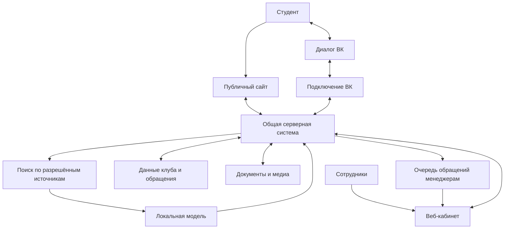

# Архитектурная концепция спортивного портала «Альянс»

Дата: 31 октября 2026 года. Статус: предложение для обсуждения в egm-brainstorm, до независимой проверки и технического проектирования.

## Основа концепции

Пользователь обозначил три части: бот ВКонтакте с локальной AI-моделью, веб-приложение для администрирования и пополнения базы знаний, публичный сайт с информацией и медиа. Ранее согласованное направление первого этапа — справочная поддержка и передача нерешённых вопросов менеджеру, отвечающему из кабинета в тот же диалог ВК.

Предлагается связать эти части общей серверной системой и общими управляемыми данными. У каждой части своя задача, а сведения о секции и её расписании поддерживаются в одном месте. Это логические границы; количество серверов, репозиториев и конкретный стек пока не выбираются.

## Состав

| Часть | Аудитория и назначение | Предлагаемые функции |
| --- | --- | --- |
| Публичный сайт | Студенты, спортсмены и посетители | Каталог секций и сборных, расписания, площадки, способы присоединиться, события, новости, достижения, фото, публичные документы, переход в поддержку ВК |
| Бот ВК | Студенты с конкретным вопросом | Справка по опубликованным данным, уточнение запроса, ссылки на страницы портала, передача человеку, получение ответов менеджера |
| Кабинет сотрудников | Менеджеры, редакторы, руководитель и администратор | Обращения, материалы базы знаний, сведения о направлениях, публикации, доступы и показатели работы поддержки |
| Общая серверная система | Обслуживает три интерфейса | Проверка прав, хранение и выдача данных, публикация материалов, история диалогов, назначение обращений, интеграции |
| Поиск и локальная модель | Подготовка справочных ответов | Получение разрешённых источников, поиск фрагментов, формулирование ответа; модель не определяет права доступа |
| Хранение и обработка материалов | Внутренняя часть | Основные записи, файлы и медиа, версии документов, подготовка поиска, повторная обработка и журнал ошибок |

## Логическая схема

Схема показывает обязанности и связи. Наличие отдельного блока не означает необходимость отдельного микросервиса. Предлагаемый старт — одно серверное приложение с внутренними модулями и отдельно запускаемая модель. Окончательное решение зависит от ресурсов команды и размещения.

## Общие данные и база знаний

Предлагается различать четыре вида материалов:

1. **Справочники:** виды спорта, сборные, секции, площадки, ответственные и расписания. Точные сведения используются сайтом и ботом из общего источника.
2. **База знаний:** ответы на частые вопросы, инструкции, правила и документы. У материала есть аудитория, ответственный, версия и статус публикации.
3. **Публикации:** новости, события, достижения и медиа. Историческая новость не должна автоматически считаться действующей инструкцией или расписанием.
4. **Внутренние данные:** переписка, обращения, служебные заметки, учётные записи и права. Они не доступны публичному сайту или публичному поиску бота.

База знаний управляется в кабинете. Загруженный файл сначала обрабатывается и проверяется, затем публикуется для выбранной аудитории. Поисковый индекс — производная копия для поиска, а не место ручного редактирования исходной информации. При замене материала старую версию нужно исключать из выдачи; задержка обновления должна быть видна сотруднику.

## Три основных потока

**Обновление сведений.** Менеджер меняет расписание в кабинете либо в назначенной исходной таблице. После предусмотренной проверки опубликованная версия используется и сайтом, и ботом. Для каждого набора данных выбирается один основной источник; свободное редактирование нескольких копий потребует правил разрешения конфликтов.

**Ответ на вопрос.** Сообщение ВК поступает в серверную систему. Она проверяет состояние диалога, выбирает доступные источники и получает точные поля или фрагменты текста. Модель формулирует ответ. При недостатке информации, конфликте источников или просьбе пользователя создаётся обращение. Менеджер отвечает через кабинет; сообщение отправляется студенту в ВК. Во время работы человека самостоятельные ответы модели приостанавливаются.

**Публикация новости.** Редактор готовит материал, назначенный сотрудник публикует его на сайте. Возможность учитывать новость в ответах бота настраивается отдельно от публикации. Включение новостей в поиск полезно для вопросов о событиях, но требует различать дату события и актуальные правила.

## Кабинет и ответственность

Предлагаемые рабочие разделы: «Обращения», «Секции и сборные», «База знаний», «События и медиа», «Показатели», «Настройки».

Менеджер отвечает за свои направления и обращения; редактор — за публикации; руководитель видит общую картину; администратор управляет доступами и подключениями. Один сотрудник может совмещать роли. Состав полномочий и необходимость согласования публикаций ещё не определены.

Первые показатели: ожидающие обращения, время ожидания, частые темы, причины передачи человеку, материалы, которых не хватает, ошибки подготовки документов и отправки ответов. Эти сведения помогают улучшать поддержку; они не заменяют будущую спортивную отчётность.

## Локальная модель

В текущем запросе локальное размещение обозначено пользователем как часть концепции. Предполагается запуск модели на контролируемом проектом оборудовании; конкретное место, оборудование, модель и допустимое время ответа остаются открытыми. ВК при этом остаётся внешним сервисом, поэтому локальная модель не делает весь портал автономным или офлайн.

При недоступности модели предлагается сохранять работу сайта, справочников и человеческой поддержки. Для этого доступ к данным и передача сообщений не должны требовать успешной генерации AI.

## Этапы реализации — предложение

1. **Рабочая поддержка:** подключение ВК, локальная модель, небольшой набор проверенных материалов, кабинет с очередью обращений и ответами, справочник ответственных. Проверить полный путь вопроса и передачи человеку.
2. **Публичный портал:** страницы направлений и площадок, памятки, события и медиа на той же основе данных. Небольшой публичный раздел можно делать вместе с первым этапом, если для него уже есть проверенные материалы и ресурсы команды.
3. **Организационные процессы:** заявки, перенос Яндекс Форм в Google Таблицы, массовые рассылки, составы, посещаемость, достижения и рейтинг. Исходные требования сохраняются в развитии проекта; последовательность и объём уточняются отдельно.

Разработка всей функциональности сразу затруднит проверку главной гипотезы — экономит ли справочная поддержка время менеджеров.

## Альтернативы и слабые места

Собственная общая система обеспечивает управляемое взаимодействие сайта и бота, но требует сопровождения. Готовая CMS для сайта и отдельная система поддержки могут сократить разработку; тогда особенно важно согласовать источники данных и обновления. Ни один вариант окончательно не утверждён.

Наибольшие риски: несколько расходящихся копий расписания; документы без ответственного за актуальность; незамеченные обращения; попадание внутренних сведений в публичную выдачу; недостаточные ресурсы для модели; отсутствие сопровождения после выпуска студенческой команды.

## Решения, которые ещё нужны

Первоочередное — определить основной источник справочных данных: где менеджеры будут регулярно поддерживать расписания, контакты и условия участия. Затем согласовать роли и публикацию, получателя общих обращений, режим работы поддержки, ресурсы локальной модели и границу первого запуска. Технические возможности интеграции ВК пока не подтверждены практической проверкой.

